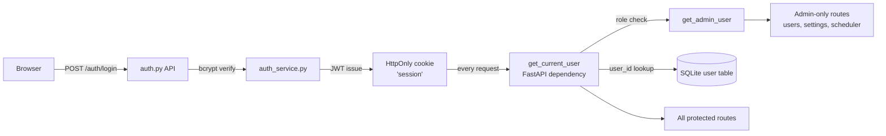

# Domain: AUTH

> LibreFolio's authentication and access control layer — ensures every request is made by a known, permitted user.

## What it does

Users log in with username/email and password. The server issues a JWT stored in an HttpOnly cookie (`session`). Every protected API endpoint validates this cookie via a FastAPI dependency (`get_current_user`) — there is no session store, no Redis, no sticky sessions. This stateless design means any number of worker processes can handle any request without coordination.

Who may create an account is the global setting `registration_mode`: `open` (anyone), `invite` (an invitation link)
or `disabled` (nobody, invitations included). `LIBREFOLIO_REGISTRATION` pins it, and then the setting is read-only.
The first account of an empty instance is an administrator, whatever the mode. `LIBREFOLIO_MAX_USERS` caps the
accounts; unset means no cap. Administrators manage accounts through the admin API (`/users`: list, activate,
deactivate, promote, demote, sign out everywhere, restart the guides, password-reset links, invitations) and the CLI;
the Users tab of the interface comes in lot A6. Inactive users are blocked at the dependency level with HTTP 401
before any business logic runs. Role-based access (`admin` vs `user`) gates administrative features such as global
settings, scheduler configuration, and user management.

The role system also extends into the broker-sharing model (Owner / Editor / Viewer per broker), but that relationship is managed by the BROKERS domain rather than AUTH. AUTH's responsibility ends at: who are you, are you active, and what is your system role.

## Feature cluster

| Code | Feature | Layer | Role in domain | Status |
|------|---------|-------|----------------|--------|
| [[F-001]] | User Authentication & Sessions | fullstack | core — login/logout/session lifecycle | implemented |
| [[F-002]] | User Management (admin CRUD) | fullstack | support — admin creates/deactivates users | implemented |
| [[F-003]] | Multi-User Role System (admin/user) | fullstack | core — role gates admin endpoints | implemented |

## Architecture at a glance

## Key decisions that shaped this domain

- [[decisions/prod-test-data-separation]] — Auth works identically in prod and test environments; the test server runs on a separate port with its own isolated SQLite DB, so auth tests never touch prod user records.
- F-065 JWT Cookie Auth (see [[features/F-065]]) — using HttpOnly cookies (not Authorization header) avoids XSS token theft; stateless JWT avoids session store complexity in multi-worker Docker deployments.
- Single-use account tokens (release 1.3, workstream A, lot A4, 15/10/2026) — invitations, password-reset links,
  email verification and the admin setup link share one table, `account_tokens`, and one service. Only the SHA-256
  of a token is stored, each token has one purpose, and it is spent by one conditional UPDATE, so two requests
  cannot both spend it. The service never commits: spending an invitation and creating its account fail together.
  Migration `005_accounts_invites` adds the table with plain `ALTER TABLE`/`CREATE TABLE`, never a batch on
  `users`: with `PRAGMA foreign_keys=ON` a batch rebuild cascades deletes into every child table.
- Session revocation by version (release 1.3, lot A4b, decision D-A17 of the developer, 14/10/2026) — the JWT
  carries `sv`, the account's `users.session_version`; `get_current_user` refuses a cookie of another version.
  A password change raises it and re-issues the cookie of the device that made the change; a reset, a
  deactivation and a demotion raise it too. A cookie without `sv` is version 0, so the upgrade signed nobody out.
  Still no session store: the check reads the user row that every request already loads.
- Registration modes, invitations and reset links (release 1.3, lot A5, 15/10/2026):
  - migration `006_registration_mode` turns `enable_registration` into `registration_mode`;
  - `registration_service` holds the rule and the limit;
  - an invitation's address is a suggestion, not a constraint (D-A16, rejected by the developer);
  - an anonymous refusal for the limit tells no count and no billing link;
  - the link pages are `/invite` and `/reset-password`. The token travels in the URL fragment, so no access or
    proxy log ever holds it: [[decisions/link-tokens-in-the-url-fragment]].
- Email on top of the tokens (release 1.3, workstream E, 15–16/10) — emailed invitation and reset links, «forgot
  password», verification at sign-up and the notice to the old address all spend these tokens; every emailed link
  comes from `LIBREFOLIO_PUBLIC_URL` alone: [[domains/email]].

## Known problems / limitations

- K-5, until lot A7: on a new instance whose registration is `invite` or `disabled` the login page offers no
  «Register here», although the backend accepts the first account; the first administrator comes from
  `dev.py user create` until A7 adds the setup link.

## What comes next

Release 1.3, workstream A:
- A6: the Users tab, with deleting an account.
- A7: the first administrator from environment variables, with a setup link.
- A8: the login attempt limit, and the Security tab.
- A9: the managed profile and the legal notices.

## Source files

| Role | Path |
|------|------|
| Primary mkdocs | `mkdocs_src/docs/developer/architecture/access_control.md` |
| Auth API endpoints | `backend/app/api/v1/auth.py` |
| Auth service | `backend/app/services/accounts/auth_service.py` |
| User service | `backend/app/services/accounts/user_service.py` |
| Auth store (frontend) | `frontend/src/lib/stores/app/auth.ts` |
| DB model (User, UserRole, AccountToken) | `backend/app/db/models.py` |
| Account token service | `backend/app/services/accounts/token_service.py` |
| Migration of the accounts schema | `backend/alembic/versions/005_accounts_invites.py` |
| Migration of the registration mode | `backend/alembic/versions/006_registration_mode.py` |
| Registration rule, invitations, limit | `backend/app/services/accounts/registration_service.py` |
| Account variables | `backend/app/config/accounts.py` |
| Admin user API | `backend/app/api/v1/users.py` |
| Link pages (frontend) | `frontend/src/routes/invite/+page.svelte`, `frontend/src/routes/reset-password/+page.svelte` |
| Account tokens mkdocs | `mkdocs_src/docs/developer/architecture/security.md` |
