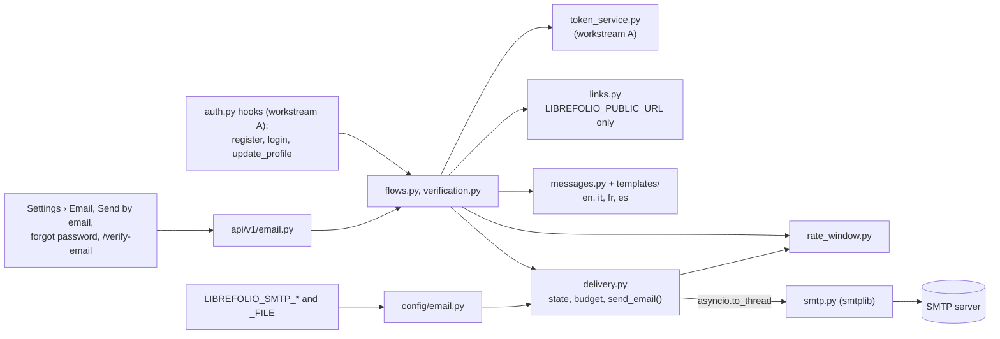

# Domain: EMAIL

> Optional transactional email over SMTP — release 1.3 «Cloud-ready core», workstream E, founder's spec F04.
> Configured only from the environment, off by default, built on workstream A's single-use account tokens.

## What it does

Email is **optional**. It is configured only from the `LIBREFOLIO_SMTP_*` environment variables (`HOST`, `TLS`,
`PORT`, `USER`, `PASSWORD`, `FROM`, `REPLY_TO`, `MAX_PER_HOUR`), the password also from
`LIBREFOLIO_SMTP_PASSWORD_FILE`. The configuration is never stored in the database, never shown in the interface and
never part of a backup. Without `LIBREFOLIO_SMTP_HOST` nothing changes: a self-hosted instance behaves as before 1.3,
and invitation and reset links are copied by hand.

What it sends — six kinds of email, with texts in English, Italian, French and Spanish:

- **A test email**: an administrator sends it to their own address from **Settings › Email**. The tab also shows the
  state (off, ready, or not working with the variable at fault), the configuration checks, the hourly budget left, and
  a check, run from the admin's browser, that `LIBREFOLIO_PUBLIC_URL` reaches this very instance.
- **Links an administrator creates**: **Send by email** in the invitation and password-reset dialogs of the Users tab.
  An invitation goes to an address the admin chooses; a reset link only to the account's own address.
- **A forgotten password**: anonymous, from the login page. The answer is always the same 202; the account lookup and
  the email come after it.
- **Email verification at sign-up**: the `require_email_verification` setting, a placeholder nobody read until 1.3, is
  real now. A new account — every one but the instance's first — waits, inactive, until its owner opens a 24-hour link
  on `/verify-email`; meanwhile the login, given the right password, answers 403 `EMAIL_NOT_VERIFIED` and offers
  **Send the link again**.
- **A notice to the old address** when an account's email changes: no link, the new address masked as `***@domain`.
- **The activation link of the initial administrator**: `build_admin_setup()` exists but has no caller yet — pending
  workstream A's lot A7a.

Every link an email carries is built from `LIBREFOLIO_PUBLIC_URL` alone, never from the request's Host, Origin or
forwarded headers (the test email, which carries no link, names the instance after the request's host). Without that
variable no email with a link goes out. The public `GET /system/instance` says only `email: {available, links}`, so
the login page and the Users dialogs offer the email actions only when they can work. A blocked instance sends nothing.

Sending is bounded by an instance budget, `LIBREFOLIO_SMTP_MAX_PER_HOUR` (50 an hour by default, in the memory of each
process), and the anonymous paths add limits per client address, per typed identifier, per mailbox and per account.
Every in-memory limit counts with one primitive, the sliding-window limiter of `utils/runtime/rate_window.py`.

The tokens are workstream A's ([[domains/auth]]): stored only as SHA-256, one purpose each, spent by one conditional
UPDATE; a reset link lives 30 minutes, an invitation 7 days, a verification link 24 hours (an admin setup link 72
hours). They travel in the URL fragment, `/verify-email#token=…` included: [[decisions/link-tokens-in-the-url-fragment]].

No feature code (`F-NNN`) is assigned to this domain yet.

## Architecture at a glance

## Key decisions that shaped this domain

The full table is §4 of the plan: D-E1…D-E14, twelve approved by the coordinator on 15/10, while D-E3 and D-E7 went to
the developer as points 45 and 44 of `decisioni-analisi-20261014.md`. The detail lives in the developer page; here,
the why.

- **The release rule** (objective of release 1.3): no cloud-only code. Every new variable defaults to today's
  behaviour, every secret also accepts `*_FILE` — so no SMTP host means no change, and the password goes through H's
  `env_secret()`. It overruled the old `TODO_FUTURI` idea of an SMTP configured from the admin settings with
  `aiosmtplib` (plan §2).
- **D-E1 — the standard library's `smtplib` in `asyncio.to_thread`, no new dependency.** The send blocks, so it runs
  in a worker thread, per the event-loop rule ([[problems/event-loop-blocking]]). TLS uses a verifying default context,
  and `starttls` never falls back to plain text. **D-E2**: the test SMTP server is written in the tests (standard
  library, loopback, ephemeral port), not `aiosmtpd`, which PyPI declared up to Python 3.12. The real-TLS tests waited
  for `cryptography`, which came on 15/10 (backlog E-1, closed).
- **D-E4 — an unusable configuration turns email off; the server still starts.** One log line per process (per
  variable, problem and reason), an `error` in the startup audit and in the Email tab. Unlike the platform's own
  secrets, an unreadable `LIBREFOLIO_SMTP_PASSWORD_FILE` never stops a start. The three checks (`email.smtp`,
  `email.smtp_encryption`, `email.links`) close H's `CONFIG_CHECKS`.
- **D-E5 and D-E12 — limits in memory, per process, with one primitive.** `rate_window.py` is written by E and planned
  for reuse by A's login limiter (A8). D-E6 adds `_MAX_PER_HOUR`, `_REPLY_TO` (for the cloud) and a three-value `_TLS`.
- **D-E8 — the texts are the backend's own catalogue** (`templates/<lang>.json` and `layout.html`), not the frontend
  i18n. A pytest guard pins the same keys and the same `$placeholders` in the four languages. The rendering keeps user
  values out of subjects, HTML-escaped, and on one line (since the review of E3s).
- **D-E10 — the email endpoint receives a freshly created token**, so A's routes stay unchanged: `POST /email/links`
  inspects the token for its purpose (`valid` only) and rebuilds the link itself, never trusting the link the dialog
  shows. **D-E11**: the admin's activation goes by email only when the instance generated the token (in the cloud the
  control panel sends it). **D-E13**: a blocked instance sends nothing — the route guard of H's CP6, plus
  `sending_blocked()` inside `send_email()` for any other caller. **D-E14**: E2E use `page.route` for simulated states;
  the real chain is proven by in-process backend tests.
- **Decision 45 (D-E3), the developer's alternative, 15/10: links only from `LIBREFOLIO_PUBLIC_URL`**, the
  administrator's sends included. A base taken from the request would let a stranger have a real token mailed inside a
  link to their own site. The server cannot know how its users reach it, so the reachability check runs in the admin's
  browser (A's address probe), and its warning says it holds for this device only.
- **Decision 44 (D-E7), approved 15/10, with the coordinator's rules.** «Waiting» means inactive with an unspent
  verification token, so no migration (`users.email_verified_at` was already in A's 005). Every account but the first
  verifies, invited ones included. The option turns on only when an email with a link can go, and a registration is
  refused with 409 `EMAIL_VERIFICATION_UNAVAILABLE` rather than creating an account nobody can activate. A waiting
  account holds a place under `LIBREFOLIO_MAX_USERS` while its link is live (`holds_place`). «Send the link again» asks
  for the username and the password. Every status change an administrator makes revokes the verification links;
  turning the option off leaves the waiting accounts waiting.
- **The security hold on «forgot password» (E3s, then E4b).** The review of 15/10 found that `PUT /auth/profile`
  changed the email with the session cookie alone: with «forgot password», a moment inside someone's session became a
  lasting takeover. The flow answered 409 `FORGOT_PASSWORD_DISABLED` until A's lot A6e asked for the current password
  to change the email; E4b then removed the hold entirely (a night decision, to be reviewed) and added the notice to
  the old address. The same review brought one-line values in emails, a per-mailbox limit, never cancelling a live
  admin reset link, 409 `EMAIL_ACCOUNT_INACTIVE`, IPv6 clients keyed by /64, and `FORWARDED_ALLOW_IPS` with exact
  proxy addresses, never `*`. The username's character set went to A (backlog A-21).
- **Limits that leave A's contracts alone (E5b.7, E4b.2, 16/10).** Past 10 registration emails an hour from one client
  address, the account is still created and waits without its email: no 429 on registration. Past 3 change notices an
  hour per account or per old mailbox, the email change still goes through; only the notice is skipped. The accepted
  compromise: whoever sends three notices to a mailbox silences the fourth, but taking an account still needs its
  password.
- **P1 (the developer, 16/10).** With email working, `ForgotPasswordCard` shows the email form, and the server
  commands stay in a panel closed by default — a native `
`, the house model — with the same test ids.
- **The E4c rule (accepted with A, 16/10).** Comparisons of two account addresses will use A's
  `user_service.same_email()` (A–Z folding, like SQLite's `lower()`), so the rule lives in one place; the four limiter
  keys stay `strip().casefold()`, where the broader grouping is the prudent side.

## Known problems / limitations

- **Per process.** Every in-memory limit — the hourly budget, the per-address, per-identifier and per-mailbox limiters,
  and the change notice's per-account limit — lives in each process: N uvicorn workers allow N times the limits, and a
  restart forgets them. Only the per-account limits of «forgot password» and of the verification emails, counted on
  their token rows in the database, hold across processes. The Email tab shows the budget of the process that answers.
- **Behind a proxy.** The per-address limits key on `request.client.host`, which uvicorn takes from `X-Forwarded-For`
  only for the proxies listed in `FORWARDED_ALLOW_IPS`. Behind a proxy it does not trust — Fly's, without that setting
  — every client shares the proxy's address, so each per-address limit becomes instance-wide; for registration emails,
  that means emails silently held after 10 sign-ups an hour. `client_address()`, which the connection indicator uses
  ([[features/F-102]]), is advice only, never a limit key. The cloud pages («Hosting for Others», the `managed`
  profile) wait for the developer; A's login limiter has the same concern (P17).
- **No queue, no retry.** The emails sent after an answer (forgotten password, verification at sign-up, change notice)
  are FastAPI background tasks of the answering process. A verification email that does not go leaves the account
  waiting, and «Send the link again» recovers it; a forgotten-password email that does not go revokes its new link, and
  the person asks again; a failed change notice is only logged.
- **Silent hold and early spend.** A registration email held by the per-client limit is silent: the page still says an
  email was sent. The verification link is spent when its page loads, so a mail scanner that runs JavaScript could
  spend it. Both are on the developer's list (a response field or a sentence; a «Confirm» button).
- **Backlog E-7 and E-8.** A waiting account looks like any inactive one in the Users tab: the `holds_place` field
  exists, the badge is out of 1.3. «Send by email» always invites in the instance's default language:
  `POST /email/links` accepts `language`, the dialog has no selector.
- **Address comparison, until E4c.** E compares addresses `strip().casefold()`, while A's P18 folds A–Z only: for
  `Émile@` and `émile@` the change notice would not go, and a verification link sent to the old form would stay
  valid. Separately, A's `get_user_by_username_or_email()` takes the first match without an order and usernames may
  hold `@`, so login and «forgot password» can land on the wrong account — never a takeover, since the link goes to
  the found account's own address (routed to A: A-21, with P18).
- **Out of 1.3**: notifications (F19). `admin/email.en.md` is English only, by choice; the translation debt of the
  touched pages is declared, without stamps.

## Problems solved along the way

Mostly from the plan's «⚠️ Fuori pista» notes (plan 08), each with its section.

- **`smtplib` hides its timeouts** («E1.2»): a read that timed out arrives as `SMTPServerDisconnected`, so `TIMEOUT` is
  found by walking the exception chain to a `TimeoutError`; in `tls` mode the exception's class (`ssl.SSLError`), not
  the step, decides `TLS_FAILED`.
- **The server's words leaked the recipient** («E1.5»): SMTP servers quote the address they refuse
  (`550 5.1.1 <alice@…>`), so the raw `detail` could put a whole address in the log. `_redacted()` now masks the
  password and the address (`***@domain`), and the fake server quotes addresses as Postfix does, so a test sees it.
- **Import cycle with `config_audit`** («E2b.1»): `checks.py` imports `ConfigCheck` inside each check, so either
  module can be imported first; all three orders are tested in fresh interpreters.
- **Backticks broke the generated client** («E2b.4», then «E-5.0»…«E-5.3»): after `api sync`, the whole frontend
  failed to load (`TypeError: "The email part of " is not a function`). openapi-zod-client writes a multi-line
  description as a raw template literal, and a docstring with a double-backtick span became a tagged template. The fix
  was a one-line docstring. The diagnosis mapped the four forms a text takes in the client and their forbidden
  characters (49 latent components then, 52 after B2), and became the guard `schemas openapi-client-text`, pinned to
  openapi-zod-client 1.18.3 and its flags, plus rule 4 of «Contract Rules» in `developer/api/overview.md`; the
  generator's post-processor was left alone ([[problems/openapi-zod-discriminator-type-erasure]] is its other trap).
- **Test lanes read the developer's `.env`** (§1–2, C-96; «E1.1»): the analysis found that the test lanes took the
  instance configuration from `.env`, so a real `LIBREFOLIO_SMTP_*` could reach the tests. H fixed it at the source:
  the lane setup drops every `LIBREFOLIO_*` name but the few a lane keeps on purpose. Until then each E test module
  removed the SMTP variables itself, and `test_config_audit.py` still does.
- **`MissingGreenlet` after a rollback** («E3.3»): `session.rollback()` expires every loaded object, and reading
  `record.id` afterwards asks the async session for a refresh it refuses. The error handler itself crashed, and the
  reset link stayed live. The same trap came back with `user.id` in a race branch («E3.5», caught in self-review) and
  in a test that read an id after the rollback («E5.2»). Rule: read ids right after the commit or the lookup, never
  after a rollback.
- **A malformed `LIBREFOLIO_PUBLIC_URL` counted as ready** («E3.3»): A's `public_url()` checks only the prefix, so
  with `https://` alone `POST /email/links` answered 500 and «forgot password» created a reset row, then failed in
  silence. `_usable_base()` now validates scheme, host, port, no credentials, no `?` or `#`, no whitespace; and
  «forgot password» checks everything again before it creates its row, which it revokes when the email does not go.
- **IPv4 clients and the per-network key** («E3.5», self-review before any run): `address_key()` read `ipv4_mapped`
  on an `IPv4Address`, which has none — every IPv4 client would have got a 500 once the hold was lifted. Now IPv4 as
  is, an IPv4-mapped IPv6 as its IPv4 (one count for both forms), any other IPv6 by its /64, computed from the integer.
- **Verification tokens after a failed delivery** («E5.1»): a failed email kept its token's address, so «send again»
  right after a 502 answered 429. And an email can arrive despite a timeout after `DATA`: its token, left without an
  address, was revoked at confirmation, which could leave the account inactive and no longer waiting — locked out. A
  failed email now strips the address (the token is a hold again), and a token without an address is refused without
  being revoked.
- **The user limit blocked a reactivation** («E5.3»): with waiting accounts counted under `LIBREFOLIO_MAX_USERS`, an
  administrator could not reactivate one on a full instance, although its place was already counted. Hence
  `holds_place()`, `place_holders()` and the `holds_place` field, which keeps **Reactivate** usable.
- **A default changed under prepared tests** («E5b.2»): tests written at night assumed open registration, but since
  A's `683b4ff5b` a new instance starts in `invite` mode; ten reds said `INVITE_REQUIRED`. The cure was in the tests,
  a helper that sets `open` in their private database.
- **jsdom is not a browser** («E5b.2», «E3.8»): `fireEvent.click` reaches a disabled button and Svelte 5's delegated
  handler fires, which no browser allows — assert `toBeDisabled()` without clicking. A jsdom page is always `http:`,
  so the https-to-http «insecure» probe case is pinned in the pure TypeScript test, not in the component's.
- **The axios rejection** («E2.6», found by the tab's tests): the generated client rejects with `AxiosError`, not with
  the `ApiError` that nobody constructs, so every 409, 429, 502 and 422 of the Email tab would have read as a generic
  error. It now reads `isAxiosError()`, as the other callers do (backlog E-3).
- **A `<` in a catalogue** («Correzione fuori lotto», during E3: a red of E2 that T found in `dev_release2`): the
  example `LibreFolio <noreply@example.com>` broke the i18n markup gate, which forbids `<` in translations; reworded
  in the four languages. Lesson: a lot that touches `lib/i18n/email/` also runs `front-utility core-unit`.
- **A warning on every self-hosted email change** («E4.1»): with email off — the default — every change would have
  logged a WARNING; now an `info` line, and the warning only for email set but unusable.
- **The E2E slot overran** («E4b.6»): the runner rebuilds the frontend when a file of `frontend/src` is newer than the
  build, and P1 had just touched it — about eight minutes of `svelte-check` and vite builds under load, inside the
  slot. Lesson: after touching `frontend/src`, build as a light check outside the slot, and leave only the spec to it
  (the same rule, seen from the other side: [[problems/mutation-restore-keeps-old-mtime-skips-frontend-rebuild]]).

## What comes next

- **Integration** (16/10): E4b enters `dev_release2` after H, Z5 and A7a with P18; E resolves the merge of
  `auth.py::update_profile`, keeping every line of A plus E's four additions.
- **After A7a**: `build_admin_setup()` gets its caller, so `developer/backend/email.md` and `admin/email.en.md` gain
  the `admin_setup` kind; the docs sentence saying that A's `Profile updated` events write the address goes (A's
  `bde624b38` removed it from those logs); backlog E-4 (the deprecated 422 name in `api/v1/settings.py`) with A's OK.
- **E4c** (pending, after A7a/P18): `email_changed_work()` and `confirm_email()` compare with `same_email()`; ECN-004,
  EMF-046 and the EMV confirmations change; the docs drop «stripped and case-folded».
- **E6, the closure** (started 16/10): the seven C-99 rows in `admin/configuration.en.md` are written (build pending),
  «📧 Server email» has moved from `TODO_FUTURI.md` to `TODO_Completati.md`, and the FAQ's forgotten-password answer
  now points to **Forgot Password?**. Left: a coherence pass on `admin/email.en.md`, the slots (`all-backend`, the
  domain's E2E, the `settings/email` gallery shot), the final security review, the CHANGELOG text for the coordinator.
- **Developer decisions**: the «Confirm» button on `/verify-email`, the message after a held email, the proxy for the
  cloud; and the review of the night decisions (the hold removed entirely, E-8, the notice-limit compromise, P1 as a
  `
`).
- **Backlog «E · Email (fase 01)»**: E-1 and E-5 closed. E-2 (the widened optional type,
  [[problems/generated-client-widens-nullable-scalar]]), E-3 (`ApiError`) and E-6 (the settings tab registry) deferred
  to 1.4, as they touch shared files. E-4 in E6, with A's OK. E-7 out of 1.3. E-8 open, proposed for 1.4.

## Source files

| Role | Path |
|------|------|
| Primary mkdocs (developer) | `mkdocs_src/docs/developer/backend/email.md` |
| Administrator's guide | `mkdocs_src/docs/admin/email.en.md` |
| Contract rule 4 (texts the client generator does not escape) | `mkdocs_src/docs/developer/api/overview.md` |
| Configuration accessors, `EmailConfigError` | `backend/app/config/email.py` |
| SMTP transport | `backend/app/services/email/smtp.py` |
| Configuration state, hourly budget, `send_email()` | `backend/app/services/email/delivery.py` |
| Message builders | `backend/app/services/email/messages.py` |
| Email texts in four languages, HTML layout | `backend/app/services/email/templates/` |
| Configuration checks | `backend/app/services/email/checks.py` |
| Emailed links from `LIBREFOLIO_PUBLIC_URL` | `backend/app/services/email/links.py` |
| Flows: test, admin links, forgotten password, change notice | `backend/app/services/email/flows.py` |
| Email verification | `backend/app/services/email/verification.py` |
| API routes | `backend/app/api/v1/email.py` |
| Schemas, `EmailInstanceConfig` | `backend/app/schemas/email.py` |
| Sliding-window limiter | `backend/app/utils/runtime/rate_window.py` |
| Hooks in login, register and `update_profile` (A's file) | `backend/app/api/v1/auth.py` |
| Hook in `register_user()` (A's file) | `backend/app/services/accounts/registration_service.py` |
| Status changes revoke verification links (A's file) | `backend/app/services/accounts/user_service.py` |
| Single-use account tokens (workstream A) | `backend/app/services/accounts/token_service.py` |
| `CONFIG_CHECKS`, closed by the email checks (H's file) | `backend/app/services/platform/config_audit.py` |
| The `email` field of `/system/instance` (H's file) | `backend/app/api/v1/system/instance.py` |
| Email tab, Send by email, forgot form, verification components | `frontend/src/lib/features/email/` |
| Verification page | `frontend/src/routes/verify-email/+page.svelte` |
| i18n source `email` | `frontend/src/lib/i18n/email/` |
| Forgot-password card hosting the form (A's file) | `frontend/src/lib/features/auth/ForgotPasswordCard.svelte` |
| «Send by email» in the link-share registry (A's file) | `frontend/src/lib/features/settings/users/linkShareActions.ts` |
| Address probe reused by the Email tab (A's file) | `frontend/src/lib/features/settings/users/addressProbe.ts` |
| Fake SMTP server for the tests | `backend/test_scripts/fixtures/email/fake_smtp.py` |
| Service tests | `backend/test_scripts/test_services/test_email_config.py`, `backend/test_scripts/test_services/test_email_messages.py`, `backend/test_scripts/test_services/test_email_delivery.py`, `backend/test_scripts/test_services/test_email_checks.py`, `backend/test_scripts/test_services/test_email_links.py`, `backend/test_scripts/test_services/test_email_flows.py`, `backend/test_scripts/test_services/test_email_verification.py`, `backend/test_scripts/test_services/test_email_verification_hooks.py` |
| API tests | `backend/test_scripts/test_api/test_email_api.py`, `backend/test_scripts/test_api/test_email_verification_api.py`, `backend/test_scripts/test_api/test_email_verification_hooks_api.py`, `backend/test_scripts/test_api/test_email_change_notice_api.py` |
| Limiter tests | `backend/test_scripts/test_utilities/test_rate_window.py` |
| Guard on the generated client's texts (E-5) | `backend/test_scripts/test_schemas/test_openapi_client_text.py` |
| E2E | `frontend/e2e/settings/email-tab.spec.ts`, `frontend/e2e/settings/email-send-link.spec.ts`, `frontend/e2e/auth-email-verification.spec.ts`, `frontend/e2e/auth-forgot-password-email.spec.ts` |
| Test-lane environment, C-96 (H's file) | `scripts/cli_base.py` |
| Journal plan of workstream E | `LibreFolio_developer_journal/Release_2/Phase_1/08_email/plan-phase01Email.prompt.md` |
| Backlog, section «E · Email (fase 01)» | `LibreFolio_developer_journal/Release_2/Phase_0/BACKLOG_POST_1.2.md` |
| Developer decisions 44 and 45 | `LibreFolio_developer_journal/Release_2/Phase_1/decisioni-analisi-20261014.md` |
