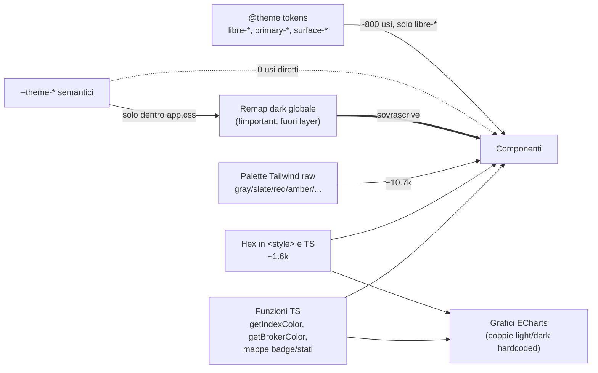

# Review colori UI — Sintesi e indice (v1.2)

> Snapshot: `dev_release2` @ `6d0b1266c`, 2026-10-14. Analisi **read-only**: nessun file del repository modificato.
> Report di dettaglio (in inglese, con citazioni `file:line`) nella stessa cartella; inventario quantitativo in `00_inventory_summary.md`.

| # | Report | Contenuto |
|---|---|---|
| 00 | **questo file** | sintesi, problemi trasversali, decisioni da prendere, proposta di lavoro |
| 01 | `01_theme_foundation.md` | token `@theme` e `--theme-*`, meccanismo dark mode, override globali in `app.css`, contrasti WCAG |
| 02 | `02_ui_components.md` | pattern UI (bottoni, card, input, alert, hover, focus, backdrop…), famiglie Tailwind, CSS parallelo in `<style>` |
| 03 | `03_semantic_dynamic_logic.md` | funzioni/mappe TS che decidono colori (gain/loss, stati, badge, broker, provider, signal), duplicazioni, test che bloccano i colori |
| 04 | `04_charts_dataviz.md` | palette categoriali ECharts, colori semantici nei grafici, funzioni generative, gestione dark nei grafici |
| 05 | `05_history_color_studies.md` | studi/decisioni storiche (solo come dato storico) e principi già concordati |
| inv | `00_inventory_summary.md` (i CSV si rigenerano con lo script) | conteggi esatti per classe/hex/variabile/file, hotspot, file "light-only" |
| — | `scripts/visual_review/color_inventory.py` | script riproducibile: `pipenv run python -m scripts.visual_review.color_inventory` dalla radice del repo |

---

## 1. Fotografia in numeri (codice di produzione, test esclusi)

| Cosa | Quantità |
|---|---:|
| Classi Tailwind di colore (palette + white/black) | **~10.700** |
| …di cui varianti `dark:` | ~4.800 |
| Classi brand `libre-*` | ~800 |
| Hex letterali | **~1.600** (166 valori distinti) |
| `rgb()/rgba()/hsl()/color-mix()` | ~210 |
| `var(--…)` in tutto il frontend | 84 |
| `var(--theme-*)` nei componenti | **0** |
| Famiglie Tailwind usate | 21 (gray 5.4k, slate 1.8k, amber 830, red 680, emerald 330, blue 270, green 220, sky, violet, indigo, orange, purple, yellow, pink, rose, teal, cyan, lime…) |
| Step di opacità diversi | 12 (`/5`…`/95`) |
| Verdi "dark mode" diversi per il brand | **8** |

## 2. Problemi trasversali (ordinati per impatto)

### P1 — Il dark mode reale non è quello scritto nel codice ⚠️
Le regole dark di `app.css` (righe ~178-295) sono **fuori da `@layer`** e molte hanno `!important`; le utility Tailwind v4 stanno in `@layer utilities`. Verificato sul CSS compilato (`frontend/build/_app/immutable/assets/0.*.css`). Conseguenze in dark mode:
- ~1.540 elementi `text-gray-N dark:text-…` → il `dark:` è ignorato, vince la variabile tema.
- ~220 `bg-white dark:bg-…`, ~160 `bg-gray-50/100 dark:bg-…`, ~270 hover → idem.
- `.rounded-xl/.rounded-2xl` → **il colore del bordo dipende dal raggio**: ~100 elementi con `dark:border-*` (es. alert rossi/ambra) perdono il bordo colorato.
- input/select/textarea → `dark:border-*` e **`focus:border-libre-green` ignorati** (bordo fisso `#546175`, contrasto 2.3:1).
- bottone primario dark: riposo `#166534`, hover `#00d681`@90% → salto di tinta.

**Implicazione per la designer:** valutare il dark mode **solo nel browser** (DevTools → Computed → origine regola), non leggendo le classi. Dettagli: report 01 §6.0.

### P2 — Il livello semantico esiste ma nessuno lo usa
16 variabili `--theme-*` ben nominate, 0 usi nei componenti; 4 nemmeno in `app.css`. Token `@theme` inutilizzati: `libre-banner`, `libre-sage`, `surface-*` (tutta la scala), 9/10 `primary-*`. In compenso `#1a4031` è copiato a mano ~80-110 volte. → report 01.

### P3 — Due scale neutre mescolate
gray (light) + slate (dark), ma slate anche in light (~1k `bg-slate-*`) e gray anche in dark; i grafici mescolano gray e slate *nello stesso tema*. Superficie card dark: slate-800 (122) vs slate-700 (75) vs altri. Classi inesistenti: `slate-750`, `libre-green-dark`. → report 01, 02, 04.

### P4 — Stesso significato, colori diversi
| Significato | Varianti trovate |
|---|---|
| Guadagno | emerald-600/400 (asset, FX, broker), green-600/400 (dashboard), `#16a34a`, `#10b981` (tooltip Δ), `#22c55e`; dark `#4ade80`, `#86efac` |
| Perdita | red-500/400, red-600, `#dc2626`, `#ef4444`; dark `#f87171`, `#fca5a5`; barre KPI con shade invertite |
| Successo | emerald (toast, sync, PAC) vs green (import report) vs `libre-green` (PAC targets) |
| Errore | red (ovunque) **ma ambra** in `DataQualityBanner` |
| Info | sky vs blue |
| Warning | amber + yellow + orange |
| Costi | arancio (Growth) vs rosso (Performance) |
| Interessi | `#7c3aed` vs `#6d28d9` |
| Provider FX MANUAL | ambra (`providerHelpers.ts`) vs rosso (`colors.ts`) |
| Brand verde dark | `#00d681`, `#00834f`, `#22c55e`, `#16a34a`, `#39af50`, `#4ade80`, `#166534`, `#156534`, `#86efac` |
→ report 03 §2, 04 §5.

### P5 — Stesso colore, significati diversi (soprattutto nei grafici)
`#dc2626` = perdita, costi, vendita, **e** slot 4 della palette allocazione (una fetta "sembra una perdita"); `#16a34a/#4ade80` = guadagno, realizzato, linea mercato, **e** slot 1 dark allocazione; `#7c3aed` = interessi, altri effetti, transfer, income…; `#d97706` = benchmark, lotto stimato, income, broker slot 2… → report 04 §5.

### P6 — Palette categoriali duplicate e incoerenti
3 palette allocazione (Pie 14, History 14 con ordine diverso, SemiDonut 8 **solo light** → `#1a4031` quasi invisibile su card dark); broker palette Growth (6) ≠ broker HSL generati (`getBrokerColor`); signal palette separata; choropleth copiata in due file. Colori del broker **dipendono dalla posizione** nella lista (eliminare un broker ricolora gli altri). → report 03, 04.

### P7 — Logica colore duplicata, nessun helper condiviso
Ternario gain/loss inline ≥20 volte in ~13 file; 7 mappe badge/stato indipendenti con shade diverse (100/700 vs 100/800; dark 900/30 vs 900/40); conversione hex→hue implementata due volte; 4 set diversi per assi/griglie/tooltip nei grafici. → report 03 §3, 04 §2.

### P8 — Sistema CSS parallelo nei `<style>` dei componenti
`DataTable*`, modali file/media, `ConfirmModal`, `ContextMenu`, `FileGrid`… usano hex in `<style>` + `:global(.dark)` (31 file) anziché classi/token → probabile fonte principale di superfici "diverse" a colpo d'occhio. → report 02 §4.

### P9 — Accessibilità
- `text-gray-400` (la classe testo più usata, ~1.2k) su bianco: **2.5:1** (AA richiede 4.5).
- Placeholder dark `#64748b` su `#1e293b`: 3.1:1. Bordo input dark 2.3:1 (< 3:1).
- Bianco su `#00d681` (hover bottone dark): 1.9:1.
- Gain/loss **solo rosso/verde** ovunque (candele, treemap, barre, KPI): nessun secondo canale per daltonici. Nessuno studio daltonismo nella storia del progetto.
- `#ca8a04` (già scartato a ottobre per 2.94:1) ancora in Gantt SPLIT e Pie.
→ report 01 §6.8, 04 §5, 05.

### P10 — Superfici "fuori app" non allineate
Splash (`app.html`), `offline.html` (palette propria, dark bg `#11151c` ≠ `#0f172a`), `manifest.json` (nessun dark), meta theme-color dark `#156534` (probabile refuso di `#166534`). Tile logo bianco fisso nelle pagine auth. Toast pieni identici nei due temi.

### P11 — Stesso nome, due colori: classi Tailwind v4 (OKLCH) vs hex scritti a mano (sRGB)
Tailwind è v4.1.18: la palette predefinita è in **OKLCH**, e molti colori saturi escono da sRGB (gamut P3). Gli hex copiati in grafici, `<style>` e TS sono i valori **v3 in sRGB**. Hanno stessa luminosità e stessa tinta, ma saturazione +12–15%: `text-red-500` = `oklch(63.7% .237 25)` mentre il grafico usa `#ef4444` = `oklch(63.7% .208 25)`. Conseguenze:
- interfaccia e grafici non coincidono anche quando "usano lo stesso colore";
- su un Mac recente l'app dal vivo è più satura degli screenshot della gallery, che sono in sRGB;
- i token futuri devono scegliere uno spazio colore.

Dettagli in report 01 §6.9.

## 3. Principi già concordati in passato (da rispettare o rimettere in discussione esplicitamente)
Stesso significato → stesso colore (D26); contrasto misurato (≥3:1 grafica) + ΔE vs vicini; enfasi per luminanza, non per tinta, su scale divergenti; colore per item, mai per indice serie; sottotipi = sfumature del padre; brand `#1a4031` primo nelle palette. → report 05.

## 4. Decisioni che servono dalla designer (raggruppate)

**A. Fondamenta**
1. Fonte unica: token semantici (`--theme-*` esposti come utility Tailwind, es. `bg-surface`, `text-muted`) vs palette raw.
2. Scala neutra unica (gray o slate) e scala di superfici dark (page/card/raised/hover).
3. Un solo verde brand per tema (solid/text/focus/opacity) + ruolo di beige, sage, `primary-*`, `surface-*`.
4. Destino del remap globale `!important` (rete di sicurezza vs token espliciti).
5. Target di contrasto (AA testo, 3:1 UI/grafica) e coppie testo secondario/terziario.

**B. Semantica**
6. Colori per success / warning / error / info / neutral / disabled (una famiglia + shade per ruolo, light e dark).
7. Gain / loss (testo, barre, linee) + secondo canale per daltonici (▲▼, pattern, o opzione blu/arancio).
8. Pattern badge unico; toast; alert; focus ring; backdrop; scala opacità ridotta.
9. Eventuale palette per tipi di transazione (oggi non esiste).

**C. Data-viz**
10. Palette categoriale unica (quanti colori, ordine, colori riservati esclusi: brand/gain/loss).
11. Colori-significato fissi per income/costi/dividendi/interessi/benchmark/portafoglio.
12. Neutri grafici (assi/griglie/tooltip) dagli stessi token UI.
13. Colori stabili per broker/lotti (curati vs generati).

## 5. Rischi tecnici da tenere presenti quando si correggerà
- **Test che fissano colori**: `colors.test.ts`, `sourcePalettes.ts/.test.ts` (leggono array `const NAME = ['#rrggbb', …]` dai `.svelte` — spostare palette in CSS/oklch li rompe), `allocationHierarchy/allocationRings/AllocationHistoryChart` tests, `assetTypeTables.test.ts:255`, `chartCoreHelpers.test.ts` (`cc('bookAssetLike')`), `SchedulerLogModal.test.ts`. Più eventuali screenshot gallery / E2E.
- I grafici leggono il tema con `classList.contains('dark')` + un `MutationObserver` per grafico (17): passare a token CSS richiede lettura runtime (`getComputedStyle`) o un modulo TS unico.
- `hexToRgba` e concatenazioni `+ '88'` accettano solo `#rrggbb`: introdurre `#rgb`, `hsl()` o `oklch()` li rompe silenziosamente.
- Rimuovere il remap `!important` cambierà l'aspetto dark di migliaia di elementi in un colpo: va fatto con confronto screenshot prima/dopo.

## 6. Proposta di prosecuzione (quando si passerà ai lavori)

Analisi ancora **non coperta** o coperta solo a campione, candidabile a sotto-agenti paralleli read-only:
- Audit visivo reale (screenshot light/dark delle pagine principali, es. riuso della gallery `./dev.py mkdocs` / Playwright) con contrasti misurati sui colori *renderizzati*.
- Inventario puntuale di Sidebar, tabs, tooltip, skeleton, onboarding highlight, AI export, changelog, update-check.
- Simulazione daltonismo delle palette grafici (deuteranopia/protanopia/tritanopia) + ΔE tra slot adiacenti.

Possibile split dei futuri workstream di correzione (file in gran parte disgiunti):
| Lettera | Workstream | File principali |
|---|---|---|
| T | Token & tema (fondamenta, remap dark, splash/offline/manifest) | `app.css`, `app.html`, `static/*`, `themeStore.ts` — **owner condiviso, va prima** |
| S | Colori semantici + helper condivisi (sign/status/badge/toast/alert) | `lib/utils/**`, `ui/feedback/**`, mappe badge |
| C | Data-viz (palette unica, neutri grafici, gain/loss, broker/lotti) | `lib/charts/**`, `components/charts/**`, `dashboard/**`, `risk/**`, `brokers/lots/**` |
| U | Componenti con CSS parallelo (`DataTable*`, media/file modali, `ConfirmModal`) | `components/table/**`, `ui/media/**`, `files/**` |
| P | Migrazione pagine/modali hotspot alle nuove utility | `routes/**`, modali transazioni/import |
Dipendenze: T → (S, C, U) → P.

## 7. Limiti di questa analisi
- Conteggi da grep/regex: classi costruite dinamicamente (`class={…}`, template string) sono contate solo se il letterale compare nel sorgente; co-occorrenze di P1 contano solo `class="…"` statici (i numeri reali sono più alti).
- Nessun rendering eseguito: contrasti calcolati sui valori dichiarati; P1 verificato sul CSS compilato dell'ultima build locale, non visivamente.
- Report 02/03/04 prodotti da sotto-agenti read-only, verificati a campione dal coordinatore (slate-750, libre-green-dark, layer CSS, SemiDonut light-only, treemap, `#ef4444` in lineChartHelpers, file light-only).
