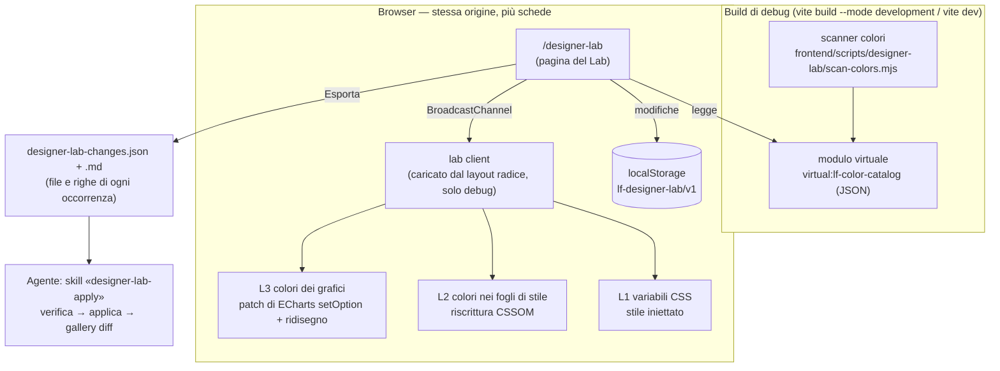
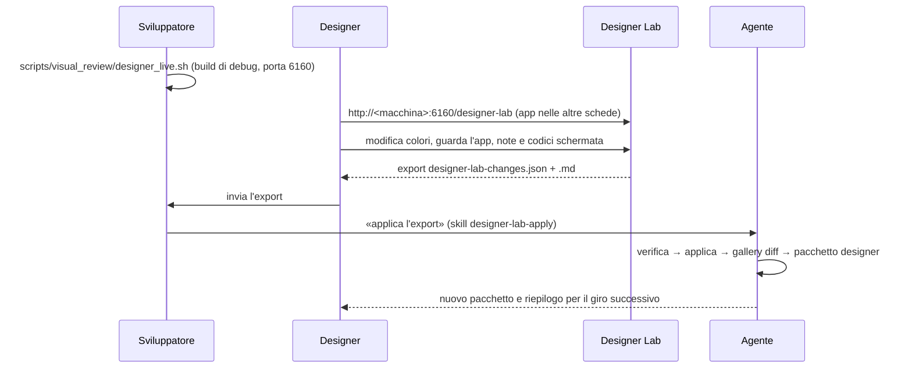

# Progetto — «Designer Lab»: pagina nascosta per regolare i colori dal vivo (solo build di debug)

> Progetto del coordinatore, 14/10/2026. Base: `dev_release2` @ `27228466c` (v1.2). Approvato per l'avvio dal developer
> lo stesso giorno: workstream **L** (piano di dettaglio del figlio in `L-designerLab/`).
> Completa e precisa le fasi A e C di [`plan-phase00ColorSystemThemeLab.prompt.md`](plan-phase00ColorSystemThemeLab.prompt.md).
> Il Lab funziona **già sul codice di oggi** (per valore di colore) e, dopo il passaggio ai token, anche per ruolo.

## 0. Richiesta (testuale)

> «farei una pagina "nascosta" designer che si compila e si espone solo se il server è compilato col flag debug, e che
> se c'è andando all'url giusto compare questa dashboard di controllo […] MA deve essere dinamica che si crea al build
> guardando tutte le variabili di colore nei vari file frontend, css, etc... e dopo aver fatto le varie modifiche sia
> possibile esportare la lista modifiche così che poi l'agente possa leggerle e lavorarci»

**In sintesi.** Una rotta, ad esempio `/designer-lab`, che esiste solo nelle build di debug:

- all'avvio della build un **catalogo dei colori** viene generato automaticamente dalla scansione dei sorgenti;
- la pagina mostra il catalogo, permette di modificare ogni colore e applica le modifiche **dal vivo a tutte le schede aperte**;
- alla fine **esporta** l'elenco delle modifiche, con file e riga di ogni occorrenza, in un formato pensato per un
  agente: JSON più una versione Markdown leggibile.

---

## 1. Fatti verificati nel codice (14/10)

| Fatto | Evidenza | Conseguenza per il progetto |
|---|---|---|
| La build di debug esiste già | `package.json`: `build:debug` = `VITE_DEBUG=true vite build --mode development`; `dev.py front build --debug`; `src/lib/debug.ts` (`DEBUG_ENABLED`) | Si usa lo stesso interruttore |
| **Il server di test usa sempre la build di debug** | `dev.py` riga ~199: con `--test` imposta `debug_mode = True`; il marker `frontend/build/.build-debug` vale `1` | Il Lab è già disponibile su `scripts/visual_review/designer_live.sh` (porta 6160). Ma è presente anche in **tutti** gli E2E e nella gallery, quindi deve essere neutro quando non ci sono modifiche |
| Il commit è noto al frontend | `vite.config.ts` → `define.__APP_VERSION__` (git describe); `src/lib/version.ts` | L'export dichiara su quale versione è stato fatto |
| Le classi Tailwind leggono variabili a runtime | CSS compilato: `.text-red-500{color:var(--color-red-500)}`, trasparenze con `color-mix(in oklab,var(--color-red-500)20%,transparent)` | Oltre 10.000 classi sono modificabili dal vivo cambiando le variabili `--color-*` |
| I grafici si ridisegnano a **qualunque** cambio di classe su `<html>` | `MutationObserver(... attributeFilter: ['class'])` senza filtro su `dark` (es. `LineChart.svelte:170`, `GrowthChart.svelte:1999`, `AllocationPieChart.svelte:118`; 17 grafici) | Il Lab forza il ridisegno di tutti i grafici aggiungendo e togliendo una classe, senza toccarli |
| ECharts è importato direttamente in 28 file | `import … from 'echarts'`, nessun modulo centrale | Niente avvolgimento centrale di `init`: si interviene sul prototipo delle istanze (§5.3) |
| Distribuzione dei 1.821 colori scritti a mano (produzione) | Inventario per zona: 1.084 in `<style>` dei `.svelte`, 69 in file `.css`, 533 negli script dei `.svelte` (477 nei grafici), 118 in `.ts` (94 nei grafici), 17 nel markup | ~95 % diventa modificabile dal vivo con le tecniche del §5 |

> **Errata (14/10, dalle analisi di implementazione di L e R).** Due righe della tabella sono sbagliate. Valgono i piani
> dei due workstream.
>
> - **Ridisegno dei grafici.** Gli osservatori del tema sono 16, non 17, e solo 12 ridisegnano il grafico a qualunque
>   cambio di classe su `<html>`. `ScatterChart`, `CorrelationHeatmap`, `ExposureBars` ed `ExposureMaps` aggiornano
>   solo uno `$state` `dark`, quindi aggiungere e togliere una classe non li ridisegna. `SemiDonutChart` non ha
>   osservatore. `OtherPeriodEffectsTable` osserva `data-row-id`, non il tema. Come il Lab ridisegna questi grafici lo
>   decide lo spike di L (N1); R conserva il ridisegno a qualunque cambio di classe anche quando riunisce gli osservatori
>   (W8).
> - **Ripartizione per zona.** I totali (hex 1.610 + funzioni 211 = 1.821) sono confermati, la ripartizione no:
>   `color_inventory.py` non classifica le zone. La misura per zona la dà lo scanner del Lab (passo 1 di L).

## 2. Architettura



**Principio.** Il catalogo al build dà la **completezza** e la **provenienza**: tutti i colori di tutti i file, anche
dei componenti che la pagina non ha ancora caricato, con file e riga. Il motore a runtime dà l'**anteprima immediata**,
agendo su ciò che il browser ha davvero caricato. L'export unisce i due: cosa cambia e dove.

## 3. Solo nelle build di debug

1. **Interruttore di build.** In `vite.config.ts`:
   `define.__LF_DESIGNER_LAB__ = JSON.stringify(process.env.VITE_DEBUG === 'true' || mode === 'development' || command === 'serve')`.
   È una costante letterale: nelle build di release `if (__LF_DESIGNER_LAB__)` diventa `if (false)` e Rollup elimina il
   ramo **e l'`import()` dinamico che contiene**, quindi i chunk del Lab non vengono generati.
   Dichiarazione in `src/app.d.ts`.
2. **La rotta** `src/routes/designer-lab/` (fuori dal gruppo `(app)`: niente login e niente shell dell'app):
   - `+page.ts`: `if (!__LF_DESIGNER_LAB__) error(404)`;
   - `+page.svelte`: `{#if __LF_DESIGNER_LAB__}{#await import('$lib/dev/designer-lab/DesignerLab.svelte')}…{/if}`.

   In release resta uno stub che risponde 404; il codice del Lab non c'è.
3. **Il client del Lab** nel layout radice: `if (__LF_DESIGNER_LAB__) import('$lib/dev/designer-lab/client')`.
   - Riapplica le modifiche salvate e ascolta il canale tra schede.
   - **Non fa nulla se non ci sono modifiche**: nessuna patch e nessun osservatore aggiuntivo. Così E2E e gallery
     restano identici.
4. **Il catalogo** viene servito dal plugin Vite solo quando l'interruttore è attivo. In release il modulo virtuale non
   viene mai importato.
5. **Controlli:**
   - dopo `./dev.py front build` in modalità release, nessun file di `frontend/build/` deve contenere il marcatore
     `lf-designer-lab`. Se lo contiene, la build fallisce;
   - un gate test sui sorgenti verifica che `$lib/dev/designer-lab` sia importato solo dentro i rami
     `__LF_DESIGNER_LAB__`;
   - `src/lib/dev/**` va escluso dalla strumentazione di copertura (istanbul).
6. **Neutralità:** gallery dello stesso giorno con e senza la funzionalità, diff con le maschere del rumore. Atteso:
   `identical`, a parte le schermate già instabili.

## 4. Il catalogo dei colori, generato al build

**Lo scanner** è un modulo Node ESM senza dipendenze, `frontend/scripts/designer-lab/scan-colors.mjs`, con tre usi:
- dal plugin Vite;
- da riga di comando (`node frontend/scripts/designer-lab/scan-colors.mjs --out catalog.json`), per gli agenti;
- dai test Vitest.

Riprende le regole di `scripts/visual_review/color_inventory.py`: stesse espressioni regolari, stesse esclusioni.
Su una o due fonti di verità vedi §11.

**Cosa raccoglie:**

| Sezione | Contenuto |
|---|---|
| `css_vars` | Ogni variabile CSS definita: `@theme`, `:root`, `html.dark`, blocchi `<style>`. Per ognuna: nome, valore, file:riga, contesto (chiaro/scuro), usi `var()` per file |
| `palette` | Ogni classe di colore Tailwind usata, ricondotta alla sua variabile (`text-emerald-600` → `--color-emerald-600`), con numero di usi e file. I valori reali (OKLCH) si leggono a runtime con `getComputedStyle` |
| `literals` | Ogni colore scritto a mano (hex, `rgb()`, `hsl()`, `oklch()`), con file, riga, colonna, valore normalizzato e zona (`svelte-style`, `css-file`, `svelte-script`, `ts`, `svelte-markup`) |
| `literals` (solo per i CSS) | Selettore e proprietà, indizio di tema (`dark` se il selettore contiene `.dark`) |
| `literals` (per gli script) | Indizio di tema (ramo `isDark ? … : …`) e indizio «grafico» (file di grafico o opzione ECharts) |
| `by_value` | Indice valore normalizzato → occorrenze |
| `meta` | Schema `lf-color-catalog/1`, `app_version`, data, hash del catalogo, numero di file |

**Il plugin Vite** (`designerLabCatalog()`):
- `resolveId` e `load` del modulo `virtual:lf-color-catalog`;
- con `vite dev`, invalida il modulo quando cambia un sorgente, così il catalogo resta aggiornato senza riavviare.

Il costo stimato è circa un secondo su ~1.050 file. Il JSON (~1 MB) è caricato solo dalla pagina del Lab.

## 5. Modifica dal vivo, per livello

Ogni modifica ha un **ambito**: `light`, `dark` o `both`. Il Lab mostra e modifica il tema corrente, oppure entrambi.

### 5.1 L1 — Variabili CSS (classi Tailwind, marchio, `--theme-*`, in futuro i ruoli `--lf-*`)
- Uno `<style id="lf-designer-lab">` iniettato in fondo al documento, con
  `html:not(.dark){--x: v !important}` e `html.dark{--x: v !important}`.
- Una variabile con `!important` vince sulle definizioni normali, anche quelle in `@layer theme`.
- Si aggiorna tutto quello che legge la variabile, comprese le trasparenze `color-mix`.
- **Granularità:** la variabile. Cambiare `--color-emerald-600` cambia **tutti** i suoi usi. Il Lab lo dichiara e mostra
  l'impatto: n classi, n file, elenco.

### 5.2 L2 — Colori scritti nei fogli di stile (blocchi `<style>` dei componenti, regole di `app.css`): 1.153 occorrenze
- **Riscrittura CSSOM:** il client scorre `document.styleSheets`, tutti della stessa origine e quindi leggibili, e nelle
  regole che contengono il valore lo sostituisce con `rule.style.setProperty(prop, nuovo, priorità originale)`.
  Conserva l'originale per poterlo ripristinare.
- **Ambito:** una regola con `.dark` nel selettore vale solo in scuro; le altre valgono in entrambi i temi. Il Lab
  avvisa quando una modifica «chiara» tocca anche lo scuro.
- **Stili caricati dopo:** SvelteKit carica il CSS per pagina o componente. Un `MutationObserver` su `<head>`
  applica le modifiche ai fogli che arrivano più tardi.
- **Granularità:**
  - per valore, ad esempio «tutti i `#1e293b` dei fogli di stile»;
  - per occorrenza (file:riga): selettore e proprietà del catalogo si confrontano con la regola caricata, ignorando la
    classe di scope `.svelte-xxxx`. Se il confronto non riesce, si ricade sul valore.

> **Decisione del developer (14/10, sera): nessuna ricaduta sul valore.** Sostituisce l'ultima frase qui sopra. Una
> modifica per occorrenza appare solo quando il suo punto è sullo schermo: «se si modifica qualcosa che non c'è è corretto
> non si veda». Ricadere sul valore cambierebbe punti che la designer non ha scelto (`#64748b` sta in 33 regole) e
> l'anteprima mostrerebbe più di quanto l'export registra. Per partire da un punto e vedere l'effetto sul resto c'è il
> selettore di elementi (§5.6).

### 5.3 L3 — Colori dei grafici (opzioni ECharts costruite in JS): 571 occorrenze
- **Patch del prototipo.** Quando arriva la prima modifica a un colore di grafico, il client crea un'istanza ECharts di
  servizio fuori dal documento e avvolge `setOption` sul prototipo comune: tutte le istanze, anche quelle future, lo
  ereditano. La patch percorre l'oggetto delle opzioni e sostituisce i colori sovrascritti:
  - stringhe;
  - `rgba()`, conservando l'alfa;
  - gradienti (`colorStops`);
  - le funzioni `color`/`formatter`, di cui mappa il valore di ritorno, compreso l'HTML dei tooltip.
- **Ridisegno.** Dopo ogni modifica il client aggiunge e toglie la classe `lf-lab-tick` su `<html>`. I 17
  `MutationObserver` esistenti ridisegnano i grafici senza modifiche al loro codice (verificato al §1).
- **Ambito:** la patch applica l'insieme di modifiche del tema corrente (`html.dark`).
- **Granularità:** il valore. Le opzioni non dicono da quale file vengono; la provenienza delle occorrenze la dà il catalogo.

### 5.4 L4 — Senza anteprima: ~100 occorrenze
Comprende:
- attributi `style=` nel markup;
- colori generati (HSL di `getIndexColor` per broker e etichette);
- `offline.html`, `manifest.json`, la meta `theme-color`.

Il Lab li elenca e accetta **proposte** di nuovo valore, che finiscono nell'export marcate `preview: false`.

### 5.5 Persistenza e sincronizzazione
- Le modifiche stanno in `localStorage['lf-designer-lab/v1']`, insieme alle varianti con nome per il confronto A/B.
- **Canale tra schede** `BroadcastChannel('lf-designer-lab')`: la designer tiene il Lab in una finestra e l'app nelle
  altre, e ogni scheda della stessa origine si aggiorna subito.
- **Pulsanti generali:**
  - «Sospendi», per vedere l'originale al volo;
  - «Ripristina tutto».

> **Come è stato costruito (L, 14/10):** la sincronizzazione usa l'evento `storage` di `localStorage`, non
> `BroadcastChannel`, così il client resta minimo quando il Lab non è in uso. È il **flusso di riferimento** confermato dal
> developer il 14/10: il Lab in una scheda o in una finestra a parte, anche su un altro schermo, e l'app nell'altra; ogni
> modifica arriva subito all'app. Condizione: stesso browser e stesso indirizzo nelle due schede.

### 5.6 Selettore di elementi (richiesta del developer, 14/10 sera)

Richiesta testuale: «servirebbe al contrario avere qualcosa che mi permette, puntando un elemento, di avere un filtro per
quelle proprietà, così lo modifico e posso farmi un giro nell'app per vedere che effetto ha sul resto. mi immagino che se
un colore va specializzato a quel punto l'app deve creare un css path o qualcosa di simile a indicare il componente così
che l'ia poi sappia a quale componente legare la nuova varabile. se servisse».

Cosa chiede:
- **Puntare un elemento** nella scheda dell'app, e il Lab mostra solo le sorgenti dei colori di quell'elemento: classi
  della palette, variabili dell'app, regole dei fogli di stile con file e riga, colori ereditati.
- **Modificarle e girare l'app** per vedere l'effetto sul resto: si modifica la sorgente condivisa, non il solo punto.
- **Specializzare in quel punto**, se serve: l'export registra un'ancora (componente, percorso dell'elemento) che dica
  all'agente a quale componente legare la nuova variabile.

Progetto, costo e test: analisi di L, che lo inserisce nel suo piano prima del passo 6, così test e documentazione lo
coprono.

## 6. La pagina

- **Testata:** versione (`__APP_VERSION__`), hash del catalogo, tema in modifica (chiaro, scuro, entrambi), sospendi,
  variante attiva, numero di modifiche, Esporta / Importa.
- **Panoramica:** quanti colori ci sono per livello e quanti sono modificabili dal vivo; coppie di contrasto che non
  superano AA.
- **Sezioni** (ognuna con ricerca e filtri per file, area, famiglia):
  1. **Palette Tailwind in uso**: griglia famiglia × sfumatura, con usi e file.
  2. **Variabili dell'app**: `--color-libre-*`, `--theme-*`, poi i ruoli `--lf-*`.
  3. **Colori nei fogli di stile**: raggruppati per valore, espandibili fino alle occorrenze.
  4. **Colori dei grafici**: per valore, con le occorrenze.
  5. **Senza anteprima**: solo proposte.
- **Editor del colore:**
  - campo di testo che accetta qualsiasi colore CSS;
  - slider OKLCH (L, C, H), con avviso quando il colore esce da sRGB;
  - scorciatoia `<input type=color>`, che gestisce solo sRGB;
  - «aggancia a» una variabile esistente, ad es. `= var(--color-emerald-600)`, per proporre unificazioni.
- **Contrasto WCAG dal vivo:**
  - coppie dichiarate: testi `--theme-*` su superfici, bordi dei campi;
  - coppie aggiunte dalla designer;
  - prima/dopo della modifica.
- **Daltonismo:** filtri SVG `feColorMatrix` applicati alla pagina (protanopia, deuteranopia, tritanopia,
  acromatopsia), propagati alle altre schede.
- **Note:** ogni modifica può avere una nota e i **codici delle schermate** della gallery (es. `dashboard/kpi-top`),
  gli stessi che la designer usa nel pacchetto. C'è anche una nota generale.
- **Componenti:** il Lab ha uno stile proprio e sobrio, che non cambia quando si modificano i colori dell'app:
  variabili `--lab-*` isolate in un sotto-albero dedicato.

## 7. Export per l'agente

Due file sempre allineati: **`designer-lab-changes.json`** per la macchina e **`designer-lab-changes.md`** per le persone.

```json
{
  "schema": "lf-designer-lab/1",
  "app_version": "v1.2.0-11-g27228466c",
  "catalog_hash": "sha256:…",
  "exported_at": "2026-10-20T15:02:11+02:00",
  "author": "",
  "notes": "testo libero della designer",
  "changes": [
    {
      "id": "var:--color-emerald-600@light", "layer": "css-var", "scope": "light", "preview": true,
      "target": "--color-emerald-600", "from": "oklch(59.6% .145 163.225)", "to": "oklch(62% .13 160)",
      "impact": {"classes": {"text-emerald-600": 46, "bg-emerald-600/10": 3}, "files": 31},
      "occurrences": [{"file": "src/lib/components/assets/AssetCard.svelte", "line": 230, "snippet": "text-emerald-600 dark:text-emerald-400"}],
      "note": "verde dei guadagni troppo acceso", "shots": ["assets/list", "fx/list"]
    },
    {
      "id": "lit:#1e293b@dark", "layer": "css-literal", "scope": "dark", "preview": true,
      "target": "#1e293b", "from": "#1e293b", "to": "#1b2433", "granularity": "value",
      "occurrences": [{"file": "src/lib/components/table/DataTable.svelte", "line": 812, "selector": ":global(.dark) .lf-table th", "property": "background-color"}]
    },
    {
      "id": "chart:#16a34a@light", "layer": "chart-color", "scope": "light", "preview": true,
      "target": "#16a34a", "from": "#16a34a", "to": "oklch(60% .15 150)",
      "occurrences": [{"file": "src/lib/components/charts/lineChartHelpers.ts", "line": 46}]
    }
  ],
  "contrast": [{"fg": "--theme-text-muted", "bg": "#ffffff", "scope": "light", "before": 4.83, "after": 5.1}],
  "variants": {"A": "…", "B": "…"}
}
```

- **Stessa versione del codice.**
  - Il CLI `node frontend/scripts/designer-lab/verify-export.mjs <file>` rigenera il catalogo sul codice corrente.
  - Controlla che ogni `from` sia ancora al suo file:riga.
  - Segnala le occorrenze spostate o sparite: quelle spostate le ritrova cercando il valore nel file.
- **Skill per l'agente** (`.github/skills/designer-lab-apply/SKILL.md`):
  1. verificare l'export;
  2. raggruppare per livello;
  3. applicare (`css-var` → definizione del token; `css-literal` / `chart-color` → occorrenze, oppure tokenizzazione
     se le occorrenze sono molte, d'accordo con il piano dei token);
  4. mai sostituire un hex «ovunque» alla cieca: un valore può avere significati diversi (P5);
  5. rete di sicurezza: gallery dello stesso giorno, diff con `--stability`, pacchetto per la designer;
  6. rapporto finale con le modifiche non applicabili.
- **Dove finisce il file:** nella v1 è un download dal browser, più «copia riassunto» negli appunti. Se la designer
  lavora da un'altra macchina in rete locale, lo invia; poi lo si mette in `~/LibreFolio_visual_review/lab-exports/` e
  lo si passa all'agente. Il salvataggio sul server è un'opzione (§11).

## 7bis. Ciclo di lavoro con la designer



## 8. Limiti noti

- **Per valore, non per significato.** Finché i colori non sono token, cambiare `#dc2626` cambia perdite, costi e la
  fetta 4 dell'allocazione (P5). Il Lab lo mostra con l'elenco delle occorrenze, e la designer può scendere alla
  singola occorrenza nei fogli di stile. Per i grafici la provenienza è solo nell'export. Con i token il problema sparisce.
- **Il tema scuro è falsato (P1).** Le regole `!important` di `app.css` sono colori dei fogli di stile: il Lab può
  modificarle (L2), ma la designer deve sapere che lì una variabile non basta. Il Lab marca queste regole come «override globale».
- **Nessuna anteprima per L4** (§5.4).
- **Prestazioni:** la patch di `setOption` percorre opzioni anche grandi. È accettabile in debug ed è attiva solo se ci
  sono modifiche ai grafici.
- **Gamut:** in sRGB `<input type=color>` non rappresenta l'OKLCH; gli slider sì. Gli screenshot della gallery restano in sRGB.

## 9. Test e verifiche

- **Vitest**:
  - scanner su sorgenti di prova: zone, selettori, normalizzazione dei valori, indici;
  - normalizzazione e confronto dei colori, conversioni OKLCH↔sRGB, contrasto;
  - mappa delle opzioni ECharts: stringhe, `rgba`, gradienti, funzioni;
  - serializzazione e validazione dell'export.
- **E2E smoke** (build di debug, `frontend/e2e/designer-lab/`):
  - apertura del Lab;
  - modifica di una variabile e di un colore nei fogli di stile → colore calcolato su un elemento noto in un'altra scheda;
  - modifica di un colore di grafico → opzione applicata (lettura con `getInstanceByDom` nel test);
  - export → import con lo stesso contenuto.
- **Release:** controllo del marcatore (§3.5) e 404 su `/designer-lab`.
- **Neutralità:** gallery dello stesso giorno prima e dopo la funzionalità (§3.6).
- I test li scrive `test-author`; la pagina developer (Lab, catalogo, formato dell'export) `docs-writer`.
  È una funzionalità di sviluppo: nessuna voce nel changelog utente.

## 10. Passi di lavoro (workstream «L — Designer Lab», corsia 6152 + `/tmp/librefolio-r2-l`)

| Passo | Contenuto | Definition of done |
|---|---|---|
| 0. Spike | Su un ramo usa e getta: riscrittura CSSOM di un valore su `transactions/list`; patch di `setOption` con ridisegno via classe su 3 grafici; tempo dello scanner | Le tre tecniche funzionano, con misure scritte nel piano; altrimenti si rivede il §5 |
| 1. Scanner + CLI | `scan-colors.mjs`, schema `lf-color-catalog/1`, Vitest | Il catalogo copre tutte le occorrenze dell'inventario Python (stessi conteggi) |
| 2. Interruttore e rotta | `define`, plugin del modulo virtuale, rotta stub, client nel layout, controllo di release, gate test | La build di release non contiene il Lab; quella di debug serve `/designer-lab` con il catalogo |
| 3. Motore dal vivo | L1, L2, L3, persistenza, canale tra schede, sospendi/ripristina, osservatore dei fogli caricati dopo | Le modifiche si vedono subito in un'altra scheda, grafici compresi; senza modifiche, nessun effetto |
| 4. Interfaccia | Sezioni, editor OKLCH, contrasto, daltonismo, note e codici schermata, varianti A/B | Utilizzabile dalla designer (verifica con lei, dal vivo) |
| 5. Export e agente | JSON + Markdown, import, `verify-export.mjs`, skill `designer-lab-apply` | Un export di prova applicato da un agente con diff della gallery coerente |
| 6. Test e documentazione | Vitest, E2E smoke, controllo di release, neutralità della gallery, pagina developer | Tutti verdi; gallery neutra (§3.6) |

**File e superfici condivise:**

| File | Proprietario / natura |
|---|---|
| `vite.config.ts` | Proprietario L: plugin e `define` |
| `src/routes/+layout.svelte` | Proprietario L: una riga di import condizionale |
| `src/app.d.ts` | Dichiarazione della costante |
| `src/lib/dev/designer-lab/**`, `src/routes/designer-lab/**`, `frontend/scripts/designer-lab/**`, `frontend/e2e/designer-lab/**` | Nuovi |
| Catalogo del test runner | `test-author` |

Nessun conflitto con il workstream T (token): L non tocca `app.css`.

## 11. Decisioni aperte

1. **URL e accesso:**
   - `/designer-lab` senza login (raccomandato: build di debug e solo dati di test), oppure dietro il login dell'app;
   - in alternativa un nome meno ovvio, ad esempio `/__lab`.
2. **Lingua del Lab:** italiano e inglese con un dizionario locale, fuori dal catalogo i18n dell'app (raccomandato),
   oppure solo inglese. Vale come eccezione alla regola della UI in 4 lingue.
3. **Destinazione dell'export:**
   - solo download (v1, raccomandato);
   - anche salvataggio sul server di test in `<data-dir>/designer-lab/exports/`, con un endpoint solo in modalità
     test, così l'agente legge direttamente.
4. **Una o due fonti per lo scanner:** lo scanner JS sostituisce l'inventario Python, che legge il JSON
   (raccomandato), oppure restano due implementazioni allineate dai test.
5. **Granularità predefinita per i colori dei fogli di stile:** per valore (più semplice per la designer) o per occorrenza.
6. **Campionario dei componenti** (pagina con tutti i componenti negli stati principali): nella v1 o dopo.
   L'app vera nelle altre schede copre già il bisogno.
7. **Ordine rispetto ai token:** Lab v1 **prima** dei token (raccomandato). Le prime proposte della designer diventano
   export concreti, che orientano la definizione dei ruoli.
