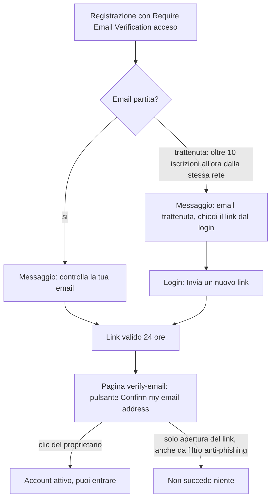

# Checklist di revisione: dal 19/10 alle 18:12 alla build 3007 sul server

## Il periodo, in parole semplici

- **Da**: il tuo push di `dev_release2` del 19/10/2026 alle 18:12 (commit `ecc7ac667`), l'ultimo punto di stato fatto con il vecchio coordinatore Copilot.
- **A**: il contenuto della build che hai messo sul server ieri notte, versione `v1.2.1-3007-g96c7fe7fe` (`96c7fe7fe` = merge della PR #59 di `dev_release2` a `02b0f7931` dentro `dev`).
- **Quanti commit**: 180 (senza i merge). Per tipo: 86 documentazione e journal, 36 funzioni nuove, 33 correzioni, 13 test, 5 refactor, 3 prestazioni, 2 manutenzione, 1 wip, 1 regola di Claude. 804 file toccati.
- **Cosa contiene**:
  - **Treni 2, 3, 4, 5**: i lotti del 19-21/10 (H-60 errori tracciabili, E-AI503/E-23 AI Export, J-57 costo in Auto, J-60 costo negativo, N69a/b impostazioni admin, N70 Tailscale, Z-32 base di quotazione, MF matematica finanziaria, X-R45 pianificatore PAC, B-50...B-55 backup, ecc.).
  - **Treno 6 = ondata 1** (21/10): Y-39a (un solo disegnatore dei segnali), H-61 R1 (stato per i pannelli di hosting), Z-29s-a (segnali sulle serie campionate).
  - **Treno 7 = ondata 2** (21/10): Y-39b, Z-29b, H-61 CP2 (biglietti firmati), W-B92 Fineco, W-B86/B87 avvisi di import, #58 e sicurezza del bulk, colori di broker/impostazioni/strumenti/asset/cambi/serie grafici.
  - **Treno 8 = ondata 3** (notte 21-22/10, dieci lotti): Y-40 Rolling Return, Z-29fx, H-55 v2 (CSP), E-25/E-26 (email), A-62 e E-7, J (TC-23, L1b, Q-G29-1), X (Y-42, N64), C1/C2 (colori), W (N78-1).
  - Dopo il treno 8: pulizia del backlog, fork `justetf-scraping`, skill del coordinatore (solo documentazione e dipendenza).
- Nota sulle date: alcuni commit portano date del 19/10 pomeriggio perché stavano su rami dei lotti e sono stati uniti dopo il tuo push.

> **Cosa NON c'è ancora sul server**: il **treno 9** (ondata 4 senza backup: Y-41, N64b/c/d, Q-N78-1k, N69c/d, aggiornamento completo delle dipendenze, H-55 R4/R5...) è già nel `dev_release2` locale (`0ebee607a`), ma non è stato né pushato né messo in build. Il **treno 10** (il nuovo backup L3, H-62) è ancora nel gate. Quello che trovi qui sotto è solo ciò che è sul server adesso.

---

## Come usare questa checklist

1. Apri la voce, prova la cosa sul server (la riga `Dove provarlo` dice dove).
2. Se va bene, segna `[x]`. Se no, lascia `[ ]` e scrivi il problema sulla riga `Feedback:` sotto la voce (anche una parola: "ok", "testo brutto", "non capisco").
3. `Rif.:` ti dice a quale lotto e a quale commit risale la voce, se vuoi guardare il codice.
4. Le voci marcate **[non in CHANGELOG]** si vedono nell'app ma non sono scritte nel CHANGELOG: dimmi se vanno aggiunte.
5. Le voci con **[solo API]** si provano con `curl` o con la documentazione API (`/api/v1/docs` esiste solo con `LIBREFOLIO_API_DOCS=true`); se non ti va, segna "salto".
6. Sezioni e simboli: lotto = nome interno del pezzo di lavoro (per esempio `Y-40`, `E-25`); SHA = i primi 9 caratteri del commit.

---

## 1. Dashboard e grafici

- [x] **Lot Life & Custody: ogni segno spiega cosa è successo**
  Nel pannello Analisi dei lotti, il grafico "Lot Life & Custody" ha segni (▲ acquisto, ▼ vendita, ◆ trasferimento, + / × rettifica, │ split). Passandoci sopra (o toccando, o con la tastiera) compare un tooltip: cosa è successo, quando, quante unità (nascoste in modalità privacy) e su quale broker. Per un trasferimento tra due tuoi broker vedi "Da" e "A". Se più eventi cadono nello stesso giorno, il tooltip li elenca tutti.

  - Dove provarlo: Dashboard, una posizione, **Analyze Lots**, grafico "Lot Life & Custody". Prova con un titolo trasferito tra due broker e con l'occhio "Hide amounts" acceso (la quantità deve sparire).
  - Rif.: Q-G29-1 (J), `dd9f8a78b`
  - Feedback:

- [x] **Rischio: aggiungi la coppia di cambio mancante senza uscire dall'analisi**
  Quando manca la rotta di cambio per un'analisi di rischio, il pulsante della coppia non ti porta più alla pagina FX: apre la finestra **Add New Currency Pair** già compilata (per esempio EUR/USD). Quando la coppia è salvata, e di nuovo quando i suoi cambi sono scaricati, l'analisi si aggiorna da sola.

  - Dove provarlo: tab Rischio della Dashboard, di un broker e di un asset, e il laboratorio di rischio nella pagina Asset. Serve un caso con una valuta senza coppia (per esempio un asset in USD con base EUR e la coppia EUR/USD cancellata).
  - Rif.: TC-23 (J), `2744d8d20`
  - Feedback:

- [x] **Report del portafoglio più veloci sulle storie lunghe**
  I cambi che servono a un report si leggono solo nei giorni in cui cambiano, non giorno per giorno. Stessi numeri, meno tempo: su una storia che parte dal 1900, un report di un mese passa da 3-6 secondi a circa 1,4.

  - Dove provarlo: Dashboard con un periodo di un mese e un portafoglio con storia lunga. Controlla che i numeri siano uguali a prima (se hai uno screenshot vecchio, confrontalo).
  - Rif.: P3 (MF), `b8c2f614b`, `e71012c67`
  - Feedback:

- [x] **Analisi dei lotti più veloce sulle storie lunghe**
  Il pannello dei lotti FIFO legge i cambi solo nei giorni in cui cambiano, come i report. Su una storia dal 1900, un'analisi di un mese in un'altra valuta impiega circa il 40 % in meno, con gli stessi numeri. In più, la serie giornaliera dei lotti ora si calcola solo nei giorni di cambiamento (L1a).

  - Dove provarlo: Dashboard, **Analyze Lots** in una valuta diversa da quella dell'asset.
  - Rif.: L1a e L1b (J), `197a421fd`, `c10bea915`
  - Feedback:

- [x] **Rendimento pesato per il denaro (MWRR) dopo perdite quasi totali**
  Su portafogli che hanno perso quasi tutto in molti anni, la carta e la linea del grafico mostravano "—" dove un tasso esiste; ora lo mostrano.

  - Dove provarlo: Dashboard, carta MWRR, su un portafoglio (anche di prova) con perdita quasi totale. Sui dati normali: controlla solo che i valori non siano cambiati.
  - Rif.: P1b (MF), `b970284de`
  - Feedback:

- [x] **Lotti: storia delle performance con posizioni corte**
  Una posizione corta aperta veniva contata come posseduta e la sua vendita mancava, quindi la storia mostrava una perdita su una corta in guadagno. Ora la corta conta come debito, la vendita come uscita di denaro, e i rendimenti si misurano sull'esposizione lorda.

  - Dove provarlo: Analisi dei lotti di un asset con una vendita allo scoperto (vendi più di quanto hai, su un broker che lo permette).
  - Rif.: MF-E2 (MF), `1c8a63b72`
  - Feedback:

- [x] **Lotti: un'operazione in un giorno senza valore ora conta**
  Un acquisto o una vendita in un giorno che la storia non sapeva valutare (un prezzo senza cambio) restava fuori da ROI e TWRR, mentre le sue unità erano nel valore del giorno dopo. Ora conta nel primo giorno successivo che ha un valore.

  - Dove provarlo: Analisi dei lotti con un'operazione in valuta senza cambio per quel giorno; il pannello deve restare coerente.
  - Rif.: MF-E2b (MF), `bf748bbc3`
  - Feedback:

- [x] **Dettaglio del lotto: la vendita dice da quale broker sono uscite le unità**
  Nella storia di un lotto, una vendita (o un trasferimento in uscita dai broker che guardi) di unità che erano state spostate prima su un altro broker ora nomina il broker da cui sono uscite, non quello dell'acquisto. Esempio: lotto comprato su A, spostato su B, venduto da B: la riga dice SELL B.

  - Dove provarlo: Analisi dei lotti, apri il dettaglio di un lotto spostato e poi venduto.
  - Rif.: §29 punto 2 (J), `448c34353`
  - Feedback:

- [x] **Lotti e Dashboard: la rettifica in uscita non ha più un valore** (vedi anche la sezione Transazioni)
  Le unità tolte con una rettifica fanno solo scendere la quantità; il loro costo conta come perdita realizzata, uguale in Dashboard e nei lotti, senza flusso di capitale (quindi il rendimento del giorno mostra la perdita).

  - Dove provarlo: dopo aver registrato una rettifica in uscita, guarda la perdita realizzata in Dashboard e nei lotti: devono combaciare.
  - Rif.: N78-1 (W), `79068afe5`
  - Feedback:

---

## 2. Asset e cambi

- [x] **Terza vista dei grafici: Rolling Return (liste Asset e FX)**
  Accanto ad **Abs** e **%** c'è **Rolling Return**. L'interruttore della barra strumenti la applica a tutte le schede e se la ricorda (la lista FX riapre ancora su Abs). Il pulsante di ogni scheda fa il giro % → Rolling Return → Abs e tiene la scelta della scheda. Il rolling return a calendario ora esiste anche per le coppie FX.

  - Dove provarlo: pagina Asset e pagina FX, vista a schede. Cambia la barra strumenti, poi il pulsante di una scheda, ricarica la pagina.
  - Rif.: Y-40 (Y), `816a4b6c1`, `5e5c6b64a`; la parte FX poggia su Z-29fx `46455857a`
  - Feedback: Ho visto che nelle card ti sei inventato un icona per l'abs e mi piace molto, a sto punto sostituiscila all'abs in tutte le top bar con quella icona, nel grafico di asset detail, quando si è in modalità prezzi però il seletotre abs/% lascialo comè. Altra cosa, nei 3 pulsanti della topbar, ora che togli i testi, aggiungi un tooltip custom su ciascuno di loro, che si nostri se il mouse resta sopra per qualche secondo con la spiegazione di che tipo di grafico è in 1 riga
  - ↪ Coordinatore: segnato in **ondata 5, lotto Y** (Y5-F1): l'icona delle card al posto di «Abs» in tutte le barre strumenti (liste Asset e FX); nel dettaglio asset in modalità prezzi il selettore Abs/% resta com'è; sui tre pulsanti della barra un tooltip (il `Tooltip` con il suo ritardo di apertura) con una riga che spiega il tipo di grafico, nelle 4 lingue.

- [x] **Il dettaglio dell'asset si apre nella vista della scheda**
  La pagina di dettaglio si apre nella vista (Abs, %, Rolling Return) della scheda da cui arrivi e con la sua finestra di Rolling Return. Una vista o una finestra scelta nel dettaglio diventa quella della scheda.

  - Dove provarlo: dalla lista Asset, metti una scheda in Rolling Return, apri il dettaglio, cambia la finestra, torna alla lista.
  - Rif.: Y-40 (Y, con X), `b64c3f4c6`
  - Feedback:

- [x] **Chart Settings: l'anteprima si apre nella vista salvata e somiglia al grafico di dettaglio**
  L'anteprima si apre nella vista salvata, con un'anteprima del Rolling Return e della sua finestra (automatica finché non ne scegli una: la più grande tra i preset che entra nel periodo mostrato). L'anteprima è più alta, solo linea, con zoom con la rotella del mouse. Se confronti un asset nuovo su una scheda campionata, l'anteprima lo mostra prima di salvare.

  - Dove provarlo: ingranaggio ⚙️ di una scheda (Asset o FX) oppure **Settings** della barra strumenti. Prova lo zoom con la rotella e l'aggiunta di un confronto.
  - Rif.: Y-39b (Y) `79965b736`; Y-40 `816a4b6c1`; Z-29d `9331a2dd0`
  - Feedback: In segnali sovrapposti dentro impostazioni grafico, se si mette rendimento, dovrebbero scomparire gli indicatori tecnici, come avviene dentro asset detail e anzi, in asset detail ora andrebbe aggiunto oltre al confronto dati con altri asset anche il confronto dati con le forex, visto che abbiamo aggiunto il supporto. E in forex detail manca ancora la rendita mobile, continua ad esserci solo abs e % del prezzo
  - ↪ Coordinatore: tre punti. (1) **Chart Settings**: con un segnale di rendimento sovrapposto spariscono gli indicatori tecnici, come nel dettaglio → **ondata 5, Y** (Y5-F2). (2) **Confronto con le coppie FX nel dettaglio asset**: è **già fatto nel treno 9** (Y-41, commit `6fd3be583`: il dettaglio asset e il dettaglio del cambio disegnano un confronto `fx-pair`), non ancora sul server. (3) **Rolling Return nel dettaglio del cambio**: verificato, la pagina `fx/[pair]` oggi non ha la modalità (il backend la calcola già per le coppie, Z-29fx) → **ondata 5, X** (X5-F1).

- [x] **Le schede colorano la linea da dove parte il periodo**
  Verde sopra la base, rosso sotto, come già faceva il grafico di dettaglio.

  - Dove provarlo: lista Asset con un periodo in cui l'asset scende e poi risale: la linea deve cambiare colore attraverso la base.
  - Rif.: Y-39b (Y), `79965b736`
  - Feedback:

- [x] **La lista Asset carica grafici più leggeri**
  Ogni scheda chiede solo i punti che sa disegnare (cinque anni: circa 200 invece di circa 1800) e la base della percentuale parte dal primo giorno del periodo. Il grafico deve sembrare uguale.

  - Dove provarlo: lista Asset con periodo 5Y; nella rete del browser la richiesta dei prezzi deve essere più piccola. Controlla anche che aprire "All" da una scheda funzioni.
  - Rif.: Z-29b (Z), `62f03b204`
  - Feedback: si percepisce l'accelerata, ma forse è corretto se nel grafico si mostra il badge con il livello di aggregazione subito, come avviene anche in detail
  - ↪ Coordinatore: **ondata 5, Y** (Y5-F3): il badge del livello di aggregazione sulla card appena la serie è campionata, come nel dettaglio.

- [x] **Più indicatori su una scheda campionata hanno le stesse date**
  Le linee di un indicatore (per esempio ADX, con avviamenti diversi) condividono le stesse date su una scheda campionata.

  - Dove provarlo: lista Asset, scheda con un indicatore tipo ADX, periodo lungo: le linee non devono avere buchi diversi.
  - Rif.: O1 (Z), `0fdbb28a7`
  - Feedback:

- [x] **Dettaglio asset e FX: gli indicatori tornano subito**
  Tornare a una modalità di grafico, a una finestra di Rolling Return, a un periodo o a una valuta già visti ridisegna indicatori e rolling return dalla cache del browser: nessuna richiesta, nessun spinner. Refresh, sincronizzazione o aggiornamento prezzi in background richiedono di nuovo i dati.

  - Dove provarlo: dettaglio di un asset: cambia periodo, poi torna al precedente (nessun spinner). Poi premi Refresh (deve richiedere). Stessa cosa nel dettaglio di una coppia FX.
  - Rif.: N64 (X), `34b6d45c0`
  - Feedback:

- [x] **Schede e anteprima disegnano i segnali con lo stesso codice**
  Le schede Asset/FX e l'anteprima di Chart Settings usano un solo disegnatore: un confronto prende il nome del suo bersaglio, le coppie FX sono girate allo stesso modo, e un asset non si confronta con se stesso. Anche le pagine di dettaglio ora disegnano i segnali con lo stesso disegnatore (nessuna differenza visibile voluta).

  - Dove provarlo: stessa scheda e sua anteprima con un confronto salvato: devono essere identiche. Prova a confrontare un asset con se stesso (non deve essere possibile).
  - Rif.: Y-39a (Y) `d8bc582a7`; Y-42 (X) `087769e44`
  - Feedback:

- [x] **Selettore dell'asset di confronto: i nomi lunghi scorrono**
  Nel campo e nella lista, un nome lungo scorre invece di essere tagliato.

  - Dove provarlo: Chart Settings, aggiungi un confronto, scegli un asset con nome molto lungo.
  - Rif.: Y-38 (Y), `252ddefbd`
  - Feedback: si lo fanno, però se ci sono problemi ho notato che il messaggio non è tradotto in italiano "One or more calendar-return points are unavailable" e per altro non si capisce dal messaggio il periodo da risingronizzare quale sia. Poi penserei di migrare il selettore asset a quello che si usa anche nel pannel + del rischio, è più sofisticato e adatto.
  - ↪ Coordinatore: due punti. (1) Il messaggio viene dal backend in inglese (`calendar_rolling_return/plugin.py:279`, codice `UNDEFINED_METRIC_WINDOW`) e il frontend lo mostra così com'è: il frontend deve tradurlo **dal codice** e dire **quali date** mancano e quale periodo risincronizzare (il backend passa già i conteggi nei `details`: va aggiunto l'intervallo) → **ondata 5, Z** (Z5-F1, conosce i segnali). (2) **Il selettore dell'asset di confronto passa a quello del pannello «+» del rischio** → **ondata 5, Y** (Y5-F4), con X che rivede perché lo usa anche il dettaglio.

- [x] **Unità per singolo prezzo, proposta dal provider**
  Scegliendo un risultato di **Search Online** il campo si compila come il nome: il 100 di Yahoo Finance per una linea di Londra quotata in pence (`GBp`), altrimenti 100 per un'obbligazione e 1 per ogni altro tipo, con una nota sotto il campo. **Ask Provider** lo propone come riga spuntata quando è diverso. Niente cambia finché non salvi.

  - Dove provarlo: nuovo asset, **Search Online**, cerca un titolo di Londra in pence (per esempio un ETF su LSE) e un'obbligazione; poi **Ask Provider** su un asset esistente. Il campo si chiama "Units per single price".
  - Rif.: Z-32 (d), `3cf04d0aa`, `daf7b200d`
  - Feedback:

- [x] **«Can't find it? Let us know»: la pagina di supporto riceve titolo e testo**
  Dopo ogni ricerca di asset, il rapporto (cosa hai cercato, quali fonti hanno risposto, valuta, tipo, versione) si può inviare dal tuo dispositivo. Con `LIBREFOLIO_SUPPORT_URL` come pagina di supporto, l'indirizzo apre la pagina con `title` e `body` (come una issue di GitHub, così un modulo di supporto si compila da solo) e il rapporto è anche copiato per te. Senza la variabile, su self-hosted, apre una issue GitHub da rivedere prima dell'invio. Niente di te o del tuo portafoglio nel rapporto.

  - Dove provarlo: nuovo asset, cerca qualcosa che non esiste e premi il link. Con e senza `LIBREFOLIO_SUPPORT_URL` (indirizzo `https://…` e `mailto:`).
  - Rif.: N61-form (X), `ea532c5eb`
  - Feedback:

- [x] **Ricerca asset con Yahoo Finance: un rifiuto per troppe richieste non si nasconde più**
  Mentre LibreFolio leggeva la valuta di ogni risultato, un rifiuto lasciava quel risultato senza valuta per un giorno e Yahoo non veniva mai messo in pausa. Ora la ricerca dice che Yahoo ha rifiutato e lo mette in pausa come per ogni altro rifiuto. Un altro errore nella lettura della valuta non la nasconde più per un giorno: la prossima ricerca chiede di nuovo.

  - Dove provarlo: difficile da provocare a mano (serve un rifiuto di Yahoo). Basta controllare che la ricerca online funzioni normalmente e che il messaggio di Yahoo in pausa sia leggibile, se compare.
  - Rif.: Z-39, `6011a9ff0`
  - Feedback:

- [x] **[solo API] Conversioni FX campionate per grafici compatti**
  `POST /api/v1/fx/currencies/convert` può campionare una conversione (`max_points`, `sample_like`, `sample_bounds`) con i segnali tecnici ridotti sulle stesse date, come `POST /assets/prices/query`.

  - Dove provarlo: lo usano le schede FX in vista Rolling Return (vedi sopra); nessuna prova manuale necessaria oltre a quella.
  - Rif.: Z-29fx (Z), `46455857a`
  - Feedback:

- [x] **[solo API] `POST /assets/prices/query` accetta segnali su item settimanali o mensili**
  Con `max_points`, `resolution`, `sample_like`: i segnali sono calcolati sulla serie giornaliera, poi prezzi e segnali sono ridotti alle stesse date (un punto a settimana o al mese). Annotazioni ed eventi sono ancora rifiutati con questi campi. Un item campionato richiesto senza prezzi non legge niente.

  - Dove provarlo: lo usano le schede della lista Asset (vedi sopra); nessuna prova manuale.
  - Rif.: Z-29s-a (Z), `7d077207d`; correzione `5bbadda95`
  - Feedback:

---

## 3. Transazioni e import (BRIM)

### Inserire e modificare

- [x] **Una rettifica che toglie unità non ha più un valore**
  Le unità escono solo dalla quantità; il costo conta come perdita realizzata, senza flusso di capitale. Per registrare una vendita usa una Sell. Il campo valore appare solo per le unità in entrata. Se cancelli un broker, o dividi una coppia di trasferimento, la gamba che dà diventa una rettifica senza valore e non serve più un cambio per convertirla.

  - Dove provarlo: nuova transazione di tipo Adjustment con quantità negativa (il campo valore non c'è), poi con quantità positiva (c'è). Prova anche a cancellare un broker che ha un trasferimento, o a dividere una coppia di trasferimento nel bulk editor.
  - Rif.: N78-1 (W), `79068afe5`
  - Feedback:

- [x] **Il costo di carico non può più essere negativo**
  Un costo scritto a mano sotto 0, su una transazione nuova, una modifica, un merge o un import al salvataggio, è rifiutato con «The cost basis can't be negative: enter 0 or more.». 0 resta permesso (un regalo, le azioni nuove di uno split).

  - Dove provarlo: nuova transazione con costo manuale -5; poi 0.
  - Rif.: J-60 (J), `cd44e6531`
  - Feedback:

- [x] **Import: una riga che porta unità senza costo parte in Auto**
  Una rettifica che aggiunge unità, o il lato che riceve di un trasferimento, che il report lascia senza costo viene salvata al costo medio delle unità che hai già, invece di restare senza modalità. Un costo scritto nel report (anche 0) resta Manuale. Le righe segnalate dall'importer (Align with the bank, una riga di scissione di Danske Bank, una rettifica di Generic CSV senza costo) si aprono in Manuale con il costo vuoto e restano elencate finché non scrivi un costo, anche 0.

  - Dove provarlo: import di un Generic CSV con una rettifica in entrata senza costo, e di un file Danske Bank con una scissione.
  - Rif.: J-57 (J), `4ee8423ab`
  - Feedback:

- [x] **Un costo Auto rifiutato dice cosa fare, e la griglia ti porta lì**
  Se non c'è niente da mediare, il messaggio ti chiede di scegliere Manuale e scrivere quanto ti sono costate le unità (0 per un regalo). Dopo l'arrivo delle righe, dopo **⚡ Validate now** e dopo un **Save All** rifiutato, la griglia scorre alla riga rifiutata più vecchia.

  - Dove provarlo: bulk/import: una rettifica in entrata in Auto su un asset che non hai mai avuto. Premi **Save All**.
  - Rif.: J-57 (J), `4ee8423ab`
  - Feedback:

- [x] **Import: il controllo fatto all'arrivo delle righe non si butta più**
  Su import con più di 50 righe, le righe rifiutate comparivano solo dopo **⚡ Validate now**; ora sono già lì.

  - Dove provarlo: importa un file con più di 50 righe di cui qualcuna sbagliata.
  - Rif.: J-57 (J), `4ee8423ab`
  - Feedback:

- [x] **La riga salvata blocca asset e broker nell'editor** (#58)
  L'asset e il broker di una transazione salvata non si cambiano più nell'editor: il cambio sembrava accettato ma non si poteva salvare. Per cambiarli, cancella e ricrea. Le righe nuove li scelgono ancora.

  - Dove provarlo: apri una transazione salvata (o una coppia di trasferimento) nell'editor: asset e broker bloccati; su una riga nuova no.
  - Rif.: #58 (W-front), `bc01226f4`
  - Feedback:

- [x] **Cambio lingua con l'editor aperto: non perde le modifiche**
  Rif.: K-4 (W-front), `bc01226f4`

  - Dove provarlo: apri l'editor, scrivi qualcosa, cambia lingua (es. IT → EN): le modifiche restano.
  - Feedback:

- [x] **Entrare e uscire da un importo non chiede «discard changes?»**
  E un importo identico non viene riscritto. Rif.: B-47 (W-front), `bc01226f4`

  - Dove provarlo: clicca in un campo importo e fuori senza scrivere; poi esci dall'editor.
  - Feedback:

- [x] **Un modulo o wizard chiuso mentre carica non si riapre da solo**
  Rif.: K-2 (W-front), `bc01226f4`

  - Dove provarlo: apri e chiudi in fretta il modulo o il wizard di import mentre carica (rete lenta).
  - Feedback:

- [x] **«Reset all» su una coppia con un lato illeggibile**
  Non fallisce più e non nasconde più la metà leggibile. Rif.: K-3/K-3b (W-front), `bc01226f4`

  - Dove provarlo: bulk editor con una coppia di cui un lato non è accessibile (per esempio un broker che non puoi vedere), poi **Reset all**.
  - Feedback:

- [x] **Più di 15 cifre significative: rifiutate subito nel modulo**
  Quantità e importi con più di 15 cifre significative sono rifiutati subito, come fa il server, invece di fallire alla validazione. Rif.: B-48 (W-front), `bc01226f4`

  - Dove provarlo: scrivi 1234567890.1234567 nella quantità di una transazione.
  - Feedback:

- [x] **Escape chiude una finestra appena aperta**
  Un Escape premuto subito dopo l'apertura poteva perdersi mentre la finestra caricava. Ora chiude. Rif.: ondata 3 (trovato dagli E2E), `ad99d8791`

  - Dove provarlo: apri una finestra qualsiasi (es. dettaglio broker) e premi subito Esc.
  - Feedback:

### Editor bulk: unire e dividere coppie

- [x] **Banner di merge: lo scambio nel verso giusto**
  Un prelievo accoppiato a un deposito in un'altra valuta è di nuovo elencato per primo, e il tasso implicito si legge dalla valuta pagata a quella ricevuta (1000 EUR pagati per 1100 USD: EUR → USD @ 1,1000, non più USD → EUR @ 0,9091), confrontato con il tasso di mercato della stessa coppia. La finestra **Merge** elenca le due righe nell'ordine del banner e **Merge all → All left** tiene le note della riga elencata per prima, quella che paga.

  - Dove provarlo: bulk editor con un prelievo EUR e un deposito USD suggeriti come coppia.
  - Rif.: J-66 (J), `7dbb043a2`
  - Feedback:

- [x] **Merge con una transazione salvata, e «Split pair» che annulla**
  Dopo il merge di un prelievo salvato con un deposito (o di un deposito salvato con un prelievo nuovo), la riga poteva mostrare il deposito come lato *From* e i due importi positivi fino al salvataggio. Dividere di nuovo prima di salvare scambiava i tipi e il salvataggio veniva rifiutato. Ora **Split pair** rida a ogni transazione com'era.

  - Dove provarlo: bulk editor: unisci un prelievo salvato e un deposito, guarda il segno, poi **Split pair** e **Save All**.
  - Rif.: J-67 (J), `fb073f919`
  - Feedback:

### Importer dei broker

- [x] **Fineco: ogni operazione sul giorno in cui l'hai fatta; Danske Bank idem**
  Fineco e Danske Bank registrano ogni operazione nel giorno in cui l'hai fatta, non nel giorno in cui sono mossi i soldi; la data valuta decide solo se l'operazione è regolata. **File importati con una versione precedente**: cancella quelle transazioni una volta (per Danske, anche le correzioni di apertura e di buco) e reimportale.

  - Dove provarlo: import di un export Fineco e di uno Danske Bank (servono i file reali; puoi usare quelli di prova nei sample report). Controlla le date delle transazioni.
  - Rif.: B-52 (W), `56be23cf7`; doc `5731086cd` (W-B89)
  - Feedback:

- [x] **Fineco: le commissioni non si contano due volte**
  Il *Controvalore* di Fineco contiene già la commissione su un acquisto e l'ha già tolta su una vendita; LibreFolio la aggiungeva di nuovo come commissione a parte. Ora acquisto e vendita sono registrati senza commissione, più una sola commissione, e insieme fanno il *Controvalore*. **I dati già importati restano sbagliati**: cancella le transazioni Fineco create da quel file e reimporta. Grazie a @Xgialippo.

  - Dove provarlo: import di un export Fineco con un acquisto e una vendita con commissione: somma acquisto + commissione = Controvalore.
  - Rif.: W-B92 (W-back), `a7c6db19f`
  - Feedback:

- [x] **Fineco: solo operazioni regolate**
  Un'operazione con data valuta ancora nel futuro (di solito l'ultimo o i due ultimi giorni lavorativi) aspetta il prossimo export, commissione compresa; una nota blu dice quante. Una riga senza quantità o senza importo si importa come prima, con una nota che la elenca e un link per aprire una issue su GitHub.

  - Dove provarlo: export Fineco con operazioni degli ultimi due giorni.
  - Rif.: a7c6db19f (W-B92, riga modificata del CHANGELOG)
  - Feedback:

- [x] **Fineco non è più beta, guida riscritta**
  Guida con il percorso reale in sei screenshot (Portafoglio → Reports → Ordini e contabili → filtro → Cerca → Esporta excel), nota sulle commissioni e sezione «Known limitations». Screenshot di @Xgialippo (#49).

  - Dove provarlo: nel wizard di import scegli Fineco (niente badge beta) e apri la guida; documentazione `user/transactions/import/fineco`. Controlla anche il credito a Xgialippo.
  - Rif.: W-B92 (W-back), `a7c6db19f`
  - Feedback:

- [x] **Danske Bank: serie di cassa che parte dopo e prenotazioni quiete**
  Un set il cui estratto di cassa parte dopo l'export dei titoli ora parte il giorno prima dell'export dei titoli, e le operazioni di quei primi giorni sono importate nel loro giorno; i confronti dei saldi contano le operazioni fatte ma non ancora pagate. Le prenotazioni (*Varaus*) sono saltate in silenzio; le righe sconosciute sono saltate con un avviso che chiede di aprire una issue.

  - Dove provarlo: import di un set Danske Bank con estratto di cassa più corto dei titoli.
  - Rif.: B-52 `56be23cf7`; W-B85 `323c120eb` (W)
  - Feedback:

- [x] **Gli avvisi di import dicono quali righe sono state lasciate fuori**
  Quando un importer lascia fuori una riga che non riconosce o non sa leggere, l'avviso elenca le righe e dà un link per aprire una issue su GitHub. DEGIRO, Crédit Agricole, Scalable e Directa seguono la regola; gli ordini in attesa, annullati, scaduti o rifiutati in un export Scalable sono lasciati fuori in silenzio.

  - Dove provarlo: import di un file DEGIRO / Scalable con una riga sconosciuta o un ordine annullato.
  - Rif.: W-B86 (W-back), `fcf39fab0`
  - Feedback:

- [x] **Revolut, Trading 212, eToro e altri: le righe che cambiano i numeri non sono più saltate in silenzio**
  Split, distribuzioni di azioni, conversioni di valuta, commissioni notturne e rimborsi, SDRT: un avviso ambra le elenca e le aggiungi a mano. Le colonne di commissioni e tasse di Trade Republic, le operazioni forex di Swissquote e le operazioni in valuta di Interactive Brokers sono elencate allo stesso modo. Importarle davvero viene dopo la 1.3.

  - Dove provarlo: import di un export Revolut / Trading 212 / eToro con uno split o una conversione.
  - Rif.: W-B87 (W-back), `fcf39fab0`
  - Feedback:

- [x] **Passo 3 dell'import: le note blu non sono avvisi**
  La tabella dei risultati e il riepilogo mostrano ⚠️ avvisi e ℹ️ note separati, il dettaglio file li elenca sotto due intestazioni, e la conferma conta solo gli avvisi quando parla di avvisi.

  - Dove provarlo: import Fineco con operazioni non regolate (nota blu) più una riga con avviso.
  - Rif.: B-51 (W), `3cc5bed99`
  - Feedback:

---

## 4. AI Export

- [x] **I prompt incollati non fanno più ripetere le tue cifre all'AI**
  Un'analisi risponde alla sua domanda con i dati; **Export Data** finisce con l'AI che conferma di avere i dati, nella tua lingua, oppure risponde alla domanda che aggiungi. Quando i dati non bastano, all'AI si chiede di cercare notizie recenti. I prompt di soli dati vietano anche le fonti inventate.

  - Dove provarlo: AI Export di un portafoglio o di un asset, copia il prompt e incollalo in un'AI. Prova **Export Data** con e senza domanda aggiunta, in due lingue.
  - Rif.: E-24 (E), `3c064de75`, `a5f01976a`
  - Feedback:

- [x] **Prezzi mancanti mostrati, non nascosti**
  Un asset posseduto i cui prezzi sono tutti precedenti al periodo è elencato con l'ultimo prezzo salvato invece di contare come coperto; le serie di prezzi o cambi mancanti nei giorni di mercato sono mostrate come buchi uniti con l'ultimo valore salvato prima. Anche il solo giorno dello snapshot non è più un buco, e i significati dei buchi dicono da dove viene il valore della posizione.

  - Dove provarlo: AI Export di un portafoglio con un asset i cui prezzi finiscono prima del periodo scelto.
  - Rif.: E-23 (E), `32462b543`, `d2388ea2c`, `f7be98971`
  - Feedback:

- [x] **AI Export: niente 503 per un asset posseduto senza prezzi**
  L'export non fallisce più con "a required data source is unavailable" quando un asset posseduto non ha prezzi salvati o li ha in più valute: l'asset è elencato senza serie di prezzi e dice perché.

  - Dove provarlo: AI Export (portafoglio o broker, dati tecnici) con un asset posseduto senza prezzi.
  - Rif.: E-AI503 (E), `48b44ee64`
  - Feedback:

- [x] **Una parte fallita dell'AI Export va nel log con la sua causa**
  Il 503 "source unavailable" non lasciava niente da indagare; ora il log ha la causa.

  - Dove provarlo: guarda il log del server dopo un AI Export fallito (difficile da provocare: serve una fonte rotta).
  - Rif.: H-60 (H), `bf16865ed`
  - Feedback:

---

## 5. Account, accesso ed email

- [ ] **Verifica email: il link si spende solo con un clic**
  Con **Require Email Verification** acceso (Settings › Administration › Global Settings), un nuovo account (tranne il primo) aspetta un link via email, valido 24 ore. Il proprietario deve premere **Confirm my email address** sulla pagina che il link apre: aprire il link non conferma niente, così i filtri della posta che aprono i link per controllarli non possono attivare l'account. La pagina di accesso offre di inviare un nuovo link. L'interruttore si accende solo se le email con link possono partire (SMTP e `LIBREFOLIO_PUBLIC_URL`); spegnerlo funziona sempre e lascia in attesa gli account in attesa. Limiti: al massimo 3 email l'ora alla stessa casella.

  - Dove provarlo: serve un SMTP configurato e un secondo indirizzo email. Accendi l'interruttore, registra un account, apri il link dall'email (non deve succedere nulla), poi premi il pulsante (deve entrare). Prova anche "invia un nuovo link" dal login.
  - Rif.: E-25 (E), `bb11f1479`
  - Feedback:

- [ ] **Dopo la registrazione dice la verità se l'email è trattenuta**
  Oltre 10 iscrizioni l'ora dalla stessa rete, gli account sono creati senza la loro email e la pagina di iscrizione lo dice (`verification_email`: `sending` oppure `held`): i proprietari chiedono il link di nuovo dalla pagina di accesso. Anche il testo di accesso per un account in attesa cambia: l'account potrebbe non avere email, la frase rimanda all'email di attivazione o a un nuovo link. I testi sono ancora da confermare da te.

  - Dove provarlo: caso normale (messaggio "email in invio") è facile; il caso trattenuta richiede 11 registrazioni in un'ora dalla stessa rete, quindi probabilmente basta leggere i testi in `it`/`en` e dirmi se ti piacciono. Controlla anche il testo del login di un account in attesa.
  - Rif.: E-26 (E), `5086e9244`; test `8fdeab4d6`
  - Feedback:

- [ ] **Scheda Utenti: «In attesa di verifica»**
  Un account che si è registrato e non ha ancora aperto il link mostra «Waiting for verification» (it «In attesa di verifica») invece di «Deactivated», anche a link scaduto; passa il mouse sul badge, o apri la riga, per vedere cosa fare. Le azioni non cambiano.

  - Dove provarlo: Settings › Administration › Users, dopo aver registrato un account con verifica accesa e non averlo confermato.
  - Rif.: E-7 (A), `5fa5cdeb9`
  - Feedback:

- [ ] **Scheda Utenti: avatar di ogni account**
  Ogni account mostra l'avatar, o la prima lettera del nome, accanto al nome.

  - Dove provarlo: Settings › Administration › Users.
  - Rif.: N69a (A), `ac24fdf92`
  - Feedback:

- [ ] **Settings › Administration solo per amministratori**
  Gli altri utenti non vedono più una copia in sola lettura delle Global Settings; un vecchio link ad essa apre il loro Profilo.

  - Dove provarlo: accedi con un utente normale (non admin) e apri Settings: il gruppo Administration non c'è; apri `?tab=admin` nell'indirizzo: arrivi al Profilo. Con un admin, tutto come prima.
  - Rif.: N69a (A), `ac24fdf92`
  - Feedback:

---

## 6. Impostazioni e sicurezza

- [x] **Il punto di sicurezza sulla riga di connessione (admin)**
  Quando Settings › Security ha avvisi o errori, un punto compare sulla riga di connessione della barra laterale (e sul pulsante menu da telefono); i dettagli rimandano alla lista. Il punto è rosso o ambra, e il conteggio sta nel nome accessibile.

  - Dove provarlo: accedi da admin con almeno un avviso di sicurezza (per esempio registrazione aperta) e guarda la barra laterale da PC e da telefono. Da utente normale il punto non c'è.
  - Rif.: N69b (A), `84c1329c4`
  - Feedback:

- [x] **Il pulsante menu del telefono ha il nome nella tua lingua**
  I lettori di schermo leggevano «Toggle menu» in inglese in ogni lingua; ora il nome segue la lingua dell'interfaccia, seguito come prima dal livello di connessione e dagli avvisi di sicurezza.

  - Dove provarlo: finestra stretta, lingua IT, passa sul pulsante menu (tooltip / lettore di schermo / ispeziona l'`aria-label`).
  - Rif.: A-62 (A), `bffca2884`
  - Feedback:

- [x] **La CSP è applicata in ogni profilo** (vedi anche Breaking changes)
  Uno script che LibreFolio non ha mandato (messo da un proxy, un CDN o un'estensione) è bloccato sulle pagine dell'app, e la scheda Security lo dice. La policy segue un frontend ricostruito mentre il server gira. Vedi Configuration › The Content-Security-Policy.

  - Dove provarlo: apri l'app dal server; nella console del browser non devono comparire blocchi per gli script dell'app. Prova con un'estensione che inietta script (se ne hai una) e guarda Settings › Security. Controlla PDF, font e pagine di documentazione: devono caricare.
  - Rif.: H-55 v2 (H), `a1f1cc5fb`
  - Feedback:

- [x] **La scheda Security avvisa quando il browser ha bloccato uno script non nostro**
  Rif.: H-55 v2 (H), `a1f1cc5fb`

  - Dove provarlo: stesso caso della voce precedente: l'avviso appare in Settings › Security.
  - Feedback:

- [x] **Un file dell'istanza non può più girare come script**
  Un report di broker scaricato da LibreFolio è sempre un download semplice; una richiesta "come script" per un file caricato o un report è rifiutata, e i file script o programma sono rifiutati all'upload dei report.

  - Dove provarlo: carica un report con estensione `.js` o `.exe` come report di broker (deve essere rifiutato); scarica un report PDF e un CSV (si scaricano normalmente).
  - Rif.: H-55 review (H), `9e2e35782`
  - Feedback:

- [x] **`LIBREFOLIO_FRAME_PROTECTION` e `LIBREFOLIO_CSP_REPORT_ONLY`: testo aggiornato**
  Restano spenti di default; la policy report-only ora è tutta la policy a cui l'app punta, e non blocca niente in più. Gli script inline dell'app sono ammessi per hash.

  - Dove provarlo: Configuration nell'admin guide; con `LIBREFOLIO_CSP_REPORT_ONLY=true` la console del browser elenca quello che sarebbe bloccato.
  - Rif.: H-55 v2 (H), `a1f1cc5fb`
  - Feedback:

- [x] **Errori tracciabili**
  Ogni risposta del server porta un `X-Request-Id` e ogni riga di log di quella richiesta ha lo stesso `request_id`. Un errore del server (5xx) risponde con quell'id e il tipo della causa, mai il suo messaggio, e la causa arriva nel log una sola volta, come una riga JSON con il traceback. Dove l'app mostra un errore generico, aggiunge il codice, per esempio «(code: 3f9a…)», così un amministratore lo trova nel log.

  - Dove provarlo: DevTools › Rete, guarda l'header `X-Request-Id`; provoca un errore 500 (se hai un modo) e cerca il codice nel log.
  - Rif.: H-60 / H-60r (H), `bf16865ed`, `b6a5d8544`
  - Feedback:

- [x] **Chiamate API fallite nella console del browser**
  L'app scrive una riga per ogni fallimento inatteso di una chiamata: stato, percorso, id della richiesta, mai i dati. Con `LOG_LEVEL` a `DEBUG` o `TRACE` scrive anche le risposte 4xx (`client_log_level` in `GET /api/v1/system/instance`).

  - Dove provarlo: console del browser mentre usi l'app. Con `LOG_LEVEL=DEBUG` anche i 4xx.
  - Rif.: H-60 (H), `bf16865ed`
  - Feedback:

- [x] **Ogni eccezione è scritta una volta, a livello ERROR, in JSON**
  Prima veniva una seconda volta in testo semplice a livello `EXCEPTION`; un errore imprevisto ora risponde in JSON.

  - Dove provarlo: log del server dopo un errore.
  - Rif.: H-60 (H), `bf16865ed`
  - Feedback:

---

## 7. Hosting provider e pannelli (solo se usi o vuoi provare un pannello)

- [ ] **[solo API] Stato di setup per i pannelli di hosting**
  `GET /api/v1/panel/status` dice a un pannello se il suo cliente ha attivato l'istanza (`none`, `pending` fino a un certo orario, `done` o `expired`) e nient'altro. Spento finché non imposti `LIBREFOLIO_PANEL_STATUS_TOKEN`; risponde anche su un'istanza bloccata.

  - Dove provarlo: `curl` con il token, su un'istanza senza account (`none`), con admin in attesa di setup (`pending`) e dopo il setup (`done`). Senza variabile: 404.
  - Rif.: H-61 R1 (H, con A), `64b8b9fa3`, `e917659c9`, `75dd4aa38`
  - Feedback:

- [ ] **[solo API] Le rotte dei pannelli hanno un'unica guardia**
  Le rotte backup, wake-up e status stanno sotto un unico tag «Hosting panel», e un indirizzo che manda 20 credenziali di pannello sbagliate in 10 minuti riceve `429` con `Retry-After`. Il log di avvio nomina un token di pannello inutilizzabile.

  - Dove provarlo: 21 chiamate con token sbagliato in 10 minuti: la ventunesima deve dare 429. Con un token inutilizzabile impostato, leggi il log di avvio.
  - Rif.: H-61 (H), `e917659c9`, `75dd4aa38`
  - Feedback:

- [ ] **[solo API] Biglietti firmati (Ed25519) per i pannelli**
  Oltre ai token, un pannello può chiamare le rotte di backup, wake-up e status con un biglietto Ed25519 di breve durata (`LIBREFOLIO_PANEL_PUBLIC_KEYS`, `LIBREFOLIO_PANEL_CLOCK_SKEW_SECONDS`). Ogni biglietto vale una volta, i rifiuti hanno codici `panel_ticket_*`, il limite sulle credenziali rifiutate non conta più i biglietti con firma valida, e la guida per l'hosting ha vettori di prova. Revisione di sicurezza indipendente: nessun problema alto o medio.

  - Dove provarlo: con i vettori di prova della guida (`admin/hosting_providers`): biglietto valido (passa), riuso dello stesso (rifiutato), scaduto (rifiutato con il suo codice).
  - Rif.: H-61 CP2 (H), `bf33e26de`
  - Feedback:

- [ ] **Guida admin: Tailscale Serve e Funnel davanti all'immagine Docker**
  Come trovare il gateway della rete, elencarlo in `FORWARDED_ALLOW_IPS`, controllare l'indirizzo del visitatore nel log.

  - Dove provarlo: documentazione admin (service exposure / Docker avanzato), segui i passi se vuoi.
  - ↪ Coordinatore: correzione, non è in «Service exposure»: è in **Admin › Deployment & Exposure › Check Connection Security**, sezione «🐳 Tailscale Serve and Funnel with Docker» (`admin/connection_checks/#tailscale`), con accanto «When LibreFolio Does Not Trust Your Proxy».
  - Rif.: N70, `564549192`
  - Feedback:

- [ ] **Sospensione e risveglio: nessuna novità diretta**
  Le rotte di wake-up per i pannelli ora passano dalla guardia comune (vedi sopra); le funzioni di sospensione e risveglio dell'app non sono cambiate in questo intervallo.

  - Dove provarlo: se vuoi, una sospensione e un risveglio manuali come controllo di non regressione (vedi la guida admin «sleep and wake»).
  - Rif.: H-61, `75dd4aa38`
  - Feedback:

---

## 8. Backup e ripristino

> Il **nuovo backup** (L3, H-62, treno 10) NON è sul server. Qui ci sono solo le correzioni di robustezza del backup attuale, che non sono scritte nel CHANGELOG.

- [ ] **[non in CHANGELOG] Un backup avviato in un'altra scheda non viene adottato**
  Il backup di una scheda del browser non viene più "adottato" da un'altra scheda come se fosse il suo.

  - Dove provarlo: avvia un backup in una scheda, apri la pagina backup in un'altra scheda.
  - Rif.: B-8 (B), `43face16e`
  - Feedback:

- [ ] **[non in CHANGELOG] Stato di un job illeggibile = non trovato; un solo lettore per job, controllo e report**
  Un file di stato di un job che non si legge è trattato come "non trovato" invece di dare errori strani; job, controllo e report si leggono con un solo lettore.

  - Dove provarlo: fai un backup e un ripristino di prova; la pagina deve mostrare stato e report senza errori.
  - Rif.: B-50, B-53, B-54, B-55 (B), `b9c14953f`, `29104b870`
  - Feedback:

- [ ] **[non in CHANGELOG] L'audit delle valute legge anche testo non UTF-8**
  Il controllo delle valute salvate nel ripristino e nella CLI non si ferma più su testo non UTF-8.

  - Dove provarlo: ripristino di un backup di prova (avviso di valute non ISO dove previsto).
  - Rif.: `f15d8c60c`
  - Feedback:

---

## 9. Strumenti (pianificatore PAC)

- [x] **[non in CHANGELOG] Il pianificatore PAC mostra l'avviso del cambio salvato saltato**
  Quando il pianificatore salta un cambio salvato per uno più vecchio, rileggendo i dati copiati la nota lo dice; le stesse regole di "cambio usabile" valgono per ogni cambio salvato che il pianificatore legge. La rilettura segnala anche i Broker pianificati e la scheda FX segue la rilettura.
  - Dove provarlo: Strumenti › PAC planner, con una coppia FX il cui ultimo cambio salvato non è usabile; premi la rilettura dei dati copiati.
  - Rif.: X-R45 / X-R45b (X), `082805b7a`, `5a53e00ad`, `10335d428`
  - Feedback:

---

## 10. Colori, tema e interfaccia

- [x] **Più app sui ruoli di colore chiaro/scuro**
  Broker, impostazioni, strumenti PAC, transazioni, pagine di dettaglio asset e cambi, interruttori, badge e chip di stato, e ogni serie dei grafici. I grafici cambiano colore subito quando cambi tema, senza ricaricare. I colori dei tipi di asset vengono da una sola fonte: i grafici leggono gli stessi ruoli dei badge. Le righe cancellate nelle tabelle non lasciano più vedere il contenuto scorrevole attraverso le colonne fisse.
  - Dove provarlo: passa tra tema chiaro e scuro su Broker, Impostazioni, PAC, Transazioni, dettaglio asset e FX, grafici (torta di allocazione, serie). Cancella una riga in una tabella con colonne fisse e scorri.
  - Rif.: C1 `ce3bc869a`, `1778fd328`, `25f4cc6d0`; C2 `6fc379b1b`, `1655edd9b`; fix `ebe64831e`
  - Feedback:

---

## 11. Documentazione

- [x] **Guide e pagine nuove o riscritte**
  Guida Fineco con sei screenshot; Gmail nella guida email dell'admin; Tailscale in `service_exposure`; guida all'hosting con la pagina di supporto; testi su "la data è la data dell'operazione" e sulla rettifica in uscita; tabelle e teoria dei lotti, MWRR e costo medio aggiornate; pagina Email nella galleria; voce Plugin Settings tradotta in it/fr/es; testi IT/FR/ES di Danske Bank senza la frase sul silenzio.
  - Dove provarlo: apri la documentazione dal server (`/mkdocs/`): Fineco (Import), Admin › Email (esempio Gmail), Admin › Service exposure, Admin › Hosting providers, Galleria. Dimmi se qualcosa non si capisce.
  - Rif.: `a7c6db19f`, `67d402b97`, `564549192`, `ea532c5eb`, `5731086cd`, `b02611402`, `17dfc302a`, `79f8da3fb`
  - Feedback:

---

## 12. Altro, sotto il cofano (niente da provare a mano)

- [x] **Controllo d'insieme: leggi i numeri qui sotto e dimmi se ti tornano**
  - **Commit**: 180 in totale; 86 di documentazione e journal, 36 funzioni, 33 correzioni, 13 test, 5 refactor, 3 prestazioni, 2 manutenzione.
  - **Codice**: 804 file toccati (+104.757 / -6.961 righe). Frontend `src`: 307 file; backend `app`: 122 file, di cui 19 nuovi moduli (pannelli di hosting, id di richiesta, campionamento dei prezzi e dei cambi, segnali, protezione dei file, sonda dell'indirizzo come immagine).
  - **Test**: 92 file di test backend toccati (29 nuovi); 35 test Vitest nuovi; 32 file E2E toccati (4 specifiche nuove); 9 file del runner (`scripts/test_runner`) aggiornati per registrare i nuovi casi. Ogni treno è passato dal gate completo; il treno 8 ha avuto 11 rossi, tutti ipotesi di test, curati dai proprietari.
  - **Documentazione**: 132 file in `mkdocs_src` (6 nuovi, di cui i 6 screenshot Fineco come immagini), 19 file del journal (+12.708 righe), backlog riconciliato il 22/10 (325 voci aperte classificate, 26 risposte tue registrate).
  - **Configurazione e strumenti**: 74 file nuovi in `.claude` (agenti, regole, skill portate dal setup Copilot), skill del coordinatore in autonomia e due lezioni dal coordinatore cloud, 6 file del devWiki, galleria con la fixture della sicurezza (18° controllo `platform.hosting_panel`).
  - **Dipendenze**: solo il riferimento del fork `justetf-scraping` (`f24a5c4` → `73afd12`, PR #49); un aggiornamento completo di pipenv è stato provato e annullato (SQLModel 0.0.48 con SQLAlchemy 2.1: 57 rossi nel backend). L'aggiornamento completo è nel treno 9, non sul server.
  - Rif.: tutto l'intervallo; dipendenza `c042f2481`
  - Feedback:

---

## 13. Breaking changes / cose da sapere

- [x] **La Content-Security-Policy è applicata in ogni profilo** (la sola voce "Breaking changes" nuova in questo intervallo)
  Uno script che LibreFolio non ha mandato, aggiunto da un proxy, un CDN o un'estensione del browser, è bloccato sulle pagine dell'app e la scheda Security lo dice. Se metti LibreFolio dietro un proxy o un CDN che aggiunge script, o usi estensioni che iniettano script sulle sue pagine, quelli smettono di funzionare.

  - Dove provarlo: apri l'app dal tuo percorso reale (Tailscale, reverse proxy) e controlla che tutto funzioni; guarda console e Settings › Security. Se una pagina non carica un pezzo (PDF, font), segnalalo qui: il visore PDF con i font CJK era un rosso noto del treno 8 e la cura è nel treno 9.
  - Rif.: H-55 v2 (H), `a1f1cc5fb`; `9e2e35782`
  - Feedback:

- [x] **Da rifare a mano dopo l'aggiornamento (dati già importati)**

  - **Fineco**: cancella le transazioni create da un file Fineco importato prima e reimporta (commissioni e data operazione cambiate).
  - **Danske Bank**: cancella le transazioni importate prima (anche le correzioni di apertura e di buco) e reimporta (data dell'operazione).
  - **Transazioni salvate**: asset e broker non si cambiano più nell'editor; per cambiarli, cancella e ricrea.
  - **Rettifiche in uscita**: da ora hanno valore zero; le vecchie con valore restano nel database, ma i motori le chiudono a 0 qualunque sia il valore salvato.
  - Rif.: `56be23cf7`, `a7c6db19f`, `bc01226f4`, `79068afe5`
  - Feedback:
