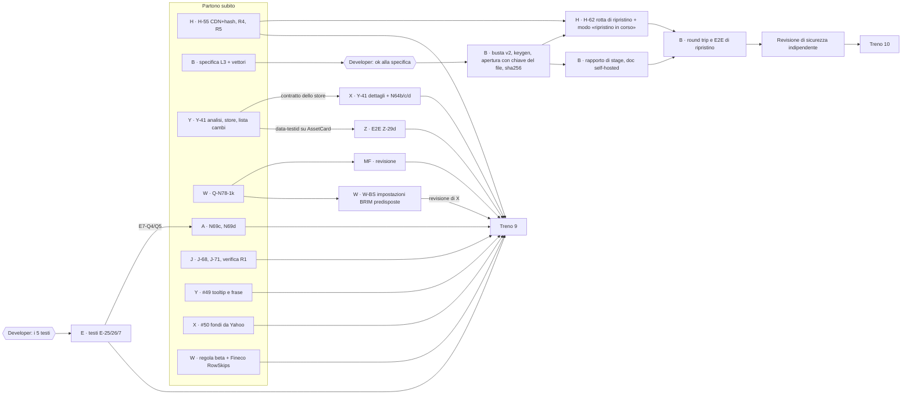

# Ondata 4 — piano (22/10/2026) — APPROVATO dal developer il 22/10 pomeriggio

> **Decisioni del developer sul piano (22/10, pomeriggio)**: il piano «torna»; valgono le raccomandazioni delle domande 1-13 (testi del 9 compresi). **Modelli per complessità, non tutti Opus**: Opus per H, B e MF (sicurezza, crittografia, revisione dei numeri); Sonnet per Y, X, W, A, J, Z; Haiku per E (testi nei cataloghi). Per Y-41/#50: il fork `justetf-scraping` ha ora la PR #49 senza conflitti (fix delle allocazioni: TER e fund size di nuovo letti); nel `Pipfile.lock` si sposta solo il suo riferimento (`c042f2481`): l'aggiornamento completo con `pipenv update` è stato provato e tolto, perché SQLModel 0.0.48 / SQLAlchemy 2.1 rifiutano le date senza fuso orario (57 rossi nel backend). È un lotto a parte, da decidere (**domanda 16**).

Base: `dev_release2` = `e2d3b8a51` (treni 7 e 8, 80 commit non pushati). La 1.3 non esce prima di novembre.
Fonte dei lavori: `BRIEF-ondata4.md` (coordinatore, 22/10). Tutto quanto segue è stato controllato sul codice di
`dev_release2` il 22/10, in sola lettura; dove non ho potuto controllare lo dico.

## Decisioni già prese (del developer, 21-22/10)
- **Backup del cloud: Opzione 1 nella 1.3** (`LibreFolio_prj/BACKUP-decisioni-20261022.md`): busta `.lfbk` chiusa con la
  chiave pubblica dell'istanza (L3), modo «ripristino in corso» su volume vuoto, rotta di ripristino del pannello solo con
  biglietto L2 di scopo `backup:restore`. Solo il coordinatore decifra (K2). Niente Litestream, niente replica continua.
  Chiave d'istanza fuori dal backup (decisione 39). Il piano di dettaglio è `PIANO-backup-L3.md`, in questa cartella.
- **H-55 CDN**: le risorse del visore PDF le serviamo noi dall'immagine; il CDN resta solo come ripiego, con l'hash atteso
  di ogni file nel codice; il ripiego del *motore* va tolto. R4 (politica per i worker) nella 1.3, insieme.
- **Y-41** nella 1.3: confrontare un asset con un cambio deve funzionare dal dettaglio dell'asset e da quello del cambio.
- **Q-N78-1k**: una coppia di rettifiche collegate fra due broker propri esce al PMC; se diventa TRANSFER è un TRANSFER;
  due rettifiche non collegate non si danno per la stessa cosa.
- **E-26-q3 = (a)**. Gli altri 5 testi (E-26-q1, E-26-q2, E-25-q1, E7-Q4, E7-Q5) aspettano la risposta.
- **Impostazioni dei plugin BRIM** (aggiunta del developer, 22/10, corretta lo stesso giorno): per i BRIM i segreti sono
  improbabili e i parametri molto più probabili, ma il sistema deve **supportare tutto**: parametri **e** segreti,
  impostazioni **personali e d'istanza**, segreti cifrati con la chiave d'istanza, sul modello di «Plugin settings, the
  foundation» (CP10 di X: `services/plugin_settings/`). Va **predisposta, non realizzata**: nessuna impostazione
  concreta adesso. In codice: famiglia `brim` con le stesse regole di `asset` (`FamilyRules(user_scope=True,
  secrets=True)`). Proprietario W. La realizzazione completa (CP12, «impostazioni per BRIM e tools», con un primo campo
  vero) è in **ondata 5** (X, la parte BRIM con W), non in questa.
- **B6, programma colori, galleria, cancelli finali: aspettano la designer.**
- **Filtro di `PROSSIMI_LAVORI.md` chiuso** (developer, 22/10, «Esito 22/10» nel file): **entrano nell'ondata 4** tre
  voci piccole, #49 (Y: tooltip «Valore Iniziale/Finale» e frase in 4 lingue), la regola dei plugin in beta con Fineco
  su `RowSkips` (W), #50 (X: i dati dei fondi da Yahoo, deciso dal 18/10). Un elenco va in **ondata 5** (sezione «Dopo
  l'ondata 4»). Il blocco del riordino va all'inizio della 1.4 (`Phase_2/ATTIVITA_INIZIO_1.4.md`), #51 e #52 in
  `TODO_FUTURI.md`, K2b/K2c tolte.
- Regole che restano: un solo scrittore per file; i figli non fanno git; un comando pesante alla volta con `flock`; ogni
  brief dice «a cosa serve»; una domanda importante ferma solo quel pezzo.

## Le 10 sessioni e a cosa servono

| # | Sessione | Lotto | A cosa serve (per il developer) | Blocca il tag? | Giorni |
|---|---|---|---|---|---|
| 1 | **H** (esistente, Opus) | **H-55 CDN + hash, R4, R5** → poi **H-62**: rotta di ripristino del pannello e modo «ripristino in corso» | L'estratto conto di un broker giapponese si legge anche con la politica stretta: i font CJK arrivano da noi o da un CDN controllato byte per byte, e il motore del visore non si scarica più da fuori. Uno script iniettato non carica codice da fuori nemmeno dentro un worker (R4). Swagger e ReDoc smettono di caricare librerie non fissate (R5). Poi, con la specifica di B: il coordinatore cloud può rimettere i dati su una macchina nuova da solo, con un biglietto, e una macchina appena creata su un volume vuoto non si presenta come «istanza nuova» (niente `/setup`). | **sì** (`files.spec.ts:826` è l'unico rosso del gate; sicurezza) | 2-3 (H-55) + 4 (H-62) |
| 2 | **B** (nuova, Opus) | **Backup L3**: prima la **specifica con i vettori di prova**, poi busta v2, keygen, apertura con la chiave del file, `sha256` del lavoro, rapporto di stage, doc self-hosted, round trip e E2E | Ogni notte l'istanza chiude il suo zip con il «lucchetto aperto» del cliente: nemmeno lei può riaprirlo. Esempio: un token del pannello rubato scarica solo file illeggibili. Il coordinatore apre con la sua chiave privata solo i 32 byte della chiave del file e li manda alla macchina nuova insieme allo zip ancora cifrato. | **sì** (è l'Opzione 1 decisa per la 1.3) | 2-3 (spec) + 8-10 |
| 3 | **Y** (esistente) | **Y-41**: analisi delle 4 superfici, poi lo store e la **lista dei cambi** (schede e anteprima); **#49**: tooltip «Valore Iniziale/Finale» e frase in 4 lingue | Nelle impostazioni di una scheda dei cambi oggi si può scegliere «confronta con un asset», ma la scheda non lo disegna (`fx/+page.svelte:860-866`: `comparisonTarget: () => null`). Con Y-41 la scheda di EUR/USD disegna davvero l'ETF scelto, come fa la lista degli asset. Con #49 l'utente che ha chiesto cosa sono «Valore Iniziale» e «Valore Finale» nel Portafoglio lo legge passando il mouse sulla colonna (`ContributionTable.svelte:390-403`, oggi senza tooltip) e nella pagina della guida anche in it/fr/es (oggi solo in inglese). | no | 2 + 0,5 |
| 4 | **X** (esistente) | **Y-41 dettagli** (dopo il contratto di Y) + **X-N64b/c/d**; **#50**: i dati dei fondi da Yahoo | Il dettaglio dell'asset e del cambio confrontano nei due sensi senza richieste in più: oggi tornando a un periodo già visto con un confronto configurato le serie del confronto vengono richieste di nuovo (N64b). Con #50 un ETF preso da Yahoo (esempio: VWCE.DE) porta la distribuzione per settore, la descrizione del fondo e «TER: x%» più l'emittente in coda, come fa già justETF: oggi `funds_data` di yfinance non è letto da nessuna parte (verificato: `yahoo_finance/plugin.py` legge solo `info["sector"]`). | no | 1,5-2 + 1-1,5 |
| 5 | **Z** (esistente) | `data-testid` sul pulsante delle impostazioni di `AssetCard` (lo aggiunge Y, è un suo file) + **E2E di Z-29d** | La prova automatica che «un confronto appena scelto compare nell'anteprima prima di salvare» esiste e gira nel gate. Oggi quel comportamento è provato solo a mano. | no | 0,5 |
| 6 | **W** (esistente) | **Q-N78-1k** + l'helper delle righe legacy spostato in `frontend/e2e/fixtures/`; **la regola dei plugin in beta** (W-B86/87) nella skill `brim-plugin` e in `brim_plugin_guide.md`, con **Fineco su `RowSkips`** e tolto da `ROW_SKIPS_PENDING`; poi **W-BS: impostazioni dei plugin BRIM predisposte** | Sposti 10 azioni da Directa a Fineco con due rettifiche collegate: con tutti i broker selezionati il totale fa 0 (oggi perde 100: A realizza −100 e B porta 100 di capitale). Con il solo broker A si vede l'uscita al PMC. Poi: un plugin BRIM che un giorno vorrà una configurazione (esempio: «formato della data» per il CSV generico, personale o d'istanza) o, più raramente, un segreto (esempio: una chiave API di un broker, cifrata con la chiave d'istanza) la dichiara con una riga, e compare da sola nella scheda Plugin, come oggi per prezzi e cambi; finché nessun plugin dichiara nulla, non cambia niente di visibile. La regola in beta: chi scrive un plugin legge «uscire dalla beta = adottare `RowSkips` (righe note scartate in silenzio, ignote con avviso e link «apri una issue»)»; Fineco è fuori dalla beta dal treno 7 ma è ancora nella lista dei plugin esentati (`test_brim_row_skips.py:60-73`): si allinea. | no | 2 + 0,5-1 + 1-1,5 |
| 7 | **MF** (nuova, Opus) | **Revisione** della cura di W: la matematica ha una sola casa (`financial_math/`); P4/D-P4 confermati fuori dalla 1.3 | Nessuna seconda copia del calcolo in giro: la regola «coppia collegata = uscita al PMC» sta in un posto solo e la leggono Dashboard, lotti e TWRR. | no | 0,5-1 |
| 8 | **E** (esistente) | **Testi E-25/E-26/E-7** (appena rispondi) | Le frasi che vede chi si registra quando l'email è trattenuta, e il badge «In attesa di verifica», sono quelle che hai scelto, nelle 4 lingue. | no | 0,5 |
| 9 | **A** (esistente) | **N69c** (modo d'iscrizione in Utenti), **N69d** (pulsante «Guida» sui controlli di Sicurezza) + i testi di `UserRow` da E7-Q4/Q5 | Chi amministra decide «chi può iscriversi» dalla scheda Utenti, senza cercarlo nelle Impostazioni globali; ogni riga della scheda Sicurezza ha il suo «Guida» che apre la pagina giusta della documentazione. | no | 2 |
| 10 | **J** (esistente) | **J-68** (rimedio nel backend), **J-71** (due copie di `buildSyncTargets`), **R1**: verifica | Un trasferimento partito e arrivato lo stesso giorno dice da dove viene («Da Directa a Fineco»), non solo «→ Fineco». I pannelli del rischio usano una sola regola per il pulsante Sync. R1 (il rischio sulle osservazioni) aspetta Q1 di X, che è fuori dalla 1.3: J lo verifica e lo chiude o lo rimanda. | no | 1,5-2 |

Più, fuori dalle sessioni: **revisione di sicurezza indipendente (Opus)** del lotto backup (B + H-62) prima del treno,
fatta dal coordinatore; **test-author** e **docs-writer** come agenti dentro le sessioni.

Totale stimato: **~33-41 giorni di lavoro**, di cui **13-17 per il backup** (coerente con il §7 delle decisioni). In
calendario, con 10 sessioni e le dipendenze: **~1 settimana per il treno 9** (tutto tranne il backup) e **~2-3 settimane
per il treno 10** (backup). Modelli (decisi dal developer: per complessità): Opus per H, B, MF; Sonnet per Y, X, W, A, J, Z; Haiku per E.

## Dipendenze

A parole:
- **Partono subito**: H (H-55), B (specifica), Y, W, A (N69c e N69d non aspettano nessuno: la mappa delle guide,
  `frontend/src/lib/features/instance/checkGuides.ts`, è in dev), J. Anche le tre voci del filtro (#49 di Y, #50 di X,
  la regola in beta di W) non aspettano nessuno: X fa #50 **per primo**, mentre aspetta il contratto di Y; Y fa #49
  dopo l'analisi di Y-41; W fa la regola dopo Q-N78-1k, prima di W-BS.
- **Aspettano una tua risposta**: E (i 5 testi); la parte `UserRow` di A (E7-Q4 e Q5); B passa dalla specifica al codice
  solo con il tuo **ok alla specifica** (domanda 3).
- **Aspettano un commit di un'altra sessione**: X aspetta il contratto di Y (cosa espone lo store per il confronto
  cambio↔asset, mezza giornata); Z aspetta una riga di Y (il `data-testid`); MF rivede W dopo il checkpoint di W; H-62
  aspetta il commit della busta v2 di B (serve `start_check(..., file_key=…)`); il round trip di B aspetta la rotta di H.
- **W-BS** (impostazioni BRIM predisposte) non aspetta nessuno: W lo fa dopo Q-N78-1k, in un checkpoint a parte. Tocca
  la fondazione delle impostazioni, che è di X (CP10/CP11): in questa ondata X non la tocca (lavora sui grafici), quindi
  **W scrive, X rivede** il checkpoint prima del commit (mezz'ora di X). Nessun altro lotto tocca `services/brim/`,
  `services/plugin_settings/` o `features/plugin-settings/` (controllato: H, B, Y, X, Z, A, E, J, MF non li nominano).
- **Due treni**: il treno 9 porta tutto ciò che non è backup appena è verde (una settimana circa). Il treno 10 porta il
  backup dopo la revisione di sicurezza. Così i lotti piccoli non aspettano il lotto lungo.

## File condivisi: un solo scrittore per file

| File o cartella | Di chi, in questa ondata | Chi altro lo tocca, e quando |
|---|---|---|
| `frontend/src/lib/stores/chartSettingsStore.svelte.ts`, `lib/charts/chartSignalRendering.ts`, `lib/utils/reducedPriceQuery.ts`, `routes/(app)/fx/+page.svelte`, `routes/(app)/assets/+page.svelte`, `FxCard.svelte`, `AssetCard.svelte`, `ChartSettingsModal.svelte`, `PriceChartCompact.svelte` | **Y** | X e Z chiedono a Y tramite il coordinatore; Y aggiunge il `data-testid` di Z come prima cosa (checkpoint piccolo) |
| `routes/(app)/assets/[id]/+page.svelte`, `routes/(app)/fx/[pair]/+page.svelte`, `lib/charts/chartPageSignals.ts`, `lib/charts/loadComparisonData.ts`, `lib/components/assets/detail/*` | **X** | Y non li tocca; se Y-41 chiede qualcosa nel dettaglio, passa da X |
| `frontend/e2e/assets/*.spec.ts` di Z-29d | **Z** | — |
| `backend/app/services/financial_math/**` | **W** scrive la cura di N78-1k; **MF** rivede e propone (non scrive nello stesso turno) | J non tocca `financial_math` in questa ondata (J-68 è in `lots_analysis_service.py`, lettura delle righe, fuori da `financial_math`: da verificare da J) |
| `backend/app/services/portfolio/lots_analysis_service.py` (`_build_transfer_rows`) | **J** | — |
| `frontend/src/lib/features/risk/**` | **J** (J-71) | — |
| `backend/app/services/platform/instance_backup/**`, `backend/app/api/v1/backup/{instance,restore,job_views,exports}.py`, `backend/app/config/backup.py`, `backend/app/schemas/backup.py`, `scripts/backup_cli.py`, `frontend/src/lib/features/backup/**`, `mkdocs_src/docs/admin/backup_restore.en.md` | **B** | H legge `restore_jobs.start_check` e `jobs`; non li modifica |
| `backend/app/services/platform/hosting_panel/**`, `backend/app/config/hosting_panel.py`, `backend/app/config/platform.py`, `backend/app/api/v1/panel.py`, `backend/app/api/v1/instance_block.py`, `backend/app/api/v1/system/*`, `backend/app/services/platform/app_lifespan.py`, `backend/app/services/platform/security_headers.py`, `frontend/src/app.html`, `frontend/src/lib/utils/files/pdfViewerAssets.ts`, `frontend/src/lib/features/instance/**`, `mkdocs_src/docs/admin/hosting_providers.en.md` | **H** | B propone le righe della guida hoster sulla busta L3; le scrive H nel suo file (oppure B in `backup_restore.en.md` e H mette il link) |
| `backend/app/api/v1/backup/__init__.py` (registrazione delle rotte) e `backend/app/api/v1/backup/panel.py` | **B** oggi; **H** aggiunge la rotta di ripristino in un **modulo nuovo** (`api/v1/backup/panel_restore.py`) e una riga di registrazione | ordine: prima il commit di B (busta v2), poi H |
| `frontend/src/lib/features/settings/**` (Utenti, Sicurezza), `UserRow.svelte`, `registrationMode` | **A** | E dà ad A i testi di E7-Q5; E non tocca `UserRow` |
| `frontend/src/lib/i18n/auth/*.json`, `email.verification.*` | **E** | A non li tocca |
| `frontend/e2e/fixtures/**` (helper delle righe legacy) | **W** | i due spec che lo copiano (`portfolio/yield-on-cost-real.spec.ts`, `portfolio/data-quality-real.spec.ts` o `data-quality-legacy.spec.ts`: W verifica quali) restano di W |
| `backend/app/services/brim/{brim_provider,registry}.py`, `brim_providers/**` (Fineco compreso), `backend/test_scripts/test_external/test_brim_row_skips.py`, `.claude/skills/brim-plugin/SKILL.md`, `mkdocs_src/docs/developer/architecture/patterns/brim_plugin_guide.md` | **W** | nessun altro in questa ondata |
| `backend/app/services/asset_source_providers/yahoo_finance/**`, i suoi test, `mkdocs_src/docs/developer/**/provider_yahoo_finance*.md`, `user/assets/providers*` (la parte Yahoo) | **X** (#50) | nessun altro in questa ondata |
| `frontend/src/lib/features/dashboard/ContributionTable.svelte`, `frontend/src/lib/i18n/dashboard/*.json`, `mkdocs_src/docs/user/dashboard/positions.{en,it,fr,es}.md` | **Y** (#49) | nessun altro in questa ondata; per #49 Y scrive **anche** it/fr/es, eccezione voluta dal developer alla regola «solo inglese» |
| `backend/app/services/plugin_settings/{fields,service,contract,runtime}.py`, `backend/app/schemas/plugin_settings.py`, `backend/app/services/provider_registry.py`, `frontend/src/lib/features/plugin-settings/**`, `frontend/src/lib/i18n/pluginSettings/*.json` | **W** per W-BS (la fondazione è di X: CP10/CP11) | **X rivede** il checkpoint di W-BS prima del commit; X non li tocca in questa ondata. `settingsTabs.ts` (A) **non** cambia: la scheda Plugin c'è già |
| File comuni additivi (li risolve il coordinatore al treno): `scripts/test_runner/*`, cataloghi i18n, baseline dei colori (`frontend/src/themeRoles.baseline.tsv`), `BACKLOG_POST_1.2.md`, `CHANGELOG.md` (solo righe proposte), `mkdocs.yml` (nav) | coordinatore | una riga additiva per volta |

Punti in cui due lotti si incrociano, e chi passa per primo:
1. **Y → X** (Y-41): Y definisce nello store come una scheda dei cambi trova la serie dell'asset confrontato; X la legge
   nel dettaglio solo dopo il commit di Y. Nel frattempo X fa N64b/c/d (file suoi).
2. **Y → Z**: una riga (`data-testid`) in `AssetCard.svelte`; Y la consegna in un checkpoint separato nelle prime ore.
3. **B → H-62**: la firma `start_check(upload_id, *, file_key: bytes | None)` e `EnvelopeKey` da chiave grezza sono di B;
   H costruisce la rotta sopra. Se H è pronto prima, scrive la rotta contro la specifica e la prova con una chiave
   finta, poi la collega.
4. **W → MF**: W consegna il checkpoint; MF rivede (sola lettura) e manda al coordinatore le correzioni; W le applica.
   MF non scrive in `financial_math` mentre W è aperto.
5. **E → A**: E consegna i testi in catalogo; A legge `E7-Q5` dal catalogo per `UserRow` (nessun file in comune).
6. **H-55 → H-62**: stesso worktree, in sequenza. Se H-55 tarda, il coordinatore può far partire B sui pezzi che non
   dipendono da H (busta, CLI, rapporto, doc) e tenere H-62 per dopo: nulla si blocca.
7. **W-BS → X**: W cambia la fondazione delle impostazioni (famiglia `brim` accanto ad `asset` e `fx`); X, che l'ha
   costruita, rivede in sola lettura prima del commit. Se X trova un problema, W lo corregge; X non scrive.

## Ordine degli slot pesanti (uno alla volta, `flock`; RAM 15 GB)

Un `all-frontend` dura ~1 h, un `all-backend` ~27 min.

1. **H**: corsa completa `all-frontend` con la politica dei worker (R4) e il visore senza CDN: 1 h. È il rosso del
   gate: va per primo.
2. **Y**: E2E `front-fx fx-list`, `front-fx fx-settings`, `front-asset asset-list`: ~15 min. Per #49 bastano i Vitest
   di `ContributionTable` e un `mkdocs build` (in `flock`).
3. **W**: `front-transaction all` (~20 min) + le azioni `services` dei motori (`lots-analysis-pure`, `financial-math`,
   `portfolio-engine`, `transaction-cost-basis-rule`): ~15 min. Per W-BS, più tardi: `services plugin-settings-*`
   (5 azioni, pure), `api plugin-settings`, `api brim`, `front-utility plugin-settings`: ~10 min.
4. **X**: `front-asset asset-detail`, `front-fx fx-detail`, `risk-asset-detail`: ~15 min. Per #50 i test del plugin
   Yahoo (`external`/`services` sul provider, con `funds_data` finto) sono leggeri: fuori dal lucchetto. Per la regola
   di W: `external brim-row-skips` è puro (nessun server), `api brim` ~2 min.
5. **J**: `services lots-analysis-pure` + parità, `front-portfolio risk-levels-component`: ~10 min.
6. **A**: E2E `settings`, `api users-admin`: ~10 min. **E**: Vitest + `api email-verification-hooks`: 5 min.
7. **Z**: lo spec nuovo di Z-29d: 5 min.
8. **Gate del treno 9**: `api sync`, ratchet, `front check`, `i18n check`, `check-orphans`, `all-backend`, `all-frontend`,
   `mkdocs build` + `check-links`: ~1 h 40.
9. **B** (più avanti): `services backup-*`, `api backup-*`, `utils backup-cli*`, `api backup-roundtrip` (lavoro vero su
   una corsia, ~10 min), `front-utility backup`.
10. **H-62**: `api hosting-panel-routes`, `panel-status`, `services hosting-panel-*`, `managed-headers`.
11. **Revisione di sicurezza** (nessun comando pesante) → **gate del treno 10** (~1 h 40).

Regola: i controlli leggeri (un file Vitest, un file pytest, `ruff`, `prettier`) restano fuori dal lucchetto, con carico
sotto 8.

## Preparazione (coordinatore, prima degli avvii)

| Sessione | Worktree | Branch | HEAD oggi | Da fare |
|---|---|---|---|---|
| H | `e-alfy-sturdy-memory` | `e-alfy-h-piattaforma` | `a0d7fb5a5` (13 dietro, pulito) | fast-forward a `e2d3b8a51` |
| B | `e-alfy-miniature-telegram` | `e-alfy-b-backup-e-docker` | `1fd559a26` (**309 dietro**, 0 avanti, pulito) | fast-forward (possibile: 0 commit avanti); **`npm ci`** (i `node_modules` sono `darwin-arm64`) |
| Y | `e-alfy-redesigned-spork` | `e-alfy-y-cruscotto-e-grafici` | `5e5c6b64a` (54 dietro) | fast-forward |
| X | `e-alfy-cuddly-engine` | `e-alfy-x-plugin-asset-e-ricerca` | `71813a40c` (13 dietro) | fast-forward |
| Z | `e-alfy-potential-sniffle` | `e-alfy-z-sospensione-e-risveglio` | `29deddba3` (11 dietro) | fast-forward |
| W | `e-alfy-fluffy-meme` | `e-alfy-w-import-e-transazioni` | `fe9e48bee` (13 dietro) | fast-forward |
| MF | `e-alfy-turbo-waddle` | `e-alfy-mf-matematica-finanziaria` | `d1f75a3df` (132 dietro, **1 file sporco**: il piano `11_financialMath/plan-phase01FinancialMath.prompt.md`) | commit del piano sporco, poi fast-forward; **`npm ci`** (`darwin-arm64`) |
| E | `e-alfy-stunning-fortnight` | `e-alfy-e-email` | `8fdeab4d6` (13 dietro) | fast-forward |
| A | `e-alfy-legendary-winner` | `e-alfy-a-account-e-accessi` | `e6738808f` (53 dietro) | fast-forward |
| J | `e-alfy-crispy-goggles` | `e-alfy-j-numeri-e-analisi` | `0c9a07d9a` (53 dietro) | fast-forward |

Corsie: H 6181, E 6182, W 6183, A 6185, Z 6186, Y 6189, J 6190, X 6191, **B 6192** (nuova), **MF 6193** (nuova); il gate
usa 6180. Cartelle dati `/tmp/librefolio-r13-<lettera>`. Dopo ogni fast-forward: `api sync` nel worktree prima di
`front check`.

## Domande per il developer

1. **H-55-docs (R5): Swagger e ReDoc** (`/api/v1/docs`, `/api/v1/redoc`) caricano oggi le loro librerie da jsDelivr senza
   versione né controllo d'integrità, fuori dalla politica. Opzioni: (a) **le serviamo noi** (copia fissata nell'immagine,
   qualche MB) **e le spegniamo nel profilo managed** (consiglio di H); (b) versione fissata + SRI, restando sul CDN;
   (c) spegnerle ovunque in produzione; (d) lasciare così. **Consiglio: (a).** Esempio: un hoster apre
   `https://istanza.example.com/api/v1/docs` e trova «Not Found»; un self-hoster la trova, servita dal suo server.
2. **Font CJK del visore PDF**: Regular dei 4 set (giapponese, coreano, cinese sempl. e trad.) ≈ 23 MB, Bold ≈ 23 MB
   (misurati in `node_modules/@embedpdf/fonts-*`), su un'immagine di 68 MB. Opzioni: (a) tutti e 47 MB nell'immagine;
   (b) solo i Regular nell'immagine (+23 MB), i Bold dal CDN verificato; (c) **nessuno nell'immagine: i font CJK arrivano
   da jsDelivr ma passano dal nostro server**, che li scarica una volta, controlla l'hash atteso (lista generata in build
   dalla copia in `node_modules`, versione fissata), li tiene in una cache sul volume e li serve alla pagina come suoi:
   la politica resta `connect-src 'self'`, il browser non parla mai con il CDN, e dopo la prima volta funziona anche
   offline; (d) la pagina scarica dal CDN e controlla l'hash lei (richiede `connect-src https://cdn.jsdelivr.net` e
   `blob:`). **Consiglio: (c)**, con (b) come alternativa se preferisci zero dipendenze dalla rete. In ogni caso il
   ripiego del motore dal CDN si toglie, come hai deciso.
3. **La specifica della busta L3** (`PIANO-backup-L3.md`, §3): formato `LFBK` versione 2 solo per le buste a chiave
   pubblica (le buste con password restano byte per byte come oggi), X25519 + HKDF-SHA256 + AES-256-GCM per avvolgere la
   chiave del file, `kid` = prime 16 byte di SHA-256 della chiave pubblica, variabile `LIBREFOLIO_BACKUP_PUBLIC_KEY`
   (43 caratteri base64url, non segreta). **Consiglio: approvare così**, e lasciare che B la rifinisca con i vettori di
   prova. Alternativa: formato compatibile con `age` (si aprirebbe con uno strumento esterno, ma servirebbe riscrivere il
   corpo del file e aggiungere una dipendenza).
4. **La rotta di ripristino del pannello funziona solo nel modo «ripristino in corso»?** (a) **sì**: su un'istanza che
   gira normale la rotta risponde `409 restore_mode_required`; così una chiave di firma L2 rubata può al massimo
   riempire un volume vuoto, mai sovrascrivere dati vivi; (b) no, sempre con il biglietto (serve per un futuro «com'era
   ieri» dal pannello). **Consiglio: (a)**; il «com'era ieri» è dopo la 1.3 e potrà allargarla.
5. **Come si esce dal modo «ripristino in corso»**: (a) **solo il coordinatore**, togliendo la variabile e riavviando la
   macchina quando `GET /api/v1/panel/status` dice `restore.state = committed` (un riavvio in più, nessuno stato nascosto);
   (b) da sola, al primo avvio dopo un ripristino riuscito, anche con la variabile ancora impostata. **Consiglio: (a)**:
   «il pannello decide», più facile da capire e da provare.
6. **`GET /api/v1/panel/status` cresce**: oltre `admin_setup` e `setup_expires_at`, un campo `mode`
   (`normal | awaiting_restore`) e un oggetto `restore` (`state`, `reason`, `backup_created_at`). È un cambiamento di
   contratto (oggi il contratto dice «solo quelle due chiavi»). **Consiglio: sì**, e il coordinatore cloud accetta chiavi
   nuove che non conosce. Alternativa: tutto sotto la rotta di ripristino, e il pannello di stato resta com'è.
7. **Con `LIBREFOLIO_BACKUP_PUBLIC_KEY` impostata, i backup del pannello sono sempre buste L3** (mai più uno zip in chiaro
   dalla rotta del pannello). **Consiglio: sì.** I backup dell'amministratore dalla UI restano con password.
8. **`sha256` dell'archivio nel lavoro finito** (`GET /api/v1/backup/panel/jobs/{id}`): oggi il lavoro lo calcola
   (`BackupJob.file_sha256`) ma la vista API lo toglie. Darlo a pannello e UI insieme (stesso schema)? **Consiglio: sì.**
9. **I 5 testi** (dal recap della notte, invariati): **E-26-q1** (A con il motivo, consigliata, o B corta);
   **E-26-q2** (riquadro verde, consigliato, o giallo); **E-25-q1** (senza «Torna all'accesso», consigliato, o con);
   **E7-Q4** (hover + pannello, consigliato; solo hover; solo pannello); **E7-Q5** (fr «En attente de vérification», es
   «Pendiente de verificación», e il suggerimento it proposto da A). E parte appena rispondi; A fa `UserRow` dopo.
10. **Q-N78-1k, un dettaglio**: la coppia collegata esce al PMC anche per il TWRR (nessun flusso: è uno spostamento
    interno)? **Consiglio: sì**, è coerente con «totale 0». E «collegata» vuol dire la coppia che l'app già lega con
    `related_transaction_id` (quella che propone di trasformare in TRANSFER). W lo verifica nell'analisi.
11. **Y-41, la lista dei cambi**: per disegnare il confronto, la pagina della lista dei cambi deve chiedere al server le
    serie degli asset confrontati (come fa la lista degli asset con la query ridotta). Va bene qualche richiesta in più
    sulla lista dei cambi solo per le schede che hanno un confronto configurato? **Consiglio: sì**, con la cache di N64
    dove possibile.
12. ❌ (corretta il 22/10 sera: restano nella 1.3, ondata 5) **Fuori dalla 1.3, da confermare**: P4/D-P4 (motore a segmenti, `daily_states` pigri) e le formule veloci di X
    (X-Q1…Q3, S1). **Consiglio: fuori.** Conseguenza: R1 di J resta fuori anche lui (aspetta Q1 di X).
13. **Impostazioni dei plugin BRIM** (nessuna scelta aperta, solo una conferma della lettura): la famiglia `brim` prende
    le regole di `asset` (`plugin_settings/fields.py:94`: `user_scope=True, secrets=True`), cioè impostazioni personali
    e d'istanza, segreti cifrati con la chiave d'istanza e mai mostrati nel catalogo. La scheda Plugin **non mostra
    nulla di nuovo** finché nessun plugin BRIM dichiara un campo: il catalogo elenca solo i plugin con campi
    (`service.py:117-131`). Un punto che W chiarirà nell'analisi: il parse dei report gira in un **sottoprocesso**
    (`services/brim/brim_parse_pool.py`), quindi i valori legati, segreti compresi, dovranno passare al processo figlio
    quando un plugin li chiederà; la predisposizione mette il gancio nel processo padre e lascia il passaggio al
    figlio documentato come «da fare con il primo campo» (CP12), a meno che W non lo trovi a buon mercato.
14. ✅ **Modelli**: deciso, per complessità (vedi in testa).
15. **Per il coordinatore cloud** (non prodotto, ma le aspetta da te): l'immagine nightly con la 005 fusa (solo tu puoi pushare su `dev`; `release.yml` pubblica
    `nightly` solo da `dev`, verificato alle righe 319 e 341).

16. **Aggiornare le dipendenze Python** (nuova, 22/10): un `pipenv update` completo porta SQLModel 0.0.48 e SQLAlchemy 2.1, che rifiutano le date senza fuso orario; 57 test del backend rossi (utenti, profilo, backup, broker). Opzioni: (a) un lotto a sé, nell'ondata 5, per passare a date con fuso (modelli, test, eventuale migrazione) e poi aggiornare; (b) fissare SQLModel/SQLAlchemy alle versioni di oggi e aggiornare il resto; (c) rimandare dopo la 1.3. **Consiglio: (c)** per ora, (a) all'inizio della 1.4: tocca molti file e non porta nulla all'utente.

## Dopo l'ondata 4: l'ondata 5 (sempre nella 1.3, quando i lavori iniziati sono finiti)

Dal filtro del 22/10 (`PROSSIMI_LAVORI.md`, «Esito 22/10»). Non pianificata qui nel dettaglio: solo le voci, i
proprietari e le dipendenze principali, per non perderle.

| Voce | Chi | A cosa serve, in breve | Dipende da |
|---|---|---|---|
| **V-37b** «⚡ Validate now» come pre-controllo completo | W | il Form controlla campi obbligatori e formato prima di chiamare il server, su singola, coppia e FX | K3a ✅ (treno 7); stesso form di #47 |
| **#47** prezzo unitario invece dell'importo | W | nel Form si sceglie «Importo totale / Prezzo unitario» con un selettore a badge come «PMC manuale/auto»; l'importo resta visibile e modificabile | **dopo V-37b** (stesso form) |
| **Crédit Agricole sui report set**, solo l'analisi | W | capire con gli export veri se CA entra nei report set; nessun codice | il pilota Danske dei report set ✅ |
| **W-B88** quale data registra ogni plugin | W | inventario e correzioni su tutti e 10 i plugin, anche in beta, **senza bonifica dei dati salvati** | nessuna |
| **CP12** impostazioni dei plugin per BRIM e Tool | X (BRIM con W) | il primo campo vero di un plugin BRIM e la famiglia dei tool | **W-BS** (ondata 4), CP10/CP11 ✅ |
| **C-70b** rifiuti del parse e dell'anteprima tradotti | E, W rivede | il 400 del parse e gli errori dell'anteprima diventano codici tradotti | la patch parcheggiata di C-70b; **prima di E-21** |
| **E-21** frasi dei plugin tradotte | E, W rivede | le frasi che i plugin scrivono nelle righe importate, tradotte | **dopo C-70b** |
| **MF-P1c** gli zeri falsi della griglia del MWRR | MF | sui periodi lunghissimi che aprono a zero: «—» nei casi estremi invece di un numero fuori scala | P1b ✅ |
| **#48** grafico delle singole posizioni sovrapposte + torta per asset | Y (frontend), J/MF (la serie per posizione nel backend) | una torta per asset e la storia della distribuzione, posizioni chiuse comprese; colori categoriali per peso di oggi, poi a ritroso | la serie per posizione in `financial_math` (J/MF) prima del frontend (Y); il programma colori categoriale (designer) per i colori |

Ordine suggerito quando si aprirà: prima i lotti senza dipendenze (W-B88, Crédit Agricole analisi, MF-P1c, C-70b),
poi V-37b → #47, E-21, CP12; #48 per ultimo, con il backend prima del frontend.

**Aggiunta del 22/10 sera (correzione del developer):** le «formule veloci» **restano nella 1.3** (decisione del developer del 19/10, backlog `MF-FV`: «tutto nella 1.3»); la domanda 12 di questo piano le aveva consigliate fuori per errore. Entrano nell'ondata 5:
- **MF-FV P4** (il motore a segmenti, `daily_states` pigri) e poi **i pavimenti** — MF; dove sono descritti: piano MF «Piano «formule veloci»» (`11_financialMath/plan-phase01FinancialMath.prompt.md` ~3667) e backlog `MF-FV` (~10231). P1, P2 e P3 sono già in dev. Attenzione: P4 collide con CP-8 di J su `portfolio_service.py` (CP-8 è nel blocco del riordino all'inizio della 1.4, quindi nessun conflitto nella 1.3).
- **X-Q1…Q3 e S1** (le formule veloci lato X, la serie con le sole quotazioni vere) — X.
- **R1 di J** (il rischio sulle sole osservazioni), dopo X-Q1 — J. La riga di backlog che J ha scritto oggi («R1 dopo la 1.3») va corretta in «ondata 5».

**Aggiunta del 23/10 mattina (decisioni del developer):**
- **L'admin titolare, nel profilo `managed`** — A (con B per il ripristino). (1) La protezione: l'account con l'email di
  `LIBREFOLIO_ADMIN_EMAIL` non si elimina, non si disattiva, non si declassa (riempire `user_service.account_protection`,
  il 409 `ACCOUNT_PROTECTED` c'è già; la CLI resta sopra la protezione). (2) Il ripristino di un backup **caricato
  dall'utente** dalla web GUI: il controllo chiede quale utente del backup diventa l'admin titolare (suggerisce quello con
  l'email del titolare; se un utente ha già quell'email la scelta è obbligata); una modale avvisa che a quell'utente verrà
  messa l'email del titolare e che la password verrà reimpostata tramite link email; al termine l'account è admin,
  protetto, e riceve il link. Non vale per i ripristini del coordinatore cloud (copie notturne della stessa istanza).
- **`users_used` e `users_limit` in `GET /api/v1/panel/status`** (richiesta formale del coordinatore cloud, C5): solo i
  conteggi, nessun nome né email — H.
- **`backup pending` leggibile dal coordinatore cloud** (richiesta formale del cloud, 23/10; serve al recupero di un'istanza) — B:
  (1) `./dev.py backup pending --json` su una riga: `state` (`none | pending | in_progress | committed | rolled_back |
  unreadable`), `reason`, `backup_created_at`, `safety_copy` (sì/no e ora), `choices` valide per `--recover`; mai dati del
  portafoglio, nomi o email; (2) `--recover <scelta>` non interattivo e idempotente; (3) codici d'uscita fissi
  documentati in `cli_tools.en.md` (0 fatto, 2 uso, 3 niente da recuperare, 4 scelta non valida, 5 fallito); (4) con
  `--json` niente colori né log su stdout (log su stderr).
- **D6 nel codice** (chiave d'istanza che non corrisponde: `instance_key: "ok" | "mismatch"` in `panel/status`, job del
  pannello rifiutati, link all'assistenza) — H, insieme a **H-3** (ondata 6), che introduce il controllo all'avvio.

## Cosa resta fuori e perché
- **B6, chiusura del programma colori (69 classi categoriali), galleria G-22…G-27, cancelli finali** (coverage, galleria,
  aggiornamento da DB 1.2, immagine Docker, revisione di sicurezza generale, CHANGELOG `[1.3.0]`, tag): aspettano la
  designer.
- **Il blocco del riordino** (W3, W4/CP7, W5-W6, CP5, CP7/FE4, FE5a, e dal backlog CP-8/9b/9c di J e T-SG): all'inizio
  della 1.4, a codice fermo (`LibreFolio_developer_journal/Release_2/Phase_2/ATTIVITA_INIZIO_1.4.md`). **#51** e **#52**
  in `TODO_FUTURI.md`. **K2b/K2c** tolte (doppione di C-70b).
- **P4/D-P4 e X-Q1…Q3/S1**: consigliati dopo la 1.3 (domanda 12); **R1 di J** di conseguenza.
- **CP12 completo** (impostazioni per BRIM **e tools**, con un primo plugin che le usa): ondata 5. Nell'ondata 4 entra
  solo la **predisposizione** per BRIM (W-BS): famiglia `brim`, mixin sulla base, catalogo, scheda pronta, nessun campo
  dichiarato. I tool aspettano CP12.
- **W-B86/W-B87 per i plugin in beta**: restano una regola («si fanno quando il plugin esce dalla beta»), scritta da W
  nella skill e nella guida in questa ondata; non sono un lotto.
- **Y-43** (tassi ridotti sulle schede dei cambi): dopo la 1.3, 1-1,5 giorni, nessun difetto visibile.
- **Litestream, replica continua, bucket per istanza, `kill_timeout` per Litestream**: usciti con le decisioni del 22/10.
- **Dopo la 1.3 anche**: rotta `admin:reset` del pannello, secondo fattore per gli admin, parser dei report in
  sottoprocesso, scansione delle dipendenze, pulsante «com'era ieri», più destinatari nella busta.
- **Debito di traduzione** delle pagine toccate (it/fr/es): solo su tua richiesta, con la pipeline Aphra.
- **Spike lato cloud**: del coordinatore cloud. Il prodotto misura solo lo spazio che un ripristino usa in `.restore/`
  (due copie), e lo scrive nella doc per hoster (già una domanda aperta del contratto, §11).

## Brief
`kickoff-common.md` e `kickoff-{H,B,Y,X,Z,W,MF,E,A,J}.md` in questa cartella, bozze da rivedere. Il piano di dettaglio del
backup: `PIANO-backup-L3.md`.

## Cosa non ho potuto verificare
- Non ho lanciato nessun test, né server: le stime dei tempi degli slot vengono dall'ondata 3.
- `files.spec.ts:826` l'ho letto (è la prova del ripiego CDN del motore) ma non l'ho visto rosso con i miei occhi.
- La parte «dettaglio» di Y-41: dal codice il dettaglio del cambio già carica le serie degli asset confrontati
  (`fx/[pair]/+page.svelte:927-987`) e il dettaglio dell'asset disegna un cambio (`fx-pair`, `assets/[id]/+page.svelte:915`);
  che funzionino davvero nei due sensi lo dice solo l'analisi di Y con una prova a mano.
- Le dimensioni dell'immagine Docker (68 MB) le prendo dal recap di H; i 23+23 MB dei font CJK li ho misurati io.
- Il contenuto esatto del vecchio documento di architettura B (`backup-architettura-cloud-20261020.md`) sta solo nella
  cartella della sessione Copilot `928ffa97…`: l'ho citato dai riassunti, non riletto.
- Per W-BS non ho trovato dove il parse BRIM istanzia il plugin (`get_plugin_instance` non compare in
  `services/brim/*.py`; forse il parse pool o `brokers.py` lo fanno in un altro modo): W lo trova nell'analisi, perché lì
  va il gancio `configure_instance(provider, "brim", …)`.
- Le tre voci del filtro: ho verificato che `funds_data` non è letto da nessuna parte (`yahoo_finance/plugin.py` legge
  solo `info["sector"]`), che Fineco è ancora in `ROW_SKIPS_PENDING` (`test_brim_row_skips.py:60-73`) e che le due
  colonne di #49 non hanno tooltip (`ContributionTable.svelte:390-403`). Non ho trovato in `positions.en.md` la frase
  che #49 dice «alla riga ~96» (il grep su «Start Value» non la trova): Y la cerca prima di tradurla.
