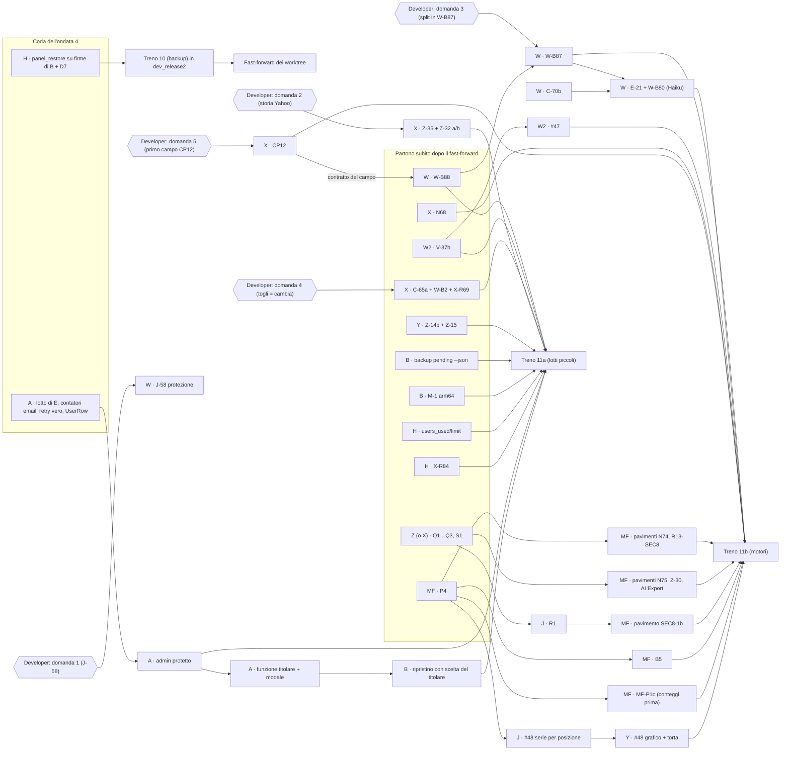

# Ondata 5 — brief del coordinatore (23/10/2026) — PROPOSTA DA VALUTARE, nulla parte da qui

Base: `dev_release2` dopo il **treno 10** (backup). Oggi `dev_release2` = `bc450ee54` (treno 9 dentro). Il treno 10 non c'è
ancora: aspetta la coda di H (adattamento di `panel_restore` alle ultime firme di B + D7, 22 file sporchi nel worktree di H)
e il candidato. Tutto quanto segue è stato controllato sul codice il 23/10, in sola lettura (nessun test, nessun server);
dove non ho potuto controllare lo dico in fondo.

## 1. In due parole

**Cosa porta l'ondata 5.** Chiude i lavori della 1.3 decisi il 19-23/10 e non ancora iniziati. Per chi usa l'app: i plugin
di import registrano la data giusta dell'operazione e importano davvero tasse, commissioni e gambe forex che oggi solo
segnalano (W-B88, W-B87); il form delle transazioni controlla i campi prima di chiamare il server e accetta il prezzo
unitario al posto dell'importo (V-37b, #47); i rifiuti dell'import parlano la lingua dell'app (C-70b, E-21, W-B80);
cambiare il fornitore di un asset avvisa prima di scollegare le transazioni dagli eventi (C-65a); cambiare la valuta di un
asset non è più bloccato e c'è un bottone «Ricollega eventi» (N68); le chiusure Yahoo si salvano come le dà la borsa, senza
la rettifica del giorno di lettura, e i pence (`GBp`) non valgono più come sterline (Z-35, Z-32); le pagine dei prezzi e i
pannelli di rischio si ricaricano da soli dopo un recupero (Z-14b, Z-15); una torta per asset e il grafico delle singole
posizioni (#48); impostazioni dei plugin anche per BRIM e tool (CP12). Sotto il cofano: il motore dei numeri tiene in
memoria solo i giorni che cambiano (MF-FV P4) e cadono i «pavimenti» del 1900 e dei 100 anni; il rischio legge solo le
quotazioni vere (X-Q1…Q3, S1, R1). Per il cloud: l'admin titolare non si può eliminare né declassare, il ripristino di un
backup caricato a mano sceglie chi diventa il titolare, `panel/status` dice quanti utenti ci sono e quanti ne può avere,
`dev.py backup pending --json` e `--recover <scelta>` per il recupero di un'istanza da parte del pannello, immagine Docker arm64.

**Quanto costa.** **~33-44 giorni di lavoro** su 10 sessioni (9 esistenti + una riusata). In calendario, con le dipendenze
e un comando pesante alla volta: **~2,5-3 settimane**; i due percorsi lunghi sono W (plugin e import, 7-9 giorni) e X
(asset e plugin, 5-7 giorni, più Q1…S1 se restano a X). Un treno solo alla fine, **treno 11**, oppure due: un treno 11a con
i lotti piccoli appena verdi (H, B, A, Y Z-14b, X Z-35/C-65a) e un 11b con i motori (MF P4 + pavimenti, Q1…S1, R1, #48).
Modelli per complessità (vedi tabella): **Opus solo per** MF (P4, parità al bit, pavimenti), la parte di B del ripristino
con scelta del titolare (email e password di un account) e la revisione dell'admin protetto; **Sonnet** per il resto;
**Haiku** per i lavori meccanici (E-21 sui 31 plugin, M-1, `users_used`/`users_limit`, i testi).

Due proposte di organico, da confermare (non sono decisioni di prodotto):
- **W in due worktree.** I lotti di W toccano due famiglie di file disgiunte: i 31 `plugin.py` + `brokers.py`/`uploads.py`/
  wizard (W-B88, W-B87, E-21, C-70b, W-B80, B2, J-58, analisi Crédit Agricole) e il form (`TransactionFormModal.svelte`,
  `txPayloadHelpers.ts`: V-37b poi #47). Propongo **W** (worktree `e-alfy-fluffy-meme`) sui plugin e **W2** sul form,
  riusando il worktree di **D** (`e-alfy-d-dipendenze`, lotto finito e già in dev: 0 commit avanti, corsia 6194). Così
  7-9 + 2,5-3,5 giorni corrono in parallelo invece che in fila (10-12,5).
- **Q1…Q3 e S1 alla sessione Z** (worktree `e-alfy-potential-sniffle`, altrimenti ferma), con X che rivede. Motivo: Q1 e
  Q2 riscrivono proprio i blocchi di `get_prices_bulk` che Z ha cambiato con Z-29a (`_fill_point`, `_sample_series`; piano
  03 ~8219-8222), e X ha già 5-7 giorni. Se preferisci tenerli a X, Z si archivia e X sale a 8-11 giorni.

Gli orfani di E (C-70b, E-21, W-B80: «frasi dei plugin solo in inglese») vanno a **W**: C-70b era il K2b di W (parcheggiato
il 19/10 perché aspettava un commit su `brokers.py`/`uploads.py`), E-21 tocca gli stessi 31 `plugin.py` di W-B88 e W-B87
(un solo scrittore per file: non può essere di un altro), W-B80 è il 409 del gap-fix (`services/brim/`, di W). E-21 è
meccanico (90 `raise BRIMParseError` in 31 plugin): lo fa un agente **Haiku** dentro la sessione di W, W rivede.

## 2. I lotti per sessione

Legenda: **Blocca il tag** = «sì» se il developer l'ha fissato nella 1.3 o se lo aspetta il coordinatore cloud per il lancio;
«no» = scivolerebbe alla 1.4 senza danno. I giorni sono stime grezze (dalla classifica del 22/10 e dai piani).

### W · Import e transazioni — plugin (worktree `e-alfy-fluffy-meme`, Sonnet; E-21 con Haiku) — 7-9 giorni

| Lotto | Riferimenti | A cosa serve (per il developer) | File principali | Modello | Giorni | Blocca il tag |
|---|---|---|---|---|---|---|
| W5-1 | **W-B88** (backlog ~7278) | Ogni plugin registra la data dell'operazione, non la data valuta. Esempio: compri il 28/12 con valuta 2/1: oggi alcuni plugin mettono l'acquisto nell'anno dopo, e i numeri «per periodo» e i lotti slittano. Inventario dei 13 plugin che nominano una data valuta (Avanza, Crédit Agricole, DEGIRO, Directa, Disnat, Intesa, InvestEngine, Rabobank, Saxo, Schwab, Danske, Fineco, generico), correzione di chi data con la valuta, **nessuna bonifica dei dati già salvati** (decisione) | `backend/app/services/brim_providers/*/plugin.py`, i loro test `test_external/`, `brim_plugin_guide.md` | Sonnet | 1-1,5 | no |
| W5-2 | **W-B87** (backlog ~7271; decisione 22/10: «entrano davvero; i plugin restano in beta; BRIM non crea eventi») | Le righe con effetto economico dei sei plugin in beta entrano come transazioni invece di finire in un avviso «not imported yet». Esempio: eToro, 40 righe «overnight fee» in un anno: oggi un avviso con il link «apri una issue» (`broker_etoro/plugin.py:78-79`, `:363`), domani 40 commissioni vere. Stessa cosa per Trade Republic (Kosten/Belasting), Swissquote (gambe forex), IBKR (FX senza ISIN). **Gli split** di Revolut e Trading 212 (`SKIP_TYPES`, `broker_revolut/plugin.py:91`, `broker_trading212/plugin.py:88`) restano avviso: BRIM non crea eventi (vedi domanda 3) | i 6 `plugin.py`, i report d'esempio in `sample_reports/`, i test del plugin | Sonnet | 2-3 | no |
| W5-3 | **B2** (backlog ~668: «solo segnalazione al salvataggio, nessuna correzione») | Una coppia di trasferimento con l'arrivo datato prima della partenza viene **segnalata** al salvataggio, non corretta. Esempio: esce da Directa il 5, entra in Fineco il 3: oggi si salva zitta e il motore mette il flusso sul 5 (`daily_state.py:1173-1178`); domani il form lo dice. Oggi `_validate_linked_pair` (`transactions/validation.py:38-99`) non guarda le date; è chiamata solo alla creazione (`batch_creates.py:342`), non alla modifica di una gamba (`batch_edits.py:318-345`): la segnalazione serve in entrambi i punti | `transactions/validation.py`, `batch_creates.py`, `batch_edits.py`, form (solo il testo dell'avviso) | Sonnet | 0,5 | no |
| W5-4 | **J-58 → protezione** (backlog ~8309) | **Vedi domanda 1.** La riga 🌊 dice «rifiuto di una coppia di rettifiche collegate con un codice che indica il TRANSFER»: **questo è già in dev** (W, ondata 4, `0af0f3593`: `validation.py:63-68`, codice `pairAdjustmentNotAllowed`). Il J-58 originale è un'altra cosa: una rettifica in Auto su un insieme in parte a costo ignoto salva un costo medio troppo basso in silenzio (BUY 10 a 1 000 € + 10 ricevute senza costo → Auto = 50 €/u invece di «ignoto»). Oggi N88 rifiuta solo l'insieme vuoto o tutto ignoto (`transactions/auto_cost.py:37-38`: `autoCostEmptyPool`, `autoCostUnknownPool`); il caso «in parte ignoto» passa. Proposta: lo stesso rifiuto con un codice nuovo (`autoCostIncompletePool`), leggendo `report_complete` del motore (`financial_math/average_cost.py:149`, `:243`) | `transactions/auto_cost.py`, i18n `transactions.*`, un test rosso | Sonnet | 0,5 | no |
| W5-5 | **C-70b** (orfano di E; patch parcheggiata, piano 08 ~7813-7904) | Il 400 del parse e l'anteprima illeggibile arrivano tradotti nel wizard. Oggi `api/v1/brokers.py:1090` risponde `detail=f"Parse error: {e.message}"` (frase inglese) e il wizard la mostra com'è. Domani: `parse_failed` con plugin e motivo in una cornice tradotta («Il plugin Fineco non ha potuto leggere il file: …») | `api/v1/brokers.py`, `api/v1/uploads.py`, `ImportWizardModal.svelte`, `i18n/importWizard/*.json` | Sonnet | 1 | no |
| W5-6 | **E-21 + W-B80** (orfani di E; backlog ~10008, ~7161; dopo C-70b) | I motivi dei plugin e il 409 del gap-fix arrivano tradotti. Esempio: DEGIRO, colonna «Datum» mancante: oggi l'italiano legge «Missing column Datum»; domani «Manca la colonna Datum». Lavoro meccanico: 90 `raise BRIMParseError(...)` in 31 plugin prendono `details={"code": …, "context": …}` (`brim_provider.py:101-107` li accetta già); il 409 `ledger_unreadable` (`brim_report_sets.py:96`, mostrato da `GapFixStep.svelte` come testo) prende codice e parametri | i 31 `plugin.py` (**dopo** W5-1 e W5-2, stesso scrittore), `brim_gap_fix.py`, `GapFixStep.svelte`, `i18n/importWizard` | **Haiku** (W rivede) | 1,5-2 | no |
| W5-7 | **Crédit Agricole sui report set**, solo analisi (`PROSSIMI_LAVORI.md:181-201`) | Capire, con gli export veri, se CA può passare al modello dei report set del pilota Danske. Oggi CA è due import separati con gambe `auto_cash` (`broker_credit_agricole/plugin.py:980`) e non è un plugin a set (non ridefinisce `report_roles`/`detect_role`: `brim_provider.py:470-478`). **Nessun codice**: un documento con i problemi (dati già importati alla vecchia maniera, export di soli 2 anni, saldo d'apertura nel CSV) e una proposta; decidi tu dopo | solo il piano 04 | Sonnet | 0,5 | no |

Ordine dentro W: W5-1 → W5-2 → W5-6 (stessi `plugin.py`, in fila); W5-3, W5-4, W5-5, W5-7 negli intervalli (file diversi).

### W2 · Il form (worktree di D riusato, `e-alfy-d-dipendenze`, Sonnet) — 2,5-3,5 giorni

| Lotto | Riferimenti | A cosa serve | File principali | Modello | Giorni | Blocca il tag |
|---|---|---|---|---|---|---|
| W2-1 | **V-37b** (backlog ~2104; `PROSSIMI_LAVORI.md:129-143`) | «⚡ Validate now» sempre cliccabile: al clic controlla prima gli obbligatori, poi il formato; il rosso su **tutte** le celle sbagliate e il fuoco sulla prima; nessuna chiamata al server finché c'è un errore; vale per singola, coppia e FX. Esempio: Qty vuota e data «abc»: oggi il pulsante è disabilitato e non dice perché (`TransactionFormModal.svelte` `disabled={!isFormComplete}`); domani cliccabile, due celle rosse. Una parte c'è già: `validateNow` salta il server con errori locali e porta al primo (`:1106-1137`) | `TransactionFormModal.svelte`, un helper puro nuovo, 2-4 chiavi i18n in 4 lingue, `user/transactions/form.en.md`, `tx-fx-completeness.spec.ts` | Sonnet | 1,5-2 | no |
| W2-2 | **#47** (`PROSSIMI_LAVORI.md:567-580`; dopo V-37b, stesso form) | Nel form si sceglie «Importo totale / Prezzo unitario» con un selettore a badge come «PMC manuale/auto»; l'altro valore si calcola e l'importo resta visibile e modificabile. Esempio: 12 azioni a 83,40: scrivi il prezzo, l'importo 1 000,80 compare da solo. Regola dei decimali già in uso (W-B64, N63) | `TransactionFormModal.svelte`, `txPayloadHelpers.ts`, i18n `transactions`, doc del form | Sonnet | 1-1,5 | no |

### X · Plugin, asset e ricerca (worktree `e-alfy-cuddly-engine`, Sonnet) — 5-7 giorni (+3-4 se tiene Q1…S1)

| Lotto | Riferimenti | A cosa serve | File principali | Modello | Giorni | Blocca il tag |
|---|---|---|---|---|---|---|
| X5-1 | **C-65a + W-B2 + X-R69** (backlog ~232, ~6493, ~6279; decisione 22/10: «togli» e «cambia» con la stessa regola) | Cambiando fornitore o parametri del piano, una modale dice **cosa succede** prima di farlo: «si cancellano 1 240 prezzi e 6 eventi del fornitore; 3 transazioni perdono il collegamento all'evento». Oggi `provider_management.py:234-250` scollega e cancella con una sola riga di log (`:259-267`) e la risposta dice solo «Provider X assigned»; le conferme del frontend (`AssetModal.svelte:279-293`) parlano solo di prezzi. Serve un **dry-run** del cambio (non c'è: `api/v1/assets/providers.py` ha probe/assign/remove, nessun riepilogo; l'unico riepilogo è quello della valuta). Allineare «togli» (oggi rifiuta se ci sono transazioni collegate, `PROVIDER_REMOVAL_LINKED_TRANSACTIONS`, `:340-370`) a «cambia»: **domanda 4** | `services/assets/provider_management.py`, `api/v1/assets/providers.py`, `schemas/assets*.py`, `AssetModal.svelte`, i18n `assets` | Sonnet | 1,5-2 | no |
| X5-2 | **Z-35 + Z-32 (a/b)** (backlog ~8886, ~8838; decisione 22/10, con MF) | Le chiusure Yahoo si salvano **come le dà la borsa**: oggi `ticker.history(...)` è chiamato senza `auto_adjust` (`yahoo_finance/plugin.py:332`, `:338`) e yfinance rettifica di default per dividendi e split al giorno della lettura: le righe vecchie hanno la rettifica di allora, le nuove quella di oggi, e i dividendi possono contare due volte (prezzo rettificato + evento). Con `auto_adjust=False` i prezzi sono quelli veri (split a parte: li gestiscono gli eventi). Z-32 (a/b): i dividendi in pence divisi per 100 dove un evento diventa un importo; (d) la base 100 suggerita dal plugin **è già fatta** (`plugin.py:384-386`, `:889`). **Nessuna bonifica** delle righe già salvate (decisione): **domanda 2** su come offrire la rilettura | `yahoo_finance/plugin.py` e test, `provider_yahoo_finance*.md`; MF legge (effetto su rendimenti ed eventi) | Sonnet (MF rivede) | 1-1,5 | **sì** (dati sbagliati in produzione) |
| X5-3 | **N68** (decisione 19/10, `plan-phase01Release13.prompt.md:1412`; scritta nella riga di X-R48b, backlog ~6133) | Cambiare la valuta di un asset non è più bloccato; gli split sopravvivono; in Transazioni un bottone «Ricollega eventi» elenca le transazioni senza evento con il candidato. Oggi è l'opposto: la PATCH blocca appena esistono prezzi o eventi (`services/assets/crud.py:536-586`, token `CURRENCY_CHANGE_BLOCKED_BY_MARKET_DATA`) e il «wipe» cancella tutto, split compresi (`currency_change.py:145-155`). Nessun bottone esiste in `routes/(app)/transactions/`. Da riusare: `GET /transactions?asset_event_id=` (C-65b, fatto). X-R48b è stata **scartata** il 22/10 perché la modale cambia con N68 | `services/assets/crud.py`, `currency_change.py`, `api/v1/assets/market_data.py`, `AssetCurrencyChangeModal.svelte`, `currencyBlocker.ts`, `transactions/+page.svelte` (il bottone), i18n | Sonnet | 1,5-2 | no |
| X5-4 | **CP12** (piano 03:643; W-BS ✅ ondata 4) | Impostazioni dei plugin anche per BRIM e tool. BRIM è **già predisposto** da W-BS (`plugin_settings/fields.py:92-100`: famiglia `brim` con `user_scope=True, secrets=True`; `BRIMProvider(PluginSettingsMixin)`; i valori passano al sottoprocesso del parse, `brim_parse_pool.py:130-155`). Mancano: la famiglia **`tool`** (`tools/base.py:95` senza mixin; `ToolPluginRegistry.settings_family()` → None, `provider_registry.py:287-290`; frontend `pluginSettingsApi.ts:11` senza `'tool'`), la consegna dei valori al runtime dei tool, e **il primo campo vero** di un BRIM (**domanda 5**: candidato `broker_generic_csv`, ordine della data DMY/MDY, `plugin.py:198-208` oggi prova `%d/%m/%Y` prima di `%m/%d/%Y`). Il campo nel `plugin.py` lo scrive **W** (W5-1), sul contratto di X | `plugin_settings/{fields,service,runtime}.py`, `tools/base.py`, `tools/registry.py`, `provider_registry.py`, `features/plugin-settings/**`, i18n `pluginSettings` | Sonnet | 1-1,5 | no |
| X5-5 | **X-Q1…Q3 + S1** («formule veloci» lato X; piano MF ~3703-3737; decisione 22/10 sera: nella 1.3) — **proposta: alla sessione Z, X rivede** | I prezzi si leggono «per osservazione» invece che un punto al giorno dal primo prezzo. Oggi `_build_backward_filled_series` (`assets/price_query.py:189-211`) genera un punto per ogni giorno di calendario e `convert_bulk` è chiamato una volta al giorno (`price_query.py:780-797`; `api/v1/fx/currencies.py:540-558`, due volte). Esempio: un ETF con 10 anni di storia e 2 500 quotazioni oggi produce 3 650 punti e 3 650 conversioni; domani 2 500 + i giorni in cui cambia il tasso (P3 di MF, `unit_rate_steps`, è già in dev). L'API pubblica resta «un punto al giorno» ma solo nella finestra visibile. S1: i segnali si allargano solo sulla finestra + warm-up (`signals/planning.py:68-82`). Niente in codice oggi (il flag `observed_only` esistente è un'altra cosa: filtro delle annotazioni, `schemas/signals.py:326`). **Prerequisito di R1 (J) e dei pavimenti N75/SEC8-1b/Z-30 (MF)** | `assets/price_query.py`, `api/v1/fx/currencies.py`, `signals/planning.py`, `utils/date_range_limits.py` (solo lettura: i pavimenti li toglie MF dopo), test di parità | Sonnet | 3-4 | **sì** (il developer: «tutto nella 1.3») |

### MF · Matematica finanziaria (worktree `e-alfy-turbo-waddle`, **Opus**) — 4,5-6,5 giorni

| Lotto | Riferimenti | A cosa serve | File principali | Modello | Giorni | Blocca il tag |
|---|---|---|---|---|---|---|
| MF5-1 | **MF-FV P4** (piano MF ~3702, analisi ~4502-4549; backlog ~10812) | Il motore tiene in memoria solo i giorni in cui cambia qualcosa, come «segmenti validi fino al prossimo», e `daily_states` diventa una sequenza pigra che costruisce il giorno tranquillo solo se qualcuno lo legge. Esempio misurato: una data sbagliata al 1500 oggi costa 720 MB di stati (`:4566`); al 1900, 176 MB; con P4 pochi MB. **Parità al bit** su `get_report` come P3 (330 report, 0 differenze). P1, P2, P3 sono in dev (`returns.py:826-856`, `derived_views.py:78`, merge `015094472`); P4 non ha nessun codice (`portfolio/models.py:413` è ancora `list[DailyPortfolioState]`; `daily_state.py:310-339` copia ogni giorno). Sette moduli; rischio medio-alto; test-author ha i rossi `p4-tests` «in corso» (`:4568`) | `financial_math/portfolio/{daily_state,engine,models,derived_views,data_quality,period}.py`, `portfolio_service.py` (~:347 e il P&L per broker) | **Opus** | 2-3 | **sì** |
| MF5-2 | **I pavimenti all'indietro** (piano MF ~3681-3689; D2: alla fine, uno per lotto) | Cadono i limiti «non prima del 1900» e «non più di 100 anni», tranne tre: «non dopo domani», `MAX_BULK_ITEMS`, `MAX_BULK_ITEM_DAYS`. Esempio: un BTP comprato dal nonno nel 1898 oggi è rifiutato (`transaction_batch_stages.py:202-207`). Un lotto per pavimento, **dopo** chi cura la camminata: N74 e R13-SEC8 dopo P4 (`engine.py:303`, `:562`, `:664`; `daily_state.py:899-901`; `native_cash.py:508-513`; `lots_analysis_service.py:148`, `:259`); N75/X-R55, SEC8-1b, Z-30 e il tetto dell'AI Export **dopo Q1…S1 e R1** (`date_range_limits.py:21`, `currencies.py:494-525`, `assets/refresh.py:287`, `risk/scope.py:71-85`, `price_query.py:549-555`, `ai_export/runtime_service.py:104`). I test che fissano i pavimenti (piano MF :3738) si riscrivono | i file sopra, un lotto alla volta | **Opus** | 1,5-2 | **sì** |
| MF5-3 | **B5** (backlog ~680; «rosso prima») | Nel waterfall per broker il guadagno maturato di un titolo che entra o esce dalla selezione ha una riga sua, invece di finire in «Other». Esempio: filtri su Fineco; 10 azioni arrivate da Directa valgono 800 e costavano 500: i 300 maturati da Directa oggi stanno nel residuo «Other»; domani in una riga «Trasferimenti al valore di mercato». B8 è chiusa (MF-A) ma il suo taglio copre solo le coppie con entrambi i broker in vista (`contributions.py:24-46`): il caso al bordo del filtro resta. Dove: `portfolio_service.py:1879-1922` (le righe «FX on cash» sono il precedente), formula `period.py:140-145`; schema, frontend (`PerformanceChart.svelte`, `OtherPeriodEffectsTable.svelte`) e i18n | `portfolio_service.py`, `financial_math/portfolio/period.py`, `schemas/portfolio.py`, dashboard | **Opus** (è nei numeri) | 0,5 | no |
| MF5-4 | **MF-P1c** (piano MF ~4074-4085; `PROSSIMI_LAVORI.md:310-323`) | Attenzione, il senso è l'inverso di come l'avevo scritto: su periodi che aprono a zero e durano più di ~77 anni ogni termine del NPV va a 0.0 e la griglia prende quel punto come «radice esatta» (`returns.py:755-756`, `:786-789`): la Dashboard mostra un **MWRR falso** (12,80 dove la radice vera è fuori griglia) e dovrebbe mostrare «—». La cura accetta uno zero esatto solo se il NPV cambia davvero segno attorno, sopra il rumore di P1b. **Prima conta i casi** sui corpora di test e sui dati reali (lo hai chiesto tu) | `financial_math/returns.py`, test con un caso lungo | **Opus** | 0,5-1 | no |

### J · Numeri e analisi (worktree `e-alfy-crispy-goggles`, Sonnet) — 2-3 giorni

| Lotto | Riferimenti | A cosa serve | File principali | Modello | Giorni | Blocca il tag |
|---|---|---|---|---|---|---|
| J5-1 | **#48, il backend**: la serie giornaliera per posizione (`PROSSIMI_LAVORI.md:390-444`; **dopo P4**) | Il grafico delle posizioni sovrapposte e la torta per asset hanno bisogno di una serie per (broker, asset, giorno) con valore di mercato, costo e flussi, esposta solo per le posizioni scelte. Oggi il motore ha `DailyPositionState` (`financial_math/portfolio/models.py:141-170`) ma nessun endpoint la espone; `DailyPortfolioState` ha solo `by_type/by_sector/by_geography`; l'unica storia «per posizione» è per **lotto** e per un solo asset (`financial_math/lots/histories.py:499`). La matematica va in `financial_math/` (casa unica) e deve leggere i segmenti di P4, non `daily_states` pieno: per questo **dopo** MF5-1 | `financial_math/portfolio/` (un modulo nuovo), `portfolio_service.py` (un lettore), `api/v1/portfolio_api.py`, `schemas/portfolio.py` | Sonnet (MF rivede) | 1,5-2 | no |
| J5-2 | **R1** (piano 05 ~7444-7470, ~9323-9335; backlog ~8487-8491; **dopo X-Q1**) | Il rischio legge solo le quotazioni vere. Lo strato del rischio già scarta i punti riempiti (`market_series.py:205`); la camminata sta nel prezzo (Q1). R1 passa `prepare_asset_series` (`risk/scope.py:338`, `:358`) e il replay (`risk/replay.py`) alla lettura di Q1; punto delicato: nelle date comuni serve «ultimo prezzo ≤ d al tasso di d», da concordare con chi fa Q1/Q2. 7 scenari di parità descritti, 0 scritti | `risk/scope.py`, `risk/replay.py`, `market_series.py`, `test_risk_*` | Sonnet | 0,5-1 | **sì** (con Q1) |

### Y · Cruscotto e grafici (worktree `e-alfy-redesigned-spork`, Sonnet) — 3-4 giorni

| Lotto | Riferimenti | A cosa serve | File principali | Modello | Giorni | Blocca il tag |
|---|---|---|---|---|---|---|
| Y5-1 | **Z-14b + Z-15** (backlog ~8628, ~8638; piano 06 ~3555-3690, «pronto»; decisione 22/10) | Dopo un recupero dei prezzi, le quattro pagine dei prezzi (lista e dettaglio di asset e cambi) e i pannelli di rischio e lotti già aperti si ricaricano **da soli e in silenzio** (niente spinner, niente `aria-busy`: la lezione di Z-18). Esempio: lasci aperto il dettaglio di VWCE mentre il computer dorme; al risveglio il grafico prende i prezzi nuovi senza che tu prema «Aggiorna». Oggi si ricaricano solo Dashboard (`dashboard/+page.svelte:760`) e broker (`brokers/[id]/+page.svelte:491`). Helper nuovo `features/price-refresh/onPricesCaughtUp.ts`; non usare `refreshVersion`/`requestPortfolioRefresh` (sono l'«Aggiorna» dell'utente e girano l'icona). E2E `price-refresh-reload.spec.ts` | le 4 pagine, `riskPanelController.svelte.ts` (`:86`, `:651`), `LotsAnalysisPanel.svelte`, l'helper nuovo | Sonnet | 1 | no |
| Y5-2 | **#48, il frontend** + la torta per asset (`PROSSIMI_LAVORI.md:390-444`; **dopo J5-1**; colori dalla designer) | Sotto «Le tue posizioni» → «Portafoglio»: il rendimento di ogni posizione come linee sovrapposte (Abs e %, «base 100»), con i selettori di riga come la tabella dei lotti; «Dettaglio lotto» al posto della vista e «← Portafoglio» per tornare. Più una torta del peso di oggi per asset e la storia della distribuzione, chiuse comprese; colori categoriali per peso. Riusa `LotComparisonChart`/`lotComparisonChartHelpers.ts`. I colori categoriali aspettano la designer: Y parte con i ruoli `cat-*` esistenti e li cambia dopo (nessun blocco) | `features/dashboard/**` (componente nuovo), `lotComparisonChartHelpers.ts`, i18n `dashboard`, `user/dashboard/positions.en.md` | Sonnet | 2-3 | no |

### A · Account e accessi (worktree `e-alfy-legendary-winner`, Sonnet; **sta finendo il lotto di E**) — 1,5-2 giorni

| Lotto | Riferimenti | A cosa serve | File principali | Modello | Giorni | Blocca il tag |
|---|---|---|---|---|---|---|
| A5-1 | **L'admin titolare, protezione** (aggiunta 23/10; recap sera §7.4) | Nel profilo `managed` l'account con l'email di `LIBREFOLIO_ADMIN_EMAIL` non si elimina, non si disattiva, non si declassa. I ganci ci sono e **non proteggono nessuno**: `user_service.account_protection` è uno stub `return None` (`accounts/user_service.py:842-848`); il 409 `ACCOUNT_PROTECTED` è già cablato in `api/v1/users.py:107-112` e controllato alla PATCH (`:221`: disattiva, annulla setup, declassa) e alla DELETE (`:282`); `AdminUserRead.protected` è già nello schema (`schemas/users.py:53`) e `UserRow` mostra già il badge. La CLI (`scripts/user_cli.py:254-290`) chiama i servizi direttamente, quindi **resta sopra** la protezione, come vuoi tu. Lavoro: riempire lo stub (profilo `managed`, `config/__init__.py:295`; email da `config/accounts.py:107`) + test. Da decidere nell'analisi se proteggere anche il reset password e la revoca sessioni (`:302`, `:317`: oggi fuori) | `accounts/user_service.py`, `api/v1/users.py`, test `api/users-admin` | Sonnet (revisione **Opus**, 30 min: è sicurezza) | 0,5 | **sì** (cloud) |
| A5-2 | **Ripristino di un backup caricato dall'utente: scelta del titolare**, lato account ed email (aggiunta 23/10; con B) | Quando l'admin del cloud carica un backup *suo* dalla web GUI, il controllo chiede quale utente del backup diventa l'admin titolare: propone quello con l'email del titolare; se c'è già, la scelta è obbligata. Una modale avvisa che a quell'utente verrà messa l'email del titolare e che la password verrà reimpostata via link email. A fine ripristino l'account è admin, protetto, e riceve il link. **Non** per i ripristini del pannello (copie notturne). Pezzi che ci sono: `build_password_reset` (`email/messages.py:150`), `send_link_email(..., purpose="password_reset")` (`email/flows.py:138`), `create_password_reset` (`users.py:302-314`). **Non c'è** nessun gancio «metti l'email del titolare a un utente» né alla fine del ripristino. A scrive la funzione di servizio (`accounts/`) «assegna email del titolare + crea il link + spedisci» e la UI della scelta; B la chiama dal ripristino | `accounts/user_service.py` (una funzione), `email/flows.py`, `features/backup/**` **solo la modale della scelta** (vedi file condivisi: la cartella è di B; A consegna il componente, B lo monta) | Sonnet | 1-1,5 | **sì** (cloud) |

### B · Backup e Docker (worktree `e-alfy-miniature-telegram`, Sonnet; Opus sul ripristino) — 2-3,5 giorni

| Lotto | Riferimenti | A cosa serve | File principali | Modello | Giorni | Blocca il tag |
|---|---|---|---|---|---|---|
| B5-1 | **Ripristino con scelta del titolare, lato backup** (con A5-2) | Il rapporto di stage elenca già gli admin del backup, **solo per username** (`instance_backup/staging.py:801-805`: `SELECT username FROM users WHERE is_superuser=1 AND is_active=1`; `StagingReport.administrators: list[str]`, `:203`); per proporre «quello con l'email del titolare» servono anche le email (lettura sola, dentro il controllo). La conferma (`api/v1/backup/restore.py:364` → `restore_jobs.confirm_check`, `:380` → `apply.confirm_restore`) prende la scelta; lo scambio avviene al riavvio (`apply.py:741`, `_swap` `:776`): il gancio di A si chiama **dopo** lo scambio, al primo avvio. Solo la rotta dell'admin, non `panel_restore.py` | `instance_backup/{staging,restore_jobs,apply}.py`, `api/v1/backup/restore.py`, `schemas/backup.py`, `features/backup/**`, `backup_restore.en.md` | **Opus** (tocca email e password di un account a partire da un file caricato) | 1-1,5 | **sì** (cloud) |
| B5-2 | **`dev.py backup pending --json` e `--recover <scelta>`** (richiesta formale del cloud, 23/10) | Il comando esiste (`scripts/backup_cli.py:1374-1378`: `--cancel` e `--recover` come flag, **senza argomento**; **niente `--json`**; non interattivo; uscite solo 0/1, `:1187-1204`, `:1229-1260`; output a emoji `:902`, `:1207-1226`). Da fare: `--json` su una riga (`state` tra `none | pending | in_progress | committed | rolled_back | unreadable`, `reason`, `backup_created_at`, `safety_copy`, `choices` valide; **mai** dati del portafoglio, nomi o email); `--recover <scelta>` idempotente; codici fissi 0/2/3/4/5; con `--json` niente colori e log su stderr; doc in `cli_tools.en.md` (`:630-671`, oggi `#backup-pending`) | `scripts/backup_cli.py`, `cli_tools.en.md`, `test_utils/backup_cli*` | Sonnet | 0,5-1 | **sì** (cloud) |
| B5-3 | **M-1, immagine arm64** (backlog ~1120; decisione 22/10: arm 32 bit solo a richiesta) | L'immagine Docker gira su Raspberry Pi 4/5 e sui Mac Apple Silicon senza emulazione. Oggi i due passi `build-push-action` (`release.yml:359-370` light, `:372-381` full) **non hanno `platforms:`**: solo amd64; QEMU e Buildx sono già impostati (`:292`, `:295`); il `Dockerfile` usa `python:3.13-slim`, multi-arch. Lavoro: `platforms: linux/amd64,linux/arm64` sui due passi, CI più lunga (QEMU), un controllo del manifest. Lo pubblichi tu (solo tu pushi) | `.github/workflows/release.yml`, `install*.en.md` (una riga) | **Haiku** | 0,5-1 (+ CI) | no |

### H · Piattaforma (worktree `e-alfy-sturdy-memory`, Sonnet; **sta finendo la coda del treno 10**) — 0,75-1 giorno

| Lotto | Riferimenti | A cosa serve | File principali | Modello | Giorni | Blocca il tag |
|---|---|---|---|---|---|---|
| H5-1 | **`users_used` / `users_limit` in `GET /api/v1/panel/status`** (richiesta formale del cloud, C5; aggiunta 23/10) | Il pannello sa quanti utenti ha l'istanza e quanti ne può avere: **solo conteggi**, nessun nome né email. Oggi `PanelStatusResponse` (`schemas/hosting_panel.py:49-64`, `extra="forbid"`) ha `admin_setup`, `setup_expires_at`, `mode`, `restore`; la docstring (`:52`) dice «no count»: è un cambio di contratto, il cloud accetta chiavi nuove (già deciso per `mode`/`restore`). Il conteggio esiste: `registration_service.user_usage()` (`:157-167`: attivi + inviti vivi + in attesa), il limite `config/accounts.py:56-69` (`LIBREFOLIO_MAX_USERS`, `users_limit = null` se non impostato) | `api/v1/panel.py:41-49`, `schemas/hosting_panel.py`, contratto L3/pannello, `hosting_providers.en.md` | **Haiku** | 0,25 | **sì** (cloud) |
| H5-2 | **X-R84** (backlog ~6452; decisione 22/10: `hooks.client.ts` + `vite:preloadError`) | Se dopo un aggiornamento un pezzo dell'app non si carica (chunk vecchio), la pagina si ricarica **da sola una volta** invece di mostrare «500 Internal Error». Oggi `frontend/src/hooks.client.ts` **non esiste** (c'è solo `hooks.server.ts`) e nessun `vite:preloadError` in `frontend/src`. Esempio visto: dopo il login, 47 chunk su 63 richiesti, uno fallisce, SvelteKit mostra la pagina d'errore finché l'utente non ricarica | `frontend/src/hooks.client.ts` (nuovo), `app.html` se serve, Vitest | Sonnet | 0,5 | no |

Nota su H: **D6** (chiave d'istanza che non corrisponde, `instance_key: "ok" | "mismatch"` in `panel/status`) **non è qui**: va
con H-3 nell'**ondata 6**, che introduce il controllo all'avvio (decisione 23/10). Nel worktree di H oggi non c'è nessun
campo del genere (verificato: il diff sporco segna «D6 rimandata a H-3»).

### Z · Sospensione e risveglio (worktree `e-alfy-potential-sniffle`)

Nessun lotto suo: **o prende X-Q1…Q3 + S1** (X5-5, proposta sopra; 3-4 giorni, Sonnet), **o si archivia** (0 commit avanti,
pulito). **D** si archivia in ogni caso come sessione (lotto finito, `08a1c8690` in dev); il suo **worktree** lo riusa W2.

## 3. Dipendenze

A parole:
- **Prima di tutto il treno 10.** L'ondata 5 parte da `dev_release2` **dopo** il treno 10: H finisce la coda (22 file sporchi:
  `panel_restore.py` sulle firme nuove di B, `panel.py` con lo stato `unreadable` a 200 = D7, `instance_block.py` con il 409
  `backup_restore_interrupted`), il coordinatore fa il candidato, il gate e il merge. Poi fast-forward di tutti i worktree
  (oggi sono 41-46 commit dietro). Fino ad allora **nessuna sessione dell'ondata 5 scrive** nei file di B e H.
- **A** inizia i suoi lotti solo dopo aver committato il lotto di E che sta facendo (33 file sporchi: `config/email.py`,
  `email/verification.py`, `email/delivery.py`, `api/v1/auth.py`, `LoginCard`, `RegisterCard`, `UserRow`, i18n `email`). Nota:
  il campo `verification_retry_after_seconds` che il frontend già legge **non esiste ancora nel backend** (verificato con
  grep): la metà «retry in X minuti» del backend è ancora da fare in quel lotto.
- **Partono subito** (nessuna domanda aperta, nessun file di altri): W-B88, V-37b, N68, P4, Z-14b/Z-15, `backup pending`,
  M-1, `users_used`, X-R84, Q1…Q3/S1.
- **Aspettano una tua risposta**: J-58 (domanda 1), Z-35 (domanda 2), W-B87 (domanda 3), la direzione di C-65a/X-R69
  (domanda 4: X può intanto fare il dry-run e la modale per «cambia», che è decisa), il primo campo di CP12 (domanda 5: X
  fa intanto la famiglia `tool`).
- **Aspettano un commit di un'altra sessione**: E-21 aspetta W-B88 e W-B87 (stessi `plugin.py`) e C-70b (stesso risolutore);
  #47 aspetta V-37b; il ripristino con scelta del titolare (B) aspetta la funzione di A; **#48 backend (J) aspetta P4**
  (legge i segmenti, non `daily_states` pieno) e **#48 frontend (Y) aspetta il backend**; **R1 aspetta Q1**; i pavimenti di
  MF aspettano P4 (N74, R13-SEC8), Q1…S1 (N75, Z-30, AI Export) e R1 (SEC8-1b); il campo di CP12 in `generic_csv` lo
  scrive W quando X ha committato il contratto.
- **Due treni** anche qui: il treno 11a porta i lotti piccoli appena verdi; l'11b i motori (P4 + pavimenti, Q1…S1, R1, #48,
  W-B87, N68, CP12), con una revisione dei numeri da MF prima del gate. Così Z-35 e `backup pending` non aspettano P4.

## 4. File condivisi: un solo scrittore per file

| File o cartella | Di chi, in questa ondata | Chi altro lo tocca, e quando |
|---|---|---|
| `backend/app/services/brim_providers/*/plugin.py` (31 file), `sample_reports/`, i loro test | **W** (W-B88 → W-B87 → E-21, in fila) | X **non** li tocca: il primo campo di CP12 in `broker_generic_csv/plugin.py` lo scrive W sul contratto di X |
| `backend/app/services/brim/{brim_gap_fix,brim_report_sets,brim_provider}.py`, `api/v1/brokers.py`, `api/v1/uploads.py` | **W** (C-70b, W-B80) | nessun altro |
| `frontend/src/lib/features/transactions/import/**` (`ImportWizardModal`, `GapFixStep`), `i18n/importWizard/*.json` | **W** | nessun altro |
| `backend/app/services/transactions/{validation,batch_creates,batch_edits,auto_cost}.py` | **W** (B2, J-58) | MF legge; W6-7 (C-42) viene dopo, ondata 6 |
| `frontend/src/lib/features/transactions/form/TransactionFormModal.svelte`, `utils/transactions/txPayloadHelpers.ts`, `i18n/transactions/*.json`, `user/transactions/form.en.md`, `tx-fx-completeness.spec.ts`, `transactions-modals.spec.ts` | **W2** (V-37b → #47) | W (plugin) non li tocca; B2 mette il suo avviso **nel backend** e W2 lo mostra, se serve, in un checkpoint concordato |
| `frontend/src/routes/(app)/transactions/+page.svelte` | **X** (il bottone «Ricollega eventi» di N68) | W e W2 non lo toccano in questa ondata (W6-6 e Y6-2 sono ondata 6) |
| `backend/app/services/assets/{provider_management,crud,currency_change}.py`, `api/v1/assets/{providers,market_data,crud}.py`, `schemas/assets*.py` | **X** (C-65a, N68) | nessun altro |
| `frontend/src/lib/components/assets/{AssetModal,AssetCurrencyChangeModal}.svelte`, `currencyBlocker.ts`, `currencyChangeErrors.ts`, `i18n/assets` | **X** | nessun altro |
| `backend/app/services/asset_source_providers/yahoo_finance/**`, `provider_yahoo_finance*.md` | **X** (Z-35, Z-32 a/b) | MF rivede (rendimenti ed eventi), non scrive |
| `backend/app/services/plugin_settings/**`, `services/tools/{base,registry}.py`, `provider_registry.py`, `frontend/src/lib/features/plugin-settings/**`, `i18n/pluginSettings` | **X** (CP12) | W legge il contratto per il campo in `generic_csv` |
| `backend/app/services/assets/price_query.py`, `api/v1/fx/currencies.py`, `signals/planning.py`, `market_series.py` | **Z** (o X) per Q1…Q3/S1 | J (R1) legge `price_query`; MF toglie i pavimenti **dopo** il commit di Q1…S1, nelle righe dei limiti soltanto |
| `backend/app/utils/date_range_limits.py`, `assets/refresh.py:287`, `ai_export/runtime_service.py:104`, `transactions/transaction_batch_stages.py:202-207`, `schemas/common.py:746-752` | **MF** (pavimenti, uno per lotto) | nessuno scrive lì nel frattempo: le righe sono solo limiti |
| `backend/app/services/financial_math/portfolio/**`, `financial_math/returns.py`, `financial_math/portfolio/period.py`, `backend/app/services/portfolio_service.py` | **MF** (P4, B5, P1c) | **J** scrive il modulo nuovo della serie per posizione **dopo** il commit di P4, in un file nuovo; il lettore in `portfolio_service.py` lo concorda con MF (checkpoint separato) |
| `backend/app/services/risk/{scope,replay}.py`, `risk/service.py` | **J** (R1) | MF toglie il pavimento SEC8-1b (`scope.py:71-85`) **dopo** R1 |
| `backend/app/api/v1/portfolio_api.py`, `schemas/portfolio.py` | **J** (#48) e **MF** (B5): due sezioni diverse, **in fila** (B5 prima: è piccolo) | — |
| `frontend/src/routes/(app)/assets/+page.svelte`, `assets/[id]/+page.svelte`, `fx/+page.svelte`, `fx/[pair]/+page.svelte`, `features/risk/riskPanelController.svelte.ts`, `features/brokers/lots/LotsAnalysisPanel.svelte`, `features/price-refresh/**` | **Y** (Z-14b/Z-15) | X non tocca i dettagli in questa ondata (nell'ondata 4 erano suoi) |
| `frontend/src/lib/features/dashboard/**`, `lotComparisonChartHelpers.ts`, `i18n/dashboard`, `user/dashboard/positions.en.md` | **Y** (#48) | MF/J per B5 toccano `PerformanceChart.svelte` e `OtherPeriodEffectsTable.svelte` (una riga): **Y scrive**, su richiesta di MF |
| `backend/app/services/accounts/{user_service,bootstrap_admin_service}.py`, `api/v1/users.py`, `services/email/flows.py`, `features/settings/users/UserRow.svelte`, `i18n/email`, `i18n/auth` | **A** | B chiama la funzione di A, non la scrive; il lotto di E in corso è dello stesso A |
| `backend/app/services/platform/instance_backup/**`, `api/v1/backup/{restore,instance,job_views,exports}.py`, `schemas/backup.py`, `scripts/backup_cli.py`, `frontend/src/lib/features/backup/**`, `backup_restore.en.md`, `cli_tools.en.md` (sezione backup) | **B** | A consegna il componente della scelta del titolare come file nuovo in `features/backup/`; B lo monta. H legge `restore_jobs`, non scrive |
| `backend/app/api/v1/backup/panel_restore.py`, `api/v1/panel.py`, `api/v1/instance_block.py`, `schemas/hosting_panel.py`, `services/platform/hosting_panel/**`, `hosting_providers.en.md`, contratto L3 | **H** | B non li tocca; `registration_service.user_usage()` H lo legge soltanto |
| `frontend/src/hooks.client.ts` (nuovo), `app.html` | **H** | — |
| `.github/workflows/release.yml`, `Dockerfile`, `install*.en.md` | **B** (M-1) | — |
| File comuni additivi: `scripts/test_runner/*`, cataloghi i18n (`npm run i18n:build`), baseline dei colori, `BACKLOG_POST_1.2.md`, `CHANGELOG.md` (righe proposte), `mkdocs.yml` (nav) | **coordinatore** | una riga additiva per volta, al treno |

Dove due lotti si incrociano, e chi passa per primo:
1. **X → W** (CP12): X committa il contratto (famiglia `tool`, come si dichiara un campo BRIM); W aggiunge il campo in
   `generic_csv` dentro il suo giro sui plugin. Finché X non ha committato, W fa W-B88 sugli altri 12 plugin.
2. **W → W** (plugin): W-B88, poi W-B87, poi E-21 (Haiku) nello stesso worktree, in fila. Tre checkpoint, tre commit.
3. **MF → J → Y** (#48): P4 prima, poi la serie per posizione (file nuovo, J), poi il grafico (Y). Y nel frattempo fa Z-14b/Z-15
   e disegna il componente contro il contratto scritto da J (schema), con dati finti.
4. **Z/X → J → MF** (osservazioni): Q1 prima, R1 dopo, i pavimenti N75/Z-30/AI Export dopo Q1…S1 e SEC8-1b dopo R1.
5. **A → B** (titolare): A committa la funzione di servizio e la modale; B la chiama dal controllo e dal primo avvio dopo lo
   scambio. Se B è pronto prima, scrive contro la firma concordata e prova con una funzione finta.
6. **MF → Y** (B5): una riga nel waterfall del frontend; Y la scrive su indicazione di MF (schema di MF, testo in i18n `dashboard`).
7. **B2 → W2**: l'avviso di B2 nasce nel backend (W); se il form deve mostrarlo con un testo suo, W2 lo aggiunge dopo il
   commit di W. Nessun file in comune.

## 5. Ordine degli slot pesanti (uno alla volta, `flock`; RAM 15 GB)

Tempi dall'ondata 3-4: `all-frontend` ~1 h, `all-backend` ~27 min; i controlli leggeri (un file pytest, un Vitest, `ruff`,
`prettier`) restano fuori dal lucchetto, con carico sotto 8. Corsie come nell'ondata 4 (H 6181, W 6183, A 6185, Z 6186, Y 6189,
J 6190, X 6191, B 6192, MF 6193; **W2 6194**, quella di D; gate 6180). `npm ci` serve solo se un worktree cambia lock.

1. **Treno 10** (prima dell'ondata): gate completo ~1 h 40.
2. **MF**: `services financial-math`, `portfolio-engine`, parità di `get_report` sui corpora (P4): ~20 min a checkpoint; sono
   i più pesanti in RAM (stati del motore): **mai insieme a un `all-frontend`**.
3. **W**: `external brim-row-skips` (puro) + i test dei plugin (`external`, leggeri) + `api brim` (~2 min) + `front-transaction
   import` (~10 min) per W-B88/W-B87; per C-70b/E-21: `api brim`, `front-transaction import`: ~10 min.
4. **W2**: `front-transaction form`/`modals` (~15 min) + Vitest del form (leggero).
5. **X**: `api assets`, `services asset-providers`, `front-asset asset-modal`, `front-asset asset-detail` (~15 min); per Z-35 i
   test del plugin Yahoo con `history` finta (leggeri, fuori dal lucchetto).
6. **Z/X (Q1…S1)**: `services price-query`, `api prices`, `api fx`, `services signals`, parità delle serie (~15 min).
7. **Y**: `front-portfolio`, `front-asset asset-list`, `front-fx fx-list`, lo spec nuovo `price-refresh-reload` (~15 min).
8. **J**: `services risk-*` + parità (R1, ~10 min); `services portfolio-*` per #48.
9. **A**: `api users-admin`, `api email-*`, E2E `settings` (~10 min). **B**: `services backup-*`, `api backup-*`, `utils backup-cli*`,
   `api backup-roundtrip` (~10 min); M-1 non ha test locali (è CI).
10. **H**: `api panel-status`, `api hosting-panel-routes` (~3 min); X-R84: Vitest + uno spec.
11. **Gate del treno 11a** (~1 h 40), poi **gate del treno 11b** (~1 h 40) con la revisione dei numeri di MF prima.

Regola per P4: durante le misure di memoria di MF (la copia del DB con la data al 1500) nessun altro slot pesante.

## 6. Cosa resta fuori, è già fatto o va spostato (verificato sul codice di `dev_release2`, `bc450ee54`)

| Voce | Esito | Prova |
|---|---|---|
| **H-18** (toast ai lettori di schermo) | **già fatto nell'ondata 4**: fuori | `ToastContainer.svelte:97`: `role={… 'alert' : 'status'}`, `aria-live` `assertive`/`polite`, `aria-atomic`; commit `74badd7b9`, `146912caf` |
| **D6** (chiave d'istanza che non corrisponde) | **ondata 6**, con H-3 (decisione 23/10) | nessun campo `instance_key` nel worktree di H; il piano di H segna «D6 rimandata a H-3» |
| **X-R48b** (modale del cambio valuta) | **scartata** il 22/10: la sostituisce N68 | backlog ~6126-6133; i rossi parcheggiati in patch, nessun codice |
| **W-B87, la versione minima** (avvisi con `report_issue`) | **già fatta** (treno 7): in ondata 5 resta **solo l'import vero** | `broker_etoro/plugin.py:240`, `:352`, `:363` («1.2.0 … listed in a notice», W-B87); Revolut `:368`, `:470`; commit `fcf39fab0`, `065cfa49e` |
| **W-B86/W-B87 per i plugin in beta come regola** | resta una regola, non un lotto | `PROSSIMI_LAVORI.md:35` |
| **Z-32 (c)** avviso di qualità / (d) base suggerita dal plugin | (c) **tolta** il 19/10 (D8); (d) **fatta**: restano solo (a)/(b) | `yahoo_finance/plugin.py:384-386`, `:537`, `:889`; `utils/currency_units.py:17` |
| **J-58 come lo descrive la riga 🌊** («rifiuto coppia di rettifiche → TRANSFER») | **già fatto** da W nell'ondata 4 | `transactions/validation.py:63-68`, codice `pairAdjustmentNotAllowed`, commit `0af0f3593`. Resta il J-58 originale: **domanda 1** |
| **MF-FV P1, P1b, P2, P3** | **fatti**: in ondata 5 solo P4 + pavimenti | `returns.py:826`, `:856`, `:678-696`; `derived_views.py:78`; merge `015094472` (P3: `fx/conversion.py:304`, `fx_rates.py:55`) |
| **N83** (pavimento 1900 sulle scritture di prezzi e cambi) | **già tolto** da X il 19/10; resta solo il 1900 su `POST /prices/current range_start` (`api/v1/assets/prices.py:48-51`): va nel lotto dei pavimenti di MF | piano MF :3681-3689 |
| **C-65b** (ricerca inversa `GET /transactions?asset_event_id=`) | **fatto** il 15/10 (`5e96df752`): N68 e C-65a lo riusano | backlog ~226-228 |
| **K3a** (prima di V-37b) | **fatto** (treno 7) | `PROSSIMI_LAVORI.md:28` |
| **B6, B7** (coppie ADJUSTMENT al mercato; split in viaggio) | **scartate** il 22/10 | backlog ~685-689 |
| **D-P4** (storia campionata per i grafici lunghi) e **P4b** (Newton a mano) | **dopo P4**, da decidere allora: non in questo brief | piano MF :4540-4554 |
| **Y-43**, «rendimento totale» di Z-35, parse in sottoprocesso, 2FA admin, `admin:reset` | fuori dalla 1.3 (decisioni 22/10) | `PIANO-ondata4.md` «Cosa resta fuori» |
| **B6 colori, galleria G-22…G-27, cancelli finali** | aspettano la designer | idem |
| **Debito di traduzione** (pagine toccate: form, Yahoo, backup, CLI, dashboard) | giro unico prima del tag, con Aphra, su tua richiesta | — |

## 7. Domande per il developer (solo dove un lotto non può partire senza)

1. **J-58: che cosa resta da fare?** La riga 🌊 del 22/10 descrive il rifiuto della coppia di rettifiche, che W ha già
   consegnato (`validation.py:63-68`). Il J-58 originale è: una rettifica in **Auto** su un insieme in parte a costo ignoto
   salva una media troppo bassa in silenzio. Esempio: compri 10 a 1 000 € e ricevi 10 senza costo da un broker esterno; una
   rettifica Auto si salva a 50 €/u invece di dire «ignoto». Opzioni: **(a) rifiutare come N88**, codice nuovo
   `autoCostIncompletePool` (l'utente mette il costo a mano o importa il costo mancante); (b) solo un avviso nell'anteprima,
   si salva lo stesso; (c) considerarlo chiuso dal rifiuto della coppia. **Consiglio: (a)**, è una protezione in ingresso
   come vuoi tu; costa mezza giornata. Nota: (a) cambia un flusso che oggi passa per chi importa righe senza costo.
2. **Z-35: le chiusure Yahoo già salvate.** Con `auto_adjust=False` le righe nuove saranno «vere», quelle già salvate restano
   rettificate al giorno in cui furono lette: una storia mista. Opzioni: **(a) nessuna correzione automatica; l'utente rilegge
   la storia completa dal fornitore con il Sync che c'è già** (la modale di C-66 avvisa prima di sovrascrivere), e la doc lo
   dice; (b) una rilettura completa una tantum allo scheduler per gli asset Yahoo (automatica, quindi «silenziosa»); (c)
   lasciare tutto com'è. **Consiglio: (a)**: non è una bonifica dei calcoli, è una rilettura dalla fonte che decide l'utente.
   Da chiarire con MF nell'analisi: con i prezzi non rettificati, uno split già avvenuto deve essere un **evento** nell'app
   perché il grafico non mostri un gradino; X verifica che gli eventi Yahoo lo coprano.
3. **W-B87: gli split restano fuori?** «BRIM non crea eventi» vuol dire che gli stock split di Revolut e Trading 212
   (`SKIP_TYPES`) **non** si possono importare come evento di split. Opzioni: **(a) sì: entrano tasse, commissioni, rimborsi e
   gambe forex; gli split restano un avviso con il link «apri una issue»**; (b) il wizard propone l'evento di split all'utente
   (un passo nuovo nel wizard, +1-1,5 giorni, e apre la porta a «BRIM crea eventi»). **Consiglio: (a)**. Esempio: Revolut,
   riga «Stock split 4:1» su AAPL: l'avviso dice «split non importato: aggiungilo come evento nel dettaglio dell'asset».
4. **C-65a / X-R69: «togli» come «cambia», in che direzione?** Hai deciso «stessa regola». Oggi **togliere** il fornitore
   rifiuta se un evento ha transazioni collegate (`PROVIDER_REMOVAL_LINKED_TRANSACTIONS`), **cambiarlo** scollega in silenzio.
   Opzioni: **(a) entrambi mostrano la modale con i conteggi (prezzi, eventi, transazioni che perdono il collegamento) e, se
   confermi, scollegano**: il rifiuto duro resta solo per gli SPLIT con rettifiche senza costo (X-R49); (b) entrambi rifiutano
   finché ci sono transazioni collegate: l'utente deve scollegarle prima. **Consiglio: (a)**: la modale è la protezione, e con
   N68 c'è «Ricollega eventi» per rimettere i collegamenti dopo. Esempio: passi VWCE da Yahoo a justETF: «6 eventi del
   fornitore saranno cancellati, 3 transazioni perderanno l'evento. Continuare?».
5. **CP12: il primo campo vero di un BRIM, sì o no, e quale?** Il 22/10 hai detto «nessuna impostazione concreta adesso»; CP12
   dice «con un primo campo vero». Opzioni: **(a) un campo nel CSV generico: «ordine della data: auto / giorno-mese / mese-
   giorno»** (oggi `plugin.py:198-208` prova sempre il giorno prima del mese: 03/01 è sempre il 3 gennaio, anche per un
   americano), scritto da W sul contratto di X; (b) nessun campo vero: la famiglia `tool` e il plugin di prova nei test
   bastano; (c) un altro campo che preferisci. **Consiglio: (a)**: piccolo, utile, e prova che il passaggio al sottoprocesso
   del parse funziona davvero con un valore legato.

Non sono domande (sono proposte, le cambi se vuoi): W in due worktree (riuso di quello di D); Q1…S1 alla sessione Z;
due treni (11a, 11b); Opus solo per MF, il ripristino con scelta del titolare (B) e la revisione dell'admin protetto.

## 8. Cosa non ho potuto verificare

- **Nessun test lanciato, nessun server**: i tempi degli slot vengono dalle ondate 3 e 4; i giorni dalla classifica del 22/10
  (`BACKLOG-classifica-20261022.md:36-46`: W 7-8,5; X 3,5-4,5; Y 1-1,5; MF 4-6; H 1; E 2,5-3; B 0,5-1) più le mie stime per i
  lotti senza riga di backlog (#47, #48, CP12, N68, Q1…S1, R1, i tre del cloud). Nessuno dei piani dà giorni per #47, #48,
  N68, CP12, Q1…S1; P4 è «2-3 giorni con i test» (piano MF :4537), R1 «~3 h più la parità» (:7469), V-37b «1,5-2 giorni».
- **Il treno 10**: ho letto il diff sporco di H (22 file) ma non ho visto il round trip verde con i miei occhi; il recap della
  sera dice «round trip L3 verde (3/3)» su `06515e795`, prima delle ultime firme di B.
- **Z-14b/Z-15**: il piano 06 (:3688) e il backlog dicono ancora «aspetta il sì del developer» su tre scelte di UX (ricarica
  silenziosa dei pannelli di rischio; le analisi a richiesta restano come sono; i punti vecchi mostrati subito). La classifica
  del 22/10 dice «decisione 22/10; piano pronto»: ho preso quel sì come dato. Se non lo era, è una sesta domanda piccola.
- **Z-35 e gli split**: non ho controllato se, con `auto_adjust=False`, il grafico di un asset con uno split passato mostra un
  gradino quando l'evento di split manca nell'app; è il primo punto dell'analisi di X con MF.
- **W-B88**: i 13 plugin li ho trovati con un grep su «value date / valuta / settlement» nei `plugin.py`; quali di loro **datano**
  davvero con la valuta lo dice solo l'inventario di W (il backlog ne stima 10 + i 3 di B-52).
- **E-21**: 90 `raise BRIMParseError` in 31 plugin (grep di oggi); il backlog dice «circa 60 in più di 30», la classifica «93».
  Il numero esatto lo dà il giro di Haiku.
- **La funzione di A per il titolare**: non esiste un precedente «cambia l'email di un utente senza verifica + reset forzato»;
  l'ho dato per fattibile con `create_password_reset` + `send_link_email`, ma il caso «SMTP spento nel managed» (il link non
  parte) va risolto nell'analisi di A (consiglio: il link stampato nel rapporto del ripristino, come fa la CLI).
- **Il contratto L3/pannello** per `users_used`/`users_limit`: la richiesta C5 del cloud l'ho letta solo nel piano dell'ondata
  4 («Aggiunta del 23/10 mattina»), non nel repository del cloud.
- **Il lotto di E in A**: il diff c'è (33 file) ma non è committato né provato da me; i file che tocca sono quelli che A userà
  anche per A5-1/A5-2 (`UserRow`, `email/*`): stesso scrittore, nessun conflitto, ma A deve chiudere il primo prima del secondo.
- Non ho letto `backend/data/prod/` (regola), né i dati reali: i conteggi che MF-P1c chiede sui dati reali si fanno con la
  skill `real-data-copy`, nella sua sessione.

## Risposte del developer (23/10)

1. **J-58**: scartata. Non è un errore rilevabile: un costo mancante inserito dall'utente è responsabilità dell'utente,
   non si corregge né si rifiuta. Il lotto esce dall'ondata 5.
2. **Z-35**: nessuna bonifica delle chiusure già salvate; l'utente rifà il Sync completo quando se ne accorge, e la doc lo
   dice. Resta la cura per le righe nuove.
4. **C-65a / X-R69**: (a), uniformati: modale con i conteggi e, se confermi, scollega; N68 è pensato apposta.
5. **CP12**: (a), il campo «ordine della data» nel CSV generico, per iniziare a sperimentare; **il predefinito è il
   comportamento di oggi** (prima il giorno, poi il mese), così chi non tocca niente non vede differenze.
3. **W-B87**: in attesa, il developer chiede cosa dice la riga dello split nei report (rapporto o nuove quantità).
3. **W-B87** (risposta del 23/10, dopo la verifica dei formati): uno **split moltiplicativo** nei report di Revolut e
   Trading 212 si importa come rettifica in entrata della variazione di azioni, senza costo; nel Bulk la riga ha un flag
   gestito con un avviso in alto («potrebbe essere uno split»: crea l'evento SPLIT e collega, oppure collega a un evento
   esistente); una nota a fine wizard lo ricorda. BRIM non crea eventi. Lo **split inverso** resta un avviso «non
   importato» finché non arriva un caso reale. Lotto di W (+1,5-2 giorni), revisione veloce di MF.

## Aggiunte dal feedback della checklist (developer, 23/10)

| Id | Sessione | Cosa | Giorni |
|---|---|---|---|
| Y5-F1 | Y | Icona delle card al posto di «Abs» in tutte le barre strumenti (liste Asset e FX; nel dettaglio asset in modalità prezzi il selettore Abs/% resta); tooltip con ritardo e una riga di spiegazione sui tre pulsanti della barra, 4 lingue | 0,5 |
| Y5-F2 | Y | Chart Settings: con un segnale di rendimento sovrapposto spariscono gli indicatori tecnici, come nel dettaglio | 0,25 |
| Y5-F3 | Y | Badge del livello di aggregazione sulla card appena la serie è campionata, come nel dettaglio | 0,25 |
| Y5-F4 | Y (rivede X) | Il selettore dell'asset di confronto diventa quello del pannello «+» del rischio | 0,5-1 |
| X5-F1 | X | Rolling Return nel dettaglio del cambio (`fx/[pair]`), sul calcolo per le coppie che c'è già (Z-29fx) | 1 |
| Z5-F1 | Z | Avviso `UNDEFINED_METRIC_WINDOW` del calendar rolling return tradotto dal codice nel frontend, con le date mancanti e il periodo da risincronizzare (il backend aggiunge l'intervallo nei `details`) | 0,5 |

Nota: il confronto con le coppie FX nel dettaglio asset è già nel treno 9 (Y-41, `6fd3be583`).
| DOC-1 | docs-writer (proprietario: H) | **Riordino della guida admin, solo in inglese**: rivedere tutta la sezione admin di MkDocs e alberare dove una pagina è troppo lunga o mescola argomenti (esempi già visti: «Configuration», 1003 righe; le guide Tailscale `connection_checks` e `service_exposure`). Prima un inventario delle pagine con righe e argomenti e una proposta d'albero (cosa si divide, cosa si raggruppa, la nuova navigazione), poi il lavoro. Da tenere: le ancore usate dall'app (pulsanti «Guida» di Sicurezza, `checkGuides.ts`, link dei messaggi d'errore e della CLI) con reindirizzamenti o link aggiornati; `mkdocs build` stretto e `check-links` verdi; le pagine it/fr/es diventano debito di traduzione dichiarato | 2-3 |
| DOC-2 | H | Ricerca della documentazione per lingua: per default **solo** i risultati delle pagine scritte nella lingua scelta; un pulsante esplicito nella ricerca («cerca anche nelle altre lingue») allarga a tutte le altre lingue, non solo all'inglese. Da verificare nell'analisi come lo permettono `mkdocs-static-i18n` e la ricerca di Material (un indice per lingua, le pagine di ripiego marcate) | 1 (da confermare) |

Voci «[non in CHANGELOG]» della checklist (robustezza del backup attuale, valute non UTF-8, avviso del PAC): restano fuori dal CHANGELOG (developer, 23/10: piccole, il CHANGELOG è già corposo).
