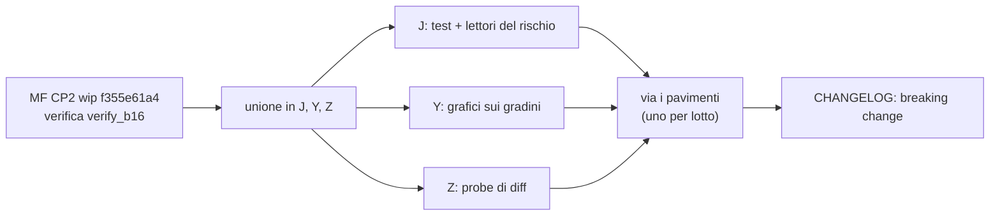

# Ripartenza — 26/10/2026

Fermi tutti dal 25/10 sera (pausa per il reset del limite settimanale). Nulla è stato spinto; `dev_release2` è fermo.
Il diario completo resta in `RECAP-ondata5.md`; qui c'è solo quello che serve per ripartire.

## 1. In breve

- **Ondata 5: circa 90 %.** Tutti i lotti sono chiusi tranne **D-P4** (le serie a gradini) e **B5-1j** (il titolare dopo
  un ripristino da CLI).
- **D-P4 a metà strada.** Il backend è fatto (MF) e i lotti sono riscritti (J); mancano i test di J, i grafici di Y, il
  confronto di Z e, alla fine, la rimozione dei pavimenti.
- **Da te servono 4 risposte** (§4): 15, 16, 17 su B5-1j e 18 sul banner «cambio vecchio».
- **L'ondata 6 parte solo a ondata 5 finita** (tua regola del 25/10). Primo lotto in caldo: W5-7, Crédit Agricole.

## 2. Stato per sessione

| Sessione | Stato | Ultimo commit sul ramo | Prossimo passo |
|---|---|---|---|
| **MF** (sotto-agente) | secondo checkpoint di D-P4 **salvato come «wip»**, non ancora verificato da me | `f355e61a4` (wip) sopra `1164a1e65` | leggere `verify_b16/summary.txt` (la verifica girava alla pausa); se è verde, riscrivere il messaggio del commit e unirlo nei rami di J, Y e Z |
| **J** | lotti e #48 a tratti **salvati come «wip»**: codice identico a HEAD (lotti 178/178, #48 12/12), circa 280 test esistenti ancora da adattare | `9bf2a3066` (wip) | finire l'adattamento dei test; poi i due lettori del rischio (`risk/data_quality.py`, `risk/results.py`), togliere i `*_dates` e l'anno breve in `assetSetLevels` |
| **Y** | passi 1–3 fatti: `stepSeries.ts`, l'adattatore per GrowthChart (25 casi di parità), l'anno breve nei grafici | `1a6687be7` | collegare i grafici al report a gradini (GrowthChart, allocazioni, P&L per broker, lotti, #48), circa 5 giorni |
| **Z** | l'AI Export legge i tratti (`a7eb38d5c`), anno breve fatto | `fa6539998` | dopo l'unione di MF: il probe di diff sulle 6 copie (atteso: 0 differenze) |
| **W** | tutti i lotti dell'ondata 5 chiusi (W5-8, W5-9 #47 nel browser, W5-10 avviso prima del 1900, W5-11 anno breve) | `8db10d43d` | libero; W5-7 (Crédit Agricole) ha il piano pronto, il codice è dell'ondata 6 |
| **X** | tutti i lotti chiusi (X5-4c, X5-5 anno breve) | `6b02bc7f6` | libero |
| **A** | A5-4 `user reassign-owner` fatto | `2f2c925c2` | A5-5 (email dopo un ripristino) e OWN-083 dopo le tue risposte 15–17 |
| **B** | analisi B5-1j fatta e rivista da A (ok con 6 modifiche, già integrate) | `d3437a203` (+ nota B5-1i non committata, voluta) | codice di B5-1j dopo le tue risposte 15–17 |
| **H** | H5-6 (P-2/P-3 del cloud) fatto, SHA girati al cloud | `1fd2a19ab` | libero |

## 3. D-P4 — la strada che resta



- **Cosa c'è già:** il report ha un punto per tratto (`date`…`through`) e il campo `range`; il MWRR sta in `mwrr_line`,
  con l'inizio e la fine di ogni tratto più un punto al mese nei tratti oltre 62 giorni; il «prezzo vecchio» rifinito
  (soglie e banner invariati); il cambio vecchio è una novità (`stale_fx_pairs`); la qualità dei dati a intervalli.
- **Prova di MF:** 214 casi sulle 6 copie, 0 differenze; sulle copie del 1900 i punti scendono da 94 338 a 1 304.
- **Un'eccezione voluta:** la candela del P&L di alcuni sabati e domeniche, che prima venivano ricalcolati per errore
  (il «venerdì + 8»). La chiusura del giorno è identica.
- **Stima rimasta:** circa 6–8 giorni-persona, soprattutto i grafici di Y.

## 4. Decisioni che aspettano te

| N. | Tema | Consiglio |
|---|---|---|
| 15 | B5-1j su self-hosted: la password va revocata anche lì dopo un ripristino? | **No**: non c'è un indirizzo fidato e chi ripristina i propri dati resterebbe chiuso fuori (B e A d'accordo) |
| 16 | B5-1j, nessun account può diventare titolare: il ripristino va avanti con un avviso o si rifiuta? | **Va avanti con un avviso**, come oggi; la CLI dice di usare `user reassign-owner` |
| 17 | B5-1j, l'email dopo il ripristino | **Un'email di reset con il link** più la frase «per la tua sicurezza la password è stata revocata; se il link scade usa Password dimenticata», in 4 lingue (la scrive A) |
| 18 | Banner «cambio vecchio» (cambio fermo da più di 7 giorni) nella UI | **Per ora solo il dato** nel report; il banner nell'ondata 6 |

Solo informazioni, non domande:
- con B5-1j anche la CLI e il pannello **rifiutano** un ripristino con conflitti sul titolare, come già fa l'app;
- deciso da me, e lo puoi cambiare: i punti mensili del MWRR nei tratti lunghi; l'aritmetica decimale con BigInt nel
  form di #47.

**Decise oggi (25/10):** 10 (`reassign-owner`), 11 (cura B a gradini, una sola forma `steps`), 12 (P-2/P-3 con la
revisione del DB), 13 (terza via: il titolare resta e la password viene revocata), 14 e 19 (Crédit Agricole a report
set; data operazione dalla colonna `Data Op.`; abbinamento valuta con valuta; soldi «in volo»), #47 nel frontend.

## 5. Treno 11 e candidato finale

- Il candidato di prova `train11-trial` (`48bd230d1`, worktree `gate-coord`) è **vecchio**: va ricostruito quando
  l'ondata 5 è chiusa, unendo tutti i rami.
- **Promemoria per il candidato finale:**
  - gate completo;
  - righe del CHANGELOG (sotto);
  - commit di sola formattazione black;
  - commit delle regole: `CLAUDE.md`, gli agenti, la skill e `backend-db.instructions.md` sono modificati e non
    committati nel checkout principale (la regola «una migrazione per release», il principio «piccoli conti nel
    frontend», le lezioni della skill);
  - un solo `import {spyOnApi}` nei test email e plugin-settings;
  - la riga delle famiglie in `plugin_settings.md`;
  - testlist segnata «✅ pronta».
- **Rossi noti che si chiudono con le unioni:** X5-F4b nel ramo di X (gli manca `cf9d58ec0` di Y); B5-1i (si chiude
  con B5-1j).

**Righe del CHANGELOG raccolte:**
- ✨ W5-8 — CSV generico: impostazione personale dell'ordine di giorno e mese.
- ✨ W5-9 — acquisto o vendita: scrivi l'importo totale o il prezzo unitario e l'altro si calcola subito; una
  transazione salvata mostra tutte e due le forme.
- ✨ W5-10 — una data prima del 1900 (form, Bulk, import) mostra un avviso e chiede conferma una volta.
- 🐛 W5-11 / X5-5 / Z / Y — una data con l'anno a una o due cifre non viene più spostata di un secolo né rifiutata.
- ✨ A5-4 — istanze managed: `./dev.py user reassign-owner <username>`; `user set-email` annulla anche un link di
  cambio email ancora aperto.
- 🔄 H5-6 — `/system/ready` distingue un database indietro (`behind`) o avanti (`ahead`) e mostra la sua revisione.
- ⚠️ D-P4 — le serie della storia del portafoglio sono a gradini (testo in inglese pronto in `CONTRATTO-P4b.md` §9; J
  aggiunge lotti e positions-series).

## 6. Seguiti (non bloccano)

- `hosting_providers.en.md`, righe 455 e 473: i link a `user set-email` tornano a `#set-email` quando IT/FR/ES avranno
  la sezione (debito di traduzione).
- Debito di traduzione IT/FR/ES per le pagine nuove di W, MF e A (nessun timbro: è debito vero).
- Backlog proposto da X: un controllo che nomini il modulo colpevole quando un import avvia un thread nella catena del
  preload.
- Ondata 6: `REVISIONE-ondata6.md` resta in caldo; la rivedi tu prima del via.

## 7. Primo giro di domani (coordinatore)

1. Leggere `verify_b16/summary.txt`. Se è verde: riscrivere il messaggio di `f355e61a4` come
   `feat(portfolio)!: …`; se è rosso: rimandare a MF con i log.
2. Riscrivere il messaggio di `9bf2a3066` (J) solo dopo la sua verifica.
3. Unire MF nei rami di J, Y e Z; far ripartire J (test), Y (grafici) e Z (probe).
4. Con le tue risposte 15–17: B scrive B5-1j, A scrive A5-5 e poi OWN-083.

## 8. Aggiunta dopo la pausa

La verifica di MF (`verify_b16`) è finita dopo la pausa; esito:

```
finmath rc=0 ============================ 3673 passed in 54.25s =============================
engine rc=0 ============================== 41 passed in 0.82s ==============================
roi rc=1 ============ 1 failed, 2082 passed, 6 warnings in 89.70s (0:01:29) =============
risk rc=0 ======================= 925 passed, 6 warnings in 47.80s =======================
api_portfolio rc=0 ============================= 55 passed in 22.36s ==============================
black rc=1
ruff rc=1
mkdocs rc=0
links rc=0
orphans rc=0
DONE
```

Lettura: tutto come atteso da MF. L'unico rosso di roi-fifo-utils è quello annunciato, il lettore del rischio di J (`test_date_range_bounds`). I rc=1 di black e ruff **non valgono**: lo script ha preso i file da `git status`, che dopo il commit «wip» era vuoto, quindi black e ruff sono partiti senza file. Domani vanno rilanciati sui file del commit `f355e61a4` (`git show --name-only`).
