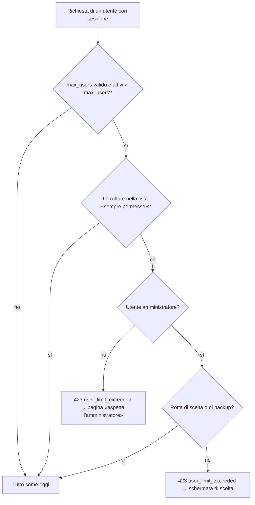

# A5-7 — Analisi: gli utenti attivi superano `max_users`

Autore: sessione A (Account e accessi). Stato: **solo analisi, nessun codice scritto**. Da rivedere con B (ripristino e backup).
Richiesta: R-2 del coordinatore cloud, approvata dal developer il 26/10. Assorbe B5-1k.

## 1. In una frase

Un solo stato, «oltre il limite», **calcolato dai dati ogni volta che serve** (non salvato): vale quando gli **utenti attivi sono più di `LIBREFOLIO_MAX_USERS`**. Finché c'è, gli utenti normali non entrano, e l'amministratore vede una schermata dove sceglie chi tiene l'accesso. Gli altri vengono **disattivati** (non cancellati). Dopo un ripristino non serve nessun codice speciale: i dati ripristinati hanno più utenti del limite, e lo stato scatta da solo.

## 2. Chi conta come «utente» (la cifra che scatena lo stato)

| Cosa | Conta per far scattare lo stato? | Conta per i posti? (`user_usage.used`, come oggi) |
|---|---|---|
| Account **attivo** | **sì** | sì |
| Invito vivo | no | sì |
| Account inattivo che aspetta il link di verifica / il setup dell'amministratore | no | sì |
| Account disattivato | no | no |

- **Scatta quando `attivi > max_users`** (strettamente maggiore). Con attivi = limite non succede niente (resta il rifiuto di nuovi inviti/registrazioni di oggi, `used >= max`).
- Inviti e account in attesa non sono utenti che entrano, quindi non fanno scattare lo stato. Ma tengono un posto: lo vediamo al punto 4.
- **Valore non valido** di `LIBREFOLIO_MAX_USERS`: oggi `_max_users()` lo legge come **0** (registrazione chiusa). Per il nuovo stato questo sarebbe un disastro (con 0 «tutti sono oltre» → nessuno entra per un refuso). **Regola: un valore non valido non fa mai scattare lo stato** (errore nel log come oggi, registrazione chiusa come oggi, nessun blocco degli accessi). Test dedicato.
- Limite non impostato → mai.

## 3. Dove si calcola: ogni richiesta, con un COUNT

- Una dipendenza del router `/api/v1`, fratello di `refuse_when_blocked` (`api/v1/instance_block.py`): `refuse_when_over_limit`, nel nuovo modulo `backend/app/api/v1/user_limit.py`. Lo schema è lo stesso del blocco: lista di funzioni permesse, 423 `Locked` con codice proprio, solo per chi ha una sessione (chi non ne ha prende il 401 di sempre).
- Costo: se `max_users` è `None` o non valido, **zero query**. Altrimenti un `SELECT COUNT(*) FROM users WHERE is_active` per richiesta con sessione. SQLite lo fa in microsecondi; niente cache da tenere coerente tra i worker (una cache in processo sarebbe sbagliata appena un altro worker disattiva utenti).
- All'avvio: un solo **warning nel log** («N utenti attivi su M posti: l'amministratore deve scegliere»), nessun passo che scrive. La stessa cifra va nello stato del pannello (punto 8).
- Ordine rispetto agli altri guardiani: blocco dell'istanza (`LIBREFOLIO_BLOCKED`) prima; poi questo.

### Ordine delle guardie (revisione di B, 26/10)

Router `/api/v1`, nell'ordine: 1. blocco dell'istanza (`refuse_when_blocked`); 2. attesa del ripristino (`refuse_when_awaiting_restore`); 3. ripristino interrotto o titolare ancora `pending` (`refuse_when_restore_interrupted`, 423 con `restore_interrupted_reason`); 4. **`refuse_when_over_limit`**. Se due guardie scattano insieme vince la prima: un ripristino con il titolare ancora senza account **e** utenti oltre il limite risponde con la guardia del ripristino (il titolare non può entrare, quindi la scelta non c'è ancora). Un test lo fissa.

### Rotte sempre permesse (a chiunque abbia una sessione)

Si **copia riga per riga** `ALLOWED_WHEN_BLOCKED` di `api/v1/instance_block.py`, tolte solo le cinque rotte del backup dell'amministratore (che passano solo all'amministratore, sotto). Resta quindi: `auth.login`, `auth.logout`, `auth.get_me`, `auth.inspect_link_token`, `auth.reset_password_with_link`, `auth.delete_own_account` + la sua anteprima, `backup_panel.start/get/download/delete_panel_backup*`, `backup_restore.get_restore_outcome` (biglietto monouso: serve alla pagina che aspetta il riavvio dopo un ripristino), `block.get_instance_block`, `instance.get_instance_config`, le sonde (`health`, `ready`, `info`), `wake.wake_sync`, `panel.get_panel_status`, le sette rotte del ripristino del pannello. Un test fissa la lista **e** che sia uguale a quella del blocco meno le cinque del backup admin. Le rotte del ripristino dell'amministratore (dall'app) restano **fuori**: un amministratore oltre il limite non lancia un altro ripristino prima di aver scelto.

### Rotte permesse **solo all'amministratore**

- Scelta: `GET /users/over-limit`, `POST /users/over-limit/resolve` (nuove, punto 6).
- Backup completo: `backup_instance.start_instance_backup`, `get_instance_backup_options`, `get_instance_backup_job`, `download_instance_backup`, `delete_instance_backup_job` (le stesse cinque che il blocco lascia passare).
- `ALLOWED_WHEN_OVER_LIMIT_ADMIN` = quelle sopra; un test fissa la lista (come per il blocco).

Un utente non amministratore che chiama una rotta di scelta/backup prende il 423 (non è nella sua lista).

## 4. La scelta: regole

Si possono tenere al massimo `max_users − account in attesa` utenti (`max_keep`: gli account in attesa non si liberano da qui). Gli **inviti vivi** tengono un posto ma si possono revocare: se gli utenti tenuti + gli inviti superano il limite, la risoluzione revoca gli inviti che non ci stanno, **dal più recente**, e la schermata lo dice prima di confermare. Esempio: limite 3, un invito vivo: tenere 2 utenti lascia il posto all'invito, tenerne 3 lo revoca.

Chi **si tiene per forza** (la schermata li mostra bloccati):
1. **Il titolare** dell'istanza (profilo `managed`, `account_protection` lo riconosce: flag `is_instance_owner`, o il fallback sull'indirizzo di `LIBREFOLIO_ADMIN_EMAIL`). Non si può disattivare, mai.
2. **Solo se non c'è un titolare da proteggere**: l'amministratore che sta scegliendo (altrimenti si chiude fuori da solo). Con un titolare, chi sceglie può anche lasciarsi fuori: il titolare è un amministratore, ne resta uno. Questo evita che un amministratore non titolare resti bloccato quando il piano ha un solo posto, tutto del titolare. Scelta fatta nel codice; l'analisi iniziale proteggeva sempre chi sceglie.
3. In ogni caso almeno **un amministratore attivo** deve restare (`NO_ADMIN_KEPT`).

Se non c'è un titolare da proteggere (profilo `managed` ma esito `none` di B5-1j, o self-hosted), la schermata protegge **solo l'amministratore che sta scegliendo**.

Se «per forza» + inviti superano i posti (caso raro: limite 1, titolare + invito vivo) → la risoluzione **revoca gli inviti vivi che non ci stanno** e la schermata lo dice prima di confermare. Domanda D3 sotto.

`POST /users/over-limit/resolve` `{keep_user_ids: [int]}`, una sola transazione, sotto il blocco di scrittura di SQLite (`begin_writes`, come la riattivazione, A-56):
1. rilegge lo stato (se non è più oltre il limite → **409 `NOT_OVER_LIMIT`**, nulla cambia: due amministratori che confermano insieme non si pestano i piedi);
2. controlla `keep_user_ids` (422 con codice: `UNKNOWN_USER`, `TOO_MANY_KEPT`, `PROTECTED_MISSING`);
3. per ogni attivo non scelto: **stessa operazione di `update_user_status(is_active=False)`** (fine sessioni con `end_sessions`, revoca dei link di verifica/setup, `updated_at`), mai `delete_user`. Si riusano le funzioni interne, non si riscrive la regola;
4. commit unico; log con i numeri e gli **id** (mai nomi o indirizzi); risposta `{kept, deactivated}`.

**Nessun dato si perde.** I broker di un utente disattivato restano; se era l'unico OWNER di un broker condiviso, gli altri non lo raggiungono finché l'amministratore non lo riattiva (la riattivazione resta con la regola di oggi: serve un posto libero). La schermata mostra per ogni utente il numero di broker di cui è **unico titolare** (un numero, non nomi), così chi sceglie vede l'effetto.

## 5. Che cosa vede ciascuno

**Amministratore, primo accesso.** Il login riesce. Al primo 423 l'app mostra, al posto di qualunque pagina, la schermata di scelta (stesso meccanismo di `InstanceBlockedPage`: un piccolo store `instanceUserLimit` impostato dall'intercettore di `zodios-client.ts`, e un ramo in più nel layout `(app)`). Contiene:
- il testo: «Questa istanza ha N utenti attivi ma il piano ne consente M. Scegli chi tiene l'accesso: gli altri verranno disattivati, non cancellati.»;
- l'**elenco** (nome utente, email, ruolo, n. di broker di cui è unico titolare), con caselle; titolare e tu stesso già spuntati e bloccati; contatore «scelti X di M» che impedisce di confermare se X > M;
- **«Scarica prima il backup completo»**: riuso di `BackupDownloadCard` (stesse cinque rotte), nella stessa schermata;
- «Conferma» → POST → l'app si ricarica normalmente.
- «Esci» sempre disponibile.

**Altri utenti.** Il login riesce (così non si dà un errore generico), poi pagina chiara: «L'amministratore deve ancora scegliere chi tiene l'accesso a questa istanza (limite di utenti superato). Riprova più tardi.» Solo «Esci» (e l'eliminazione del proprio account resta raggiungibile dal login come per il blocco). Nessun errore generico: il codice `user_limit_exceeded` ha la sua pagina.

**Disattivati dopo la scelta.** Al login ricevono il normale `ACCOUNT_DISABLED` («account disattivato»). Non aggiungo una colonna «disattivato per il limite»: servirebbe una modifica allo schema (005 è la sola migrazione della 1.3.0) per cambiare una frase. Domanda D4.

## 6. API (riepilogo)

| Rotta | Chi | Risposta |
|---|---|---|
| `GET /api/v1/users/over-limit` | amministratore | `{over_limit, active, max_users, places_for_users, revoked_invites_if_needed, users:[{id, username, email, is_superuser, protected: "owner"\|"you"\|null, owned_brokers_alone}]}`; se non è oltre il limite `over_limit=false`, `users=[]` |
| `POST /api/v1/users/over-limit/resolve` | amministratore | 200 `{kept, deactivated, revoked_invites}`; 409 `NOT_OVER_LIMIT`; 422 `UNKNOWN_USER` / `TOO_MANY_KEPT` / `PROTECTED_MISSING` |
| qualunque rotta non permessa | utente con sessione | 423 `{"code": "user_limit_exceeded"}` |

Dopo: `./dev.py api sync`.

## 7. Ripristino e backup (per la revisione di B)

- **Ripristino: nessun codice speciale.** L'esito di un ripristino con troppi utenti è lo stato «oltre il limite» al primo accesso. `confirm_restore`, la CLI e il pannello **non rifiutano più** per troppi utenti: il motivo di blocco `too_many_users` previsto da B5-1k **non si scrive**. (Nel mio ramo oggi non c'è: B5-1k non è ancora unito.)
- **Il conteggio del titolare riattivato** (nota della mia revisione di B5-1k) non serve più: lo calcola lo stato a regime, dai dati veri.
- **L'erede/ordine «prima il passaggio poi le cancellazioni»** di B5-1k cade: non si cancella nulla.
- **Primo avvio dopo il ripristino da pannello**: il titolare riceve il suo reset (A5-5) e può entrare; è lui (amministratore) a vedere la scelta. Gli altri aspettano. Il cloud lo vede dallo stato del pannello (punto 8).
- **Scaricare il backup prima** è già permesso a un amministratore anche quando l'istanza è oltre il limite (lista del punto 3).
- B ha rivisto questo paragrafo: ok con modifiche (le tre sopra). Non costruisce nulla: monta `BackupDownloadCard` e fa solo l'avviso nel rapporto del ripristino (B5-1k2).
- Da chiedere a B: una **copia di prova** di un backup con più utenti del limite entra nell'istanza senza rifiuto; i test di B5-1k su `too_many_users` diventano «il ripristino va a buon fine e lo stato scatta».

## 8. Cloud (R-2)

> _(parte del servizio gestito: nel repo privato `librefolio-cloud`)_
- **Richiesta per H** (`backend/app/schemas/hosting_panel.py`, `PanelStatusResponse`, e `backend/app/api/v1/panel.py:get_panel_status`): un campo `users_over_limit: bool` (veri se attivi > limite valido). Con `users_used`/`users_limit` il cloud non lo può dedurre, perché `used` include inviti e account in attesa. Lo calcolo io (`user_limit_service.over_limit_state`), H lo mette nel modello. Domanda D5.

## 9. Dove vive il codice (mio dominio)

- `backend/app/services/accounts/user_limit_service.py` (nuovo): `over_limit_state(session)`, `list_for_choice(session, admin)`, `resolve(session, admin, keep_ids)`. Nessun calcolo finanziario.
- `backend/app/api/v1/user_limit.py` (nuovo): la dipendenza e la lista; le due rotte stanno in `api/v1/users.py`.
- **Richiesta a H/coordinatore** (`backend/app/api/v1/router.py`, dove si aggancia `refuse_when_blocked`): una riga che aggancia anche `refuse_when_over_limit`.
- Frontend: `lib/features/instance/instanceUserLimit.svelte.ts`, `components/UserLimitChoicePage.svelte`, `components/UserLimitWaitingPage.svelte`, ramo nel layout `(app)`, riga nell'intercettore di `lib/api/zodios-client.ts` (come `markBlocked()`), chiavi i18n in 4 lingue (`./dev.py i18n … -y`), solo colori `lf-*`.
- Documentazione: `admin/hosting_instances.en.md` (che cosa succede quando si abbassa il limite), `developer/architecture/access_control.md`.

## 10. Esempio: 5 utenti, limite 3

Utenti attivi: **Anna** (titolare, amministratrice), **Bruno** (amministratore), **Carla**, **Dario**, **Elena**. `LIBREFOLIO_MAX_USERS` passa da 5 a 3 e l'istanza riavvia. Nessun invito vivo.

1. Avvio: warning nel log «5 utenti attivi su 3 posti». `panel/status` → `users_over_limit: true`.
2. **Carla** apre l'app: il login riesce; ogni chiamata dà 423 `user_limit_exceeded`; vede «L'amministratore deve ancora scegliere…» e può solo uscire.
3. **Anna** accede: vede la schermata di scelta. Anna è già spuntata e bloccata (titolare, e sta scegliendo). Posti: 3, quindi può spuntare altri 2. Prima scarica il backup completo dalla stessa schermata.
4. Anna spunta **Bruno** e **Carla**, lascia fuori **Dario** ed **Elena**. Il contatore dice «3 di 3». Conferma.
5. Dario ed Elena sono **disattivati** (sessioni chiuse, nessun dato cancellato; se Dario era l'unico titolare di un broker condiviso con Carla, Carla non lo raggiunge finché Anna non lo riattiva e c'è un posto). Bruno e Carla entrano al prossimo caricamento.
6. Se Anna avesse provato a non tenere sé stessa o a spuntarne 4: la schermata non glielo lascia fare, e il server lo rifiuta lo stesso (422 `PROTECTED_MISSING` / `TOO_MANY_KEPT`).
7. Se nel frattempo Bruno apre la schermata e conferma per primo con altre scelte → la conferma di Anna prende 409 `NOT_OVER_LIMIT` e l'app ricarica.

## 11. Test (rossi prima)

Backend (`services`, nuovo `test_user_limit.py`, registrato nel catalogo):
- stato: attivi ≤ limite → nessuno stato; attivi = limite → nessuno; attivi > limite → stato; limite assente → mai; **limite non valido → mai** (e `user_usage` come prima); inviti vivi e account in attesa non fanno scattare ma riducono i posti.
- regole di scelta: protetti (titolare managed, chi sceglie), `TOO_MANY_KEPT`, `UNKNOWN_USER`, `PROTECTED_MISSING`, `NOT_OVER_LIMIT` (due conferme di fila), inviti revocati solo se non ci stanno, **nessuna cancellazione** (conteggio righe di users e broker invariato), sessioni chiuse e `session_version` aumentata per i disattivati, e **nessuna modifica** a chi resta; un amministratore non-titolare in self-hosted.
- un singolo commit (come OWN-085: contare commit e rollback).
API (`api`, chiavi esatte):
- 423 `user_limit_exceeded` per un utente normale su una rotta qualunque; permesse: `login`, `logout`, `me`, `system/instance`; l'amministratore: scelta e backup sì, il resto 423; **lista fissata da un test** come per il blocco; chi non ha sessione prende il 401 di sempre; un'istanza non oltre il limite non cambia nessuna risposta.
- `GET/POST /users/over-limit` a chiavi esatte; 403 a un non amministratore.
- risposte pubbliche toccate (lezione H5-3): `instance-legal`, `registration`, `system` a chiavi esatte, eseguite.
Frontend (vitest): store, pagina di scelta (contatore, bloccati, conferma disattivata se troppi, backup), pagina d'attesa, nessun testo tradotto nei selettori. E2E: un caso solo (limite abbassato → admin sceglie → utente disattivato non entra).
Ripristino (con B): backup con più utenti del limite → ripristino riuscito → stato scatta.

## 12. Domande per il developer

- **D1.** Scatta con `attivi > max_users` (stretto). Va bene che «attivi = limite» non faccia niente? *(consiglio: sì)*
- **D2.** Un valore non valido di `LIBREFOLIO_MAX_USERS` non deve mai far scattare lo stato (resta registrazione chiusa). Confermi? *(consiglio: sì, un refuso non deve chiudere tutti fuori)*
- **D3.** Se titolare + inviti vivi non ci stanno nei posti, la risoluzione **revoca gli inviti** non rientranti e lo dice prima. Oppure rifiutare e basta? *(consiglio: revocare, gli inviti non sono dati)*
- **D4.** Nessuna colonna «disattivato per il limite»: chi è stato disattivato vede il solito «account disattivato». Basta così, o vuoi una frase dedicata (costa una colonna in 005)? *(consiglio: basta così)*
- **D5.** Aggiungere `users_over_limit` allo stato del pannello (lo scrive H). *(consiglio: sì)*
- **D6.** Serve anche un comando da terminale per chi gestisce l'istanza (`./dev.py user keep …`) per risolvere senza interfaccia? *(consiglio: no per ora; il cliente managed usa la schermata, l'operatore può disattivare con `user deactivate`)*

## 13. Rischi e cose da non toccare

- La dipendenza gira su **ogni** richiesta con sessione: un errore qui chiude fuori tutti. Perciò: valore non valido = mai; query semplice; test che fissano la lista; e la rotta `me` sempre permessa (altrimenti l'app non sa chi sei).
- Non si tocca `bulk_update_access`, né `delete_user`, né l'eredità dei broker: questa analisi toglie la parte di cancellazione e di erede che B5-1k voleva.
- CLI `user` resta esente dai guardiani, come oggi.
- Piano di lavoro dopo l'approvazione: (1) test rossi backend, (2) servizio + dipendenza + rotte, (3) `api sync`, (4) i18n e frontend con test, (5) documentazione. Lotti piccoli, un CHECKPOINT dopo il backend e uno dopo il frontend.
