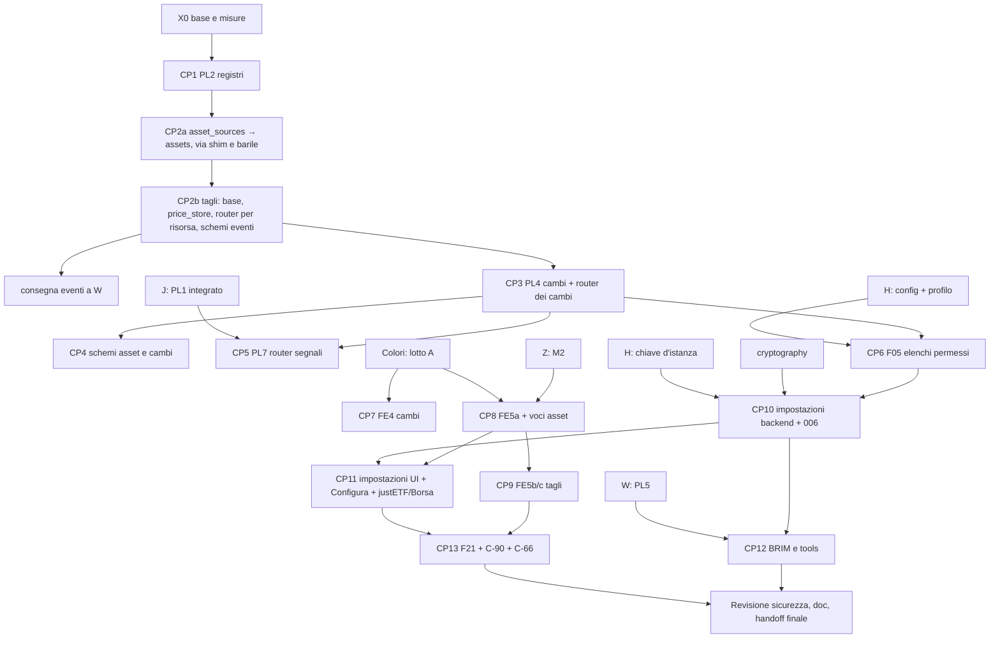

# Piano — fase 01, 03: plugin, asset e ricerca (X)

> **Via libera parziale al codice** — coordinatore 1.3, 14/10/2026 ~22:55, su delega esplicita del developer. Parole del
> developer, alla lettera, riportate dal coordinatore: «chat, sto leggendo
> LibreFolio_developer_journal/Release_2/Phase_1/decisioni-analisi-20261014.md — ho appena finito le prime 11 domande e
> sto iniziando piattaforma, ma ho già messo varie note dev, leggi intanto quelle, vedi se con quelle risposte devi
> aggiornare quello che viene dopo e poi vedi tu se aspettare che leggo tutto, o intanto grazie a queste riesci ad avviare
> qualche lavoro». Decisione del coordinatore: parte **solo X0 e CP1** (riordino puro); il resto aspetta il suo via, con
> le risposte del developer.
>
> - **Approvate** (coordinamento, 14/10): D-P1, D-X1, D-X3, D-X5, D-X6, D-X7, D-X8, D-X11, D-X12, D-X13, D-X14, D-X15.
>   D-X9 è **superata da C3** (schemi in pacchetti per dominio; gli eventi in `schemas/assets/events.py` o dove li colloca X
>   nel pacchetto). D-X10: oltre al confronto di `openapi.json`, la verifica della corrispondenza dei percorsi (C2).
>   **Ancora al developer**: D-X2 e D-X4 (non servono al CP1; nel documento delle decisioni sono le voci 18 e 19).
> - **Regole comuni**: piano generale, §6 (Git, «Forma comune del riordino» C1–C7, superfici condivise, regole di ogni lotto
>   di riordino, «Taglio dichiarato», nuove schermate) e §7 (programma colori, regola «chi parte prima»).
> - **Primo treno**: H CP1 → X CP1 → A A1; il CP1 di X entra dopo quello di H, con gli import riallineati all'aggiornamento
>   di base.
> - **Indicazioni per dopo** (coordinatore, 14/10): `market_calendar` e `web_link_finder` → `services/assets/` in CP2a;
>   eventi in moduli propri, consegnati a W dopo CP2b; `AssetModal` è fuori dai lotti dei colori e si può tagliare prima
>   del lotto A, con annuncio (§7 del piano generale), la pagina dell'asset dopo la riga di G; nel lotto F05, dal giro di
>   sicurezza di H, il `css_scraper` non deve raggiungere loopback, reti private, link-local e metadati del cloud, anche
>   dopo un redirect; le parti X6, X7, X8 e `fx.py:717` di U1 le scrive J nei file di X dopo PL4 (regola 10), con X
>   informato.
> - **Finestra della galleria**: 15/10 dalle 09:00, circa 2 ore: nessuna `all-backend` né build pesanti nella corsia.
>
> - Sessione: «X - Plugin asset e ricerca»; coordinatore «Release 1.3 planning» (`928ffa97-f0c3-4975-a442-3de0c2c20fc7`).
> - Worktree: `/Users/ea_enel/Documents/00_My/LibreFolio-worktrees/e-alfy-cuddly-engine`; ramo
>   `e-alfy-x-plugin-asset-e-ricerca`. Base del codice: `c9bb8f257643c0b770788033789425b41ba16715` (fast-forward del
>   coordinatore da `459131eb8`, solo journal, `scripts/visual_review/gallery_snapshot.sh` e `TODO_FUTURI.md`).
> - Corsia: porta **6183**, data-dir **`/tmp/librefolio-r13-x`**. Preambolo:
>   `PIPENV_CUSTOM_VENV_NAME=LibreFolio-SAUMUTtc pipenv run python dev.py test --test-port 6183 --data-dir /tmp/librefolio-r13-x <CAT> <AZIONE>`.
> - L'analisi (§1–§14) è quella consegnata al coordinatore il 14/10, con le correzioni della rilettura; l'avanzamento è
>   nel §15.

## 1. Fonti lette

`.github/copilot-instructions.md`; istruzioni `backend`, `backend-providers-{asset,fx,brim}`, `backend-{signals,risk,tools,schemas,db}`,
`frontend`, indici di `backend-testing`, `frontend-testing`, `mkdocs`; skill `asset-plugin`, `brim-plugin`, `tool-plugin`,
`devpy-i18n`, `wiki-search`. Piano 1.3 (§1–§12) e README di `Phase_1`; piano 43 §1, §4, §7.2–7.5, P2.0–P2.7; piano 45 §2–§9
(U-B1); `TODO_FUTURI.md` («🔌 Arricchimento…» r. 8, «⚙️ Impostazioni per plugin» r. 1924); feedback utente C (voci 3, 11, 15);
`BACKLOG_POST_1.2.md` (C-65, C-66, C-90, T-PL*, U-B*, sezione X); backlog 38 (K-16, K-19, K-20, O-8, O-9, O-20);
`TODO_ProssimeAttivita.md` voce 5; specifica cloud «Feature SaaS Readiness» (F03, F05, F06, F21; sola lettura). devWiki:
`domains/assets.md`, `domains/fx.md`, `decisions/provider-registry-decision.md`, `entities/asset-sources-package.md`,
`decisions/settings-write-path-contract.md`. **Grafo della devWiki non disponibile** nel worktree (atteso): pagine lette
direttamente.

## 2. Stato reale verificato (su `459131eb8`)

### 2.1 Registri e contratti delle famiglie

| Oggetto | Dove oggi | Note verificate |
|---|---|---|
| Basi e decoratori | `services/provider_registry.py` (617 righe) | `AbstractPluginRegistry` :115, `AbstractProviderRegistry` :314, `register_provider` :574, `register_plugin` :593; re-export pigri `SignalPlugin`/`RiskAnalytic` :20-38 (usati solo da `test_signal_registry.py:644-645`) |
| `FXProviderRegistry` | `provider_registry.py:373` | importato da 12 file app (6 plugin) e 8 test |
| `AssetProviderRegistry` | `:379` | 18 app (6 plugin), 15 test |
| `SignalPluginRegistry` | `:385` (validazione con import pigro di `signal_plugins.base`) | 32 app (23 plugin), 17 test |
| `RiskAnalyticRegistry` | `:428` (import pigro di `risk.base`) | 18 app (15 plugin), 5 test |
| `BRIMProviderRegistry` | `:471` (+ `auto_detect_plugin`, `get_compatible_plugins`, `list_plugin_info`) | 43 app, 15 test |
| `ToolPluginRegistry` | `tools/registry.py:175` | già «uno per famiglia» (sottoclasse di `AbstractPluginRegistry`) |
| Importatori di `provider_registry` | — | **107 file app, 45 test, 2 script** (il piano 43 diceva 104) |
| Contratto asset | `asset_sources/core.py:251-885` (`AssetSourceProvider`) | `params_schema` lista di dict (`core.py:701`); `get_plugin_instance` (`provider_registry.py:155-163`) crea un'istanza nuova a ogni chiamata e ricade in silenzio su `plugin_class()` se i kwargs danno `TypeError` |
| Contratto FX | `fx.py:52-337` | **si chiama `FXRateProvider`**, non `FXProvider` come scrive `backend-providers-fx.instructions.md` (deriva da correggere) |
| Contratto BRIM / segnali / rischio / tools | `brim_provider.py:118` (W) / `signal_plugins/base.py` (J) / `risk/base.py` (J) / `tools/base.py:95` | nessuna famiglia ha impostazioni; i tools girano in processi isolati senza principal né DB; il parse BRIM gira in un **process pool** (`brim_parse_pool.py`) |

### 2.2 Asset (servizi)

- Shim `services/asset_source.py` (21 righe): **13 importatori app** (i 6 plugin asset, `mockprov` compreso;
  `brim_provider.py:79`, `scheduler/jobs.py:15`, `risk/service.py:57`, `ai_export/components/{asset_resources,technical_shared}.py`,
  `api/v1/assets.py:69`, import pigro in `schemas/provider.py:204`), ~25 file di test e un diagnostico; il vecchio percorso
  compare anche in commenti e docstring (`utils/json_utils.py:10`, `schemas/common.py:369`, `db/models.py:123`,
  `signal_plugins/drawdown/plugin.py:119`) e nel runner (`_backend_services.py:184,195,515,617`, `_backend_utils.py:112`,
  `_server.py:221`, `scripts/coverage_analysis.py:55,178`). In più **`asset_sources/__init__.py` è un barile pigro**
  (`_EXPORTS`, `__getattr__`), un secondo shim non citato dal piano 43; nessuno lo usa per i nomi (solo import di
  sottomoduli), quindi si riduce a docstring senza danni.
- Pacchetto `asset_sources/` (5 609 righe): `core.py` 899, `crud.py` 871, `price_query.py` 939, `price_store.py` 1 020,
  `refresh.py` 688, `provider_management.py` 466, `search.py` 444, `metadata.py` 210, `manager.py` 22 (mixin).
- `price_store.py`: prezzi :55-472 (con `_upsert_asset_events` :277 usato da `refresh.py:556`), cambio di valuta :473-628,
  eventi :629-1020 (`bulk_upsert_events`, `query_events_bulk`, `get_events_by_ids`, `delete_events_bulk`).
- `web_link_finder.py` (273, legge 7 variabili d'ambiente fra cui `LIBREFOLIO_WEB_LINK_FINDER_API_KEY`: **H la tocca per F03**)
  e `market_calendar.py` (183; importato da `main.py`, `series_preparation.py`, `risk/{service,eligibility}.py`, `price_query.py`).

### 2.3 Cambi, router, schemi

- `fx.py` **1 673 righe** (piano: 1 679): base :52-337, normalizzazione :344, errori :380, sync `ensure_rates_multi_source` :401,
  catene :681, `sync_pairs_bulk` :780, `convert_bulk` :1238, `upsert_rates_bulk` :1435, `delete_rates_bulk` :1536.
  **17 importatori app fuori dai plugin, più i 6 plugin FX** (piano: 19): 7 di J (`financial_math/{average_cost,native_cash,
  yield_on_cost}.py`, `financial_math/lots/conversions.py`, `financial_math/portfolio/engine.py`, `portfolio_service.py`,
  `risk/eligibility.py`), 6 dell'AI Export, 3 miei (`api/v1/fx.py`, `price_query.py`, `price_store.py`), `scheduler/jobs.py`;
  11 test; patch dei test su `fx_service._fx_fetch_cache` e `fx_service.FXProviderRegistry` (`test_fx_sync_service.py:210-288`);
  le patch di `convert_bulk` sono sui moduli consumatori (non cambiano).
- `api/v1/assets.py` 1 229: quattro router (`asset`, `price`, `provider`, `event`) composti a :1227-1229; eventi :1027-1166;
  market data :1167-1226; catalogo segnali `GET /assets/prices/signals` :735. `api/v1/fx.py` 1 091: `providers`, `currencies`;
  catalogo segnali :516; `convert` con piano/esecuzione dei segnali intrecciati :524-722; rotte :729-1089. `api/v1/signals.py` 65.
- `operationId` = nome funzione + percorso + metodo (default FastAPI): spostare le funzioni non li cambia; **l'ordine dei
  percorsi** in `openapi.json` segue l'ordine di registrazione (in `assets.py` le rotte proprie dell'`asset_router`, in ordine
  di file, poi `prices`, `provider`, `events`; in `fx.py` `providers` poi `currencies`): riproducibile identico dopo la
  divisione. `openapi.json`/`generated.ts` sono ignorati da git; `dev.py api schema` (solo Python) basta a provare «nessuna
  differenza» sui lotti backend; `api sync` completo vuole `node_modules`.
- **Test che importano i moduli dei router**: `test_fx_api_unit.py` (patch su `fx_api.sync_pairs_bulk`,
  `fx_api.FXProviderRegistry` e altre globali), `test_fx_signals_api.py` (`fx_api.convert_bulk`), `test_fx_compress_errors.py`,
  `test_signal_catalogs.py`, `test_signal_request_validation_api.py` (funzioni di `api/v1/{assets,fx}`),
  `test_schemas/test_fx_route_schemas.py`. Dopo la divisione le patch puntano al sotto-modulo che usa il nome; un `setattr` su
  un nome sparito fallisce rumorosamente (nessuna patch muta), ma va riscritto.
- Schemi: `assets.py` 1 000, `prices.py` 551 (eventi :270-456), `provider.py` 438 (`FXProviderInfo` dentro), `refresh.py` 245
  (FA + FX insieme), `fx.py` 500; importatori: assets 15 app/26 test, prices 13/32, provider 11/16, refresh 5/12.

### 2.4 Frontend

- `lib/components/assets/` 55 file; `AssetModal.svelte` **2 510**; `routes/(app)/assets/[id]/+page.svelte` **3 597** (piano 3 578;
  polling a :1494 e :2000-2064, che Z cambia); `assets/+page.svelte` 1 864; `lib/components/fx/` 10 file;
  `fx/+page.svelte` 1 263, `fx/[pair]/+page.svelte` 1 652. Importatori di `$lib/components/{assets,fx}`: 19 file, fra cui
  `ImportWizardModal` e `TransactionFormModal` (W, FE8), dashboard, rischio, lotti, planner del PAC.
- Impostazioni: `routes/(app)/settings/+page.svelte` con 4 schede fisse (`TabId`); il registro delle schede è di A.
- Ricerca: `AssetSearchAutocomplete.svelte` legge l'SSE con `fetch` manuale (`/assets/provider/search/stream`); i risultati
  arrivano **in ordine di risposta**; la cache di ricerca è per `(provider, query)` (`search.py:237`, `:368`).
- `node_modules` assente (atteso): servirà `npm ci` (con il via del coordinatore) al primo lotto frontend.

### 2.5 Voci del dominio

| Voce | Stato verificato |
|---|---|
| K-16 | aperta: `borsa_italiana/plugin.py:82` `"etc/etn": AssetType.ETF` |
| K-19 | aperta: la lista asset non ha snapshot né filtri nell'URL |
| K-20 | aperta, riga spostata: `assets/[id]/+page.svelte:2689` usa `$page.url`; `lib/utils/url/dateRangeUrl.ts:13` scrive con `history.replaceState` |
| O-8 | aperta: `AssetDataEditorSection.svelte:444`, `:466`, `:467` |
| O-9 | aperta: `justetf/` e `css_scraper/` non hanno `i18n/`; il frontend legge già `assets.providerParams.${code}.${kind}.${key}` (nessuna modifica frontend) |
| O-20 | aperta: `AssetModal.svelte:1462` (sync post-creazione `start: 'resume'`) più `assets/+page.svelte:1834-1840` |
| C-66 | aperta: `ui/modals/SyncModalBase.svelte`, `PageSyncModal`, `AssetSyncModal`, `FxSyncModal` |
| C-90 | aperta: `ProviderAssignmentSection.svelte:372` (**file del lotto A dei colori**) |
| Voce 5 (link alle transazioni nella modale di cancellazione) | **già fatta** il 10/09 (`e50d66408`): conteggio e link sia nella cancellazione singola (`assets/+page.svelte:920-934`, `asset-delete-transactions-link`) sia nella multipla (`:985-994`); backend `FAAssetDeleteResult.transaction_count` (`schemas/assets.py:809`, `crud.py:376-385`); E2E in `e2e/assets/asset-list.spec.ts`. Da chiudere |

## 3. Già fatto, contraddetto, derive

- Voce 5: fatta (sopra). La pagina wiki F-095 la dà ancora «pianificata».
- Numeri del piano 43 superati: importatori di `provider_registry` 107/45/2; `fx.py` 1 673 righe e 17 importatori app.
- PL2 non può spostare `FXProviderRegistry` nel suo runtime senza PL4: un pacchetto `services/fx/` e il modulo `services/fx.py`
  non possono convivere (vince il pacchetto). Il registro FX si sposta con PL4.
- `asset_sources/__init__.py` è un barile pigro: PL6 (CP2a) lo riduce a docstring.
- `backend-providers-fx.instructions.md` («`FXProvider`») e la mappa di `backend.instructions.md` («`services/fx.py`
  (`convert_bulk`)») vanno corrette nel lotto che sposta il file.
- La voce 15 dell'utente C («nazione e valuta») si traduce così: **justETF → valuta preferita** (EUR/USD/CHF/GBP, o la valuta
  del fondo 👑); **Borsa Italiana → lingua preferita** (IT/EN, le due bandiere). Default «tutte» = comportamento di oggi.
- La specifica cloud F21 nomina un terzo livello `advanced`; il perimetro testuale del coordinatore ne ha due
  (premium/community): seguo il coordinatore.
- Consegna degli eventi: confermata dal piano generale sulla base nuova (`f27e83448`, «Fuori pista» delle sessioni avviate).
- Il gate `utils gate-plugin-layout` trova le famiglie leggendo i registri in tutto `backend/app`
  (`test_plugin_layout_gate.py:166`, `:439`) e il solo `PLUGIN_MODULE_NAME` in `provider_registry.py`: sopravvive a PL2 senza
  modifiche, purché `PLUGIN_MODULE_NAME` resti nelle basi.

## 4. Disegno per area

### 4.1 Riordino backend — forma d'arrivo

```text
services/
  provider_registry.py      basi + decoratori (D-P1), senza registri di famiglia né re-export pigri
  plugin_settings/          NUOVO: campi dichiarati, archivio cifrato, risoluzione, servizio
  assets/                   ← asset_sources/* + registry.py + base.py + web_link_finder.py + market_calendar.py
    registry.py base.py core.py crud.py manager.py metadata.py price_query.py provider_management.py
    refresh.py search.py price_store.py currency_change.py event_store.py(→W) web_link_finder.py market_calendar.py
  asset_source_providers/   invariato (D-P2)
  fx/                       ← fx.py, che in CP1 entra come fx/fx.py (C1) accanto a fx/registry.py; al PL4 il taglio per tema
                            (base.py, sync.py, conversion.py, storage.py)
  fx_providers/             invariato
  brim/registry.py          NUOVO in PL2; il pacchetto lo riempie W (PL5)
  signals/registry.py       NUOVO in PL2; il pacchetto lo riempie J (PL1)
  risk/registry.py          NUOVO in PL2 (pacchetto di J)
api/v1/
  assets/  __init__.py (composizione dei sotto-router, C2) crud.py providers.py prices.py events.py(→W) market_data.py
  fx/      __init__.py (composizione, C2) providers.py currencies.py
  plugin_settings.py        NUOVO
schemas/                    pacchetti per dominio (C3): schemas/assets/ con gli eventi in schemas/assets/events.py (→W),
                            __init__.py con la sola docstring; l'hub schemas/__init__.py resta
```

Regole (piano 43 P2.0): prima la rinomina (`git mv`, ≥ 95 % in `git diff -M`), poi il taglio; niente shim né barili;
`patch` dei test sui nuovi percorsi; grep dei vecchi percorsi a zero in `backend/`, `scripts/`, `.github/`,
`mkdocs_src/docs/developer/` (commenti e docstring compresi); `openapi.json` identico (hash di `dev.py api schema`
prima/dopo); `python -c "import backend.app.main"`.

Due moduli toccano H: `market_calendar.py` (importato da `main.py:44`, che H svuota estraendo l'avvio) e
`web_link_finder.py` (H ci aggiunge `_FILE` per la sua chiave, F03). Si spostano in `services/assets/` in CP2a (indicazione
del coordinatore, 14/10); git segue una rinomina anche se l'altro ramo modifica il file, e il solo conflitto possibile è la
riga d'import in `main.py` o nel suo successore, da riallineare all'aggiornamento di base.

### 4.2 Riordino frontend

- **FE4** `lib/features/fx/` ← `components/fx/*`, `stores/fxStoreRegistry.ts`, `stores/fx/*`, gli helper solo-FX
  (`utils/currency/fxConversionHelper.ts`, e `fxRoutesStore`/`currencyGraph*` solo se nessun altro dominio li usa: si decide
  dagli importatori). Solo rinomina + import. Dopo il lotto A dei colori.
- **FE5** `lib/features/assets/` ← `components/assets/*`, `utils/{assetPriceDerived,assetSimilarity,assetGrouping,assetIdentifiers}`:
  FE5a rinomina; FE5b taglio di `AssetModal` lungo le cuciture già marcate (identificativi, confronto metadati, salvataggio
  create/edit, applicazione del risultato di ricerca) in componenti e moduli `.ts`; FE5c taglio della pagina
  `assets/[id]` (caricamento dati, azioni, derivati, schede del template). `data-testid`, chiavi i18n, URL invariati;
  D-P4 (file pubblico per gli import fra feature, mai per i moduli presi da `vi.mock`). Dopo il lotto A e dopo M2 di Z.
  Indicazione del coordinatore (14/10): `AssetModal` è fuori dai lotti dei colori e si può tagliare anche prima del lotto
  A, con l'annuncio della regola «chi parte prima» (§7 del piano generale); la pagina dell'asset dopo la riga di G.

### 4.3 Elenchi dei fornitori permessi (F05, parte X)

- `LIBREFOLIO_ASSET_PROVIDERS_ALLOWED`, `LIBREFOLIO_FX_PROVIDERS_ALLOWED` (+ `_FILE` non serve: non sono segreti), letti con
  l'helper di configurazione di H. **Non impostate = tutti permessi** (self-hosted invariato). Profilo gestito (interruttore di
  H) e non impostate = solo i fornitori **non scraper** (D-X4). `MANUAL` sempre permesso; i fornitori di test esclusi.
- Ogni fornitore dichiara `is_scraper` (asset: yfinance, justETF, Borsa Italiana, CSS scraper = sì; scheduled_investment = no;
  FX: banche centrali = no). Default **prudente**: un fornitore che non lo dichiara conta come scraper, così un plugin di terzi
  montato non entra da solo in un'istanza gestita. È un attributo distinto dal `tier` di F21: «community» non vuol dire
  scraper (una futura API ufficiale gratuita, come OpenFIGI, sarebbe community ma non scraper). Facoltativo: un flag
  dichiarato «solo test» sostituisce i nomi scritti a mano (`api/v1/assets.py:419`, `api/v1/fx.py:129`).
- Nel profilo gestito senza elenchi espliciti la ricerca degli asset resta senza fornitori finché non arriva il fornitore a
  pagamento (F06) o l'operatore ne permette qualcuno: è la specifica («scraper disattivati di default»), da sapere.
- Un punto unico per famiglia (`registry.is_allowed(code)`), controllato a: elenco, ricerca, probe, assegnazione, sync, prezzo
  corrente, metadati. **Asset già legati a un fornitore non permesso** (D-X5): l'assegnazione resta nel DB; sync e prezzo
  corrente lo saltano con esito per voce `PROVIDER_NOT_ALLOWED` (niente 500, niente spam nello scheduler); le letture delle
  assegnazioni espongono `provider_allowed: false`; la UI mostra un avviso con «Cambia fonte» o prezzi manuali; mai
  cancellazioni né riassegnazioni automatiche. FX: il fornitore non permesso esce dalla catena di ripiego della coppia,
  l'esito della gamba lo dice; nessuna modifica alle rotte salvate (l'ambiente può tornare indietro).
- Facoltativo, se H offre l'area avvisi: «N asset usano fonti non permesse su questa istanza» per l'admin.
- Dal giro di sicurezza di H (coordinatore, 14/10), nello stesso lotto: il `css_scraper` segue i redirect su URL scelti
  dall'utente; vanno bloccati loopback, reti private, link-local e metadati del cloud, anche dopo un redirect.

### 4.4 Impostazioni dei plugin

**Contratto** (`plugin_settings/fields.py`, `contract.py`): ogni base di famiglia (asset, FX, BRIM dopo PL5, tools) eredita
un mixin con `settings_fields: ClassVar[tuple[PluginSettingField, ...]] = ()`. Un campo dichiara: `key`, `type`
(`string|number|integer|boolean|select`), `scope` (`user` = personale | `system` = solo admin), `secret` (solo `string`),
`required`, `default`, `options`, `label`/`description` in inglese (ripiego per i plugin montati senza traduzioni) e chiavi
i18n dichiarate nel campo (come `name_i18n_key` dei tools: la UI non costruisce chiavi), `env` facoltativo (alias esplicito).
La dichiarazione è statica, validata alla registrazione (chiavi uniche, tipi, default validi; per i tools un campo `secret` è
rifiutato: un Tool non chiama fonti esterne). Un campo personale serve alle preferenze di un utente; un campo di sistema
all'istanza (per esempio la chiave di un fornitore a pagamento, che nel self-hosted l'admin inserisce una volta per tutti).

**Valori e precedenza** (`resolver.py`): variabile d'ambiente `NAME` → `NAME_FILE` → DB → default. Nome derivato
`LIBREFOLIO_PLUGIN_<FAMIGLIA>_<CODICE>_<CAMPO>` (maiuscolo, non alfanumerici → `_`), più l'alias dichiarato (es.
`LIBREFOLIO_TWELVEDATA_API_KEY`, D-X6). Una variabile impostata **vince e blocca** il campo. Profilo gestito: i campi bloccati
dall'ambiente **non compaiono** né nella UI né nelle API.

**Archivio** (`store.py`, migrazione **006**, `006_plugin_settings`): tabella `plugin_settings` (`family`, `plugin_code`,
`field_key`, `scope`, `user_id` FK `users.id ON DELETE CASCADE`, `value_json` | `secret_ciphertext`, `key_id`, `updated_at`,
`updated_by_user_id`); CHECK su scope/utente e «esattamente uno fra valore e cifrato»; indici unici **parziali** (uno per
`system`, uno per `user`), perché in SQLite i NULL non collidono in un UNIQUE; gli indici parziali vanno dichiarati anche nel
modello (`sqlite_where`), altrimenti il confronto modello/DB di `db_schema_validate.py` li vede come differenza. Righe di campi
non più dichiarati: ignorate. Id della revisione `006_plugin_settings` (19 caratteri, sotto il limite di 32).

**Cifratura** (`crypto.py`, D-X1): `cryptography`, AES-256-GCM; sottochiave HKDF-SHA256 dalla chiave d'istanza di H con
`info="librefolio/plugin-settings/v1"`; **AAD = contesto** (`famiglia|plugin|campo|scope|user_id`), così un cifrato spostato su
un'altra riga non si decifra; `key_id` = impronta della sottochiave, per la rotazione; nonce casuale da 96 bit.

**API** (`api/v1/plugin_settings.py`, bulk come il resto del progetto): `GET /api/v1/plugins/settings` (catalogo dei plugin
con campi, stato per il chiamante: valore se non segreto, `is_set`, `source` env|db|default, `locked`, `editable`);
`PATCH /api/v1/plugins/settings` (lista di `{family, plugin_code, field_key, scope, value | clear}`; esito **per campo**, tutti
tentati, rifiuti con codice: `FORBIDDEN_SCOPE`, `LOCKED_BY_ENV`, `INVALID_VALUE`, `UNKNOWN_FIELD`; contratto di
`settings-write-path-contract`). **Un segreto non torna mai**: lo schema di risposta non ha il campo; scrittura sola; in
ingresso il valore segreto è un `SecretStr` senza vincoli di validazione nello schema (i controlli stanno nel servizio, con
messaggi che non lo ripetono), così nessun 422 lo rimanda indietro né finisce in un log.
Permessi: `system` lo scrive solo l'admin; `user` solo il proprietario; l'admin non vede le impostazioni personali di altri,
nemmeno se esistono. Un non-admin vede i campi di sistema in sola lettura: il valore se non è segreto, altrimenti solo
«configurato / da configurare» (D-X15).

**Consegna al runtime** (D-X13): il core risolve i valori **prima** di entrare nel thread del provider (nessun DB nei plugin) e
li lega all'istanza con `bind_settings(...)`, letti dal plugin come `self.settings` (vuoto di default, così i plugin di oggi e
quelli di terzi non cambiano); mai via costruttore, per il ripiego silenzioso di `get_plugin_instance`. L'istanza è nuova a
ogni chiamata, quindi i valori di un utente non restano a un altro.

| Famiglia | Percorso | Valori consegnati |
|---|---|---|
| Asset | ricerca, probe (con utente) | `system` + `user` del chiamante |
| Asset | prezzo corrente, storico, metadati, sync, scheduler | solo `system` (i prezzi sono condivisi fra gli utenti) |
| FX | sync (utente o scheduler) | solo `system` |
| BRIM (dopo PL5) | parse dell'utente che carica | `system` + `user`, passati come argomento picklable al process pool |
| Tools | compute del richiedente | solo non segreti, `system` + `user`, nel contesto d'esecuzione |

Valore obbligatorio mancante → esito strutturato `NOT_CONFIGURED` (asset: `AssetSourceError`; FX: errore della gamba), mai 500;
nel pannello del fornitore e nella ricerca il fornitore compare «da configurare», con il pulsante Configura.
Le cache del core che dipendono dalle impostazioni (ricerca: oggi `(provider, query)`) aggiungono alla chiave **un'impronta
HMAC** (sottochiave d'istanza) di tutti i valori consegnati, segreti compresi: mai il valore, e nessuna condivisione dei
risultati fra preferenze o chiavi diverse.

**UI**: scheda «Plugin» nel registro di A (una riga) costruita dal catalogo, raggruppata per famiglia (Prezzi, Cambi, Import
broker, Strumenti); modulo generato per tipo; segreto = campo a sola scrittura con «impostato il …», «Sostituisci», «Cancella»;
campo bloccato con la nota «impostato dal server»; nel pannello del fornitore di «Aggiungi asset» il pulsante **Configura**
apre lo stesso modulo filtrato sul plugin. Sottosistema i18n nuovo `pluginSettings` (non tocco `settings` di A); le etichette
dei campi stanno nei frammenti dei plugin sotto `pluginSettings.<famiglia>.<codice>.*` (il gate di proprietà si estende di
un'area per plugin). Primo uso (D-X14): `justetf.preferred_currency`, `borsa_italiana.preferred_language` (personali, default
«tutte»; filtrano i risultati e, se il filtro svuota la lista, mostrano tutto; legenda della 👑).

**U-B1** (traduzioni dei plugin montati a runtime): con il testo inglese di ripiego nelle dichiarazioni non serve alle
impostazioni. Il merge a runtime (`GET` dei frammenti + `addMessages`) resta facoltativo (D-X11).

### 4.5 Analisi dei rischi delle chiavi (prima del codice)

**Cosa protegge la cifratura e cosa no**

| Scenario | Protetto? | Perché |
|---|---|---|
| Copia del solo DB (file condiviso per supporto, dump, replica Litestream su S3, backup del solo DB) | **Sì** | la chiave non è nel DB |
| Lettura via SQL o export di tabelle | **Sì** | si vede solo il cifrato |
| Volume dati intero, o zip di backup F01 con `secrets/` + DB | **No** | chiave e cifrato viaggiano insieme |
| Admin dell'app che scarica il backup completo (F01) e decifra offline | **No** | vedi D-X2: è il buco vero rispetto a «l'admin non legge i segreti personali» |
| Processo compromesso (RCE), dump di memoria, plugin malevolo montato | **No** | il valore in chiaro esiste in memoria durante la chiamata; un plugin gira nel processo e può leggere DB e chiave |
| Operatore con shell sul container o sul volume | **No** | confine di fiducia dichiarato: chi gestisce l'istanza può leggere tutto |
| Cifrato spostato su un'altra riga o un altro utente | **Sì** | AAD con il contesto: la decifratura fallisce |

**Minacce e misure**

1. Fughe applicative (API, UI, log, messaggi d'errore, AI Export, chiavi delle cache, `/settings/cache/status`):
   scrittura sola; nessuno schema di risposta porta il valore; **redazione per valore** dei segreti risolti in ogni
   `AssetSourceError`/errore FX/BRIM e nei log prima che escano (un provider che mette la chiave nell'URL produce eccezioni
   con l'URL); chiavi di cache con impronte, mai il valore; l'AI Export non legge la tabella (test con un segreto marcatore).
2. Admin e segreti personali: nessun endpoint li espone ad altri; il backup resta il canale aperto (D-X2).
3. Chiave sullo stesso volume: H la crea in `<DATA_DIR>/secrets/` (600, atomica); la doc consiglia
   `LIBREFOLIO_INSTANCE_KEY_FILE` su un mount separato (Docker secret); nel cloud la inietta il pannello.
4. Rotazione: righe con `key_id`; la decifratura prova le chiavi note, la cifratura usa la corrente; comando di ricifratura
   (`dev.py`, file condiviso: una voce) quando H definisce la rotazione della chiave d'istanza. Chiave persa o cambiata: il
   campo risulta «impostato ma illeggibile, reinseriscilo» (mai un crash, mai un valore sbagliato); avviso all'admin.
5. Memoria dei worker: risoluzione a ogni chiamata, nessuna cache del chiaro; i tools non ricevono segreti; il process pool
   BRIM li riceve solo se il plugin li dichiara.
6. Plugin di terzi montati: sono codice fidato (documentato); ognuno riceve solo le proprie impostazioni.
7. Profilo gestito: campi bloccati dall'ambiente invisibili; nessuna scrittura nel DB per quelli.
8. Test e fixture: mai chiavi vere; chiave d'istanza generata per corsia.
9. `provider_params` resta per i parametri d'identità dell'asset, condivisi fra gli utenti, in chiaro, esportati e visibili a
   chi vede l'asset: **mai un segreto lì** (regola scritta nella guida dei plugin, controllata in revisione).
10. Corpo delle richieste: nessun middleware registra il corpo di `PATCH /plugins/settings` (da verificare con H, che possiede
    i middleware); `SecretStr` in ingresso (§4.4).

**Proposta per §10 n. 5**: segreti personali ammessi, scrittura sola dal proprietario, l'admin non li legge mai **dall'app**;
in più (D-X2) gli zip di backup scaricabili dalla UI contengono la chiave d'istanza solo se protetti da password (decisione
6), altrimenti la escludono e i segreti si reinseriscono dopo il ripristino. Revisione `security-review` a fine lavoro.

### 4.6 Ordine dei fornitori nella ricerca (F21) e C-90

- Ogni fornitore asset dichiara `tier` (`premium` | `community`, default `community`) e `search_priority` (intero, più basso =
  prima). Sovrascrittura (D-X8): `LIBREFOLIO_ASSET_PROVIDERS_PREMIUM` e `LIBREFOLIO_ASSET_PROVIDERS_ORDER`, non impostate =
  dichiarato. `FAProviderInfo` espone `tier` e `priority`; la ricerca non in streaming ordina per gruppo e priorità; lo
  streaming resta per arrivo e il frontend raggruppa.
- UI (dopo FE5 e il lotto A): sezione Premium in testa con badge (funzioni condivise dei colori); poi «Non lo trovi?
  Segnalacelo» (URL di supporto se configurato, altrimenti le issue GitHub) e «Prezzo manuale / import»; in fondo la sezione
  chiusa «Fonti non premium»; scegliendo un risultato di quella sezione, avviso «fonte di terzi, nessuna garanzia» che vale solo
  per quell'asset (niente memoria globale). **Se nessun fornitore premium è attivo, la lista resta come oggi** (D-X3).
- C-90: accanto al risultato di «Testa configurazione», la nota «prova sugli ultimi giorni: alla creazione LibreFolio scarica
  tutto lo storico» (in `ProviderAssignmentSection`, dopo il lotto A).

### 4.7 Voci del dominio

K-16 (`etc/etn` → `ETF_COMMODITY`, D-X7, test in `borsa-italiana-search`); O-9 (frammenti `i18n/` per justETF e CSS scraper,
4 lingue); O-8 (le tre stringhe con chiavi esistenti o nuove in `assets`); K-20 (URL della scheda da `window.location`, come
`AssetBrowseNav.svelte:91`); O-20 (un solo sync alla creazione, con un test rosso che conta le chiamate); K-19 (`snapshot` di
SvelteKit sulla pagina lista per i filtri); C-66 (avviso nel dialogo di sync quando l'intervallo copre dati già presenti;
`SyncModalBase` va verificato con le liste dei lotti colori); C-90 (sopra); voce 5 chiusa.

## 5. Superfici esatte

| Lotto | Sorgenti | Test | Doc e `.github` |
|---|---|---|---|
| PL2 | `provider_registry.py`; nuovi `assets/registry.py`, `brim/{__init__,registry}.py`, `signals/{__init__,registry}.py`, `risk/registry.py`; righe d'import in ~95 file app (plugin, servizi, `main.py`, `api/v1/{system,assets,fx,brokers}.py`, AI Export) | ~50 file (registri, gate `plugin-i18n-ownership`, `test_signal_registry.py:36,644`) | `patterns/registry_pattern.md`, guide dei plugin (asset, fx, brim, signal, tool), `backend/{assets,brim,risk}/architecture.md`; istruzioni `backend-providers-*`, `backend-{signals,risk,tools}`; skill asset/brim/signal/risk/tool |
| CP2a/CP2b — asset backend ed eventi | `asset_sources/*` → `assets/`, shim e barile via, `core.py` → `base.py` + `core.py`, `price_store.py` → `price_store`/`currency_change`/`event_store`; `api/v1/assets.py` → `api/v1/assets/{router,crud,providers,prices,events,market_data}.py`; schemi degli eventi in `schemas/assets/events.py` (C3); `api/v1/router.py` intatto (C2); `market_calendar.py`/`web_link_finder.py` in `services/assets/` (CP2a); ~30 importatori app | ~32 test di servizio e API; `test_signal_catalogs.py`, `test_signal_request_validation_api.py` (import dei router) | `backend/assets/architecture.md`, `backend/assets/events.md`, `search_link_finder.md`, `architecture/settings_cache.md`, `asset_plugin_guide.md`; `backend-providers-asset` (`applyTo`); runner (stringhe dei percorsi), `scripts/coverage_analysis.py` |
| CP3 — PL4 cambi | `fx.py` → `fx/{registry,base,sync,conversion,storage}.py`; `api/v1/fx.py` → `api/v1/fx/{router,providers,currencies}.py`; 6 plugin FX; 17 importatori app | 11 test di servizio, patch di `test_fx_sync_service.py`; `test_fx_api_unit.py`, `test_fx_signals_api.py`, `test_fx_compress_errors.py`, `test_fx_route_schemas.py` (patch sui nuovi sotto-moduli) | `fx_plugin_guide.md`, `backend/fx/{architecture,configuration}.md`, `financial_math.md`; `backend-providers-fx` (`applyTo`, nome della base), mappa di `backend.instructions.md` |
| PL7 | `api/v1/signals.py` + estrazione dei pezzi segnali da `prices/query` e `currencies/convert` | `api signal-*` | `backend-signals` (sezione API) |
| Schemi | `schemas/{assets,prices,provider,refresh,fx}.py` (D-X9) | importatori | `backend-schemas.instructions.md` |
| F05 | `assets/registry.py`, `fx/registry.py`, choke point nei servizi, schemi `provider_allowed` | nuovi pytest | sezione X di `.env.example`; testo per `admin/configuration` (H) |
| Impostazioni | `plugin_settings/*`, `db/models.py` (un modello), `alembic/versions/006_plugin_settings.py`, `api/v1/plugin_settings.py`, `schemas/plugin_settings.py`, basi di famiglia, justETF/Borsa; frontend `lib/features/plugin-settings/*`, una riga nel registro schede di A, «Configura» | pytest servizi/API/migrazione/sicurezza; Vitest; E2E; galleria | pagina dev `patterns/plugin_settings.md`; admin (sicurezza e variabili); utente `user/settings/plugins.md`, pagine dei fornitori |
| F21 + C-90 | `assets/registry.py`, `assets/search.py`, `FAProviderInfo`; `features/assets/` ricerca e pannello | pytest, Vitest, E2E | `search_link_finder.md`, `user/assets/create-edit.en.md` |

Runner (condiviso, solo le mie voci): `services plugin-settings`, `api plugin-settings`, `services provider-policy`, guardie dei
vecchi percorsi; stringhe di percorso in `_backend_services.py`/`_backend_utils.py`.

## 6. Dipendenze, contratti e decisioni

**Contratti che chiedo**

| Da | Cosa | Serve a |
|---|---|---|
| H | helper `NAME` → `NAME_FILE` → default; accessore del profilo gestito; dove dichiaro le mie variabili (nel modulo di H o nel mio dominio con il suo helper) | F05, impostazioni |
| H | API della chiave d'istanza (`bytes` + id), comportamento se manca o cambia, piano di rotazione | impostazioni |
| H | area avvisi d'istanza (facoltativa) | F05, chiavi illeggibili |
| A | registro delle schede; id della revisione 005; cancellazione account (verifico la cascata) | impostazioni, 006 |
| W | PL5 dopo PL2; presa in carico, appena integrato CP2b, di `api/v1/assets/events.py`, `services/assets/event_store.py`, `schemas/asset_events.py` (e dei loro test); ordine di V-22 e C-65 rispetto a FE5 | eventi, BRIM |
| J | PL1 dopo PL2; finestra per PL4 rispetto alle sue modifiche nei consumatori di `convert_bulk` | PL2, PL4, PL7 |
| Z | M2 sulle pagine asset prima di FE5; `scheduler/jobs.py` (riga d'import dello shim) | FE5, CP2a |
| Colori | liste dei lotti B/C/D sui miei file (`ui/modals/{SyncModalBase,PageSyncModal}`, `AssetSyncModal`, `FxSyncModal`, `utils/sync/syncHelpers.ts`, `Asset/FxDataEditorSection`, `AssetModal`, `AssetSearchAutocomplete`, pagine asset e cambi) | FE4, FE5, C-66, O-8 |
| Developer | `cryptography` nella finestra delle dipendenze | impostazioni |

**Decisioni (con la mia raccomandazione)**

| # | Domanda | Raccomandazione |
|---|---|---|
| D-X1 | Cifratura | AES-256-GCM con AAD di contesto e sottochiave HKDF (`cryptography`); Fernet come alternativa più semplice ma senza AAD |
| D-X2 | Segreti personali e backup (§10 n. 5) | ammessi, scrittura sola dal proprietario; zip della UI con la chiave d'istanza solo se protetto da password, altrimenti senza chiave e segreti da reinserire (con B) |
| D-X3 | F21 senza fornitori premium attivi | lista come oggi: gruppi e avviso solo se almeno un premium è permesso |
| D-X4 | Default degli elenchi nel profilo gestito | solo fornitori non scraper (flag dichiarato); `MANUAL` sempre |
| D-X5 | Asset legati a un fornitore non più permesso | assegnazione intatta, sync saltato con esito chiaro, avviso e «Cambia fonte» |
| D-X6 | Nome delle variabili per campo | `LIBREFOLIO_PLUGIN_<FAMIGLIA>_<CODICE>_<CAMPO>` (+ `_FILE`) più alias dichiarato |
| D-X7 | K-16 | `etc/etn` → `ETF_COMMODITY` |
| D-X8 | Sovrascrittura di tier e priorità | due variabili (`…_PREMIUM`, `…_ORDER`); nessuna UI admin nella 1.3 |
| D-X9 | Forma degli schemi degli asset | **superata da C3** (coordinatore, 14/10): pacchetto `schemas/assets/` con moduli per tema, eventi in `schemas/assets/events.py`, `__init__.py` con la sola docstring, hub invariato |
| D-X10 | PL7 e ordine dei percorsi in `openapi.json` | accettare un riordino verificato (stessi URL e `operationId`, confronto canonico) se tenere l'ordine richiede artifici |
| D-X11 | U-B1 | testo inglese di ripiego ora; merge a runtime facoltativo, non bloccante |
| D-X12 | Tools e segreti | vietati alla dichiarazione |
| D-X13 | Consegna dei valori personali | solo nei percorsi interattivi non di prezzo (tabella §4.4) |
| D-X14 | Voce 15 dell'utente C («nazione e valuta preferite») | justETF → **valuta** preferita fra le 4 varianti (le bandiere sono di valuta); Borsa Italiana → **lingua** preferita fra le 2 varianti; default «tutte»; se il filtro svuota la lista, tutto |
| D-X15 | Campi di sistema visti da un non-admin | in sola lettura: valore se non segreto, altrimenti solo «configurato / da configurare» |

## 7. Previsione dei conflitti

| Con | Dove | Gestione |
|---|---|---|
| H | `main.py:44-49,318-320,348-350`, `api/v1/system.py:26` (import dei registri), `api/v1/router.py`, `market_calendar.py` (import in `main.py:44`), `web_link_finder.py` (F03), middleware (corpo delle richieste) | PL2 entra prima dell'estrazione dell'avvio da `main.py`, altrimenti le righe d'import si sistemano all'aggiornamento di base; `market_calendar`/`web_link_finder` nel commit a parte (§4.1); `router.py`: righe concordate |
| A | registro schede, catena 005→006, `db/models.py` (un modello in coda) | 006 con `down_revision` rimesso all'aggiornamento di base; nessun file di A toccato oltre la riga |
| W | import in 31 plugin BRIM, `brim_provider.py`, `brim_*`, `api/v1/brokers.py`; eventi; FE5 tocca gli import di `ImportWizardModal`/`TransactionFormModal`; V-22 e C-65 su componenti asset | PL2 integrato prima di PL5; il taglio degli eventi (CP2b) prima che W scriva codice sugli eventi, poi la consegna; FE5a (solo import) prima del taglio FE8; V-22 prima o dopo FE5, deciso col coordinatore |
| J | import in 23 plugin segnali, 15 rischio, `signal_service`, `risk/service`, AI Export, `financial_math/*` (FX), `series_preparation`/`risk` (`market_calendar`) | PL2 e PL4 presto, prima che J tocchi quegli import; PL7 dopo PL1; `signals/` e `risk/registry.py` sono file nuovi: J parte dalla base con PL2 dentro |
| Z | pagine asset (polling), `scheduler/jobs.py` | FE5 dopo M2; la riga d'import dello shim cambia in CP2a |
| Colori | 7 file del lotto A; possibili file dei lotti B/C/D (sopra); `app.css` | FE4/FE5, C-90, «Configura», badge F21 dopo il lotto A; C-66/O-8 dopo il lotto che li elenca |
| Y | `utils`/`stores` generici (FE9–FE10) | FE4/FE5 spostano solo moduli di dominio |
| Hotfix 1.2.x | eventuali correzioni ai plugin | i file dei plugin non si spostano; cambiano solo righe d'import |

## 8. Complessità e rischi

| Lotto | Peso | Rischio principale | Contromisura |
|---|---|---|---|
| PL2 | medio (largo, meccanico) | conflitti con W/J; cicli d'import nei registri dei segnali | integrazione immediata; import pigro mantenuto finché J non sposta la base; import di `main` e test di scoperta |
| CP2a/CP2b asset ed eventi | medio | import pigri dimenticati; barile rimosso; ordine dei percorsi e `operationId` del router diviso | grep a zero, guardia «vecchie case», suite asset, hash di `openapi.json` identico |
| PL4 (+ router dei cambi) | medio | patch mute; lavoro di J sui consumatori | niente shim, patch riscritte, finestra concordata, hash di `openapi.json` |
| PL7 | medio-basso | intreccio segnali/conversione in `convert` | dopo PL1; confronto canonico |
| Schemi | medio (molti import) | churn | D-X9 |
| FE4 / FE5a | basso / medio | `vi.mock` sui vecchi percorsi | nessun barile per i moduli mockati; Vitest + `svelte-check` + build + E2E |
| FE5b/c | alto | regressioni di comportamento in due file enormi | commit piccoli, test esistenti come oracolo, `data-testid` invariati |
| F05 | medio | scheduler rumoroso, UX degli asset orfani | esiti per voce, test dello scheduler, avviso |
| Impostazioni | alto | fughe di segreti, migrazione, permessi | analisi §4.5, test di sicurezza, `security-review` |
| F21 | medio | regressione UX self-hosted | D-X3, Vitest dei gruppi, E2E |

## 9. Lotti e checkpoint (ordine proposto)

Ordine rivisto alla rilettura: il lotto degli asset e degli eventi viene **prima** dei cambi, perché W aspetta il modulo degli
eventi e il taglio deve entrare prima che W scriva codice su quei file; le modifiche di PL4 ai file di J sono righe d'import.



1. **X0** — piano nel journal; misure di base sulla corsia: `all-backend` con i conteggi, `ruff`/`black`, `lint --dead-code`,
   hash di `dev.py api schema`, `mkdocs build` stretto, conteggio di `check-links`, `check_source_paths.py`, `i18n check`.
2. **CP1 — PL2** (subito, da integrare subito): registri di asset, cambi, BRIM, segnali e rischio nei pacchetti di famiglia
   (§4.1); `provider_registry.py` con sole basi e decoratori; via i re-export pigri; import, test, gate, doc, istruzioni,
   skill. Il registro dei cambi chiede il pacchetto `services/fx/`, che non convive con `services/fx.py`: il file entra come
   `services/fx/fx.py` (C1, spostamento puro; il suo taglio resta al PL4). **Un solo commit** (opzione 1, approvata dal
   coordinatore il 14/10, condizioni nel §6 del piano generale): nessun file insieme rinominato e tagliato, ogni rinomina
   ≥ 95 % in `git diff --cached -M`, due elenchi nell'handoff (rinomine pure, tagli) e un messaggio con le due parti nel
   corpo.
3. **CP2a — rinomina degli asset**: `git mv asset_sources/ assets/` (il registro di CP1 è già lì), via lo shim
   `asset_source.py` e il barile di `asset_sources/__init__.py`; import, commenti, runner, doc; `market_calendar.py` e
   `web_link_finder.py` in `services/assets/` (indicazione del coordinatore).
4. **CP2b — tagli degli asset ed eventi**: `core.py` → `base.py` + `core.py`; `price_store.py` → `price_store` /
   `currency_change` / `event_store`; `api/v1/assets.py` → `api/v1/assets/` per risorsa con `events.py`, ordine dei percorsi
   identico (C2); schemi degli eventi in `schemas/assets/events.py` (C3). Integrato presto; **subito dopo, consegna degli
   eventi a W** (`api/v1/assets/events.py`, `services/assets/event_store.py`, `schemas/assets/events.py` e i loro test): da lì
   non tocco la logica degli eventi.
5. **CP3 — PL4**: il taglio di `services/fx/fx.py` per tema (`base`, `sync`, `conversion`, `storage`), poi
   `api/v1/fx.py` → `api/v1/fx/` per risorsa (C2). CP2b e CP3 possono viaggiare nello stesso treno. Dopo il PL4, J scrive
   nei miei file le parti X6, X7, X8 e `fx.py:717` di U1 (regola 10), con me informato.
6. **CP4 — schemi** (C3: pacchetti per dominio, al posto di D-X9), quando W e J sono fermi su quei file.
7. **CP5 — PL7**, dopo PL1 di J.
8. **CP6 — F05**: elenchi, `is_scraper`, punto unico, esiti `PROVIDER_NOT_ALLOWED`, `provider_allowed`, sezione `.env.example`;
   avviso minimo nella UI (asset e cambi). K-16 e O-9 (backend, piccoli) viaggiano qui o in un treno qualunque.
9. **CP7 — FE4**; **CP8 — FE5a** con O-8, O-20, K-20, K-19; **CP9 — FE5b/c**.
10. **CP10 — impostazioni backend**: contratto e validazione, modello e migrazione 006 (upgrade/downgrade su un DB 1.2 popolato),
    cifratura, archivio, risoluzione, redazione, API, consegna asset/FX, test di sicurezza.
11. **CP11 — impostazioni UI**: scheda, modulo, «Configura», i18n, galleria; primo uso justETF/Borsa Italiana.
12. **CP12 — BRIM e tools**: mixin nelle due basi e consegna (BRIM con W, dopo PL5).
13. **CP13 — F21 + C-90 (+ C-66)**; facoltativo U-B1.
14. **Finale**: `security-review` sulle impostazioni e sugli elenchi; doc (`docs-writer`); handoff finale.

## 10. Definizione di fatto

- Riordino: vecchi percorsi a zero (`services.asset_source` puntato, `services.asset_sources`, `services/fx.py`,
  registri in `provider_registry`, `api/v1/{assets,fx}.py` monolitici); guardia «vecchie case» verde; `all-backend` con gli
  stessi conteggi della base (+ test nuovi); `ruff`/`black` puliti; `--dead-code` senza reperti nuovi; `openapi.json`
  identico (o D-X10 per PL7); `mkdocs build` e `check-links` verdi; `check_source_paths.py` non peggiora; rinomine ≥ 95 %.
- Frontend: `svelte-check`, Vitest, `front build`, E2E di asset e cambi verdi; `data-testid` e chiavi invariati.
- F05: default invariato nel self-hosted provato da test; profilo gestito provato; asset orfani gestiti.
- Impostazioni: §4.5 nel piano prima del codice; contratto in 4 famiglie; 006 testata su un DB 1.2; nessun segreto in risposte,
  log, errori, AI Export (test); permessi provati (utente/utente, admin/personale, non-admin/sistema); env vince e blocca;
  invisibilità nel profilo gestito; chiave persa o cambiata gestita; 4 lingue; doc; `security-review` senza HIGH/CRITICAL aperti.
- F21: ordine, gruppi, badge, azioni, sezione chiusa, avviso per asset; D-X3 provato.
- Voci K-16, K-19, K-20, O-8, O-9, O-20, C-66, C-90 chiuse con test; voce 5 chiusa come già fatta.
- Ogni schermata nuova (scheda dei plugin, «Configura», gruppi della ricerca, avviso delle fonti non permesse) nella galleria,
  con lo scatto assestato di G quando è integrato.
- Sezione X di `BACKLOG_POST_1.2.md` aggiornata a ogni checkpoint; porta 6183 libera (`lsof`) a ogni handoff.

## 11. Test e selettori (corsia 6183)

**Vincolo**: il server di test della corsia è unico e il suo ambiente non cambia durante una run. Tutto ciò che dipende da
variabili d'ambiente (profilo gestito, elenchi permessi, blocco di un campo da `NAME`/`NAME_FILE`) si prova **in processo**:
servizi e handler chiamati direttamente con `monkeypatch` dell'ambiente, come fanno già `api fx-unit` e `api signal-catalogs`;
mai riavviando il server della corsia. Il risolutore legge l'ambiente a ogni chiamata, non all'import.

- **CP1 (PL2)**: `services provider-registry`, `provider-registry-misc`, `signal-registry`, `signal-plugin-matrix`, `risk-all`,
  `tools-registry`, `brim-provider-base`, `provider-contracts`, `asset-source`; `api signal-catalogs`, `assets-provider`, `fx`;
  `utils gate-plugin-layout`, `gate-plugin-i18n-ownership`, `gate-i18n-catalog`; `external brim-providers` (file d'esempio,
  offline); poi `all-backend`.
- **CP2a/CP2b (asset ed eventi)**: `services asset-source`, `asset-source-refresh`, `asset-source-guards`, `asset-signals`,
  `current-price-bootstrap`, `scheduled-investment-param-change`, `asset-sync-counts`, `borsa-italiana-search`,
  `borsa-italiana-funds`, `web-link-finder`, `provider-errors`, `series-preparation`, `risk-all`, `scheduler-jobs`; `utils
  provider-core-cache`; `api assets-crud`, `assets-price`, `assets-events`, `events-target-currency`, `events-suggest`,
  `assets-metadata`, `asset-merge`, `market-data-wipe`, `asset-currency-change`, `ohlc-sentinel`, `current-price-persistence`,
  `prices-currency-coherence`, `prices-sync-delta`, `asset-signals`, `signal-catalogs`, `signal-request-validation`;
  `db asset-merge`; `all-backend`; hash di `api schema`.
- **CP3 (PL4 + router dei cambi)**: `services fx-conversion`, `fx-core`, `fx-sync-service`, `financial-math`, `roi-fifo-utils`,
  `portfolio-engine`, `lots-analysis-pure`, `ai-export-pure`; `api fx`, `fx-unit`, `fx-sync`, `fx-signals`,
  `fx-compress-errors`, `signal-catalogs`, `signal-request-validation`; `schemas fx-routes`; `all-backend`; hash di `api schema`.
- **F05**: `services provider-policy` (nuovo, in processo), `scheduler-jobs`, `asset-source-refresh`, `fx-sync-service`;
  `api assets-provider`, `fx-sync` (comportamento di default, invariato).
- **Impostazioni**: `services plugin-settings` (nuovo: dichiarazioni, cifratura, AAD, risoluzione, redazione, blocco da ambiente
  in processo), `api plugin-settings` (nuovo: permessi, scrittura sola, esiti per campo; profilo gestito in processo),
  `db post-migration` + test della 006 (upgrade/downgrade su un DB 1.2 popolato, `db validate`), `api account-deletion`,
  `services ai-export` (marcatore), `utils gate-plugin-i18n-ownership`; Vitest del modulo; E2E delle impostazioni.
- **Frontend**: `front-asset asset-unit|asset-list|asset-detail|asset-modal|asset-data-editor|asset-classification|asset-event-delete|asset-merge`,
  `front-fx fx-unit|fx-list|fx-detail|fx-add-pair|fx-editor|fx-csv-import|fx-sync|fx-sync-mock|fx-bulk|fx-destructive`,
  `front-utility core-unit|component-unit`; `front check`, `front build` (senza porta).
- Senza porta: `pipenv run python dev.py lint`, `lint --dead-code`, `api schema`, `mkdocs build`, `mkdocs check-links`, `i18n check`.

## 12. Specialisti

- `test-author`: guardie dei vecchi percorsi, aggiornamenti dei test dei registri, tutta la suite delle impostazioni (inclusa
  la sicurezza e la migrazione), F05, F21, i rossi delle voci del dominio, Vitest/E2E dei lotti frontend.
- `docs-writer` (solo EN): pagine dev dei pattern e delle famiglie, pagina nuova `patterns/plugin_settings.md`, testo admin
  (variabili e note di sicurezza, da consegnare a H per `admin/configuration`), pagina utente delle impostazioni dei plugin,
  ricerca e preferenze dei fornitori; `translate-stamp` solo per ritocchi puntuali.
- `security-review`: a fine CP10–CP11 e prima dell'handoff finale.
- `project-historian`: tabelle «Source files» e una pagina di decisione sulle impostazioni dei plugin, su richiesta del coordinatore.
- Skill: `asset-plugin`, `brim-plugin`, `tool-plugin`, `devpy-i18n`, `testing-backend`, `testing-frontend`, `lint-format`,
  `lint-format-frontend`, `test-triage` quando serve.

## 13. Dipendenze nuove

- Python: **`cryptography`** (solo questa; serve a CP10). Nessuna per i test.
- npm: nessuna. `npm ci` (lock esistente) al primo lotto frontend, dopo un errore confermato e col via del coordinatore.

## 14. Proposte per CHANGELOG e navigazione (le scrive il coordinatore)

- `[Unreleased]`: «✨ Impostazioni dei plugin», «✨ Fonti premium in testa alla ricerca», «🔄 Elenchi dei fornitori permessi»,
  «🐛» per K-16, K-20, O-8, O-20, O-9; nessuna voce per il riordino.
- Nav MkDocs: `developer/architecture/patterns/plugin_settings.md`; `user/settings/plugins.md`.

## 15. Avanzamento

### Via libera parziale ✅ (2026-10-14, ~22:55)

> **Note implementazione**: approvazione del coordinatore 1.3, su delega del developer (testo nell'intestazione).
> Perimetro: X0 e CP1. Il 14/10 il coordinatore ha anche approvato l'opzione (1) per il CP1: un solo commit (§9, passo 2).
>
> **Fuori pista**: alla prima approvazione nella sessione ho scritto al coordinatore che il piano l'aveva approvato
> direttamente il developer «alle 19:30». Non era così: l'ha approvato il coordinatore alle 22:55, su delega del developer,
> e il coordinatore l'ha corretto nel suo messaggio successivo.

### X0 — base e misure ✅ (2026-10-14)

- ✅ Piano nel journal (questo file), dalla mia analisi del 14/10, aggiornato con le decisioni del coordinatore (C1–C3,
  opzione 1, indicazioni per dopo).
- ✅ Misure rapide sulla base `c9bb8f257` (14/10, ~23:00), log in `/tmp/libreFolio_x_base/`:
  - `pipenv run python dev.py lint` (ruff): «All checks passed!»;
  - `pipenv run python -m black --check backend/`: **4 file da riformattare, preesistenti** (728 invariati):
    `alembic/versions/004_release_1_2_0_schema.py`, `test_api/test_portfolio_wac.py`, `test_api/test_portfolio_api.py`,
    `test_utilities/test_i18n_usage_gate.py`. Nessuno è mio: il CP1 non deve aggiungerne altri;
  - `pipenv run python dev.py lint --dead-code --scope backend`: 10 reperti non referenziati, 26 referenziati solo dai test
    (581 a basso segnale nascosti);
  - `pipenv run python dev.py api schema`: sha256 `openapi.json` `1302530690b505a767f1b0fc855edac193ab3e530f052ba70588dfbf8e213c2b`,
    `tool-contracts.openapi.json` `202402e592a48f3085ffbb6fda0f8b5d422f29c5fac794c318b5ace7f46dcc1d` (copia in
    `/tmp/libreFolio_x_base/openapi.base.json`);
  - `pipenv run python dev.py i18n check`: 4 361 chiavi, sorgenti base 1, plugin 71, sottosistemi 17, severo, verde;
  - `python3 LibreFolio_devWiki/check_source_paths.py`: 8 percorsi inesistenti (13 occorrenze) su 3 844 citati, in 9
    pagine (preesistenti, fra cui gli output della coverage ignorati da git: C-92 del backlog);
  - `pipenv run python dev.py mkdocs build` (stretto): verde, 3 012 URL relativi risolti;
  - `pipenv run python dev.py mkdocs check-links`: 95 link validi, verde.
- ✅ `PIPENV_CUSTOM_VENV_NAME=LibreFolio-SAUMUTtc pipenv run python dev.py test --test-port 6183 --data-dir /tmp/librefolio-r13-x --fresh-run all-backend`
  (14/10, 23:06–23:46, 39 min 17 s) sulla base `c9bb8f257`: **7/7 categorie verdi**; nei 23 riepiloghi di pytest
  **12 965 passati, 28 saltati, 0 falliti** (righe in `/tmp/libreFolio_x_base/allbackend_counts.txt`, log completo in
  `/tmp/libreFolio_x_base_allbackend.log`). Porta 6183 libera alla fine.

> **Note implementazione**: la seconda trappola segnalata dal coordinatore (il server condiviso costruisce frontend e
> mkdocs dentro un limite di 300 s) qui non è scattata: la build di debug è entrata nel limite e il sito mkdocs c'era già
> dalle misure rapide («Shared backend ready on port 6183», riga 27 del log).

> **Fuori pista**:
> - HEAD si è spostato da `459131eb8` a `c9bb8f257` (fast-forward del coordinatore, solo journal, uno script della galleria e
>   `TODO_FUTURI.md`) prima delle misure: le misure sono tutte su `c9bb8f257`.
> - La prima `all-backend` (14/10 23:04) si è fermata prima di qualunque test: il backend condiviso è uscito all'avvio
>   (codice 1). `dev.py server --test` costruisce il frontend se manca, e il worktree nuovo non aveva `node_modules`. In
>   quel passaggio la build ha lanciato `npm run generate-api`, che chiama `npx openapi-zod-client`, eseguito dalla cache
>   utente (`~/.npm/_npx/347e8615a33b6e89`, toccata alle 23:04:49; versione 1.18.3, la stessa del lock): è il `npx`
>   vietato, come per H, partito dal runner e non da un mio comando. Toccati: il DB di test in `/tmp/librefolio-r13-x`
>   (creato dal runner) e il file ignorato `frontend/src/lib/api/generated.ts`, che ogni build rigenera. Nessun server
>   rimasto acceso. Cura: `npm ci` dal lock in `frontend/` (regola C5), 23:05, uscita 0, nessun file tracciato cambiato;
>   poi la run ripartita con `--fresh-run`.

### CP1 — un registro per famiglia (PL2) ✅ (2026-10-15)

- ✅ **Registri nei pacchetti di famiglia**: `services/assets/registry.py` (`AssetProviderRegistry`),
  `services/fx/registry.py` (`FXProviderRegistry`), `services/brim/registry.py` (`BRIMProviderRegistry`),
  `services/signals/registry.py` (`SignalPluginRegistry`), `services/risk/registry.py` (`RiskAnalyticRegistry`); classi
  spostate tali e quali. I pacchetti `assets/`, `fx/`, `brim/`, `signals/` nascono con `__init__.py` di sola docstring.
- ✅ **`provider_registry.py`** tiene basi, errori, scoperta e decoratori (617 → 400 righe), con una docstring di modulo che
  dice dove stanno i registri; via `_LAZY_PLUGIN_BASES`, `__getattr__`, `__dir__` e l'`import importlib` rimasto senza uso.
- ✅ **Spostamento puro** `services/fx.py` → `services/fx/fx.py` (C1), con `mv` e non `git mv` (lo staging è del
  coordinatore): cambia una riga su 1 673, l'import del registro.
- ✅ **Import**: 168 istruzioni in 156 file riscritte con uno script AST usa e getta (`/tmp/libreFolio_x_cp1_rewrite.py`:
  nomi spostati da `provider_registry` al modulo nuovo, `services.fx` → `services.fx.fx`), poi `ruff --select I001 --fix` e
  `black` sui file toccati. A mano: `test_signal_registry.py` (le basi lette dall'alias del modulo), il codice in stringa di
  `test_provider_core_cache.py:179` (eseguito in un sottoprocesso, invisibile all'AST), le forme sintetiche della guardia
  `test_layer_boundaries.py`, docstring e commenti con il vecchio percorso (6 moduli dell'AI Export, i plugin asset), le
  stringhe del runner e di `scripts/coverage_analysis.py`, 8 righe in `.github` (istruzioni di FX, asset, BRIM, segnali,
  rischio, tools, `backend.instructions.md`, l'agente historian), 32 tabelle «Source files» della devWiki (C6).
- ✅ **Verifiche statiche**: `dev.py lint` pulito; `black --check backend/` con gli stessi 4 file preesistenti della base;
  `import backend.app.main`; scoperta dei registri identica alla base (stessi codici nello stesso ordine: asset 6, cambi 7,
  BRIM 33, segnali 23, rischio 15; confronto con una copia di HEAD estratta con `git archive`); `pytest --collect-only` su
  tutto `backend/test_scripts`: 12 976 test raccolti, nessun errore; `dev.py api schema`: `openapi.json` identico alla base
  tranne `info.version` (`-dirty`, escluso da C2), stessi 113 percorsi nello stesso ordine e stessi 133 `operationId`,
  `tool-contracts.openapi.json` identico byte per byte; `check_source_paths.py`: nessun percorso mancante nuovo.
- ✅ **Suite del dominio** sulla corsia 6183, una invocazione alla volta (14/10 23:53 – 15/10 00:03, script
  `/tmp/libreFolio_x_cp1_targeted.sh`), tutte verdi: `services` provider-registry 7, provider-registry-misc 23,
  signal-registry 65, signal-plugin-matrix 92, risk-all 896, tools-registry 109, brim-provider-base 34, provider-contracts
  435 (+1 saltato), asset-source 61, fx-conversion 18, fx-core 23, fx-sync-service 5, financial-math 212; `utils`
  gate-plugin-layout 33, gate-plugin-i18n-ownership 45, gate-i18n-catalog 176, provider-core-cache 33; `api`
  signal-catalogs 4, signal-request-validation 2, assets-provider 24, fx 21, fx-unit 29, fx-signals 8, fx-compress-errors
  6, fx-sync 10; `external` brim-providers 706 (+1 saltato).
- ✅ **Doc per sviluppatori** (`docs-writer`, solo EN): 10 pagine di `mkdocs_src/docs/developer/` (pattern dei registri,
  guide dei plugin asset, FX, BRIM, segnali e tools, architettura di FX, rischio e matematica finanziaria); nessuna
  traduzione toccata, nessun `translate-stamp` necessario. `dev.py mkdocs build` stretto e `mkdocs check-links` verdi
  (95 link validi).
- ✅ **Codice morto** (`lint --dead-code --scope backend`): nessun reperto nuovo; due in meno (`__getattr__` e `__dir__` di
  `provider_registry.py`, tolti), uno con il percorso nuovo (`fx/fx.py`).
- ✅ **Grep dei vecchi percorsi** in `backend/`, `scripts/`, `dev.py`, `.github/`, `mkdocs_src/docs/developer/`,
  `pyproject.toml`: zero, tranne l'eccezione di `api/v1/fx.py:767` (sopra).

> **Fuori pista**:
> - `black` su `scripts/coverage_analysis.py` (mai formattato: `dev.py format` copre solo `backend/`) aveva riformattato
>   216 righe non mie. Rifatto da `git show HEAD:…` con le sole due righe del percorso.
> - Unica eccezione al grep dei vecchi percorsi: la docstring di `api/v1/fx.py:767` («in ``services/fx.py``») finisce
>   nella descrizione di un endpoint in `openapi.json`, e cambiarla romperebbe C2. Resta com'è e si corregge al PL4, quando
>   `normalize_rate_for_storage` avrà la sua casa definitiva (voce nel backlog X).
> - Nell'analisi avevo scritto che la pagina F-095 la dava «pianificata»: era `documented`; la elencava come futura solo
>   `domains/assets.md`, corretta in X0.
- ✅ **Backend intera** sull'albero del CP1: `PIPENV_CUSTOM_VENV_NAME=LibreFolio-SAUMUTtc pipenv run python dev.py test
  --test-port 6183 --data-dir /tmp/librefolio-r13-x --fresh-run all-backend` (15/10 00:04–00:26, 21 min 34 s): **7/7
  categorie verdi**, 23 riepiloghi di pytest **identici alla base uno per uno**: 12 965 passati, 28 saltati, 0 falliti
  (log in `/tmp/libreFolio_x_cp1_allbackend.log`). Porta 6183 libera; `git diff --check` pulito.

### Checkpoint CP1 ✅ (2026-10-15) — committato dal coordinatore: `9426c1bae` (codice) e `9d895a9c4` (journal)

- Base `c9bb8f257`; un solo commit (opzione 1): 1 rinomina pura (`services/fx.py` → `services/fx/fx.py`), 10 file nuovi
  (9 di codice più questo piano), 218 modificati; elenco esplicito in `/tmp/libreFolio_x_cp1_paths.txt`.
- Esclusi, ignorati da git: `frontend/node_modules/` (`npm ci`), `frontend/build/`, `frontend/.svelte-kit/`, i file
  generati di `frontend/src/lib/api/` e `frontend/src/lib/i18n/`, `.testLog/`, `.pytest_cache/`, `.ruff_cache/`, i
  `__pycache__`, il sito mkdocs, `backend/data/prod/logs/librefolio.log` (vuoto, scritto da `dev.py api schema`).
- Messaggio proposto: `refactor(plugins): one registry per plugin family`, con le due parti (rinomine pure, tagli) nel
  corpo.

### CP2a — gli asset in `services/assets/`, via lo shim e il barile (PL6) ✅ (2026-10-15)

Via del coordinatore il 15/10 (~00:28), sul mio ramo a `9d895a9c4`. All'handoff il coordinatore porta nel ramo
`dev_release2` (A1 e H CP1); i conflitti d'import li risolvo io, poi entrano CP1 e CP2a insieme.

- ✅ **Spostamento puro (C1)**, con `mv` (lo staging è del coordinatore):
  `services/asset_sources/{core,crud,manager,metadata,price_query,price_store,provider_management,refresh,search}.py` →
  `services/assets/`; `services/market_calendar.py` e `services/web_link_finder.py` → `services/assets/` (indicazione del
  coordinatore). Tolti lo shim `services/asset_source.py` e il barile pigro `services/asset_sources/__init__.py`.
  `services/assets/__init__.py` resta di sola docstring, ora con la mappa dei moduli, e non riesporta nulla.
- ✅ **Import**: 93 istruzioni in 48 file, con lo script AST `/tmp/libreFolio_x_cp2a_rewrite.py`. Lo script porta i nomi dello
  shim e del barile al modulo che li definisce, `asset_sources.<m>` → `assets.<m>`, e `services import
  web_link_finder|market_calendar` e `import …market_calendar as …` nel pacchetto nuovo. Poi `ruff --select I001 --fix` su
  16 file: `assets` ordina dopo `asset_source_providers`. Lo script aveva raccolto su una riga sola 6 istruzioni su più
  righe dei moduli spostati (`manager`, `metadata`, `price_query`, `price_store`, `provider_management`, `refresh`): hanno
  ripreso la forma di HEAD, e cambia solo il percorso.
- ✅ **A mano**:
  - le stringhe che l'AST non vede: `MODULE` e la sonda in sottoprocesso di `test_market_calendar.py`, il percorso in
    `test_data_quality_thresholds.py`;
  - docstring e commenti con il vecchio percorso:
    - 3 in `assets/core.py`, `utils/json_utils.py`, il commento del drawdown in `signal_plugins/`;
    - 9 docstring di test che citavano le righe del vecchio monolite: tolte le righe, citato il modulo giusto;
    - i commenti di `test_signal_registry.py` e `test_risk_signal_plugins.py`;
  - le stampe del runner (`_backend_services.py` ×5, `_backend_utils.py`) e il commento di `_server.py`;
  - `scripts/coverage_analysis.py`: la voce HIGH dello shim, che non copriva più i servizi veri, diventa il pacchetto
    `backend/app/services/assets/`; lo stesso per la categoria CORE_SVC;
  - `.github`: `applyTo` e 3 righe delle istruzioni degli asset, la skill `asset-plugin`, la skill `testing-backend`.
- ✅ **Test** (`test-author`): `test_provider_core_cache.py` perde il contratto della facciata, che non esiste più. Via
  `test_legacy_and_canonical_public_symbols_share_identity` (5 casi), gli alias `Canonical*` e i due import rotti; la sonda a
  freddo verifica la sola base `AssetSourceProvider` di `assets/core.py`. Il file passa da 33 a 28 test.
- ✅ **Doc per sviluppatori** (`docs-writer`, solo EN, nessuna traduzione): 13 pagine, 40 sostituzioni su 42. Le 2 rimaste
  sono corrette: un nome di file in un diagramma e un file di test. In `backend/assets/architecture.md` la sezione «Canonical
  Package and Compatibility» diventa «Package Layout and Imports» (nessun link all'ancora vecchia), e la tabella dei moduli
  guadagna `registry.py`, `web_link_finder.py` e `market_calendar.py`.
- ✅ **devWiki (C6)**: 80 sostituzioni in 59 pagine, con lo script `/tmp/libreFolio_x_cp2a_wiki.py`, che lega ogni modifica a
  pagina e riga.
  - Le tabelle «Source files» che citavano lo shim puntano ora al modulo che fa la cosa descritta: base, thread e cache →
    `core.py`; sincronizzazione → `refresh.py`; metadati → `metadata.py`; assegnazione → `provider_management.py`; scritture,
    eventi e azzeramento → `price_store.py`; letture → `price_query.py`; registro → `registry.py`; la «facciata» del
    pianificatore → `manager.py`. Le altre tabelle seguono lo spostamento.
  - Aggiornata la prosa al presente di feature, concetti e problemi; quella storica no.
  - L'entità `asset-sources-package.md` è riscritta per lo stato nuovo (il nome del file non cambia, per i link).
  - `check_source_paths.py`: 5 percorsi mancanti, tutti preesistenti e ignorati da git (15 a metà lavoro).
- ✅ **Verifiche statiche**:
  - ruff su `backend/` pulito; `black --check backend/` con gli stessi 4 file preesistenti;
  - sui 4 file di `scripts/` toccati, nessun reperto ruff; `_server.py` e `coverage_analysis.py` erano già fuori da black a
    HEAD (non riformattati);
  - `import backend.app.main`; scoperta: asset 6, cambi 7, BRIM 33; i 12 moduli di `services/assets/` si importano, i 4
    vecchi no;
  - `pytest --collect-only`: 12 971 test (CP1: 12 976, meno i 5 casi tolti), nessun errore;
  - `dev.py api schema`: `openapi.json` identico alla base tranne `info.version`; `tool-contracts.openapi.json` identico;
  - `lint --dead-code`: nessun reperto nuovo (via `__getattr__`/`__dir__` del barile, due reperti con il percorso nuovo);
  - `mkdocs build` stretto verde; `check-links` 95 validi; `git diff --check` pulito.
- ✅ **Similarità**, misurata con git in un repo usa e getta (`/tmp/libreFolio_x_cp2a_sim`), senza toccare l'indice del
  worktree:
  - 100 %: `market_calendar.py`, `web_link_finder.py`;
  - 99 %: `core`, `crud`, `price_query`, `price_store`, `provider_management`, `refresh`, `search`; 98 %: `metadata`;
  - **50 %: `manager.py`**. Il file ha 22 righe, e 8 sono le 6 istruzioni d'import che devono portare il percorso nuovo; il
    corpo della classe non cambia.
- ✅ **Grep dei vecchi percorsi** in `backend/`, `scripts/`, `dev.py`, `.github/`, `mkdocs_src/docs/developer/`: zero, tranne
  le due docstring che finiscono in `openapi.json` (sotto, voce X-R2 del backlog).
- ✅ **Suite del dominio** sulla corsia 6183, una alla volta (`/tmp/libreFolio_x_cp2a_targeted.sh`, 15/10 00:48–00:51), tutte
  verdi:
  - `services`: asset-source 61, asset-source-refresh 12, asset-signals 30, current-price-bootstrap 8,
    scheduled-investment-param-change 3, asset-sync-counts 1, web-link-finder 24, provider-errors 134, signal-registry 65,
    risk-all 896;
  - `utils` provider-core-cache 28; `db` asset-merge 12.
- ✅ **Backend intera** sull'albero del CP2a: `PIPENV_CUSTOM_VENV_NAME=LibreFolio-SAUMUTtc pipenv run python dev.py test
  --test-port 6183 --data-dir /tmp/librefolio-r13-x all-backend` (15/10 00:52–01:14, 22 min 38 s): **7/7 categorie
  verdi**. 22 riepiloghi di pytest su 23 sono identici al CP1; il ventitreesimo, l'unità consolidata di `utils`, passa da 2 191
  a 2 186: sono i 5 casi del test della facciata, tolto. Totale **12 960 passati, 28 saltati, 0 falliti** (CP1: 12 965 e
  28). Log in `/tmp/libreFolio_x_cp2a_allbackend.log`, righe in `/tmp/libreFolio_x_cp2a_allbackend_counts.txt`. Porta 6183
  libera alla fine; `git diff --check` pulito.
- ✅ **Backlog** (la mia sezione di `Phase_0/BACKLOG_POST_1.2.md`): aggiunte X-R2 (le due docstring sotto) e W-B9 (il test dei
  cambi che chiama dal vivo la BCE, passato a X dal coordinatore il 15/10).

> **Fuori pista**:
> - Nella prima stesura avevo corretto due docstring che `openapi.json` riporta come descrizioni di schemi: `BackwardFillInfo`,
>   da `schemas/common.py:369`, e `IdentifierType`, da `db/models.py:123`. Il confronto con la base le ha mostrate come
>   uniche differenze. Le ho rimesse com'erano, come per X-R1: si correggono in un lotto che cambia comunque l'API (voce
>   X-R2). Effetto utile: `db/models.py` e `schemas/common.py`, file condivisi, restano intatti.
> - Lo script degli import raccoglieva su una riga sola le istruzioni su più righe: un cambio di forma, non di percorso, che
>   abbassava la similarità (`manager.py` al 46 %, sotto la soglia di rinomina di git). Rimesse 6 istruzioni nella forma di
>   HEAD.
> - `docs-writer` segnala la docstring di `assets/manager.py` («Compatibility manager…»), che non torna più ora che la
>   facciata non c'è. Cambiarla adesso porterebbe il file sotto il 50 %: si aggiorna nel CP2b, che è un lotto di tagli.

### Checkpoint CP2a ✅ (2026-10-15) — committato dal coordinatore: `4284c50f3` (codice) e `e8f0b293c` (journal)

- Base `9d895a9c4`. 11 rinomine pure, 2 file tolti, 134 modificati (compresi questo piano e il backlog), nessun file nuovo
  oltre alle rinomine; elenco esplicito in `/tmp/libreFolio_x_cp2a_paths.txt`. Nessun file tagliato: un solo elenco.
- Esclusi, ignorati da git: `frontend/src/lib/api/openapi.json` e `tool-contracts.openapi.json` (rigenerati da
  `dev.py api schema`), il sito mkdocs, `.testLog/` (con `00_archive/test-db_20261015_011424.tar.xz`), `.pytest_cache/`,
  `.ruff_cache/`, i `__pycache__`, `backend/data/prod/logs/librefolio.log`.
- Messaggi proposti: `refactor(assets): move asset services, drop shim` per il codice, `docs(journal): X CP2a log, backlog
  X-R2 and W-B9` per il journal.

### Aggiornamento di base: `dev_release2` (A1, A2, H CP1, W1, W2) nel ramo X ✅ (2026-10-15)

Il coordinatore ha aperto il merge (`git merge --no-ff --no-commit e0816ec9c` sul mio `e8f0b293c`; base comune
`c9bb8f257`), fermo su 35 conflitti, tutti di percorso: i miei (`assets/`, registri per famiglia, `fx/fx.py`) contro quelli
di A (`accounts/`), H (`platform/`, `platform/scheduler/`, `files/`) e W (`transactions/`, `brokers/`). Il merge commit lo fa
lui; io risolvo, metto in stage i soli file risolti o corretti, e valido.

- ✅ **Risoluzione dei 35 conflitti**:
  - 25 file Python con conflitti di soli import (22 in `backend/app`, 3 test): preso il lato in arrivo di ogni blocco (script
    `/tmp/libreFolio_x_merge_take_theirs.py`, che si ferma se un blocco contiene altro che import), poi rimesse le mie rinomine
    con i due riscrittori AST del CP1 e del CP2a (28 istruzioni), poi `ruff --select I --fix`. Il confronto con i due genitori
    lo prova: rispetto al lato in arrivo cambiano solo le mie rinomine, rispetto al mio solo le loro;
  - riga per riga, tenendo per ogni voce la casa più nuova (script `/tmp/libreFolio_x_merge_manual.py`): le forme sintetiche
    di `test_layer_boundaries.py` (`brokers.broker_service`; `fx.fx` con `transactions.transaction_service`), 7 pagine della
    devWiki, i due blocchi di `mkdocs_src/docs/developer/backend/risk/architecture.md` (tabella ed esempio di codice) e i due
    di `scripts/coverage_analysis.py` (le chiavi di tutti, senza riformattare).
- ✅ **Rischio semantico** (import verso vecchie case fuori dai conflitti): nessuno nei moduli nuovi di W, H e A. L'unico
  riferimento fuori dai conflitti era un commento di `scripts/visual_review/live_price_check.py` (nuovo, della galleria G):
  `asset_sources/price_query.py` → `assets/price_query.py`. I riscrittori, a secco, ora non trovano più nulla.
- ✅ **Grep dei vecchi percorsi** di X, A, H e W in `backend/`, `scripts/`, `dev.py`, `.github/`,
  `mkdocs_src/docs/developer/`: zero, tranne le eccezioni note X-R1 (`api/v1/fx.py:767`) e X-R2 (`db/models.py:123`,
  `schemas/common.py:369`).
- ✅ **Verifiche sulla revisione combinata** (confronti con `e0816ec9c` estratto con `git archive` in
  `/tmp/libreFolio_x_theirs_tree`):
  - `dev.py api schema`: `openapi.json` identico a quello di `e0816ec9c` tranne `info.version`; 113 percorsi e 133
    `operationId` nello stesso ordine; `tool-contracts.openapi.json` identico;
  - scoperta dei registri identica (stessi codici, stesso ordine): asset 6, cambi 7, BRIM 33, segnali 23, rischio 15;
  - `pytest --collect-only`: 12 971 (`e0816ec9c`: 12 976; differenza = i 5 casi della facciata tolti nel CP2a, più l'id
    rinominato del test delle soglie su `assets/crud.py`);
  - ruff su `backend/` pulito; `black --check backend/` con i soliti 4 file preesistenti; `lint --dead-code --scope
    backend`: rispetto a `e0816ec9c` cambiano solo i reperti già spiegati nel CP1 e nel CP2a;
  - `check_source_paths.py`: i 5 artefatti ignorati preesistenti; `mkdocs build` stretto verde; `check-links` 95 validi;
  - `dev.py front build --debug` (01:26–01:28): svelte-check 0 errori e 0 avvisi, build vite verde;
  - `PIPENV_CUSTOM_VENV_NAME=LibreFolio-SAUMUTtc pipenv run python dev.py test --test-port 6183 --data-dir
    /tmp/librefolio-r13-x --fresh-run all-backend` (01:28–01:48, 19 min 36 s): **7/7 categorie verdi**, 23 riepiloghi
    identici a quelli del CP2a, **12 960 passati, 28 saltati, 0 falliti**. Porta 6183 libera alla fine.
- ✅ **Stage**: i 35 file risolti più `live_price_check.py`, nient'altro; `git diff --cached --check` pulito. Il merge
  messo in stage, rispetto al mio `e8f0b293c`, ha esattamente le modifiche di `e0816ec9c` sulla base (364 file, +13 799
  −4 787); rispetto a `e0816ec9c`, esattamente le mie (323 file, +1 739 −981) più la riga del commento.
- Questo piano resta fuori dallo stage: è journal, da committare dopo il merge.

> **Fuori pista**: nessuno. Segnalato al coordinatore, fuori dal mio perimetro: `scripts/coverage_analysis.py` cita
> `backend/app/uploads.py`, che non esiste (preesistente, già alla base `c9bb8f257`).
