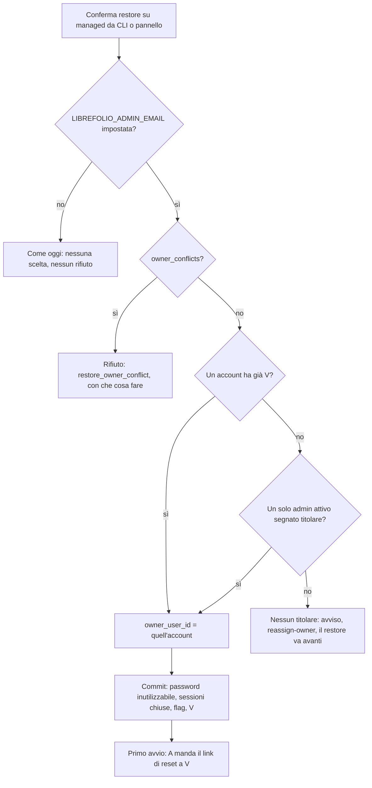

# B5-1j — Il titolare dopo un restore da CLI o dal pannello: analisi (nessun codice scritto)

Data: 2026-10-25. Autore: B. Rivisto da A (OK con modifiche, riportate qui: regola 2 con un solo admin segnato, confronto unico, managed senza variabile, flag azzerato sempre, username nell'output, errore con «che fare»). Sorgente: la «terza via» del developer sulla domanda 13 (vedi sotto).

> Parole del developer: «a livello di backup da terminale, in quella tabella abbiamo certamente il titolare pagante, la cosa
> migliore è che in caso di ripristino, oltre all'email che avvisa che è stato fatto si dica all'utente che per la sua sicurezza
> la pw è stata revocata e può ottenerne una nuova seguendo la procedura della pw dimenticata».

## 0. Cosa c'è oggi (letto nel codice, `d3437a203`)

| Percorso | Chi conferma | Titolare |
|---|---|---|
| App, `managed` | un admin dell'app | **scelto** nel dialogo (`owner_user_id`); B lo chiude nel commit (`_close_owner_account`), poi A manda il link di reset a `LIBREFOLIO_ADMIN_EMAIL` |
| Pannello hosting, CLI | il gestore (host) | **nessuno**: `_check_owner_choice` rifiuta anche solo di nominarne uno; nel commit B5-1g spegne il flag `is_instance_owner`; al primo avvio `owner-sync` di A ricava il titolare **solo** dall'account che ha già l'indirizzo della variabile |
| Self-hosted | chiunque | il concetto non esiste (`_variable()` è `None` fuori da `managed`; A risponde `NOT_MANAGED`) |

Due fatti che contano:

1. **Non esiste oggi nessuna email «ripristino fatto».** L'unica email del restore è il reset di A (`build_password_reset`), e parte
   solo nel percorso app. Quindi la frase del developer richiede un testo nuovo (o una variante del reset), in 4 lingue.
2. **Il rosso di OWN-083** nasce perché, nel percorso senza scelta, il flag viene spento e nessuno ha l'indirizzo nuovo: non c'è titolare
   e non parte nessun link (triage in B5-1i).

## 1. Come leggo la terza via

Dopo un restore **da CLI o pannello su `managed`**:

- il titolare resta quello del backup (nessun cambio di persona);
- la sua password diventa inutilizzabile, le sue sessioni si chiudono;
- l'email gli dice: «per la tua sicurezza la password è stata revocata; ne ottieni una nuova con *Password dimenticata*».

Questo è **già** quello che A fa nel percorso app (`assign_owner_and_send_reset`: indirizzo = variabile, admin attivo, flag,
password inutilizzabile, sessioni chiuse, altri token revocati, un link di reset nuovo mandato a `LIBREFOLIO_ADMIN_EMAIL`).
La differenza è solo **chi sceglie l'account**: nell'app lo sceglie l'umano, qui deve sceglierlo il codice.

## 2. Come si riconosce il titolare nel DB ripristinato

Il backup è dato non fidato; l'unico indirizzo fidato su `managed` è `LIBREFOLIO_ADMIN_EMAIL` (V). Regola proposta, in ordine,
calcolata da B al **conferma** sul rapporto dello staging (lo stesso `owner_candidates` dell'app), e scritta in `RestoreState.owner_user_id`:

1. **Un account ha già V**: è lui. Nessuna ambiguità, nessun altro account può prenderlo. Il confronto è quello che `owner_choices` e A usano già
   (`user_service.same_email`, cioè `email_fold`: solo A–Z): **non si scrive un terzo confronto**.
2. **Nessuno ha V, e UN SOLO account admin attivo è segnato titolare nel backup** (`is_instance_owner = 1`): è lui. È il caso «Anna».
   Con **due o più** admin attivi segnati non si sceglie nessuno (caso 3), e mai «il primo per id» (revisione di A). Il flag è un
   *suggerimento* di chi ha preparato il backup, mai un permesso: vedi §4 per perché non apre il buco di A.
3. **Né l'uno né l'altro** (o due o più segnati): nessun titolare assegnato. Il restore prosegue come oggi, con un avviso nel log e nell'esito.
   L'output della CLI e il rapporto dicono: «nessun titolare assegnato: usa `./dev.py user reassign-owner <username>`» (il comando arriva con A5-4).
   Non si indovina.

Casi fuori dalla regola:

- **`managed` senza `LIBREFOLIO_ADMIN_EMAIL`**: nessuna scelta automatica e nessun rifiuto, come oggi (non c'è un indirizzo fidato a cui mandare niente).
- **Output**: la CLI e il rapporto dicono lo **username** scelto, mai l'indirizzo (né quello del backup né V).
- **Il flag del backup si azzera a ogni ripristino, anche self-hosted.** Verificato: `_clear_owner_flag` è chiamata senza condizione dentro `_close_the_way_in`
  (non guarda profilo né canale) e il test (u) di B5-1g è parametrizzato anche su `selfhosted`/`admin`. Nessuna modifica necessaria.

Prima di tutto: se `owner_conflicts` del rapporto non è vuoto (indirizzo doppio, indirizzo uguale a un nome utente, amministratore in attesa),
il restore da CLI/pannello viene **rifiutato** con lo stesso errore dell'app (`restore_owner_conflict`): oggi per CLI/pannello quel controllo
non gira (`_check_owner_choice` esce subito), ed è un buco di coerenza. Il testo dell'errore dice **che cosa fare** (es. «togli l'indirizzo doppio
dal backup o liberalo, poi controlla di nuovo l'archivio»), non solo il motivo.

Mancano nel rapporto due dati: se il candidato è segnato titolare nel backup. Va aggiunto un campo `is_instance_owner` a `OwnerCandidate`
(letto dalla copia, `PRAGMA table_info` come per il resto; la colonna può non esserci in un backup vecchio → falso). Non cambia il formato del backup.

## 3. Verso quale indirizzo vanno email e «password dimenticata»

| Profilo | Indirizzo dell'email | «Password dimenticata» |
|---|---|---|
| `managed` | **sempre V**, scritto da A sull'account prima dell'invio. Mai l'indirizzo che l'account aveva nel backup | usa l'indirizzo dell'account, che ora è V: va a V |
| self-hosted | nessuna email di revoca (vedi sotto) | invariato: l'indirizzo che l'account ha nei dati, come oggi |

Self-hosted: **non cambia niente**. Non c'è un indirizzo fidato (chi fa il restore è il proprietario dei dati), e revocare la password a chi ripristina
il proprio backup, magari senza email configurata, lo chiuderebbe fuori. Le sessioni restano chiuse per la decisione 40, come ora. Se il developer
vuole la stessa cosa anche lì, è una decisione diversa (rischio di blocco).

Senza email configurata su `managed`: come oggi, il link è nel log dell'istanza (`link_only`), mai in stato, report, API, CLI o `--json`.

## 4. Perché non riapre il buco segnalato da A

Il buco di A: un backup con un account segnato titolare **che conosce la password**, e un link di cambio indirizzo che arriva al vero titolare:
quando il titolare lo conferma, l'account ha il suo indirizzo, è protetto, ed è accessibile a chi sapeva la password.

Con la terza via, nel commit del restore l'account scelto riceve **password inutilizzabile e sessioni chiuse** *prima* che esista qualunque link.
Chi ha preparato il backup non può entrare con quell'account; l'indirizzo di destinazione è V, non scelto da lui. Quello che gli resta:
poter indicare *quale* account (un admin attivo) diventa titolare. Un danno vero richiederebbe che avesse già un admin con password nota, e quello
oggi resta com'è (decisione Q3 del developer sugli altri admin): il flag non gli dà potere in più.

Resta il vincolo di A rispettato per costruzione: nessun indirizzo, link o `reset_path` in log, stato, report, API, CLI.

## 5. Gli altri admin (domanda 3)

**Restano come oggi**: nessuna password toccata, tutte le sessioni chiuse (versione di sessione alzata a tutti). Parole del developer:
«a noi interessa resettare la pw del titolare per essere certi che acceda, siccome paga». Residuo noto e accettato.

## 6. Cosa cambia in B

- `apply.py`: la scelta automatica (§2) dentro `confirm_restore`, quando `confirmed_via` è `cli` o `panel` e il profilo è `managed`. **Nessun file di H toccato**:
  il pannello passa dallo stesso `confirm_restore`. Va tolto il filtro `confirmed_via != "admin"` in `owner_assignment_problem`, `owner_pending`, `owner_recover_*`.
- `staging.py`: campo `is_instance_owner` in `OwnerCandidate`.
- `owner.py`: nessun cambio di logica (l'esito `sent` / `link_only` / `error:*` già c'è); aggiornare il docstring («never names an owner»).
- **B5-1g punto 2 (spegnere il flag) resta**: ora è coerente, perché il titolare lo assegna sempre B esplicitamente (`_close_owner_account` accende il flag solo su di lui).
- Il fail-closed resta: `error:EMAIL_TAKEN` ecc. dopo un restore da CLI danno 423 fino a `backup pending --recover owner` (stessa riparazione dell'app).
- Test (via `test-author`, prima rossi): scelta automatica nei tre casi, rifiuto con conflitti, pannello e CLI, self-hosted invariato, nessun indirizzo in log/stato; E2E con server vero come B5-1f per il percorso CLI.
- Docs (`docs-writer`, solo EN): `backup_restore.en.md` (`#owner-account`: ora anche CLI/pannello), `cli_backup.en.md`; H ha una frase in `hosting_providers.en.md` che dice «mai nomina un titolare» da riallineare (file di H).
- Test in più dalla revisione di A: **due account segnati** e admin attivi → nessuno scelto (caso 3, mai il primo per id); managed senza variabile → né scelta né
  rifiuto; username (mai indirizzo) nell'output; il rifiuto per conflitti con il testo «che cosa fare».
- Testi: l'email. Il reset di A dice già «scegli la password»; va **un testo in più** che spieghi «revocata per sicurezza dopo un ripristino, o *Password dimenticata*».
  Sono i template di A (`messages.py`, `templates/*.json` in 4 lingue): **lo scrive A in un lotto suo (A5-5), variante `after_restore`**; B non li tocca.
  Anche OWN-083 lo riscrive A, dopo che il codice di B è unito. Variante semplice: stesso reset, frase aggiunta.
  Variante del developer alla lettera (solo avviso, nessun link): più semplice ma, con email spenta, il titolare resterebbe chiuso fuori senza link nel log.
  Consiglio: reset con link **più** la frase (il link serve; «Password dimenticata» resta il ripiego se scade in 30 minuti, come già dice la doc).

## 7. Cosa cambia nel test OWN-083 di A

Con la terza via il caso di OWN-083 non produce più un link `email_change`: l'account di Anna riceve V *nel commit del restore*, quindi `owner-sync` vede
«il titolare ha V» (UNCHANGED) e non emette niente; il link vivo è un `password_reset` mandato a V. Quindi OWN-083 **va riscritto** (suo file, lo rivede A):

- premessa: restore da CLI, titolare nel backup con vecchio indirizzo, variabile nuova;
- atteso dopo i due passi reali (`restore-commit`, `restore-owner`, `owner-sync`): account titolare con V, flag acceso, password inutilizzabile,
  **nessun** `email_change` vivo, **un** `password_reset` vivo e mandato a V.

L'invariante «il link emesso all'avvio sopravvive al commit del restore» (watermark B5-1d) resta provata da OWN-082 e dai test B5-1d (link di setup
del primo admin). Il cambio di indirizzo di un titolare *già in esercizio* (variabile cambiata senza restore) non si tocca.

## 8. Esempio: Anna

Backup del cliente: Anna, admin attiva, segnata titolare, indirizzo `vecchia@x.it`. Il gestore ripristina da CLI su `managed` con `LIBREFOLIO_ADMIN_EMAIL=nuova@x.it`.

1. Conferma: nessun account ha `nuova@x.it`; Anna è segnata ed è admin attiva → `owner_user_id` = Anna.
2. Commit: password di Anna inutilizzabile, sessioni chiuse, indirizzo → `nuova@x.it`, flag acceso solo su di lei.
3. Primo avvio: `restore-owner` → A manda a `nuova@x.it` il link di reset e il testo «password revocata per sicurezza dopo il ripristino».
   `owner-sync`: Anna ha già V → nessun link di cambio indirizzo.
4. Anna sceglie una password col link (o con *Password dimenticata*) e accede. Mai un messaggio a `vecchia@x.it`.

Variante ostile: il backup è di un altro, con un account «mallory» (admin, segnato titolare, password nota). Stesso esito per il codice: mallory diventa titolare,
la sua password è inutilizzabile, il link va a `nuova@x.it`; mallory non entra. Se invece un altro account già ha `nuova@x.it` (caso `forced`) è quello il titolare;
se due account si contendono l'indirizzo, il restore è rifiutato (`owner_conflicts`).

## 9. Domande aperte per il developer

- **O1.** Self-hosted: nessuna revoca (consigliato) o anche lì? Rischio: chiuso fuori senza email.
- **O2.** Nessun candidato (§2 punto 3): il restore prosegue senza titolare con un avviso (consigliato, come oggi) o si rifiuta?
- **O3.** L'email: reset con link più frase (consigliato) o solo avviso come da lettera?
