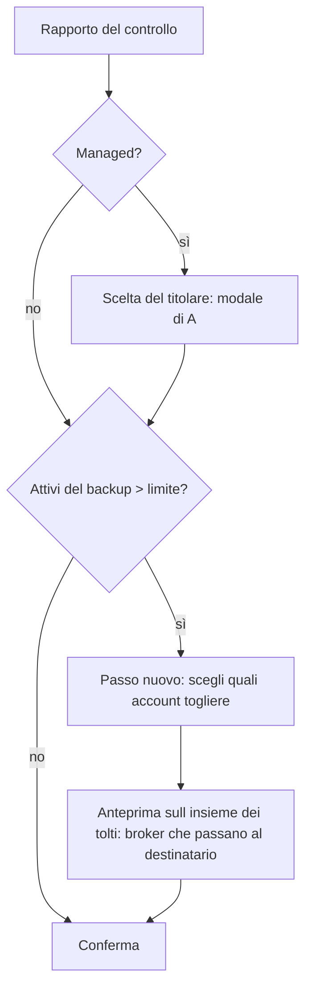

# B5-1k — Un backup con più utenti di quanti l'istanza ne accetti: analisi (nessun codice scritto)

Data: 2026-10-26. Autore: B. Decisioni del developer integrate (D1, D2, D4: quota 0 %, nessun destinatario scelto, rifiuto 409 sul pannello). Rivisto da A (OK con modifiche, **integrate qui**: 2 bloccanti di correttezza — §4 e §5 — e 5 piccole). Le scelte di prodotto vanno al developer. Viene dopo B5-1j (il titolare scelto o ricavato da B5-1j è il destinatario dei broker).

Richiesta del developer: prima di attivare il ripristino, se il backup ha più utenti del limite, il sistema chiede all'utente quali account togliere.
Per i dati, via standard: chi viene tolto passa i suoi broker all'admin titolare (aggiunto come OWNER di ogni suo broker), poi si cancella con
`user_service.delete_user` (F4: cancella solo i broker di cui l'utente era l'ultimo OWNER). Nessuna transazione si perde, nessun codice di cancellazione nuovo.

## 0. Cosa c'è oggi (letto nel codice)

- Il limite è `LIBREFOLIO_MAX_USERS` (`config/accounts.max_users`, letto da `registration_service._max_users`; un valore non valido vale **0**, cioè tutto chiuso).
  Si controlla alla registrazione, all'invito e alla verifica email (`user_usage`). **Il ripristino non lo controlla**: un backup più grande lascia l'istanza sopra il limite.
- Come si conta (`user_usage`): account **attivi** + inviti vivi + account in attesa di verifica con link vivo + l'admin iniziale in attesa del `/setup`.
  Il commit del restore **revoca ogni link vivo** (inviti e verifiche compresi; resta solo il `/setup` emesso dall'avvio stesso, watermark B5-1d).
  Quindi, dopo un restore, i posti occupati sono: **gli account attivi del backup** (+ l'admin iniziale in attesa, se c'è). Gli inattivi non contano.
- `delete_user(session, user_id)` fa broker per broker `leave_broker`: l'ultimo OWNER che esce cancella il broker con le sue transazioni; altrimenti se ne va solo l'accesso.
  `preview_user_deletion` calcola senza scrivere la stessa cosa: `brokers_deleted` (con n. transazioni), `brokers_left`, `transfers_unpaired`.
- `BrokerService.bulk_update_access` **sostituisce l'intero elenco degli accessi** di un broker (aggiunge, aggiorna e toglie per differenza): passargli solo il destinatario cancellerebbe gli accessi di tutti gli altri.
  **Non si usa.** Il passaggio scrive direttamente la riga `BrokerUserAccess` del destinatario (§5).

## 1. Come si conta nel ripristino

`da_togliere = |attivi ∪ {titolare}| − M` (M = limite), se positivo. Si tolgono solo account **attivi** (togliere un inattivo non libera un posto).
Il titolare scelto viene **attivato** dal restore anche se nel backup era inattivo (A5-2): va contato. Nel rapporto `users_over_limit` presume il titolare già attivo; il server lo ricalcola alla conferma e al passo di anteprima con il titolare vero.

Non si possono togliere:
- il **titolare** (scelto nell'app, o ricavato da B5-1j su CLI/pannello): è anche il **destinatario** dei broker;
- l'ultimo admin attivo (sempre almeno uno: il titolare, su `managed`).

Quindi il massimo togliibile è `attivi − 1`, e se `M < 1` (limite non valido = 0) non c'è modo di rientrare: il ripristino è rifiutato con «`LIBREFOLIO_MAX_USERS` non valido» (già segnalato dai controlli di avvio).

Self-hosted: il limite esiste anche lì (`LIBREFOLIO_MAX_USERS` non è solo di `managed`), ma non c'è un titolare. **Nessuna scelta del destinatario** (decisione D4): i broker che altrimenti sparirebbero
vanno a **tutti gli admin attivi che restano**, ciascuno OWNER con quota 0 %. Resta sempre almeno un admin attivo (non si può togliere l'ultimo).

## 2. Dove si inserisce nel percorso app

- **Un passo dopo** la scelta del titolare, non dentro la stessa modale: il titolare deve già essere noto (non si può togliere, e riceve i broker). La modale del titolare è di A: non la tocco.
  Il passo nuovo è un componente di B (`RestoreTrimModal`), aperto dal rapporto solo se `users_over_limit > 0`.
- Il passo mostra: «Il backup ha N utenti, l'istanza ne accetta M: toglierne almeno K». Elenco degli account con casella (il titolare è bloccato). «Conferma» resta spento finché non si è scelto
  esattamente il numero necessario: **ne servono almeno K**, e non più del necessario senza dirlo (se ne scegli di più, avviso, ma si può).
- La richiesta di conferma (`POST /backup/restore/stage/{id}/confirm`) prende un campo nuovo `remove_user_ids: list[int]` (nessun campo per il destinatario). Il server **ripete tutti i controlli** (la UI non è fidata):
  ogni id è un account attivo del rapporto, non è il titolare/destinatario, e `attivi − len(remove) <= M`; se il limite è cambiato dopo il controllo → `restore_stage_outdated` come per l'indirizzo.
- Il rapporto del controllo guadagna: `users_active`, `users_limit`, `users_over_limit` e, **solo se > 0**, `accounts` (id, username, is_superuser). Niente indirizzi. **L'anteprima non sta nel rapporto**: dipende dall'insieme scelto (§4), quindi è una richiesta a parte.
- Rifiuto finale (conferma che non rientra nel limite): «il backup ha N utenti attivi, il limite è M: alza `LIBREFOLIO_MAX_USERS` o togli altri account».

## 3. CLI e pannello (nessuno a scegliere)

- **Rifiuto con un messaggio chiaro**, prima di scrivere lo stato: `❌ Il backup ha 5 utenti attivi, l'istanza ne accetta 3 (LIBREFOLIO_MAX_USERS): togline 2 o alza il limite (restore_too_many_users)`.
  Codice `too_many_users` (409 nel pannello). È il consiglio del coordinatore e anche il mio: senza una persona non si decide chi sparisce.
- **`--remove-user USERNAME`** (ripetibile) sul comando `backup restore` della CLI: facoltativo (D1, deciso). Stesse regole del server (§2). Il destinatario è il titolare ricavato da B5-1j (managed) o tutti gli admin che restano (self-hosted).
  Nel rifiuto il messaggio nomina i nomi utente per aiutare a scegliere (mai indirizzi). I nomi vengono da un backup non fidato: si stampano con `_safe` (già in `backup_cli.py`:
  ogni carattere non stampabile, di controllo o di formato/bidi, diventa `?`); nei log solo id.
- **Managed senza titolare ricavabile** (caso (c) di B5-1j) **e** con una rimozione necessaria: rifiuto «prima assegna un titolare» (`./dev.py user reassign-owner <username>`). Nessun `--heir`.
- Pannello (il ripristino lanciato dal pannello di hosting, H-62: nessuno sceglie dentro l'app): solo rifiuto, `409 too_many_users` con i due numeri N e M nel corpo (D1; se il developer cambia idea è un cambio piccolo). Il corpo dell'API non cambia per il resto. Il file di H (`panel_restore.py`) non si tocca: mappa già `RestoreStateError.code`.

## 4. L'anteprima: una sola volta, sull'insieme dei tolti (bloccante di A)

`preview_user_deletion` va **per account**, e un account alla volta non vede che due tolti sono gli unici OWNER dello stesso broker. Quindi **non si usa per l'insieme**.
Serve il calcolo congiunto, e dipende dalla scelta fatta nel passo: è una richiesta del passo (`POST /backup/restore/stage/{id}/removal-preview` con `remove_user_ids` e il titolare), non un campo del rapporto.

La regola è quella di `leave_broker`, applicata una volta all'insieme R dei tolti:

- un broker **sparirebbe** se ha almeno un OWNER e **tutti** i suoi OWNER stanno in R. Solo questi passano al destinatario (con quante transazioni);
- per ogni altro broker a cui un tolto aveva accesso se ne va solo l'accesso (conteggio, senza elencarli).
- Esempio dell'obiezione di A: Carla è solo VIEWER sul broker privato di Bruno e Bruno resta → quel broker non è nell'elenco e **il titolare non ne diventa OWNER**.

Come si calcola: SQL grezzo in sola lettura (`mode=ro`, `trusted_schema=OFF`) sulle sole tabelle `broker_user_access`, `brokers`, `transactions` e `users(id, username)`.
Verificato (domanda 4 di A): la copia di controllo è **già alla testa** quando si legge (`staging` fa girare le migrazioni, poi esige `alembic_revision == head`, e solo dopo `_owner_check`), quindi anche l'ORM
non si romperebbe; scelgo comunque l'SQL grezzo perché non passa dal modello `User` completo e non c'è un servizio che calcoli l'insieme.
La regola è una copia di quella di `leave_broker`: **un test la inchioda contro il comportamento vero** (§6, punto 4): si esegue davvero passaggio + `delete_user` su una copia e si confronta l'elenco dei broker sopravvissuti con quello dell'anteprima.

Quote (`share_percentage`), decisione D2: il destinatario entra come OWNER con quota **0 %**, non con la somma. Parole del developer: «così gli altri utenti sono corretti e l'owner deve solo decidere se riassegnare o eliminare, senza che gli cambia la dashboard».
**Verificato nel codice, nessun validatore da toccare:**
- il modello ammette 0 (`CheckConstraint share_percentage >= 0 AND <= 1`; il commento di `BrokerUserAccess` dice «Sum CAN be less than 1.00»); la somma dei broker può restare sotto 1;
- `effective_share` (`financial_math/native_cash.py`) dice «un OWNER scala le cifre, anche a zero»; l'engine commenta «0% is valid and contributes nothing»; la divisione per la quota in `daily_state.py` è protetta (`receiver.share == 0`);
  ci sono già test dedicati (`test_portfolio_service` «OWNER share=0% is valid», `test_assets_crud` broker a quota 0, F2);
- gli asset: `assets/crud` conta come «propri» solo i broker OWNER con quota > 0, quindi un broker a 0 % vale come «di altri», senza mostrare valori propri;
- un caso noto, non nuovo: un trasferimento tra un broker a 0 % e un broker dello stesso utente al 100 % dà l'avviso di qualità dati sulle quote diverse (J-43), come già oggi per quote diverse.
Il test lo inchioda: dashboard/portafoglio del destinatario prima e dopo il passaggio **uguali** (numeri e totali).

## 5. Come si esegue

Due strade:

| | Dove | Pro | Contro |
|---|---|---|---|
| **A (consigliata)** | al primo avvio dopo il commit, nello stesso step `restore-owner` (`owner.py`, mio), dopo l'assegnazione del titolare | stesso schema già provato (stato, esito, fail-closed 423, `--recover`); `delete_user` e `bulk_update_access` si usano com'è | un po' di macchina in più (esito `removal` nello stato) |
| B | sulla copia controllata già a «conferma» | l'istanza parte già a posto | modifica la copia (`cancel` che la lascia, riconferma…); ORM in una richiesta; ordine col titolare scelto dopo |

Strada A in dettaglio:
- `RestoreState` guadagna `remove_user_ids: list[int] = []` (e l'esito della rimozione). Id, mai nomi né indirizzi, come `owner_user_id`. Nessun campo per il destinatario: si ricava all'avvio.
- `assign_restored_owner` (step esistente, **`app_lifespan.py` di H non cambia**) dopo il titolare esegue la rimozione. Oggi esce subito se non c'è un titolare in attesa (`owner_pending`): va esteso a
  «titolare in attesa **o** rimozione in attesa», così vale anche per self-hosted (senza titolare).
- **A ogni avvio rilegge tutto dal DB** (bloccante 6 di A), senza fidarsi dello stato. I destinatari si ricavano: managed → il titolare (account col flag, esiste, attivo, admin, non fra i tolti); self-hosted → gli admin attivi che non sono fra i tolti.
  Nessun destinatario valido → `error:NO_RECIPIENT`, fail-closed;
  gli id tolti che non esistono più si saltano; l'insieme dei broker da passare si **ricalcola** (§4) a ogni avvio, così una ripetizione dopo un'interruzione fa il resto e basta.
- Ordine: (1) per ogni broker dell'insieme «sparirebbero» scrive la riga `BrokerUserAccess` di ciascun destinatario come OWNER con quota 0 % (se ha già OWNER, non si tocca; se aveva un ruolo minore lo promuove a OWNER a 0 %), in una transazione;
  (2) poi `delete_user` per ciascun tolto. Gli altri accessi di quei broker non si toccano (test del bloccante 1: broker con 3 utenti, uno tolto → gli altri due tengono ruolo e quota).
- Alla fine ricontrolla il conteggio: se `attivi > M`, errore, non si serve.
- Fail-closed: se fallisce, `error:<CODE>`, il guard serve 423. Un motivo solo, `owner_assignment` (nessun file di H), con testo dell'esito che dica che si tratta **della rimozione degli account**
  (`backup pending` e il log: «rimozione degli account in eccesso non completata»). `backup pending --recover owner` riprova.
- File dei broker (BRIM) di broker cancellati: nessuno per costruzione; `delete_user` ne darebbe comunque la lista e il codice li rimuove come fa l'API.
- Log: ids e conteggi, mai nomi né indirizzi.

## 6. Test necessari (via `test-author`, prima rossi)

1. Conteggio: attivi vs M; inattivi esclusi; limite assente = nessun passo; limite non valido = rifiuto; il titolare mai tra i togliibili.
2. Rapporto: `users_*` e `accounts` solo se sopra; titolare inattivo nel backup contato come attivo; nessun indirizzo. Anteprima congiunta: solo i broker con tutti gli OWNER fra i tolti; **Carla VIEWER sul broker privato di Bruno → il titolare non diventa OWNER**; la regola uguale all'esecuzione vera (oracolo: passaggio + `delete_user` su una copia).
3. Conferma: 409 se `remove_user_ids` non basta, contiene il titolare/destinatario, un id inesistente/inattivo, un duplicato; `restore_stage_outdated` se M cambia; lo stato non viene scritto in caso di rifiuto.
4. Esecuzione (E2E con server vero, come B5-1f): backup 5 utenti, M=3: restano 3, i broker dei 2 tolti sono del titolare (OWNER) con **tutte le transazioni**, nessun broker cancellato, i due tolti non esistono più e non possono entrare; i totali di controllo del libro mastro uguali prima e dopo.
5. Due tolti, OWNER unici dello stesso broker: il broker resta. **Broker con 3 utenti, uno tolto: gli altri due tengono ruolo e quota** (bloccante 1). Destinatario già VIEWER sul broker: promosso a OWNER a 0 %. Quota sempre 0 % (mai la somma). Dashboard/portafoglio del destinatario identici prima e dopo. Self-hosted: tutti gli admin che restano diventano OWNER a 0 %.
6. Rilettura all'avvio: nessun destinatario valido (titolare inattivo/non admin/fra i tolti; self-hosted senza admin che restano) → `error:NO_RECIPIENT`, nulla cancellato; id già spariti saltati; insieme ricalcolato; fail-closed: errore dopo il commit → 423 `owner_assignment` → `--recover owner` → riparte e finisce; ripetere lo step non cancella altro.
7. CLI: rifiuto con N e M nel messaggio e codice; `--remove-user` valido e non valido; managed senza titolare ricavabile → «prima assegna un titolare»; nomi utente con caratteri di controllo/bidi stampati con `?`, nei log solo id; pannello 409 `too_many_users`.
8. Vitest: il passo si apre solo sopra il limite, conferma spenta finché non basta, il titolare bloccato, nessun indirizzo in pagina; testi in 4 lingue (`dev.py i18n`).
9. Self-hosted: nessuna scelta del destinatario, tutti gli admin che restano; limite assente = nulla cambia.

## 7. Esempio: 5 utenti, limite 3

Backup di un piano grande: Anna (titolare, admin), Bruno (admin), Carla, Dario, Elena (tutti attivi). L'istanza ha `LIBREFOLIO_MAX_USERS=3`.

1. Controllo: `users_active=5`, `users_limit=3`, `users_over_limit=2`. Il rapporto elenca Bruno, Carla, Dario, Elena con l'anteprima (es. Carla: «broker "Fineco" con 214 transazioni passa ad Anna»; Dario: «solo il suo accesso se ne va»).
2. App: Anna scelta come titolare; passo nuovo: «Il backup ha 5 utenti, l'istanza ne accetta 3: toglierne almeno 2». Si spuntano Carla ed Elena. Conferma.
3. Primo avvio dopo il commit: Anna diventa OWNER di tutti i broker di Carla ed Elena; poi `delete_user` per Carla e per Elena; restano Anna, Bruno, Dario (3 posti). Nessuna transazione persa.
4. CLI con lo stesso backup: `❌ Il backup ha 5 utenti attivi, l'istanza ne accetta 3: togline 2 o alza il limite (too_many_users)`; con `--remove-user carla --remove-user elena` parte come sopra.

## 8. Cosa tocca (e cosa no)

- B: `staging.py` (conteggio, `accounts`), un modulo nuovo per l'anteprima congiunta e l'esecuzione (SQL grezzo/ORM solo per `delete_user`), `schemas/backup.py` (campo di conferma, rapporto, anteprima), `api/v1/backup/restore.py` (+ la richiesta `removal-preview`), `apply.py` (controlli e stato), `owner.py` (esecuzione), `scripts/backup_cli.py` (rifiuto, `--remove-user`), frontend (`RestoreTrimModal`, i18n 4 lingue), docs EN, test.
- **A**: nessun file. Usa `delete_user`, `preview_user_deletion`, `bulk_update_access` com'è; la modale del titolare non cambia.
- **H**: nessun file se D3 = un motivo solo. Con `account_removal` serve una riga in `restore_guard.py`.
- Servizi usati ma non modificati: `registration_service` (limite), `user_service.delete_user`. `bulk_update_access` e `preview_user_deletion` **non** si usano (sostituzione dell'elenco; calcolo per singolo account).

## 9. Decisioni del developer (nessuna domanda aperta)

- **D1.** CLI: rifiuto con `--remove-user` facoltativo. Pannello (ripristino lanciato dal pannello di hosting): rifiuto `409 too_many_users` con N e M.
- **D2.** Il destinatario entra come OWNER con quota 0 %.
- **D3.** Motivo di blocco unico `owner_assignment` (con testo sulla rimozione).
- **D4.** Self-hosted: nessuna scelta; i broker vanno a tutti gli admin che restano, OWNER a 0 %.
