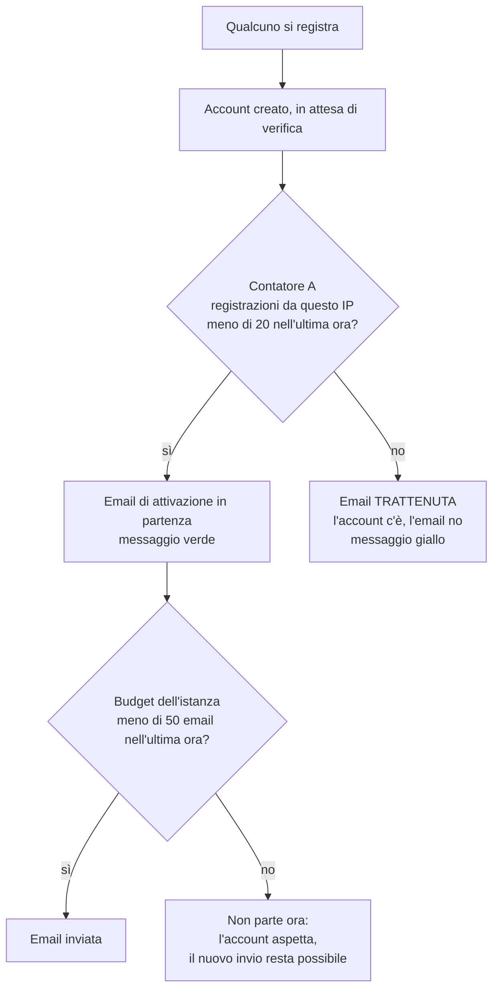
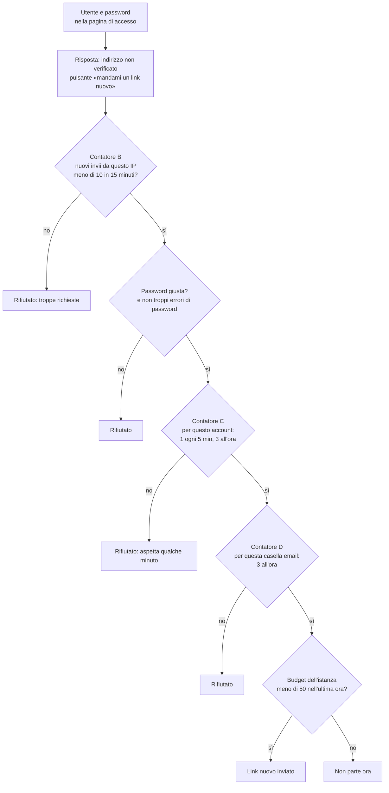
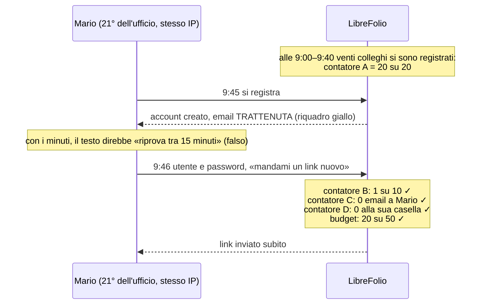
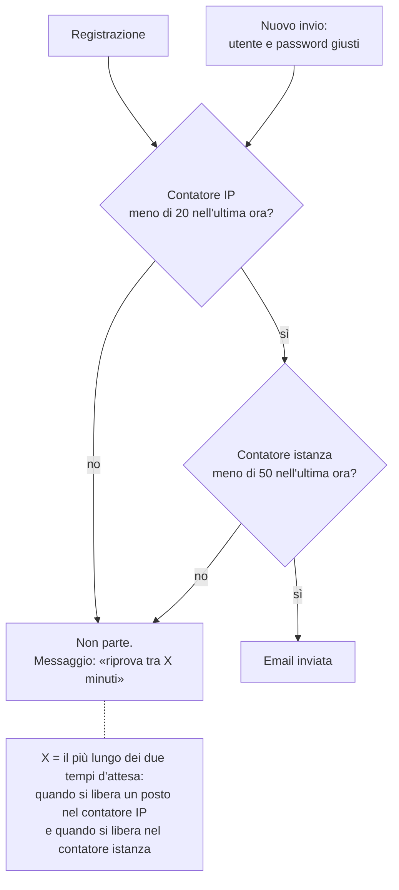

# Email di attivazione: chi conta cosa (E-26)

Ci sono **due momenti** in cui parte un'email di attivazione, e ognuno ha **i suoi contatori**. I contatori sono a
finestra mobile: «20 all'ora» vuol dire «20 negli ultimi 60 minuti», e ogni tentativo esce dal conto 60 minuti dopo.

## 1. La registrazione

- **Contatore A** (`LIBREFOLIO_SIGNUP_EMAILS_PER_ADDRESS`, nuovo, predefinito 20): conta **solo le registrazioni**, per
  indirizzo IP. Serve a evitare che una sola rete si mangi tutto il budget.
- **Budget dell'istanza** (`LIBREFOLIO_SMTP_MAX_PER_HOUR`, predefinito 50): conta **tutte** le email dell'istanza
  (attivazioni, reset password, inviti…).

## 2. Il «nuovo invio» dalla pagina di accesso

Chi ha l'account in attesa inserisce utente e password: il server risponde «indirizzo non verificato» e la pagina offre
«mandami un link nuovo».

**Il contatore A qui non c'è.** Per questo un tempo d'attesa calcolato sul contatore A sarebbe falso.

## 3. L'esempio dell'ufficio

Mario riceve il link **subito**, non dopo 15 minuti: per questo il testo scelto (opzione a) dice solo «inserisci utente e
password nella pagina di accesso per chiederne un nuovo invio», senza minuti.

## Perché il blocco alla registrazione serve lo stesso

Il nuovo invio costa un passo umano in più (utente e password) e ha i suoi limiti per account e per casella: un programma
che crea cento account dalla stessa rete non riceve cento email in automatico, e il budget dell'istanza resta libero per
i reset password degli altri utenti.

---

## 4. Proposta: due contatori soli, e un tempo vero

Idea del developer (23/10): per le email di attivazione restano **due contatori**, gli stessi per la registrazione e per
il nuovo invio:

| Contatore | Variabile | Predefinito | Conta |
|---|---|---|---|
| **IP** | `LIBREFOLIO_SIGNUP_EMAILS_PER_ADDRESS` | 20 all'ora | le email di attivazione chieste da questo IP, alla registrazione **e** al nuovo invio |
| **Istanza** | `LIBREFOLIO_SMTP_MAX_PER_HOUR` | 50 all'ora | tutte le email dell'istanza (c'è già) |

Il contatore B (10 ogni 15 minuti per IP sul nuovo invio) sparisce: lo sostituisce il contatore IP. Il contatore A
diventa il contatore IP, condiviso.

**X è vero**, perché registrazione e nuovo invio guardano gli stessi due contatori: se alle 9:45 il messaggio dice
«riprova tra 15 minuti», alle 10:00 il nuovo invio passa (salvo che nel frattempo altri dalla stessa rete abbiano usato
il posto: allora il nuovo messaggio dice il nuovo tempo).

### Cosa resta fuori dai due contatori (proposta: tenerli, non cambiano X per chi è trattenuto)

- **Il limite delle password sbagliate**: non è un contatore di email, è la protezione dell'accesso contro chi prova le
  password. Resta com'è.
- **3 email all'ora per la stessa casella**: impedisce di usare LibreFolio per bombardare di email l'indirizzo di
  un'altra persona, e protegge la reputazione del server che spedisce (troppe email a uno stesso indirizzo finiscono nello
  spam). Per un account trattenuto non pesa: alla sua casella non è ancora partito niente. Se un giorno dovesse pesare, il
  messaggio del nuovo invio include anche il suo tempo (sempre il più lungo).
- **1 nuovo invio ogni 5 minuti per account**: come sopra, evita di sommergere la propria casella; non pesa al primo invio.

Gli stessi contatori, con la stessa forma, valgono anche per il «password dimenticata» (oggi ha la sua copia:
`FORGOT_BY_ADDRESS`, `FORGOT_BY_MAILBOX`): conviene allinearlo nello stesso lotto, così le regole sono una sola.
