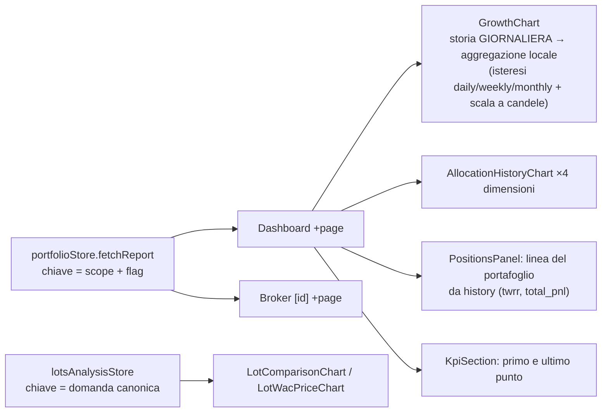

# Y5-3 — i grafici con la serie campionata: piano di implementazione

Y, 24/10/2026. Solo analisi, nessun codice, nessuna operazione git. Letti `DECISIONI-DP4.md` e `CONTRATTO-P4b.md`, poi
il codice nel mio ramo (`e-alfy-y-cruscotto-e-grafici` a `9ccc01c8a`).

## 1. Che cosa c'è oggi (e che cosa si rompe)

- **Richieste al report** (tutte passano da `portfolioStore.svelte.ts`): Dashboard 3 (principale, storia pigra
  `+page.svelte:677`, candele pigre `:729`), broker 3 (`[id]/+page.svelte:346/391/409`), elenco broker e pannello rischio
  (senza storia: `max_points` non serve, resta il tetto di sicurezza).
- **Una sola richiesta nutre quattro grafici** (crescita, allocazioni nel tempo, P&L per broker, linea del portafoglio
  nel grafico #48). Quindi `max_points` non è «per grafico»: è uno solo per richiesta.
- `GrowthChart` oggi riceve tutti i giorni e **riduce da sé** (`chooseResolution`/`cascadeResolution` sulla larghezza,
  `ChartResolution = 'daily'|'weekly'|'monthly'`). Con un campione in ingresso non può scendere sotto il passo del
  backend: serve un **pavimento**.
- La scala a candele (`growthLadderBuckets.ts`: 1D 3D 1W 2W 1M 3M 6M 1Y) costruisce le candele dai giorni. Con candele
  per bucket del backend, un rung è esatto solo se **contiene** i bucket del backend: una settimana ISO non sta dentro un
  mese.
- `KpiSection` e `markMaxResolved` leggono solo primo e ultimo punto: il contratto li garantisce sempre nel campione
  (§3.1). Nessuna modifica.
- `incomplete_*_dates` e `missing_fx_pairs[].dates`: nessun componente li legge (grep fatto). Niente da fare per la
  qualità dei dati.

## 2. Quale `max_points`

Una costante per richiesta, non la larghezza misurata:

| Superficie | `max_points` | Perché |
|---|---|---|
| Report Dashboard e broker (viewport ≥ 768 px) | **4 000** | densità del grafico 1,3 punti/px × ~1 500 px di tracciato ≈ 2 000 visibili, ×2 di margine per lo zoom |
| Idem, viewport stretto (< 768 px) | **2 000** | tracciato ~350 px, margine ×3 |
| Lotti (7 storie in una risposta) | **2 000** | grafici più stretti, risposta già grossa |
| Linea per posizione (#48) | **`resolution` del report** | stessi giorni della linea del portafoglio (§4) |

- **Perché non la larghezza misurata** (come le schede di Assets, che la rimisurano): il grafico di crescita ha lo zoom a
  rotella. Con un campione stretto sulla larghezza, zoomare non mostra nulla di più fine. Con 4 000 un portafoglio fino a
  ~11 anni resta **giornaliero come oggi**, e uno di 30 anni diventa settimanale (1 565 punti). E non c'è nessuna nuova
  richiesta a ogni ridimensionamento o apertura della barra laterale.
- Il refuso all'anno 1 (739 912 giorni): con 4 000 il passo è `yearly`, ~2 000 punti, ~60 MB nel server (29 kB per punto).
  Con 1 000 sarebbe `decade` (~202 punti, ~6 MB). Se MF vuole la risposta più leggera, la costante si abbassa in un solo
  posto, senza cambiare il resto.
- **Decisione da confermare al developer/coordinatore:** 4 000 (zoom intatto) oppure ~1 500 (risposta più leggera, ma
  lo zoom oltre i ~4 anni di dati non dà più dettaglio, a meno di una nuova richiesta con l'intervallo zoomato).

## 3. Lavoro, file, in ordine

**Prima dell'unione dei rami (nessun tipo generato): puro frontend, con test.**
1. `lib/features/dashboard/reportSampling.ts` (nuovo, funzioni pure):
   - `REPORT_MAX_POINTS`, `reportMaxPoints(viewportWidth)`;
   - tipo `SampleResolution` = `daily|weekly|monthly|quarterly|yearly|decade` (**tipo a parte**: `ChartResolution` resta a
     tre valori, perché gli aggregatori di `timeSeriesAggregation.ts` non devono imparare i passi nuovi);
   - `coarserResolution(local, backend)` e `effectiveResolution`;
   - `ladderRungsFor(resolution)`: i rung che contengono il bucket. daily: tutti; weekly: 1W, 2W; monthly: 1M, 3M, 6M, 1Y;
     quarterly: 3M, 6M, 1Y; yearly: 1Y; decade: solo 1Y (a un punto per decennio).
   - `bucketBounds(date, resolution, sampleBounds)`: inizio e fine del bucket, con il primo bucket tagliato a
     `sample_bounds.start`.
2. `ResolutionBadge.svelte`: tre etichette nuove (`chart.resolution.quarterly|yearly|decade`) in EN/IT/FR/ES; accetta
   `SampleResolution`.
3. `GrowthChart.svelte` + `growthChartData.ts` + `growthChartTooltip.ts`: nuovo prop `sampleResolution` (+ `sampleBounds`);
   la risoluzione locale non scende sotto il pavimento; il badge mostra la più grossa tra locale e backend; con un passo
   ≥ `weekly` l'isteresi non può tornare a `daily`; i tooltip mostrano «settimana/mese/trimestre/anno/decennio del …»
   con `bucketBounds`. La scala a candele offre solo `ladderRungsFor(...)`.
4. `AllocationHistoryChart.svelte` (le 4 dimensioni, incluso «By Asset»): stessa logica di pavimento e badge. Un punto è
   già un giorno vero: nessuna ricostruzione.

**Dopo l'unione di MF/J e `api sync`.**
5. `portfolioStore.svelte.ts`: `options.maxPoints`, nel corpo (`max_points`) e **nella chiave della cache**
   (`|mp4000`); il report porta `resolution` e `sample_bounds`, esposti con la storia. Una risposta senza `resolution`
   (server vecchio, mock) vale `daily`: i mock degli E2E esistenti non si toccano.
6. `dashboard/+page.svelte` e `brokers/[id]/+page.svelte`: passano `maxPoints` a tutte e tre le richieste, danno
   `resolution` / `sample_bounds` ai grafici. La richiesta pigra delle candele usa lo **stesso** `max_points`, così le
   candele hanno lo stesso passo della linea (`pnl_candles` per bucket, contratto §2.1).
7. #48: `positionsSeriesController.ts` aggiunge alla richiesta `resolution` = quella del report quando esiste (altrimenti
   `max_points`); `positionsSeries.ts` legge `resolution` e `sample_bounds` della risposta; `PositionsReturnChart` mostra il
   badge. La linea del portafoglio, ricavata dalla storia, cade sugli stessi giorni.
8. Lotti: `LotsAnalysisPanel.svelte` aggiunge `max_points` ai due corpi (`loadMain`, selezione); `lotsAnalysisStore` lo
   include già nella chiave canonica (la chiave è l'intero corpo); `LotComparisonChart.svelte`, `LotWacPriceChart.svelte` e
   i loro helper leggono `resolution` / `sample_bounds`, mostrano il badge e usano il pavimento. Il Gantt, il riepilogo e gli
   eventi non cambiano.
9. Documentazione: `charts.en.md` (una sezione «Long periods are sampled», con i passi); `positions.en.md` una riga.

## 4. Test

- **Vitest nuovi:** `reportSampling.test.ts` (pavimento, rung annidati, bucket tagliati, default `daily`);
  `ResolutionBadge.test.ts` (passi nuovi, 4 lingue); `portfolioStore.test.ts` (`max_points` nel corpo, chiavi diverse per
  `max_points` diversi, risposta senza `resolution`); `growthChartData.test.ts` (pavimento, candele per bucket,
  `bucketBounds`); `GrowthChart.test.ts` e `AllocationHistoryChart.test.ts` (con `resolution = monthly` i punti sono
  disegnati sulle loro date e il badge dice Monthly); `positionsSeriesController.test.ts` (`resolution` ereditata);
  test dei lotti per badge e pavimento; guardia i18n.
- **E2E da toccare:**
  - `portfolio/dashboard.spec.ts`: «tutto» → la richiesta porta `max_points`; con una risposta finta `monthly` compare il
    badge Monthly e la scala a candele non offre 1W; il test «positions chart on real data» controlla che il corpo porti
    `resolution`;
  - `brokers/brokers-detail.spec.ts`: stessa asserzione sul corpo;
  - un test su dato vero (dopo il treno): refuso all'anno 1 → Dashboard risponde e disegna (passo `yearly`).
  - Gli altri ~12 spec che mockano `/portfolio/report` non cambiano (manca `resolution` = `daily`).
- Gate da tenere verdi: `chart-safety-unit`, `check-orphans`, i18n check, front check, il ratchet dei colori (badge: solo
  ruoli).

## 5. Rischi

1. **Zoom senza dettaglio** se `max_points` è troppo basso (§2). Si decide con la costante.
2. **Rung della scala a candele non annidati** (settimana ISO nel mese): la scelta è mostrare solo i rung esatti. Costo:
   con un campione `monthly` sparisce «1W». L'alternativa, chiedere le candele con `resolution` uguale al rung scelto, è
   una richiesta in più a ogni cambio di rung: la scarto per ora.
3. **Primo bucket parziale:** il primo punto non è la fine di un bucket; i tooltip devono usare `sample_bounds`, altrimenti
   dicono «settimana dal 6/1» per un campione che parte il 9/1.
4. **Passi nuovi solo nei badge:** non estendo `ChartResolution` e gli aggregatori. Se un domani un grafico dovrà
   aggregare per trimestre in locale, sarà un lavoro a parte.
5. **Allineamento linee del #48:** se J costruisce `first` per posizione e per il portafoglio in modi diversi, le linee
   potrebbero avere date diverse. L'asse del tempo le unisce comunque; da verificare con la risposta vera.
6. **Dipendenze:** i punti 5-8 aspettano `api sync` dopo l'unione (campi `max_points`, `resolution`, `sample_bounds` nel
   client generato). I punti 1-4 no.
7. **Tetto di sicurezza (36 525 giorni) per i chiamanti senza `max_points`:** l'elenco broker e il pannello rischio non
   chiedono la storia, quindi non sono toccati.

## 6. Stima

0,5 giorni per i punti 1-4 (adesso, senza backend), 1 giorno per 5-9 con i test e il giro E2E dopo l'unione.

## 7. Domande per il coordinatore

1. `max_points` = 4 000 (zoom intatto, consigliato) o ~1 500 (risposta più leggera)?
2. Vuoi che io parta con i punti 1-4 già adesso, nel mio ramo, in attesa dell'unione?
3. Per i lotti, `max_points` = 2 000 va bene?
