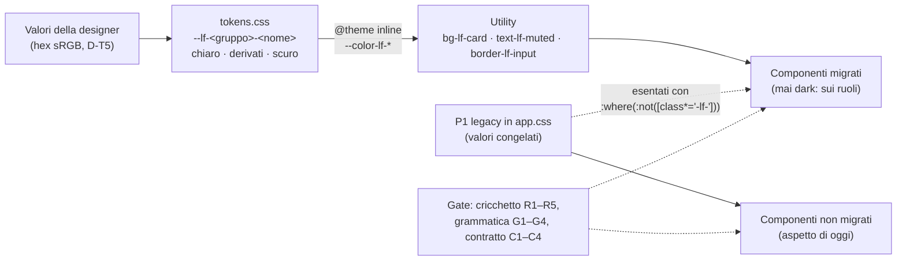

# Piano — Workstream T, token e tema (ruoli `--lf-*`, utility semantiche, migrazione a ondate)

> **Workstream T del programma colori**, sessione «T - token e tema». Coordinatore: sessione «UI color analysis»
> (`aec04834-1532-4d86-9e3f-f942e82aca89`).
> Branch `e-alfy-t-tokens-theme`, base `d9aec01936fe7207f1fa118558ce36dcafc90748` (`dev_release2`).
> Corsia: porta **6155**, dati **`/tmp/librefolio-r2-t`**.
> Comandi: `PIPENV_CUSTOM_VENV_NAME=LibreFolio-SAUMUTtc pipenv run python dev.py test --test-port 6155 --data-dir /tmp/librefolio-r2-t …`.
>
> **Fonti:**
> - analisi d'implementazione del 14/10: [`../coordination/workstream-analyses/T-analisi-implementazione-20261014.md`](../coordination/workstream-analyses/T-analisi-implementazione-20261014.md),
>   copiata dal coordinatore;
> - giro 1 della designer: [`../designer-feedback/2026-10-14-round1-auth/`](../designer-feedback/2026-10-14-round1-auth/README.md);
> - [piano generale](../plan-phase00ColorSystemThemeLab.prompt.md), §2, §5 e §6.
>
> **Il contratto dei ruoli è il codice:** `frontend/src/lib/theme/tokens.css`, che ha in testa le regole d'uso. Il
> manuale dei migratori è la skill [`theme-roles`](../../../../../.github/skills/design-tools/theme-roles/SKILL.md).

## ✅ Autorizzazione e decisioni (14/10/2026, sera)

**Autorizzazione del developer**, inoltrata alla lettera dal coordinatore: «Sì, approva T con tutte le raccomandazioni
e le tue integrazioni».

| # | Decisione |
|---|---|
| D-T1 | T si apre subito, in parallelo a R |
| D-T2 | La barra laterale prende il verde della testata della card di login, nei due temi. `#F1EDE3`/`#131A17` sono lo sfondo dell'app; `#F7F4ED`/`#0F1412` lo sfondo della pagina di login. La barra del titolo della PWA segue la barra laterale |
| D-T3 | Soluzione finale subito: ruoli `--lf-*` e utility semantiche, migrazione a ondate. Nessuna ritintura delle scale né del bianco. I rimasti indietro si vedono nel build (cricchetto) e nel rendering (gallery) |
| D-T4 | Nomi come nella tabella del §3.2 dell'analisi: variabili `--lf-<gruppo>-<nome>`, utility `*-lf-<nome>` con `@theme inline` sul namespace `--color-*` |
| D-T5 | Valori della designer in hex sRGB; derivati con `color-mix(in oklab, …)`; in B4, ponte sRGB per ECharts |
| D-T6 | Correzioni minime di contrasto applicate subito in `tokens.css`, ciascuna commentata col valore originale. La designer le conferma nel giro 2 |
| D-T7 | Splash, `offline.html` e `background_color` del manifest: sfondo `page` |
| D-T8 | Cricchetto R1–R5, grammatica G1–G4, contratto C1–C4. **M2 (colori letterali) attivo in T-1**: R è d'accordo e lo cede a T al posto della parte equivalente del suo W10/D7 (coordinatore, 14/10 sera). Requisiti di R: nomi di colore CSS nei valori (non nei selettori né in `white-space`) e come stringhe negli script; `rgba()`, `hsla()`, `oklab()`, `lab()`, `lch()`, `hwb()`; test e commenti esclusi; per file si confronta il **multinsieme dei valori normalizzati**, così uno scambio a conteggio pari è rosso; percorsi di L esenti; elenco motivato delle eccezioni di R; un `rgb()` fatto solo di `var()` non è un letterale |
| D-T8b | Baseline adatta ai merge (1.3, 14/10 sera): una riga per file, ordinata, nessun totale (lo calcola il gate). Su un conflitto vince il valore più stretto (m1 minore, intersezione dei valori m2), poi il gate deve passare sull'albero fuso: mai allargare. `--resolve` applica la regola. Tagli di file **dichiarati** con `--split VECCHIO:NUOVO1,NUOVO2`, nel commit del taglio |
| D-T9 | Piloti estesi a `ThemeToggle`, `PrivacyToggle`, `LanguageSelector`, `ConnectionSecurityIndicator`. Con l'OK di A: `auth/ForgotPasswordCard`, la barra in alto di `routes/+page.svelte` e `layout/HelpMenu`, solo classi colore e markup non riordinato; A arriva dopo il merge di T, altrimenti T segue sui percorsi nuovi. `routes/+error.svelte` è di T |
| D-T10 | La migrazione la fa T con sotto-agenti; altri workstream paralleli li decide il coordinatore |
| D-T11 | Nessun rilascio della 1.3 con la conversione dei neutri e degli stati a metà |
| D-T12 | Istruzioni per gli agenti, solo in tre punti: la sezione «Design System» di `.github/instructions/frontend.instructions.md`, la riga «Dark mode» di `.github/copilot-instructions.md` e la skill nuova `.github/skills/design-tools/theme-roles/`. Il coordinatore le rivede al checkpoint |
| D-T13 | Barra di robustezza della password: 3 ruoli (0–1 errore, 2 avviso, 3–4 successo) |
| D-T14 | Card di accesso con `border-lf-subtle` nei due temi; poi decide la designer |

**Vincoli:**
- **Fino alle 22:45 del 14/10:** solo scrittura. Niente `npm ci`, build, test né server: G misura la gallery. Dopo,
  `npm ci` è pre-approvato.
- **Git:** solo il coordinatore committa; il push lo fa il developer.
- **Specialisti:** `test-author` scrive i test, `docs-writer` il sito MkDocs, che si aggiorna solo alla chiusura del
  programma.

## Architettura in breve

## Passi

> Regola: dopo **ogni** passo, qui: ✅ con data, «Note implementazione», «Fuori pista» per ogni deviazione, comandi ed
> evidenze.

### T-0 · Piano nel repo e sezione del backlog

- [x] Questo file.
- [x] Sezione «T (colori)» in `Release_2/Phase_0/BACKLOG_POST_1.2.md`, al checkpoint 1: la lettera T c'era già, per la
  43.

### T-1 · Fondamenta (B1): nessun pixel cambia — checkpoint 1

1. `frontend/src/lib/theme/tokens.css`, nuovo. Contiene:
   - il contratto;
   - i ruoli chiari su `:root, html.light, .light`;
   - i derivati su `:root, .light, .dark`;
   - i ruoli scuri su `html.dark, .dark`;
   - `@theme inline` con `--color-lf-*`;
   - le correzioni D-T6, commentate.
2. `frontend/src/app.css`:
   - `@import './lib/theme/tokens.css'`;
   - le 4 regole strutturali di P1 con `:where(:not([class*='-lf-']))` (stessa specificità);
   - via `.animated-bg-gradient`, morto;
   - intestazione della sezione P1 legacy.
3. `frontend/scripts/theme/theme-roles.mjs`, nuovo: scanner e logica dei gate.
   - metriche M1 e M2, attive tutte e due (D-T8);
   - cricchetto R1–R5, grammatica G1–G4;
   - lettura dei token e risoluzione dei colori;
   - CLI `--report`, `--check`, `--update` (solo stringe), `--split`, `--resolve`, `--accept`, `--init`.
4. `frontend/src/themeRoles.baseline.tsv`, scritta con `--init`: una riga per file, nessun totale (D-T8b).
5. `test-author`:
   - `src/themeRoles.gate.test.ts` (cricchetto e grammatica);
   - `src/themeTokens.gate.test.ts` (contratto C1–C4);
   - registrazione in `front_utility_unit`, azione `core-unit`.
6. Istruzioni D-T12 e skill `theme-roles`.

**Prova, dopo le 22:45:**
- `npm ci`, se serve;
- `front build` della baseline (export con `git archive`) e di T-1, poi diff del CSS compilato: attese solo le
  variabili `--lf-*` e i 4 selettori;
- gate verdi; `front check`; `front format`; `lint --dead-code --scope frontend`.

### T-2 · Pilota dell'accesso — checkpoint 2

- **File:**
  - `auth/LoginCard`, `auth/RegisterCard`, `auth/ForgotPasswordCard` (OK di A);
  - `ui/input/PasswordInput` (prop `icon`), `ui/input/PasswordStrength`;
  - la barra in alto di `routes/+page.svelte` (OK di A);
  - `routes/+error.svelte`.
- **Cosa:**
  - icone `User`, `Mail`, `Lock` nei campi;
  - via il sottotitolo e la chiave: `dev.py i18n remove "auth.registerTitle" -f`, poi `i18n check`;
  - box dei requisiti sulla famiglia `success`;
  - barra a 3 ruoli (D-T13); card con `border-lf-subtle` (D-T14).
- **Test (`test-author`):** test dei componenti; E2E `e2e/layout/theme-roles.spec.ts`, punto (a).
- **Schermate di accesso** in chiaro e scuro, desktop e mobile, per la revisione: in corsia, oppure una gallery mirata
  del coordinatore.

### T-3 · Pilota della shell, solo classi

- **File:** `routes/(app)/+layout.svelte`, `layout/Sidebar`, `layout/Header`, `layout/HelpMenu` (OK di A),
  `layout/LanguageSelector`, `layout/ConnectionSecurityIndicator`, `ui/ThemeToggle`, `ui/PrivacyToggle`.
- **Cosa:**
  - barra laterale `bg-lf-brand` con testi `on-brand` (email e versione a `/70`, correzione D-T6);
  - sfondo `bg-lf-app`; header `bg-lf-app border-lf-subtle`.
- **Test:** E2E, punti (b) e (c). Gallery completa quando il coordinatore la mette in calendario.

### T-4 · PWA e superfici statiche, dopo l'ingresso del lotto A di R

- Meta `theme-color` `#1B4334`/`#1B4334` in `app.html`, `themeStore.ts` e `offline.html`.
- `manifest.json`: `theme_color` e `background_color`, quest'ultimo = page (D-T7).
- Splash e palette di `offline.html` sui valori dei ruoli.
- Il gate della meta di R: `PAIR` e (d) su `--lf-brand`.
- Nuovo `staticThemeMirrors.gate.test.ts`.
- **Il cricchetto e `themeStore.ts`** (coordinatore, 14/10 sera):
  - nel merge di base di R, la sua correzione D3 (`#156534` → `#166534`) è entrata con
    `--accept lib/stores/app/themeStore.ts --reason …D3…`, perché per il multinsieme m2 era uno scambio;
  - in T-4 la coppia della meta cambia di nuovo (`#1b4334` nei due temi): stesso percorso, con un `--accept`
    motivato D-T2 nel commit di T-4;
  - da lì il gate `themeColorMeta` di R passa a T.

### T-5 · Sfondo del login, dopo l'ingresso di G

- `ui/AnimatedBackground.svelte`: `--lf-surface-page` e i nuovi `--lf-art-*`. Le opacità si tarano con la designer.

### W1–W6 · Ondate di migrazione (sotto-agenti)

Ordine e prerequisiti: analisi §4.5.

| Ondata | Contenuto | Prerequisito |
|---|---|---|
| W1 | primitivi liberi di `ui/` | — |
| W2 | settings, support, onboarding, ai-export, resto di layout | — |
| W3 | stati e mappe (B2) | lotto A di R |
| W4 | fx, assets, transactions | lotto A; FE4, FE5, FE8 |
| W5 | charts, dashboard, risk, brokers (B4) | lotto B; FE2, FE6, FE7 |
| W6 | table, files, media, dialoghi (B5) | lotti C e D; FE3 |

Per ogni ondata: lotti di ≤ 15 file; gate eseguiti in serie da T; gallery e revisione della designer.

**File che la 1.3 taglia** (coordinatore, 14/10 sera): FE5 di X (`AssetModal` e la pagina dell'asset), FE8a di W
(wizard e modali delle transazioni), FE6 di Y (`GrowthChart`) e il taglio di `DataTable` di Y (ondata W6).

- **Regola «chi parte prima»:**
  - se il taglio non è ancora iniziato quando T arriva al file, T converte il file di oggi e il taglio si fa dopo;
  - se è iniziato, quel file si lascia per ultimo nell'ondata;
  - mai due sessioni sullo stesso file nello stesso momento.
- **Prima di convertire uno di questi file**, T chiede al coordinatore se c'è un taglio in corso. Inizio e ingresso
  dei tagli passano da lui.
- **Chi taglia** dichiara il taglio nel cricchetto, nello stesso commit:
  `node frontend/scripts/theme/theme-roles.mjs --split VECCHIO:NUOVO1,NUOVO2`.

### B6 · Pulizia

- Via P1, le `--theme-*`, i valori scuri dei `--color-libre-*`, i token morti.
- `body` sui ruoli; gallery finale.

## Checkpoint

| # | Contenuto | Stato |
|---|---|---|
| 1 | T-0, T-1 con il diff del CSS compilato | ✅ checkpoint `2018fd853`, integrato con `4e024dfe8` |
| 2 | T-2, poi integrazione subito: A aspetta | ✅ checkpoint `a73eb7eda`, integrato con `d80b986bf` |
| 3 | T-3 con la gallery completa | ✅ checkpoint `bd51acbc2`, base aggiornata con G nel merge `dad0f6292`; la gallery la lancia il coordinatore il 15/10 |
| 4 | T-5 sfondo del login, prima della gallery candidata del 15/10 | ✅ pronto il 15/10, FROZEN in attesa del commit |

## Avanzamento

### T-0 — ✅ 14/10/2026

> **Note implementazione:** piano creato dall'analisi d'implementazione, con le decisioni D-T1…D-T14 approvate dal
> developer. Il branch è stato rinominato dall'app `e-alfy-t-tokens-theme` all'avvio della sessione. Sezione «T (colori)»
> del backlog: TC-1 (requisiti della password per i lettori di schermo, ad A), TC-2 (ruoli in attesa del giro 2), TC-3
> (uno scanner solo con L).

### T-1 — ✅ 14/10/2026 (checkpoint 1)

> **Note implementazione:**
> - `lib/theme/tokens.css`:
>   - 45 utility `--color-lf-*`;
>   - ruoli chiari, derivati e scuri;
>   - le correzioni D-T6, commentate col valore della designer: attenuato `#636B61`/`#848F87`, bordo dei campi
>     `#8F8573`/`#64736B` (3:1 anche su app e pannello), successo `#17784D`, info `#145DEE`.
>
>   La correzione della barra laterale (`on-brand/70`) è una classe: va in T-3.
> - **Contrasti:** 158 coppie verificate nei due temi, nessuna sotto soglia. Le più strette: bordo dei campi su
>   pannello in chiaro, 3,01; attenuato su pannello in scuro, 4,52.
> - `app.css`:
>   - import dei token;
>   - `@source not` per le sorgenti dei gate;
>   - le 4 regole strutturali di P1 con `:where(:not([class*='-lf-']))`;
>   - via due regole morte, `.animated-bg-gradient` e `.bg-surface-100`, la cui classe ha 0 usi.
> - `scripts/theme/theme-roles.mjs`:
>   - metriche m1 (classi) e m2 (multinsieme dei letterali), tutte e due attive;
>   - R1–R5, G1–G4, contratto dei token;
>   - CLI con `--split`, `--resolve`, `--update` (solo stringe), `--accept`, `--init`.
> - Baseline `src/themeRoles.baseline.tsv`: 315 file, m1 11.435, m2 1.785.
> - **Gate di `test-author`:**
>   - `themeRoles.gate.test.ts` e `themeTokens.gate.test.ts`, 50 test;
>   - registrati in `core-unit`.
> - **Istruzioni D-T12:** la sezione «Design System», la riga «Dark mode» e la skill `design-tools/theme-roles`.
>
> **Evidenze:**
> - **CSS compilato**, build della baseline (export con `git archive d9aec019`) e di T-1, `npm run build`:
>   - 22 file CSS su 23 identici;
>   - nel diff di `0.*.css` (`files/T1-compiled-css.diff` della sessione T) solo +87 dichiarazioni `--lf-*` con i loro
>     blocchi, i 4 selettori strutturali riscritti con `:where` e le 2 regole morte tolte.
>
>   Nessuna utility in più: nessun pixel cambia.
> - `front-utility core-unit`: 130 file, 4.245 test verdi.
> - `front check`: 0 errori, 0 warning.
> - Prettier: verde sui file toccati.
> - `lint --dead-code --scope frontend`: esce con 1 come la baseline. Report identico (2 file, 18 export, 28 tipi, 4
>   devDependencies, 20 dipendenze non dichiarate): nessun reperto nuovo.
> - `theme-roles.mjs --check`: pulito.
>
> **⚠️ Fuori pista:**
> - **Tailwind e le sorgenti degli script.** Tailwind generava utility (`.border-y`, `.inset-ring`, `.bg-lf-card`…)
>   leggendo le stringhe di `scripts/theme/theme-roles.mjs`. Risolto con `@source not '../scripts/theme'` e
>   `@source not './theme*.gate.test.ts'`: i gate tengono classi come dati, non interfaccia.
> - **Due difetti dello scanner, trovati da `test-author` leggendolo.**
>   - Il `_` delle classi arbitrarie nascondeva i colori a `\b`; corretto con confini espliciti. La baseline, non
>     ancora committata, è stata rigenerata: +2 letterali, il bagliore del coachmark.
>   - `--update` poteva allargare la baseline tramite una tabella centrale che fa salire il totale; ora la rifiuta.
> - **C4 trovava una regola P1 morta:** `html.dark .bg-surface-100`, 0 usi. Tolta, senza effetto visivo.
> - **Decisioni arrivate durante T-1** (coordinatore, 14/10 sera):
>   - M2 attivo: R d'accordo, con i suoi requisiti;
>   - baseline a una riga per file, senza totali, e `--resolve` (dalla 1.3);
>   - tagli dichiarati, con la regola «chi parte prima».
> - **Artefatti generati e ignorati, da non committare:**
>   - `frontend/node_modules` (`npm ci`), `frontend/build`, `frontend/.svelte-kit`;
>   - il client API (`dev.py api sync`) e il catalogo i18n;
>   - `backend/data/prod/`, creato dall'import in-process dell'app durante `api sync`;
>   - `scripts/test_runner/.campaign.json`.
>
> **Checkpoint 1:** commit `2018fd853` del coordinatore, 12 file. Merge di base `4e024dfe8`, con il `793395913` della
> 1.3. `dev_release2` = `4e024dfe8`, entrato con un fast-forward: il cricchetto vale per tutti dal 14/10 sera.

### T-2 — ✅ 14/10/2026 (checkpoint 2)

> **Note implementazione:**
> - **Primitivi** (anche in `settings/PasswordChangeModal`, che li riusa):
>   - `PasswordInput`: nuova prop `icon` (icona lucide decorativa, `aria-hidden`, `data-testid="<testId>-icon"`) e
>     ruoli per campo, bordo, errore, focus e placeholder;
>   - `PasswordStrength`: barra a 3 stati (D-T13); box dei requisiti sulla famiglia `success`
>     (`data-testid="password-requirements"`); ogni regola con `data-testid="password-rule-<key>"` e `data-passed`;
>     ✓ e ✗ restano, quindi l'informazione non dipende dal colore.
> - **Card:**
>   - `LoginCard`, `RegisterCard`: icone `User`, `Mail` e `Lock`, grigie, che diventano del colore del testo
>     primario al focus (`group-focus-within`); card `bg-lf-card border-lf-subtle` (D-T14); testata `bg-lf-brand`;
>     pulsanti `bg-lf-action` con l'hover vero (prima `hover:bg-opacity-90`, che in v4 non esiste); link
>     `text-lf-link`;
>   - nella `RegisterCard` via il sottotitolo; `dev.py i18n remove "auth.registerTitle" -f` nelle 4 lingue, poi
>     `i18n check` strict verde (4.360 chiavi).
> - **Con l'OK di A, solo classi colore:**
>   - `ForgotPasswordCard`;
>   - il link del caffè di `routes/+page.svelte`, ora `text-lf-donate` (avviso).
> - **Di T:** `routes/+error.svelte`.
> - **Cricchetto** (R5), 7 file in calo:
>
>   | File | m1 |
>   |---|---|
>   | Login | 20 → 0 |
>   | Register | 28 → 0 |
>   | Forgot | 17 → 4 |
>   | `PasswordInput` | 10 → 0 |
>   | `PasswordStrength` | 24 → 0 |
>   | `+error` | 11 → 0 |
>   | `+page` | 5 → 1 |
>
>   Più un `#ffffff` in meno in ciascuna card, il riquadro del logo ora su `bg-lf-logo`.
> - **Restano legacy, di proposito:**
>   - il blocco terminale di Forgot (`bg-gray-800 text-green-400`, scuro nei due temi): nessun ruolo «codice»,
>     e A ne cambierà il contenuto con F13;
>   - il «Loading…» di `+page.svelte`, fuori dalla barra in alto e quindi di A.
>
> **Evidenze:**
> - **Test di `test-author`:**
>   - `PasswordInput.test.ts` ed estensioni di `LoginCard.test.ts` e `RegisterCard.test.ts`: icone `aria-hidden`
>     dentro il campo, nessun `auth.registerTitle`;
>   - `PasswordStrength.test.ts`, nuovo: `data-passed` per regola, ✓ contro ✗, barra 0→4;
>   - E2E `e2e/layout/theme-roles.spec.ts`, nuova, azione `front-utility theme-roles`: in chiaro e in scuro confronta
>     card, bordo, campo, focus, placeholder, pulsante e box dei requisiti con il valore del ruolo risolto dal browser
>     (una sonda per ruolo, nessun hex). In scuro prova le esenzioni di P1.
> - **Esecuzioni nella corsia 6155**, in serie:
>   - unità 149/149 (i 6 file toccati, gate compresi);
>   - `theme-roles` 8/8 (desktop e mobile);
>   - `auth` 29/29; `settings` 45/45 (la modale di cambio password riusa i due primitivi);
>   - `component-unit` 3.162, `core-unit` 4.245, `onboarding-component-unit` 437, tutti verdi.
> - **Controlli:**
>   - `front check` 0/0; Prettier verde; `i18n check` strict verde;
>   - `tsc -p tsconfig.e2e.json`: 2 errori, entrambi in file che T non tocca (`e2e/onboarding-tour.spec.ts`,
>     `src/lib/types/files.ts`); nessuno nella spec nuova.
> - **Cricchetto:** `--update` stringe la baseline, m1 11.435 → 11.325 e m2 1.785 → 1.782, solo i 7 file migrati;
>   `--check` pulito.
> - **28 scatti** in `files/T2-shots/` della sessione T:
>   - login, login con focus, registrazione vuota, compilata e debole, password dimenticata, 404;
>   - in chiaro e scuro, desktop 1280×800 e mobile 430×932;
>   - lingua italiana, corsia 6155, build di debug del server.
> - **Per la designer:**
>   - in scuro lo sfondo del login è ancora quello vecchio (`#11151c`, colline `#00ff9a`), perché è di G fino al
>     suo ingresso: va in T-5;
>   - il terminale di Forgot resta ardesia;
>   - il link del caffè in chiaro è `#895000` (avviso, 5,95:1), più bruno dell'arancio del render, che col colore di
>     oggi era a 3:1.
>
> **⚠️ Fuori pista:**
> - **Corsia nuova:** `/tmp/librefolio-r2-t` non esisteva. `test db populate --force --clean` sulla sola cartella
>   della corsia, come prevede il piano (E2E e scatti). Lo snapshot del DB è in `.testLog/00_archive/`, ignorato.
> - **Il server di test ricostruisce il frontend all'avvio** (api sync, check, build di debug): circa 2 minuti prima
>   di rispondere.
>
> **Checkpoint 2:** commit `a73eb7eda` del coordinatore, merge di base `d80b986bf` con avanzamento veloce del target.
> Il developer ha approvato gli scatti. Poi G è entrata in `dev_release2` (`265ae5c6e`): la base di T si aggiorna
> al checkpoint di T-3.

### T-3 — ✅ 15/10/2026 (checkpoint 3, prima della gallery)

> **Note implementazione:** classi soltanto, markup non riordinato (vincolo della 1.3 sui file condivisi).
> - `routes/(app)/+layout.svelte`:
>   - i 6 involucri `bg-libre-beige dark:bg-slate-900` diventano `bg-lf-app`;
>   - i 4 testi di caricamento diventano `text-lf-link`.
> - `layout/Sidebar.svelte`:
>   - barra `bg-lf-brand text-lf-on-brand`;
>   - divisori, hover e voce attiva su `on-brand/10`, `/20` e `/30`;
>   - riquadro del logo `bg-lf-logo`, prima `style="background:#fff"`;
>   - tooltip a barra chiusa `bg-lf-inverse`;
>   - fondale mobile `bg-lf-overlay`;
>   - email e versione `on-brand/70`, prima `/50` e `/40`: la correzione D-T6, 6:1.
> - `layout/Header.svelte`:
>   - `bg-lf-app border-lf-subtle`;
>   - icona del menu `text-lf-primary`;
>   - punto di sicurezza `bg-lf-danger ring-lf-app`;
>   - caffè `text-lf-donate hover:bg-lf-hover`.
> - `ThemeToggle`, `PrivacyToggle`: `text-lf-secondary hover:bg-lf-hover`.
> - `LanguageSelector`, `HelpMenu` (OK di A): pulsanti `text-lf-secondary`; menu `bg-lf-card border-lf-subtle`, voci
>   `text-lf-primary hover:bg-lf-hover`, lingua scelta `bg-lf-selected`; icone di bug e caffè `text-lf-warning` e
>   `text-lf-donate`. Prettier ha riunito su una riga i due `<button>` accorciati (formato, non ordine).
> - `ConnectionSecurityIndicator`: etichetta, dettagli e link su `on-brand`.
>
>   Restano legacy, di proposito, i colori di stato sulla barra verde:
>   - le icone (`emerald-300`, `lime-200`, `red-300`);
>   - la tinta rossa dello stato «insicuro»;
>   - l'avviso ambra per l'admin.
>
>   I ruoli di stato del chiaro sono scuri e sul verde sparirebbero. Un sotto-albero `.dark` sulla barra risolverebbe,
>   ma toglierebbe la barra alla modifica dal vivo del Lab, che sovrascrive i ruoli su `<html>`: decide la designer
>   (TC-2).
>
> **Evidenze:**
> - **Cricchetto:** `--update` stringe la baseline, m1 11.325 → 11.185 e m2 1.782 → 1.781, solo gli 8 file della
>   shell; `--check` pulito. In calo:
>
>   | File | m1 |
>   |---|---|
>   | `Sidebar` | 33 → 0, e un `#ffffff` in meno |
>   | `HelpMenu` | 48 → 0 |
>   | `+layout` | 20 → 0 |
>   | `LanguageSelector` | 14 → 0 |
>   | `Header` | 13 → 0 |
>   | `ConnectionSecurityIndicator` | 11 → 7 |
>   | `ThemeToggle`, `PrivacyToggle` | 4 → 0 ciascuno |
> - **Test di `test-author`:** `e2e/layout/theme-roles.spec.ts` ora ha 7 test per progetto.
>   - (b) con l'utente E2E su `/dashboard`, in chiaro e scuro: `app-shell` e `app-header` = `--lf-surface-app`, bordo
>     = `--lf-border-subtle`; la barra laterale = `--lf-brand` con il testo `--lf-on-brand`; il bordo della voce
>     attiva = `--lf-on-brand`;
>   - (c) controllo negativo in scuro: la card legacy `dashboard-cash-balances` = `var(--theme-bg-card)` e ≠
>     `--lf-surface-card`; il menu della lingua migrato = `--lf-surface-card`.
>
>   Dopo l'accesso il test ricarica la pagina, perché il login riapplica il tema dell'account.
> - **Esecuzioni nella corsia 6155**, in serie, tutte verdi:
>   - E2E `theme-roles` 14/14, `connection-security` 8, `header-scroll` 4, `document-title` 22, `app-start-auth`
>     3, `changelog-locale` 2, `onboarding-tour` 10, `onboarding-guides` 24 (le guide puntano le voci della barra);
>   - `core-unit` 4.245, `component-unit` 3.162, `onboarding-component-unit` 437.
> - **Controlli:**
>   - `front check` 0/0; Prettier verde;
>   - `tsc` E2E: gli stessi 2 errori di prima, in file che T non tocca.
> - **16 scatti** in `files/T3-shots/` della sessione T:
>   - dashboard, asset, impostazioni; barra mobile aperta; menu della lingua;
>   - chiaro e scuro, desktop 1440×900 e mobile.
>
>   In scuro le card delle pagine restano ardesia sul fondo verde-nero dell'app: è il «rimasto indietro» voluto da D-T3.
>
> **⚠️ Fuori pista:**
> - **`html.dark body` dipinge ancora il blu notte di P1 dove la shell non copre**, per esempio con il rimbalzo dello
>   scorrimento su iOS. Va con la pulizia B6, insieme al `body` chiaro, che è bianco. Non tolto ora: cambierebbe il
>   fondo di pagine fuori dalla shell (per esempio il Lab di L).
> - **Osservazioni di `test-author` fuori perimetro**, nel backlog come TC-5: il tema dell'header perso a un nuovo
>   accesso; l'accessibilità della shell, preesistente.

### T-5 — ✅ 15/10/2026 (checkpoint 4)

> **Avvio:** il coordinatore ha committato T-3 (`bd51acbc2`) e aggiornato la base con G (merge `dad0f6292`, worktree
> pulito, verificato). Con G entrato, `ui/AnimatedBackground.svelte` passa a T. Vincolo di G: il congelamento a
> t* = 3.600 ms resta com'è, si toccano solo i colori. Checkpoint entro le 09:00, così la gallery candidata copre T-3
> e T-5 insieme.
>
> **Note implementazione:**
> - `lib/theme/tokens.css`: quattro ruoli nuovi, solo variabili e senza utility, nei blocchi chiaro e scuro:
>
>   | Ruolo | Chiaro | Scuro |
>   |---|---|---|
>   | `--lf-art-hill-1` | `#9CAF9C` al 25% | `#14241E` |
>   | `--lf-art-hill-2` | `#9CAF9C` al 18% | `#192E26` |
>   | `--lf-art-hill-3` | `#9CAF9C` al 12% | `#1F382F` |
>   | `--lf-art-line` | `--lf-brand` al 15% | `#284238` |
>
>   - **L'intensità di ogni strato è l'alfa del suo colore**, con `color-mix(in oklab, X p%, transparent)`, così la
>     designer nel Lab tara colore e intensità in un valore solo.
>   - **In chiaro il disegno resta quello di oggi:** la salvia che la designer ha chiesto di tenere, alle opacità di
>     oggi, e il marchio al 15% (`#1a4031` → `#1B4334`, il verde di D-T2).
>   - **In scuro, i valori della designer a piena intensità,** come nel suo render: è la mia proposta iniziale, la
>     tara con lei sulla gallery (TC-2).
> - `ui/AnimatedBackground.svelte`:
>   - fondo `var(--lf-surface-page)`: `#f5f4ef` → `#F7F4ED` in chiaro, `#11151c` → `#0F1412` in scuro;
>   - ogni collina col suo gradiente su `--lf-art-hill-N` e senza `opacity`; linee con `stroke: var(--lf-art-line)` al
>     posto dell'attributo `stroke="#1a4031"`;
>   - nel fotogramma chiave `drawAndFade` l'altopiano passa da `0.15` a `1`: fa solo la dissolvenza, l'intensità è
>     nel colore. Durate, ritardi e passi dei fotogrammi chiave restano uguali, quindi a t* = 3,6 s il fotogramma è lo
>     stesso di G;
>   - via le tre regole `:global(html.dark)` (`#11151c`, `#00ff9a`, `#4ade80`);
>   - `data-testid="animated-background"` sulla radice, per le sonde E2E.
> - **Cricchetto:** il file esce dalla baseline (m2 8 → 0, totale 1.781 → 1.773).
> - **Skill:** una frase sui ruoli senza utility, letti con `var()` nel `<style>`.
> - **Rinomina nel backlog** (coordinatore, 15/10): le voci di T diventano TC-1…TC-5, perché T-B4…T-B9 collidevano
>   con la sezione «T · Matematica finanziaria» del piano 43. Richiami aggiornati qui e nella sezione; la sezione A
>   aggiorna da sé il suo richiamo in A-6.
>
> **Test di `test-author`:**
> - `themeTokens.gate.test.ts`: C2 risolve ora **ogni** ruolo dichiarato, con o senza utility, nei due temi; fa
>   eccezione solo la ricetta delle tinte (`--lf-tint-*`, percentuali). Prima un refuso in un `--lf-art-*` sarebbe
>   passato in silenzio, perché C2 guardava solo le utility. Controllo positivo su una tabella difettosa; prova per
>   mutazione su una copia in memoria di `tokens.css`, poi tolta.
> - `e2e/layout/theme-roles.spec.ts`, sonda (d), in chiaro e scuro, da disconnessi su `/`:
>   - il fondo è `--lf-surface-page`;
>   - le tre colline, attese dopo il montaggio, hanno ciascuna una tappa del gradiente in `--lf-art-hill-N` e opacità 1;
>   - le tre linee hanno `stroke` = `--lf-art-line`;
>   - in scuro, nessuno dei tre letterali ritirati.
>
>   Da 7 a 9 test per progetto. Il dubbio di `test-author`, cioè se Chrome scriva una tappa del gradiente come il
>   `color` di una sonda, è sciolto: (d) chiaro passa.
> - Descrizione dell'azione `theme-roles` e docstring di `front_theme_roles` aggiornate a T-5.
>
> **Evidenze, corsia 6155, in serie, tutte verdi:**
> - E2E `theme-roles` 18/18, `auth` 29, `app-start-auth` 3;
> - `core-unit` 4.246, cioè i 4.245 di T-3 più il test nuovo del gate;
> - `front check` 0/0; Prettier verde; `--check` pulito.
> - **16 scatti** in `files/T5-shots/` della sessione T: accesso, registrazione, password dimenticata, 404; chiaro e
>   scuro, desktop 1280×800 e mobile. Le animazioni che si ripetono sono ferme a 3,6 s della loro corsa, come nella
>   gallery di G.
>   - In chiaro il disegno è quello di prima; cambia solo la pagina, più calda.
>   - In scuro: fondo `#0F1412`, colline fino a circa `#1E372E` in basso (nel render della designer `#213127`–
>     `#273B30`), linee `#284238` ben visibili.
> - Il CSS compilato di `AnimatedBackground` legge solo `var(--lf-…)`; nessun letterale.
>
> **Fuori pista:**
> - **TC-6 nel backlog:** sugli scatti, la bandiera del selettore della lingua è 🇬🇧 su una pagina in italiano, alla
>   prima visita con browser `it-IT`. È un difetto di prima, non di colore: va instradato.
> - **I pallini sulle linee** del render della designer restano fuori, come detto nell'analisi: non sono nelle sue
>   note.
