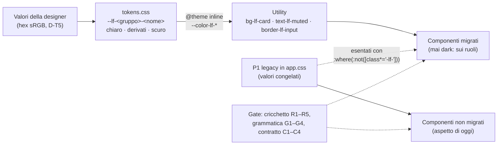

# Piano — Workstream T, token e tema (ruoli `--lf-*`, utility semantiche, migrazione a ondate)

> **Workstream T del programma colori**, sessione «T - token e tema». Coordinatore: sessione «UI color analysis»
> (`aec04834-1532-4d86-9e3f-f942e82aca89`).
> Branch `e-alfy-t-tokens-theme`, base `d9aec01936fe7207f1fa118558ce36dcafc90748` (`dev_release2`).
> Corsia: porta **6155**, dati **`/tmp/librefolio-r2-t`**.
> Comandi: `PIPENV_CUSTOM_VENV_NAME=LibreFolio-SAUMUTtc pipenv run python dev.py test --test-port 6155 --data-dir /tmp/librefolio-r2-t …`.
>
> **Fonti:**
> - analisi d'implementazione del 14/10: [`../coordination/workstream-analyses/T-analisi-implementazione-20261014.md`](../coordination/workstream-analyses/T-analisi-implementazione-20261014.md),
>   copiata dal coordinatore;
> - giro 1 della designer: [`../designer-feedback/2026-10-14-round1-auth/`](../designer-feedback/2026-10-14-round1-auth/README.md);
> - [piano generale](../plan-phase00ColorSystemThemeLab.prompt.md), §2, §5 e §6.
>
> **Il contratto dei ruoli è il codice:** `frontend/src/lib/theme/tokens.css`, che ha in testa le regole d'uso. Il
> manuale dei migratori è la skill [`theme-roles`](../../../../../.github/skills/design-tools/theme-roles/SKILL.md).

## ✅ Autorizzazione e decisioni (14/10/2026, sera)

**Autorizzazione del developer**, inoltrata alla lettera dal coordinatore: «Sì, approva T con tutte le raccomandazioni
e le tue integrazioni».

| # | Decisione |
|---|---|
| D-T1 | T si apre subito, in parallelo a R |
| D-T2 | La barra laterale prende il verde della testata della card di login, nei due temi. `#F1EDE3`/`#131A17` sono lo sfondo dell'app; `#F7F4ED`/`#0F1412` lo sfondo della pagina di login. La barra del titolo della PWA segue la barra laterale |
| D-T3 | Soluzione finale subito: ruoli `--lf-*` e utility semantiche, migrazione a ondate. Nessuna ritintura delle scale né del bianco. I rimasti indietro si vedono nel build (cricchetto) e nel rendering (gallery) |
| D-T4 | Nomi come nella tabella del §3.2 dell'analisi: variabili `--lf-<gruppo>-<nome>`, utility `*-lf-<nome>` con `@theme inline` sul namespace `--color-*` |
| D-T5 | Valori della designer in hex sRGB; derivati con `color-mix(in oklab, …)`; in B4, ponte sRGB per ECharts |
| D-T6 | Correzioni minime di contrasto applicate subito in `tokens.css`, ciascuna commentata col valore originale. La designer le conferma nel giro 2 |
| D-T7 | Splash, `offline.html` e `background_color` del manifest: sfondo `page` |
| D-T8 | Cricchetto R1–R5, grammatica G1–G4, contratto C1–C4. **M2 (colori letterali) attivo in T-1**: R è d'accordo e lo cede a T al posto della parte equivalente del suo W10/D7 (coordinatore, 14/10 sera). Requisiti di R: nomi di colore CSS nei valori (non nei selettori né in `white-space`) e come stringhe negli script; `rgba()`, `hsla()`, `oklab()`, `lab()`, `lch()`, `hwb()`; test e commenti esclusi; per file si confronta il **multinsieme dei valori normalizzati**, così uno scambio a conteggio pari è rosso; percorsi di L esenti; elenco motivato delle eccezioni di R; un `rgb()` fatto solo di `var()` non è un letterale |
| D-T8b | Baseline adatta ai merge (1.3, 14/10 sera): una riga per file, ordinata, nessun totale (lo calcola il gate). Su un conflitto vince il valore più stretto (m1 minore, intersezione dei valori m2), poi il gate deve passare sull'albero fuso: mai allargare. `--resolve` applica la regola. Tagli di file **dichiarati** con `--split VECCHIO:NUOVO1,NUOVO2`, nel commit del taglio. **TC-7 (15/10):** `--resolve` è un merge a tre vie: una riga che un lato ha lasciato com'era nella base prende quella dell'altro lato; cambiata dai due lati, vince il lato con un `~accept` nuovo per quel file (due `~accept` nuovi: errore, si riaccetta sull'albero fuso), altrimenti il più stretto |
| D-T9 | Piloti estesi a `ThemeToggle`, `PrivacyToggle`, `LanguageSelector`, `ConnectionSecurityIndicator`. Con l'OK di A: `auth/ForgotPasswordCard`, la barra in alto di `routes/+page.svelte` e `layout/HelpMenu`, solo classi colore e markup non riordinato; A arriva dopo il merge di T, altrimenti T segue sui percorsi nuovi. `routes/+error.svelte` è di T |
| D-T10 | La migrazione la fa T con sotto-agenti; altri workstream paralleli li decide il coordinatore |
| D-T11 | Nessun rilascio della 1.3 con la conversione dei neutri e degli stati a metà |
| D-T12 | Istruzioni per gli agenti, solo in tre punti: la sezione «Design System» di `.github/instructions/frontend.instructions.md`, la riga «Dark mode» di `.github/copilot-instructions.md` e la skill nuova `.github/skills/design-tools/theme-roles/`. Il coordinatore le rivede al checkpoint |
| D-T13 | Barra di robustezza della password: 3 ruoli (0–1 errore, 2 avviso, 3–4 successo) |
| D-T14 | Card di accesso con `border-lf-subtle` nei due temi; poi decide la designer. **Superata da N3 (D-T17):** `border-lf-raised`, `#D8E0DC` in chiaro e `#2E3B36` in scuro, anche per modali e menu a tendina |
| D-T15 | (15/10, supera D-T2) «Barra laterale neutra, come scrive la designer: #EDF0EE / #111615; il verde #1B4334 resta per l'header del login e i pulsanti». Palette del giro 2: «Pietra e Salvia» / «Ardesia e Salvia»; lo sfondo pagina vale anche per l'app |
| D-T16 | (15/10, chiude Q1) «Verde focus: riempimento #236B4D / #429E79, segno nel colore della card (6,1:1 in chiaro, 5,3:1 in scuro)»: ruoli `--lf-checked` e `--lf-on-checked` |
| D-T3 confermata | (15/10) «Solo le ondate W1–W6, come da D-T3: chi non è migrato resta visibilmente vecchio»: niente ponte, né sulle regole globali dello scuro di `app.css` né sulle tabelle di R |
| D-T17 | (15/10, 15:03, supera D-T15) «archiviali opportunamente e poi dai mandato ai vari sotto agenti di realizzare quanto pianificato»: giro 2 della designer approvato per intero. Barra laterale verde nei due temi, stati con tinte esplicite, N1–N6, Q2–Q13, GR1–GR5. Fonti: `designer-feedback/2026-10-15-round2-palette/` |
| D-T18 | (15/10, 15:50) «meglio mantenere la regola WCAG, usa Attuale 3:1 ovunque + hover proposto sia per chiaro che per scuro»: il bordo dei campi resta `#7E8984`/`#606F6A`; `--lf-border-input-hover` = testo attenuato (`#616D67`/`#7F8C87`), definitivo, sui campi di T; gli altri con W1-d e le ondate |
| D-T19 | (15/10, 15:50, supera l'interpretazione di N2 in `analisi.md` §5) «credo che la designer si aspetti che anche in desktop sia verde, non solo in mobile»: header e barra laterale `#1B4334` nei due temi, una sola famiglia di ruoli, `--lf-bar-*` (i nomi della designer, `--lf-surface-sidebar` e `--lf-sidebar-*`, restano nei commenti). Anello di focus dedicato `#52C493` (5,10:1); icone sul testo della barra `#CFE0D8`; «Offrimi un caffè» `#F59E0B` nei due temi; anello del pallino di sicurezza nel verde della barra; bordo inferiore solo in scuro, `#265946`. Restano il comportamento di T-7 e i menu sulla card |
| D-T20 | (15/10, 15:55) Integrazione progressiva: T entra in `dev_release2` dopo la revisione del developer di T-8 sull'anteprima 6160; da lì ogni gruppo di lotti delle ondate entra appena validato, senza accumulo sul ramo. Il merge lo fa il coordinatore; a ogni ingresso la 1.3 rifà la sua galleria di riferimento |
| D-T21 | (15/10, 15:55) «si principalmente io, se lei è disponibile te lo faccio sapere»: l'aspetto lo approva il developer, dal contact sheet e dal diff della galleria. La designer rivede tutto insieme nel giro 3; sostituisce la sua revisione a ogni ondata |
| D-T23 | (15/10, sera, dopo l'anteprima di T-8; supera D-T19 per l'header) «l'header con lo stesso colore del menù verticale non ci piace, sarebbe meglio usare il colore di sfondo con una variante più scura nel tema chiaro e una più chiara nel tema scuro»: opzione A, la barra neutra della designer, `#EDF0EE` / `#111615`, ruolo `--lf-surface-header`, desktop e mobile. Controlli dell'header nel loro aspetto di pagina, bordo inferiore `--lf-border-subtle`. La barra laterale resta verde (D-T17), senza il bordo destro scuro (la «lineetta» fra il menu e l'header) |
| D-T24 | (15/10, sera) La barra del titolo della PWA (`theme-color`) resta verde `#1B4334` nei due temi, come la barra laterale, anche con l'header neutro di D-T23: opzione A di T, nessun cambio alle tre copie né al gate |
| D-T25 | (15/10, sera) Il rosso del tema scuro è `#FF7A86` al posto di `#F84361`, per `--lf-danger` (testi, bordi, icone di errore): 7,0:1 sulla card. Invariati `--lf-danger-solid` e `--lf-danger-hover` (il riempimento dei pulsanti pieni sotto testo bianco, che `#FF7A86` non regge), le tinte `-soft`, `-line`, `-on-soft`, `--lf-bar-danger` e tutto il tema chiaro. |
| D-T26 | (15/10, sera) Il verde del tema scuro è `#5ED69A` al posto di `#36D399`, per `--lf-success` (testi, icone ✓, barra di robustezza, «Forte»): 9,6:1 sulla card, 8,8:1 sulla superficie secondaria. Con D-T25 chiude il punto 5 di T-8b. Per coerenza con la regola della designer sulla barra verde («gli stati luminosi del tema scuro», indicazione del coordinatore): `--lf-bar-success` `#5ED69A` e `--lf-bar-danger` `#FF7A86` |
| D-T27 | (15/10, notte; il developer è andato a dormire) «il tuo obiettivo è finire la migrazione e fattorizzazione dei colori, cercando comunque di seguire le direttive della designer, e poi a giochi fatti, possiamo sempre tornare e modificare solo i colori». Dal coordinatore: ogni lotto validato entra senza aspettare l'OK del developer, che rivede tutto insieme la mattina; niente contact sheet per lotto; gate verdi a ogni lotto; valori sempre dai ruoli e dalla tabella della skill `theme-roles`, e un caso non coperto prende il ruolo più vicino, annotato qui nel piano («da rivedere»); in ogni handoff due o tre righe «dove guardarlo». Ordine: W3-a, TD-3, W3-b, W3-c con W3-d, poi W1, W2 e oltre |

**Vincoli:**
- **Fino alle 22:45 del 14/10:** solo scrittura. Niente `npm ci`, build, test né server: G misura la gallery. Dopo,
  `npm ci` è pre-approvato.
- **Git:** solo il coordinatore committa; il push lo fa il developer.
- **Specialisti:** `test-author` scrive i test, `docs-writer` il sito MkDocs, che si aggiorna solo alla chiusura del
  programma.

## Architettura in breve



## Passi

> Regola: dopo **ogni** passo, qui: ✅ con data, «Note implementazione», «Fuori pista» per ogni deviazione, comandi ed
> evidenze.

### T-0 · Piano nel repo e sezione del backlog

- [x] Questo file.
- [x] Sezione «T (colori)» in `Release_2/Phase_0/BACKLOG_POST_1.2.md`, al checkpoint 1: la lettera T c'era già, per la
  43.

### T-1 · Fondamenta (B1): nessun pixel cambia — checkpoint 1

1. `frontend/src/lib/theme/tokens.css`, nuovo. Contiene:
   - il contratto;
   - i ruoli chiari su `:root, html.light, .light`;
   - i derivati su `:root, .light, .dark`;
   - i ruoli scuri su `html.dark, .dark`;
   - `@theme inline` con `--color-lf-*`;
   - le correzioni D-T6, commentate.
2. `frontend/src/app.css`:
   - `@import './lib/theme/tokens.css'`;
   - le 4 regole strutturali di P1 con `:where(:not([class*='-lf-']))` (stessa specificità);
   - via `.animated-bg-gradient`, morto;
   - intestazione della sezione P1 legacy.
3. `frontend/scripts/theme/theme-roles.mjs`, nuovo: scanner e logica dei gate.
   - metriche M1 e M2, attive tutte e due (D-T8);
   - cricchetto R1–R5, grammatica G1–G4;
   - lettura dei token e risoluzione dei colori;
   - CLI `--report`, `--check`, `--update` (solo stringe), `--split`, `--resolve`, `--accept`, `--init`.
4. `frontend/src/themeRoles.baseline.tsv`, scritta con `--init`: una riga per file, nessun totale (D-T8b).
5. `test-author`:
   - `src/themeRoles.gate.test.ts` (cricchetto e grammatica);
   - `src/themeTokens.gate.test.ts` (contratto C1–C4);
   - registrazione in `front_utility_unit`, azione `core-unit`.
6. Istruzioni D-T12 e skill `theme-roles`.

**Prova, dopo le 22:45:**
- `npm ci`, se serve;
- `front build` della baseline (export con `git archive`) e di T-1, poi diff del CSS compilato: attese solo le
  variabili `--lf-*` e i 4 selettori;
- gate verdi; `front check`; `front format`; `lint --dead-code --scope frontend`.

### T-2 · Pilota dell'accesso — checkpoint 2

- **File:**
  - `auth/LoginCard`, `auth/RegisterCard`, `auth/ForgotPasswordCard` (OK di A);
  - `ui/input/PasswordInput` (prop `icon`), `ui/input/PasswordStrength`;
  - la barra in alto di `routes/+page.svelte` (OK di A);
  - `routes/+error.svelte`.
- **Cosa:**
  - icone `User`, `Mail`, `Lock` nei campi;
  - via il sottotitolo e la chiave: `dev.py i18n remove "auth.registerTitle" -f`, poi `i18n check`;
  - box dei requisiti sulla famiglia `success`;
  - barra a 3 ruoli (D-T13); card con `border-lf-subtle` (D-T14).
- **Test (`test-author`):** test dei componenti; E2E `e2e/layout/theme-roles.spec.ts`, punto (a).
- **Schermate di accesso** in chiaro e scuro, desktop e mobile, per la revisione: in corsia, oppure una gallery mirata
  del coordinatore.

### T-3 · Pilota della shell, solo classi

- **File:** `routes/(app)/+layout.svelte`, `layout/Sidebar`, `layout/Header`, `layout/HelpMenu` (OK di A),
  `layout/LanguageSelector`, `layout/ConnectionSecurityIndicator`, `ui/ThemeToggle`, `ui/PrivacyToggle`.
- **Cosa:**
  - barra laterale `bg-lf-brand` con testi `on-brand` (email e versione a `/70`, correzione D-T6);
  - sfondo `bg-lf-app`; header `bg-lf-app border-lf-subtle`.
- **Test:** E2E, punti (b) e (c). Gallery completa quando il coordinatore la mette in calendario.

### T-4 · PWA e superfici statiche, dopo l'ingresso del lotto A di R — fatto dentro T-8 (sbloccato da N2)

- Meta `theme-color` `#1B4334`/`#1B4334` in `app.html`, `themeStore.ts` e `offline.html`.
- `manifest.json`: `theme_color` e `background_color`, quest'ultimo = page (D-T7).
- Splash e palette di `offline.html` sui valori dei ruoli.
- Il gate della meta di R: `PAIR` e (d) su `--lf-surface-bar`, il ruolo delle barre verdi (D-T19), che la barra del
  titolo continua.
- Le copie statiche dei ruoli (splash e `offline.html`) controllate in un blocco nuovo dello stesso
  `themeColorMeta.gate.test.ts`, già registrato: nessun file nuovo nel runner, che è una superficie condivisa.
- **Il cricchetto e `themeStore.ts`** (coordinatore, 14/10 sera):
  - nel merge di base di R, la sua correzione D3 (`#156534` → `#166534`) è entrata con
    `--accept lib/stores/app/themeStore.ts --reason …D3…`, perché per il multinsieme m2 era uno scambio;
  - in T-4 la coppia della meta cambia di nuovo (`#1b4334` nei due temi): stesso percorso, con un `--accept`
    motivato D-T17 nel commit di T-8;
  - da lì il gate `themeColorMeta` di R passa a T.

### T-5 · Sfondo del login, dopo l'ingresso di G

- `ui/AnimatedBackground.svelte`: `--lf-surface-page` e i nuovi `--lf-art-*`. Le opacità si tarano con la designer.

### T-6 · Palette del giro 2 e barra laterale neutra (D-T15, D-T16)

- `tokens.css`: i valori di «Pietra e Salvia» e «Ardesia e Salvia»; ruoli nuovi `--lf-surface-sidebar`, `--lf-checked`,
  `--lf-on-checked`; `--lf-surface-app` derivato dallo sfondo pagina; correzioni minime di contrasto (politica D-T6).
- Barra laterale neutra, controllo della connessione sui ruoli di stato, box dei requisiti sulla superficie
  secondaria, colline del login ritarate.
- Niente ponte (D-T3 confermata): i componenti non migrati restano come sono.

### T-8 · Giro 2 della designer approvato (D-T17)

- `tokens.css`, solo ruoli e valori:
  - la famiglia della barra verde (README §A) e i colori di stato sulla barra;
  - gli stati con fondi tenui, bordi e testi espliciti al posto della ricetta (§B), con l'avviso chiaro `#B45309`;
  - N3 (card in rilievo), N6 (colline scure), Q2 (interruttore), Q3 (rosso pieno e hover), Q6 (terminale), Q7 (`mark`),
    Q8 (ombre), Q9 (alone del tour), Q10 (avviso nel tooltip), Q11 (viola AI), Q13 (fondale, da verificare);
  - `--lf-border-input-hover`, il testo attenuato (D-T18, decisa alle 15:50);
  - correzioni minime D-T6 su ogni coppia misurata dal gate, col valore della designer in commento.
- Componenti di T: barra laterale tutta verde; stato della connessione sulla barra verde; header verde anche su
  desktop, con la stessa famiglia `--lf-bar-*` della barra (D-T19, supera l'interpretazione di N2); card di accesso e
  menu sul bordo e sull'ombra in rilievo (N3, Q8); hover dei campi di T, `PasswordInput` compreso (OK del coordinatore,
  A verificato); terminale di `ForgotPasswordCard` (Q6), solo classi colore, via libera di A e del 1.3.
- T-4, sbloccato da N2: `theme-color` `#1B4334` nei due temi, manifest, `offline.html`, gate di R ripreso da T,
  `--accept` di `themeStore.ts` motivato D-T17.
- TC-7: `--resolve` a tre vie, prima di W1.
- Fuori perimetro: l'applicazione nei componenti degli altri (Q4, Q5, Q6 codice nel testo, Q7, Q9, Q10, Q11, Q12, card
  scure di Profilo e Allocazione) va nelle ondate; i grafici (GR1–GR5) a DV.

### T-8b · Correzioni del developer dopo l'anteprima (D-T23)

- Header neutro, `--lf-surface-header`; i suoi controlli tornano all'aspetto di pagina (via la prop `onBar`), col
  ring di focus della pagina.
- Barra laterale senza bordo destro; via `--lf-bar-edge` e `--lf-bar-donate`, che nessuno usa più.
- `ForgotPasswordCard`: via la riga «Password Recovery» e la chiave `auth.passwordRecovery` (OK della 1.3).
- `AuthPageFrame` (di A, OK della 1.3): i controlli in alto `absolute` sotto `lg`, `fixed` su desktop.
- Rosso e verde del tema scuro: punto preparato, valori dal developer.
- `theme-color`: resta `#1B4334` (D-T24); solo i commenti delle tre copie passano da «le barre verdi» alla barra laterale.
- Test con `test-author`: C3, `theme-roles` (b), `header-scroll`.

### T-8c · La card d'accesso non nasce sotto i controlli, su telefono

- Visto negli scatti di T-8b: su un telefono la card di registrazione, alta, partiva a 16 px, sotto i controlli in
  alto, già a pagina non scorsa. `AuthPageFrame` (di A): la 1.3 lo assegna a T, riga dichiarata all'ingresso.
- Il contenitore riserva in alto lo spazio dei controlli sotto `lg`; il desktop resta com'è.
- Test di `test-author` in `header-scroll.spec.ts`; E2E `header-scroll` e `auth` a 1 worker; scatto prima e dopo.

### W1–W6 · Ondate di migrazione (sotto-agenti)

Ordine e prerequisiti: analisi §4.5.

| Ondata | Contenuto | Prerequisito |
|---|---|---|
| W1 | primitivi liberi di `ui/` | — |
| W2 | settings, support, onboarding, ai-export, resto di layout | — |
| W3 | stati e mappe (B2) | lotto A di R |
| W4 | fx, assets, transactions | lotto A; FE4, FE5, FE8 |
| W5 | charts, dashboard, risk, brokers (B4) | lotto B; FE2, FE6, FE7 |
| W6 | table, files, media, dialoghi (B5) | lotti C e D; FE3 |

Per ogni ondata: lotti di ≤ 15 file, scritti dai sotto-agenti; gate eseguiti in serie da T, una prova pesante alla
volta. **Ingresso a gruppi (D-T20):** ogni gruppo di lotti entra in `dev_release2` appena validato, senza accumulo sul
ramo; il merge lo fa il coordinatore e la 1.3 rifà la sua galleria di riferimento. **Approvazione dell'aspetto
(D-T21):** il developer, dal contact sheet e dal diff della galleria; la designer rivede tutto insieme nel giro 3.

**File che la 1.3 taglia** (coordinatore, 14/10 sera): FE5 di X (`AssetModal` e la pagina dell'asset), FE8a di W
(wizard e modali delle transazioni), FE6 di Y (`GrowthChart`) e il taglio di `DataTable` di Y (ondata W6).

- **Regola «chi parte prima»:**
  - se il taglio non è ancora iniziato quando T arriva al file, T converte il file di oggi e il taglio si fa dopo;
  - se è iniziato, quel file si lascia per ultimo nell'ondata;
  - mai due sessioni sullo stesso file nello stesso momento.
- **Prima di convertire uno di questi file**, T chiede al coordinatore se c'è un taglio in corso. Inizio e ingresso
  dei tagli passano da lui.
- **Chi taglia** dichiara il taglio nel cricchetto, nello stesso commit:
  `node frontend/scripts/theme/theme-roles.mjs --split VECCHIO:NUOVO1,NUOVO2`.

#### Spacchettamento di W3, stati e mappe (B2) — 15/10, sera; prima ondata dopo l'ingresso

> Mandato del coordinatore (15/10, 22:10): W3 per prima, perché chiude TD-2 (i verdi e i rossi fluo dei KPI della
> dashboard, notati dal developer). Le mappe dell'analisi `03_semantic_dynamic_logic.md` stanno quasi tutte, dal lotto A
> di R, nelle tabelle centrali di `lib/theme/toneClasses.ts` (202 classi legacy): convertire una voce cambia di colpo
> tutti i suoi consumatori, quindi un lotto è la voce più i consumatori da controllare (G3 a runtime: un elemento che
> riceve una classe `-lf-` dalla tabella e ne tiene una legacy esce dal remap scuro di P1 a metà).

| Lotto | Tabelle e funzioni | Consumatori | File |
|---|---|---|---|
| W3-a · segno sulla dashboard (TD-2) | `SIGN_TEXT.kpi`, `.headline`, `.portfolio`; `SIGN_BAR.kpi`, `.accent`; `timingEffectColor` di `chartColorScales.ts` (oggi `rgba(22,163,74,α)` / `rgba(220,38,38,α)` fissi) → `--lf-gain` / `--lf-loss`, l'alfa con `color-mix` o col ponte di DV (`ChartRole` allargata a `--lf-gain` / `--lf-loss`, `STAND_INS` e gate di parità) | `KpiCard`, `KpiSection`, `ContributionTable`, `ExposureTable`, `OtherPeriodEffectsTable`, `KpiDivergingFlowBar`, `RiskMetricCard` | 10 |
| W3-b · segno su mercato e broker | `SIGN_TEXT.market`, `.brokerCard` → `--lf-gain` / `--lf-loss` (via la divergenza emerald/green); i bordi di segno di `CompactCashCell` (`<style>`, emerald/red al 70 %) | `AssetCard`, `AssetPriceSummary`, `AssetTable`, `FxCard`, `FxPriceSummary`, `FxTable`, `BrokerCard`, `UnifiedLotsTable`, `MeasurePanel`, `CompactCashCell` | 11 |
| W3-c · stati | `STATUS_TONES` (`syncIcon`, `pacBadge`, `pacNotice`, `pacTargetBar`, `pacTargetTotal`, `toast`, `reportSet`, `fileSet`, `riskAssetChip`, `dataQuality`) → ruoli di stato (`-soft`, `-line`, `-on-soft`; i pieni `bg-lf-X text-lf-on-status`, il rosso pieno `danger-solid` per Q3) | `FileSetBadges`, `AssetChip`, `ReportSetCard`, `DataQualityBanner`, `ToastContainer`, `SyncResultRow`, `TargetsStep`, `planner/ui.ts`, `syncHelpers.ts` | 10 |
| W3-d · polarità e tipi d'identificativo | `POLARITY_TONES` (correlazione: negativa `danger`, positiva `info`; contributo al rischio; divergenza, dove più alto è peggio); `KIND_TONES.identifier` (ISIN, simbolo, nome) | `CorrelationPairsList`, `RiskAnalysisPanel`, `L2Diversification`, `AssetGroupStep` | 5 |

- **Ordine:** W3-a (TD-2) → W3-b → W3-c → W3-d; ingresso a gruppi (D-T20): W3-a da solo, poi W3-b, poi W3-c con W3-d.
- **Prima di ogni lotto:** il coordinatore conferma che nessuna sessione della 1.3 ha annunciato quei file («chi parte
  prima»); `test-author` aggiorna i test che leggono le classi delle tabelle.
- **Da chiedere** (designer o developer): `DataQualityBanner` oggi colora l'errore come l'avviso (ambra); il violetto
  del simbolo in `KIND_TONES` è categoriale (la Q11 riguarda solo l'AI).
- **Fuori da W3:** `ROLE_COLORS` dei segnali (B4, grafici); `PROVIDER_COLORS` e `BADGE_CLASS_MAP` dei tipi d'asset
  (categoriali, con le tabelle dei tipi del giro 2 di DV); TD-3, la card «Allocazione Patrimoniale» (W5), un lotto
  piccolo subito dopo W3-a, sui file che il coordinatore conferma.
- **Prove pesanti per gruppo:** `--check`, i gate di T e la parità di DV, `front check`, `component-unit`; E2E
  `front-portfolio dashboard` (W3-a), `asset-list`, `fx-list`, `broker-*` (W3-b), `settings`, `tx-import-*`, `files`,
  `risk-lab` (W3-c, W3-d); gli scatti di galleria delle scene toccate.

#### Spacchettamento di W1 e W2 (analisi del 15/10, notte; sola lettura)

> Chiesto dal coordinatore il 15/10 all'01:08: lotti di W1 e W2, file liberi prima, quelli toccati da un ramo attivo
> in fondo, ruoli mancanti come domande per la designer, test, gallery e bozza del prompt per ogni lotto. Niente
> codice, server, test né sotto-agenti che scrivono.

**Riferimento e metodo**

- `dev_release2` = `9a12e623d`. Il frontend è identico a `c1df8f4cb` (A2 integrato), perché i due commit successivi
  toccano solo il journal e `scripts/visual_review`. Il mio HEAD resta `f43aa7200`.
- I conteggi vengono dallo scanner di T, eseguito su una copia del target fatta con `git archive` e confrontati con la
  baseline del target: coincidono per ogni file.
- **I 22 file spostati da A2** hanno ancora la riga col percorso vecchio (`components/{auth,settings,support}/…`): la
  regola R4 li abbina per nome. Il primo `--update` dopo il merge di base li riscrive coi nomi nuovi.
- **Rami attivi** (`git diff --name-status -M dev_release2...<ramo>`):
  - nessuno tocca un file di W1 o W2 con un commit. R tocca `ui/ContextMenu` (lotto C), L il layout radice, J un file
    del PAC (W3).
  - A, H e Z non hanno commit oltre il target: il loro lavoro in corso non si vede. Le sovrapposizioni qui sotto
    vengono quindi dai piani committati: A, H e W nel target; X, J e R sui loro rami; il piano generale della 1.3.
    Il piano di Z non è committato.
- **Totali:** W1 35 file, m1 1.085, m2 12, in 7 lotti; W2 34 file, m1 1.501, m2 16, in 9 lotti. La stima
  dell'analisi (§4.5: ~700 e ~1.300) era bassa: soprattutto `ui/select` e le schede delle impostazioni.

**Fuori dai lotti**

- **Già convertiti da T, in attesa d'ingresso:** gli 8 file di T-3 e `AnimatedBackground` (T-5).
- **Di R:** `ui/modals/ConfirmModal` e `ui/ContextMenu` (lotto C, poi W6 con B5); `ui/modals/SyncResultRow` (lotto A,
  poi W3).
- **Residui:**
  - `features/auth/ForgotPasswordCard`, 4 classi: il blocco del terminale aspetta Q6 e A9, che ne cambia il contenuto;
  - `routes/+page.svelte`, 1 classe: il «Loading...» di `auth-loading`, file di A;
  - `layout/ConnectionSecurityIndicator`, 7 classi: gli stati sulla barra verde, TC-2.

**Regole di esecuzione** (in aggiunta all'analisi §4.1)

- **Quando:** W1 parte dopo l'ingresso del lotto A di R e dopo T-4 (coordinatore, 15/10). La base comprende allora il
  lotto A, quindi nessun file di W1 o W2 si sovrappone a R.
- **Lotti «da chiedere»** (in fondo a ogni ondata): prima di avviarne uno, T chiede al coordinatore se la sessione
  indicata ha annunciato quei file.
  - Se non li ha annunciati, T converte il file di oggi e la sessione lavora dopo, sul file convertito.
  - Se li ha annunciati, il file resta per ultimo.
- **Ogni lotto:**
  - un sotto-agente `general-purpose` con la skill `theme-roles` modifica solo i file del lotto;
  - `test-author` aggiorna prima i test che leggono classi legacy;
  - T rilegge il diff ed esegue in serie, nella corsia 6155: `--check`, i due gate, `front check`, Prettier sui file
    del lotto, i Vitest e gli E2E del lotto;
  - al checkpoint, `--update`.
- **Elementi che restano legacy di proposito:**
  - i categoriali (viola, indaco, ciano, verde acqua…) fino a B4;
  - gli elementi che aspettano una domanda qui sotto.

  Un elemento resta legacy per intero (G3), e il sotto-agente lo elenca nel suo resoconto.

**Lotti**

| Lotto | Contenuto | File | m1 | m2 | Chi altro | Ordine |
|---|---|---:|---:|---:|---|---|
| W1-a | `ui/select`, selettori generici | 11 | 245 | 0 | W: una riga d'import in `ImportPluginSelect` (spostamento puro) | 1 |
| W1-b | `ui/select`, selettori di dominio | 3 | 283 | 1 | — | 2 |
| W1-c | `ui/date`, `ui/tabs`, `ui/toolbar`, piccoli di `ui/` | 10 | 225 | 0 | — | 3 |
| W1-d | `ui/input` | 4 | 59 | 6 | — | 4 |
| W1-e | `ui/modals/ModalBase` da solo: cambia il contenitore di ogni modale | 1 | 0 | 5 | — | 5 |
| W1-f1 | modali di sync | 2 | 68 | 0 | **X, C-66 aperta**: da chiedere | 6 |
| W1-f2 | `ui/data-editor` | 4 | 205 | 0 | **W**, I1/K1 (P-15, I-10, I-11); Y: da chiedere | 7 |
| W2-a | onboarding e rotta `welcome` | 8 | 240 | 2 | A9 aggiunge il disclaimer in `WelcomePage`; H copia il banner | 1 |
| W2-b | resto di `layout`: `ChangelogModal`, `ServerUnreachable` | 2 | 100 | 8 | **H** (proprietario di `ChangelogModal`), forse Z: da chiedere | 2 |
| W2-d | `features/ai-export` | 2 | 86 | 0 | **J** (D-J5): da chiedere | 3 |
| W2-c | `features/support`, `features/update-check` | 6 | 162 | 5 | **A** (cartelle sue; `DonationPopupModal` solo con il suo OK) | 4 |
| W2-e2 | modali dello scheduler | 2 | 226 | 0 | Z, F07 più tardi; cartella di A | 5 |
| W2-e1 | controlli delle impostazioni, `CachePanel`, `PasswordChangeModal` | 9 | 176 | 0 | **A**, A4/A5 («bloccato da variabile») e F13 | 6 |
| W2-f1 | `AboutTab`, `ProfileTab` | 2 | 337 | 1 | **A**, A8 e A9; W, una riga d'import | 7 |
| W2-f2 | `GlobalSettingsTab` | 1 | 110 | 0 | **A**, A4/A5 | 8 |
| W2-f3 | `SettingsLayout` e rotta `settings` | 2 | 64 | 0 | **A3, il prossimo passo di A**: per ultimo, di norma dopo A3 | 9 |

- **W1:** prima i liberi, a–e, poi f1 ed f2.
- **W2:**
  - **W2-a va per primo:** è libero, e H, nel CP4, costruisce il suo `InstanceNotices` sulle classi del banner.
  - Seguono b e d (H, Z e J toccano poco quei file), poi le cartelle di A, a partire da quelle che A tocca più tardi.
  - I lotti di A si possono anche anticipare tutti, prima di A3, se il coordinatore preferisce convertire prima che
    A riprenda le impostazioni: vale la regola «chi parte prima».
- **Il lotto degli interruttori (Q2)** (coordinatore, 16/10, 08:08). Gli interruttori dell'app migrano **tutti insieme**,
  in un lotto di T, così in scuro non ce n'è uno diverso dagli altri. Anche il colore dell'«acceso» si decide una volta
  sola: oggi è verde Libre, smeraldo o ambra. Lo schema della skill (Q2): traccia accesa `bg-lf-checked` (D-T16), spenta
  `bg-lf-switch-off`; manopola `bg-lf-switch-knob-on` da accesa, `bg-lf-switch-knob-off border border-lf-input` da
  spenta, nello stesso ternario della traslazione (regola 8). Finché il lotto non c'è, gli altri lotti li lasciano legacy
  per intero (G3). Inventario del 16/10 (13 interruttori in 9 file; righe della manopola o di `role="switch"`):

  | File | Interruttori | Acceso oggi | Di chi |
  |---|---:|---|---|
  | `features/settings/SettingToggle.svelte` (70) | 1 | `bg-libre-green` | A (W2-e1; A4/A5, «bloccato da variabile») |
  | `components/ui/data-editor/DataEditor.svelte` (648, «stale») | 1 | `bg-amber-500 dark:bg-amber-600` | W; tolto da W1-f2 il 16/10 |
  | `components/brokers/BrokerForm.svelte` (298) | 1 | `bg-libre-green` | da chiedere |
  | `components/transactions/modals/TransactionCompareModal.svelte` (183) | 1 | `bg-emerald-500` | W |
  | `components/assets/AssetModalFooter.svelte` (40, 63) | 2 | `bg-libre-green` | da chiedere |
  | `components/charts/ChartAestheticsSection.svelte` (111–184) | 4 | (DV-7, 16 classi) | DV |
  | `components/transactions/import/GapFixToggle.svelte` (39, `aria-pressed`) | 1 | `bg-emerald-500` | W |
  | `components/table/DataTableCellContent.svelte` (166, `aria-pressed`) | 1 | `bg-emerald-500` | DataTable (W6) |
  | `components/assets/ScheduledInvestmentEditor.svelte` (1223, `aria-pressed`) | 1 | `bg-libre-green` | da chiedere |

  Prima del lotto: rifare l'inventario (`role="switch"` e manopole `translate-x-`), chiedere gli OK, far decidere alla
  designer il colore dell'acceso (in particolare per «stale», oggi ambra come il suo ⚠).

**File per file** (m1 e m2 = baseline del target)

| Lotto | File | m1 | m2 | Rami, sessioni, voci |
|---|---|---:|---:|---|
| W1-a | `ui/select/SearchSelect.svelte` | 63 | 0 | — |
| W1-a | `ui/select/SimpleSelect.svelte` | 40 | 0 | — |
| W1-a | `ui/select/SelectPopover.svelte` | 8 | 0 | — |
| W1-a | `ui/select/TreeSelect.svelte` | 47 | 0 | — |
| W1-a | `ui/select/CheckMenu.svelte` | 36 | 0 | — |
| W1-a | `ui/select/CountrySearchSelect.svelte` | 10 | 0 | — |
| W1-a | `ui/select/CurrencySearchSelect.svelte` | 13 | 0 | — |
| W1-a | `ui/select/SectorSearchSelect.svelte` | 6 | 0 | — |
| W1-a | `ui/select/UserSearchSelect.svelte` | 10 | 0 | — |
| W1-a | `ui/select/AssetTypeSelect.svelte` | 8 | 0 | — |
| W1-a | `ui/select/ImportPluginSelect.svelte` | 4 | 0 | W, FE8b: solo una riga d'import (spostamento puro) |
| W1-b | `ui/select/AssetPickerPanel.svelte` | 107 | 0 | — |
| W1-b | `ui/select/AssetSelect.svelte` | 28 | 0 | — |
| W1-b | `ui/select/FxProviderSelect.svelte` | 148 | 1 | — |
| W1-c | `ui/date/CalendarMonth.svelte` | 40 | 0 | — |
| W1-c | `ui/date/DateRangePicker.svelte` | 73 | 0 | — |
| W1-c | `ui/date/SingleDatePicker.svelte` | 24 | 0 | — |
| W1-c | `ui/date/CompactDurationBadge.svelte` | 13 | 0 | — |
| W1-c | `ui/tabs/TabBar.svelte` | 20 | 0 | — |
| W1-c | `ui/toolbar/PageToolbar.svelte` | 4 | 0 | — |
| W1-c | `ui/ViewModeToggle.svelte` | 18 | 0 | — |
| W1-c | `ui/DocsLink.svelte` | 4 | 0 | — |
| W1-c | `ui/TweenedValue.svelte` | 2 | 0 | — |
| W1-c | `ui/OrderableList.svelte` | 27 | 0 | — |
| W1-d | `ui/input/DistributionEditor.svelte` | 30 | 0 | — |
| W1-d | `ui/input/ExactDecimalInput.svelte` | 10 | 0 | — |
| W1-d | `ui/input/ExactQuantityInput.svelte` | 0 | 2 | — |
| W1-d | `ui/input/TagInput.svelte` | 19 | 4 | — |
| W1-e | `ui/modals/ModalBase.svelte` | 0 | 5 | — |
| W1-f1 | `ui/modals/SyncModalBase.svelte` | 66 | 0 | **X, C-66 aperta** (avviso nel dialogo di sync) |
| W1-f1 | `ui/modals/PageSyncModal.svelte` | 2 | 0 | **X, C-66 aperta** |
| W1-f2 | `ui/data-editor/DataEditor.svelte` | 67 | 0 | **W**, P-15 (`:652`, `:661-668`) e I-10 S3 (`:525-534`); Y, «Reset layout» e «max» |
| W1-f2 | `ui/data-editor/CsvEditor.svelte` | 72 | 0 | **W**, I-11 (`:416-436`) |
| W1-f2 | `ui/data-editor/DataImportModal.svelte` | 52 | 0 | **W**, P-15 (`:211`, `:220`) |
| W1-f2 | `ui/data-editor/ErasableNumberCell.svelte` | 14 | 0 | stessa cartella di W (Q3 di W: `ui/data-editor/**`) |
| W2-a | `features/onboarding/components/OnboardingBootstrapBanner.svelte` | 10 | 0 | H, CP4: `InstanceNotices` ne copia le classi |
| W2-a | `features/onboarding/components/OnboardingBootstrapBlock.svelte` | 16 | 0 | — |
| W2-a | `features/onboarding/components/OnboardingCoachmark.svelte` | 45 | 2 | — |
| W2-a | `features/onboarding/components/OnboardingIntroScene.svelte` | 32 | 0 | — |
| W2-a | `features/onboarding/components/OnboardingReplaySection.svelte` | 66 | 0 | — |
| W2-a | `features/onboarding/components/WelcomeForm.svelte` | 39 | 0 | A2: righe d'import, già entrate |
| W2-a | `features/onboarding/components/WelcomePage.svelte` | 28 | 0 | A9, F09: il disclaimer |
| W2-a | `routes/(app)/welcome/+page.svelte` | 4 | 0 | — |
| W2-b | `layout/ChangelogModal.svelte` | 89 | 8 | **di H** (piano di A, §4.12 e D-A13); nessuna modifica nel piano di H. A11 di A (C-54, «novità») non lo tocca |
| W2-b | `layout/ServerUnreachable.svelte` | 11 | 0 | forse Z (F07, stato del risveglio): piano di Z non committato |
| W2-c | `features/support/SocialShareModal.svelte` | 57 | 0 | cartella di A (A2) |
| W2-c | `features/support/SupportActions.svelte` | 11 | 0 | A9, F05: «Buy me a coffee» e link di supporto |
| W2-c | `features/support/supportLinks.ts` | 14 | 0 | A9, F05 (D-A8); colori dei marchi in eccezione |
| W2-c | `features/support/DonationPopupModal.svelte` | 28 | 1 | **di A**: serve il suo OK esplicito |
| W2-c | `features/update-check/AskAdminModal.svelte` | 27 | 0 | cartella di A (D-A13); A9 ferma il controllo in `checkForNewerRelease`, non le modali |
| W2-c | `features/update-check/UpdateAvailableModal.svelte` | 25 | 4 | cartella di A (D-A13) |
| W2-d | `features/ai-export/AiExportMenu.svelte` | 12 | 0 | **J** (D-J5: `features/ai-export/**`) |
| W2-d | `features/ai-export/AiExportOptionsPanel.svelte` | 74 | 0 | **J** (D-J5) |
| W2-e1 | `features/settings/SettingActions.svelte` | 15 | 0 | cartella di A (`features/settings`) |
| W2-e1 | `features/settings/SettingBulkActions.svelte` | 15 | 0 | cartella di A (`features/settings`) |
| W2-e1 | `features/settings/SettingCurrency.svelte` | 8 | 0 | cartella di A (`features/settings`) |
| W2-e1 | `features/settings/SettingNumber.svelte` | 28 | 0 | cartella di A (`features/settings`) |
| W2-e1 | `features/settings/SettingSelect.svelte` | 8 | 0 | A4/A5: stato «bloccato da variabile» |
| W2-e1 | `features/settings/SettingTheme.svelte` | 19 | 0 | cartella di A (`features/settings`) |
| W2-e1 | `features/settings/SettingToggle.svelte` | 18 | 0 | A4/A5: stato «bloccato da variabile» (schema condiviso con X) |
| W2-e1 | `features/settings/CachePanel.svelte` | 34 | 0 | cartella di A (`features/settings`) |
| W2-e1 | `features/settings/PasswordChangeModal.svelte` | 31 | 0 | A, F13: regole della password unificate |
| W2-e2 | `features/settings/SchedulerConfigModal.svelte` | 112 | 0 | Z, F07 (più tardi) |
| W2-e2 | `features/settings/SchedulerLogModal.svelte` | 114 | 0 | Z, F07 (più tardi) |
| W2-f1 | `features/settings/tabs/AboutTab.svelte` | 157 | 1 | A9, F09: card «Note legali»; W, FE8b: una riga d'import |
| W2-f1 | `features/settings/tabs/ProfileTab.svelte` | 180 | 0 | A8: scheda «Sicurezza»; A6: cancellazione |
| W2-f2 | `features/settings/tabs/GlobalSettingsTab.svelte` | 110 | 0 | A4/A5: `registration_mode` bloccabile |
| W2-f3 | `features/settings/SettingsLayout.svelte` | 61 | 0 | **A3, il prossimo passo di A**: registro delle schede |
| W2-f3 | `routes/(app)/settings/+page.svelte` | 3 | 0 | **A3**: la pagina diventa un runtime del registro |

**Ruoli che mancano: domande per il giro 2 della designer (TC-2)**

Ogni domanda ha una proposta provvisoria, costruita solo dai suoi valori come vuole l'analisi §3.3. Le proposte non
sono applicate. Prima di ogni lotto, il coordinatore sceglie per le domande che lo toccano fra tre strade:
- la risposta della designer;
- l'OK alla proposta, col valore della designer in commento, come per D-T6;
- lasciare legacy l'elemento, per intero.

| # | Dove | Domanda | Proposta provvisoria |
|---|---|---|---|
| Q1 | checkbox, radio, interruttore acceso, giorno o preset selezionato, segmento attivo (`CheckMenu`, `AssetPickerPanel`, `CalendarMonth`, `DateRangePicker`, `ViewModeToggle`, `SettingToggle`) | Che colore ha un controllo selezionato? Su `action` il riempimento è a 2,10:1 sulla card scura, sotto i 3:1 di WCAG 1.4.11; e `focus` col testo chiaro sopra è a 2,63:1 | **chiusa, D-T16 (15/10):** riempimento `bg-lf-checked` (focus), segno `text-lf-on-checked` (card), 6,17:1 in chiaro e 5,32:1 in scuro. W1 non è più bloccata |
| Q2 | interruttore spento | Traccia e pomello | traccia `bg-lf-input` (3,43:1 e 3,37:1; `neutral` è a 1,37:1 e 1,25:1), pomello `bg-lf-on-action` (sulla traccia accesa scura è a 2,63:1: lo stato lo dicono traccia e posizione) |
| Q3 | pulsanti pieni distruttivi e d'avviso (`ProfileTab`, `SupportActions`) | L'hover di `danger`, `warning` e `donate` pieni | `hover:bg-lf-danger/90` e simili; oppure `--lf-danger-hover`, come `action-hover` |
| Q4 | stato «modificato» delle impostazioni, oggi arancio (`SettingActions`, `SettingBulkActions`, `SettingNumber`) | È un avviso o uno stato a sé? | i ruoli `warning` |
| Q5 | pallino di stato neutro o inattivo, `gray-400` (`SchedulerLogModal`) | Colore | `bg-lf-muted` (5,20:1 e 5,01:1) |
| Q6 | codice: in linea (`ChangelogModal`, `UpdateAvailableModal`) e blocco del terminale (`ForgotPasswordCard`) | Il fondo del codice; il terminale resta scuro nei due temi? | in linea: `color-mix(in oklab, var(--lf-text-primary) 7%, transparent)`, una formula sola per i due temi; il terminale aspetta lei |
| Q7 | evidenziazione `mark`, oggi `#fef08a` e giallo al 35% (`ChangelogModal`) | Colore | nessuna proposta: la tinta d'avviso in chiaro è bruna. Resta legacy |
| Q8 | ombra di elevazione delle modali (`ModalBase`: nero al 25% in chiaro, al 50% in scuro) | Ombre per tema | `--lf-shadow` = `#0F1412` al 25% e al 50%. Fino ad allora W1-e lascia l'ombra letterale (m2 non sale) |
| Q9 | alone del coachmark (smeraldo, `border-emerald-400`) e fondale dello spotlight (nero al 45%) | Colore dell'evidenziazione | alone su `--lf-focus` al 40%, fondale `bg-lf-overlay/75`, cioè il 45%. Si toglie l'eccezione `ARBITRARY_ALLOWED` del coachmark |
| Q10 | avviso dentro il tooltip (`FxProviderSelect`, `#fbbf24`) | L'avviso su superficie inversa | = l'avviso dell'altro tema: `#F5A623` sul tooltip scuro del tema chiaro, `#895000` su quello chiaro del tema scuro |
| Q11 | accento viola dell'AI Export (`AiExportOptionsPanel`) | È un categoriale o un accento? | con i categoriali di B4; fino ad allora legacy |
| Q12 | icone decorative di «Informazioni» (arancio, cielo, ambra, rosa, viola, ciano, verde acqua, indaco) | Palette decorativa | con i categoriali di B4 |
| Q13 | fondale delle modali, oggi nero al 50% | `--lf-surface-overlay` (`#0F1412` al 60%) scurisce tutte le modali: va bene? | sì; si vede in W1-e |

Già decisi, nessuna domanda:
- `bg-libre-beige` nelle modali (`DonationPopupModal`, `UpdateAvailableModal`) diventa `bg-lf-card`;
- `routes/(app)/welcome` e `ServerUnreachable` si disegnano senza la shell (rami del layout `(app)`), quindi `bg-lf-page`;
- il `style="background:#fff"` della piastrella del logo (`DonationPopupModal`, `AboutTab`) diventa `bg-lf-logo`, come nella barra laterale in T-3;
- i chip con `var(--badge-bg, #e2e8f0)` (`TagInput`, `UpdateAvailableModal`) diventano `var(--badge-bg, var(--lf-surface-neutral))`.

**Test e gallery per lotto**

Sempre:
- `--check` e i due gate (`node_modules/.bin/vitest run src/themeRoles.gate.test.ts src/themeTokens.gate.test.ts`);
- `front check`;
- Prettier sui file del lotto.

Le categorie si scelgono con i file Vitest del lotto, tutti registrati (verificato): `component-unit`, salvo
`onboarding-component-unit` e due in `core-unit`.

| Lotto | Prima, `test-author` | Vitest | E2E (azioni del runner) | Gallery |
|---|---|---|---|---|
| W1-a | `SimpleSelect.test.ts:74-76` legge le classi (`bg-white`, `ring-libre-green`…) | `SearchSelect`, `SearchSelect.reopen`, `SimpleSelect`, `TreeSelect`, `CurrencySearchSelect`, `AssetTypeSelect` | `select`, `asset-modal`, `asset-classification`, `transactions-modals`, `broker-sharing`, `tx-import-upload` | Assets (creazione, tipo, albero dei segnali, distribuzioni), Settings (preferenze), Transactions (modale), Brokers (condivisione) |
| W1-b | — | `AssetPickerPanel`, `FxProviderSelect` | `risk-lab`, `fx-add-pair`, `fx-detail`, `transactions-modals` | Risk lab (selettori), FX (provider, aggiunta di una coppia) |
| W1-c | `DateRangePicker.test.ts:949-954` (classi); `fx/fx-list.spec.ts:155` (`bg-libre-green` sul preset 1Y); `assets/asset-data-editor.spec.ts:115,126` (classe della scheda attiva: `TabBar`) | `CalendarMonth`, `DateRangePicker`, `SingleDatePicker`, `TabBar` | `fx-list`, `asset-data-editor`, `dashboard`, `toolbar-width-sweep`, `asset-list` | quasi tutte le pagine: barre degli strumenti, schede, intervallo di date della dashboard, vista a card o tabella |
| W1-d | — | `ExactDecimalInput`, `ExactQuantityInput`, `TagInput` | `asset-modal`, `transactions-modals`, `files` | Assets (distribuzioni), Transactions (modale), Files |
| W1-e | — | `ModalBase`, `ModalBase.escapeLayers` | `transactions-modals`, `settings`, `asset-modal`, `files`, `support-copy-and-go` | **tutte le modali** |
| W1-f1 | — | `SyncModalBase`, `PageSyncModal` | `fx-sync`, `fx-sync-mock` | FX (Sync All) |
| W1-f2 | `asset-data-editor.spec.ts:287` e `fx/fx-csv-import.spec.ts:53,56` cercano `.text-red-500` (la ✗ di `CsvEditor`) | `DataEditor` | `asset-data-editor`, `fx-editor`, `fx-csv-import` | FX e Assets (editor dei dati, importazione CSV) |
| W2-a | — | `onboarding-component-unit` (5 file) | `onboarding-tour`, `onboarding-guides`, `settings` | Onboarding (welcome, tour, guida), Settings (ripasso dell'onboarding) |
| W2-b | — | `ChangelogModal` | `changelog-locale`, `app-start-auth` | Settings (changelog); `ServerUnreachable` non è nella gallery |
| W2-d | — | `front-ai-export unit` | `front-ai-export panel`, `catalog` | nessuna: l'AI Export non è nella gallery, servono scatti miei o una scena di G |
| W2-c | — | `SocialShareModal`, `SupportActions`, `shareNavigation`, `DonationPopupModal`, `UpdateAvailableModal`; `supportLinks` e `updateCheck` in `core-unit` | `support-copy-and-go`, `auth` | Support (donazione, condivisione), Auth Pages (aggiornamento disponibile) |
| W2-e2 | — | `SchedulerConfigModal`, `SchedulerLogModal` | `scheduler` | Settings (modali dello scheduler) |
| W2-e1 | — | `SettingControls`, `PasswordChangeModal` | `settings` | Settings (preferenze, globali, password, cache) |
| W2-f1 | — | `AboutTab`, `ProfileTab` | `settings`, `account-deletion` | Settings (informazioni, diagnostica dei plugin e degli strumenti, profilo) |
| W2-f2 | `GlobalSettingsTab.test.ts:885` cerca `closest('div.bg-gray-50')` | `GlobalSettingsTab` | `settings` | Settings (globali, menu delle categorie su mobile) |
| W2-f3 | — | `SettingsLayout`, `PreferencesTab` | `settings`, `document-title` | Settings (tutte le schede) |

**Bozza del prompt per il sotto-agente** (comune; T aggiunge il blocco del lotto)

```text
You convert ONE lot of LibreFolio frontend files to the colour roles. Workstream T, wave <W>, lot <ID>.

Worktree only: <worktree path>. Never read another checkout. Edit ONLY these files:
<files of the lot>

Read first: .github/skills/design-tools/theme-roles/SKILL.md (roles → utilities, conversion table, rules),
frontend/src/lib/theme/tokens.css (the roles), .github/instructions/frontend.instructions.md («Design System»).

Rules:
- Convert by meaning and step, not by colour family. Every pair `light dark:…` becomes ONE role, without `dark:`.
- An element migrates whole (G3): never a role utility next to a palette class in the same class string or tag.
  If an element cannot migrate (a categorical colour: violet, purple, indigo, pink, teal, cyan, fuchsia, lime;
  or a case listed below as «leave legacy»), leave that element entirely as it is and list it in your report.
- Every `border` names its role. The component's root sets its text role (`text-lf-primary`).
- No hand-written colours: no hex, rgb(), hsl(), oklch() or colour names in markup, scripts or <style>; in <style>
  read a role with var(--lf-…). No arbitrary colour values, except ones built only on var(--lf-…)
  (bg-[var(--lf-surface-card)]). Delete `:global(html.dark)` overrides that a role now covers.
- Class names stay whole literals; never build them from pieces. Do not touch classes that come from the tables of
  src/lib/theme/ (toneClasses, themePair…): they migrate centrally.
- Classes assembled at run time from several literals (a state function such as getDayClasses, a ternary) belong
  to ONE element: convert all of its literals or none.
- Do not reorder markup, rename props, change behaviour or i18n. Do not edit tests: list in your report any test
  that reads a class you changed.
- Allowed commands: `node frontend/scripts/theme/theme-roles.mjs --check` and `--report` (read-only).
  Never --update, never git add/commit, never tests, builds, servers, npm/pipenv commands.

Report: per file, the m1/m2 before and after (from --report), the elements left legacy and why, the tests that read
classes, any doubt about a role. Do not stop at the first doubt: leave the element legacy and go on.
```

Blocchi per lotto (aggiornati al giro 2, D-T17: Q2–Q13 hanno risposta, e sono valide per tutti i lotti le regole
seguenti: menu a tendina e modali su `border-lf-raised` e `shadow-lf-shadow` (N3, Q8); campi con
`hover:border-lf-input-hover` (D-T18)):

| Lotto | Casi particolari da scrivere nel prompt |
|---|---|
| W1-a | Opzione evidenziata nella lista: `bg-lf-selected`. Bordo del campo `border-lf-input hover:border-lf-input-hover`, aperto `ring-lf-focus border-lf-focus`. Spunte e caselle selezionate (`CheckMenu`): `bg-lf-checked text-lf-on-checked` (D-T16). Il pannello del popover: `bg-lf-card border-lf-raised shadow-lf-shadow` |
| W1-b | `FxProviderSelect`: il `#fbbf24` dentro l'HTML del tooltip diventa `var(--lf-warning-on-inverse)` (Q10: l'avviso del tema opposto sul tooltip invertito). Gli stati delle righe dei provider (`emerald`, `blue`, `amber`) vanno sui ruoli di stato. Le caselle di `AssetPickerPanel` come in W1-a (D-T16) |
| W1-c | Il giorno di `CalendarMonth` è un elemento solo, assemblato da `getDayClasses`: selezionato e capi dell'intervallo `bg-lf-checked !text-lf-on-checked` (D-T16), intervallo `bg-lf-selected`, in sospeso `bg-lf-checked/50`, oggi `ring-lf-focus`, giorni fuori mese e futuri `text-lf-muted`. Lo stesso per il preset attivo di `DateRangePicker` e il segmento attivo di `ViewModeToggle` |
| W1-d | `ExactQuantityInput`: i due `oklch(… / 0.7)` diventano `color-mix(in oklab, var(--lf-danger) 70%, transparent)` e lo stesso con `--lf-success`. `TagInput`: le variabili `--badge-*` ricadono sui ruoli. Ogni campo: `hover:border-lf-input-hover` (D-T18) |
| W1-e | Pannello `var(--lf-surface-card)` col bordo `var(--lf-border-raised)` (N3), ombra `var(--lf-shadow-raised)` (Q8), fondale `var(--lf-surface-overlay)` (Q13); via la regola scura |
| W1-f1 | Gli stati della sync vanno sui ruoli di stato; le classi che arrivano da `syncHelpers` e dalle tabelle di R non si toccano |
| W1-f2 | La ✗ e la ✓ di convalida: `text-lf-danger` e `text-lf-success`; le celle d'errore `bg-lf-danger-soft` |
| W2-a | Il banner va sui ruoli `warning` (soft, line, on-soft): è il modello per `InstanceNotices` di H. Il coachmark: alone `var(--lf-tour-glow)` e fondale `var(--lf-surface-overlay)` (Q9); poi si toglie la sua eccezione dallo scanner (file di T) |
| W2-b | Gli stili del changelog: i link su `var(--lf-link)`, il testo attenuato su `var(--lf-text-muted)`, il bordo su `var(--lf-border-subtle)`; `mark` su `--lf-mark-bg`, `--lf-mark-text`, `--lf-mark-line` (Q7); il codice nel testo su `--lf-surface-panel`, `--lf-border-subtle`, `--lf-text-primary` (Q6) |
| W2-d | Il viola va sui ruoli dell'AI: `text-lf-ai`, `bg-lf-ai-soft`, `border-lf-ai-line`, `text-lf-on-ai` sul pieno (Q11); neutri e stati come gli altri |
| W2-c | `supportLinks.ts`: restano solo i colori dei marchi (eccezione); i neutri si convertono. Il `#ffffff` della donazione diventa `bg-lf-logo` |
| W2-e2 | I pallini di stato vanno sui ruoli di stato, quello «inattivo» sul testo attenuato, `bg-lf-muted` (Q5) |
| W2-e1 | L'interruttore (Q2): traccia accesa `bg-lf-checked` (D-T16), spenta `bg-lf-switch-off`; pomello `bg-lf-switch-knob-on` da acceso, `bg-lf-switch-knob-off` con `border border-lf-input` da spento (correzione D-T6 sul pallino chiaro). Il badge `setting-badge` (ambra, per esempio «Coming soon») va su `warning-soft` e `warning-on-soft`, come oggi; «modificato» sui ruoli dell'avviso, `warning`, `-soft`, `-line` (Q4) |
| W2-f1 | Le icone della scheda «Informazioni», senza arcobaleno: badge `bg-lf-panel`, icona `text-lf-focus` (Q12). Il pulsante distruttivo pieno: `bg-lf-danger-solid text-lf-on-danger-solid hover:bg-lf-danger-hover` (Q3). Il logo: `bg-lf-logo` al posto dello `style`. A6 taglia prima `ProfileTab` (`AccountDeletionDialog`): il lotto segue i file del taglio |
| W2-f2 | I pallini di stato vanno su `bg-lf-success`, `bg-lf-warning`, `bg-lf-danger` |
| W2-f3 | Nessun caso particolare |

**Stima**

- 16 lotti di sotto-agenti e 2 gallery.
- Ogni lotto passa per T con 3 o 4 esecuzioni in serie nella corsia: gate, `component-unit` mirato, 1–5 azioni E2E.
- Da coordinare: 10 lotti su 16 chiedono il via a una sessione (X, W, H, Z, J, A). Q1 è chiusa da D-T16 (15/10),
  Q2–Q13 dal giro 2 (D-T17).

**Gruppi d'ingresso di W1 e W2 (proposta del 15/10 per D-T20 e D-T21)**

Un gruppo entra in `dev_release2` appena validato. Dentro un gruppo i lotti li scrivono sotto-agenti in parallelo, su
file disgiunti; poi una sola validazione pesante del gruppo, in serie nella corsia. Mentre gira, i sotto-agenti possono
già scrivere il gruppo dopo: scrivere è leggero. Il developer approva da contact sheet e diff della galleria.

| Gruppo | Lotti | Prima, `test-author` | Prove pesanti del gruppo, in serie | Scatti e scene |
|---|---|---|---|---|
| I1 · selettori | W1-a, W1-b (14 file, tutto `ui/select`) | `SimpleSelect.test.ts:74-76` | gate, `front check`; Vitest dei selettori in `component-unit`; E2E `select`, `asset-modal`, `asset-classification`, `transactions-modals`, `broker-sharing`, `tx-import-upload`, `risk-lab`, `fx-add-pair`, `fx-detail` | Assets (creazione, tipo, albero, distribuzioni), Settings (preferenze), Transactions (modale), Brokers (condivisione), Risk lab, FX (provider, nuova coppia) |
| I2 · date, schede, campi | W1-c, W1-d (14 file) | `DateRangePicker.test.ts:949-954`, `fx-list.spec.ts:155`, `asset-data-editor.spec.ts:115,126` | gate, `front check`; Vitest di date, `TabBar` e input; E2E `fx-list`, `asset-data-editor`, `dashboard`, `toolbar-width-sweep`, `asset-list`, `asset-modal`, `transactions-modals`, `files` | galleria completa: barre degli strumenti, schede e intervallo di date sono su quasi ogni pagina |
| I3 · modali | W1-e (`ModalBase` da solo) | — | gate, `front check`; Vitest `ModalBase`, `ModalBase.escapeLayers`; E2E `transactions-modals`, `settings`, `asset-modal`, `files`, `support-copy-and-go` | tutte le scene con una modale |
| I4 · onboarding | W2-a (8 file) | — | gate, `front check`; `onboarding-component-unit`; E2E `onboarding-tour`, `onboarding-guides`, `settings` | Onboarding (welcome, tour, guida), Settings (ripasso) |
| I5 · da chiedere, ciascuno quando ha il via | W1-f1 (X), W1-f2 (W), W2-b (H, Z), W2-c (A), W2-d (J) | come da tabella dei lotti | come da tabella dei lotti | come da tabella; W2-b e W2-d con scatti miei, fuori dalla galleria |
| I6 · impostazioni | W2-e1, W2-e2, poi W2-f1, W2-f2, W2-f3 (16 file, cartelle di A) | `GlobalSettingsTab.test.ts:885` | gate, `front check`; Vitest delle impostazioni; E2E `settings`, `scheduler`, `account-deletion`, `document-title` | Settings, tutte le schede e le modali dello scheduler |

- **Ordine:** I1 → I2 → I3 → I4; I5 e I6 appena le sessioni danno il via. I6 dopo A6, A8 e A9.
- **Se la galleria della 1.3 a ogni ingresso pesa più dei conflitti,** I2 e I3 possono entrare insieme: tutti e due
  chiedono la galleria completa.
- **Un lotto che resta indietro nel gruppo** non blocca gli altri: esce dal gruppo e passa al successivo.

### B6 · Pulizia

- Via P1, le `--theme-*`, i valori scuri dei `--color-libre-*`, i token morti.
- `body` sui ruoli; gallery finale.

## Checkpoint

| # | Contenuto | Stato |
|---|---|---|
| 1 | T-0, T-1 con il diff del CSS compilato | ✅ checkpoint `2018fd853`, integrato con `4e024dfe8` |
| 2 | T-2, poi integrazione subito: A aspetta | ✅ checkpoint `a73eb7eda`, integrato con `d80b986bf` |
| 3 | T-3 con la gallery completa | ✅ checkpoint `bd51acbc2`, base aggiornata con G nel merge `dad0f6292`; la gallery la lancia il coordinatore il 15/10 |
| 4 | T-5 sfondo del login, prima della gallery candidata del 15/10 | ✅ checkpoint `f43aa7200`; spacchettamento W1/W2 `48cc52e5b`; base con X nel merge `2c7553e0b` |
| 5 | T-6 palette del giro 2 e barra neutra (D-T15, D-T16) | ✅ checkpoint `078dec1ae`; base con `dc9a5d232` nel merge `e1443e952`, validato il 15/10; candidata T6 fatta, l'ingresso aspetta il via del developer |
| 6 | T-7 header che si nasconde di nuovo, fascia verde del logo nella barra laterale | ✅ checkpoint `0580c92ab`; base `8f1abf89e` nel merge `fe618a0e3` |
| 7 | T-8 giro 2 della designer (D-T17, D-T18, D-T19), T-4, TC-7 | ✅ checkpoint `68c990b35`; base `d22eb6f43` nel merge `02c23c773`, validato il 15/10 con contact sheet; correzione della marca di `sw.js` e del `background_color` da committare |
| 8 | T-8b correzioni del developer (D-T23–D-T26), `ForgotPasswordCard`, `AuthPageFrame` | ✅ checkpoint `312748dcc`; base `9bd3e39bb` nel merge `a74185670`, validato il 15/10 con contact sheet |
| 9 | T-8c `AuthPageFrame`: la card d'accesso non nasce sotto i controlli su telefono | ✅ checkpoint `87dbd494e` |
| 10 | T-9 ramo combinato T + DV: `STAND_INS`, baseline stretta, test dell'header da tastiera | ✅ commit `690472ce3` e `54b0076e4`; basi `2ce572779` e `dd4be16ad`; **ingresso unico di T e DV in `dev_release2` con `a0915bef9`** |
| 11 | W3-a (TD-2): il segno della dashboard sui ruoli `gain` / `loss` | ✅ checkpoint `96a7c5bbb`, nel target |
| 12 | TD-3 (card «Allocazione Patrimoniale») e W3-b (segno su mercato e broker) | ✅ commit `7df164689`; validato nello slot unico del 16/10 (02:08–03:21) su `abc4c84de`; ingresso unico con 13–15 |
| 13 | W3-c e W3-d (stati e polarità sui ruoli) | ✅ commit `078d4dcf8`; validato nello slot unico; ingresso unico |
| 14 | I1 = W1-a + W1-b (selettori di `ui/select`) e le funzioni di segno di `LotCustodyModal` | ✅ commit `6345f6950` e `1c16151a1`; validato nello slot unico; ingresso unico |
| 15 | W1-d (`DistributionEditor`, `TagInput`) e Q10 (tooltip invertito, 3 ruoli `-on-inverse`) | ✅ commit `eebbd1da4` e `17e26bfce`; validato nello slot unico (impronte di G uguali); base `3b9c4ca1c` con `front check` 0 e 0; ingresso unico |
| 16 | W1-c (date, schede, barra), W1-e (`ModalBase`), W2-a (onboarding) | ✅ commit `a5c7714ca`, `d27fdef4a`, `a0ced5980`; secondo slot verde su `91bae7f2e` (03:54–04:50); il gate dell'eccezione orfana corretto a parte (TC-12) |
| 17 | Lotto input (`ExactDecimalInput`, `ExactQuantityInput`, `INPUT` del PAC, form delle transazioni, 6 campi dei grafici) | ✅ commit `37972b529`; terzo slot verde su `f0d19e499` (07:12–07:58; T13 rosso per il timeout di 30 s, verde al rilancio: assunzione) |
| 18 | W1-f1 (modali di sync), W1-g (banner e righe di sync), W2-b (changelog, server irraggiungibile), W2-d (AI Export), W1-f2 (`ui/data-editor`); la nota wiki sull'ordine di Tailwind 4 e la regola 8 della skill | ✅ W1-f1 `7bc586870`, W1-g `83cbb0855`, W2-b `eabf863f3`: ✅ terzo slot verde; W2-d `b338a442d` e W1-f2 `eb2adb37b` (l'interruttore «stale» resta per il lotto degli interruttori): ✅ quarto slot verde su `e1ae55a6c`; la nota wiki committata (`0d5cebce7`) |
| 19 | Lo skill del design system (D-T29): `.github/skills/design-tools/design-system/SKILL.md`, le citazioni in `frontend.instructions.md`, `copilot-instructions.md` e `theme-roles` | ✅ integrato `6e569084a` |
| 20 | Palette in `palette.md`; i ruoli `gain`/`loss` sulle tinte, `success-hover`, `info-hover`, `on-overlay`; `SIGN_BADGE`, `SIGN_TEXT.riskTable`, `SIGN_BAR.histogram`; l'estensione `over` del gate; le correzioni di DV allo skill | ✅ integrato `f043c1b58` |
| 21 | Lo scanner e i commenti nelle espressioni del markup (bug di AF), col test di regressione; la regola dei campi nativi negli skill (osservazione di TR) | ✅ integrato `be911db7e` (commit `18824449c` e `a317392d4`) |
| 22 | Il resto della UI: `ColumnVisibilityToggle`, `SelectionBar`, `BrokerIcon`, `ConfirmModal`, `LoadingSpinner`, `FileGrid`, `routes/+page.svelte`; i campi nativi di `TagInput` e `TreeSelect`; l'hover del conteggio di `DataEditor` | ✅ commit `e5e427f8e`; lo slot (`slot5.sh`, 45 minuti al massimo) verso le 17:00 |
| 23 | Il lotto del gate: G5 (una proprietà, un ternario) e G6 (i campi nativi) nel motore; il fondale uguale nei due temi; le coppie del ruolo `selected`; gli skill; TC-15 nel backlog | ✅ commit `8fb80d3b8`; entra col resto della UI dopo lo slot |
| 24 | I component tokens, parte 1: `ModalBase` con `tone`, `ConfirmModal` e `FileGrid` sui ruoli, 72 token tolti; `brokers-detail.spec.ts` su `data-selected` | ✅ commit `4a7ba1d7e`; base merge `1427d5ea1` (DV e BK), gate 119/119 |
| 25 | I component tokens, parte 2a: `BrokerImportFilesModal` e `UnifiedLotsTable` (BK) sui ruoli, 22 token tolti | ✅ commit `26b45f520` |
| 26 | I component tokens, parte 2b: i 13 letterali dello `<style>` di `TransactionsTable` (TR-3) sui ruoli | ✅ commit `c4b8a4ae3` |
| 27 | TC-15: la regola centrale nello `<style>` delle 4 select (`SearchSelect`, `SimpleSelect` con `data-highlighted`, `TreeSelect` col passaggio, `AssetPickerPanel`); lo skill, regola 5 | ✅ commit `4b59cfe53`; base merge `4a3f5cf3f` (IW) |
| 28 | I component tokens, parte 2c: `ImportBrokerMismatchModal` (IW) sui ruoli, 49 token tolti | ✅ commit `d39728347`; quinto slot verde (15:45–16:49, con il recupero): 312 E2E su 16 spec, `component-unit` 4.055, mutazione di TC-15 |
| 29 | Le tabelle: i token di `table.css` sui ruoli in 8 componenti (`DataTable` e le sue parti, `OtherPeriodEffectsTable`, `RiskReturnLevel`), 231 token tolti, la regola di TC-15 in `DataTable` | ✅ commit `77bfa6a39`, base merge `9a02a02c7`; sesto slot (21:42–22:47): 298 E2E verdi e 3 rossi, tutti triati e rilanciati verdi alle 23:14–23:28 (righe 30, TC-17); entrato in `9016f47c3` (23:46) |
| 30 | La spec del rischio sui ruoli: `risk-analysis.spec.ts` (L3), le righe confrontate con `--lf-surface-card` e `--lf-selected` risolti nella pagina; TC-17 nell'indice | ✅ commit `3c810cd04`, entrato in `9016f47c3`: `front-portfolio risk` 38/38, `tx-picker-pagination` 5/5 |
| 31 | I 23 «ruolo-mancante»: 4 file (i chip su `bg-lf-neutral/50`, lo stato vuoto degli asset sull'accento, l'anello di `SocialShareModal`), il TSV (m1 697 → 674), la voce di `htmlSink`, lo skill (domanda 7) | ✅ commit `a092cda38`, entrato in `9016f47c3`: Vitest 300/300, `front check` 0 e 0, E2E 20/20 |
| 32 | `CompactCashCell` sul percorso nuovo (`features/transactions/form/`): i 12 token di `table.css` sui ruoli, il segnaposto e il bordo del disabilitato come la select della cella | ✅ commit `55bced133`, entrato in `b58108665`: Vitest 179/179, `front check` 0 e 0, E2E 44/45; FM6 (TC-18, duplicato di W-B56) verde sulla punta, 10/10 |
| 33 | Il caso (c) di `theme-roles.spec.ts`: una sonda nel contenuto della pagina invece di `dashboard-cash-balances`, migrata da DV | ⏳ CHECKPOINT READY (11:5x): desktop 13/13, mobile 11/11 + 2 saltati per costruzione, (c) verde sui due |

## Avanzamento

### T-0 — ✅ 14/10/2026

> **Note implementazione:** piano creato dall'analisi d'implementazione, con le decisioni D-T1…D-T14 approvate dal
> developer. Il branch è stato rinominato dall'app `e-alfy-t-tokens-theme` all'avvio della sessione. Sezione «T (colori)»
> del backlog: TC-1 (requisiti della password per i lettori di schermo, ad A), TC-2 (ruoli in attesa del giro 2), TC-3
> (uno scanner solo con L).

### T-1 — ✅ 14/10/2026 (checkpoint 1)

> **Note implementazione:**
> - `lib/theme/tokens.css`:
>   - 45 utility `--color-lf-*`;
>   - ruoli chiari, derivati e scuri;
>   - le correzioni D-T6, commentate col valore della designer: attenuato `#636B61`/`#848F87`, bordo dei campi
>     `#8F8573`/`#64736B` (3:1 anche su app e pannello), successo `#17784D`, info `#145DEE`.
>
>   La correzione della barra laterale (`on-brand/70`) è una classe: va in T-3.
> - **Contrasti:** 158 coppie verificate nei due temi, nessuna sotto soglia. Le più strette: bordo dei campi su
>   pannello in chiaro, 3,01; attenuato su pannello in scuro, 4,52.
> - `app.css`:
>   - import dei token;
>   - `@source not` per le sorgenti dei gate;
>   - le 4 regole strutturali di P1 con `:where(:not([class*='-lf-']))`;
>   - via due regole morte, `.animated-bg-gradient` e `.bg-surface-100`, la cui classe ha 0 usi.
> - `scripts/theme/theme-roles.mjs`:
>   - metriche m1 (classi) e m2 (multinsieme dei letterali), tutte e due attive;
>   - R1–R5, G1–G4, contratto dei token;
>   - CLI con `--split`, `--resolve`, `--update` (solo stringe), `--accept`, `--init`.
> - Baseline `src/themeRoles.baseline.tsv`: 315 file, m1 11.435, m2 1.785.
> - **Gate di `test-author`:**
>   - `themeRoles.gate.test.ts` e `themeTokens.gate.test.ts`, 50 test;
>   - registrati in `core-unit`.
> - **Istruzioni D-T12:** la sezione «Design System», la riga «Dark mode» e la skill `design-tools/theme-roles`.
>
> **Evidenze:**
> - **CSS compilato**, build della baseline (export con `git archive d9aec019`) e di T-1, `npm run build`:
>   - 22 file CSS su 23 identici;
>   - nel diff di `0.*.css` (`files/T1-compiled-css.diff` della sessione T) solo +87 dichiarazioni `--lf-*` con i loro
>     blocchi, i 4 selettori strutturali riscritti con `:where` e le 2 regole morte tolte.
>
>   Nessuna utility in più: nessun pixel cambia.
> - `front-utility core-unit`: 130 file, 4.245 test verdi.
> - `front check`: 0 errori, 0 warning.
> - Prettier: verde sui file toccati.
> - `lint --dead-code --scope frontend`: esce con 1 come la baseline. Report identico (2 file, 18 export, 28 tipi, 4
>   devDependencies, 20 dipendenze non dichiarate): nessun reperto nuovo.
> - `theme-roles.mjs --check`: pulito.
>
> **⚠️ Fuori pista:**
> - **Tailwind e le sorgenti degli script.** Tailwind generava utility (`.border-y`, `.inset-ring`, `.bg-lf-card`…)
>   leggendo le stringhe di `scripts/theme/theme-roles.mjs`. Risolto con `@source not '../scripts/theme'` e
>   `@source not './theme*.gate.test.ts'`: i gate tengono classi come dati, non interfaccia.
> - **Due difetti dello scanner, trovati da `test-author` leggendolo.**
>   - Il `_` delle classi arbitrarie nascondeva i colori a `\b`; corretto con confini espliciti. La baseline, non
>     ancora committata, è stata rigenerata: +2 letterali, il bagliore del coachmark.
>   - `--update` poteva allargare la baseline tramite una tabella centrale che fa salire il totale; ora la rifiuta.
> - **C4 trovava una regola P1 morta:** `html.dark .bg-surface-100`, 0 usi. Tolta, senza effetto visivo.
> - **Decisioni arrivate durante T-1** (coordinatore, 14/10 sera):
>   - M2 attivo: R d'accordo, con i suoi requisiti;
>   - baseline a una riga per file, senza totali, e `--resolve` (dalla 1.3);
>   - tagli dichiarati, con la regola «chi parte prima».
> - **Artefatti generati e ignorati, da non committare:**
>   - `frontend/node_modules` (`npm ci`), `frontend/build`, `frontend/.svelte-kit`;
>   - il client API (`dev.py api sync`) e il catalogo i18n;
>   - `backend/data/prod/`, creato dall'import in-process dell'app durante `api sync`;
>   - `scripts/test_runner/.campaign.json`.
>
> **Checkpoint 1:** commit `2018fd853` del coordinatore, 12 file. Merge di base `4e024dfe8`, con il `793395913` della
> 1.3. `dev_release2` = `4e024dfe8`, entrato con un fast-forward: il cricchetto vale per tutti dal 14/10 sera.

### T-2 — ✅ 14/10/2026 (checkpoint 2)

> **Note implementazione:**
> - **Primitivi** (anche in `settings/PasswordChangeModal`, che li riusa):
>   - `PasswordInput`: nuova prop `icon` (icona lucide decorativa, `aria-hidden`, `data-testid="<testId>-icon"`) e
>     ruoli per campo, bordo, errore, focus e placeholder;
>   - `PasswordStrength`: barra a 3 stati (D-T13); box dei requisiti sulla famiglia `success`
>     (`data-testid="password-requirements"`); ogni regola con `data-testid="password-rule-<key>"` e `data-passed`;
>     ✓ e ✗ restano, quindi l'informazione non dipende dal colore.
> - **Card:**
>   - `LoginCard`, `RegisterCard`: icone `User`, `Mail` e `Lock`, grigie, che diventano del colore del testo
>     primario al focus (`group-focus-within`); card `bg-lf-card border-lf-subtle` (D-T14); testata `bg-lf-brand`;
>     pulsanti `bg-lf-action` con l'hover vero (prima `hover:bg-opacity-90`, che in v4 non esiste); link
>     `text-lf-link`;
>   - nella `RegisterCard` via il sottotitolo; `dev.py i18n remove "auth.registerTitle" -f` nelle 4 lingue, poi
>     `i18n check` strict verde (4.360 chiavi).
> - **Con l'OK di A, solo classi colore:**
>   - `ForgotPasswordCard`;
>   - il link del caffè di `routes/+page.svelte`, ora `text-lf-donate` (avviso).
> - **Di T:** `routes/+error.svelte`.
> - **Cricchetto** (R5), 7 file in calo:
>
>   | File | m1 |
>   |---|---|
>   | Login | 20 → 0 |
>   | Register | 28 → 0 |
>   | Forgot | 17 → 4 |
>   | `PasswordInput` | 10 → 0 |
>   | `PasswordStrength` | 24 → 0 |
>   | `+error` | 11 → 0 |
>   | `+page` | 5 → 1 |
>
>   Più un `#ffffff` in meno in ciascuna card, il riquadro del logo ora su `bg-lf-logo`.
> - **Restano legacy, di proposito:**
>   - il blocco terminale di Forgot (`bg-gray-800 text-green-400`, scuro nei due temi): nessun ruolo «codice»,
>     e A ne cambierà il contenuto con F13;
>   - il «Loading…» di `+page.svelte`, fuori dalla barra in alto e quindi di A.
>
> **Evidenze:**
> - **Test di `test-author`:**
>   - `PasswordInput.test.ts` ed estensioni di `LoginCard.test.ts` e `RegisterCard.test.ts`: icone `aria-hidden`
>     dentro il campo, nessun `auth.registerTitle`;
>   - `PasswordStrength.test.ts`, nuovo: `data-passed` per regola, ✓ contro ✗, barra 0→4;
>   - E2E `e2e/layout/theme-roles.spec.ts`, nuova, azione `front-utility theme-roles`: in chiaro e in scuro confronta
>     card, bordo, campo, focus, placeholder, pulsante e box dei requisiti con il valore del ruolo risolto dal browser
>     (una sonda per ruolo, nessun hex). In scuro prova le esenzioni di P1.
> - **Esecuzioni nella corsia 6155**, in serie:
>   - unità 149/149 (i 6 file toccati, gate compresi);
>   - `theme-roles` 8/8 (desktop e mobile);
>   - `auth` 29/29; `settings` 45/45 (la modale di cambio password riusa i due primitivi);
>   - `component-unit` 3.162, `core-unit` 4.245, `onboarding-component-unit` 437, tutti verdi.
> - **Controlli:**
>   - `front check` 0/0; Prettier verde; `i18n check` strict verde;
>   - `tsc -p tsconfig.e2e.json`: 2 errori, entrambi in file che T non tocca (`e2e/onboarding-tour.spec.ts`,
>     `src/lib/types/files.ts`); nessuno nella spec nuova.
> - **Cricchetto:** `--update` stringe la baseline, m1 11.435 → 11.325 e m2 1.785 → 1.782, solo i 7 file migrati;
>   `--check` pulito.
> - **28 scatti** in `files/T2-shots/` della sessione T:
>   - login, login con focus, registrazione vuota, compilata e debole, password dimenticata, 404;
>   - in chiaro e scuro, desktop 1280×800 e mobile 430×932;
>   - lingua italiana, corsia 6155, build di debug del server.
> - **Per la designer:**
>   - in scuro lo sfondo del login è ancora quello vecchio (`#11151c`, colline `#00ff9a`), perché è di G fino al
>     suo ingresso: va in T-5;
>   - il terminale di Forgot resta ardesia;
>   - il link del caffè in chiaro è `#895000` (avviso, 5,95:1), più bruno dell'arancio del render, che col colore di
>     oggi era a 3:1.
>
> **⚠️ Fuori pista:**
> - **Corsia nuova:** `/tmp/librefolio-r2-t` non esisteva. `test db populate --force --clean` sulla sola cartella
>   della corsia, come prevede il piano (E2E e scatti). Lo snapshot del DB è in `.testLog/00_archive/`, ignorato.
> - **Il server di test ricostruisce il frontend all'avvio** (api sync, check, build di debug): circa 2 minuti prima
>   di rispondere.
>
> **Checkpoint 2:** commit `a73eb7eda` del coordinatore, merge di base `d80b986bf` con avanzamento veloce del target.
> Il developer ha approvato gli scatti. Poi G è entrata in `dev_release2` (`265ae5c6e`): la base di T si aggiorna
> al checkpoint di T-3.

### T-3 — ✅ 15/10/2026 (checkpoint 3, prima della gallery)

> **Note implementazione:** classi soltanto, markup non riordinato (vincolo della 1.3 sui file condivisi).
> - `routes/(app)/+layout.svelte`:
>   - i 6 involucri `bg-libre-beige dark:bg-slate-900` diventano `bg-lf-app`;
>   - i 4 testi di caricamento diventano `text-lf-link`.
> - `layout/Sidebar.svelte`:
>   - barra `bg-lf-brand text-lf-on-brand`;
>   - divisori, hover e voce attiva su `on-brand/10`, `/20` e `/30`;
>   - riquadro del logo `bg-lf-logo`, prima `style="background:#fff"`;
>   - tooltip a barra chiusa `bg-lf-inverse`;
>   - fondale mobile `bg-lf-overlay`;
>   - email e versione `on-brand/70`, prima `/50` e `/40`: la correzione D-T6, 6:1.
> - `layout/Header.svelte`:
>   - `bg-lf-app border-lf-subtle`;
>   - icona del menu `text-lf-primary`;
>   - punto di sicurezza `bg-lf-danger ring-lf-app`;
>   - caffè `text-lf-donate hover:bg-lf-hover`.
> - `ThemeToggle`, `PrivacyToggle`: `text-lf-secondary hover:bg-lf-hover`.
> - `LanguageSelector`, `HelpMenu` (OK di A): pulsanti `text-lf-secondary`; menu `bg-lf-card border-lf-subtle`, voci
>   `text-lf-primary hover:bg-lf-hover`, lingua scelta `bg-lf-selected`; icone di bug e caffè `text-lf-warning` e
>   `text-lf-donate`. Prettier ha riunito su una riga i due `<button>` accorciati (formato, non ordine).
> - `ConnectionSecurityIndicator`: etichetta, dettagli e link su `on-brand`.
>
>   Restano legacy, di proposito, i colori di stato sulla barra verde:
>   - le icone (`emerald-300`, `lime-200`, `red-300`);
>   - la tinta rossa dello stato «insicuro»;
>   - l'avviso ambra per l'admin.
>
>   I ruoli di stato del chiaro sono scuri e sul verde sparirebbero. Un sotto-albero `.dark` sulla barra risolverebbe,
>   ma toglierebbe la barra alla modifica dal vivo del Lab, che sovrascrive i ruoli su `<html>`: decide la designer
>   (TC-2).
>
> **Evidenze:**
> - **Cricchetto:** `--update` stringe la baseline, m1 11.325 → 11.185 e m2 1.782 → 1.781, solo gli 8 file della
>   shell; `--check` pulito. In calo:
>
>   | File | m1 |
>   |---|---|
>   | `Sidebar` | 33 → 0, e un `#ffffff` in meno |
>   | `HelpMenu` | 48 → 0 |
>   | `+layout` | 20 → 0 |
>   | `LanguageSelector` | 14 → 0 |
>   | `Header` | 13 → 0 |
>   | `ConnectionSecurityIndicator` | 11 → 7 |
>   | `ThemeToggle`, `PrivacyToggle` | 4 → 0 ciascuno |
> - **Test di `test-author`:** `e2e/layout/theme-roles.spec.ts` ora ha 7 test per progetto.
>   - (b) con l'utente E2E su `/dashboard`, in chiaro e scuro: `app-shell` e `app-header` = `--lf-surface-app`, bordo
>     = `--lf-border-subtle`; la barra laterale = `--lf-brand` con il testo `--lf-on-brand`; il bordo della voce
>     attiva = `--lf-on-brand`;
>   - (c) controllo negativo in scuro: la card legacy `dashboard-cash-balances` = `var(--theme-bg-card)` e ≠
>     `--lf-surface-card`; il menu della lingua migrato = `--lf-surface-card`.
>
>   Dopo l'accesso il test ricarica la pagina, perché il login riapplica il tema dell'account.
> - **Esecuzioni nella corsia 6155**, in serie, tutte verdi:
>   - E2E `theme-roles` 14/14, `connection-security` 8, `header-scroll` 4, `document-title` 22, `app-start-auth`
>     3, `changelog-locale` 2, `onboarding-tour` 10, `onboarding-guides` 24 (le guide puntano le voci della barra);
>   - `core-unit` 4.245, `component-unit` 3.162, `onboarding-component-unit` 437.
> - **Controlli:**
>   - `front check` 0/0; Prettier verde;
>   - `tsc` E2E: gli stessi 2 errori di prima, in file che T non tocca.
> - **16 scatti** in `files/T3-shots/` della sessione T:
>   - dashboard, asset, impostazioni; barra mobile aperta; menu della lingua;
>   - chiaro e scuro, desktop 1440×900 e mobile.
>
>   In scuro le card delle pagine restano ardesia sul fondo verde-nero dell'app: è il «rimasto indietro» voluto da D-T3.
>
> **⚠️ Fuori pista:**
> - **`html.dark body` dipinge ancora il blu notte di P1 dove la shell non copre**, per esempio con il rimbalzo dello
>   scorrimento su iOS. Va con la pulizia B6, insieme al `body` chiaro, che è bianco. Non tolto ora: cambierebbe il
>   fondo di pagine fuori dalla shell (per esempio il Lab di L).
> - **Osservazioni di `test-author` fuori perimetro**, nel backlog come TC-5: il tema dell'header perso a un nuovo
>   accesso; l'accessibilità della shell, preesistente.

### T-5 — ✅ 15/10/2026 (checkpoint 4)

> **Avvio:** il coordinatore ha committato T-3 (`bd51acbc2`) e aggiornato la base con G (merge `dad0f6292`, worktree
> pulito, verificato). Con G entrato, `ui/AnimatedBackground.svelte` passa a T. Vincolo di G: il congelamento a
> t* = 3.600 ms resta com'è, si toccano solo i colori. Checkpoint entro le 09:00, così la gallery candidata copre T-3
> e T-5 insieme.
>
> **Note implementazione:**
> - `lib/theme/tokens.css`: quattro ruoli nuovi, solo variabili e senza utility, nei blocchi chiaro e scuro:
>
>   | Ruolo | Chiaro | Scuro |
>   |---|---|---|
>   | `--lf-art-hill-1` | `#9CAF9C` al 25% | `#14241E` |
>   | `--lf-art-hill-2` | `#9CAF9C` al 18% | `#192E26` |
>   | `--lf-art-hill-3` | `#9CAF9C` al 12% | `#1F382F` |
>   | `--lf-art-line` | `--lf-brand` al 15% | `#284238` |
>
>   - **L'intensità di ogni strato è l'alfa del suo colore**, con `color-mix(in oklab, X p%, transparent)`, così la
>     designer nel Lab tara colore e intensità in un valore solo.
>   - **In chiaro il disegno resta quello di oggi:** la salvia che la designer ha chiesto di tenere, alle opacità di
>     oggi, e il marchio al 15% (`#1a4031` → `#1B4334`, il verde di D-T2).
>   - **In scuro, i valori della designer a piena intensità,** come nel suo render: è la mia proposta iniziale, la
>     tara con lei sulla gallery (TC-2).
> - `ui/AnimatedBackground.svelte`:
>   - fondo `var(--lf-surface-page)`: `#f5f4ef` → `#F7F4ED` in chiaro, `#11151c` → `#0F1412` in scuro;
>   - ogni collina col suo gradiente su `--lf-art-hill-N` e senza `opacity`; linee con `stroke: var(--lf-art-line)` al
>     posto dell'attributo `stroke="#1a4031"`;
>   - nel fotogramma chiave `drawAndFade` l'altopiano passa da `0.15` a `1`: fa solo la dissolvenza, l'intensità è
>     nel colore. Durate, ritardi e passi dei fotogrammi chiave restano uguali, quindi a t* = 3,6 s il fotogramma è lo
>     stesso di G;
>   - via le tre regole `:global(html.dark)` (`#11151c`, `#00ff9a`, `#4ade80`);
>   - `data-testid="animated-background"` sulla radice, per le sonde E2E.
> - **Cricchetto:** il file esce dalla baseline (m2 8 → 0, totale 1.781 → 1.773).
> - **Skill:** una frase sui ruoli senza utility, letti con `var()` nel `<style>`.
> - **Rinomina nel backlog** (coordinatore, 15/10): le voci di T diventano TC-1…TC-5, perché T-B4…T-B9 collidevano
>   con la sezione «T · Matematica finanziaria» del piano 43. Richiami aggiornati qui e nella sezione; la sezione A
>   aggiorna da sé il suo richiamo in A-6.
>
> **Test di `test-author`:**
> - `themeTokens.gate.test.ts`: C2 risolve ora **ogni** ruolo dichiarato, con o senza utility, nei due temi; fa
>   eccezione solo la ricetta delle tinte (`--lf-tint-*`, percentuali). Prima un refuso in un `--lf-art-*` sarebbe
>   passato in silenzio, perché C2 guardava solo le utility. Controllo positivo su una tabella difettosa; prova per
>   mutazione su una copia in memoria di `tokens.css`, poi tolta.
> - `e2e/layout/theme-roles.spec.ts`, sonda (d), in chiaro e scuro, da disconnessi su `/`:
>   - il fondo è `--lf-surface-page`;
>   - le tre colline, attese dopo il montaggio, hanno ciascuna una tappa del gradiente in `--lf-art-hill-N` e opacità 1;
>   - le tre linee hanno `stroke` = `--lf-art-line`;
>   - in scuro, nessuno dei tre letterali ritirati.
>
>   Da 7 a 9 test per progetto. Il dubbio di `test-author`, cioè se Chrome scriva una tappa del gradiente come il
>   `color` di una sonda, è sciolto: (d) chiaro passa.
> - Descrizione dell'azione `theme-roles` e docstring di `front_theme_roles` aggiornate a T-5.
>
> **Evidenze, corsia 6155, in serie, tutte verdi:**
> - E2E `theme-roles` 18/18, `auth` 29, `app-start-auth` 3;
> - `core-unit` 4.246, cioè i 4.245 di T-3 più il test nuovo del gate;
> - `front check` 0/0; Prettier verde; `--check` pulito.
> - **16 scatti** in `files/T5-shots/` della sessione T: accesso, registrazione, password dimenticata, 404; chiaro e
>   scuro, desktop 1280×800 e mobile. Le animazioni che si ripetono sono ferme a 3,6 s della loro corsa, come nella
>   gallery di G.
>   - In chiaro il disegno è quello di prima; cambia solo la pagina, più calda.
>   - In scuro: fondo `#0F1412`, colline fino a circa `#1E372E` in basso (nel render della designer `#213127`–
>     `#273B30`), linee `#284238` ben visibili.
> - Il CSS compilato di `AnimatedBackground` legge solo `var(--lf-…)`; nessun letterale.
>
> **Fuori pista:**
> - **TC-6 nel backlog:** sugli scatti, la bandiera del selettore della lingua è 🇬🇧 su una pagina in italiano, alla
>   prima visita con browser `it-IT`. È un difetto di prima, non di colore: va instradato.
> - **I pallini sulle linee** del render della designer restano fuori, come detto nell'analisi: non sono nelle sue
>   note.

### W1–W2 · Spacchettamento — ✅ 15/10/2026 (analisi, sola lettura)

> **Avvio:** il coordinatore ha committato T-5 (`f43aa7200`, worktree pulito) e ha chiesto lo spacchettamento di W1 e
> W2 entro le 08:30: niente codice, server, test né sotto-agenti che scrivono.
>
> **Note implementazione:** il risultato è nella sezione «W1–W6», paragrafo «Spacchettamento di W1 e W2». In sintesi:
> - 16 lotti: W1 7 (35 file, m1 1.085), W2 9 (34 file, m1 1.501);
> - le sovrapposizioni vengono dai piani, non dai commit: nessun ramo attivo ha commit su un file di W1 o W2;
> - 13 domande per la designer (Q1–Q13); Q1 blocca W1;
> - quattro test da far aggiornare a `test-author` prima dei loro lotti: due Vitest e due E2E;
> - un prompt comune per i sotto-agenti, più un blocco per ogni lotto.
>
> Comandi, tutti in sola lettura fuori dal worktree:
> - `git archive dev_release2 frontend/src frontend/scripts/theme frontend/e2e` in `/tmp/libreFolio_W12/`;
> - lo scanner di quella copia (`measureSource`, `readBaseline`);
> - `git diff --name-status -M dev_release2...<ramo>` sugli 8 rami;
> - `git show <ramo>:<piano>` per i piani.
>
> **Fuori pista:**
> - **`InstanceNotices` di H** (CP4, piano di H §3.4): il piano dice «le classi ambra di `OnboardingBootstrapBanner`».
>   È un file nuovo, quindi R3 lo respingerebbe con classi legacy: deve nascere sui ruoli `warning`. Per questo W2-a
>   va per primo e converte il banner. Segnalato al coordinatore.
> - **Copertura della gallery:** l'AI Export e `ServerUnreachable` non hanno scene. Per W2-b e W2-d servono scatti
>   miei o una scena di G.
> - **Stima dell'analisi bassa:** §4.5 diceva ~700 e ~1.300 classi; sono 1.085 e 1.501.

### T-6 — ✅ 15/10/2026 (palette del giro 2, barra neutra; checkpoint 5)

> **Avvio** (coordinatore, 11:41): il developer e la designer chiedono, testuale, di «aggiornare subito le
> impostazioni… per vedere come va e poi elencare i colori che sono rimasti fuori». Palette «Pietra e Salvia» (chiaro)
> e «Ardesia e Salvia» (scuro); D-T15 rende neutra la barra laterale. Durante il lavoro arrivano D-T16 (Q1) e la
> conferma di D-T3 (niente ponte). Base `2c7553e0b`.
>
> **Note implementazione:**
> - **`lib/theme/tokens.css`:**
>   - i valori della tabella della designer sui ruoli esistenti;
>   - ruolo nuovo `--lf-surface-sidebar` (`#EDF0EE`/`#111615`, utility `bg-lf-sidebar`);
>   - `--lf-surface-app` passa ai derivati: `var(--lf-surface-page)`, perché «sfondo pagina» vale anche per l'app;
>   - D-T16: `--lf-checked` = focus e `--lf-on-checked` = card, con le utility;
>   - tolti i valori scuri del box dei requisiti del giro 1 (`success-soft`, `-line`, `-on-soft`): il box ora sta
>     sulla superficie secondaria.
> - **Correzioni minime di contrasto** (politica D-T6: solo la luminosità OKLCH, col valore della designer in commento):
>
>   | Ruolo | Tema | Designer | Corretto | Perché |
>   |---|---|---|---|---|
>   | `--lf-text-muted` (e placeholder) | chiaro | `#6E7A74` | `#616D67` | 3,75:1 sul pannello, 4,08:1 sulla pagina |
>   | `--lf-border-input` | chiaro | `#B2BEB8` | `#7E8984` | 1,61–1,92:1, sotto i 3:1 di un controllo |
>   | `--lf-text-muted` (e placeholder) | scuro | `#687570` | `#7F8C87` | 3,31:1 sul pannello |
>   | `--lf-border-input` | scuro | `#313F3A` | `#606F6A` | 1,44–1,72:1 |
>   | `--lf-danger` | scuro | `#F43F5E` | `#F84361` | 4,33:1 sul pannello |
>   | `--lf-info` | scuro | `#3B82F6` | `#3F86FA` | 4,32:1 sul pannello |
>
>   Senza le correzioni, 46 coppie su 180 erano sotto soglia; con le correzioni, 0. Le coppie della barra laterale
>   sono comprese.
> - **Barra laterale** (`layout/Sidebar.svelte`, solo classi):
>   - `bg-lf-sidebar text-lf-primary` e un bordo destro `border-lf-subtle`: la barra e l'app sono quasi uguali,
>     1,05:1 in chiaro e 1,04:1 in scuro;
>   - voci inattive `text-lf-secondary hover:bg-lf-hover hover:text-lf-primary`;
>   - voce attiva, provvisoria: `bg-lf-panel text-lf-link border-r-4 border-lf-focus` (link sul pannello 5,36:1 e 4,84:1;
>     barra focus sulla barra laterale 5,58:1 e 5,57:1);
>   - divisori `border-lf-subtle`; avatar `bg-lf-panel` con `text-lf-muted`; nome `text-lf-primary`, email e versione
>     `text-lf-muted`; logout `bg-lf-panel hover:bg-lf-neutral`.
> - **`layout/ConnectionSecurityIndicator.svelte`:**
>   - livelli sicuro `text-lf-success`, rete locale `text-lf-warning` (il testo dice che il traffico è leggibile),
>     non sicuro `text-lf-danger`;
>   - il resto su `hover`, `danger-soft`, `secondary`, `panel` e `warning-soft`/`warning-on-soft`;
>   - m1 7 → 0: la voce «stati sulla barra verde» di TC-2 è chiusa.
> - **`ui/input/PasswordStrength.svelte`:** box `bg-lf-panel border-lf-subtle`, titolo `text-lf-primary`, requisito
>   soddisfatto ✓ `text-lf-success` col testo `text-lf-secondary`. La card di accesso ha già la fascia verde col logo
>   del render (T-2).
> - **Colline del login, provvisorie:**
>   - chiaro: la salvia del giro 1 al 25, 18 e 12%, e la linea nel marchio al 30%, che dà `#B2C0BA`, il colore della
>     linea del suo render (`#B3BEB8`);
>   - scuro: colline = superficie secondaria `#1B2421`, bordo generale `#222C28` e un misto `#171E1C`, come le fasce del
>     suo render (`#1A2521`, `#24302C`); linea = `#687570` al 60%.
> - **Documentazione:** la skill `theme-roles` e la sezione «Design System» con `bg-lf-sidebar` e `bg-lf-checked`; il
>   marchio resta solo sulla testata della card di accesso.
> - **Non toccati (D-T3 confermata):** `app.css` e le tabelle di R.
>
> **Rimasti fuori: ruoli che la tabella del giro 2 non copre, coi valori provvisori usati** (chiaro / scuro)
>
> | Ruolo | Valore | Da dove |
> |---|---|---|
> | `--lf-surface-app` | `#F3F5F3` / `#0D1110` | = sfondo pagina (coordinatore) |
> | `--lf-surface-hover` | `#E8ECE9` / `#1B2421` | = superficie secondaria; sulla barra laterale si vede appena (1,04:1 e 1,15:1) |
> | `--lf-surface-neutral` (tracce, scheletri, chip) | `#D8E0DC` / `#222C28` | = bordo generale |
> | `--lf-surface-inverse` / `--lf-text-on-inverse` (tooltip) | `#1C2420` su `#FAFBFA` / `#EDF2F0` su `#151B19` | = testo primario e card |
> | `--lf-surface-overlay` (fondale delle modali) | `#0D1110` al 60% | = pagina scura |
> | `--lf-surface-logo` | `#FFFFFF` | invariato |
> | `--lf-link`, `--lf-checked` | = focus | D-T16 per `checked` |
> | `--lf-selected` | focus al 12% | derivato |
> | `--lf-on-brand`, `--lf-on-action`, `--lf-on-status`, `--lf-on-checked` | card in chiaro; primario (brand, azione) e card (stati, checked) in scuro | derivati |
> | `--lf-action-hover` chiaro | `#1E4F3B` | provvisorio: azione al 70% verso il focus. Nello scuro c'è il suo `#28634E` |
> | Tinte degli stati, ricetta 8/25/60 in chiaro, 6/22/37 in scuro | successo `#E9F0EB` `#C5DACC` `#21553B` / `#192420` `#223E32` `#B7E8CF`; avviso `#F3EEE8` `#E3D2C1` `#66451D` / `#20221C` `#403622` `#F3D5AE`; errore `#F9ECEA` `#F5CBC8` `#813130` / `#221F1D` `#432828` `#FAB9BA`; info `#E8EFFB` `#C1D7FC` `#1A4A97` / `#182124` `#1E3144` `#ADCCF7` | provvisori (fondo, bordo, testo) |
> | `--lf-gain`, `--lf-loss`, `--lf-donate` | = successo, errore, avviso | D-T del giro 1 |
> | `--lf-art-*` | vedi sopra | provvisori |
>
> **Domande per la designer (giro 3)**
> - **N1 · Barra laterale:** la voce attiva (pannello, testo e barretta nel verde focus) e l'hover, che sulla barra
>   chiara quasi non si vede. Il bordo destro che separa la barra dall'app.
> - **N2 · Barra del titolo della PWA:** D-T2 la legava alla barra laterale. Con D-T15 segue la barra neutra
>   (`#EDF0EE`/`#111615`) o resta verde marchio? Serve a T-4.
> - **N3 · Bordo della card di accesso in scuro:** nel suo render è un filo chiaro (≈ `#7F8883`); noi usiamo
>   `border-lf-subtle` (`#222C28`, D-T14).
> - **N4 · Sottotitolo «Crea un account»:** compare ancora nel render della registrazione; T-2 l'ha tolto su sua
>   richiesta del giro 1.
> - **N5 · Le sei correzioni di contrasto:** soprattutto il bordo dei campi, che diventa molto più scuro.
> - **N6 · Colline e linee scure**, e i pallini sulle linee del render, che restano fuori.
> - **Ancora aperte da W1/W2:** Q2–Q13 (interruttore spento, hover pieni distruttivi, «modificato», pallino neutro,
>   codice e terminale, `mark`, ombre, coachmark, avviso nel tooltip, viola dell'AI Export, icone decorative,
>   fondale). Q1 è chiusa da D-T16.
>
> **Test di `test-author`:**
> - `e2e/layout/theme-roles.spec.ts`, sempre 9 test per progetto:
>   - (a) il box dei requisiti = `--lf-surface-panel` col bordo `--lf-border-subtle`; ogni requisito soddisfatto ha ✓ =
>     `--lf-success` e testo `--lf-text-secondary`;
>   - (b) `--lf-surface-app` = `--lf-surface-page`; barra laterale = `--lf-surface-sidebar`, testo `--lf-text-primary`,
>     bordo destro `--lf-border-subtle`; voce attiva (`nav-dashboard`) pannello, `--lf-link` e barretta `--lf-focus`;
>     voce inattiva `--lf-text-secondary`; icona della connessione nel ruolo del suo livello, etichetta
>     `--lf-text-secondary`.
> - `themeTokens.gate.test.ts`:
>   - C3 con la superficie della barra laterale fra le superfici, e fra gli sfondi di `link` e `focus`;
>   - coppie D-T16: il segno sul riempimento a 4,5:1, il riempimento su card, pannello, campo e barra a 3:1;
>   - commento di C1 aggiornato: oggi lo scuro non ridefinisce alcun derivato.
>
>   Restano 51/51 test: le coppie nuove girano dentro i test di C3.
> - Descrizione dell'azione `theme-roles` del runner.
>
> **Evidenze, corsia 6155, in serie, tutte verdi:**
> - `core-unit` 4.291, `component-unit` 3.225, `onboarding-component-unit` 441;
> - E2E `theme-roles` 18/18, `connection-security` 8, `auth` 29;
> - `front check` 0/0; Prettier verde; `tsc` E2E con i soli 2 errori di prima;
> - `--check` pulito, con `ConnectionSecurityIndicator` sotto il record (m1 11.185 → 11.178). Niente `--update`, come
>   chiesto dal coordinatore.
> - **16 scatti** in `files/T6-shots/`:
>   - accesso, registrazione compilata, dashboard, impostazioni;
>   - chiaro e scuro, desktop 1440×900 e mobile;
>   - animazioni ferme a 3,6 s.
>
> **Fuori pista:**
> - **D-T16 e D-T3 arrivate a metà lavoro:** ruoli `checked`/`on-checked` aggiunti, Q1 chiusa nel paragrafo di W1/W2.
>   Niente ponte: `app.css` e le tabelle di R restano come sono.
> - **Ricetta delle tinte in scuro:** provata 8/25/40, tenuta quella del giro 1, 6/22/37, che chiede una correzione
>   minore del testo attenuato (`#7F8C87` invece di `#818E89`).
>
> **Validazione del fuso `e1443e952`** (15/10, pomeriggio)
>
> Il merge `e1443e952` ha due padri: `078dec1ae`, cioè T-6, e `dc9a5d232`. Porta R completo, il Lab di L, il
> checkpoint 2 di G, la 1.2.1 e `cryptography`, già nel venv condiviso (50.0.2). Nessuna migrazione nuova; `npm`
> invariato.
>
> Le esecuzioni vanno in serie, un comando alla volta: il coordinatore ha chiesto un budget di carico, con la macchina
> a 110–139.
> - `api sync`, poi `front check` 0/0.
> - `--check` pulito, con 82 file sotto il record. I totali misurati sono m1 11.069 e m2 83, contro 11.185 e 1.773
>   nella baseline: R ha portato i letterali in `lib/theme`. Niente `--update`.
> - Unità: `core-unit` 4.381 (dopo la correzione qui sotto), `component-unit` 3.225, `onboarding-component-unit` 441.
> - E2E: `theme-roles` 18/18, `connection-security` 8, `auth` 29.
> - Lab di L, `front-designer-lab all`: unità 394, E2E 11.
>
> **Fuori pista:**
> - **Il controllo positivo del cricchetto era rotto dal progresso.** Il test chiedeva letterali in più di 20 file e
>   ne trovava 19: con R completo, più T-3 e T-5, i letterali sono quasi tutti in `lib/theme`.
>   - `test-author` ha sostituito le soglie assolute con un controllo che il progresso non rompe: finché la baseline
>     registra una metrica, la scansione deve misurarne qualcosa.
>   - Nuovo nome del test: «measures each metric while the baseline still records it, with no floor on how much is
>     left (positive control)».
>   - Prova per mutazione: con la scansione a zero il test è rosso per entrambe le metriche.
> - **Il backend condiviso non ha risposto entro 300 s per due volte** (`theme-roles`, `connection-security`). Dopo il
>   merge, all'avvio ricostruisce il frontend in debug, e la macchina era carica. Al terzo avvio il build era pronto: le
>   due azioni ripetute sono verdi. Non è un difetto dei test.
> - **TC-7 nel backlog:** `--resolve` non fa un vero merge a tre vie. È la R-8 di R, spostata a T dal coordinatore.
>   Due volte oggi, a R e a X, un `~accept` di un lato si è perso nel merge della baseline.

### T-7 — ✅ 15/10/2026 (header che si nasconde; fascia verde del logo; checkpoint 6)

> **Avvio** (coordinatore, 14:08): il developer, dopo l'anteprima sulla 6160, chiede due cose, con priorità.
> - Una regressione, testuale: «è scomparsa la cosa che la header bar scrollando in basso si nasconde».
> - Una richiesta, testuale: «almeno nel riquadro del logo, nel menù laterale, metti il verde della head della login».
>
> Base `c5a8a03a4`.
>
> **Diagnosi:**
> - **Nella corsia lo scorrimento funziona.** Con lo script di diagnosi (utente E2E, dati veri, rotella del mouse) su
>   `/dashboard` e `/assets`, in desktop e mobile, l'header va `hidden`: `translate` `0px -100%`, cima a −57 px.
>   `/settings` in desktop non scorre affatto: la pagina sta nello schermo.
> - **Il sintomo del developer** viene dal blocco per focus di `Header.svelte` (`focusPinned`, dal 9/9, `ef722b552`).
>   In Chrome un clic su un pulsante dell'header, per esempio `theme-toggle`, gli lascia il focus. L'header resta
>   allora `pinned` e non si nasconde più finché non si clicca nella pagina: provato, si scorre di 600 px e resta
>   fermo.
> - **Non è una regressione di T né del merge.** La revisione dei colori l'ha resa visibile, perché il developer cambia
>   tema dall'header.
> - **La E2E `header-scroll`** non poteva vederlo: scorre col focus fuori dall'header. Ed era rossa per un altro
>   motivo: il suo insieme di API sintetiche non risponde al `GET /api/v1/system/instance` di H, arrivato col merge.
>
> **Note implementazione:**
> - **`layout/Header.svelte`**, solo lo script, markup intatto:
>   - `focusPinsHeader()` blocca l'header solo se l'elemento con il focus corrisponde a `:focus-visible`, cioè per il
>     focus da tastiera;
>   - se il motore non sa leggere `:focus-visible`, vale la regola di prima.
> - **`layout/Sidebar.svelte`:** il blocco del logo diventa la fascia `bg-lf-brand text-lf-on-brand` (con
>   `data-testid="sidebar-brand"`, sullo stesso elemento) e perde il bordo inferiore, perché lo segna il cambio di
>   colore. Il pulsante di chiusura su mobile usa `hover:bg-lf-on-brand/10`. Il resto della barra resta neutro (D-T15).
> - **Test di `test-author`**, scritti senza eseguirli per il budget di carico:
>   - `header-scroll`:
>     - il sintetico di `/api/v1/system/instance` (`{profile: 'selfhosted'}`, il valore predefinito dello store);
>     - due test nuovi, desktop e mobile: dopo un clic su un controllo dell'header lo scorrimento lo nasconde; col focus
>       da tastiera (un vero Tab) resta fermo;
>   - `theme-roles` (b): `sidebar-brand` = `--lf-brand` con testo `--lf-on-brand`;
>   - `Header.test.ts`:
>     - un aiuto `ownFocusVisible` fissa la risposta di `:focus-visible`;
>     - il test esistente dichiara il focus da tastiera;
>     - due test nuovi: il clic non blocca, e il motore che non legge `:focus-visible` tiene la regola vecchia;
>     - `test-author` ha visto che jsdom, letto file per file, ricorda l'ultimo evento di mouse: per questo il test
>       esistente ora dichiara il suo focus.
> - **Runner:** le descrizioni di `header-scroll` e `theme-roles`; `black` riformatta la sola chiamata di
>   `header-scroll`.
>
> **Evidenze finora**, una alla volta, prima del passaggio dello slot a Y1:
> - E2E `header-scroll` 8/8;
> - `Header.test.ts` 30/30, a file intero;
> - `front check` 0/0;
> - `--check` pulito; Prettier, `ruff` e `black` verdi.
>
> **Al via dello slot**, in serie:
> - E2E `theme-roles` 18/18, compresa la fascia;
> - `component-unit` 3.227 e `onboarding-component-unit` 443 (+2 ciascuna, i casi nuovi di `Header.test.ts`);
> - **4 scatti** in `files/T7-shots/`: dashboard in desktop e barra mobile aperta, chiaro e scuro.

### T-8 — 🔄 15/10/2026 (giro 2 della designer, D-T17)

> **Avvio** (coordinatore, 15:37): mandato T-8 dal developer, testuale: «archiviali opportunamente e poi dai mandato ai
> vari sotto agenti di realizzare quanto pianificato» (D-T17). Prima il merge di base `8f1abf89e`:
> - conflitti su `LanguageSelector` (`data-language` di A5 più la classe del ruolo di T-3) e sul commento di
>   `theme-roles.spec.ts` (il `registration_mode` di A5 più i casi con accesso di T);
> - resto fuso in automatico e rivisto; il coordinatore ha committato `fe618a0e3`.
>
> Le prove pesanti della revisione fusa vanno insieme a quelle di T-8, quando arriva lo slot.

> **Decisioni arrivate durante il passo** (coordinatore): D-T18 e D-T19 alle 15:50, D-T20 e D-T21 alle 15:55, nella
> tabella in alto. Via libera su `ForgotPasswordCard` (solo classi colore, A e il 1.3 verificati) e su `PasswordInput`
> (solo la direttiva dell'hover, A verificato).

> ✅ **1 · `tokens.css` sul giro 2.** Valori del README §A e §B; ruoli nuovi per N3, N6, Q2, Q3, Q6, Q7, Q8, Q9, Q10,
> Q11, Q13; `--lf-border-input-hover` (D-T18). Blocchi: chiaro 53 ruoli, derivati 40, scuro 53, utility 89; ogni ruolo
> si risolve nei due temi, C1 regge.
> - **Note implementazione — correzioni D-T6**, ciascuna in commento accanto al valore della designer:
>   - avviso chiaro `#B45309` → `#AE4E00` (4,21:1 sulla superficie secondaria);
>   - fondo tenue dell'errore chiaro `#FEE2E2` → `#FFE5E5` (testo attenuato 4,42);
>   - fondo tenue dell'informazione chiaro `#DBEAFE` → `#DEEDFF` (info 4,44, attenuato 4,42);
>   - testo attenuato della barra `#8CA89B` → `#A0BCAF` (4,31 sulla barra, 3,59 sull'hover; ora 5,43 e 4,52);
>   - avviso sul tooltip invertito, scuro, `#B45309` → `#AE4E00` (4,44; è l'avviso del tema chiaro);
>   - rosso pieno scuro `#F84361` → `#E1284F` (bianco 3,52); hover `#E12D4B` → `#D51C42` (4,49);
>   - pallino dell'interruttore acceso in scuro `#FFFFFF`, l'opzione della designer che passa (3,29; `#EDF2F0` dà 2,90).
> - **Q13:** il fondale è `#0D1110` al 60 % nei due temi, verificato.
> - **Prova:** script dei contrasti della sessione, 0 coppie sotto soglia su 246, nei due temi.

> ✅ **2 · Una famiglia per le due barre (D-T19).** `--lf-surface-bar` e `--lf-bar-*` al posto di `--lf-sidebar-*`;
> i nomi della designer restano nei commenti. Nuovi `--lf-bar-focus` `#52C493` (5,10:1) e `--lf-bar-donate` `#F59E0B`
> (5,15:1); `--lf-bar-edge` trasparente in chiaro, `#265946` in scuro.
> - **⚠️ Fuori pista:** il primo script di rinomina controllava che non restasse `--lf-sidebar` nel file e ha fallito
>   sui commenti con i nomi della designer, senza scrivere nulla. Rieseguito col controllo sulle sole dichiarazioni.

> ✅ **3 · Barra laterale tutta verde.** `bg-lf-bar text-lf-bar-text`, bordo destro `border-lf-bar-edge`; la fascia del
> logo non ha più un fondo suo e si fonde nella barra, la piastrella del logo resta bianca (N1). Voce attiva
> `bg-lf-bar-active text-lf-on-bar-active` con l'indicatore a sinistra, `border-l-4 border-lf-bar-indicator`, come nel
> README; divisori `border-lf-bar-line`; esci `bg-lf-bar-logout`. Anello di focus da tastiera
> `focus-visible:outline-lf-bar-focus` su ogni elemento interattivo (8).

> ✅ **4 · Header verde anche su desktop (D-T19).** `bg-lf-bar text-lf-bar-text border-b border-lf-bar-edge`; icona
> del menu sul testo della barra; «Offrimi un caffè» `text-lf-bar-donate`, con `data-testid="header-donate-link"`.
> `ThemeToggle`, `PrivacyToggle`, `LanguageSelector` e `HelpMenu` hanno la prop `onBar` (predefinita `false`: la pagina
> di accesso di A resta com'è); i loro menu restano sulla card, con `border-lf-raised` e `shadow-lf-shadow`. Lo script
> di T-7 non è toccato; solo classi e attributi.
> - **Pallino di sicurezza:** `bg-lf-bar-danger ring-lf-bar`, `#F87171` (4,00:1) nei due temi, come l'icona «non
>   sicura» della barra. `bg-lf-danger` darebbe 3,14 in scuro (`#F84361`) ma 2,01 in chiaro (`#C82838`).
> - **⚠️ Fuori pista — «Offrimi un caffè» al passaggio del mouse:** `#F59E0B` (D-T19) sull'hover della barra `#21503E`
>   dà 4,29:1. L'ha trovato `test-author` leggendo le coppie che il prodotto disegna. Correzione minima D-T6 (solo la
>   luminosità OKLCH, +0,015): `--lf-bar-donate` `#FAA319`, 5,43 sulla barra e 4,52 sull'hover, col valore chiesto in
>   commento.

> ✅ **5 · Stato della connessione sulla barra verde (TC-2).** Livelli `text-lf-bar-success`, `-warning`, `-danger`
> (5,76, 6,62 e 4,00:1); etichetta e dettagli `text-lf-bar-text`; avviso agli amministratori con bordo e testo
> `lf-bar-warning`.

> ✅ **6 · Accesso: card in rilievo e hover dei campi.** `LoginCard`, `RegisterCard`, `ForgotPasswordCard` e
> `+error`: `border-lf-raised shadow-lf-shadow` (N3, Q8). Campi: `hover:border-lf-input-hover` nelle due card e in
> `PasswordInput` (`class:hover:…={!hasError}`).
> - **Verifiche chieste dal coordinatore:**
>   - compilando con il Tailwind del progetto le sole classi del campo, `focus:border-lf-focus` e
>     `focus:border-lf-danger` vengono dopo `hover:border-lf-input-hover`, a pari specificità: il focus vince;
>   - lo scanner legge la variante dentro `class:`: una sonda con `class:hover:border-lf-nope` dà G2, quella vera no.

> ✅ **7 · Terminale di `ForgotPasswordCard` (Q6).** `bg-lf-terminal border border-lf-terminal-line
> text-lf-terminal-prompt`; i commenti `# …` su `text-lf-terminal-comment`, derivato provvisorio (testo al 60 % verso
> il fondo, 5,74:1). Testo dei comandi e markup invariati. Il file scende da 4 a 0 sotto il record (R4 lo segue dal
> vecchio percorso).

> ✅ **8 · N6, colline del login.** Nessuna modifica al markup: la designer conferma «niente pallini (mantieni il
> grafico pulito come nel codice attuale)». I valori scuri erano già nei ruoli `--lf-art-*`. In chiaro scrive «perfetti
> quelli attuali», citandoli come `#9BAF9B` e linea `#1A4235`: una cifra di distanza da quelli in uso (`#9CAF9C`, e
> `--lf-brand` `#1B4334` al 30 %), letta come arrotondamento della sua misura. Valori lasciati.

> ✅ **9 · T-4: barra del titolo e superfici statiche.**
> - `theme-color` `#1B4334` nei due temi in `app.html`, `themeStore.ts` e `offline.html`. Resta una coppia
>   chiaro/scuro con i due rami uguali: un tema suo resta a una modifica di distanza, e il gate legge le tre copie.
> - `manifest.json`: `theme_color` `#1B4334`. `background_color` resta il beige `#F5F4EF`: vedi il punto 15.
> - Splash di `app.html`: copie `--lf-*` limitate a `#app-splash`, così non arrivano all'app; spinner sul verde focus.
> - `offline.html`: un blocco `--lf-*` per tema, copiato da `tokens.css`; le variabili della pagina puntano ai ruoli;
>   colline e linee come in `AnimatedBackground`; nessun colore letterale fuori dalle copie.
> - Cricchetto: `--accept lib/stores/app/themeStore.ts --reason "D-T17 …"`. La riga `~accept` D3 resta, una sola.
> - **⚠️ Fuori pista:** al posto di un `staticThemeMirrors.gate.test.ts` nuovo, il controllo delle copie è un blocco
>   di `themeColorMeta.gate.test.ts`, già registrato: niente modifica al runner, che è condiviso.

> ✅ **10 · TC-7: `--resolve` a tre vie.** `mergeBaselines`: una riga che un lato ha lasciato com'era nella base
> prende quella dell'altro lato; cambiata dai due lati, vince il lato con un `~accept` nuovo (due: errore), altrimenti
> il più stretto. Aggiornati la regola nell'intestazione della baseline (il file la prende alla prossima scrittura dello strumento, `--update` o `--resolve`) e il messaggio di `--resolve`.
> - **Prova:** basi sintetiche, simmetria compresa: accetta contro stringe, accetta contro rimuove, invariato contro
>   stringe, entrambi cambiati, due accettazioni (errore). I test li scrive test-author.

> ✅ **11 · Piano delle ondate.** W1–W6 su D-T20 e D-T21; blocchi dei lotti aggiornati alle risposte del giro 2;
> gruppi d'ingresso I1–I6.

> ✅ **12 · Test (`test-author`, solo scrittura; nessuna suite eseguita: lo slot pesante era di altre corsie).**
> - `themeTokens.gate.test.ts` (C3): via `surface-sidebar`; 126 coppie per tema (prima 119). Le barre verdi hanno 25
>   coppie: testo, attenuato, attivo, indicatore, anello di focus, stati, caffè, su barra, hover, attivo ed esci. Si
>   aggiungono il rosso pieno, l'avviso sul tooltip, l'hover dei campi, l'interruttore, `mark`, il terminale, l'AI e
>   ogni stato sul suo fondo tenue a 4,5. Via la ricetta `--lf-tint-*`; nuovo test che vieta le coppie doppie. Nel
>   commento, ciò che C3 non può dire: il pallino dell'interruttore spento e la tinta «non sicura», traslucida (icona
>   3,19, anello 4,06, misurati a mano).
> - `themeColorMeta.gate.test.ts`, ripreso da R: coppia `#1b4334` nei due temi (D-T17); (d) su `--lf-surface-bar`;
>   blocco nuovo sulle copie statiche: (f) ogni copia uguale a `tokens.css` nei due temi, (g) controllo positivo,
>   (h) nessun colore letterale fuori dalle copie. Una (i) sul `background_color` del manifest è stata tolta alla
>   validazione (punto 15).
> - `themeRoles.gate.test.ts`: TC-7, casi da 1 a 10, simmetria compresa; i casi 1–3 falliscono con l'algoritmo di
>   prima.
> - `e2e/layout/theme-roles.spec.ts`: (a) card in rilievo; campi sotto il puntatore e a fuoco lì (solo desktop: Tailwind
>   scrive l'hover dentro `@media (hover: hover)`); card «password dimenticata» col terminale. (b) le due barre verdi da
>   una famiglia, il bordo trasparente in chiaro letto con un aiuto nuovo, `declaredRole`; l'anello di focus da tastiera
>   su `theme-toggle`, raggiunto col Tab. (c) il menu della lingua con `--lf-border-raised`.
> - **Prove leggere:** Prettier e `tsc` mirato puliti sui quattro file, la spec compresa.

> ✅ **13 · Descrizione nel runner.** La voce `theme-roles` di `scripts/test_runner/_frontend_utility.py`, scritta da T
> in T-2 e T-6, descrive i casi di oggi: solo il testo di `desc`, superficie condivisa.

> ✅ **14 · Checkpoint e merge di base (15/10).** Il coordinatore ha committato T-8 in `68c990b35` e ha aperto il merge
> con `d22eb6f43` (J C-94, W FE8a, Z1, L-10, G-9).
> - **Un conflitto, nella baseline:** le righe del wizard di FE8a accanto alla riga di `AnimatedBackground`, che T-5
>   aveva tolto e il target aveva ancora uguale alla base. Risolto con `--resolve`, il primo a tre vie su un caso reale
>   (TC-7): restano le 6 righe del wizard, esce `AnimatedBackground`.
> - **Controllo riga per riga** contro le tre fasi dell'indice: 303 righe invariate, 10 dal lato di T, 15 dal target,
>   nessuna cambiata dai due lati, nessuna errata. Le 7 righe `~` ci sono tutte: i due `~accept` di `themeStore` e i
>   cinque `~split`. `--check` pulito sull'albero fuso.
> - **Fusi in automatico e rivisti:** il runner (le registrazioni di Z1 e la `desc` di T) e il backlog.
> - Merge committato dal coordinatore: `02c23c773`, padri `68c990b35` e `d22eb6f43`.
> - **Per la validazione:** nessun manifesto delle dipendenze cambiato, quindi niente `npm ci` né venv; l'API è
>   cambiata (eventi degli asset, broker), quindi `api sync` prima di `front check`.

> ✅ **15 · Validazione della revisione fusa `02c23c773`** (15/10, slot pesante dalle 17:12, un comando alla volta nella
> corsia 6155, comandi `PIPENV_CUSTOM_VENV_NAME=LibreFolio-SAUMUTtc pipenv run python dev.py …`):
> - `api sync` rc 0 (l'API era cambiata: eventi degli asset, broker); `front check` 0 errori, 0 avvisi;
> - `test … front-utility core-unit` 4.655/4.655 (150 file); i tre gate di T anche da soli, `vitest run` dei file:
>   79/79, con C3, le copie statiche (f)–(h), (d) su `--lf-surface-bar` e i casi TC-7;
> - `component-unit` 3.416/3.416 (129 file); `onboarding-component-unit` 449/449 (15 file);
> - E2E a 1 worker: `theme-roles` 24 passati e 2 saltati (l'hover sul progetto mobile, come previsto),
>   `header-scroll` 8/8, `connection-security` 8/8, `auth` 33/33;
> - `front-designer-lab all`: unit 422/422 (15 file), E2E 13/13;
> - contact sheet: 28 scatti e due fogli, `files/T8-shots/contact-sheet-{desktop,mobile}.png` della sessione T; server
>   della corsia avviato per gli scatti e fermato, porta 6155 libera (`lsof` senza listener).
> - **⚠️ Fuori pista — la marca di `sw.js`:** la build riscrive `// build: <md5(offline.html)[:8]>` in
>   `frontend/static/sw.js`, e `utils pwa-assets` (`test_pwa_assets.py`, di K) controlla che coincida: senza, i client
>   installati tengono la pagina offline vecchia. T-8 ha cambiato `offline.html` senza rifare la marca: in `02c23c773`
>   resta `2ef2dd96`, la pagina dà `5e99e50d`. La build della validazione l'ha riscritta; va nel commit.
> - **⚠️ Fuori pista — `background_color` del manifest:** lo stesso test fissa il beige `#F5F4EF`, perché le icone
>   maskable sono dipinte fino al bordo in quel colore e il ritaglio del launcher incontra lo splash di sistema senza
>   cucitura. Il `#F3F5F3` di T-8 (D-T7) lo rendeva rosso, e la (i) nuova di `themeColorMeta` diceva il contrario.
>   Riportato `background_color` a `#F5F4EF`; `test-author` toglie la (i). Seguire D-T7 anche qui vuol dire ridipingere
>   le icone: decisione aperta, TC-9 nel backlog.
> - Dopo le due correzioni: `utils pwa-assets` 20/20; i tre gate 78/78 (la (i) in meno); `--check` pulito.

> **Prove leggere** (nessuna prova pesante: lo slot è di altre corsie):
> - `theme-roles --check` pulito, 82 file sotto il record;
> - grammatica 0 sui 12 file toccati;
> - Prettier sui file toccati: `manifest.json` non era formattato già in `HEAD`, lasciato com'era.

### T-8b — ✅ 15/10/2026 (correzioni del developer dopo l'anteprima, D-T23–D-T26; checkpoint 8)

> **Avvio** (coordinatore, 17:59): T-8 e la sua validazione committati in `63de39c45`; TC-9 accettata (il manifest
> resta beige). Scrittura subito, prove pesanti al via del coordinatore.

> ✅ **1 · Header neutro (D-T23).** Ruolo nuovo `--lf-surface-header`, `#EDF0EE` in chiaro e `#111615` in scuro
> (utility `bg-lf-header`); header `bg-lf-header text-lf-primary border-b border-lf-subtle`. I quattro controlli
> perdono la prop `onBar`: un solo aspetto, quello di pagina, col ring `focus-visible:outline-lf-focus`, anche nella
> cornice delle pagine di accesso (prima non avevano un ring proprio). Caffè `text-lf-donate`, icona del menu
> `text-lf-primary`, pallino di sicurezza `bg-lf-danger ring-lf-header`.
> - **Contrasti:** testo primario 13,84 / 16,15; secondario 6,76 / 7,41; caffè 4,70 in chiaro e 4,53 sull'hover;
>   focus 5,58 / 5,57; pallino 4,79 / 5,19. Lo script della sessione: 0 coppie sotto soglia su 270.

> ✅ **2 · La «lineetta».** Via `border-r border-lf-bar-edge` dalla barra laterale. `--lf-bar-edge` e
> `--lf-bar-donate` escono da `tokens.css` con le loro utility: nessuno li usa più. La correzione D-T6 n. 8 (il caffè
> sulla barra, `#FAA319`) decade con il suo ruolo.

> ✅ **3 · `ForgotPasswordCard`.** Via la riga «Password Recovery» sotto il logo. `dev.py i18n remove
> "auth.passwordRecovery" -f`: tolta da `i18n/auth/{en,it,fr,es}.json`; `dev.py i18n check` rigoroso, 4.421 chiavi.

> ✅ **4 · `AuthPageFrame`.** I controlli in alto passano da `fixed` a `absolute lg:fixed`: sotto il breakpoint della
> shell (`lg`, come il menu mobile) salgono con la pagina e non coprono più la card; su desktop restano fissi.
> `data-testid="auth-page-controls"` per la E2E. Il componente non ha test che leggano quelle classi.

> ✅ **5 · Rosso e verde del tema scuro: il punto, pronto per i valori del developer.**
> - **Ruoli e tinte di oggi (scuro):**
>   - `--lf-success` `#36D399` (e `--lf-gain`); `-soft` `#13261E`, `-line` `#1F4435`, `-on-soft` `#86EFAC`;
>   - `--lf-danger` `#F84361` (e `--lf-loss`); `-soft` `#2A1417`, `-line` `#581C24`, `-on-soft` `#FCA5A5`;
>     `-solid` `#E1284F`, `-hover` `#D51C42`;
>   - sulla barra verde, nei due temi: `--lf-bar-success` `#36D399`, `--lf-bar-danger` `#F87171`; terminale:
>     `--lf-terminal-prompt` `#36D399`.
> - **Margini** (`files/T8b-tools/dark_status_range.mjs` della sessione T, alla tinta di oggi):
>   - il rosso è già alla luminosità minima: `#F84361` dà 4,52 sul pannello. Per farlo meno acceso si può solo
>     desaturarlo a pari luminosità: croma ×0,75 `#DF5E6B`, ×0,5 `#C57075`;
>   - il verde ha margine: si può scurire fino a L 0,605 (`#009D67`), o scurire e desaturare (`#319A71`, `#599579`).
> - **Da sapere prima di scegliere:** i verdi e i rossi accesi della dashboard in scuro non sono questi ruoli, ma le
>   tabelle centrali di R (`lib/theme/toneClasses.ts`: `emerald-400`, `green-400`, `red-400`, `red-500`). Un valore
>   nuovo dei ruoli li raggiunge solo quando quelle voci passano a `text-lf-gain` e `text-lf-loss` (W3, B2).
> - **Strumento:** `files/T8b-tools/dark_status_candidates.mjs danger=#… success=#… [--fix]` misura le 34 coppie
>   in cui entrano e propone la correzione minima D-T6.

> ✅ **6 · `theme-color` (D-T24).** Il developer lo tiene verde, `#1B4334`, come la barra laterale. Nessun cambio a
> coppia, copie e gate; aggiornati solo i commenti delle tre copie («the green sidebar's», D-T24) e la dicitura di
> `themeColorMeta` (test-author).
> - **⚠️ Fuori pista evitato:** il commento cambia i byte di `offline.html`, quindi anche la marca di `sw.js`: rifatta
>   come la scrive `dev.py` (`md5(offline.html)[:8]` = `f58c3888`). `dev.py test … utils pwa-assets` 20/20.

> ✅ **7 · Rosso scuro (D-T25).** `--lf-danger` scuro `#FF7A86` (e con lui `--lf-loss`): 6,97 sulla card, 6,92 sul suo
> fondo tenue, e il testo della card sul rosso pieno 6,97. Lo script dei candidati: 0 coppie sotto soglia su 34; lo
> script della sessione: 0 su 270. Aggiornata la copia scura di `offline.html`, quindi di nuovo la marca di `sw.js`
> (`7e726c69`); `utils pwa-assets` 20/20. Per DV: il ripiego del ponte, con il suo gate di parità, deve dire
> `#FF7A86` per `--lf-danger` scuro.

> ✅ **8 · Verde scuro (D-T26) e stati della barra verde.** `--lf-success` scuro `#5ED69A` (e con lui `--lf-gain`): 9,61
> sulla card, 8,75 sul pannello, 8,73 sul suo fondo tenue. Sulla barra verde, nei due temi, `--lf-bar-success`
> `#5ED69A` (6,09 sulla barra, 5,07 sull'hover) e `--lf-bar-danger` `#FF7A86` (4,41 e 3,67: meglio del `#F87171` di
> prima). La tinta «non sicura», traslucida, che il gate non misura: icona 3,41 (era 3,19), anello di focus 3,94 (era
> 4,06), etichetta 6,24. Invariati: `--lf-terminal-prompt` `#36D399` (Q6, ruolo suo), il tema chiaro, le tinte, il
> rosso pieno. Il verde non ha copie statiche: niente marca nuova per `sw.js`. Script della sessione: 0 su 270.

> ✅ **9 · Test (`test-author`, solo scrittura).**
> - `themeTokens.gate.test.ts` (C3): `surface-header` fra le superfici; caffè sull'header e sul suo hover, focus
>   sull'header; via le coppie di `bar-donate`. 137 coppie per tema. Nel commento le cifre nuove della tinta «non
>   sicura» (icona 3,41, anello 3,94).
> - `themeColorMeta.gate.test.ts`: solo la dicitura, «la barra laterale verde» e D-T24; coppia e (d) invariate.
> - `e2e/layout/theme-roles.spec.ts` (b): la barra laterale verde senza bordo destro (`border-right-width` 0), l'header
>   neutro su `--lf-surface-header` (prima controllato diverso da `app` e da `bar`), i suoi controlli coi ruoli di
>   pagina, i due anelli da tastiera (`--lf-focus` sull'header, `--lf-bar-focus` sulla barra) controllati diversi
>   fra loro. Via `declaredRole`.
> - `e2e/layout/header-scroll.spec.ts`: describe nuovo per `auth-page-controls`. Desktop: `fixed`. Mobile: finestra
>   `430×560` (un telefono con la tastiera aperta: a 740 px la pagina non scorre), `absolute`, nessun antenato fisso,
>   pagina scorribile, e la barra sale di 100 px con lo scorrimento, entro 1 px.
> - Prove leggere: Prettier e `tsc` mirato puliti su tutti e quattro.

> ✅ **10 · Runner e istruzioni.** Le `desc` di `theme-roles` e `header-scroll` in `_frontend_utility.py`; la skill
> `theme-roles` e la sezione «Design System» (`bg-lf-header`, la famiglia verde è della sola barra laterale).

> **Prove leggere del checkpoint:** `--check` pulito (82 file sotto il record); grammatica 0 sui 9 componenti
> toccati; `dev.py i18n check` rigoroso; script dei contrasti 0 su 270; `utils pwa-assets` 20/20; Prettier e
> `git diff --check` puliti. Delta: 26 file tracciati, nessun file nuovo.

> ✅ **11 · Checkpoint e merge di base.** Il coordinatore ha committato T-8b in `312748dcc` e aperto il merge con
> `9bd3e39bb` (H, Z7a, Y2, E1b, J CP-4, E2b).
> - **Un conflitto, `e2e/layout/header-scroll.spec.ts`:** i due lati rispondevano a `/system/instance` nella tabella
>   sintetica. Tenuta quella di H, `[INSTANCE_CONFIG_PATH, plainInstanceConfig()]`, validata sullo schema; tolta la mia
>   `{profile: 'selfhosted'}` di T-7. Il describe `auth-page-controls` usa il backend vero; `theme-roles.spec.ts` non
>   ha sintetici di quella lettura.
> - **Baseline fusa in automatico,** controllata riga per riga contro base, T e target: 317 invariate, 10 da T, 2 dal
>   target, nessuna dai due lati, 8 righe `~` (con lo `~split` di `DataTable`). `--check` pulito, 81 file sotto il
>   record. Merge committato dal coordinatore: `a74185670`.

> ✅ **12 · Validazione della revisione fusa `a74185670`** (15/10, 18:33–19:03, un comando alla volta nella 6155):
> - `api sync` rc 0 (schemi `system` e `users` cambiati; dipendenze e migrazioni no); `front check` 0 e 0;
> - `core-unit` 4.880 su 4.881. **⚠️ Fuori pista:** il rosso è `htmlInterpolation.gate.test.ts`, una traduzione con
>   `<` (`email.problems.SMTP_FROM_INVALID`, entrata con `b33654f22` di E, identica in `9bd3e39bb`): rosso del target,
>   non di T, segnalato subito al coordinatore. I tre gate di T da soli: 78/78;
> - `component-unit` 3.461/3.461; `onboarding-component-unit` 449/449;
> - E2E a 1 worker: `theme-roles` 24 e 2 saltati (l'hover su mobile), `header-scroll` 10 e 2 saltati (i due casi
>   della barra d'accesso, ciascuno sul suo progetto: su mobile la prova dello scorrimento passa), `auth` 33/33,
>   `connection-security` 8/8;
> - `utils pwa-assets` 20/20, `utils gate-i18n-catalog` 176/176, `utils gate-i18n-usage` 195/195;
> - `front-designer-lab all`: unit 422/422, E2E 13/13;
> - contact sheet: 30 scatti e due fogli in `files/T8b-shots/` della sessione T; server fermato, porta 6155 libera.
> - **Visto negli scatti, fuori dal cambio chiesto:** su un telefono la card di registrazione, alta, nasce già sotto i
>   controlli, a pagina non ancora scorsa, perché la cornice la centra in verticale. La card di accesso no. È la
>   disposizione di `AuthPageFrame`, non `fixed`/`absolute`: proposta al coordinatore (un margine in alto sotto `lg`).

### T-8c — ✅ 15/10/2026 (la card d'accesso non nasce sotto i controlli, su telefono)

> **Avvio** (coordinatore, 19:07): la 1.3 assegna a T la correzione in `AuthPageFrame`, file di A, come riga dichiarata
> all'ingresso. Scrittura subito; E2E breve al via, dopo L.

> ✅ **1 · Il contenitore.** `min-h-screen flex items-center justify-center p-4` più
> `pt-[calc(4rem_+_env(safe-area-inset-top,0px))] lg:pt-4`: sotto `lg` la pagina tiene libero in alto lo spazio della
> fila di controlli, così una card troppo alta per stare al centro parte sotto di loro; da `lg` resta 1rem.
> - **Perché non solo `pt-16`, come proposto:** i controlli stanno a `1rem + env(safe-area-inset-top)`
>   (`safe-top-offset`), e `app.html` dichiara `black-translucent` e `viewport-fit=cover`. Nell'app installata su un
>   iPhone con la tacca l'inset vale circa 50 px, e con `pt-16` fisso la sovrapposizione tornerebbe. In una scheda del
>   browser l'inset è 0 e il valore è `pt-16`.
> - **Controllato compilando le tre classi** col Tailwind del progetto: `padding-top: calc(4rem + env(…))`, nell'ordine
>   `p-4`, padding in alto, `lg:pt-4`.

> ✅ **2 · Test (`test-author`, solo scrittura).** `e2e/layout/header-scroll.spec.ts`, describe `auth-page-controls`:
> - mobile, nella finestra del progetto (430×740), caso nuovo: barra `absolute`, card di registrazione coi requisiti,
>   e a scorrimento 0 il bordo alto di `register-modal` non sta sopra il bordo basso di `auth-page-controls`; prima il
>   controllo positivo che le due scatole abbiano altezza. Margine misurato sul CSS: circa 4 px fra le scatole (60 e
>   64 px), circa 12 px visivi, perché le icone hanno il loro padding;
> - mobile, finestra accorciata (430×560): lo stesso controllo a scorrimento 0, poi la prova dello scorrimento;
> - desktop: barra `fixed` e `padding-top` 16 px della cornice (`lg:pt-4`).
> - Prove leggere: Prettier, `tsc` mirato (anche `--noUnusedLocals`), `--check` e `git diff --check` puliti.

> ✅ **3 · Validazione** (15/10, 19:36–19:45, slot dopo L, un comando alla volta nella 6155, su `e0c88bbc3` più il
> delta):
> - E2E `header-scroll` a 1 worker: 11 passati e 3 saltati (i tre casi della barra d'accesso, ciascuno sul suo
>   progetto: i due mobili ✓, il desktop ✓);
> - E2E `auth` a 1 worker: 33/33;
> - scatto prima/dopo, `files/T8c-shots/before-after.png` della sessione T: prima i controlli stavano sulla testata
>   verde della card; dopo, nei due temi, i controlli finiscono a 60 px e la card comincia a 64 px. Server fermato,
>   porta 6155 libera.

### T-9 — ✅ 15/10/2026 (ramo combinato T + DV: una review e un ingresso)

> **Avvio** (coordinatore, 21:29): il developer chiede una review unica per T-8b, T-8c e DV, e un ingresso unico. Il
> ramo di T diventa il ramo combinato, T il proprietario d'integrazione. Merge del coordinatore, puliti: `620476853`
> (`dev_release2` = `4294ba12a` sopra `87dbd494e`) e `ec1ddba96` (DV `ebd1dfff6`).
> **Esito della review** (22:2x): «mergia il lavoro fatto, correggi gli aspetti tecnici e avanza sulle altre wave».

> ✅ **1 · I sei `STAND_INS` di `lib/theme/roleColors.ts`** (DV), allineati al `tokens.css` unito: card `#FAFBFA` /
> `#151B19`, pannello `#E8ECE9` / `#1B2421`, testo `#1C2420` / `#EDF2F0`, su-inverso come la card, rosso `#C82838` /
> `#FF7A86` (D-T25), info `#155EEF` / `#3F86FA`. Erano i valori del giro 1. Nessun altro test li leggeva.

> ✅ **2 · Baseline.** Le 8 righe `~` ci sono e i file che dichiarano esistono tutti. Nessuna riga `~` per `ProfileTab`:
> A6b vi ha tolto `AccountDeletionDialog`, che è già sui ruoli (m1 0), quindi niente `~split`; `ProfileTab` misura 153
> contro un record di 180. `--update`: m1 11.185 → 11.026, m2 1.562 → 83 (i file che R ha portato sui token di
> componente, `--lf-cmp-*`, esenti da m2); nessuna riga allargata; 22 chiavi nuove, gli spostamenti di A2 sotto il nome
> nuovo, più `lib/theme/toneClasses.ts`; le 8 righe `~` identiche; `--check` pulito, 0 file sotto il record.

> ✅ **3 · Validazione combinata** (21:33–22:32, nella 6155, un comando alla volta):
> - `api sync` rc 0; `front check` 0 e 0;
> - `core-unit` 5.378/5.378 (con i gate di T e la parità di DV); `component-unit` 3.675/3.675;
>   `onboarding-component-unit` 449/449; `front-portfolio allocation-unit` 173/173, `risk-levels-component` 273/273;
> - E2E a 1 worker: `theme-roles` 24 e 2 saltati, `header-scroll` 11 e 3 saltati (tutti per progetto, come previsto),
>   `auth` 33/33, `connection-security` 8/8;
> - `front-designer-lab all`: unit 548/548, E2E 15/15;
> - backend: `utils pwa-assets` 20, `gate-i18n-catalog` 176, `gate-i18n-usage` 195, `api utilities` 9.
> - **⚠️ Fuori pista — l'header bloccato dal focus:** `front-portfolio dashboard` 4 rossi su 27 e `privacy-masking` 7
>   su 18, tutti su `data-scroll-state` atteso `pinned`, letto `visible`. Gli spec degli altri facevano `focus()` da
>   script e si aspettavano l'header bloccato; con T-7 lo blocca solo il focus `:focus-visible`, e un `focus()` dopo
>   un clic non lo è. Il coordinatore approva: il prodotto resta com'è, si correggono i test. `test-author`:
>   `e2e/fixtures/headerKeyboardFocus.ts` (`focus()`, `Tab`, `Shift+Tab`, poi focus e `:focus-visible` verificati) in
>   cinque punti degli spec portfolio. Per la galleria, su proposta di G (l'anello di focus sarebbe finito in tutti i
>   16 scatti), nessun focus: clic col mouse, poi 8 px giù e 8 px su, così l'header torna `visible` per le sue soglie
>   e l'inquadratura resta identica. Dopo: `dashboard` 27/27, `privacy-masking` 18/18.
> - **Galleria filtrata** `dashboard privacy mode`, 1 worker, nella corsia (`LIBREFOLIO_TEST_DATA_DIR`): mobile ✓ in
>   47 s; desktop in timeout all'ottavo scatto col carico a 82, dopo 7 scatti buoni con l'header visibile, poi ✓ 8/8 in
>   49 s nella finestra tranquilla. Scatti guardati: header neutro visibile, occhio in vista, nessun anello di focus.

> ✅ **4 · Controllo leggero e ingresso** (22:3x–22:49). Il primo merge di base, `2ce572779`, è superato dal secondo,
> `dd4be16ad` (J CP-4d: schema di `portfolio.py`, i18n `dataQuality`). Rifatto da capo su `dd4be16ad`, nella 6155:
> `api sync` rc 0, `front check` 0 e 0; i gate (11 file `*.gate.test.ts` più `roleColors.test.ts`) 237/237; `i18n check`
> stretto, 4.632 chiavi; golden `native_cash_guard` rigenerato con `LIBREFOLIO_TEST_REGEN_NATIVE_CASH_GUARD=1` (il test
> salta di proposito, «golden regenerated»), diff contro HEAD vuoto, poi 1 passato senza la variabile; E2E a 1 worker
> `theme-roles` 24 e 2 saltati, `header-scroll` 11 e 3 saltati. **Ingresso:** `dev_release2` = `a0915bef9`, merge di
> `dd4be16ad`; il ramo di T in avanti veloce. Da dichiarare: la riga di T-8b/T-8c in `features/auth/AuthPageFrame.svelte`
> (file di A; A lo sa dalla 1.3).

### W3-a — ✅ 15/10/2026 (TD-2: il segno della dashboard sui ruoli; D-T27)

> **Avvio** (coordinatore, 22:5x, dopo l'ingresso): via a W3-a nella 6155; OK della 1.3 a tutto il lotto, compresi i due
> test di `ui/display/`. Prove pesanti fino a mezzanotte; dalle 00:00 alle 01:15 la finestra di G-13.

> ✅ **1 · Analisi** (sola lettura). Il lotto è più stretto del piano: tutti i consumatori ricevono la classe della
> tabella su uno `span` o un `div` senza altri colori legacy (celle HTML di `ContributionTable`, `ExposureTable`,
> `OtherPeriodEffectsTable`, `UnifiedLotsTable`; valore e barra di `KpiMetricBar`; barre di `KpiDivergingFlowBar`;
> striscia e valore di `KpiCard` e `RiskMetricCard`; figure di `KpiSection`; barre di `TornadoChart`), quindi niente G3 a
> runtime e nessun componente da modificare. `timingEffectColor` lo legge solo lo `style` inline di `KpiSection`: un
> `color-mix()` sulla variabile del ruolo basta, senza allargare il ponte di DV (`ChartRole`, `STAND_INS`, parità).
> **⚠️ Fuori pista:** anche `UnifiedLotsTable` (brokers) usa `SIGN_TEXT.portfolio` e cambia con W3-a, non con W3-b.

> ✅ **2 · Le tabelle sui ruoli** (`lib/theme/toneClasses.ts`):
> - `SIGN_TEXT.portfolio`, `.kpi`, `.headline` → `text-lf-gain` / `text-lf-loss`; lo zero → `text-lf-muted`, il neutro
>   del titolo → `text-lf-primary`. Le tre voci restano separate, con lo stesso valore: una superficie potrà prendere un
>   ruolo suo senza toccare i consumatori;
> - `SIGN_BAR.kpi`, `.accent` → `bg-lf-gain` / `bg-lf-loss`; `SIGN_BAR.tornado` (la terza voce delle barre, fuori dal
>   piano ma dello stesso significato) → `bg-lf-gain/80` / `bg-lf-loss/80`;
> - `lib/theme/chartColorScales.ts`: `timingEffectColor` → `color-mix(in oklab, var(--lf-gain) N%, transparent)`, alfa
>   limitata a 0–1; prima `rgba(22,163,74,α)` / `rgba(220,38,38,α)` fissi, il verde e il rosso chiari anche in scuro.
> - **Da rivedere domattina (D-T27):** le barre della dashboard prendono lo stesso ruolo del testo, quindi in chiaro
>   sono più scure di prima (`#18794E` al posto di `green-500` `#22C55E`; `#C82838` al posto di `red-400`); in scuro
>   passano dal fluo `green-400` / `red-400-500` a `#5ED69A` / `#FF7A86`. Le barre di perdita delle KPI erano più chiare
>   in chiaro e più scure in scuro, per deriva: ora sono uguali al testo nei due temi. Nessun ruolo di riempimento più
>   tenue esiste per i segni: se la designer lo vuole, è un ruolo nuovo (`--lf-gain-fill`?) e una riga di tabella.

> ✅ **3 · Test** (`test-author`): `RiskMetricCard.test.ts` asserisce i ruoli `bg-lf-gain`/`text-lf-gain` e
> `bg-lf-loss`/`text-lf-loss`, ciascuno con l'assenza dell'opposto, e `text-lf-primary` per il neutro;
> `KpiDivergingFlowBar.test.ts` i ruoli di default e, nell'override, l'assenza di `bg-lf-gain` (il `not.toContain`
> vecchio era diventato vuoto). 29/29; provato che le asserzioni nuove falliscono scambiando i ruoli con un mock
> temporaneo, poi rimosso.

> ✅ **4 · Gate** (23:03–23:19, nella 6155, uno alla volta):
> - `theme-roles --update`: m1 11.026 → 11.000, solo `lib/theme/toneClasses.ts` 202 → 176; `--check` pulito;
> - `front-utility core-unit` 5.462/5.462 (166 file); `component-unit` 3.704/3.704 (139 file);
>   `front-portfolio risk-levels-component` 273/273; `front check` 0 e 0; Prettier verde;
> - E2E `front-portfolio dashboard` a 1 worker 27/27 (carico 40–60);
> - CSS compilato: `.text-lf-gain`, `.text-lf-loss`, `.bg-lf-gain`, `.bg-lf-loss` e le `/80` col `color-mix` nel blocco
>   `@supports`, tutte presenti.

> ✅ **5 · Gli scatti e le cinque righe di `KpiSection`** (23:2x; OK del coordinatore e della 1.3). Gli scatti di
> verifica (`files/W3a-shots/` della sessione T, server della corsia in modalità test, desktop, chiaro e scuro) mostrano
> le tabelle giuste, colori calcolati `#18794E` / `#5ED69A` per il guadagno e l'effetto tempi sul ruolo con la sua alfa.
> **⚠️ Fuori pista:** TD-2 non era chiuso. `KpiSection` aveva cinque copie scritte a mano delle stringhe delle tabelle,
> che il lotto A di R non aveva spostato, ancora fluo in scuro: la barra del valore di mercato (`marketBarColor`), le
> righe «Dividendi e interessi» e «Commissioni e tasse», la striscia di «Rendimenti», il valore del «Capitale
> depositato». Ora leggono `SIGN_BAR.kpi`, `SIGN_BAR.accent` e `SIGN_TEXT.kpi`: stesse soglie, solo classi, markup
> invariato. Restano com'erano le barre categoriali «Costo d'acquisto» (blu) e «Liquidità» (smeraldo): **da rivedere**,
> se accanto ai verdi nuovi lo smeraldo della liquidità sembra fluo serve un ruolo categoriale. Restano anche i badge di
> stato di `ContributionTable` (aperta/venduta) e di `OtherPeriodEffectsTable` (entrata/costo): sono stati, vanno con
> la dashboard (W5) o con W3-c.
> - `--update`: m1 11.000 → 10.980 (`KpiSection` 70 → 50); `--check` pulito; `front check` 0 e 0; Vitest di
>   `KpiSection`, `RiskMetricCard`, `KpiDivergingFlowBar`, `KpiMetricBar` 80/80; `core-unit` 5.462/5.462.
> - **⚠️ Fuori pista:** dopo la modifica `<KpiDivergingFlowBar …/>` sta su una riga e Prettier lo vuole raccolto;
>   `front check` non lancia Prettier (solo svelte-check), quindi il controllo è a parte: `prettier --write` sul file,
>   solo spazi.
> - E2E `front-portfolio dashboard` 27/27 (23:30–23:39); Prettier verde sui cinque file del lotto; `diff --check`
>   pulito; scatti dopo la correzione (`files/W3a-shots/after-kpisection/`): in scuro tutti i segni della fila dei KPI
>   sono `#5ED69A` / `#FF7A86`, in chiaro `#18794E` / `#C82838`; restano blu e smeraldo le due barre categoriali.
>   Porta 6155 libera.
> - Riga di backlog: **TC-10**, la revisione del mattino dei casi «da rivedere» delle ondate notturne.

> **Dove guardarlo** (per il developer): Dashboard, la fila dei tre KPI in alto (P&L del periodo, Rendimenti con
> l'effetto tempi, Patrimonio netto), in chiaro e in scuro; le tabelle Contributo ed Esposizione sotto; nei pannelli
> rischio le card delle metriche (striscia e valore) e il tornado dello stress test.

> **Ingresso:** commit `96a7c5bbb` nel target (15/10, 23:4x).

### TD-3 e W3-b — 🔄 15/10/2026 (la card «Allocazione Patrimoniale»; il segno su mercato e broker; D-T27)

> **Avvio** (coordinatore, 23:4x): OK a TD-3 e a W3-b, la 1.3 informata. **Escluso `brokers/lots/LotCustodyModal.svelte`**
> (J ha modifiche aperte nel suo worktree, righe 17 e 181): le sue due funzioni di segno, `signedToneClass` ed
> `eventDetailToneClass` (righe 103–114, copie scritte a mano di `SIGN_TEXT.market`), vanno in un lotto dopo l'ingresso
> di J. Se Y3 sposta `AllocationPanel.svelte` prima dell'ingresso, il merge di base lo segue coi rinomini. Dalle 00:00
> alle 01:15 la finestra di G-13: solo scrittura e prove leggere; poi lo slot va a Y7 e a DV, poi a T.

> ✅ **1 · TD-3, `dashboard/AllocationPanel.svelte`** (nota della designer nel giro 2: la card su `--lf-surface-card`, i
> pulsanti di scelta attivi su `--lf-action` `#215240` invece del vecchio verde acceso). La card → `bg-lf-card
> text-lf-primary border border-lf-subtle shadow-sm shadow-lf-shadow-card`; il titolo → `text-lf-secondary`; i due
> gruppi di pulsanti → `border-lf-subtle`, attivo `bg-lf-action text-lf-on-action`, inattivo `bg-lf-card text-lf-muted
> hover:bg-lf-hover`, divisori `border-l border-lf-subtle`; lo skeleton → `bg-lf-neutral`; «nessun dato» →
> `text-lf-muted`. I grafici dentro sono di DV. Lo stesso pannello è nel dettaglio di ogni broker. I test leggono
> `aria-pressed`, non i colori: nessun test da toccare.
> - **Da rivedere (D-T27):** i pulsanti attivi seguono la designer (`--lf-action`), non D-T16 (`--lf-checked`, il verde
>   focus `#236B4D` / `#429E79`, per i segmenti attivi); solo in questo pannello.

> ✅ **2 · W3-b, il segno su mercato e broker:**
> - `lib/theme/toneClasses.ts`: `SIGN_TEXT.market` e `.brokerCard` → `text-lf-gain` / `text-lf-loss`, `market.none` →
>   `text-lf-muted`. Ora tutte le voci di `SIGN_TEXT` e `SIGN_BAR` sono sui ruoli; il commento del modulo descrive la
>   deriva che resta, quella degli stati;
> - `app.css`, il flash del prezzo live (`.lf-price-flash-*`, dettaglio dell'asset): picco `var(--lf-gain)` /
>   `var(--lf-loss)`, riposo `var(--lf-text-secondary)`; via le quattro regole `html.dark`;
> - copie scritte a mano delle stringhe di segno, trovate come in `KpiSection`: la direzione del prezzo live di
>   `AssetTable` (riga 217) e di `AssetCard` (riga 224, il neutro → `text-lf-primary`), il neutro del prezzo di
>   `AssetPriceSummary` (riga 95 → `text-lf-secondary`, lo stesso ruolo del riposo del flash: nessun salto a fine
>   animazione);
> - `CompactCashCell`: i bordi di segno leggono i ruoli nel `<style>`, `color-mix(in oklab, var(--lf-gain) 70%,
>   transparent)`, e i due token `--lf-cmp-compact-cash-cell-sign-{ok,bad}-border` escono da
>   `lib/theme/components/table.css` (il gate dei token di componente vuole ogni token definito letto da un
>   componente). **⚠️ Fuori pista:** non li ho ridefiniti sui ruoli dentro `table.css`, perché i token di componente
>   stanno su `:root`: un `var(--lf-gain)` lì si risolverebbe col tema della radice e non seguirebbe i sottoalberi
>   forzati `.light` / `.dark` (l'anteprima del Lab), che invece `tokens.css` ricalcola.
> - Cambiano aspetto senza modifiche: `FxCard`, `FxPriceSummary`, `FxTable`, `BrokerCard`, `MeasurePanel`. Nessun test
>   legge questi colori; gli E2E del flash leggono i nomi `lf-price-flash-*`, invariati.

> ✅ **3 · Prove leggere** (23:5x): Prettier verde sugli 8 file; `--check` pulito, 5 file sotto il record; `diff --check`
> pulito. `--update` (00:00): m1 10.980 → 10.916, cioè `AllocationPanel` 42 → 0 (la riga esce dalla baseline: il file è
> tutto sui ruoli), `toneClasses` 176 → 166, `AssetCard` 76 → 70, `AssetTable` 27 → 23, `AssetPriceSummary` 15 → 13;
> `--check` pulito, 0 file sotto il record.

> ✅ **4 · Checkpoint di scrittura** (coordinatore, 00:00, scelta (a)): `toneClasses.ts` sta sia in W3-b sia in W3-c/d,
> quindi i lotti non si separano per path. TD-3 e W3-b si committano adesso con le sole prove leggere; W3-c/d si scrive
> sopra; nello slot, dopo Y7 e DV, le prove pesanti coprono tutto insieme, con un solo ingresso. Commit `7df164689`.

> **Dove guardarlo** (per il developer): Dashboard, la card «Allocazione Patrimoniale» in scuro (sfondo come le altre
> card; Ora/Storico e Tipo/Settore/Geografica attivi sul verde azione), e la stessa nel dettaglio di un broker; liste di
> asset e cambi (card e tabella), dettaglio dell'asset, card dei broker e misura del grafico: i delta ▲▼ e il flash del
> prezzo live sui ruoli.

### W3-c e W3-d — 🔄 16/10/2026 (gli stati e la polarità sui ruoli; D-T27)

> **Avvio** (coordinatore, 00:0x): scelta (a), commit di scrittura di TD-3 + W3-b `7df164689`; OK a
> `ToastContainer.svelte` e a `ReportSetCard.svelte:351`, la 1.3 informata. Le scelte «da rivedere» vanno nella lista
> del developer; il toast d'errore pieno è una delle domande aperte alla designer (la pagina dei toast). `DistributionEditor`
> va con W1-d: l'asserzione `text-green-600` di `gallery.spec.ts:6067` la cambia G dopo G-13, in fila dal coordinatore.

> ✅ **1 · Analisi** (sotto-agente `explore`, sola lettura): mappa voce per voce, consumatori, G3, copie scritte a mano,
> test. Nessun G3: ogni valore arriva su un elemento senza altri colori (`BADGE_BASE` e `NOTICE_BASE` del pianificatore
> sono solo layout; `AssetChip` aggiunge solo `border` e `border-dashed`). Nessun test legge questi colori. Le 16
> utility di stato esistono tutte, con `danger-solid`, `on-status` e `on-danger-solid`.

> ✅ **2 · Le tabelle sui ruoli** (`lib/theme/toneClasses.ts`):
> - `STATUS_TONES`: icone della sincronizzazione `text-lf-success` / `-warning` / `-danger`, saltato e sconosciuto
>   `text-lf-muted`; badge e avvisi del pianificatore PAC, stati dei report set, badge dei set di file, chip del rischio
>   e banner della qualità dei dati sulla tinta (`bg-lf-X-soft text-lf-X-on-soft`, più `border-lf-X-line` dove c'è un
>   bordo); i toast pieni `bg-lf-X text-lf-on-status`; i chip neutri `bg-lf-neutral text-lf-secondary`, come la pillola
>   «Aggiornamenti in pausa»; il chip escluso, tratteggiato, `border-lf-subtle text-lf-muted`;
> - `POLARITY_TONES`: le barre del contributo al rischio `bg-lf-danger` / `bg-lf-info`, i poli della correlazione; la
>   divergenza, dove più alto è peggio, `danger` / `success` per il testo e la barra;
> - restano classi di palette solo i categoriali: `KIND_TONES.identifier` (ISIN azzurro, simbolo viola, nome ardesia) e
>   `fileSet.combined` (indaco). Il commento del modulo lo dice.

> ✅ **3 · Le copie scritte a mano nello stesso widget:** `ToastContainer`, il pulsante di chiusura
> `hover:bg-lf-on-status/20` e il conto alla rovescia `bg-lf-on-status/15` e `/40`: seguono il testo sul pieno, quindi in
> scuro sono scuri su un pieno chiaro; `ReportSetCard:351`, il badge «analizzato» → `bg-lf-info-soft text-lf-info-on-soft`,
> come lo stato accanto.

> **Da rivedere (D-T27):**
> - i toast in scuro passano a pieni chiari col testo scuro, lo stile «pieno» dei ruoli; anche l'errore, su `danger` +
>   `on-status` come gli altri tre e non su `danger-solid`, che è dei pulsanti col testo bianco (Q3);
> - `DataQualityBanner` tiene gli errori nel tono d'avviso, come prima; il suo pulsante sta un passo sopra la tinta,
>   `bg-lf-X-line/50 hover:bg-lf-X-line`, perché manca un ruolo per l'hover su una tinta;
> - la barra PAC «bilanciata» passa da `libre-green` a `bg-lf-success`; la «sconosciuta» va su `bg-lf-neutral`, e la sua
>   traccia in `TargetsStep` resta di palette, come quella di `RiskAnalysisPanel`: un neutro più forte per un riempimento
>   non esiste;
> - i chip neutri (`gray-100`) vanno su `bg-lf-neutral`, un passo più scuri in chiaro.
> - **Rimandato a W1-d:** `ui/input/DistributionEditor.svelte`, righe 138 e 527, copie di `pacTargetBar` e
>   `pacTargetTotal`, dopo che G avrà portato l'asserzione di `gallery.spec.ts:6067` su un attributo `data-`.

> ✅ **4 · Prove leggere** (00:0x): Prettier verde sui 3 file; `--update` m1 10.916 → 10.765, cioè `toneClasses` 166 → 22
> (restano i categoriali), `ToastContainer` 3 → 0 (la riga esce), `ReportSetCard` 79 → 75; `--check` pulito, 0 file sotto
> il record; `diff --check` pulito. Le prove pesanti nello slot, dopo Y7 e DV, su TD-3, W3-b, W3-c e W3-d insieme.

> **Dove guardarlo** (per il developer): i toast, in chiaro e in scuro (salvare un'impostazione, una sincronizzazione);
> il pianificatore PAC (badge, avvisi, barra e totale della distribuzione); il banner della qualità dei dati sulla
> dashboard; l'import delle transazioni (lo stato dei report set); i badge dei set di file; nel rischio i chip degli
> asset, le barre del contributo e la divergenza della diversificazione; l'esito di una sincronizzazione.

> **Commit:** `078d4dcf8` (coordinatore, 16/10, 00:1x; 6 file, genitore `7df164689`).

### I1 — 🔄 16/10/2026 (W1-a e W1-b, i selettori di `ui/select`; le funzioni di segno di `LotCustodyModal`; D-T27)

> **Avvio** (coordinatore, 00:14): OK a I1 con due sotto-agenti su file disgiunti e sole prove leggere; nessun worktree
> ha modifiche aperte in `ui/select/`, la 1.3 avvisata.
> - `ImportPluginSelect`: Y5 (broker → `features/brokers/`) ne riscriverà una riga d'import, entrando dopo di noi.
> - `brokers/lots/LotCustodyModal.svelte` (il resto di W3-b) si scrive quando il coordinatore dice che J CP-16 è entrato
>   (~01:00): stesso lotto, prima di Y5.
> - **`frontend/scripts/theme/theme-roles.mjs` non si tocca fino all'ingresso di Y5:** Y sposta l'eccezione della riga
>   70 (`lotComparisonChartHelpers.ts`) insieme al file.
> - **Uno slot solo**, ~60 minuti, subito dopo DV (verso le 02:10): W3 (TD-3, W3-b, W3-c, W3-d), `LotCustodyModal` e I1.
>   Prima del via, il checkpoint di I1 con `LotCustodyModal` (commit a parte), poi la base del coordinatore con DV e
>   CP-16.

> 🔄 **1 · Scrittura** (00:15): due sotto-agenti `general-purpose`, in parallelo su file disgiunti, col prompt comune
> della bozza qui sopra e i blocchi di W1-a e W1-b: W1-a gli 11 selettori generici (`SearchSelect`, `SimpleSelect`,
> `SelectPopover`, `TreeSelect`, `CheckMenu`, `CountrySearchSelect`, `CurrencySearchSelect`, `SectorSearchSelect`,
> `UserSearchSelect`, `AssetTypeSelect`, `ImportPluginSelect`); W1-b i 3 di dominio (`AssetPickerPanel`, `AssetSelect`,
> `FxProviderSelect`). Poi `test-author` su `SimpleSelect.test.ts:74-76`, che elenca le classi del trigger una per una.

> ✅ **2 · W1-b** (sotto-agente, 00:30): i 3 file a m1 0 e m2 0 per il sotto-agente, nessun G3; `--check` pulito,
> Prettier verde. Campi e trigger sui ruoli del campo (`bg-lf-field border-lf-input`, aperto `ring-lf-focus
> border-lf-focus`), caselle D-T16, righe evidenziate `bg-lf-selected`, stati dei provider sui ruoli di stato (tinte
> `-soft`/`-on-soft`/`-line`), badge inattivi e di ripiego `bg-lf-neutral text-lf-secondary` (il testo attenuato sulla
> traccia neutra è a 4,0:1, il secondario no). Restano legacy i badge dei provider e della priorità, che prendono il colore
> da `getProviderColor` / `getPriorityBadgeStyle` di `lib/utils/colors.ts` (categoriali), con le loro due regole
> `:global(.dark)`.
> - **⚠️ Fuori pista — l'ordine delle utility:** Tailwind 4 emette due utility base della stessa proprietà in ordine
>   alfabetico, e vince l'ultima. Con la palette `border-gray-300` veniva prima di `border-libre-green`, quindi il trigger
>   aperto era verde per caso; coi ruoli `border-lf-focus` viene prima di `border-lf-input`, e il bordo di focus
>   perderebbe. Regola per tutte le ondate: due colori della stessa proprietà su un elemento stanno nei due rami di un
>   ternario, mai uno sempre presente. Correzione mandata al sotto-agente di W1-a mentre lavorava; scansione
>   `/tmp/libreFolio_T_r2/same_prop_scan.py` (gli attributi `class` con due utility base della stessa proprietà) sui tre
>   file di W1-b: tre casi, tutti ternari esclusivi. La stessa scansione sui 44 file già sui ruoli (piloti, W3, TD-3):
>   nessun caso fuori da un ternario esclusivo (un falso positivo in `PasswordStrength`, dove l'elemento prende un solo
>   `textColor`).
> - **⚠️ Fuori pista — Q10 aspetta il tooltip:** il sotto-agente aveva portato l'avviso dentro il tooltip di
>   `FxProviderSelect` (riga 466, `#fbbf24`) su `var(--lf-warning-on-inverse)`. Ma `ui/feedback/Tooltip.svelte` disegna
>   ancora un tooltip scuro nei due temi (`#1f2937`, in scuro `#61666f`): l'avviso del tema opposto, pensato per il
>   tooltip invertito chiaro del tema scuro, lì sarebbe `#AE4E00` su `#61666F`, 1,07:1. Riga ripristinata a `#fbbf24`
>   (m2 1, come il record): l'avviso migra con `Tooltip.svelte`, in un lotto a parte (da proporre).
> - **Da rivedere:** la riga evidenziata di `AssetPickerPanel` era verde al 30 % in chiaro e piena verde col testo bianco
>   in scuro, ora è `bg-lf-selected` (12 %), molto più quieta in scuro.

> ✅ **3 · W1-a** (sotto-agente, 00:4x): gli 11 file a m1 0, nessun G3, `--check` pulito, Prettier verde. Trigger nei tre
> stati, campi di ricerca, pannelli (`bg-lf-card border-lf-raised shadow-lg shadow-lf-shadow`), opzioni, caselle D-T16,
> intestazioni, vuoti, badge di conteggio, avatar di ripiego.
> - **Correzione dell'ordine** (ricevuta mentre lavorava): il bordo del trigger in un solo ternario, `{isOpen ? 'ring-2
>   ring-lf-focus border-lf-focus' : disabled ? 'border-lf-subtle' : 'border-lf-input hover:border-lf-input-hover'}`
>   (`SearchSelect`; in `SimpleSelect` con `disabled || loading`, che possono accendersi a lista aperta); l'hover solo
>   nel ramo chiuso, anche in `TreeSelect`; le righe di `SimpleSelect` `{evidenziata ? 'bg-lf-selected' : selezionata ?
>   'bg-lf-selected/50' : 'hover:bg-lf-hover'}`, quindi ora l'evidenziazione da tastiera vince sulla selezione, prima il
>   contrario. Scansione rifatta: tutti i casi sono ternari esclusivi.
> - **Le props di classe dei chiamanti** (`triggerBorderClass`, `triggerClass`, `rootClass`, `panelClass`,
>   `fieldsClass`): passano solo layout o ruoli, nessun G3 a runtime.
> - **Da rivedere:** il bordo quasi nero del selettore dei segnali (`TreeSelect:83`, `border-gray-900`) → `border-lf-input`,
>   più chiaro in chiaro: manca un ruolo per un bordo di campo forte; il filtro attivo di `CheckMenu` (blu) sui ruoli
>   `info` (i ruoli della selezione l'avrebbero fatto verde); l'evidenziazione scura di `SearchSelect`, piena verde col
>   testo bianco, ora `bg-lf-selected`; il trigger di `SearchSelect` ora nomina il bordo (prima in chiaro era nel colore
>   del testo).

> ✅ **4 · `test-author`, `SimpleSelect.test.ts`** (00:5x): i gruppi del trigger divisi in superficie (abilitata,
> non disponibile) e bordo (a riposo, non disponibile, aperto); 7 stati, con «caricamento» chiuso e «aperto, poi
> caricamento/disabilitato» raggiunti con `rerender` a lista aperta; un test nuovo vuole a lista aperta `border-lf-focus`
> e nessun bordo chiuso; la radice `['relative', 'text-lf-primary']`. 31 → 40 test, 40/40; provato che il test nuovo
> fallisce coi bordi chiusi accanto a quello di focus (tre rossi, gli stati aperti), poi tolto.
> - **⚠️ Fuori pista:** test-author ha notato che una select disabilitata a lista aperta resta aperta e un clic del mouse
>   su un'opzione la sceglie ancora (solo la tastiera controlla `disabled || loading`). Viene da prima dei colori: riga
>   **TC-11** del backlog.

> ✅ **5 · `LotCustodyModal`** (00:50, dopo l'ingresso di J CP-16, `240675ad1`): `signedToneClass` ed
> `eventDetailToneClass` sulle tabelle, `SIGN_TEXT.portfolio` per guadagno, perdita e zero; il valore assente e il
> neutro degli eventi → `text-lf-primary`. L'import di `SIGN_TEXT` sta dopo `maskableQuantity`, lontano dalla riga 17
> che J cambia (la base del coordinatore, simulata, è pulita). m1 219 → 205; il resto della modale va con W5.
> - **Da rivedere:** il neutro degli eventi era `slate-700` in chiaro (fra primario e secondario) e `slate-100` in scuro.

> ✅ **6 · Prove leggere** (00:5x): Prettier verde sui 16 file; scansione dell'ordine; `--update` m1 10.765 → 10.223
> (13 dei 14 file di I1 escono dalla baseline; `FxProviderSelect` resta col solo `#fbbf24`; `LotCustodyModal` 205);
> `--check` pulito; `diff --check` pulito; `theme-roles.mjs` non toccato (Y5). `front check`, `component-unit` ed E2E
> nello slot unico.

> **Dove guardarlo** (per il developer): tutte le select, in chiaro e in scuro, aperte e chiuse — Impostazioni
> (preferenze), la modale dell'asset (tipo ad albero, settore, paese, valuta), la modale delle transazioni (asset,
> broker), l'aggiunta di una coppia di cambi (la scelta della rotta dei provider), il laboratorio del rischio (asset,
> filtro dei broker), la condivisione di un broker (utenti), i segnali del grafico; la modale di custodia di un lotto
> (le cifre col segno).

> **Commit:** `6345f6950` (`LotCustodyModal`) e `1c16151a1` (I1); base del coordinatore `7d78607df` (target `03ec20ac8`,
> con J CP-16 e X CP11a): `LotCustodyModal` fuso da solo, il mio import, la riga di J con `closureValueLabelKey`, le mie
> due funzioni, la sua etichetta alla 182; `--check` pulito.

### W1-d e Q10 — 🔄 16/10/2026 (i campi di `ui/input`; il tooltip sul fondo invertito; D-T27)

> **Avvio** (coordinatore, 00:5x–01:1x). Lo slot unico si sposta verso le 02:30–02:40 (dopo r2 di G, la galleria mobile
> di Y7 e DV); fino alle 02:20 si scrive, e quello che è committato a quell'ora entra nello slot, che resta sotto i 75
> minuti. **W1-d** sbloccato da G alle sue condizioni: in `gallery.spec.ts` solo le righe 6064 e 6067–6068, sullo span
> `distribution-total-{kind}` un attributo di stato e non di colore, e nello slot una galleria filtrata a 1 worker,
> desktop e mobile, le cui impronte 🔎 delle due scene siano uguali a `g-ref13-r1`/`r2` (`/tmp/librefolio-g13-ref/
> compare_fingerprints.py`). OK di W per `TransactionFormModal.test.ts` 791–792 e 834–838. **Q10** approvato dalla
> designer (`risposta-1-originale.txt`): tooltip sul fondo invertito, avviso su `--lf-warning-on-inverse`; la regola si
> estende (coordinatore) a successo, pericolo, info e attenuato, «da rivedere». OK della 1.3, per W e X, a
> `fxConversionHelper.ts:118–131`, `WacPreviewSection.svelte:321–322` e `providerProbe.ts:111`, solo colori.

> ✅ **1 · W1-d, ridotto a 2 file** (sotto-agente, 01:1x). `DistributionEditor`: barra e totale sui ruoli di stato, gli
> stessi valori di `pacTargetBar` / `pacTargetTotal`, traccia `bg-lf-neutral`, ✅/⚠ sui ruoli, testi attenuati; sullo span
> del totale `data-state={isValid ? 'valid' : isExcess ? 'excess' : 'missing'}`, coi rami della classe. `TagInput`: campo
> `bg-lf-field border-lf-input`, menu `bg-lf-card border-lf-raised shadow-lg shadow-lf-shadow`, suggerimento evidenziato
> `bg-lf-selected` (prima blu), anello del chip a fuoco `ring-lf-focus ring-offset-lf-field`, i ripieghi del `<style>` sui
> ruoli; i colori dei chip da `getStringBadgeStyle` restano (categoriali). Nessuno dei due riceve classi dai chiamanti.
> - **⚠️ Fuori pista — `ExactDecimalInput` ed `ExactQuantityInput` rimandati:** i chiamanti passano classi di palette
>   dentro `className`. Il pianificatore PAC passa `INPUT` (`ui.ts:39`: `bg-white`, `border-gray-300`, `dark:…`) a
>   `TargetInputCell`, `AssetsStep`, `RoutingStep`: col campo sui ruoli il suo `dark:border-gray-600` (variante) batterebbe
>   il bordo d'errore `border-lf-danger` (base), e in scuro l'errore sparirebbe. `TxFormSingleSection:185,233` e
>   `TxFormPairSection:200` forzano `!bg-white`: col campo sui ruoli il remap scuro non vale più, e in scuro il campo
>   sarebbe bianco col testo chiaro. In più `ExactQuantityInput.test.ts:284`, `TransactionFormModal.test.ts:803–813, 826`
>   e `transactions-modals.spec.ts:1171–1203` leggono i colori dello stile in linea. I due file tornano come in HEAD; le
>   bozze del sotto-agente stanno in `files/W1d-deferred/` della sessione. Vanno con i loro chiamanti (pianificatore, form
>   delle transazioni), in un lotto con l'OK dei proprietari. Il test di `TransactionFormModal` non serve più stanotte.
> - `gallery.spec.ts` (test-author): il commento della 6064 e le asserzioni 6067–6068 su
>   `toHaveAttribute('data-state', 'valid', {timeout: 5_000})`; nient'altro (la 6027 dice ancora «green 100% total badge»:
>   è di G).

> ✅ **2 · Q10** (01:1x). Ruoli nuovi in `tokens.css`, coi valori del tema opposto, e le utility:
> `--lf-danger-on-inverse` `#FF7A86` / `#C82838` (6,34 / 4,86:1 sul tooltip `#1C2420` / `#EDF2F0`),
> `--lf-info-on-inverse` `#3F86FA` / `#155EEF` (4,54 / 4,78:1), `--lf-text-muted-on-inverse` `#7F8C87` / `#616D67`
> (4,54 / 4,77:1); il verde non serve (nessun tooltip ne ha). `Tooltip.svelte`: fondo `var(--lf-surface-inverse)`, testo
> `var(--lf-text-on-inverse)`, ombra `var(--lf-shadow-raised)` come i menu (Q8), KaTeX `var(--lf-info-on-inverse)`; via la
> regola `html.dark`. I contenuti col colore per il fondo scuro (mappa di un `explore`, gli altri costruttori non hanno
> colori): `fxConversionHelper` (etichette → `text-lf-muted-on-inverse`, «⚠️ non aggiornato» →
> `text-lf-warning-on-inverse`), `WacPreviewSection:321–322` (data → avviso, tasso vecchio → `text-lf-danger-on-inverse`),
> `FxProviderSelect:466` (`#fbbf24` → `class="text-lf-warning-on-inverse"`), `providerProbe.ts:111` (il bordo delle
> intestazioni → `color-mix(in oklab, var(--lf-text-on-inverse) 20%, transparent)`).
> - `test-author`: in `themeTokens.gate.test.ts` le 3 coppie nuove su `surface-inverse` e un controllo di parità (ogni
>   `X-on-inverse` di un tema è la `X` dell'altro, trovati per nome, non vuoto, con un foglio difettoso permanente che
>   deve dare 6 rilievi); in `sanitizeHtml.test.ts` un caso col markup vero della sonda: DOMPurify 3.4.8 tiene lo stile
>   con `color-mix(… var(…) …)` com'è scritto e la classe. 28/28, provati rossi coi valori sbagliati.
> - **Da rivedere:** in scuro tutti i tooltip dell'app diventano chiari col testo scuro; l'ombra dei tooltip è quella dei
>   menu, più marcata; info e attenuato in chiaro stanno a 4,54:1, al filo della soglia (la parità li lega ai valori
>   dello scuro).

> ✅ **3 · Prove leggere** (01:2x–01:37): Prettier verde sugli 11 file; `--update` m1 10.223 → 10.166 e m2 83 → 71 (escono
> dalla baseline `Tooltip`, `providerProbe`, `fxConversionHelper`, `FxProviderSelect`, `DistributionEditor`, `TagInput`;
> `WacPreviewSection` 96 → 94); `--check` pulito; `diff --check` pulito; Vitest mirati sotto `nice -n 10` (dopo r2 di G,
> come chiesto): `Tooltip`, `TagInput`, `providerProbe`, `providerProbeState`, `fxConversionHelper`, gate dei token,
> `sanitizeHtml`, `FxProviderSelect` 336/336, `WacPreviewSection` 4/4. `front check`, suite intere, E2E e la galleria
> filtrata di G nello slot unico.

> **Dove guardarlo** (per il developer): i tooltip, in chiaro e soprattutto in scuro (ora chiari col testo scuro) — i KPI
> della dashboard, l'informazione sul cambio nella modale delle transazioni e nel bulk, l'anteprima WAC, la sonda del
> provider nella modale dell'asset (la tabella col bordo delle intestazioni), la legenda della rotta dei provider dei
> cambi (l'avviso), le formule KaTeX del pianificatore PAC; l'editor delle distribuzioni (settori, paesi) nella modale
> dell'asset; il campo dei tag.

> **Commit:** `eebbd1da4` (W1-d) e `17e26bfce` (Q10), dal coordinatore alle 01:38; albero pulito, `--check` pulito.
> Approvato il ritiro di `ExactDecimalInput` ed `ExactQuantityInput`: vanno con i chiamanti, con l'OK dei proprietari.

### Slot unico — ✅ 16/10/2026 (W3, I1, `LotCustodyModal`, W1-d, Q10: le prove pesanti)

> **Via** (coordinatore, 02:08): valida `abc4c84de`, la base col target `57802d827` (DV, Y7, Z4, W-B31/36, E4a). Corsia
> 6155 e `/tmp/librefolio-r2-t`, carico 33–38; script `/tmp/libreFolio_T_r2/slot_w3_i1.sh` in ordine di priorità, con lo
> stop a 70 minuti e il resoconto di cosa resta; albero fermo durante lo slot.

> ✅ **Esito** (02:08–03:21, 72 minuti, nessun passo saltato):
> - `--check` pulito; `component-unit` 3.816/3.816; `risk-levels-component` 273/273;
> - E2E a 1 worker, W3: `dashboard` 27, `banners` 20, `risk` 38, `asset-list` 28, il flash del prezzo 4, `fx-list` 12,
>   `tx-import-report-set` 32 (più 32 saltati per progetto, come vuole lo spec: ogni test gira solo sul suo, desktop o
>   `@mobile`), `files` 28, `pac-allocator-real` 1; I1 e W1-d: `select` 17, `asset-modal` 17, `transactions-modals` 25,
>   `asset-classification` 4, `fx-add-pair` 11, `tx-import-upload` 10, `broker-sharing` 17, `fx-detail` 17, `risk-lab`
>   44; Q10: `tooltip` 9;
> - **la prova di G per W1-d:** galleria filtrata `Asset distribution editors`, 1 worker, desktop e mobile, 2 test verdi,
>   32 scatti su 32; `compare_fingerprints.py` contro `g-ref13-r1`: `y`, `dh`, `vh`, `hdr` e `focus` uguali in tutti e 32.
>   L'unico campo diverso è `charts` in 12 scatti (5 → 4 o 3): i grafici già disegnati sulla pagina dell'asset dietro la
>   modale, un tempo, non un colore. Il coordinatore: «le impronte di W1-d tornano».
> - **⚠️ Fuori pista — il client API vecchio:** lo script non apriva con `api sync`. Al primo giro `front check` 12 errori
>   in 4 file e `core-unit` 15 rossi su 5.902, tutti in `features/email/verificationApi.test.ts`
>   (`confirm_email_verification_… is not a function`): la base aveva portato gli endpoint della verifica email e `scope`
>   in `UploadFileInfo`, e `generated.ts`, ignorato da git, era di prima. Nessun file di T. Il build del primo E2E
>   (`cmd_fe_build`) l'ha rigenerato, col suo `svelte-check` 0 e 0; alle 03:22 `front check` 0 e 0 e
>   `verificationApi.test.ts` 104/104. **Regola per gli slot:** aprire con `api sync`.
> - Porta 6155 libera alla fine.

> ✅ **Base** (coordinatore, 03:2x): `3b9c4ca1c`, col target `8850ad002` (Y4b, il rischio in `features/risk`: 103 file
> che usano `toneClasses` spostati; H CP-U2, A6d/e, X CP11b, Z7b, B2); baseline e backlog fusi da soli. Cancello sulla
> revisione unita, nella corsia: `api sync` rc 0, `front check` 0 e 0, `--check` pulito (03:24–03:25).

### W1-c, W1-e e W2-a — 🔄 16/10/2026 (bozze su copie durante lo slot; D-T27)

> **Avvio** (coordinatore, 01:4x–02:2x): OK a W1-c (10 file e `DateRangePicker.test.ts`; la 1.3 per
> `fx-list.spec.ts:155` e `asset-data-editor.spec.ts:115,126`, solo quelle righe), a W1-e (`ModalBase`) e a W2-a
> (la 1.3: A9 stanotte non c'è; H copierà direttamente i ruoli in `InstanceNotices`). Durante lo slot si scrive solo su
> copie fuori dall'albero, in `files/W1c-draft`, `W1e-draft`, `W2a-draft` della sessione (`base/` dalla revisione dello
> slot, `work/` convertita, `FILES`, `BASE_COMMIT`, `count_legacy.mjs` che importa in sola lettura i pattern del gate);
> dopo l'ingresso le patch si applicano con `git apply --3way`, controllando prima `git diff <BASE_COMMIT> HEAD` sui loro
> file. `theme-roles.mjs` non si tocca fino a Y5 (resta orfana la voce `ARBITRARY_ALLOWED` del coachmark).

> ✅ **1 · W1-c** (sotto-agente su copie di `17e26bfce`): i 10 file da 225 classi legacy a 0. Il giorno di `CalendarMonth`
> è una catena di rami esclusivi per sfondo e testo (selezionato e capi `bg-lf-checked text-lf-on-checked`, intervallo
> `bg-lf-selected`, in sospeso `bg-lf-checked/50` col testo primario per il contrasto, oggi `ring-lf-focus`, fuori mese e
> futuri `text-lf-muted`): il `!text-white` del piano non serve più. La cornice di `DateRangePicker` col bordo in un solo
> ternario (aperto `ring-lf-focus border-lf-focus`, chiuso `border-lf-input hover:border-lf-input-hover`), e così il
> testo d'errore dei campi. Preset attivi e segmento attivo di `ViewModeToggle` D-T16; preset inattivi riallineati da me
> alla tabella della skill (`bg-lf-panel text-lf-secondary hover:bg-lf-neutral`, scuri al passaggio come oggi), testo
> inattivo del toggle `text-lf-muted`; `CompactDurationBadge` attivo resta sull'avviso (ambra, oggi); `TabBar` attiva
> `text-lf-link border-lf-focus bg-lf-selected`. Nessun chiamante passa classi di palette (`fieldClass`, `className`,
> `tab.className`: solo classi d'immagine). `test-author` su copie: la cornice di `DateRangePicker.test.ts` divisa in
> base, bordo chiuso e aperto, più un test che a calendario aperto vuole il bordo di focus e nessun bordo chiuso;
> `fx-list.spec.ts:155` su `data-active`, `asset-data-editor.spec.ts:114–115, 126` su `aria-selected`. Patch
> `w1c.patch`, 13 file; `git apply --check` pulito su `abc4c84de`.
> - **Da rivedere:** al passaggio i preset inattivi si scuriscono come oggi; il badge personalizzato resta ambra; la
>   sottolineatura al passaggio delle schede è del colore della riga sotto la barra.

> ✅ **2 · W1-e** (io, su copie di `abc4c84de`): `ModalBase`, fondale `var(--lf-surface-overlay)` (Q13), pannello
> `var(--lf-surface-card)` con l'ombra `var(--lf-shadow-raised)` (Q8), via la regola `.dark`; il bordo `border
> border-lf-raised` (N3) e il testo `text-lf-primary` come classi nel markup. **⚠️ Fuori pista:** lo stile di un
> componente sta fuori dai layer di Tailwind e batte ogni utility: un bordo nel `<style>` cancellerebbe il
> `border-2 border-red-300 dark:border-red-700` che `AssetCurrencyChangeModal` passa in `contentClass`; come classi, le
> sue vincono per ordine. Il `bg-white dark:bg-slate-*` di `LotCustodyModal` era già morto (vince lo sfondo del
> componente) e resta tale. Nota per dopo: quando `AssetCurrencyChangeModal` migrerà (per esempio a
> `border-lf-danger-line`), quel nome viene prima di `border-lf-raised` e perderebbe: servirà una variante della modale.
> Nessun test legge questi colori; `OnboardingCoachmark.test.ts` usa `modal-content` come selettore (il nome resta).
> Patch `w1e.patch`; `git apply --check` pulito.
> - **Da rivedere** (aggiunto il 16/10, 07:3x, dalla galleria candidata di G): il bordo N3 è 1 px sopra e 1 px sotto, e il
>   vecchio `<style>` non aveva bordo in nessuno dei due temi, quindi ogni modale di `ModalBase` è 2 px più alta. Nella
>   galleria cambiano misura solo le scene scattate con `fitScreenToDialog` (`galleryTallShots.ts`), che porta lo schermo
>   all'altezza a cui il dialogo non nasconde niente: `transactions/form-modal-transfer` da 884 a 886 px,
>   `fx/add-pair-chain` +2 o +3 px secondo la lingua (`dialogTarget` divide per il cap, una quota dello schermo: 2 px di
>   dialogo diventano circa 2,35 px di schermo, poi l'arrotondamento per eccesso). Voluto; se la designer volesse il filo
>   senza ingombro, basterebbe un'ombra interna al posto del bordo.

> ✅ **3 · W2-a** (sotto-agente su copie di `abc4c84de`): gli 8 file da 240 classi legacy a 0. Il banner del bootstrap
> sulla tinta d'avviso (il modello per H); il blocco con la card dal bordo `danger-line`; il coachmark con fondale
> `bg-lf-overlay`, bagliore `border-lf-focus shadow-[0_0_0_5px_var(--lf-tour-glow),0_0_28px_var(--lf-tour-glow)]` (Q9),
> pannello flottante; pagine di benvenuto su `bg-lf-page`, card `bg-lf-card`, il disco dell'avatar `bg-lf-brand`; i punti
> dell'introduzione in un solo ternario. `onboarding-tour.spec.ts:443–448` legge l'alfa calcolata del puntatore (0,7 e
> 0,8): coi ruoli `color-mix()` il browser dà `oklab(… / 0.7)`, che passa la regex. Patch `w2a.patch`, 8 file; `git apply
> --check` pulito.
> - **Da rivedere:** il contorno del pulsante «Riprova» sul banner (`border-lf-warning-line`) è tenue in chiaro; i punti
>   inattivi dell'introduzione più tenui in scuro; le tessere del logo bianche anche in scuro (`bg-lf-logo`); fondale
>   del coachmark al 60 % invece del 45 %.

> ✅ **4 · Applicazione e prove leggere** (03:28–03:31, dopo l'ingresso `503dce683`, il ramo in avanti veloce): `git diff
> <BASE_COMMIT> HEAD` vuoto sui file di tutti e tre i lotti, quindi `git apply -p2` semplice (solo l'albero, niente
> indice; il coordinatore: «se è vuoto, va bene anche la copia»), 22 file identici alle bozze. Prettier verde sui 22;
> `--check` pulito (anche la grammatica G1–G4, ora sui file veri); nessun colore della stessa proprietà fuori da un
> ternario; `diff --check` pulito; Vitest mirati sotto `nice -n 10` (lo slot di L girava): date, schede, barra,
> `ModalBase` e onboarding, 16 file, 430/430 (compreso `DateRangePicker.test.ts`, scritto su copia senza poterlo
> lanciare). `--update`: m1 10.166 → 9.701, m2 71 → 64; i 19 file escono dalla baseline. `front check` ed E2E nel secondo
> slot, che apre con `api sync`.

> **Dove guardarlo** (per il developer):
> - **W1-c:** i selettori di date (preset, calendario, intervallo, campi) su quasi ogni pagina, le schede (asset, impostazioni,
>   editor dei dati), la barra degli strumenti, la vista griglia/lista, l'elenco ordinabile del pianificatore.
> - **W1-e:** tutte le modali, in chiaro e in scuro: il fondale più scuro, il pannello sulla superficie delle card, il bordo
>   sottile, l'ombra.
> - **W2-a:** il benvenuto del primo accesso, il tour guidato (bagliore, fondale, pannello), il ripasso dell'onboarding
>   nelle impostazioni, il banner del bootstrap.

> **Commit:** `a5c7714ca` (W1-c), `d27fdef4a` (W1-e), `a0ced5980` (W2-a, con baseline e piano), dal coordinatore sopra
> `503dce683`; base `91bae7f2e` (target `d0efca910`: H CP7b-1, J CP-6 backend).

### Secondo slot — ✅ 16/10/2026 (W1-c, W1-e, W2-a)

> **Via** del coordinatore: valida `91bae7f2e`; corsia 6155, carico 27 alla partenza (dalle 04:00 alle 04:30 un `all-backend`
> di H sotto `nice -n 19`); script `/tmp/libreFolio_T_r2/slot2.sh`, che apre con `api sync`; stop a 65 minuti; un rosso
> di valore e non di colore sulla dashboard sarebbe stato CP-6.

> ✅ **Esito** (03:54–04:50, 55 minuti, nessun passo saltato): `api sync` rc 0; `--check` pulito; `front check` 0 e 0;
> `component-unit` 3.940/3.940; `onboarding-component-unit` 449/449; E2E a 1 worker: `transactions-modals` 25,
> `settings` 51, `onboarding-tour` 10 (l'alfa del puntatore regge, `oklab(… / 0.7)`), `onboarding-guides` 24, `fx-list` 12
> e `asset-data-editor` 26 (le asserzioni nuove su `data-active` e `aria-selected`), `asset-modal` 17, `dashboard` 27,
> `toolbar-width-sweep` 24, `files` 29, `support-copy-and-go` 16, `asset-list` 28. Porta libera.
> - **⚠️ Fuori pista — un rosso mio:** `core-unit` 1 su 6.146, `themeRoles.gate.test.ts › keeps LITERAL_EXCEPTIONS and
>   ARBITRARY_ALLOWED current and explained`: «These entries let nothing through: delete them — ARBITRARY_ALLOWED
>   OnboardingCoachmark.svelte». Con W2-a il bagliore è sui ruoli e il gate vuole che l'eccezione si tolga. Avevo scritto
>   (TC-12) che la voce orfana non faceva danni: sbagliato. Le mie prove leggere lanciavano il gate da riga di comando
>   (`--check`), che questo controllo non lo fa, e non il suo file Vitest. **Regola, da ora:** le prove leggere di ogni
>   lotto includono `src/themeRoles.gate.test.ts` e `src/themeTokens.gate.test.ts`, non solo `--check`.
> - **Correzione** (OK del coordinatore durante lo slot; a slot finito, commit a parte prima dell'ingresso): via la riga 84 di
>   `frontend/scripts/theme/theme-roles.mjs` (Y5 cambia la riga 70: 13 righe in mezzo, il merge a tre vie resta pulito in
>   tutti e due gli ordini; il coordinatore avvisa la 1.3); `test-author` riscrive i due commenti di
>   `themeRoles.gate.test.ts` (~218, ~547) che descrivevano il vecchio bagliore `rgba`. `themeRoles.gate.test.ts` 47/47,
>   `--check` pulito, Prettier verde. TC-12 chiusa.

### Lotto input — 🔄 16/10/2026 (bozza su copie: i campi numerici e i loro chiamanti; D-T27)

> **Avvio** (coordinatore, prima e durante il secondo slot). Il disegno approvato: il bordo d'errore del campo come variante,
> `aria-invalid:border-lf-danger`. Tailwind 4.1 registra `aria` dopo `hover`, `focus` e `disabled` (prima di `dark`), quindi
> la variante viene dopo ogni utility base e vince sul `border-lf-input` che un chiamante passa in `className`. **Da
> rivedere:** un campo non valido resta rosso anche col fuoco (oggi diventava verde). OK della 1.3, per W e J, a `ui.ts`
> (`INPUT`/`TITLE_INPUT`), ai due `TxForm*` e ai test di W (righe 791–792, 803–813, 826, 828, 829, 831, 834–838 di
> `TransactionFormModal.test.ts`; 1168, 1171, 1173, 1176, 1198, 1203 di `transactions-modals.spec.ts`). `ui.ts` e i tre file
> dei grafici sono di DV (W5-PAC, W5-charts, commit `7d3896011`, entra verso le 07:20): la bozza parte dalla sua versione
> (`git show 7d3896011:<path>`; il target non li ha toccati dalla base di DV, `20558ead5`). Slot dopo quello di DV, verso le
> 07:30.

> ✅ **1 · Bozza** (`files/INPUT-draft` della sessione, `input.patch`, 11 file, la base di ogni file in `BASES`):
> - `ExactDecimalInput`: una sola stringa di classi sui ruoli, l'hover del campo (D-T18), il segnaposto, la variante
>   `aria-invalid:border-lf-danger`; via il ternario su `locallyInvalid` (il campo mette già `aria-invalid={locallyInvalid}`);
> - `ExactQuantityInput`: il bordo del segno (stile in linea, che batte ogni classe) su `color-mix(in oklab,
>   var(--lf-danger|success) 70%, transparent)`, la stessa alfa di oggi;
> - `INPUT`: ruoli del campo, hover, segnaposto (non l'errore: i campi semplici del pianificatore non l'hanno mai avuto);
>   `TITLE_INPUT`: `text-lf-primary`, segnaposto, `hover:border-lf-input`; i 37 usi in 8 file non si toccano;
> - i tre campi quantità dei form delle transazioni: via `!bg-white dark:!bg-slate-800`, `focus:!ring-lf-focus/30`;
> - i 6 campi dei grafici di DV (`ChartSignalsSection` 609 e 798, `ChartAestheticsSection` 221 e 237, `SignalParamControl`
>   79 e 93): `border-lf-input bg-lf-field text-lf-primary hover:border-lf-input-hover focus:ring-lf-focus`;
> - `test-author` su copie: `ExactQuantityInput.test.ts` (i due bordi come costanti, nessun `border-color` per il segno
>   neutro); `TransactionFormModal.test.ts` (la variante presente in tutti e due gli stati, nessun `border-lf-danger` di
>   base, `aria-invalid="false"` a riposo; la tabella dei segni su `'success'`/`'danger'`); `transactions-modals.spec.ts`
>   (l'helper risolve il colore atteso nella pagina: le espressioni coi ruoli).

> ✅ **2 · Ricontrollo sul target nuovo** (05:05, solo git in lettura; la macchina è della galleria fino alle 06:45): base
> `72e66d1a6` (ingresso di TC-12 e del journal, poi Z2b, i cherry-pick di W, A6c, X CP11c, H CP7b-2, Z config). Gli 11
> file non sono cambiati dalle basi della bozza; i 4 di DV non sono cambiati nel target dalla sua base `20558ead5`; nessun
> chiamante nuovo dei due campi, e nella versione di DV i chiamanti del pianificatore passano solo `{INPUT}` più classi di
> layout; `aria-invalid={locallyInvalid}` copre anche `externalInvalid`. Se DV entra senza ritoccare i suoi 4 file, la
> patch va liscia.

### W1-f1, W2-b, W2-d e W1-f2 — 🔄 16/10/2026 (bozze su copie durante la galleria; D-T27)

> **Avvio** (coordinatore, 05:0x). Proposti i quattro lotti successivi del piano, con file e proprietari; OK del
> coordinatore e della 1.3 su tutti e quattro: W1-f1 (X; C-66 di X va dopo il lotto e lo usa come base), W2-b (H e Z),
> W2-d (J), W1-f2 (W e Y, con le tre righe di spec che leggono il colore). Ordine: W1-f1 e W2-b nello slot delle 07:30,
> col lotto input; W2-d e W1-f2 nello slot dopo. Fino alle 06:45 solo testo e copie: i sotto-agenti lavorano su
> `files/<lotto>-draft/{base,work}` della sessione, senza lanciare comandi.

> ✅ **1 · Analisi** (05:1x, in lettura):
> - **W1-f1:** `SyncModalBase` (66) e `PageSyncModal` (2), tutti e due dentro `ModalBase`; nessun prop di classe (i
>   chiamanti, rischio e pagine di asset e cambi, non c'entrano); nessun test legge le classi. La barra di avanzamento ambra
>   e i filtri avviso/errore sono i casi da guardare.
> - **W2-b:** `ChangelogModal` (89 più 8 letterali nel `<style>` del markdown) e `ServerUnreachable` (11). Le scelte del
>   `<style>` sono quelle della nota di lotto (giro 2): link su `--lf-link`, citazione su `--lf-border-subtle` e
>   `--lf-text-muted`, codice nel testo su `--lf-surface-panel`, `--lf-border-subtle`, `--lf-text-primary` (Q6), `mark` sui
>   tre `--lf-mark-*` (Q7). Le avevo lasciate al «ruolo più vicino» nel primo prompt: corretto con un messaggio al
>   sotto-agente. `ServerUnreachable` va su `bg-lf-page` (la pagina a sé, come login e offline). Se toglie l'ultimo uso di
>   `bg-libre-beige` o di `focus:ring-libre-green`, le regole scure di `app.css` relative le tolgo io (file mio).
> - **W2-d:** lette `frontend-ai-export.instructions.md` e `ai-development.instructions.md`: si cambiano solo classi di
>   colore, mai prompt, catalogo, serializzazione o appunti (equivalenza UI/probe). Il viola va sui ruoli `ai` (Q11), il
>   pieno su `bg-lf-ai text-lf-on-ai`. Gli E2E leggono solo un `white-space`.
> - **W1-f2:** `DataEditor` 67, `CsvEditor` 72, `DataImportModal` 52, `ErasableNumberCell` 14. Gli spec che leggono il
>   colore sono cinque righe, non tre: `asset-data-editor.spec.ts` 287 e 346 (`.text-red-500`, il ✗), 384
>   (`span.text-amber-600, span.text-amber-400`, il contatore «stale» di `DataEditor:649`), `fx-csv-import.spec.ts` 53 e 56.
>   Agganci nei componenti: `data-state="invalid"` sul ✗ e sul conteggio degli errori, `data-state="valid"` sul ✓
>   (precedente: `DistributionEditor`), `data-testid="data-editor-stale-count"` sul contatore. Chiesto al coordinatore l'OK
>   di W anche per la 346 e la 384.

> ✅ **2 · La nota wiki** (richiesta del coordinatore; solo testo, senza graphify):
> `LibreFolio_devWiki/wiki/problems/tailwind4-same-property-utilities-sorted-by-name.md`, la riga dell'indice (tabella
> «Problems» e registro cronologico) e la voce del log. Nella skill `theme-roles` la regola 8, «One property, one
> ternary». Verificati nel Tailwind installato (4.1.18) l'ordine di registrazione delle varianti (`invalid`, `hover`,
> `focus`, `focus-visible`, `active`, `disabled`, `aria`, `data`, `supports`, `dark`) e il `dark` del progetto
> (`:where(.dark, .dark *)`, nessuna specificità).
> - **⚠️ Fuori pista:** nella prima stesura avevo scritto che `dark:` batte le altre varianti. È falso: `hover:` e
>   `focus:` aggiungono una classe di specificità e il nostro `dark:` nessuna, quindi `dark:` perde con loro (da qui le
>   coppie legacy `dark:hover:`). Corretto prima di consegnare. Resta da lanciare `check_source_paths.py` dopo le 06:45.

> ✅ **3 · Bozza di W1-f1** (sotto-agente, 05:2x–05:3x; riletta da T): `SyncModalBase` 66 → 0, `PageSyncModal` 2 → 0, 24
> righe cambiate, nessuna spostata; solo classi di colore.
> - Testata, titolo, descrizione, divisori, date su `text-lf-*` e `border-lf-subtle`; il riquadro delle date su
>   `bg-lf-panel`; il bottone di chiusura `hover:bg-lf-hover text-lf-muted hover:text-lf-secondary`; il campo del timeout
>   sui ruoli del campo (`border-lf-input hover:border-lf-input-hover focus:border-lf-focus bg-lf-field text-lf-primary`);
>   «Chiudi» `bg-lf-panel text-lf-secondary hover:bg-lf-neutral` (come gli altri 5 bottoni secondari già migrati);
>   «Avvia» sui ruoli dell'azione; le icone Info `hover:text-lf-link`.
> - I due prop `headerIconBg`/`headerIconColor` (l'analisi non li aveva visti: sono prop di classe) hanno solo i default,
>   nessun chiamante li passa: `bg-lf-warning-soft` e `text-lf-warning`.
> - Non toccati: i badge dei provider (`PROVIDER_COLORS` di `providerHelpers`, categoriali); `SyncResultRow` e
>   `InfoBanner` disegnati dentro il modale sono di altri file.
> - **Da rivedere:** la barra di avanzamento su `bg-lf-warning` (l'ambra qui è l'accento della sync, non un avviso; in
>   chiaro passa da `#F59E0B` a `#AE4E00`); la pastiglia della testata sul tono d'avviso; il bottone «riprova i falliti»
>   (`-soft` con testo `-on-soft`, l'hover su `-line`: non c'è un ruolo di hover per la tinta); il campo del timeout ha
>   solo il bordo di fuoco, senza anello (aggiungerlo non sarebbe un cambio di colore).

> ✅ **4 · Bozza di W2-b** (sotto-agente, 05:2x–05:4x; riletta da T): `ChangelogModal` 89 classi e 8 letterali → 0,
> `ServerUnreachable` 11 → 0; le tre regole `:global(html.dark)` del `<style>` tolte.
> - Il `<style>` segue la nota di lotto: link su `--lf-link`; citazione `--lf-border-subtle` e `--lf-text-muted`; `code`
>   su `--lf-surface-panel` col bordo `--lf-border-subtle` e il testo `--lf-text-primary` (Q6); `.changelog-hit-mark` su
>   `--lf-mark-bg`/`--lf-mark-text` col filo `box-shadow: inset 0 0 0 1px var(--lf-mark-line)` (Q7), che non sposta il
>   testo.
> - I titoli trovati dalla ricerca: `hitClass` riceve ora il colore a riposo (`idle`), così il colore del testo del titolo
>   trovato (`text-lf-on-mark`, con `bg-lf-mark` e `inset-ring-lf-mark-line`) e quello a riposo (`text-lf-link` o
>   `text-lf-secondary`) stanno nei due rami dello stesso ternario (regola 8). È l'unico cambio di logica, interno al file;
>   il commento JSDoc l'ho riscritto io.
> - Il contenitore interno su `bg-lf-card text-lf-primary`; il campo di ricerca sui ruoli del campo, col segnaposto e il
>   bordo di fuoco; le pastiglie delle versioni come i preset di W1-c (`bg-lf-checked text-lf-on-checked` / `bg-lf-panel
>   text-lf-secondary hover:bg-lf-neutral`); i risultati della ricerca sui ruoli `info`; `ServerUnreachable` su `bg-lf-page`
>   coi ruoli dell'azione.
> - In `app.css` nessuna regola perde l'ultimo uso (`bg-libre-beige` ne ha ancora 8, `focus:ring-libre-green` 31): lo
>   conferma il gate dopo l'applicazione.
> - **Da rivedere:** il filo del `mark` come ombra interna (nessun altro usa ancora i ruoli `mark`); l'hover dei risultati
>   su `bg-lf-info-line`; la testata del capitolo al passaggio (`bg-lf-neutral`), dove il testo attenuato scende a 4,0:1
>   (oggi 2,3:1); `bg-lf-page` contro `bg-lf-app` (oggi uguali).

> ✅ **5 · Bozza di W2-d** (sotto-agente, 05:2x–05:3x; riletta da T): `AiExportMenu` 12 → 0, `AiExportOptionsPanel` 74 → 0,
> 31 righe cambiate, nessuna spostata. Tolte le classi di colore, base e copia sono identiche byte per byte: prompt,
> etichette, catalogo, serializzazione e appunti non sono toccati (equivalenza UI/probe).
> - Il viola sui ruoli `ai` (Q11): icone `text-lf-ai`, il periodo personalizzato `border-lf-ai-line bg-lf-ai-soft`, i due
>   bottoni pieni `bg-lf-ai text-lf-on-ai`; le opzioni dei tre gruppi segmentati `bg-lf-card text-lf-ai` (scelta) /
>   `text-lf-secondary`, nei due rami dello stesso ternario; le piste `bg-lf-panel`.
> - Il pannello a tendina `border-lf-raised bg-lf-card text-lf-primary` con l'ombra `shadow-lf-shadow` accanto a
>   `shadow-xl` (N3, Q8); il bottone d'apertura `border-lf-subtle bg-lf-card text-lf-secondary hover:bg-lf-hover`, come
>   gli altri inneschi delle barre (CheckMenu, ViewModeToggle); le pastiglie di gravità sugli stati (`-soft` con testo
>   `-on-soft`); le note sui ruoli del campo, col segnaposto e l'hover.
> - Aggiunto `text-lf-primary` sulla radice del form e del pannello portato nel `body` (regola 3).
> - **Da rivedere:** l'opzione scelta in viola e non nel verde di `bg-lf-checked` (D-T16); i bottoni pieni senza hover
>   (non c'era, e non c'è un ruolo `ai-hover`); in scuro il testo sul pieno è scuro su `#a78bfa` (`--lf-on-ai`
>   provvisorio, 6,4:1); in scuro l'ombra del pannello resta quella della regola legacy `html.dark .shadow-xl` fino alla
>   pulizia (B6); il bordo senza colore del bottone «compatto» (riga 302) segue il testo, com'era.

> ✅ **6 · Bozza di W1-f2** (sotto-agente, 05:2x–05:4x; riletta da T): `DataEditor` 67, `CsvEditor` 72, `DataImportModal`
> 52, `ErasableNumberCell` 14 → 0; 68 righe cambiate, nessuna spostata. OK di W anche per le righe 346 e 384 di
> `asset-data-editor.spec.ts` (coordinatore, 05:4x).
> - Gli agganci approvati, unici cambi non di colore: `data-state="invalid"` sul conteggio degli errori e sui due ✗ di
>   `CsvEditor`, `data-state="valid"` sul ✓; `data-testid="data-editor-stale-count"` sul contatore di `DataEditor:649`.
> - La nota di lotto: ✗ e ✓ su `text-lf-danger`/`text-lf-success`, le righe d'errore `bg-lf-danger-soft` (e le
>   duplicate e l'intestazione su `-soft` di avviso e successo, nello stesso ternario). La radice sulla card
>   (`bg-lf-card text-lf-primary … shadow-lf-shadow-card border border-lf-subtle`); i bottoni della barra
>   `bg-lf-card border border-lf-subtle hover:bg-lf-hover text-lf-secondary`; il riquadro d'aiuto sui ruoli `info`; la
>   zona di rilascio `{isDragOver ? 'border-lf-focus bg-lf-selected' : 'border-lf-input hover:border-lf-input-hover'}`;
>   «Annulla» e «Importa» come gli altri secondari e primari.
> - L'interruttore «stale» segue lo schema Q2 della skill: traccia `bg-lf-checked`/`bg-lf-switch-off`, pomello
>   `bg-lf-switch-knob-on` o `bg-lf-switch-knob-off border border-lf-input`; il `bg-white` fisso del pomello è entrato
>   nel ternario della traslazione (regola 8).
> - **Da rivedere:** l'interruttore acceso ora è verde e non ambra (lo schema comune; l'alternativa è `bg-lf-warning`, per
>   tenere il senso del ⚠); l'hover della pastiglia di selezione `hover:bg-lf-checked/20` (nessun ruolo per «scelto e
>   sotto il puntatore»); l'hover della cancellazione multipla su `-line`; la cornice dell'editor CSV su
>   `border-lf-subtle` e non sul bordo del campo (prima non aveva hover né fuoco); i tasti `<kbd>` su `bg-lf-card` (in
>   scuro più scuri della barra, prima più chiari); il fuoco della cella cancellabile su `border-lf-focus`; il segnaposto
>   «Not set» in chiaro più leggibile; nella barra, accanto ai due bottoni migrati, `ColumnVisibilityToggle` resta legacy
>   fino al suo lotto.
> - **Per il lotto di `InfoBanner`:** `fx-csv-import.spec.ts:289` trova il banner con `[class*="bg-blue"]`, protetto da
>   `count() > 0`. Quando `InfoBanner` migra, quel selettore smette in silenzio di trovarlo: va portato su
>   `getByTestId('info-banner-info')` nello stesso lotto.

> ✅ **7 · Gli spec di W1-f2** (`test-author`, su copie; nessun comando lanciato): `asset-data-editor.spec.ts` 287 e 346 →
> `[data-state="invalid"]`; 383–385 → `getByTestId('data-editor-stale-count')`, il commento senza il colore e senza
> `.first()` (il testid è unico nell'interruttore: un doppione ora farebbe fallire); `fx-csv-import.spec.ts` 53 →
> `[data-state="invalid"]:has-text("✗")`, 56 → `[data-state="invalid"]:has-text("error")`. Verificato sui componenti
> della bozza che i selettori trovano gli elementi agganciati e niente altro (nessun altro `data-state="invalid"` nel
> modale; il conteggio del piè di pagina dipende da quello della barra di stato, `DataImportModal:129–131`). La 289
> (`bg-blue`, `InfoBanner`) non è toccata.
> - **⚠️ Fuori pista — tre debolezze degli spec di W, già presenti, fuori dalle righe approvate** (backlog TC-13): il test
>   21 è tutto dentro `if (await staleToggle.isVisible(...))`, che non aspetta, quindi un verde non prova l'aggancio del
>   contatore; nessun controllo positivo tocca il ✗ (287 e 346 trovano per primo il conteggio); la 56 dipende dalla parola
>   inglese «error» (con `[data-state="invalid"]` e `toHaveCount(0)` le due verifiche negative non dipenderebbero dal
>   testo).

> ✅ **8 · W1-g aperto** (coordinatore, 05:5x; OK della 1.3 per `InfoBanner`, `SyncResultRow` e
> `fx-csv-import.spec.ts:289`; `SyncResultRow` entra nella riserva di X con `SyncModalBase` e `PageSyncModal`). Slot delle
> 07:30: il lotto input, W1-f1, W1-g e W2-b, sotto i 70 minuti (W2-b passa al successivo se sfora); dopo, W2-d e W1-f2.
> Analisi: `InfoBanner` (32) ha quattro varianti di stato e un `class` dei chiamanti dopo le sue classi; i 31 file che lo
> usano gli passano solo classi di layout (`mb-4`, `mx-4 mt-4 shrink-0`), e i test lo trovano per testid
> (`info-banner-<variante>`). `SyncResultRow` (22): il bottone «riprova» e il testo d'errore in ternari rosso/ambra;
> l'icona di stato viene già da `STATUS_TONES`. Script dello slot aggiornato (`fx-csv-import`, `settings`; W2-b in fondo).

> ✅ **9 · Lo spec di W1-g** (`test-author`, su copia; nessun comando lanciato): `fx-csv-import.spec.ts:289`
> `modal.locator('[class*="bg-blue"]')` → `modal.getByTestId('info-banner-info')`. Il banner di direzione di
> `FxDataImportModal:209` è sempre presente all'apertura ed è l'unico `info-banner-*` del modale; il vecchio selettore
> prendeva anche il riquadro d'aiuto, e dopo la migrazione non avrebbe preso niente (test vuoto).
> - **⚠️ Fuori pista:** il test 14 resta debole fuori dalla riga approvata (la guardia `count() > 0`, nessun controllo
>   dell'ordine dopo lo scambio): aggiunto a TC-13, che W ha già ricevuto.

> ✅ **10 · Bozza di W1-g** (sotto-agente, 05:5x–06:0x; riletta da T): `InfoBanner` 32 → 0, `SyncResultRow` 22 → 0; righe e
> rientri invariati, solo classi di colore.
> - `InfoBanner`: le quattro varianti su `bg-lf-X-soft border-lf-X-line text-lf-X-on-soft`, l'icona `text-lf-X` (X =
>   warning, info, danger, success), come il banner di W2-a e `STATUS_TONES`; il `border` del contenitore ha sempre il suo
>   ruolo.
> - `SyncResultRow`: la riga `text-lf-secondary`; il bottone «riprova» nello stesso ternario
>   (`hover:bg-lf-danger-soft text-lf-danger` / `hover:bg-lf-warning-soft text-lf-warning`); il testo d'errore
>   `text-lf-warning`/`text-lf-danger`; i suggerimenti `text-lf-muted`; l'icona di stato resta su `STATUS_TONES`.
> - Nessun test Vitest legge questi colori (i banner si trovano per testid); negli E2E solo la 289, già sistemata.
> - **Da rivedere:** in scuro il testo dei banner era attenuato al 60 % di proposito (commit `7b4090d74`, 06/03), mentre
>   `-on-soft` è pieno: i banner scuri «parlano» più forte; le icone in scuro passano dal 50 % al pieno; le tinte `-soft`
>   e `-line` in scuro sono opache dove prima erano al 10 % e al 40 %; la riga di sync su `text-lf-secondary` (in scuro più
>   spenta; `text-lf-primary` è l'alternativa); il contenuto dei chiamanti ancora legacy dentro i banner (i `<code>` di
>   `PriceDataImportModal` ed `EventDataImportModal`, il link di `TxFormBanners`) fino ai loro lotti.
> - **⚠️ Fuori pista:** `image-crop.spec.ts` (616, 643) riconosce lo scuro da `[class*="dark"]`, che prende qualsiasi
>   utility `dark:`: i suoi test «in scuro» oggi non sanno se il tema è scuro. Fuori perimetro, backlog TC-14.

> ✅ **11 · Copie pronte** (06:46, galleria finita: nessun processo di Playwright, carico 10). Checkpoint di sola
> documentazione committato dal coordinatore: `0d5cebce7` (pagina wiki, indice, log, regola 8 della skill, piano,
> backlog); entra col prossimo lotto di codice. `/tmp/libreFolio_T_r2/drafts_finish.sh`: Prettier sulle copie (riformattati
> `SyncModalBase`, `AiExportOptionsPanel`, `DataEditor`), conteggio legacy 0 e letterali 0 in tutte le copie, una patch
> per lotto (`W1f1.patch` 2 file, `W1g.patch` 3, `W2b.patch` 2, `W2d.patch` 2, `W1f2.patch` 6), da applicare con
> `git apply -p2`. `check_source_paths.py`: 5 percorsi inesistenti in 8 citazioni, gli stessi di prima, nessuno nella
> pagina nuova.

> ✅ **12 · Applicati il lotto input, W1-f1, W1-g e W2-b** (06:5x, base `7646f39ee`: il ramo di DV `35a55cf39`, W5-PAC e
> W5-charts sopra `72e66d1a6`, nel mio `0d5cebce7`; DV entra nel target verso le 07:35, io dopo). Ogni file dell'albero era
> identico alla base della sua bozza (i 4 di DV a `7d3896011`), quindi `git apply -p2 --check` e poi `git apply -p2`:
> stesso risultato di `--3way`, senza toccare l'indice. 18 file di codice.
> - **Prove leggere** (sotto `nice`, mentre gira lo slot di DV): Prettier `--check` verde sui 18 file; `--check` pulito,
>   14 file sotto il loro record, nessun selettore di `app.css` orfano; Vitest `themeRoles.gate`, `themeTokens.gate` e 12
>   file mirati (`ExactDecimalInput`, `ExactQuantityInput`, `TransactionFormModal`, `ChartSignalsSection`,
>   `ChangelogModal`, `PageSyncModal`, `SyncModalBase`, `SyncResultRow`, `FxSyncModal`, `AssetSyncModal`,
>   `layout.authGate`, `aiExportUi`): 14 file, 368/368. `git diff --check` pulito.
> - **`--update`:** m1 8.833 → 8.535, m2 64 → 54. Escono 11 righe (tra cui `ChangelogModal`, `ServerUnreachable`,
>   `InfoBanner`, `ExactDecimalInput`, `ExactQuantityInput`, i tre file di sync, `ChartSignalsSection`,
>   `SignalParamControl`, `ui.ts`); `ChartAestheticsSection` 30 → 16, `TxFormPairSection` 96 → 93,
>   `TxFormSingleSection` 56 → 50.
> - Le prove pesanti nello slot dopo l'ingresso di DV: `/tmp/libreFolio_T_r2/slot3.sh`.

> **Dove guardarlo** (per il developer):
> - **Lotto input:** i campi numerici del pianificatore PAC (prezzi, quote, cambi, liquidità, regole dei broker), i campi
>   della quantità nei form delle transazioni (il bordo rosso o verde del segno), i campi delle impostazioni dei grafici
>   (parametri dei segnali, estetica). Da rivedere: un campo non valido resta rosso anche col fuoco.
> - **W1-f1:** «Sincronizza tutto» nella lista dei cambi, e la sincronizzazione nelle pagine di asset, cambi e rischio:
>   la pastiglia della testata, il campo del timeout (hover e fuoco), la barra di avanzamento, «riprova i falliti», i
>   bottoni in fondo; in chiaro e in scuro.
> - **W1-g:** ogni banner (informazione, avviso, errore, successo): gli errori delle impostazioni e dei broker, il banner
>   di direzione dell'importazione CSV dei cambi, il riepilogo della sincronizzazione; nelle righe di sync l'icona
>   «riprova» e il testo d'errore. In scuro i banner sono più accesi di prima.
> - **W2-b:** il changelog dalla versione nella barra laterale; cercare una parola comune come «fix», in scuro: i titoli
>   evidenziati col filo, i `mark` nel testo, le pastiglie dei risultati, la testata dei capitoli al passaggio, il codice
>   nel testo. La pagina «server irraggiungibile» (quando `/auth/me` tace oltre 5 secondi).

> ✅ **13 · I commit, e W2-d e W1-f2 sulla base nuova** (06:5x): il coordinatore ha committato i quattro lotti sopra
> `7646f39ee`: `37972b529` input (11 file), `7bc586870` W1-f1 (2), `83cbb0855` W1-g (3), `eabf863f3` W2-b (4, con la
> baseline e il piano). Le bozze di W2-d e W1-f2 passate alla base `eabf863f3`: W2-d invariata; per W1-f2 la copia di
> `fx-csv-import.spec.ts` rifatta sulla HEAD (che ha già la riga 289 di W1-g) con le righe 53 e 56; patch rigenerate,
> `git apply -p2 --check` pulito. Script dello slot successivo: `/tmp/libreFolio_T_r2/slot4.sh`.

### Terzo slot — ✅ 16/10/2026 (lotto input, W1-f1, W1-g, W2-b)

> **Via** del coordinatore: valida `f0d19e499`, la base merge col target `1d37087f8` (DV entrato: W5-PAC e W5-charts; poi
> Z7c-2); corsia 6155, carico 43–49 alla partenza (le due corsie pesanti della 1.3 attive); `slot3.sh`, stop a 65 minuti.

> ✅ **Esito** (07:12–07:58, 45 minuti, nessun passo saltato): `api sync` rc 0; `--check` pulito; Vitest dei due gate
> 65/65; `front check` 0 e 0 (copre anche la firma nuova di `hitClass`); `core-unit` 6.220/6.220; `component-unit`
> 4.006/4.006; E2E a 1 worker: `transactions-modals` 24/25, `pac-allocator-real` 1, `fx-settings` 3, `asset-detail` 33,
> `fx-sync` 3, `fx-sync-mock` 5, `fx-csv-import` 21, `settings` 56, `changelog-locale` 2, `app-start-auth` 3,
> `theme-roles` 24 (2 saltati di proposito: i campi sotto il puntatore sul progetto mobile). Porta libera.
> - **⚠️ Fuori pista — il rosso di T13** (`transactions-modals.spec.ts:1211`, «invalid TX in BulkModal shows issues
>   banner…»): «Test timeout of 30000ms exceeded» in `openCreateFlow` (riga 66), il modale non compare; prima di ogni
>   controllo di colore. Triage (skill `test-triage`, §2 l'orologio): T13 ha il timeout predefinito di 30 s, dentro cui
>   gira anche il `beforeEach` (login, tracciatore, pagina delle transazioni con due attese fino a 20 s), mentre i vicini
>   sullo stesso percorso hanno `test.setTimeout(60_000)`; gli altri 24 test aprono lo stesso modale con la stessa
>   funzione. Rilanciato da solo a fine slot (07:58, carico 30): verde in 3,5 s. **Verdetto: assunzione** (un budget di
>   30 s per un percorso a cui i vicini ne danno 60). La riga `test.setTimeout(60_000)` in T13 la chiede il coordinatore a
>   W, come rafforzamento del suo spec; non entra nel lotto.

> ✅ **14 · Applicati W2-d e W1-f2** (08:0x, base `769921bb0`: il terzo lotto integrato nel target, il mio ramo portato
> avanti con fast-forward). Gli 8 file erano identici alla base delle bozze (`eabf863f3`): `git apply -p2 --check`, poi
> `git apply -p2`, senza toccare l'indice.
> - **Prove leggere** (sotto `nice`, carico 43): Prettier `--check` verde sugli 8 file; `--check` pulito, 6 file sotto il
>   record; Vitest dei due gate, `DataEditor.test.ts` e gli 11 file di `features/ai-export/__tests__` (client, appunti,
>   memoria, opzioni, UI, compatibilità del catalogo, renderer del prompt, contratto pubblico, serializzazione sicura, dati
>   dello snapshot): 15 file, 311/311. `git diff --check` pulito.
> - **`--update`:** m1 8.535 → 8.244, m2 54; escono le righe dei 4 file di `ui/data-editor` e dei 2 di
>   `features/ai-export`.
> - Le prove pesanti nello slot 4 (`slot4.sh`), al via del coordinatore.

> **Dove guardarlo** (per il developer):
> - **W2-d:** il bottone «AI Export» nelle barre della dashboard e delle pagine di asset, cambi e broker; nel pannello
>   aperto i tre gruppi segmentati (l'opzione scelta in viola), le icone della selezione, il periodo personalizzato, le
>   note (sotto «Richiedi un'analisi»), la pastiglia di gravità e «Copia comunque» (con un carico grande). L'AI Export non
>   è nella galleria.
> - **W1-f2:** la scheda dell'editor dei dati nelle pagine di asset e cambi: la barra (i due bottoni, l'interruttore
>   «stale» ora verde quando è acceso, i contatori, la pastiglia della selezione e la cancellazione multipla); il modale
>   d'importazione CSV: la zona di rilascio (a riposo, al passaggio, mentre si trascina), il riquadro d'aiuto, le righe con
>   errori, duplicati e intestazione, i tasti `<kbd>`, i bottoni in fondo; nell'editor dei prezzi una cella cancellabile
>   (la gomma, lo stato cancellato, «Not set», il bordo di fuoco).

> ✅ **15 · L'interruttore «stale» torna legacy** (coordinatore, 08:08, prima del commit): gli interruttori migrano tutti
> insieme in un lotto di T (come i 4 di DV in DV-7), così in scuro non ce n'è uno diverso dagli altri, e il passaggio
> dell'acceso dall'ambra al verde si decide una volta sola. In `DataEditor` traccia e manopola sono tornate identiche a
> HEAD (G3: tutte e due legacy per intero); il contatore `data-editor-stale-count` e il resto di W1-f2 restano. Baseline
> rifatta da HEAD con `--update`: m1 8.535 → 8.249 (non 8.244), `DataEditor` resta con 5 classi, quelle
> dell'interruttore. Prettier verde; Vitest dei due gate e `DataEditor.test.ts` 153/153; `--check` pulito. L'interruttore
> entra nell'inventario del lotto degli interruttori (sopra, dopo la tabella dei lotti), con gli altri 12 trovati nel
> codice. Le note di W1-f2 al passo 6 sull'interruttore sono superate.

### Quarto slot — ✅ 16/10/2026 (W2-d, W1-f2)

> **Via** del coordinatore: commit `b338a442d` (W2-d) ed `eb2adb37b` (W1-f2, con l'interruttore rimasto legacy); valida
> `e1ae55a6c`, la base merge col target `e5ef4fe4d` (il CHANGELOG aggiornato); corsia 6155, carico 46–51 (le due corsie
> della 1.3 attive); `slot4.sh`, stop a 65 minuti.

> ✅ **Esito** (08:13–08:42, 28 minuti, nessun passo saltato): `api sync` rc 0; `--check` pulito; Vitest dei due gate
> 65/65; `front check` 0 e 0; `core-unit` 6.233/6.233; `component-unit` 4.006/4.006; `front-ai-export unit` 547/547;
> E2E a 1 worker: `asset-data-editor` 26 (le righe 287, 346 e 384 sugli agganci), `fx-editor` 4, `fx-csv-import` 21 (53
> e 56), `front-ai-export panel` 6 e `catalog` 4. Nessun rosso. Porta libera.

> ✅ **Base merge col target `d5c3c3ae3`, poi lo STOP** (08:43–08:50; Y3, Y5, Y6, Y9, Y10, C-34, J CP-10a, E5b). Il
> coordinatore ha aperto la merge nel worktree; conflitto atteso solo sulla baseline (le righe rinominate da Y contro le
> mie). Risolta con `node frontend/scripts/theme/theme-roles.mjs --resolve` e messa in stage da sola (nessun altro file
> toccato); sulla revisione unita `--check` pulito (m1 8.249), `api sync` rc 0, Vitest dei due gate 65/65, `front check`
> 0 e 0. Alle 08:50 lo STOP del developer: niente altro, nessun processo, porta libera. Il commit di merge l'ha fatto il
> coordinatore (`6efadbc78`), poi l'ingresso `eb4040cd1` (10:20).

### Skill del design system (D-T29) — 🔄 16/10/2026

> **Avvio** (coordinatore, 10:38, «prima di tutto»). Testuale, il developer: «nel migrare cerca di seguire i colori dei
> temi che la designer ci ha intanto dato, e anzi, crea un file skill comune in cui metti nero su bianco i 2 temi, i
> nomi, la palette principale e tutte le altre regole, così che in futuro i nuovi componenti vengono già fatti seguendo
> le regole, e cita questa skill dentro il file dell'agente frontend». Base `8f2824046` (fast-forward: il quarto lotto,
> L-18, i registri del mattino). In `.github/agents/` non c'è un agente frontend: la citazione va in
> `.github/instructions/frontend.instructions.md` e nella riga dei colori di `.github/copilot-instructions.md`.
> Aggiunta del developer (10:5x, dal coordinatore): una sezione esplicita sulla cartella condivisa
> `frontend/src/lib/theme/` come casa unica dei colori, con la mappa dei file letta dal codice.

> ✅ **1 · Lo skill** `.github/skills/design-tools/design-system/SKILL.md` (nuovo, in inglese, 522 righe):
> - i due temi, «Stone and Sage» e «Slate and Sage» (i nomi del CHANGELOG; «Pietra e Salvia» e «Ardesia e Salvia» della
>   designer), da dove vengono (giro 2, D-T17) e come si applicano;
> - la cartella condivisa `lib/theme/`: la regola (i componenti prendono, al massimo si aggiunge lì), il gate che la fa
>   rispettare (m2 fuori da `lib/theme/**`, R2 e R3) e i 14 file uno per uno, letti dal codice: cosa contengono, quando
>   li usa un componente, chi li possiede (T i ruoli, i token di componente e i toni; DV i grafici e `drawnColors.ts`;
>   gli strumenti condivisi) e come si aggiunge una voce;
> - la palette: tutti i 95 ruoli di `tokens.css`, con utility, valore chiaro, valore scuro e «quando si usa», in 11
>   gruppi;
> - 11 regole (solo ruoli; niente `dark:`; G3 e le catene di classi via prop; la regola 8; i minimi WCAG con le coppie
>   del gate; i tooltip col tema opposto, Q10; guadagno e perdita distinti da successo ed errore; focus visibile; il
>   bordo delle superfici che galleggiano, N3; lo stato per i test; le categorie fuori dai grafici); i grafici
>   (GR1–GR5, `chartCategories.ts`, `chartRoles`); come si chiede un ruolo nuovo (solo T, D-T28);
> - le decisioni (D-T, N, Q, GR) coi rimandi ai documenti, e le quattro domande aperte alla designer segnate come tali
>   (grafici giro 3, toast e banner, `panel` = `hover`, l'acceso degli interruttori), più i valori che aspettano la sua
>   conferma (TC-8: le sette correzioni di contrasto, i ruoli provvisori, D-T25 e D-T26).
> - **⚠️ Fuori pista:** nella prima stesura i valori da confermare erano «tre correzioni in chiaro»; TC-8 e i commenti
>   di `tokens.css` dicono sette (quattro in chiaro, tre in scuro). Corretto prima della consegna.

> ✅ **2 · Le citazioni:** in `frontend.instructions.md`, blocco «Design System», un punto nuovo in testa e il rimando
> della palette completa allo skill nuovo; in `copilot-instructions.md`, solo la riga «Colours and dark mode»; in
> `theme-roles` un rimando inverso in testa (la tabella classe → ruolo resta lì, non duplicata).

> ✅ **3 · Prove leggere** (`/tmp` era vuota dopo il riavvio della macchina: cartella ricreata):
> - `/tmp/libreFolio_T_r2/design_system_tokens.py`: legge `tokens.css` (i blocchi chiaro, derivato, scuro e
>   `@theme inline`), risolve ogni ruolo nei due temi. Il modo `fill` ha scritto i 190 valori della tabella dai
>   segnaposto; il modo `check` confronta ogni riga con `tokens.css` (valore chiaro, valore scuro, utility del ruolo) e
>   vuole ogni ruolo una volta sola: **95 righe su 95 ruoli, OK**. Controllo positivo: una copia con un valore sbagliato,
>   un'utility di un altro ruolo e una riga tolta dà 4 errori e rc 1.
> - Link relativi: i 12 dello skill risolvono tutti; i percorsi tra apici esistono. Forma delle 15 tabelle: ogni riga
>   con le celle dell'intestazione. `git diff --check` pulito.

> ✅ **4 · Integrato** dal coordinatore: `6e569084a` (11:02), il mio ramo portato avanti con fast-forward.

### Palette a parte, ruoli nuovi e correzioni di DV (D-T29, seguito) — 🔄 16/10/2026

> **Avvio** (coordinatore, 11:02–11:2x). Tre punti, approvati dopo l'elenco dei file:
> 1. alleggerire lo skill, caricato nel contesto di ogni worker (ora sette): la palette completa in `palette.md`, accanto;
> 2. ruoli nuovi: `--lf-gain-soft`, `--lf-gain-on-soft`, `--lf-loss-soft`, `--lf-loss-on-soft` (alias delle tinte di
>    success e danger, per i badge di segno di `OtherPeriodEffectsTable`, chiesti da DV), `--lf-success-hover` e
>    `--lf-info-hover` (chiesti da IW, D2, e da TR, punto 4), il testo sul fondale (chiesto da IM e BK), con le coppie
>    nel gate; più `SIGN_BADGE` in `toneClasses.ts`;
> 3. le nove correzioni di DV alla sezione «Charts», verificate sul codice.

> ✅ **1 · La palette in `palette.md`.** Lo script `/tmp/libreFolio_T_r2/skill_split.py` ha spostato le 11 tabelle (i
> ruoli, coi valori e l'uso) in `.github/skills/design-tools/design-system/palette.md`; in `SKILL.md` restano i temi, la
> mappa di `lib/theme/`, una tabella corta dei ruoli per famiglia (utility e uso, nessun valore), le regole, i grafici,
> come si chiede un ruolo, le decisioni, le domande aperte. `SKILL.md` passa da 45,6 a ~35 KB. Il rimando inverso di
> `theme-roles` punta anche a `palette.md`. Lo script di controllo ha un modo nuovo, `names`: ogni utility e ogni
> `--lf-*` nominati nei file devono esistere in `tokens.css` (controllo positivo: due nomi sbagliati, rc 1).

> ✅ **2 · I ruoli** in `frontend/src/lib/theme/tokens.css`, tutti nel blocco derivato, con 7 utility:
> - `--lf-gain-soft` = `var(--lf-success-soft)`, `--lf-gain-on-soft` = `var(--lf-success-on-soft)`, e lo stesso per
>   `loss` su danger; niente `-line` (i badge non hanno bordo);
> - `--lf-success-hover` e `--lf-info-hover` = `color-mix(in oklab, var(--lf-X) 80%, var(--lf-text-primary))`,
>   provvisori: l'hover si allontana sempre dal testo `on-status` (chiaro `#1f6744` 6,58:1, `#1854c2` 6,54:1; scuro
>   `#81dcab` 10,63:1, `#639efa` 6,47:1). Un hover più scuro in scuro farebbe scendere info sotto 4,5:1 (la pastiglia
>   piena è a 4,99:1). I valori calcolati con il risolutore del gate (`/tmp/libreFolio_T_r2/candidates.mjs`);
> - `--lf-on-overlay` = `#ffffff` nei due temi, provvisorio: 4,98:1 nel caso peggiore, il fondale composto su un campo
>   bianco (`#edf2f0` farebbe 4,40:1).
>
> 102 ruoli, 98 utility. `SIGN_BADGE = {gain, loss}` in `toneClasses.ts`, dopo `SIGN_BAR`. Prettier verde sui due file.
> Nello skill: le 7 righe in `palette.md` (102 su 102, OK), le famiglie in `SKILL.md`, le coppie nella regola 5, i tre
> ruoli fra le domande aperte (5), insieme al fatto che gli hover della designer scuriscono anche in scuro.

> ✅ **3 · Le nove correzioni di DV** in `SKILL.md`: i ranghi 4–6 di GR4 verso il polo opposto (`#1C2420` in chiaro, il
> bianco in scuro; oltre il sesto il ciclo riparte, `familyShade`); l'eccezione delle linee dei broker (`index % 8`: il
> nono ripete il primo, DV-8); la riga di `chartPalettes.ts` (`growthBrokerColor` legge `categoryColor` a ogni disegno,
> TD-1b; `SIGNAL_DEFAULT_PALETTE` ancora unica, S9); la riga di `chartTheme.ts` (per allocazione, semi-ciambella, mappe
> e correlazione solo la cornice: mai una categoria lì); la riga di `roleColors.ts` (un ruolo si aggiunge col suo primo
> lettore, o fallisce il controllo dei ruoli morti); i proprietari (`drawnColors.ts` di T, creato da R in `0b660632f`;
> `chartColorScales.ts` di T e DV); il ridisegno al segnale C4 (TD-1b, `renderChart(true)`); le decisioni 6 e 7 di DV
> sui segnali; la domanda aperta 1 con 2.2, 2.8, 2.9 (verificato: 2,61:1 in chiaro, 2,65:1 in scuro sulla card) e
> l'eccezione di TD-1.

> ✅ **4 · Il gate** (`test-author`, solo `frontend/src/themeTokens.gate.test.ts`): 168 coppie (erano 140): `gain` e
> `loss` sulle 6 superfici; le quattro coppie degli stati sulle tinte `gain-soft` e `loss-soft`; `on-status` anche su
> `success-hover` e `info-hover`; `on-overlay` sul fondale composto su ciascuna superficie. **L'estensione `over`:** una
> coppia può nominare la superficie opaca su cui il suo fondo traslucido va composto (`over()` di `theme-roles.mjs`); un
> fondo traslucido senza `over` è rifiutato come prima; un `over` traslucido o inesistente ha il suo messaggio; il nome
> della coppia, il controllo «una volta sola» e le eccezioni contano anche `over`. La misura è in `measurePair`, con un
> controllo positivo nuovo (mezzo velo nero sul bianco: grigio opaco, il bianco a 3,98:1). 18 test → 19. Mutazioni
> (fatte e annullate da test-author nel solo file del gate): `over` traslucido o sbagliato, coppia senza `over`,
> doppione, eccezione senza `over`, riga della composizione tolta: tutte rosse come atteso.
> - Le coppie più strette (4,52, 4,53, 4,54) ripetono coppie degli stati già misurate, perché i ruoli di segno copiano
>   i valori degli stati: saranno le prime da guardare se la designer separa le tinte.
> - Suggerimento di test-author, non fatto: un controllo che il fondale abbia lo stesso valore nei due temi (la
>   misura sul campo bianco del tema chiaro copre il caso peggiore del tema scuro solo finché è così).

> ✅ **5 · Due voci in più** (DV, dal coordinatore, 11:3x): `SIGN_TEXT.riskTable` (le tabelle del rischio) e
> `SIGN_BAR.histogram` (le barre dell'istogramma dei rendimenti, traslucide come `tornado`), con i valori che DV usa già in
> W6-a; le adotta dopo l'ingresso di questo lotto.

> ✅ **6 · Prove leggere** (sotto `nice`; carico 141 alle 11:28, la 1.3 ha le sue corsie pesanti): Prettier verde su
> `tokens.css`, `toneClasses.ts` e il gate; `--check` pulito; Vitest dei due gate 66/66; i 10 file mirati (i due gate,
> `roleColors.test.ts`, i test del Designer Lab che leggono `tokens.css`) 414/414; `front check` 0 e 0 (copre i tipi del
> gate, che test-author non poteva controllare); `svelte-check` 0 e 0 dopo le due voci; `palette.md` 102 su 102 contro
> `tokens.css`; nomi di `SKILL.md` e `palette.md` tutti esistenti; `git diff --check` pulito.

> ✅ **7 · Integrato** dal coordinatore: `f043c1b58` (11:36), il mio ramo portato avanti con fast-forward.

### Il gate e i commenti nelle espressioni del markup (bug trovato da AF) — 🔄 16/10/2026

> **Avvio** (coordinatore, 11:4x, prima del lotto del resto della UI). AF, lotto 8: `--check` dava G3 su
> `routes/(app)/assets/+page.svelte:1639`, l'attributo `onfitperiod={(range) => {…}}` di `<AssetSetRiskPanel>`, che non
> ha classi. Causa: `codeOf` toglieva i commenti solo da `<script>` e `<style>`; un `//` dentro l'espressione, con un
> apostrofo («picker's») e dei backtick, faceva leggere a `closing`/`endOfString` una stringa chiusa al primo backtick
> utile, 60 righe sotto: il valore dell'attributo inghiottiva il markup, e gli elementi inghiottiti non venivano
> controllati (un punto cieco). AF ha riscritto quel commento per sbloccarsi.

> ✅ **1 · La correzione** in `frontend/scripts/theme/theme-roles.mjs`: `codeOf` divide il file Svelte lasciando interi i
> blocchi `<script>` e `<style>`, e nel markup toglie i commenti di ogni espressione `{…}` (`blankExpressionComments`),
> trovando la `}` di chiusura con un percorso che salta stringhe e commenti (`expressionEnd`). Lunghezze e righe
> invariate (i commenti diventano spazi). Prova (`/tmp/libreFolio_T_r2/g3_probe.mjs`, la copia vecchia dello scanner in
> `/tmp/libreFolio_T_r2/old/`): sul caso costruito come quello di AF il vecchio dà G3 sulla riga dell'attributo e m1 3
> (conta anche la classe scritta nel commento), il nuovo G3 sulla riga dell'elemento davvero misto e m1 2; la stringa
> `'https://…'` col suo `//` resta. `--check` pulito; Prettier verde.

> ✅ **2 · L'impatto, in sola lettura** (`/tmp/libreFolio_T_r2/g3_impact.mjs` e `g3_blind.mjs`, vecchio contro nuovo):
> - sul target `f77743d47` (estratto con `git archive` in `/tmp`, senza leggere il checkout principale; rimisurato alle
>   12:02 dopo la caduta della rete, la prima misura su `e36e45f0d` dava lo stesso esito) e sui worktree di IW, TR, AF,
>   BK, IM e DV, ciascuno col suo `tokens.css`: **nessun G3 nuovo né sparito, nessun conteggio m1 o m2 cambiato, file per
>   file** (la grammatica dà 0 violazioni ovunque, prima e dopo; m1 si misura sul testo intero, e nessun commento nel
>   markup conteneva una classe legacy). Log: `/tmp/libreFolio_T_r2/g3_impact2.log` e `g3_blind2.log`;
> - **il punto cieco era reale:** in 4 file lo scanner vecchio non leggeva parte del markup: `AssetSetRiskPanel` (3 tag
>   letti su 56), `DataTable` (25 su 51), `routes/(app)/assets/+page.svelte` (75 su 113; in AF già 113, col commento
>   riscritto), `TransactionBulkModal` (36 su 40). Oggi nessuno ha un elemento misto; ora sono controllati per intero.

> ⚠️ **Fuori pista:** fra le 11:53 e le 11:57 la rete è caduta; il primo giro di test-author è morto senza toccare
> nulla, e il mio turno si è chiuso con errore. Rilanciato test-author; rifatta la misura d'impatto sul target nuovo.

> ✅ **3 · Il test di regressione** (test-author, solo `frontend/src/themeRoles.gate.test.ts`, 85 righe aggiunte, 0
> tolte): una sezione nuova, «C'. Comments inside markup expressions», col sorgente della prova costruito come il caso
> di AF, in cinque test: G3 solo sull'elemento davvero misto e m1 2 (la classe nel commento non conta); i 7 tag di
> apertura letti tutti, e senza l'elemento misto nessun G3; `codeOf` conserva lunghezze e righe, toglie «picker's» e
> lascia `href={'https://…'}`; i blocchi `<script>` e `<style>` perdono solo i loro commenti (un `url(https://…)` resta);
> un commento a blocco in un'espressione di testo misura `{m1: 0, m2: []}`. In più una riga nei due controlli esistenti
> «ignora i commenti» (m1 e m2), per il commento dentro un'espressione. **Prova di mutazione:** col modulo vecchio 6 test
> rossi (i quattro nuovi che toccano la correzione e i due controlli estesi), il quarto verde come deve; ognuna delle 10
> asserzioni sulla correzione fallisce da sola sul vecchio e passa sul nuovo. **Le mie verifiche** (carico 75, sotto
> `nice`): Vitest dei due gate 71/71 (52 + 19); Prettier verde su `theme-roles.mjs` e sul test; `--check` pulito;
> `git diff --check` pulito.

### Campi nativi: testo e segnaposto (osservazione di TR) — 🔄 16/10/2026

> **Avvio** (coordinatore, 12:1x). TR ha notato che `app.css` dà testo e segnaposto ai campi nativi in scuro solo
> finché non hanno una classe `-lf-` (`html.dark input/select/textarea:where(:not([class*='-lf-']))`, righe 237–247):
> un campo migrato passa al preflight di Tailwind, cioè colore ereditato e segnaposto al 50 % di quello. La regola
> chiesta: «un campo nativo migrato porta sempre `text-lf-primary`, e `placeholder:text-lf-placeholder` se ha un
> segnaposto». Il controllo del coordinatore (`native_field_check.py --all`, in sola lettura) trova 4 casi sul mio
> albero: 2 miei, `ui/input/TagInput.svelte:214` e `ui/select/TreeSelect.svelte:357` (senza ruolo del testo), e 2 di
> DV, `charts/ChartAestheticsSection.svelte:217` e `:233` (senza ruolo del segnaposto; glielo dice il coordinatore).

> ✅ **1 · La regola negli skill:** in `design-system`, regola 1, un punto accanto a «text role on the root» e «every
> `border` names its role»; in `theme-roles`, un sotto-punto della regola 3 (senza rinumerare: la regola 8 si cita per
> numero). Nomi delle utility esistenti (`design_system_tokens.py names`), link validi, larghezza ≤ 120,
> `git diff --check` pulito.

> ✅ **2 · I due campi miei**, nel lotto del resto della UI (16/10, 12:2x, su `be911db7e`): `text-lf-primary` sull'`<input>`
> di `TagInput` e su quello di `TreeSelect`. Oggi nessun effetto visibile: il genitore dà già `text-lf-primary`
> (`tag-input-wrapper` e il trigger del `TreeSelect`); la regola protegge dai genitori che cambiano. Il controllo del
> coordinatore (`--all`) ora trova solo i 2 casi di DV.

> ⏳ **3 · Un controllo del gate** (G6, nel lotto del G5 e del fondale): un `<input>` di tipo testuale, `<textarea>` o
> `<select>` con una classe `-lf-` deve avere un ruolo `text-lf-…` di base, e `placeholder:text-lf-…` se ha
> `placeholder`. Costruito sui `startTags` dello scanner, con la stessa lista di tipi esenti del controllo del
> coordinatore.

### Il resto della UI: sette componenti condivisi e i due campi nativi — 🔄 16/10/2026

> **Avvio** (coordinatore, dopo gli OK della 1.3): `features/files/FileGrid` (di H), `routes/+page.svelte` (di A, lo
> segnala il coordinatore all'ingresso), `table/ColumnVisibilityToggle` e `SelectionBar` (Y non li tocca),
> `ui/display/BrokerIcon`, `ui/modals/ConfirmModal`, `ui/feedback/LoadingSpinner`. `ui/display` dei KPI e del rischio è
> passato a DV; `pairCellHtml.ts` è di IW-5. Gli `<style>` con `--lf-cmp-*` (`ConfirmModal`, `FileGrid`) restano al
> lotto dei component tokens; i 5 interruttori di `DataEditor` al lotto degli interruttori. Più `TagInput:214` e
> `TreeSelect:357` (la regola dei campi nativi). Il via dopo l'ingresso di `be911db7e` (12:18).

> ✅ **1 · Le bozze su copie** (`/tmp/libreFolio_T_r2/uilot/`, 12:0x–12:1x, durante il test di regressione dello
> scanner), dalla tabella di `theme-roles` e dai precedenti (il pulsante della barra di `DataEditor` e di
> `AiExportMenu`, le tendine con `border-lf-raised` di `TagInput` e `AiExportMenu`, il conteggio della selezione di
> `DataEditor`):
> - `ColumnVisibilityToggle`: il pulsante `bg-lf-card border-lf-subtle text-lf-secondary hover:bg-lf-hover`; la tendina
>   `border-lf-raised bg-lf-card shadow-lf-shadow`, con `text-lf-primary` sulla radice (regola 1); le voci
>   `text-lf-secondary`, l'occhio `text-lf-link`, l'occhio sbarrato e la voce nascosta `text-lf-muted`; «Reset layout»
>   `text-lf-muted hover:text-lf-secondary hover:bg-lf-hover border-lf-subtle`;
> - `SelectionBar`: il conteggio `bg-lf-selected text-lf-link hover:bg-lf-checked/20 hover:border-lf-checked/20`; le
>   azioni in un ternario solo (regola 4), `danger` `bg-lf-panel text-lf-danger hover:bg-lf-danger-soft
>   hover:text-lf-danger-on-soft`, le altre `bg-lf-panel text-lf-muted hover:bg-lf-neutral hover:text-lf-secondary`
>   (su un `panel` l'hover è `neutral`, domanda aperta 3);
> - `BrokerIcon`: il fondo `bg-lf-selected`, la valigetta `text-lf-link`;
> - `ConfirmModal`: le icone della testata `text-lf-danger` e `text-lf-warning`, quelle degli esiti `text-lf-success` e
>   `text-lf-danger`;
> - `FileGrid`: la spunta del link copiato `text-lf-success`;
> - `routes/+page.svelte`: «Loading...» `text-lf-link`;
> - `LoadingSpinner` (m2 6): nel `<style>` il testo `var(--lf-text-muted)`, la traccia `var(--lf-surface-neutral)`,
>   l'arco `var(--lf-link)`; tolte le due regole `:global(.dark)`.
> Nessun chiamante passa colori per `class`/`className`/`variant` (`/tmp/libreFolio_T_r2/caller_props.mjs`); nessun test
> asserisce queste classi.

> ✅ **2 · Applicate** su `be911db7e` (nessuno dei 9 file era cambiato dal momento della copia), più `text-lf-primary`
> sui due campi nativi e sulla radice della tendina delle colonne.

> ⚠️ **Fuori pista — 3 · Un contrasto che il gate non tiene** (`/tmp/libreFolio_T_r2/uilot_contrast.mjs`, col risolutore
> del gate): il testo `link` sul conteggio della selezione. A riposo, su `selected`, passa dove la barra sta davvero
> (pagina 4,93 e 5,02:1; la card della modale di `BrokerImportFilesModal` 5,19 e 4,53); su un `panel` scuro sarebbe
> 4,09. **Al passaggio del mouse, su `checked/20`, no:** 3,99 sulla card scura, 4,38 e 4,43 sulla pagina. Lo stesso
> difetto nel conteggio di `DataEditor` (il mio W1-f2, sulla card). **Correzione:** `hover:text-lf-primary` sui due
> conteggi, che tiene il fondo e il bordo del passaggio di prima e scurisce il testo come gli altri pulsanti
> (`text-lf-muted hover:text-lf-secondary`): 10,09–12,86:1 su tutte le superfici, nei due temi. Gli altri accoppiamenti
> nuovi passano: l'icona `link` di `BrokerIcon` su `selected` (≥ 4,09, icona: 3:1); `secondary` su `neutral` 5,77 e
> 5,84; `danger` su `panel` 4,61 e 6,34; l'arco dello spinner 4,76 e 4,39 sulla traccia; la spunta `success` di
> `FileGrid` sui fondi ancora legacy del pulsante (5,41/4,91 in chiaro, 5,67/4,16 in scuro; il verde di prima dava 2,28
> in chiaro). **Per il lotto del G5:** coppie nel gate per il ruolo traslucido `selected` (`link` sopra app, pagina,
> card e campo; `text-primary` sopra tutte), e nello skill il vincolo: il testo `link` su `selected` non sta su un
> `panel`.

> ✅ **4 · Prove leggere** (carico 64–75, sotto `nice`): Prettier verde sui 10 file; `--check` pulito, con 7 file sotto
> il record; Vitest dei due gate 71/71 prima e dopo `--update`; i 29 file di unità che nominano questi componenti
> 780/780; baseline stretta, **m1 8.249 → 8.189 (−60), m2 54 → 48 (−6)**, le 7 righe tolte; il controllo dei campi
> nativi del coordinatore (`--all`) 2 casi, tutti di DV; `git diff --check` pulito. `front check` non lanciato: solo
> classi e `<style>`, nessun tipo cambiato.

> ⏳ **5 · Lo slot:** `/tmp/libreFolio_T_r2/slot5.sh` (pronto, sintassi verificata, non lanciato): `api sync`, `--check`,
> i due gate, `front-utility component-unit`, poi 13 E2E a 1 worker, ordinati per quello che rendono: `files`,
> `files-destructive`, `front-broker detail`, `broker-sharing`, `asset-data-editor`, `asset-modal`, `auth`,
> `fx-destructive`, `tx-selection-after-bulk`, `asset-list`, `fx-list`, `risk-lab`, `tx-bulk-row-order`; stop a 70
> minuti, log per unità in `/tmp/libreFolio_T_r2/slot5/units/`.

> ✅ **Committato** dal coordinatore: `e5e427f8e` (12 file), con la correzione `hover:text-lf-primary` approvata. **Lo
> slot:** al massimo 45 minuti, come per tutti; in coda dopo W6, BK, TR e IW, verso le 17:00. Lo script è passato nella
> cartella di sessione (`files/T-r2/slot5.sh`, log in `files/T-r2/slot5/`), con un tetto duro: ogni passo riceve il
> tempo che resta, e allo scadere `timeout --signal=INT`, che il runner gestisce spegnendo il suo backend
> (`scripts/test_runner/_server.py`, `_TEARDOWN_SIGNALS`); mai SIGKILL, che lo lascerebbe sulla porta.

### Il lotto del gate: G5, G6, il fondale e il ruolo `selected` — 🔄 16/10/2026

> **Avvio** (coordinatore, 12:34): G5 dallo script di DV (`dv_rule4_check.mjs`, letto dalla sua cartella senza
> modificarlo), G6 sui campi nativi, il fondale uguale nei due temi, le coppie del ruolo traslucido `selected` col
> vincolo nello skill (`link` su `selected` mai su `panel`); prima di committare, la misura d'impatto in sola lettura
> sul target e sui worktree.

> ✅ **1 · G5 e G6 nel motore** (`frontend/scripts/theme/theme-roles.mjs`, in `grammarOfCode`, elemento per elemento
> sui `startTags`).
> - **G5, una proprietà, un ternario:** due ruoli sulla stessa utility di colore con le stesse varianti, almeno uno
>   sempre acceso. «Sempre acceso»: il testo statico di `class`, un `{…}` che non sceglie, le stringhe di
>   un'espressione che non sceglie, e ogni `${…}` di un template giudicato da solo; «a condizione»: un `{…}` o `${…}`
>   che sceglie (`?`, `&&`, `||`, `??` fuori dalle stringhe; `?.` no) e una direttiva `class:`. Le costanti stringa
>   MAIUSCOLE si leggono col loro valore, del file e importate (`$lib/…`, `./…`, `../…`, con `as`), un livello. Due
>   condizioni non si confrontano fra loro: possono escludersi. Rispetto allo script di DV, in più: le direttive
>   `class:`, i template seguiti da un metodo, due ruoli entrambi fissi, le varianti uguali (`hover:` contro `hover:`).
> - **G6, i campi nativi:** `input` (tranne i tipi senza testo, la stessa lista del controllo del coordinatore:
>   `FIELD_TYPES_WITHOUT_TEXT`), `textarea`, `select` con una classe `-lf-` in qualunque ramo scrivono un `text-lf-…` di
>   base, e `placeholder:text-lf-…` se hanno un segnaposto (anche la forma `{placeholder}`).
> - `grammarOf` prende un quarto parametro facoltativo, le sorgenti importabili, per i test sintetici; `grammarOfTree`
>   legge le costanti dei moduli dal disco, una volta per albero.
> - Prova sintetica (`files/T-r2/g56_probe.mjs`): 21 forme, tutte come previsto.

> ⚠️ **Fuori pista:** al primo giro G5 dava un falso positivo su `ui/tabs/TabBar.svelte:131`, `` class={`…`.trim()} ``:
> il `.trim()` dopo il template faceva leggere l'espressione intera come «non sceglie», e i due rami del ternario
> finivano fra le classi sempre accese. Corretto in modo generale: un'espressione che non sceglie si legge letterale per
> letterale, e i `${…}` di ogni template da soli. Nell'albero le forme a vettore (`class={[…]}`) sono una sola (la radice
> di `TabBar`, senza conflitti), oggetti e `clsx` nessuno: un vettore che sceglie resta una condizione unica (solo falsi
> negativi, scritto nello skill).

> ✅ **2 · L'impatto, in sola lettura** (`files/T-r2/g56_impact.mjs`, motore committato contro nuovo, ciascun albero col
> suo `tokens.css`; log `g56_impact.log`), sul target `54880598b` (estratto con `git archive`) e sui worktree di IW
> (`9c79d5b35`), TR (`505a28289`), AF (`0ff61e8c0`), BK (`cb1fb5690`), IM (`53b6dd352`), DV (`a694d8fb2`):
> - **G1–G4 invariati ovunque; G5 0 ovunque**, e lo script di DV dà lo stesso (0 difetti, 0 «per fortuna») su ogni albero;
> - **G6:** `TagInput:214` e `TreeSelect:357` (corretti nel mio `e5e427f8e`, non ancora nel target);
>   `charts/ChartAestheticsSection:217` e `:233` di DV (nel target e in tutti i worktree tranne quello di DV, che li ha
>   corretti in `a694d8fb2`); `assets/ScheduledInvestmentEditor:1287` solo nel worktree di AF (un `<input
>   placeholder="optional">` con `text-lf-primary` senza ruolo del segnaposto).
> - **La sequenza** (coordinatore, 12:5x): DV entra verso le 14:20, poi la base merge del mio ramo; AF corregge il suo
>   campo prima di entrare; il lotto del gate entra insieme al resto della UI, dopo il mio slot. Il checkpoint si
>   consegna col solo rosso dichiarato del test dell'albero (i due casi di DV).

> ✅ **3 · Il ruolo `selected`, misurato** (`files/T-r2/selected_pairs.mjs` e `selected_tint.mjs`): sulla tinta, composta
> sopra ciascuna superficie, reggono 4,5:1 `link` (4,53–5,38, tranne `panel` 4,56/**4,09**), `primary` (11,31–14,57) e
> `secondary` (5,45–6,69). **Muted, stati e segni no:** 3,84–4,48 quasi ovunque (passa solo il campo); una tinta più
> leggera non basta (6 %: il peggiore 4,17). Casi reali nel codice: le righe evidenziate di `AssetPickerPanel` (tipo e
> valuta in muted); `TabBar`, che usa `link` su `selected`, sta su card e pagine, non su un `panel`. Registrato **TC-15**
> (backlog, sezione T); il coordinatore: è mio (`ui/select`), da correggere in un mio lotto, muted → secondary sulle
> righe selezionate, con la regola nello skill.

> ✅ **4 · Gli skill:** `design-system`, regola 1 (G5 e G6 nell'elenco del gate), regola 4 (cosa vede G5 e cosa no), il
> punto dei campi nativi (G6), regola 5 (le righe di `selected` nella tabella delle coppie, il fondale uguale nei due
> temi, il paragrafo «On a selected row» col chip al passaggio del mouse); `palette.md`, la riga di `--lf-selected`;
> `theme-roles`, l'elenco della grammatica, G5 nella regola 8, la riga «Selected item». Prove: `palette.md` 102 su 102
> contro `tokens.css`; nomi esistenti; link validi (le 9 «PATH?» sono nomi brevi di prima); larghezze ≤ 120 caratteri;
> `git diff --check` pulito.

> ⚠️ **Fuori pista — le costanti di due lettere** (trovato da test-author): `stringConstants` registrava i nomi
> MAIUSCOLI di ogni lunghezza, ma la ricerca nelle espressioni ne voleva almeno tre (`[A-Z][A-Z0-9_]{2,}`, preso dallo
> script di DV). Caso reale: `TH` e `TD` di `features/tools/pac-allocator/planner/ui.ts`, usati da
> `DistributionDialog.svelte`. G5 non li leggeva, e G6 avrebbe segnalato a torto un campo con i ruoli in una costante
> come `IN`. Corretto con `UPPER_NAME_RE = /\b[A-Z][A-Z0-9_]*\b/g`, a ogni lunghezza: una parola conta solo se il
> modulo dichiara una costante con quel nome. Le due riproduzioni ora danno `G5 5  text-lf-muted always, text-lf-link
> on a condition` e nessun G6. **Rimisurato** (`files/T-r2/g56_impact2.log`) sul target nuovo `1248b7908` e sui sei
> worktree: G1–G4 invariati, **G5 0 ovunque**, e lo script di DV dà lo stesso; **G6 i 4 casi noti** (i miei due, già
> corretti in `e5e427f8e`, e i due di DV). Il caso di AF, `ScheduledInvestmentEditor:1287`, non c'è più: AF l'ha
> corretto nel suo worktree.

> 📝 **Una scelta, non un difetto** (segnalata da test-author): G6 accetta un ruolo del testo in qualunque ramo, quindi
> non distingue `{err ? 'text-lf-danger' : 'text-lf-primary'}` da `{err ? 'text-lf-danger' : ''}`. Chiedere un ruolo
> sempre acceso segnalerebbe la forma giusta a ternario unico, e spingerebbe verso un ruolo fisso più uno condizionale,
> proprio quello che G5 vieta. Scritto come limite nello skill (il punto dei campi nativi) e nell'intestazione del gate.
> Il bordo dell'intervallo del muted su `selected` è 4,48, non 4,47 (4,4820 e 4,4808 sull'header scuro): corretto nello
> skill, nel backlog e qui.

> ✅ **5 · I test** (test-author, solo `themeRoles.gate.test.ts` e `themeTokens.gate.test.ts`, due giri):
> - `themeRoles.gate.test.ts`, 79/80: due describe nuovi in C, «G5, one property, one ternary» (16 test, con la
>   regressione di `TabBar` e quella delle costanti di due lettere, `TH` locale e importata come dal `ui.ts` del PAC) e
>   «G6, a native field on roles names its text» (13 test, con `IN`); G5 e G6 nell'intestazione e in
>   `GRAMMAR_RULES`; il limite di G6 («un ruolo del testo in qualunque ramo conta») fra «What it cannot see»; il test
>   dell'albero rinominato G1–G6. **L'unico rosso è quello dichiarato:** il test dell'albero, sui due G6 di DV
>   (`ChartAestheticsSection:217` e `:233`), che spariscono con la base merge dopo l'ingresso di DV (`a694d8fb2`).
> - `themeTokens.gate.test.ts`, 21/21: il describe «the backdrop is one colour in both themes» (`backdropFindings`, con
>   controllo positivo); le 17 coppie `pairsOver` di `selected` (34 misure); il paragrafo di `selected` (TC-15) e il chip
>   al passaggio del mouse fra «What C3 cannot express».
> - **Mutazione:** col motore committato falliscono esattamente i 27 test nuovi di G5 e G6 e la regressione di `TabBar`
>   resta muta; col motore nuovo e la lettura vecchia del `.trim()` rimessa, 3 rossi (la regressione, il suo controllo,
>   il falso positivo vero di `TabBar:131`); con le costanti di nuovo da tre lettere in su, i test di `TH` e `IN`
>   rossi; con `link` sopra `panel` aggiunto, C3 rosso su esattamente `dark --lf-link on --lf-selected over
>   --lf-surface-panel: 4.09:1`. SHA dei file di test uguali prima e dopo ogni scambio; motore mai toccato da test-author.

> ✅ **6 · Prove leggere** (sotto `nice`, carico 48–56): i 5 file di test che importano il motore
> (`themeRoles.gate`, `themeTokens.gate`, `themeColorMeta.gate`, `roleColors.test.ts`, `emailText.test.ts`) **406/407**,
> l'unico rosso quello dichiarato; Prettier verde sul motore e sui due test; `--check` con soli i due G6 di DV; skill
> (`palette.md` 102 su 102, nomi, link, larghezze) e `git diff --check` puliti.

> ⏸️ **PAUSA del developer** (16/10, chiesta dal coordinatore), **qui:** finiti i passi 1–6; test-author fermo, nessun
> comando né server in corso, porta 6155 libera, niente in stage. **Manca solo**, alla ripresa:
> 1. `api sync` e `front check` (i tipi dei due file di test, che test-author non controlla);
> 2. il messaggio CHECKPOINT READY al coordinatore, col rosso dichiarato, la proposta di commit
>    `feat(theme): gate G5 one ternary, G6 native fields, selected pairs`, e in coda:
>    - **l'elenco dei file del lotto dei component tokens:**
>      - `ui/modals/ModalBase` con la variante `tone` e il suo test;
>      - `ConfirmModal` e `dialogs.css` (`--lf-cmp-confirm-*`, 30 token);
>      - `FileGrid` e `files.css` (`--lf-cmp-file-grid-*`, 42);
>      - `ImportBrokerMismatchModal` di IW e `dialogs.css` (`--lf-cmp-broker-mismatch-*`, 49);
>      - `BrokerImportFilesModal` di BK e `files.css` (`--lf-cmp-broker-import-files-*`, 16);
>      - `UnifiedLotsTable` di BK e `table.css` (`--lf-cmp-lots-table-*`, 6);
>      - `TransactionsTable` di TR, la base `white`/`#0f0f18` della tinta del broker → `var(--lf-surface-card)`;
>      - `e2e/brokers/brokers-detail.spec.ts` (test-author): `toHaveClass(/selected/)` → `toHaveAttribute('data-selected',
>        …)`, che `DataTable` pubblica già;
>    - **il perimetro di TC-15:** miei `ui/select/AssetPickerPanel:613–614`, `SearchSelect:550`, `TreeSelect:445`,
>      `features/ai-export/AiExportOptionsPanel:210` (lotto W2-d); di altri `charts/ChartSignalsSection` (righe
>      646–716).
> Il delta non committato: il motore, i due test del gate, gli skill `design-system` (`SKILL.md`, `palette.md`) e
> `theme-roles`, il backlog (TC-15), questo piano.

> ▶️ **Ripresa** (coordinatore, 14:14): chiudere il lotto col solo rosso dichiarato; DV entra a breve, poi la base merge
> del mio ramo. Le domande per la designer: il developer vuole un unico riepilogo, che raccoglie il coordinatore in un
> file solo; io le tengo anche nello skill, e gli dico quando ne aggiungo una.

> ✅ **7 · Chiusura** (14:15–14:2x, carico 60–65, sotto `nice`): stato invariato dalla pausa (HEAD `e5e427f8e`, gli 8 file
> del delta, porta libera); `api sync` rc 0, nessun file tracciato toccato; **`front check` 0 errori e 0 avvisi** (copre
> i tipi dei due test); Vitest dei due gate **100/101**, l'unico rosso quello dichiarato; `--check` coi soli due G6 di
> DV; **domanda aperta 6 alla designer** nello skill, la tinta di `selected` (il valore è di T, dal suo verde del
> focus; muted, stati e segni sotto 4,5:1), segnalata al coordinatore; larghezze, nomi e link dello skill a posto;
> `git diff --check` pulito.

> ✅ **Committato** dal coordinatore: `8fb80d3b8` (14:19). Entra insieme al resto della UI (`e5e427f8e`) dopo il mio slot,
> nella nostra corsia dopo IW, verso le 15:45; prima la base merge con DV (entrato, `adbc2a4b7`), che toglie il rosso
> dichiarato. Nello slot i gate Vitest: `slot5.sh` ora lancia i quattro gate dei colori (`themeRoles`, `themeTokens`,
> `themeColorMeta`, `themeComponentTokens`). La domanda 6 è nella raccolta del coordinatore per la designer.

### I component tokens, parte 1: `ModalBase`, `ConfirmModal`, `FileGrid` — 🔄 16/10/2026

> **Avvio** (coordinatore, 14:19): prima i file miei, `ModalBase` con `tone="danger"` e il suo test, `ConfirmModal` con
> `dialogs.css`, `FileGrid` con `files.css` (OK di H). Gli altri uno per uno, dopo l'ingresso del proprietario, sbloccati
> dal coordinatore: `TransactionsTable` di TR (verso le 14:30), `BrokerImportFilesModal` e `UnifiedLotsTable` di BK
> (verso le 15:05), `ImportBrokerMismatchModal` di IW (verso le 15:45). `brokers-detail.spec.ts`, righe 392–419: OK della
> 1.3 (14:2x); Y ha la stessa spec in un commit non entrato, coi suoi hunk dalla riga 569, e la modifica chiude il suo
> Y-13. TC-15: OK sui quattro file miei, in un lotto dopo; `ChartSignalsSection` va a DV.

> ✅ **1 · `ModalBase`, il tono:** `tone?: 'default' | 'danger'`, un solo ternario su larghezza e colore del bordo
> (`{tone === 'danger' ? 'border-2 border-lf-danger-line' : 'border border-lf-raised'}`, regola 4), lo stato in
> `data-tone` (regola 10), nelle due strade (`noTransition` e no); il commento del `<style>` riscritto (niente più nomi
> di chiamanti); il doc di `contentClass`: «solo disposizione, mai un colore». Il rosso del tono è `danger-line`, il
> ruolo che AF e il coordinatore avevano nominato per la sua cornice (prima `border-red-300`/`border-red-700`).

> ✅ **2 · `ConfirmModal` e `FileGrid` sui ruoli** (`files/T-r2/ct_transform.py`, che verifica il testo di partenza):
> - `ConfirmModal`: lo `<style>` intero sui ruoli, senza le 12 regole `.dark`; l'import di `dialogs.css` tolto (non ne
>   legge più nulla). Bordi `border-subtle`; titolo `text-primary`; messaggio ed elementi `text-secondary`; descrizione e
>   dettagli `text-muted`; l'azione di un esito da blu a `link`; l'interruttore della lista `surface-panel`, al passaggio
>   `surface-neutral` **col testo `secondary`** (muted su neutral 4,01:1); la lista `surface-field`; i pulsanti
>   `surface-panel`/`surface-neutral` col testo secondary, `action`/`action-hover` con `on-action`, `danger-solid`/
>   `danger-hover` con `on-danger-solid`, `warning`/`warning-hover` con `on-status`.
> - `FileGrid`: i 22 token mappati, le 16 regole `.dark` tolte, l'import di `files.css` tolto. La scheda `surface-card`
>   con `border-subtle`, l'ombra al passaggio `shadow-card`, il bordo selezionabile `border-input`, la selezionata
>   `checked` su `selected`, l'anteprima `surface-panel`, il distintivo `checked` con `on-checked`, titolo `text-primary`,
>   metadati `text-muted`, i pulsanti d'azione `surface-card`/`surface-hover` con `border-subtle`, quello di cancellazione
>   `danger` su `danger-line`, al passaggio su `danger-soft`. **Due regole del sistema applicate:** sulla scheda
>   selezionata i metadati passano a `text-secondary` (regola 5, TC-15); la casella di ricerca è un campo (`border-input`
>   su `surface-field`, `border-input-hover` al passaggio, `focus` mentre l'input ha il fuoco: prima il campo aveva
>   `outline: none` senza alcun segno del fuoco, regola 8), col segnaposto `text-placeholder`.
> - Le aree: 30 token `--lf-cmp-confirm-*` tolti da `dialogs.css`, 42 `--lf-cmp-file-grid-*` da `files.css`, e le
>   intestazioni aggiornate; nessun altro file li nominava (sorgenti, E2E, script, MkDocs, skill).

> ⚠️ **Fuori pista:** la sostituzione specifica della casella di ricerca non era scattata (il selettore catturato dallo
> script includeva il commento `/* Search bar */`), e la casella aveva preso bordo e fondo della scheda; corretta a mano,
> verificata rileggendo le regole.

> ✅ **3 · Prove leggere** (sotto `nice`): Prettier verde (riformattato `ModalBase`: le props su più righe); `--check`
> coi soli due G6 di DV (via con la base merge); i quattro gate dei colori e i 26 file di unità che nominano questi
> componenti **970/971**, l'unico rosso quello dichiarato; il gate dei token di componente verde (nessun token orfano).

> ✅ **4 · I test** (test-author, 16/10): `ModalBase.test.ts` 11/11 (8 nuovi, 4 per strada, `noTransition` sì e no): lo
> stato da `data-tone` prima, poi le classi esatte del ternario e una negazione per classe (`.not.toHaveClass(a, b)`
> passa se ne manca una sola), `contentClass` aggiunto nei due toni; il tipo `Tone` preso dalle props del componente.
> Prova di mutazione sugli aiuti: 6 cornici sbagliate tutte prese, i 2 controlli giusti verdi. `brokers-detail.spec.ts`:
> esattamente le righe 392, 395, 412 e 419 (4 aggiunte, 4 tolte), su `toHaveAttribute('data-selected', …)`; verificato
> che la selezione dal Gantt passa da `rowSelection` di `DataTable`, la stessa che dà la classe e l'attributo, e che
> `getRowClass` di `UnifiedLotsTable` dà solo `lot-row-tinted`. Lo spec si prova nello slot (`front-broker detail`).

> ✅ **5 · Prove leggere** (sotto `nice`, carico 41–60): `front check` **0 errori e 0 avvisi**; Prettier verde sui file del
> delta; `--check` coi soli due G6 di DV; i quattro gate e i 26 file di unità **978/979**, l'unico rosso quello
> dichiarato; `git diff --check` pulito; porta libera. Lo skill `design-system`, regola 9, ora dice `tone="danger"`; il
> backlog, TC-10, segna la variante fatta (AF passa a `tone` dopo l'ingresso).

> ⚠️ **Fuori pista — un rosso non mio, triage:** al secondo giro dell'insieme dei 30 file, due test di
> `FilePreviewModal.test.ts` (riga 598, `listening()`: `viewer.opened` vuoto) rossi a carico 41–52. Lo stesso codice
> verde al primo giro, da solo due volte (37/37) e al terzo giro dell'insieme (978/979); fra i giri `ModalBase` era
> cambiato solo nella formattazione. Ipotesi 2 dello skill di triage, l'orologio: `waitFor` col budget predefinito di 1 s
> su una catena asincrona. Verdetto: assunzione del test. Registrato **TC-16** per il proprietario dell'area dei file.

> ✅ **Committato** dal coordinatore: `4a7ba1d7e` (14:48); poi la base merge con la punta `939e4998a` (DV e BK):
> **`1427d5ea1`**, baseline risolto, gate sull'albero unito 119/119: il rosso dichiarato dei G6 di DV non c'è più. Lo
> slot verso le 16:15, dopo IW, copre tutto il ramo (resto della UI, gate, component tokens): nell'elenco
> `front-broker detail`, `files`, `files-destructive` e le spec distruttive di fx e asset, per `ConfirmModal`.

### I component tokens, parte 2a: `BrokerImportFilesModal` e `UnifiedLotsTable` (BK) — 🔄 16/10/2026

> **Avvio** (coordinatore, 14:48): BK è entrato, i suoi due file si sbloccano; `TransactionsTable` dopo TR (verso le
> 15:25), `ImportBrokerMismatchModal` dopo IW. Tocco solo lo `<style>` e i token, non le classi del markup.

> ✅ **1 · I due file sui ruoli** (`files/T-r2/ct_transform2.py`, che verifica il testo di partenza):
> - `BrokerImportFilesModal`: le 6 regole `.dark` tolte, l'import di `files.css` tolto. Divisori `border-subtle`; la
>   chiusura `text-muted`, al passaggio `surface-hover` con `text-secondary`; il pulsante primario `action`/
>   `action-hover` con `on-action`; l'area di caricamento e il piede `surface-panel`; il link di gestione `link`.
>   **Due scelte, «da rivedere»:** il pulsante secondario era un grigio pieno (`#6b7280` col testo bianco), che nessun
>   ruolo copre: ora è una card sul pannello del piede (`surface-card`, testo `secondary`, al passaggio `surface-hover` e
>   `primary`), col bordo `border-subtle` disegnato dentro (`box-shadow: inset`), perché lo stesso pulsante si scambia
>   col primario (`showUploader`) e un bordo vero lo sposterebbe di 2 px; il pulsante fantasma sul pannello passa al
>   passaggio a `surface-neutral` col testo `secondary` (domanda aperta 3; muted su neutral 4,01:1).
> - `UnifiedLotsTable`: la base della tinta del broker (`white`/`#0f0f18`) → `surface-card` nelle 4 regole (i colori dei
>   broker restano categoriali, per tema); l'evidenza del lotto, viola (`#f3e8ff`, al picco `#e9d5ff`), → la tinta della
>   selezione, che la palette assegna alla «riga evidenziata» (`--lf-selected`, al picco `color-mix` di `checked` al
>   20 %), e la regola `.dark` dell'evidenza tolta. L'evidenza resta finché l'utente non clicca o preme un tasto, quindi
>   conta il contrasto (`files/T-r2/lot_highlight.mjs`, sopra la card): primary 12,89/13,14, secondary 6,30/6,03 a
>   riposo, 11,42/11,57 e 5,58/5,31 al picco; il muted 4,38/4,25 (col viola di prima 4,57/4,41, già sotto in scuro),
>   quindi **dentro la riga evidenziata il muted passa a secondary** (regola 5, TC-15): l'unico muted delle righe è il
>   trattino di un valore mancante. Divergenza temporanea: l'evidenza generica di `DataTable` resta viola finché
>   `DataTable` non migra.
> - Le aree: 16 token `--lf-cmp-broker-import-files-*` tolti da `files.css` (con l'intestazione), 6
>   `--lf-cmp-lots-table-*` da `table.css`; nessun altro li nominava, nessun E2E asserisce quei colori o quelle classi.

> ✅ **2 · Prove leggere** (sotto `nice`): Prettier verde (`files.css` riformattato: una riga vuota prima della graffa);
> `--check` pulito (0 file sotto il record); i quattro gate dei colori e i 5 file di unità che nominano questi componenti
> **312/312**. `front check` non lanciato: solo `<style>` e CSS, nessun tipo.

> ✅ **Committato** dal coordinatore: `26b45f520` (14:54). Le due scelte da rivedere (il secondario come card, il
> fantasma su `neutral`) e l'evidenza dei lotti da viola a `selected` sono nella raccolta per la designer.

### TC-15: il muted nelle opzioni evidenziate delle select — 🔄 16/10/2026 (bozze su copie, durante l'attesa degli sblocchi)

> **Il perimetro, cambiato** (14:5x, approvato dal coordinatore): le opzioni di `SearchSelect` hanno 11 chiamanti con un
> loro snippet, e 6 mettono testo muted nelle opzioni (`UserSearchSelect`, `CountrySearchSelect`,
> `CurrencySearchSelect` due volte, `ImportPluginSelect`, `ChartSignalsSection` di DV, `AiExportOptionsPanel` dentro
> `SimpleSelect`); nessuno ci mette testo di stato, solo icone. Invece di correggerli uno per uno, **una regola centrale
> in ognuna delle 4 select** (`ui/select`, mie), nello `<style>` del componente: dentro l'opzione evidenziata un
> `.text-lf-muted`, del componente o di uno snippet, diventa secondary (regola 5 dello skill, al livello del
> componente). `AiExportOptionsPanel` e `ChartSignalsSection` non si toccano più. DV intanto ha committato il suo TC-15
> (`a6c79a8f3`, `ChartSignalsSection` e `SignalOptionContent`: i sottotitoli a secondary sempre, `hover:text-lf-link` →
> `hover:text-lf-primary` sui bottoni icona); dopo l'ingresso della mia regola il coordinatore valuta se riportarli a
> muted.

> ✅ **1 · Le bozze** (`files/T-r2/tc15/`, base `26b45f520`; l'albero non è toccato):
> - `SearchSelect`, `AssetPickerPanel`: `[data-highlighted='true'] :global(.text-lf-muted) { color:
>   var(--lf-text-secondary) }`, attributo già presente;
> - `SimpleSelect`: la stessa regola, e `data-highlighted={index === highlightedIndex}` sulle opzioni (serve anche ai
>   test); la riga del valore scelto (`bg-lf-selected/50`, 6 % sulla card della tendina) passa già col muted, 4,78/4,63
>   (`files/T-r2/tint6.mjs`);
> - `TreeSelect`: `[aria-selected='true']` (l'attivo) **e `[aria-selected]:hover`**: le sue opzioni prendono la tinta
>   anche al passaggio (`hover:bg-lf-selected`), che non sempre attiva la riga (la tastiera può spostare l'attivo con il
>   mouse fermo). Segnalato da DV tramite il coordinatore. Le altre select al passaggio usano `hover:bg-lf-hover`, dove il
>   muted regge (4,52).
> - Prove sulle copie: Prettier verde; compilate col compilatore di Svelte (`files/T-r2/tc15_compile.mjs`): nessun
>   avviso CSS, la regola sopravvive nell'output in tutti e quattro. Si applicano dopo la parte 2 dei component tokens.

> ✅ **TC-15, la passata sul passaggio del mouse** (coordinatore, 14:5x, segnalazione di DV): `TreeSelect` dipinge
> `selected` anche al passaggio. Fatto nella bozza (`[aria-selected]:hover`), ricompilata senza avvisi.

### I component tokens, parte 2b: `TransactionsTable` (TR) — 🔄 16/10/2026

> **Avvio** (coordinatore, 14:58): TR è entrato (`e402d3b87`); solo lo `<style>`, la base della tinta e i 13 letterali
> che TR ha lasciato a me (TR-3). Prima il coordinatore ha committato le note del piano (`fedcf5be4`) e fatto la base
> merge con la punta: **`1628863a0`**, baseline risolto, gate sull'albero unito 119/119.

> ✅ **1 · I 13 letterali sui ruoli** (`files/T-r2/ct_transform3.py`, che verifica il testo di partenza):
> - la base della tinta del broker (`white`, `#0f0f18`, quattro volte) → `var(--lf-surface-card)`; i colori dei broker
>   restano categoriali, uno per tema, e il commento lo dice;
> - l'icona del tipo al passaggio (`rgb(0 0 0 / 0.05)`, in scuro `rgb(255 255 255 / 0.08)`) → un velo del colore del
>   testo, `color-mix(in oklab, var(--lf-text-primary) 7%, transparent)`, che scurisce in chiaro e schiarisce in scuro
>   su qualunque tinta: una regola sola, quella `.dark` tolta;
> - **il punto dell'evento** (una transazione legata a un evento dell'asset; era viola, `rgb(139 92 246)` e in scuro
>   `rgb(196 181 253)`, con l'alone) → `var(--lf-info)`, l'alone `color-mix` di `info` al 20 %; la regola `.dark` tolta.
>   «Da rivedere»: nessun precedente per gli eventi; `info` è informativo e distinto dal verde dei link e dall'icona
>   della catena accanto;
> - **l'impulso della riga raggiunta navigando** (indaco, `rgb(99 102 241 / 0.25)` al picco) → la tinta della selezione,
>   `color-mix` di `checked` al 20 %, come l'evidenza dei lotti; agli estremi `transparent`. «Da rivedere» insieme
>   all'evidenza dei lotti.
> - Gli E2E usano la classe `tx-row-highlight` (struttura), non i suoi colori; nessuno asserisce il punto dell'evento.

> ✅ **2 · Prove leggere** (sotto `nice`): Prettier verde; `--check` con 1 file sotto il record, poi `--update`:
> **m2 16 → 3** (la riga di `TransactionsTable` tolta dal baseline); `--check` pulito; i quattro gate dei colori e i 5
> file di unità che nominano la tabella **310/310**. `front check` non lanciato: solo `<style>`.

> ✅ **Committato** dal coordinatore: `c4b8a4ae3` (15:02); tutti gli hunk dentro lo `<style>`. Le due scelte da rivedere
> (il punto dell'evento in `info`, l'impulso dall'indaco al verde) sono i punti 23 e 24 della raccolta per la designer.
> `ImportBrokerMismatchModal` si sblocca dopo l'ingresso di IW, verso le 15:55.

> ✅ **2 · TC-15 applicato** (15:0x, via del coordinatore): le quattro bozze copiate nell'albero (le select non erano
> cambiate dalla base delle bozze, `26b45f520` → `c4b8a4ae3`): 35 righe aggiunte, nient'altro. Prove leggere prima del
> fermo: Prettier verde; `--check` pulito; i quattro gate e i 26 file di unità che nominano le select (senza
> `SimpleSelect.test.ts`, in scrittura) **1179/1179**. Lo skill `design-system`, regola 5: la regola delle select e il
> «fate lo stesso» per una lista nuova che tinge le righe; il backlog: TC-15 chiusa.

> ⏸️ **Fermo delle prove leggere fino alle 15:45** (coordinatore, 15:1x: carico 80, la verifica di FE5c di G ha 3 rossi
> di carico). Test-author, che stava girando le Vitest del suo test di `SimpleSelect` (`data-highlighted`), fermato: chiude
> la modifica senza altre esecuzioni. **Dopo le 15:45, sotto carico 50:** `SimpleSelect.test.ts` e la prova di mutazione,
> poi il checkpoint di TC-15.

> ✅ **3 · Il test di `SimpleSelect`** (test-author, prima del fermo): `SimpleSelect.test.ts` 40 → **45/45**; un describe
> «TC-15» che legge `data-highlighted` su tutte le opzioni (un solo `"true"`, gli altri `"false"`, anche i disabilitati):
> all'apertura (su `apple`, perché `acai` è disabilitato; sul valore scelto), con la tastiera (ArrowDown salta i
> disabilitati, ArrowUp torna), col puntatore, e mai su un'opzione disabilitata (con un controllo che il `mouseenter`
> arriva davvero). L'intestazione del file aggiornata. **Non eseguiti** per il fermo: la prova di mutazione (pronta in
> `files/T-r2/tc15_mutation.sh`: M0 di controllo, M1 senza attributo, M2 che segue la selezione, M3 senza la guardia dei
> disabilitati) e `front check`, che passa allo slot. Il coordinatore (15:41): le prove fatte bastano per il checkpoint,
> il resto lo copre lo slot.

> ✅ **Committato** dal coordinatore: `4b59cfe53` (15:4x); base merge con la punta `e9b4ac6b0` (IW): **`4a3f5cf3f`**, senza
> conflitti, gate sull'albero unito 119/119.

### I component tokens, parte 2c: `ImportBrokerMismatchModal` (IW) — 🔄 16/10/2026

> **Avvio** (coordinatore, 15:41 e 15:4x): IW è entrato (`e9b4ac6b0`); solo lo `<style>` con `dialogs.css`, prove leggere
> minime sotto `nice`, poi checkpoint e slot. FE8b della 1.3 aspetta il mio ingresso (sposta
> `components/transactions/**`): il mio lotto è il collo di bottiglia.

> ✅ **1 · Sui ruoli** (`files/T-r2/ct_transform4.py`): 18 regole `.dark` tolte, 31 letture sui ruoli, l'import di
> `dialogs.css` tolto, i 49 token `--lf-cmp-broker-mismatch-*` cancellati (con l'intestazione dell'area). Ogni token ha
> un ruolo esatto: bordi `border-subtle`; titolo e nomi `text-primary`; contatore ed etichette `text-muted`; messaggio
> `text-secondary`; il riquadro del motivo su `warning-soft`, la sua barra a sinistra `warning` (una striscia d'accento
> sulla sua tinta: lo stato sulla propria tinta è nel gate), l'etichetta `warning-on-soft` (lo stesso valore di prima), il
> testo `text-primary`; le parti `surface-panel`, quella di partenza su `danger-soft` con `danger-line`; il bersaglio
> scelto `checked` (bordo e anello) su `selected` (dentro nessun muted, quindi la regola 5 non serve); i chip del plugin
> `danger-soft`/`danger-on-soft` e `success-soft`/`success-on-soft` (gli stessi valori di prima); i pulsanti
> `surface-panel`/`surface-neutral` col testo secondary, `action` con `on-action`, il contorno di pericolo
> `danger-line`/`danger`, al passaggio `danger-soft`.

> ✅ **2 · Prove leggere minime** (carico 137, sotto `nice`): Prettier verde (`dialogs.css` riformattato: la riga vuota
> prima della graffa); `--check` pulito; il gate dei token di componente, quello dei ruoli e
> `ImportBrokerMismatchModal.test.ts` **115/115**. Il resto nello slot (`tx-import-broker-mismatch` in testa).

> ✅ **Committato** dal coordinatore: `d39728347` (15:45); fuori dallo `<style>` cambia solo la riga d'import.

### Quinto slot — 🔄 16/10/2026 (resto della UI, gate, component tokens 1–2c, TC-15)

> **Via** del coordinatore (15:45): corsia 6155 sul ramo `d39728347`, taglio alle 16:30 e nessun passo nuovo dopo le
> 16:25; carico 86, quindi 1 worker; un E2E caduto per timeout si rilancia da solo prima di giudicarlo. Lo script
> (`files/T-r2/slot5.sh`) prende la scadenza assoluta (`DEADLINE_AT=16:30`, `MIN_LEFT=300`): ogni passo riceve il
> tempo che resta fino alle 16:30, allo scadere `timeout --signal=INT`, che il runner gestisce spegnendo il suo backend.
> Ordine: `api sync`, `--check`, i quattro gate, `front check`, la mutazione di TC-15, `front-utility component-unit`,
> poi gli E2E: `front-broker detail`, `tx-import-broker-mismatch`, `transactions-table`, `files`, `files-destructive`,
> `fx-destructive`, `asset-event-delete`, `asset-modal`, `auth`, `tx-selection-after-bulk`, `asset-data-editor`,
> `broker-sharing`, `asset-list`, `fx-list`, `risk-lab`, `tx-bulk-row-order`. Partito alle 15:45.

> ✅ **Esito** (15:45–16:26, carico 36–104, 1 worker; log in `files/T-r2/slot5/`): **tutto verde quello che è partito.**
> - `api sync` rc 0; `--check` pulito; i quattro gate dei colori verdi; `front check` 0 e 0.
> - **La mutazione di TC-15** (`tc15_mutation.sh`): M0, la copia di controllo, 45/45; M1 (attributo tolto) 5 rossi; M2
>   (attributo che segue la selezione) 4; M3 (guardia dei disabilitati tolta) 2: esattamente quanto previsto da
>   test-author. Il file di test ripristinato, SHA-256 uguali prima e dopo.
> - `front-utility component-unit`: 154 file, **4.055/4.055**.
> - **E2E, 177 test, nessun rosso né «flaky»:** `front-broker detail` 37 (con le due righe passate a `data-selected`:
>   il segmento del Gantt e la cella della custodia), `tx-import-broker-mismatch` 5, `transactions-table` 25, `files` 29,
>   `files-destructive` 6, `fx-destructive` 10, `asset-event-delete` 4, `asset-modal` 17, `auth` 34,
>   `tx-selection-after-bulk` 10.
> - **Saltati dalla scadenza** (dopo le 16:25): `asset-data-editor`, `broker-sharing`, `asset-list`, `fx-list`,
>   `risk-lab`, `tx-bulk-row-order`. Toccano il conteggio di `DataEditor`, `BrokerIcon`/`SelectionBar`, `TagInput` e
>   `TreeSelect`, già coperti dai test di unità e dai gate.
> - Porta 6155 libera alle 16:26.

> ✅ **Recupero delle spec saltate** (coordinatore, 16:27: prima dell'ingresso, la stessa regola di AF; corsia 6155,
> taglio alle 16:50; 2 worker col carico a 1 minuto sotto 60; `files/T-r2/slot5b.sh`, che decide i worker passo per
> passo; log in `files/T-r2/slot5b/`): 16:28–16:47, **127 test verdi, nessun rosso né «flaky»:** `asset-data-editor` 26
> (1 worker, carico 86), `broker-sharing` 17 (2 worker, carico 42), `asset-list` 28 (1, carico 63), `fx-list` 12 (1,
> carico 90), `risk-lab` 44 (2, carico 57). **`tx-bulk-row-order` non partito:** alle 16:47 restavano 164 s, meno dei
> 180 richiesti per avviare il backend e finire entro il taglio. Porta libera alle 16:47. Col quinto slot: **304 E2E
> verdi** su 15 spec.

> ✅ **`tx-bulk-row-order` da solo** (coordinatore, 16:47): 16:47–16:49, corsia 6155, 2 worker (carico 41): **8 verdi**,
> porta libera. **Tutte le 16 spec dell'elenco sono verdi: 312 E2E.** Pronto per la base merge e l'ingresso.

> ✅ **Ingresso** (coordinatore, 16:51): il mio ramo nel target come `4d8ae68c4` (diario `a3ff3830b`, base merge
> `d2125d34e`, gate 119/119): resto della UI, gate G5/G6, component tokens 1–2c, TC-15. Il target scende a 1.197 classi
> m1 e 2 letterali m2. Restano miei, in attesa della designer, il lotto degli interruttori e le categorie.

### Le tabelle: i token di componente di `table.css` — 🔄 16/10/2026 (sera)

> **Avvio** (coordinatore, 21:09, richiesta del developer): avviata l'app su `dev_release2`, `DataTable` e i suoi
> componenti mostravano ancora i vecchi colori, in chiaro e in scuro: tutti i 247 token `--lf-cmp-*` di `table.css`
> erano ancora i letterali di R-3 «a parità di aspetto», e il conteggio m1/m2 non li vedeva (lettura `var()` nei
> componenti, valori in `lib/theme/**`). Base `fa16ce787` (fast-forward), pulita. Il metodo delle parti 1–2c: ogni
> coppia su un ruolo, via le regole `.dark`, i token e l'import quando il file non ne legge più; l'evidenza viola
> generica passa alla tinta di selezione (punto 22). Correzione (21:1x): `ui/display/CompactCashCell` resta fuori (lo
> sposta FE8b stasera; mini-lotto dopo), i suoi 12 token restano. `media.css`, `files.css`, `dialogs.css` li fa AF
> stasera.

> ✅ **1 · L'analisi** (inviata, confermata dal coordinatore): **8 lettori, non 6**: anche `table/DataTableCellContent`
> (52 letture) e `table/DataTableColumnHeader` (18) leggono i token `datatable` e importano `table.css` (nessun ramo con
> modifiche, verificato dal coordinatore). Le regole di colore estratte per file (`files/T-r2/tbl/rules.py`, i log
> `*.rules.txt`); le coppie fuori dal gate misurate col suo risolutore (`files/T-r2/tbl/contrast.mjs`): `link` su
> `neutral` 4,76/**4,39**; il muted sul passaggio delle righe cliccabili (`selected` al 50 % sulla card) 4,78/4,63;
> sulla tinta di stale (da `warning-soft` al 10 % al 100 %) il muted 5,16→4,67; la testata del periodo (card al 50 %) ≥
> 4,77; `checked` sulla card 6,17/5,32; `border-input` sul pannello 3,04/3,01. Nessun test legge questi token o i vecchi
> colori.

> ✅ **2 · La trasformazione** (`files/T-r2/tbl/transform.py`: una mappa per file, gli scarti per selettore, le regole
> `.dark` tolte solo se tengono soltanto colori, l'arresto su ogni token senza ruolo o letto fuori dallo `<style>`):
> - **La mappa:** superfici della tabella, dei popover e delle tendine `surface-card` (i popover col bordo
>   `border-raised` e l'ombra `shadow-raised`, regola 9); intestazione e piede `surface-panel`; il passaggio sulle righe
>   `surface-hover`, sull'intestazione e sul pannello `surface-neutral`; celle e piede `text-primary`; intestazioni,
>   etichette, icone e i «faint» (#94a3b8, 2,6:1) `text-muted`; opzioni e testo del pannello `text-secondary`; l'accento
>   `link`, o `checked`/`on-checked` sui controlli scelti (filtro attivo, casella spuntata, cursore dello slider, pagina
>   corrente); i campi (input dei filtri, celle modificabili, il selettore della dimensione pagina) `border-input`,
>   `surface-field`, `focus`, e il segnaposto `text-placeholder` (prima, in scuro, quello legacy di `app.css`); i badge
>   `X-soft`/`X-on-soft`, quello neutro `neutral`/`secondary`, quello del broker con la sua regola `.dark` tenuta (i
>   colori dei broker sono categorie per tema), sui fallback dei ruoli; la barra degli strumenti come `SelectionBar`.
> - **Le righe:** la selezione (blu, o verde se cliccabile), l'evidenza viola e la riga analizzata di DV (smeraldo) →
>   `selected`, l'impulso e il passaggio su `checked` al 20 %, il bordo dell'evidenza `checked` al 20 %; il passaggio
>   sulle righe cliccabili `selected` al 50 %; gli stati di `DataEditor` e `TransactionBulkModal` (eliminata,
>   modificata, aggiunta, bloccante; tinte al 6–8 %) → `danger-soft`, `info-soft`, `success-soft`, `danger-soft`;
>   `row-stale` → `color-mix(in oklab, var(--lf-warning-soft) calc(var(--stale-opacity, 0.04) * 250%), transparent)`, la
>   tinta piena a 0,4; `row-paired` (nessun utente) tolta.
> - **Le aggiunte per il contrasto:** l'intestazione ordinabile al passaggio col testo `secondary`; il «⋮» delle azioni
>   di riga al passaggio `primary`; il conteggio dei valori del filtro `secondary` (era 2,4:1); **la regola di TC-15 in
>   `DataTable`**: nelle righe scelte, evidenziate o analizzate un `.text-lf-muted` diventa `secondary`, anche quello di
>   un `HtmlCell` (skill, regola 5, aggiornata).
> - **I casi tenuti:** l'opacità 0,7 dell'icona «selezione non permessa» resta per i due temi (`danger` a 0,7 sulla card
>   ≥ 3:1), via lo 0,6 solo scuro; lo 0,55 delle righe eliminate era già nella regola di base; la lista di
>   `prefers-reduced-motion` perde la sua metà `.dark`. In `RiskReturnLevel` le tinte categoriali del portafoglio e del
>   benchmark restano (punto 2.5), la riga scelta passa a `selected`; in `OtherPeriodEffectsTable` la testata è la card
>   al 50 %, i bordi `border-subtle`, via le sei regole `.dark`.
> - **I numeri:** 202 letture sui ruoli, 117 regole tolte (115 `.dark` e le 2 di `row-paired`), 7 import di `table.css`
>   tolti (restano quelli di `RiskReturnLevel` e `CompactCashCell`), **231 token cancellati, 16 restano** (i 4
>   categoriali e i 12 di `CompactCashCell`); l'intestazione di `table.css` riscritta.

> ⚠️ **Fuori pista:** al primo giro la trasformazione si è fermata su un token di `DataTableColumnFilter`: un commento
> dentro la regola `.enum-empty` cita `th { white-space: nowrap }`, e le sue graffe rompevano l'aggancio delle regole.
> Corretta mascherando i commenti durante l'aggancio e rimettendoli dopo; la prova a secco poi pulita su tutti gli 8
> file.

> ✅ **3 · Prove leggere** (carico 50–55, sotto `nice`): Prettier verde (una riga vuota doppia tolta in
> `DataTableColumnFilter`); `--check` pulito; i quattro gate dei colori e i 49 file di unità che nominano tabelle,
> `DataEditor` e le tabelle della dashboard **1.991/1.991**. Lo slot E2E al via del coordinatore (fermo di FE8b).

> ✅ **Committato** dal coordinatore: `77bfa6a39` (21:28; negli 8 componenti cambiano solo lo `<style>` e l'import); base
> merge con la punta `102fa9ec1` (E, Y12b, C-66 della 1.3): **`9a02a02c7`**, pulita.

### Sesto slot — 16/10/2026 sera (le tabelle)

> **Via** del coordinatore (21:42): corsia 6155 su `9a02a02c7`, carico 118 (le tre run della 1.3), 1 worker sopra 60,
> taglio alle 22:50; le spec rimaste e i rossi di carico si recuperano dopo; l'ingresso dopo il fermo di FE8b.

> **Esito** (21:42–22:47, carico 48–185; `files/T-r2/slot6/`): `api sync` rc 0; `--check` pulito; i quattro gate
> 134/134; `front check` 0 e 0; `component-unit` 160 file, **4.147/4.147**. E2E, tutte e 14 le spec partite: **298
> verdi, 3 rossi, 32 saltati dalla spec stessa** (`tx-import-report-set`): `asset-list` 30, `transactions-table` 25,
> `asset-data-editor` 26, `tx-bulk-diagnostics` 2, `tx-selection-after-bulk` 10, `front-broker detail` 38,
> `front-portfolio dashboard` 27, `tx-import-report-set` 32, `files-uploader` 8, `front-portfolio risk` 36 + **2
> rossi**, `risk-lab` 44, `fx-list` 12, `tx-picker-pagination` 4 + **1 rosso**, `tx-import-scalable-transfers` 4. Porta
> libera alle 22:47.

> ⚠️ **Fuori pista — i due rossi di `risk-analysis.spec.ts`, triage:** il describe «L3's table, as the developer
> approved it on 06/10/2026» confronta letterali esadecimali: a :3528 la riga di possesso `rgb(255, 255, 255)` (il
> bianco di prima di `DataTable`, ora la card `rgb(250, 251, 250)`), a :3611 e :3619 la riga scelta `rgba(34, 197, 94,
> 0.12)` (il verde di L3 schiarito dalla review 4, ora `--lf-selected`); la selezione vince sulla tinta del riferimento
> come prima. **Verdetto: assunzione** (contro la regola 10 dello skill). **Decisione del coordinatore** (22:3x, «strada
> 1»): si tiene `--lf-selected` (lo scopo della review 4, una selezione chiara invece del verde pesante, resta; il
> developer conferma al mattino; il verde proprio di L3 si può ripristinare dopo come eccezione da 2 token); la spec,
> del rischio, la cambio io nel lotto con test-author (i ruoli risolti nella pagina, i commenti della review 4), poi
> `front-portfolio risk` da solo, poi un checkpoint a parte, solo test. Il cambio di colore è il punto 31 della raccolta
> per la designer.

> ⚠️ **Fuori pista — `tx-picker-pagination`, P1:** tempo scaduto (45 s) all'apertura del picker (`tx-picker-modal` non
> visibile entro 5 s), sul primo test della spec, carico 90–140; gli altri 4 test aprono lo stesso picker e passano, e
> il lotto cambia solo gli stili. Ipotesi 2 della triage (l'orologio): da rilanciare da solo a carico più basso prima di
> giudicarlo.

### La spec del rischio sui ruoli — 🔄 16/10/2026 notte («strada 1»)

> ✅ **1 · test-author** (22:48–22:55, agente `risk-l3-roles-spec`): in `e2e/portfolio/risk-analysis.spec.ts`, describe
> «L3's table…», un aiuto `roleBackground(page, role)`: una sonda dipinta col ruolo, letta con `getComputedStyle` e
> tolta, come `expectComputedBorderColor` (regola 10 dello skill), con la premessa che il ruolo si risolva (una sonda
> trasparente farebbe passare due assenze). La riga di possesso contro `--lf-surface-card` (era :3528, ora :3554), le
> due righe scelte contro `--lf-selected` (erano :3611 e :3619, ora :3640 e :3648), letti dopo `expectLightTheme`; il
> cielo e l'ambra dei riferimenti, i titoli e i messaggi invariati; i commenti della review 4 aggiornati. +35/−6, solo
> quel describe; Prettier pulito. Chromium scrive il `color-mix()` come `oklab(… / 0.12)` sia per la sonda sia per la
> riga.

> ✅ **2 · Il controllo dei tipi di `e2e/`** (`tsc -p tsconfig.e2e.json`, perché `front check` esclude `e2e/`;
> 23:01–23:02, carico 48, `files/T-r2/rm/tsc_e2e.log`): **0 errori** in `risk-analysis.spec.ts`. Gli altri 4 stanno in
> file che il lotto non tocca: `e2e/fixtures/sync-overwrite.ts` (2, TS2769), `e2e/onboarding-tour.spec.ts` (TS2322) e
> `src/lib/types/files.ts` (TS2307, l'alias `$lib` che `tsconfig.e2e.json` non risolve); sono preesistenti e fuori
> perimetro.

> ✅ **3 · La rilanciata** (`files/T-r2/rerun7.sh`, lanciata da `go7.sh`; corsia 6155, `/tmp/librefolio-r2-t`): il via
> del coordinatore alle 23:08, con partenza alla fine della run b di G (che sta nella sua corsia, 6153 e
> `/tmp/librefolio-r2-g`) e al più tardi alle 23:15. G è finita alle 23:11:17; la rilanciata è partita subito e ha
> finito alle 23:33, con la porta libera. Albero: `9a02a02c7` con le modifiche dei due checkpoint. **Tutto verde, 63
> E2E:** `front check` 0 e 0 (23:11–23:14); `front-portfolio risk` **38/38** (23:14–23:22, 1 worker a carico 86; il
> build rifatto perché i sorgenti erano cambiati), compresi i due rossi del sesto slot, :3532 (le tinte e la riga
> semplice) e :3625 (la selezione sopra la tinta); `tx-picker-pagination` **5/5** (23:22–23:28, 2 worker a carico 42, P1
> in 7,0 s); `support-copy-and-go` **16/16** (desktop e mobile); `asset-event-editor-save` **4/4**. Log:
> `files/T-r2/rerun7/`.

> Le asserzioni nuove distinguono ancora gli stati: `--lf-selected` (`oklab(… / 0.12)`) non è né il cielo del
> riferimento (`rgba(2, 132, 199, 0.1)`) né la card (`rgb(250, 251, 250)`).

> ✅ **4 · Il verdetto su P1 di `tx-picker-pagination`:** l'orologio, cioè un'assunzione del test. `openPicker` (riga 67)
> aspetta il modale visibile con un budget esplicito di 5 s, e la spec ne ha altri di 2–3 s: a carico 90–140 non
> bastano, a carico ~45 il test intero dura 7 s. Non è un difetto del prodotto né del lotto, che cambia solo gli stili.
> La spec è delle transazioni, fuori perimetro: la cura va al suo proprietario, ed è nell'indice come **TC-17**.

> ✅ **5 · Il checkpoint, solo test:** la spec più TC-17; committato dal coordinatore come `3c810cd04` (23:37), base
> merge con la punta `e221a0544` (FE8b e il resto) → `be2f93abf`, il conflitto previsto sul TSV risolto con `--resolve`;
> **entrato** con le tabelle e i 23 come `9016f47c3` (23:46): gate 119/119, `front check` 0 e 0 (dopo un `api sync` del
> client del worktree, vecchio rispetto a B).

### I 27 «ruolo-mancante» — 🔄 16/10/2026 notte (coda della notte, D-T27/D-T28)

> **Avvio** (coordinatore, 21:5x; il developer dorme, i lotti validati entrano senza il suo OK): i file della colonna
> `ruolo-mancante` di `designer/colori-residui-motivi.csv` (cartella di sessione del coordinatore); per D-T27 il ruolo
> più vicino con «da rivedere», solo dove il cambio d'aspetto è piccolo; gli altri restano, col motivo. Prima un'analisi
> breve. Gli interruttori e le categorie no: aspettano la designer.

> ✅ **1 · L'analisi** (inviata 21:5x, approvata dal coordinatore: «23 migrano, 4 restano»; nessun ramo con modifiche sui
> 4 file toccati; Z-3 della 1.3 tocca due righe dello `<script>` di `routes/(app)/assets/+page.svelte`, un hunk
> diverso): i 27 sono le classi m1 dei 5 file del CSV (scanner: `files/T-r2/rm/legacy.mjs`).
> - I 18 chip `<code>` nei banner info di `EventDataImportModal` (12) e `PriceDataImportModal` (6): `bg-white/30
>   dark:bg-slate-700/50` → **`bg-lf-neutral/50`** (la palette dà `neutral` ai «neutral chips»). Misure
>   (`files/T-r2/rm/chip_visibility.mjs`): stacco dalla tinta del banner 1,05/1,24 prima, 1,06/1,07 ora; `panel`, il
>   ruolo del codice in linea, sparirebbe in chiaro (1,003); il testo del banner sul chip 6,90/8,60. «Da rivedere».
> - Lo stato vuoto degli asset (`routes/(app)/assets/+page.svelte:1707–1708`): il cerchio verde e l'icona →
>   `bg-lf-selected` e `text-lf-link`, l'accento dell'app («accent icons»); l'icona sul cerchio 5,19/4,53.
> - Lo stato vuoto dei cambi (`routes/(app)/fx/+page.svelte:1141–1142`, 4 classi): **resta** — l'accento ambra della
>   pagina, nessun ruolo d'accento ambra, `warning` lo leggerebbe come un avviso. **Domanda 7** nello skill.
> - `SocialShareModal:243`: via `dark:focus-visible:ring-offset-slate-800` — lo stacco dell'anello trasparente nei due
>   temi, come in chiaro; niente ruolo, perché il bottone riceve le classi di marca in palette (`bg-slate-900
>   text-white`) e un ruolo lo renderebbe misto.

> ✅ **2 · Applicati** (22:49, dopo lo slot, dalle bozze in `files/T-r2/rm/drafts/`, base `9a02a02c7` uguale): 12
> sostituzioni in 4 file, le 23 classi. Lo skill `design-system`: la domanda aperta 7 (l'accento degli stati vuoti).

> 🔄 **3 · Le prove leggere** (22:56–22:59, carico 38–44, sotto `nice`; log in `files/T-r2/rm/`): Prettier pulito sui 4
> file e sulla spec del rischio; `theme-roles.mjs --check` pulito, 4 file sotto il record; `--update`: **m1 697 → 674**,
> m2 2 → 2, le 4 righe tolte dal TSV. Vitest: i quattro gate del colore, `htmlSink` e `clipboardSink`,
> `SocialShareModal`, `SupportActions`, `DataEditor` (rende i due modali d'import) e `clipboard`: **298/300**, 2 rossi
> in `htmlSink.gate.test.ts`.

> ⚠️ **Fuori pista — il gate `{@html}`:** `REVIEWED_SINKS` riconosce il punto `{@html}` di `PriceDataImportModal` per
> espressione esatta, e il chip dentro quella stringa ha cambiato classe: il punto risulta non rivisto e la voce
> stantia. Cambio accoppiato, fatto da test-author (agente `html-sink-entry`): solo l'`expr` della voce, una riga (il
> `why`, un messaggio i18n statico con un `<code>` statico, resta vero); Prettier pulito. **Rilancio del gate: 7/7**
> (23:02, carico 46): l'insieme torna **300/300**.

> ⚠️ **Fuori pista — una prova partita sopra 50:** il controllo dei tipi di `e2e/` è partito a carico 83 (il carico è
> salito fra la lettura e l'avvio); fermato subito. D'ora in poi le prove leggere passano da `files/T-r2/light.sh`, che
> aspetta il carico sotto 50 e usa `nice`.

> ✅ **4 · Le verifiche d'impatto** (lettura): nessun test confronta le classi tolte (i `bg-emerald-100` di
> `AssetTable.test.ts` e `asset-list.spec.ts` sono il badge del tipo, un'altra cosa); `git diff --check` pulito. Le spec
> E2E che aprono i file del lotto: `front-utility support-copy-and-go` (8 test, `SocialShareModal`) e `front-asset
> asset-event-editor-save` (4, la modale d'import), proposte al coordinatore insieme alle rilanciate.

> ⚠️ **Fuori pista — il TSV e FE8b, previsione corretta:** avevo scritto che le 4 righe tolte (8, 10, 40 e 52) non
> toccano quelle che FE8b rinomina. Le intestazioni degli hunk dicono il contrario per una: la riga 52
> (`routes/(app)/assets/+page.svelte`) confina con la 51 (`lib/utils/transactions/pairCellHtml.ts`), una delle 12 che
> FE8b rinomina, e git dà conflitto sulle modifiche adiacenti. Il secondo dei due ad entrare avrà probabilmente un
> conflitto lì. Si risolve con `node frontend/scripts/theme/theme-roles.mjs --resolve`, che fonde i tre stadi
> dell'indice: la riga di `assets/+page.svelte` tolta, quella di `pairCellHtml.ts` col percorso nuovo di FE8b. Poi il
> gate. Le altre tre righe sono lontane da quelle di FE8b.

> ⚠️ **Fuori pista — `front check` dentro lo slot:** il carico non è sceso sotto 50 per 5 minuti (67–90, le prove
> leggere di altre sessioni). Ho fermato l'attesa e ho messo `front check` come primo passo della rilanciata, nella
> nostra corsia, come nel sesto slot.

> ✅ **5 · `front check`** (primo passo della rilanciata, 23:11–23:14, `files/T-r2/rerun7/front-check.log`): **0 errori e
> 0 avvisi**.

> ✅ **6 · Le due spec E2E dei 23** (sì del coordinatore alle 23:08; in coda alla rilanciata, 23:28–23:33):
> `front-utility support-copy-and-go` **16/16** (`SocialShareModal`, desktop e mobile) e `front-asset
> asset-event-editor-save` **4/4** (la modale d'import).

> ✅ **7 · Il checkpoint:** committato come `a092cda38` (23:37); entrato con la merge `9016f47c3` (23:46). Il target
> scende a **m1 674**; i token di componente letterali da 583 a 352 (a 18 con l'ingresso di AF).

### `CompactCashCell` — mini-lotto sul percorso nuovo — 🔄 16/10/2026 notte

> **Avvio** (coordinatore, 23:37): i due checkpoint della notte committati (`a092cda38` i 23, `3c810cd04` la spec), base
> merge con la punta `e221a0544` (FE8b e il resto) → `be2f93abf`; il conflitto previsto sul TSV risolto con `--resolve`.
> Le bozze di `CompactCashCell` su copie subito, FROZEN sull'albero fino al via; dopo l'ingresso il fast-forward del
> ramo.

> ✅ **1 · La mappa** (lettura; bozze in `files/T-r2/ccc/drafts/`, trasformazione `ccc/transform.py`, che si ferma se una
> sostituzione non trova esattamente un riscontro): i 12 token di `table.css` letti da
> `features/transactions/form/CompactCashCell.svelte`, il campo dell'importo.

> - il fondo `input-bg` (bianco / slate-800) → `--lf-surface-field`; il bordo `input-border` (gray-200 / slate-600) →
> `--lf-border-input`; il testo (`inherit` / slate-100) → `--lf-text-primary`;

> - il passaggio `hover-border` (gray-400 / slate-500) → `--lf-border-input-hover`; il fuoco `focus-border`
> (emerald-500) → `--lf-focus`, l'alone `focus-shadow` (emerald-500 al 25 %) → `color-mix(in oklab, var(--lf-focus) 25%,
> transparent)`, come `DataTableCellContent`;

> - il disabilitato `disabled-text` (gray-400) → `--lf-text-muted`, `disabled-bg` (gray-100 / slate-900) →
> `--lf-surface-panel`, l'opacità 0,6 resta;

> - via le tre regole `.dark`, i 12 token e la loro sezione in `table.css` (restano i 4 categoriali di
> `RiskReturnLevel`), l'import di `table.css` nel componente; i segni (`--lf-gain`/`--lf-loss`) erano già sui ruoli.

> **Due aggiunte oltre l'1:1**, per la coerenza con la select della valuta nella stessa cella (`SearchSelect`:
> `bg-lf-field text-lf-primary border-lf-input hover:border-lf-input-hover`, disabilitata `bg-lf-panel text-lf-muted
> opacity-60 border-lf-subtle`): il segnaposto su `--lf-text-placeholder` (oggi in scuro lo dà la regola strutturale di
> `app.css` per i campi senza classi `-lf-`, `--theme-text-tertiary`, 3,07:1; in chiaro il browser) e il bordo del
> disabilitato su `--lf-border-subtle`.

> **Specificità:** le regole del componente (0,2,0 e oltre, con la classe di Svelte) battono già la regola strutturale
> scura di `app.css` (`html.dark input:where(…)`, 0,1,2, senza `!important`); dopo la migrazione il fuoco vince sul
> passaggio anche in scuro (prima `:global(.dark) .amount-input:hover`, 0,4,0, lo copriva).

> **Contrasti** (`ccc/contrast.mjs`, il risolutore del gate; chiaro/scuro): testo 15,88/16,43; segnaposto 5,40/5,31
> (prima ~4,6/3,07); bordo 3,62/3,52 (prima 1,24/1,93); passaggio 5,40/5,31 (prima 2,54/3,07); fuoco 6,40/5,66 (prima
> 2,54/5,77); il disabilitato, esente, 4,52/4,54 prima dell'opacità, come la select. Il cambio visibile: in scuro il
> campo passa da slate-800 al fondo dei campi, uguale alla select accanto (oggi le due metà della cella sono diverse); i
> bordi più netti come in tutti i campi migrati («da rivedere» con quelli delle tabelle).

> ✅ **2 · Il via e le due aggiunte approvate** (coordinatore, 23:46, dopo l'ingresso `9016f47c3` e il fast-forward del
> ramo): il segnaposto su `placeholder` e il bordo del disabilitato su `subtle`. I bordi più netti e il fondo uguale
> nelle due metà della cella vanno fra i «da rivedere» del punto 31 (li porta il coordinatore).

> ✅ **3 · Applicati e provati** (23:47–23:50, carico 131–133, sotto `nice`, permesso dal coordinatore sopra 50;
> `files/T-r2/ccc/run-light/`): `ccc/apply.sh` ha rigenerato le bozze da `9016f47c3`, identiche a quelle riviste, e le
> ha copiate; `git diff --check` pulito. Prettier pulito sui 2 file; `theme-roles.mjs --check` pulito (il TSV non
> cambia: il componente non aveva classi legacy); Vitest **179/179** (i quattro gate, `CompactCashCell.test.ts`,
> `TransactionFormModal.test.ts`); `front check` **0 e 0**. Nessun riferimento ai token tolti.

> ✅ **4 · Le E2E** (via del coordinatore alle 00:14, dopo l'ingresso di AF `9d3607eb6`; `ccc/run.sh` con `SKIP_LIGHT=1`,
> 00:15–00:30, porta libera alle 00:30; `files/T-r2/ccc/run-e2e/`): `transactions-modals` **25/25** (2 worker),
> `tx-wac-formmodal` **9/10** (1 worker, carico 83), `tx-fx-implied-rate` **3/3**, `tx-crud-full` **7/7**: 44 verdi, 1
> rosso, FM6, che non dipende dal lotto (sotto).

> ⚠️ **Fuori pista — FM6 di `tx-wac-formmodal`, triage** (`files/T-r2/ccc/fm6*/`, `ccc/ab.sh`): il test fallisce in
> `commitBulkModal` (riga 185), `committed: false` con HTTP 200. Il riquadro del bulk dice «⛔ Save cancelled — Row 2b:
> Cost basis override: At most 12 decimal places»: il WAC proposto al ricevente del TRANSFER (mostrato «💡 170.36 $ USD
> per unit», riga del 17/10) parte con più di 12 decimali e lo stadio di precisione del batch lo rifiuta
> (`transaction_batch_stages.py:117`, `decimal_limit_issue` di `backend/app/db/precision.py`, cambiato il 16/10 sera in
> `bab52635d` e `0c3275057`; la spec è ferma dal 13/10). Ipotesi 1 (la forma della risposta) e 3 (lo stato condiviso)
> escluse: 1 worker, la risposta spiega il rifiuto. **A/B, 00:31–00:38:** A, la spec da sola col lotto, rosso identico;
> B, i due file del lotto riportati a HEAD `9016f47c3` e la build rifatta, rosso identico; poi i file ripristinati
> (uguali alle bozze riviste, mtime nuovo perché la prossima run ricostruisca). **Verdetto: difetto del prodotto**, già
> sulla base e fuori dal lotto; nell'indice come **TC-18**, per il proprietario del WAC.

> ✅ **5 · La riga 59 dello skill `design-system`** (richiesta del coordinatore, nello stesso checkpoint): AF ha
> cancellato `dialogs.css` e `files.css` e lasciato in `media.css` i 2 token dell'icona d'immagine di `FileUploader`
> (AF-11; letto con `git show 9d3607eb6:…`, in sola lettura). La riga ora elenca `media.css` e `table.css`, gli ultimi
> token di componente, tutti categoriali in attesa dei ruoli categoriali (2 + 4), e dice che il file d'area si cancella
> quando non ha più token (il gate vuole che ogni file d'area ne definisca). Unica menzione dei file d'area nello skill;
> la tabella resta a 5 colonne. Dopo questo ingresso lo skill lo tocca DV, nella sezione «Charts», per B4.

> ✅ **6 · Il checkpoint:** il componente, `table.css`, la riga 59 dello skill, TC-18 nell'indice e il piano; committato
> dal coordinatore come `55bced133` (00:40), base merge con la punta `618563949` → `cdb816037`, **entrato** come
> `b58108665` (00:45): gate 119/119, `api sync` senza cambi, `front check` 0 e 0. I token di componente letterali del
> target scendono a **6**, tutti categoriali (i 4 di `RiskReturnLevel`, i 2 di AF-11).

> ✅ **7 · FM6 sulla punta e TC-18 chiusa** (via del coordinatore alle 01:27, dopo lo slot di B4 di DV;
> `files/T-r2/ccc/fm6_verify.sh`, `fm6-verify/`): la 1.3 ha segnalato che W aveva già corretto il difetto in `de901f228`
> (23:31, «auto cost skips decimal check»: in modalità `auto` il controllo dei decimali salta `cost_basis_override`),
> entrato nel target con `c91bd41b2` alle 23:46, subito dopo la mia base `9016f47c3`; il difetto è nell'indice come
> **W-B56**. Rilancio di `front-transaction tx-wac-formmodal` da solo sulla punta `b58108665` (01:28–01:38, 1 worker,
> carico 37–49, il build del frontend e della documentazione rifatto perché i sorgenti erano cambiati): **10/10**, FM6
> verde in 8,7 s; porta libera alle 01:37:59. TC-18 chiusa nell'indice come duplicato di W-B56, con la segnalazione
> originale; un commit solo docs.

### Il caso (c) di `theme-roles.spec.ts` senza componenti legacy — 🔄 17/10/2026

> **Avvio** (coordinatore, 11:16; worktree portato alla punta `2dddaa95d`, pulito): un rosso della mia spec, segnalato
> dalla 1.3. `e2e/layout/theme-roles.spec.ts:613`, il caso (c), su desktop e mobile, si aspetta che
> `dashboard-cash-balances` sia legacy per decisione (D-T3), `bg-white` dipinto in scuro dal remap con
> `--theme-bg-card`; ma DV l'ha migrata su `bg-lf-card` (`daea7b31c`, 16/10, «dashboard on colour roles», mandato
> D-T28). Su D-T3 poggiano anche il commento alle righe 88–94 e la riga ~165. L'errore di processo è del coordinatore:
> all'ingresso di DV i gate non lanciano quella spec. Proposta: una sonda `bg-white` nel contenuto della pagina, la metà
> del menu delle lingue com'è; decido io con test-author. Slot concesso alle 11:2x, solo questa spec, desktop e mobile,
> carico sotto 50.

> ✅ **1 · L'analisi** (lettura):

> - **Niente sonda `bg-white`:** il gate C4 (`themeTokens.gate.test.ts`, righe ~36–37) toglie una regola di classe come
>   `html.dark .bg-white` nel cambio che ne rimuove l'ultimo uso, e `bg-white` ha 17 usi in 10 file: il caso cadrebbe di
>   nuovo nell'ondata di qualcun altro, come oggi.
> - **La regola strutturale** `html.dark .rounded-xl:where(:not([class*='-lf-']))` (`app.css` ~249–253, `border-color:
>   var(--theme-border-primary)`, senza `!important`) se ne va solo con B6 (il gate, riga ~755: «when the clean-up (B6)
>   removes them, this check goes with them»), e B6, togliendo il remap, riscriverà comunque questa metà.
> - **Il caso nuovo:** nel `<main>` dello shell (`app-shell` → il landmark `main`), in scuro, una sonda `<div
>   class="rounded-xl">`, aggiunta, letta e tolta nello stesso task, ha il bordo `--theme-border-primary` risolto nella
>   pagina, non `--lf-border-subtle`; il gemello con `border-lf-subtle` sfugge al remap. Prima il controllo positivo:
>   `--theme-border-primary` diverso da `--lf-border-subtle` e da `--lf-border-raised`. La metà del menu delle lingue
>   resta com'è.
> - **Le altre spec** (grep di `--theme-`, `D-T3`, `remap`, `by decision`, dei colori letterali e delle classi in
>   palette): nessuna dà per legacy un componente. I letterali rimasti sono il cielo e l'ambra di
>   `risk-analysis.spec.ts`, categoriali e tenuti («strada 1»); `asset-list.spec.ts:781–784` legge le classi in palette
>   del badge di ambito, un'eccezione accettata, che cambierà col lotto delle categorie insieme a
>   `AssetTable.test.ts:195`. Nessuna pagina MkDocs né della devWiki cita la spec.
> - **Un file condiviso:** la `desc` di `theme-roles` in `scripts/test_runner/_frontend_utility.py` (riga 1014)
>   descriveva ancora (c) col componente legacy. **Approvato dal coordinatore** (11:2x), insieme alla sonda strutturale
>   al posto di `bg-white`; cambiata solo quella frase (1 riga, il file compila). H ha un commit non ancora entrato
>   sullo stesso file, in altri punti (righe ~685 e ~1050): il merge lo verifica il coordinatore all'ingresso.

> ✅ **2 · test-author** (agente `theme-roles-case-c`, 11:2x–11:37): `theme-roles.spec.ts` +64/−18, solo quel file.
> - **Il caso (c), nuovo titolo** «(c) dark theme: in the page content a legacy container takes the remap and its twin
>   with a role escapes it, and a migrated menu over the page draws its roles»: il `<main>` dello shell (contato, uno
>   solo); il controllo positivo (`--theme-border-primary` diverso da `--lf-border-subtle` e da `--lf-border-raised`, in
>   scuro `#334155`, `#222c28`, `#2e3b36`); la sonda `<div class="rounded-xl">` col bordo del remap, il gemello
>   `rounded-xl border-lf-subtle` col suo ruolo. Un aiuto nuovo, `probeIn(container, className, property)`: aggiunge,
>   legge e toglie nello stesso task, lette una volta (un elemento nuovo non ha transizioni). La metà del menu identica
>   (11 righe, stesso `shasum`), tranne il commento d'apertura («over that legacy page» → «over the page»).
> - **I commenti riallineati:** l'introduzione, il blocco (c) dell'intestazione (perché una sonda e non un componente,
>   D-T28; perché una regola strutturale e non `bg-white`, C4 contro B6), «What it cannot see» (il remap letto su una
>   regola sola; le pagine sono dei casi delle ondate e della galleria). «How it reads» resta vero senza ritocchi.
> - **Adattamenti, approvati da me:** niente `not.toBe` ridondante sul lato legacy (il controllo positivo lo implica);
>   nomi di variabile nuovi per non ridichiarare `subtle`. Il commento non dice che C4 ignora le regole strutturali
>   (`p1Classes` legge anche `rounded-xl`, con ~142 usi): dice che una regola strutturale poggia su una forma, che le
>   migrazioni tengono, e se ne va con B6.
> - **Prove:** Prettier pulito; `tsc -p tsconfig.e2e.json`: 0 errori nella spec.

> ✅ **3 · La run** (slot della 1.3, 11:38–11:49, carico 44–56; `files/T-r2/tr/`): prima `dev.py api sync` (rc 0, nessun
> file tracciato toccato: il client generato, ignorato, era vecchio dopo il fast-forward), poi `tr/go.sh`, cioè
> `PIPENV_CUSTOM_VENV_NAME=LibreFolio-SAUMUTtc pipenv run python dev.py test --test-port 6155 --data-dir
> /tmp/librefolio-r2-t --workers 2 front-utility theme-roles`, con il build del frontend e della documentazione rifatto.
> **rc 0, 24 verdi e 2 saltati:** desktop **13/13**, mobile **11/11** più i 2 saltati per costruzione (il caso dei campi
> sotto il puntatore, solo desktop, nei due temi); **(c) verde sui due progetti**. Porta libera alle 11:49:16.

> Il caso nuovo morde: il lato legacy passa solo se il remap colora la sonda (senza, il preflight di Tailwind darebbe al
> bordo `currentColor`, il testo chiaro della pagina), il gemello solo se l'esenzione `:where(:not([class*='-lf-']))`
> regge, e i tre colori sono diversi per il controllo positivo.

> ⚠️ **Fuori pista — il controllo dei tipi di `e2e/` dopo `api sync`** (11:50, carico 44): da 17 errori a 5. I 12 di
> `settings/backup.spec.ts` e `fixtures/galleryBackup.ts` erano il client vecchio. Restano i 4 noti e uno nuovo,
> `e2e/assets/asset-list.spec.ts:1046` (TS2769, il predicato `isStoredPoint` contro `FAPricePoint_Output`), dal commit
> della 1.3 `c18517e31` (C-66, oggi 11:03): fuori perimetro, segnalato al coordinatore; Playwright non controlla i tipi,
> quindi la spec gira.

> ✅ **4 · L'handoff** (11:5x): CHECKPOINT READY con la spec, la frase della `desc` e il piano; commit proposto
> `test(e2e): probe the dark remap in theme-roles (c)`. Poi FROZEN.
