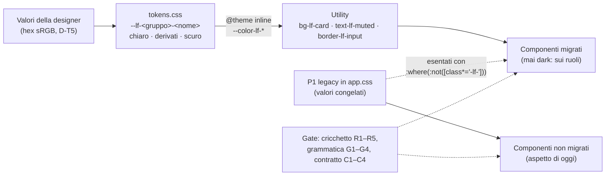

# Piano — Workstream T, token e tema (ruoli `--lf-*`, utility semantiche, migrazione a ondate)

> **Workstream T del programma colori**, sessione «T - token e tema». Coordinatore: sessione «UI color analysis»
> (`aec04834-1532-4d86-9e3f-f942e82aca89`).
> Branch `e-alfy-t-tokens-theme`, base `d9aec01936fe7207f1fa118558ce36dcafc90748` (`dev_release2`).
> Corsia: porta **6155**, dati **`/tmp/librefolio-r2-t`**.
> Comandi: `PIPENV_CUSTOM_VENV_NAME=LibreFolio-SAUMUTtc pipenv run python dev.py test --test-port 6155 --data-dir /tmp/librefolio-r2-t …`.
>
> **Fonti:**
> - analisi d'implementazione del 14/10: [`../coordination/workstream-analyses/T-analisi-implementazione-20261014.md`](../coordination/workstream-analyses/T-analisi-implementazione-20261014.md),
>   copiata dal coordinatore;
> - giro 1 della designer: [`../designer-feedback/2026-10-14-round1-auth/`](../designer-feedback/2026-10-14-round1-auth/README.md);
> - [piano generale](../plan-phase00ColorSystemThemeLab.prompt.md), §2, §5 e §6.
>
> **Il contratto dei ruoli è il codice:** `frontend/src/lib/theme/tokens.css`, che ha in testa le regole d'uso. Il
> manuale dei migratori è la skill [`theme-roles`](../../../../../.github/skills/design-tools/theme-roles/SKILL.md).

## ✅ Autorizzazione e decisioni (14/10/2026, sera)

**Autorizzazione del developer**, inoltrata alla lettera dal coordinatore: «Sì, approva T con tutte le raccomandazioni
e le tue integrazioni».

| # | Decisione |
|---|---|
| D-T1 | T si apre subito, in parallelo a R |
| D-T2 | La barra laterale prende il verde della testata della card di login, nei due temi. `#F1EDE3`/`#131A17` sono lo sfondo dell'app; `#F7F4ED`/`#0F1412` lo sfondo della pagina di login. La barra del titolo della PWA segue la barra laterale |
| D-T3 | Soluzione finale subito: ruoli `--lf-*` e utility semantiche, migrazione a ondate. Nessuna ritintura delle scale né del bianco. I rimasti indietro si vedono nel build (cricchetto) e nel rendering (gallery) |
| D-T4 | Nomi come nella tabella del §3.2 dell'analisi: variabili `--lf-<gruppo>-<nome>`, utility `*-lf-<nome>` con `@theme inline` sul namespace `--color-*` |
| D-T5 | Valori della designer in hex sRGB; derivati con `color-mix(in oklab, …)`; in B4, ponte sRGB per ECharts |
| D-T6 | Correzioni minime di contrasto applicate subito in `tokens.css`, ciascuna commentata col valore originale. La designer le conferma nel giro 2 |
| D-T7 | Splash, `offline.html` e `background_color` del manifest: sfondo `page` |
| D-T8 | Cricchetto R1–R5, grammatica G1–G4, contratto C1–C4. **M2 (colori letterali) attivo in T-1**: R è d'accordo e lo cede a T al posto della parte equivalente del suo W10/D7 (coordinatore, 14/10 sera). Requisiti di R: nomi di colore CSS nei valori (non nei selettori né in `white-space`) e come stringhe negli script; `rgba()`, `hsla()`, `oklab()`, `lab()`, `lch()`, `hwb()`; test e commenti esclusi; per file si confronta il **multinsieme dei valori normalizzati**, così uno scambio a conteggio pari è rosso; percorsi di L esenti; elenco motivato delle eccezioni di R; un `rgb()` fatto solo di `var()` non è un letterale |
| D-T8b | Baseline adatta ai merge (1.3, 14/10 sera): una riga per file, ordinata, nessun totale (lo calcola il gate). Su un conflitto vince il valore più stretto (m1 minore, intersezione dei valori m2), poi il gate deve passare sull'albero fuso: mai allargare. `--resolve` applica la regola. Tagli di file **dichiarati** con `--split VECCHIO:NUOVO1,NUOVO2`, nel commit del taglio |
| D-T9 | Piloti estesi a `ThemeToggle`, `PrivacyToggle`, `LanguageSelector`, `ConnectionSecurityIndicator`. Con l'OK di A: `auth/ForgotPasswordCard`, la barra in alto di `routes/+page.svelte` e `layout/HelpMenu`, solo classi colore e markup non riordinato; A arriva dopo il merge di T, altrimenti T segue sui percorsi nuovi. `routes/+error.svelte` è di T |
| D-T10 | La migrazione la fa T con sotto-agenti; altri workstream paralleli li decide il coordinatore |
| D-T11 | Nessun rilascio della 1.3 con la conversione dei neutri e degli stati a metà |
| D-T12 | Istruzioni per gli agenti, solo in tre punti: la sezione «Design System» di `.github/instructions/frontend.instructions.md`, la riga «Dark mode» di `.github/copilot-instructions.md` e la skill nuova `.github/skills/design-tools/theme-roles/`. Il coordinatore le rivede al checkpoint |
| D-T13 | Barra di robustezza della password: 3 ruoli (0–1 errore, 2 avviso, 3–4 successo) |
| D-T14 | Card di accesso con `border-lf-subtle` nei due temi; poi decide la designer |
| D-T15 | (15/10, supera D-T2) «Barra laterale neutra, come scrive la designer: #EDF0EE / #111615; il verde #1B4334 resta per l'header del login e i pulsanti». Palette del giro 2: «Pietra e Salvia» / «Ardesia e Salvia»; lo sfondo pagina vale anche per l'app |
| D-T16 | (15/10, chiude Q1) «Verde focus: riempimento #236B4D / #429E79, segno nel colore della card (6,1:1 in chiaro, 5,3:1 in scuro)»: ruoli `--lf-checked` e `--lf-on-checked` |
| D-T3 confermata | (15/10) «Solo le ondate W1–W6, come da D-T3: chi non è migrato resta visibilmente vecchio»: niente ponte, né sulle regole globali dello scuro di `app.css` né sulle tabelle di R |

**Vincoli:**
- **Fino alle 22:45 del 14/10:** solo scrittura. Niente `npm ci`, build, test né server: G misura la gallery. Dopo,
  `npm ci` è pre-approvato.
- **Git:** solo il coordinatore committa; il push lo fa il developer.
- **Specialisti:** `test-author` scrive i test, `docs-writer` il sito MkDocs, che si aggiorna solo alla chiusura del
  programma.

## Architettura in breve



## Passi

> Regola: dopo **ogni** passo, qui: ✅ con data, «Note implementazione», «Fuori pista» per ogni deviazione, comandi ed
> evidenze.

### T-0 · Piano nel repo e sezione del backlog

- [x] Questo file.
- [x] Sezione «T (colori)» in `Release_2/Phase_0/BACKLOG_POST_1.2.md`, al checkpoint 1: la lettera T c'era già, per la
  43.

### T-1 · Fondamenta (B1): nessun pixel cambia — checkpoint 1

1. `frontend/src/lib/theme/tokens.css`, nuovo. Contiene:
   - il contratto;
   - i ruoli chiari su `:root, html.light, .light`;
   - i derivati su `:root, .light, .dark`;
   - i ruoli scuri su `html.dark, .dark`;
   - `@theme inline` con `--color-lf-*`;
   - le correzioni D-T6, commentate.
2. `frontend/src/app.css`:
   - `@import './lib/theme/tokens.css'`;
   - le 4 regole strutturali di P1 con `:where(:not([class*='-lf-']))` (stessa specificità);
   - via `.animated-bg-gradient`, morto;
   - intestazione della sezione P1 legacy.
3. `frontend/scripts/theme/theme-roles.mjs`, nuovo: scanner e logica dei gate.
   - metriche M1 e M2, attive tutte e due (D-T8);
   - cricchetto R1–R5, grammatica G1–G4;
   - lettura dei token e risoluzione dei colori;
   - CLI `--report`, `--check`, `--update` (solo stringe), `--split`, `--resolve`, `--accept`, `--init`.
4. `frontend/src/themeRoles.baseline.tsv`, scritta con `--init`: una riga per file, nessun totale (D-T8b).
5. `test-author`:
   - `src/themeRoles.gate.test.ts` (cricchetto e grammatica);
   - `src/themeTokens.gate.test.ts` (contratto C1–C4);
   - registrazione in `front_utility_unit`, azione `core-unit`.
6. Istruzioni D-T12 e skill `theme-roles`.

**Prova, dopo le 22:45:**
- `npm ci`, se serve;
- `front build` della baseline (export con `git archive`) e di T-1, poi diff del CSS compilato: attese solo le
  variabili `--lf-*` e i 4 selettori;
- gate verdi; `front check`; `front format`; `lint --dead-code --scope frontend`.

### T-2 · Pilota dell'accesso — checkpoint 2

- **File:**
  - `auth/LoginCard`, `auth/RegisterCard`, `auth/ForgotPasswordCard` (OK di A);
  - `ui/input/PasswordInput` (prop `icon`), `ui/input/PasswordStrength`;
  - la barra in alto di `routes/+page.svelte` (OK di A);
  - `routes/+error.svelte`.
- **Cosa:**
  - icone `User`, `Mail`, `Lock` nei campi;
  - via il sottotitolo e la chiave: `dev.py i18n remove "auth.registerTitle" -f`, poi `i18n check`;
  - box dei requisiti sulla famiglia `success`;
  - barra a 3 ruoli (D-T13); card con `border-lf-subtle` (D-T14).
- **Test (`test-author`):** test dei componenti; E2E `e2e/layout/theme-roles.spec.ts`, punto (a).
- **Schermate di accesso** in chiaro e scuro, desktop e mobile, per la revisione: in corsia, oppure una gallery mirata
  del coordinatore.

### T-3 · Pilota della shell, solo classi

- **File:** `routes/(app)/+layout.svelte`, `layout/Sidebar`, `layout/Header`, `layout/HelpMenu` (OK di A),
  `layout/LanguageSelector`, `layout/ConnectionSecurityIndicator`, `ui/ThemeToggle`, `ui/PrivacyToggle`.
- **Cosa:**
  - barra laterale `bg-lf-brand` con testi `on-brand` (email e versione a `/70`, correzione D-T6);
  - sfondo `bg-lf-app`; header `bg-lf-app border-lf-subtle`.
- **Test:** E2E, punti (b) e (c). Gallery completa quando il coordinatore la mette in calendario.

### T-4 · PWA e superfici statiche, dopo l'ingresso del lotto A di R

- Meta `theme-color` `#1B4334`/`#1B4334` in `app.html`, `themeStore.ts` e `offline.html`.
- `manifest.json`: `theme_color` e `background_color`, quest'ultimo = page (D-T7).
- Splash e palette di `offline.html` sui valori dei ruoli.
- Il gate della meta di R: `PAIR` e (d) su `--lf-brand`.
- Nuovo `staticThemeMirrors.gate.test.ts`.
- **Il cricchetto e `themeStore.ts`** (coordinatore, 14/10 sera):
  - nel merge di base di R, la sua correzione D3 (`#156534` → `#166534`) è entrata con
    `--accept lib/stores/app/themeStore.ts --reason …D3…`, perché per il multinsieme m2 era uno scambio;
  - in T-4 la coppia della meta cambia di nuovo (`#1b4334` nei due temi): stesso percorso, con un `--accept`
    motivato D-T2 nel commit di T-4;
  - da lì il gate `themeColorMeta` di R passa a T.

### T-5 · Sfondo del login, dopo l'ingresso di G

- `ui/AnimatedBackground.svelte`: `--lf-surface-page` e i nuovi `--lf-art-*`. Le opacità si tarano con la designer.

### T-6 · Palette del giro 2 e barra laterale neutra (D-T15, D-T16)

- `tokens.css`: i valori di «Pietra e Salvia» e «Ardesia e Salvia»; ruoli nuovi `--lf-surface-sidebar`, `--lf-checked`,
  `--lf-on-checked`; `--lf-surface-app` derivato dallo sfondo pagina; correzioni minime di contrasto (politica D-T6).
- Barra laterale neutra, controllo della connessione sui ruoli di stato, box dei requisiti sulla superficie
  secondaria, colline del login ritarate.
- Niente ponte (D-T3 confermata): i componenti non migrati restano come sono.

### W1–W6 · Ondate di migrazione (sotto-agenti)

Ordine e prerequisiti: analisi §4.5.

| Ondata | Contenuto | Prerequisito |
|---|---|---|
| W1 | primitivi liberi di `ui/` | — |
| W2 | settings, support, onboarding, ai-export, resto di layout | — |
| W3 | stati e mappe (B2) | lotto A di R |
| W4 | fx, assets, transactions | lotto A; FE4, FE5, FE8 |
| W5 | charts, dashboard, risk, brokers (B4) | lotto B; FE2, FE6, FE7 |
| W6 | table, files, media, dialoghi (B5) | lotti C e D; FE3 |

Per ogni ondata: lotti di ≤ 15 file; gate eseguiti in serie da T; gallery e revisione della designer.

**File che la 1.3 taglia** (coordinatore, 14/10 sera): FE5 di X (`AssetModal` e la pagina dell'asset), FE8a di W
(wizard e modali delle transazioni), FE6 di Y (`GrowthChart`) e il taglio di `DataTable` di Y (ondata W6).

- **Regola «chi parte prima»:**
  - se il taglio non è ancora iniziato quando T arriva al file, T converte il file di oggi e il taglio si fa dopo;
  - se è iniziato, quel file si lascia per ultimo nell'ondata;
  - mai due sessioni sullo stesso file nello stesso momento.
- **Prima di convertire uno di questi file**, T chiede al coordinatore se c'è un taglio in corso. Inizio e ingresso
  dei tagli passano da lui.
- **Chi taglia** dichiara il taglio nel cricchetto, nello stesso commit:
  `node frontend/scripts/theme/theme-roles.mjs --split VECCHIO:NUOVO1,NUOVO2`.

#### Spacchettamento di W1 e W2 (analisi del 15/10, notte; sola lettura)

> Chiesto dal coordinatore il 15/10 all'01:08: lotti di W1 e W2, file liberi prima, quelli toccati da un ramo attivo
> in fondo, ruoli mancanti come domande per la designer, test, gallery e bozza del prompt per ogni lotto. Niente
> codice, server, test né sotto-agenti che scrivono.

**Riferimento e metodo**

- `dev_release2` = `9a12e623d`. Il frontend è identico a `c1df8f4cb` (A2 integrato), perché i due commit successivi
  toccano solo il journal e `scripts/visual_review`. Il mio HEAD resta `f43aa7200`.
- I conteggi vengono dallo scanner di T, eseguito su una copia del target fatta con `git archive` e confrontati con la
  baseline del target: coincidono per ogni file.
- **I 22 file spostati da A2** hanno ancora la riga col percorso vecchio (`components/{auth,settings,support}/…`): la
  regola R4 li abbina per nome. Il primo `--update` dopo il merge di base li riscrive coi nomi nuovi.
- **Rami attivi** (`git diff --name-status -M dev_release2...<ramo>`):
  - nessuno tocca un file di W1 o W2 con un commit. R tocca `ui/ContextMenu` (lotto C), L il layout radice, J un file
    del PAC (W3).
  - A, H e Z non hanno commit oltre il target: il loro lavoro in corso non si vede. Le sovrapposizioni qui sotto
    vengono quindi dai piani committati: A, H e W nel target; X, J e R sui loro rami; il piano generale della 1.3.
    Il piano di Z non è committato.
- **Totali:** W1 35 file, m1 1.085, m2 12, in 7 lotti; W2 34 file, m1 1.501, m2 16, in 9 lotti. La stima
  dell'analisi (§4.5: ~700 e ~1.300) era bassa: soprattutto `ui/select` e le schede delle impostazioni.

**Fuori dai lotti**

- **Già convertiti da T, in attesa d'ingresso:** gli 8 file di T-3 e `AnimatedBackground` (T-5).
- **Di R:** `ui/modals/ConfirmModal` e `ui/ContextMenu` (lotto C, poi W6 con B5); `ui/modals/SyncResultRow` (lotto A,
  poi W3).
- **Residui:**
  - `features/auth/ForgotPasswordCard`, 4 classi: il blocco del terminale aspetta Q6 e A9, che ne cambia il contenuto;
  - `routes/+page.svelte`, 1 classe: il «Loading...» di `auth-loading`, file di A;
  - `layout/ConnectionSecurityIndicator`, 7 classi: gli stati sulla barra verde, TC-2.

**Regole di esecuzione** (in aggiunta all'analisi §4.1)

- **Quando:** W1 parte dopo l'ingresso del lotto A di R e dopo T-4 (coordinatore, 15/10). La base comprende allora il
  lotto A, quindi nessun file di W1 o W2 si sovrappone a R.
- **Lotti «da chiedere»** (in fondo a ogni ondata): prima di avviarne uno, T chiede al coordinatore se la sessione
  indicata ha annunciato quei file.
  - Se non li ha annunciati, T converte il file di oggi e la sessione lavora dopo, sul file convertito.
  - Se li ha annunciati, il file resta per ultimo.
- **Ogni lotto:**
  - un sotto-agente `general-purpose` con la skill `theme-roles` modifica solo i file del lotto;
  - `test-author` aggiorna prima i test che leggono classi legacy;
  - T rilegge il diff ed esegue in serie, nella corsia 6155: `--check`, i due gate, `front check`, Prettier sui file
    del lotto, i Vitest e gli E2E del lotto;
  - al checkpoint, `--update`.
- **Elementi che restano legacy di proposito:**
  - i categoriali (viola, indaco, ciano, verde acqua…) fino a B4;
  - gli elementi che aspettano una domanda qui sotto.

  Un elemento resta legacy per intero (G3), e il sotto-agente lo elenca nel suo resoconto.

**Lotti**

| Lotto | Contenuto | File | m1 | m2 | Chi altro | Ordine |
|---|---|---:|---:|---:|---|---|
| W1-a | `ui/select`, selettori generici | 11 | 245 | 0 | W: una riga d'import in `ImportPluginSelect` (spostamento puro) | 1 |
| W1-b | `ui/select`, selettori di dominio | 3 | 283 | 1 | — | 2 |
| W1-c | `ui/date`, `ui/tabs`, `ui/toolbar`, piccoli di `ui/` | 10 | 225 | 0 | — | 3 |
| W1-d | `ui/input` | 4 | 59 | 6 | — | 4 |
| W1-e | `ui/modals/ModalBase` da solo: cambia il contenitore di ogni modale | 1 | 0 | 5 | — | 5 |
| W1-f1 | modali di sync | 2 | 68 | 0 | **X, C-66 aperta**: da chiedere | 6 |
| W1-f2 | `ui/data-editor` | 4 | 205 | 0 | **W**, I1/K1 (P-15, I-10, I-11); Y: da chiedere | 7 |
| W2-a | onboarding e rotta `welcome` | 8 | 240 | 2 | A9 aggiunge il disclaimer in `WelcomePage`; H copia il banner | 1 |
| W2-b | resto di `layout`: `ChangelogModal`, `ServerUnreachable` | 2 | 100 | 8 | **H** (proprietario di `ChangelogModal`), forse Z: da chiedere | 2 |
| W2-d | `features/ai-export` | 2 | 86 | 0 | **J** (D-J5): da chiedere | 3 |
| W2-c | `features/support`, `features/update-check` | 6 | 162 | 5 | **A** (cartelle sue; `DonationPopupModal` solo con il suo OK) | 4 |
| W2-e2 | modali dello scheduler | 2 | 226 | 0 | Z, F07 più tardi; cartella di A | 5 |
| W2-e1 | controlli delle impostazioni, `CachePanel`, `PasswordChangeModal` | 9 | 176 | 0 | **A**, A4/A5 («bloccato da variabile») e F13 | 6 |
| W2-f1 | `AboutTab`, `ProfileTab` | 2 | 337 | 1 | **A**, A8 e A9; W, una riga d'import | 7 |
| W2-f2 | `GlobalSettingsTab` | 1 | 110 | 0 | **A**, A4/A5 | 8 |
| W2-f3 | `SettingsLayout` e rotta `settings` | 2 | 64 | 0 | **A3, il prossimo passo di A**: per ultimo, di norma dopo A3 | 9 |

- **W1:** prima i liberi, a–e, poi f1 ed f2.
- **W2:**
  - **W2-a va per primo:** è libero, e H, nel CP4, costruisce il suo `InstanceNotices` sulle classi del banner.
  - Seguono b e d (H, Z e J toccano poco quei file), poi le cartelle di A, a partire da quelle che A tocca più tardi.
  - I lotti di A si possono anche anticipare tutti, prima di A3, se il coordinatore preferisce convertire prima che
    A riprenda le impostazioni: vale la regola «chi parte prima».

**File per file** (m1 e m2 = baseline del target)

| Lotto | File | m1 | m2 | Rami, sessioni, voci |
|---|---|---:|---:|---|
| W1-a | `ui/select/SearchSelect.svelte` | 63 | 0 | — |
| W1-a | `ui/select/SimpleSelect.svelte` | 40 | 0 | — |
| W1-a | `ui/select/SelectPopover.svelte` | 8 | 0 | — |
| W1-a | `ui/select/TreeSelect.svelte` | 47 | 0 | — |
| W1-a | `ui/select/CheckMenu.svelte` | 36 | 0 | — |
| W1-a | `ui/select/CountrySearchSelect.svelte` | 10 | 0 | — |
| W1-a | `ui/select/CurrencySearchSelect.svelte` | 13 | 0 | — |
| W1-a | `ui/select/SectorSearchSelect.svelte` | 6 | 0 | — |
| W1-a | `ui/select/UserSearchSelect.svelte` | 10 | 0 | — |
| W1-a | `ui/select/AssetTypeSelect.svelte` | 8 | 0 | — |
| W1-a | `ui/select/ImportPluginSelect.svelte` | 4 | 0 | W, FE8b: solo una riga d'import (spostamento puro) |
| W1-b | `ui/select/AssetPickerPanel.svelte` | 107 | 0 | — |
| W1-b | `ui/select/AssetSelect.svelte` | 28 | 0 | — |
| W1-b | `ui/select/FxProviderSelect.svelte` | 148 | 1 | — |
| W1-c | `ui/date/CalendarMonth.svelte` | 40 | 0 | — |
| W1-c | `ui/date/DateRangePicker.svelte` | 73 | 0 | — |
| W1-c | `ui/date/SingleDatePicker.svelte` | 24 | 0 | — |
| W1-c | `ui/date/CompactDurationBadge.svelte` | 13 | 0 | — |
| W1-c | `ui/tabs/TabBar.svelte` | 20 | 0 | — |
| W1-c | `ui/toolbar/PageToolbar.svelte` | 4 | 0 | — |
| W1-c | `ui/ViewModeToggle.svelte` | 18 | 0 | — |
| W1-c | `ui/DocsLink.svelte` | 4 | 0 | — |
| W1-c | `ui/TweenedValue.svelte` | 2 | 0 | — |
| W1-c | `ui/OrderableList.svelte` | 27 | 0 | — |
| W1-d | `ui/input/DistributionEditor.svelte` | 30 | 0 | — |
| W1-d | `ui/input/ExactDecimalInput.svelte` | 10 | 0 | — |
| W1-d | `ui/input/ExactQuantityInput.svelte` | 0 | 2 | — |
| W1-d | `ui/input/TagInput.svelte` | 19 | 4 | — |
| W1-e | `ui/modals/ModalBase.svelte` | 0 | 5 | — |
| W1-f1 | `ui/modals/SyncModalBase.svelte` | 66 | 0 | **X, C-66 aperta** (avviso nel dialogo di sync) |
| W1-f1 | `ui/modals/PageSyncModal.svelte` | 2 | 0 | **X, C-66 aperta** |
| W1-f2 | `ui/data-editor/DataEditor.svelte` | 67 | 0 | **W**, P-15 (`:652`, `:661-668`) e I-10 S3 (`:525-534`); Y, «Reset layout» e «max» |
| W1-f2 | `ui/data-editor/CsvEditor.svelte` | 72 | 0 | **W**, I-11 (`:416-436`) |
| W1-f2 | `ui/data-editor/DataImportModal.svelte` | 52 | 0 | **W**, P-15 (`:211`, `:220`) |
| W1-f2 | `ui/data-editor/ErasableNumberCell.svelte` | 14 | 0 | stessa cartella di W (Q3 di W: `ui/data-editor/**`) |
| W2-a | `features/onboarding/components/OnboardingBootstrapBanner.svelte` | 10 | 0 | H, CP4: `InstanceNotices` ne copia le classi |
| W2-a | `features/onboarding/components/OnboardingBootstrapBlock.svelte` | 16 | 0 | — |
| W2-a | `features/onboarding/components/OnboardingCoachmark.svelte` | 45 | 2 | — |
| W2-a | `features/onboarding/components/OnboardingIntroScene.svelte` | 32 | 0 | — |
| W2-a | `features/onboarding/components/OnboardingReplaySection.svelte` | 66 | 0 | — |
| W2-a | `features/onboarding/components/WelcomeForm.svelte` | 39 | 0 | A2: righe d'import, già entrate |
| W2-a | `features/onboarding/components/WelcomePage.svelte` | 28 | 0 | A9, F09: il disclaimer |
| W2-a | `routes/(app)/welcome/+page.svelte` | 4 | 0 | — |
| W2-b | `layout/ChangelogModal.svelte` | 89 | 8 | **di H** (piano di A, §4.12 e D-A13); nessuna modifica nel piano di H. A11 di A (C-54, «novità») non lo tocca |
| W2-b | `layout/ServerUnreachable.svelte` | 11 | 0 | forse Z (F07, stato del risveglio): piano di Z non committato |
| W2-c | `features/support/SocialShareModal.svelte` | 57 | 0 | cartella di A (A2) |
| W2-c | `features/support/SupportActions.svelte` | 11 | 0 | A9, F05: «Buy me a coffee» e link di supporto |
| W2-c | `features/support/supportLinks.ts` | 14 | 0 | A9, F05 (D-A8); colori dei marchi in eccezione |
| W2-c | `features/support/DonationPopupModal.svelte` | 28 | 1 | **di A**: serve il suo OK esplicito |
| W2-c | `features/update-check/AskAdminModal.svelte` | 27 | 0 | cartella di A (D-A13); A9 ferma il controllo in `checkForNewerRelease`, non le modali |
| W2-c | `features/update-check/UpdateAvailableModal.svelte` | 25 | 4 | cartella di A (D-A13) |
| W2-d | `features/ai-export/AiExportMenu.svelte` | 12 | 0 | **J** (D-J5: `features/ai-export/**`) |
| W2-d | `features/ai-export/AiExportOptionsPanel.svelte` | 74 | 0 | **J** (D-J5) |
| W2-e1 | `features/settings/SettingActions.svelte` | 15 | 0 | cartella di A (`features/settings`) |
| W2-e1 | `features/settings/SettingBulkActions.svelte` | 15 | 0 | cartella di A (`features/settings`) |
| W2-e1 | `features/settings/SettingCurrency.svelte` | 8 | 0 | cartella di A (`features/settings`) |
| W2-e1 | `features/settings/SettingNumber.svelte` | 28 | 0 | cartella di A (`features/settings`) |
| W2-e1 | `features/settings/SettingSelect.svelte` | 8 | 0 | A4/A5: stato «bloccato da variabile» |
| W2-e1 | `features/settings/SettingTheme.svelte` | 19 | 0 | cartella di A (`features/settings`) |
| W2-e1 | `features/settings/SettingToggle.svelte` | 18 | 0 | A4/A5: stato «bloccato da variabile» (schema condiviso con X) |
| W2-e1 | `features/settings/CachePanel.svelte` | 34 | 0 | cartella di A (`features/settings`) |
| W2-e1 | `features/settings/PasswordChangeModal.svelte` | 31 | 0 | A, F13: regole della password unificate |
| W2-e2 | `features/settings/SchedulerConfigModal.svelte` | 112 | 0 | Z, F07 (più tardi) |
| W2-e2 | `features/settings/SchedulerLogModal.svelte` | 114 | 0 | Z, F07 (più tardi) |
| W2-f1 | `features/settings/tabs/AboutTab.svelte` | 157 | 1 | A9, F09: card «Note legali»; W, FE8b: una riga d'import |
| W2-f1 | `features/settings/tabs/ProfileTab.svelte` | 180 | 0 | A8: scheda «Sicurezza»; A6: cancellazione |
| W2-f2 | `features/settings/tabs/GlobalSettingsTab.svelte` | 110 | 0 | A4/A5: `registration_mode` bloccabile |
| W2-f3 | `features/settings/SettingsLayout.svelte` | 61 | 0 | **A3, il prossimo passo di A**: registro delle schede |
| W2-f3 | `routes/(app)/settings/+page.svelte` | 3 | 0 | **A3**: la pagina diventa un runtime del registro |

**Ruoli che mancano: domande per il giro 2 della designer (TC-2)**

Ogni domanda ha una proposta provvisoria, costruita solo dai suoi valori come vuole l'analisi §3.3. Le proposte non
sono applicate. Prima di ogni lotto, il coordinatore sceglie per le domande che lo toccano fra tre strade:
- la risposta della designer;
- l'OK alla proposta, col valore della designer in commento, come per D-T6;
- lasciare legacy l'elemento, per intero.

| # | Dove | Domanda | Proposta provvisoria |
|---|---|---|---|
| Q1 | checkbox, radio, interruttore acceso, giorno o preset selezionato, segmento attivo (`CheckMenu`, `AssetPickerPanel`, `CalendarMonth`, `DateRangePicker`, `ViewModeToggle`, `SettingToggle`) | Che colore ha un controllo selezionato? Su `action` il riempimento è a 2,10:1 sulla card scura, sotto i 3:1 di WCAG 1.4.11; e `focus` col testo chiaro sopra è a 2,63:1 | **chiusa, D-T16 (15/10):** riempimento `bg-lf-checked` (focus), segno `text-lf-on-checked` (card), 6,17:1 in chiaro e 5,32:1 in scuro. W1 non è più bloccata |
| Q2 | interruttore spento | Traccia e pomello | traccia `bg-lf-input` (3,43:1 e 3,37:1; `neutral` è a 1,37:1 e 1,25:1), pomello `bg-lf-on-action` (sulla traccia accesa scura è a 2,63:1: lo stato lo dicono traccia e posizione) |
| Q3 | pulsanti pieni distruttivi e d'avviso (`ProfileTab`, `SupportActions`) | L'hover di `danger`, `warning` e `donate` pieni | `hover:bg-lf-danger/90` e simili; oppure `--lf-danger-hover`, come `action-hover` |
| Q4 | stato «modificato» delle impostazioni, oggi arancio (`SettingActions`, `SettingBulkActions`, `SettingNumber`) | È un avviso o uno stato a sé? | i ruoli `warning` |
| Q5 | pallino di stato neutro o inattivo, `gray-400` (`SchedulerLogModal`) | Colore | `bg-lf-muted` (5,20:1 e 5,01:1) |
| Q6 | codice: in linea (`ChangelogModal`, `UpdateAvailableModal`) e blocco del terminale (`ForgotPasswordCard`) | Il fondo del codice; il terminale resta scuro nei due temi? | in linea: `color-mix(in oklab, var(--lf-text-primary) 7%, transparent)`, una formula sola per i due temi; il terminale aspetta lei |
| Q7 | evidenziazione `mark`, oggi `#fef08a` e giallo al 35% (`ChangelogModal`) | Colore | nessuna proposta: la tinta d'avviso in chiaro è bruna. Resta legacy |
| Q8 | ombra di elevazione delle modali (`ModalBase`: nero al 25% in chiaro, al 50% in scuro) | Ombre per tema | `--lf-shadow` = `#0F1412` al 25% e al 50%. Fino ad allora W1-e lascia l'ombra letterale (m2 non sale) |
| Q9 | alone del coachmark (smeraldo, `border-emerald-400`) e fondale dello spotlight (nero al 45%) | Colore dell'evidenziazione | alone su `--lf-focus` al 40%, fondale `bg-lf-overlay/75`, cioè il 45%. Si toglie l'eccezione `ARBITRARY_ALLOWED` del coachmark |
| Q10 | avviso dentro il tooltip (`FxProviderSelect`, `#fbbf24`) | L'avviso su superficie inversa | = l'avviso dell'altro tema: `#F5A623` sul tooltip scuro del tema chiaro, `#895000` su quello chiaro del tema scuro |
| Q11 | accento viola dell'AI Export (`AiExportOptionsPanel`) | È un categoriale o un accento? | con i categoriali di B4; fino ad allora legacy |
| Q12 | icone decorative di «Informazioni» (arancio, cielo, ambra, rosa, viola, ciano, verde acqua, indaco) | Palette decorativa | con i categoriali di B4 |
| Q13 | fondale delle modali, oggi nero al 50% | `--lf-surface-overlay` (`#0F1412` al 60%) scurisce tutte le modali: va bene? | sì; si vede in W1-e |

Già decisi, nessuna domanda:
- `bg-libre-beige` nelle modali (`DonationPopupModal`, `UpdateAvailableModal`) diventa `bg-lf-card`;
- `routes/(app)/welcome` e `ServerUnreachable` si disegnano senza la shell (rami del layout `(app)`), quindi `bg-lf-page`;
- il `style="background:#fff"` della piastrella del logo (`DonationPopupModal`, `AboutTab`) diventa `bg-lf-logo`, come nella barra laterale in T-3;
- i chip con `var(--badge-bg, #e2e8f0)` (`TagInput`, `UpdateAvailableModal`) diventano `var(--badge-bg, var(--lf-surface-neutral))`.

**Test e gallery per lotto**

Sempre:
- `--check` e i due gate (`node_modules/.bin/vitest run src/themeRoles.gate.test.ts src/themeTokens.gate.test.ts`);
- `front check`;
- Prettier sui file del lotto.

Le categorie si scelgono con i file Vitest del lotto, tutti registrati (verificato): `component-unit`, salvo
`onboarding-component-unit` e due in `core-unit`.

| Lotto | Prima, `test-author` | Vitest | E2E (azioni del runner) | Gallery |
|---|---|---|---|---|
| W1-a | `SimpleSelect.test.ts:74-76` legge le classi (`bg-white`, `ring-libre-green`…) | `SearchSelect`, `SearchSelect.reopen`, `SimpleSelect`, `TreeSelect`, `CurrencySearchSelect`, `AssetTypeSelect` | `select`, `asset-modal`, `asset-classification`, `transactions-modals`, `broker-sharing`, `tx-import-upload` | Assets (creazione, tipo, albero dei segnali, distribuzioni), Settings (preferenze), Transactions (modale), Brokers (condivisione) |
| W1-b | — | `AssetPickerPanel`, `FxProviderSelect` | `risk-lab`, `fx-add-pair`, `fx-detail`, `transactions-modals` | Risk lab (selettori), FX (provider, aggiunta di una coppia) |
| W1-c | `DateRangePicker.test.ts:949-954` (classi); `fx/fx-list.spec.ts:155` (`bg-libre-green` sul preset 1Y); `assets/asset-data-editor.spec.ts:115,126` (classe della scheda attiva: `TabBar`) | `CalendarMonth`, `DateRangePicker`, `SingleDatePicker`, `TabBar` | `fx-list`, `asset-data-editor`, `dashboard`, `toolbar-width-sweep`, `asset-list` | quasi tutte le pagine: barre degli strumenti, schede, intervallo di date della dashboard, vista a card o tabella |
| W1-d | — | `ExactDecimalInput`, `ExactQuantityInput`, `TagInput` | `asset-modal`, `transactions-modals`, `files` | Assets (distribuzioni), Transactions (modale), Files |
| W1-e | — | `ModalBase`, `ModalBase.escapeLayers` | `transactions-modals`, `settings`, `asset-modal`, `files`, `support-copy-and-go` | **tutte le modali** |
| W1-f1 | — | `SyncModalBase`, `PageSyncModal` | `fx-sync`, `fx-sync-mock` | FX (Sync All) |
| W1-f2 | `asset-data-editor.spec.ts:287` e `fx/fx-csv-import.spec.ts:53,56` cercano `.text-red-500` (la ✗ di `CsvEditor`) | `DataEditor` | `asset-data-editor`, `fx-editor`, `fx-csv-import` | FX e Assets (editor dei dati, importazione CSV) |
| W2-a | — | `onboarding-component-unit` (5 file) | `onboarding-tour`, `onboarding-guides`, `settings` | Onboarding (welcome, tour, guida), Settings (ripasso dell'onboarding) |
| W2-b | — | `ChangelogModal` | `changelog-locale`, `app-start-auth` | Settings (changelog); `ServerUnreachable` non è nella gallery |
| W2-d | — | `front-ai-export unit` | `front-ai-export panel`, `catalog` | nessuna: l'AI Export non è nella gallery, servono scatti miei o una scena di G |
| W2-c | — | `SocialShareModal`, `SupportActions`, `shareNavigation`, `DonationPopupModal`, `UpdateAvailableModal`; `supportLinks` e `updateCheck` in `core-unit` | `support-copy-and-go`, `auth` | Support (donazione, condivisione), Auth Pages (aggiornamento disponibile) |
| W2-e2 | — | `SchedulerConfigModal`, `SchedulerLogModal` | `scheduler` | Settings (modali dello scheduler) |
| W2-e1 | — | `SettingControls`, `PasswordChangeModal` | `settings` | Settings (preferenze, globali, password, cache) |
| W2-f1 | — | `AboutTab`, `ProfileTab` | `settings`, `account-deletion` | Settings (informazioni, diagnostica dei plugin e degli strumenti, profilo) |
| W2-f2 | `GlobalSettingsTab.test.ts:885` cerca `closest('div.bg-gray-50')` | `GlobalSettingsTab` | `settings` | Settings (globali, menu delle categorie su mobile) |
| W2-f3 | — | `SettingsLayout`, `PreferencesTab` | `settings`, `document-title` | Settings (tutte le schede) |

**Bozza del prompt per il sotto-agente** (comune; T aggiunge il blocco del lotto)

```text
You convert ONE lot of LibreFolio frontend files to the colour roles. Workstream T, wave <W>, lot <ID>.

Worktree only: <worktree path>. Never read another checkout. Edit ONLY these files:
<files of the lot>

Read first: .github/skills/design-tools/theme-roles/SKILL.md (roles → utilities, conversion table, rules),
frontend/src/lib/theme/tokens.css (the roles), .github/instructions/frontend.instructions.md («Design System»).

Rules:
- Convert by meaning and step, not by colour family. Every pair `light dark:…` becomes ONE role, without `dark:`.
- An element migrates whole (G3): never a role utility next to a palette class in the same class string or tag.
  If an element cannot migrate (a categorical colour: violet, purple, indigo, pink, teal, cyan, fuchsia, lime;
  or a case listed below as «leave legacy»), leave that element entirely as it is and list it in your report.
- Every `border` names its role. The component's root sets its text role (`text-lf-primary`).
- No hand-written colours: no hex, rgb(), hsl(), oklch() or colour names in markup, scripts or <style>; in <style>
  read a role with var(--lf-…). No arbitrary colour values, except ones built only on var(--lf-…)
  (bg-[var(--lf-surface-card)]). Delete `:global(html.dark)` overrides that a role now covers.
- Class names stay whole literals; never build them from pieces. Do not touch classes that come from the tables of
  src/lib/theme/ (toneClasses, themePair…): they migrate centrally.
- Classes assembled at run time from several literals (a state function such as getDayClasses, a ternary) belong
  to ONE element: convert all of its literals or none.
- Do not reorder markup, rename props, change behaviour or i18n. Do not edit tests: list in your report any test
  that reads a class you changed.
- Allowed commands: `node frontend/scripts/theme/theme-roles.mjs --check` and `--report` (read-only).
  Never --update, never git add/commit, never tests, builds, servers, npm/pipenv commands.

Report: per file, the m1/m2 before and after (from --report), the elements left legacy and why, the tests that read
classes, any doubt about a role. Do not stop at the first doubt: leave the element legacy and go on.
```

Blocchi per lotto:

| Lotto | Casi particolari da scrivere nel prompt |
|---|---|
| W1-a | Opzione evidenziata nella lista: `bg-lf-selected`. Bordo del campo `border-lf-input`, aperto `ring-lf-focus border-lf-focus`. Spunte e caselle selezionate (`CheckMenu`): `bg-lf-checked text-lf-on-checked` (D-T16) |
| W1-b | `FxProviderSelect`: il `#fbbf24` dentro l'HTML del tooltip resta (Q10). Gli stati delle righe dei provider (`emerald`, `blue`, `amber`) vanno sui ruoli di stato. Le caselle di `AssetPickerPanel` come in W1-a (D-T16) |
| W1-c | Il giorno di `CalendarMonth` è un elemento solo, assemblato da `getDayClasses`: selezionato e capi dell'intervallo `bg-lf-checked !text-lf-on-checked` (D-T16), intervallo `bg-lf-selected`, in sospeso `bg-lf-checked/50`, oggi `ring-lf-focus`, giorni fuori mese e futuri `text-lf-muted`. Lo stesso per il preset attivo di `DateRangePicker` e il segmento attivo di `ViewModeToggle` |
| W1-d | `ExactQuantityInput`: i due `oklch(… / 0.7)` diventano `color-mix(in oklab, var(--lf-danger) 70%, transparent)` e lo stesso con `--lf-success`. `TagInput`: le variabili `--badge-*` ricadono sui ruoli |
| W1-e | Pannello `var(--lf-surface-card)`, fondale `var(--lf-surface-overlay)`; via la regola scura. L'ombra resta letterale fino a Q8 |
| W1-f1 | Gli stati della sync vanno sui ruoli di stato; le classi che arrivano da `syncHelpers` e dalle tabelle di R non si toccano |
| W1-f2 | La ✗ e la ✓ di convalida: `text-lf-danger` e `text-lf-success`; le celle d'errore `bg-lf-danger-soft` |
| W2-a | Il banner va sui ruoli `warning` (soft, line, on-soft): è il modello per `InstanceNotices` di H. Il coachmark resta legacy finché Q9 non è decisa; dopo, si toglie la sua eccezione dallo scanner (file di T) |
| W2-b | Gli stili del changelog: i link su `var(--lf-link)`, il testo attenuato su `var(--lf-text-muted)`, il bordo su `var(--lf-border-subtle)`; `mark` (Q7) e codice (Q6) restano |
| W2-d | Il viola resta (Q11); neutri e stati sì |
| W2-c | `supportLinks.ts`: restano solo i colori dei marchi (eccezione); i neutri si convertono. Il `#ffffff` della donazione diventa `bg-lf-logo` |
| W2-e2 | I pallini di stato vanno sui ruoli di stato, il grigio resta (Q5) |
| W2-e1 | L'interruttore: traccia accesa `bg-lf-checked` (D-T16), spenta `bg-lf-input`, pomello `bg-lf-on-action` (Q2: senza risposta, l'interruttore resta legacy per intero). Il badge `setting-badge` (ambra, per esempio «Coming soon») va su `warning-soft` e `warning-on-soft`, come oggi; l'arancio di «modificato» resta (Q4) |
| W2-f1 | Le icone decorative restano (Q12). Il pulsante distruttivo: `bg-lf-danger text-lf-on-status`, e l'hover provvisorio `hover:bg-lf-danger/90` (Q3), sennò resta legacy per intero. Il logo: `bg-lf-logo` al posto dello `style` |
| W2-f2 | I pallini di stato vanno su `bg-lf-success`, `bg-lf-warning`, `bg-lf-danger` |
| W2-f3 | Nessun caso particolare |

**Stima**

- 16 lotti di sotto-agenti e 2 gallery.
- Ogni lotto passa per T con 3 o 4 esecuzioni in serie nella corsia: gate, `component-unit` mirato, 1–5 azioni E2E.
- Da coordinare: 10 lotti su 16 chiedono il via a una sessione (X, W, H, Z, J, A). Q1 è chiusa da D-T16 (15/10).

### B6 · Pulizia

- Via P1, le `--theme-*`, i valori scuri dei `--color-libre-*`, i token morti.
- `body` sui ruoli; gallery finale.

## Checkpoint

| # | Contenuto | Stato |
|---|---|---|
| 1 | T-0, T-1 con il diff del CSS compilato | ✅ checkpoint `2018fd853`, integrato con `4e024dfe8` |
| 2 | T-2, poi integrazione subito: A aspetta | ✅ checkpoint `a73eb7eda`, integrato con `d80b986bf` |
| 3 | T-3 con la gallery completa | ✅ checkpoint `bd51acbc2`, base aggiornata con G nel merge `dad0f6292`; la gallery la lancia il coordinatore il 15/10 |
| 4 | T-5 sfondo del login, prima della gallery candidata del 15/10 | ✅ checkpoint `f43aa7200`; spacchettamento W1/W2 `48cc52e5b`; base con X nel merge `2c7553e0b` |
| 5 | T-6 palette del giro 2 e barra neutra (D-T15, D-T16) | ✅ checkpoint `078dec1ae`; base con `dc9a5d232` nel merge `e1443e952`, validato il 15/10; candidata T6 fatta, l'ingresso aspetta il via del developer |
| 6 | T-7 header che si nasconde di nuovo, fascia verde del logo nella barra laterale | ✅ pronto il 15/10, FROZEN in attesa del commit |

## Avanzamento

### T-0 — ✅ 14/10/2026

> **Note implementazione:** piano creato dall'analisi d'implementazione, con le decisioni D-T1…D-T14 approvate dal
> developer. Il branch è stato rinominato dall'app `e-alfy-t-tokens-theme` all'avvio della sessione. Sezione «T (colori)»
> del backlog: TC-1 (requisiti della password per i lettori di schermo, ad A), TC-2 (ruoli in attesa del giro 2), TC-3
> (uno scanner solo con L).

### T-1 — ✅ 14/10/2026 (checkpoint 1)

> **Note implementazione:**
> - `lib/theme/tokens.css`:
>   - 45 utility `--color-lf-*`;
>   - ruoli chiari, derivati e scuri;
>   - le correzioni D-T6, commentate col valore della designer: attenuato `#636B61`/`#848F87`, bordo dei campi
>     `#8F8573`/`#64736B` (3:1 anche su app e pannello), successo `#17784D`, info `#145DEE`.
>
>   La correzione della barra laterale (`on-brand/70`) è una classe: va in T-3.
> - **Contrasti:** 158 coppie verificate nei due temi, nessuna sotto soglia. Le più strette: bordo dei campi su
>   pannello in chiaro, 3,01; attenuato su pannello in scuro, 4,52.
> - `app.css`:
>   - import dei token;
>   - `@source not` per le sorgenti dei gate;
>   - le 4 regole strutturali di P1 con `:where(:not([class*='-lf-']))`;
>   - via due regole morte, `.animated-bg-gradient` e `.bg-surface-100`, la cui classe ha 0 usi.
> - `scripts/theme/theme-roles.mjs`:
>   - metriche m1 (classi) e m2 (multinsieme dei letterali), tutte e due attive;
>   - R1–R5, G1–G4, contratto dei token;
>   - CLI con `--split`, `--resolve`, `--update` (solo stringe), `--accept`, `--init`.
> - Baseline `src/themeRoles.baseline.tsv`: 315 file, m1 11.435, m2 1.785.
> - **Gate di `test-author`:**
>   - `themeRoles.gate.test.ts` e `themeTokens.gate.test.ts`, 50 test;
>   - registrati in `core-unit`.
> - **Istruzioni D-T12:** la sezione «Design System», la riga «Dark mode» e la skill `design-tools/theme-roles`.
>
> **Evidenze:**
> - **CSS compilato**, build della baseline (export con `git archive d9aec019`) e di T-1, `npm run build`:
>   - 22 file CSS su 23 identici;
>   - nel diff di `0.*.css` (`files/T1-compiled-css.diff` della sessione T) solo +87 dichiarazioni `--lf-*` con i loro
>     blocchi, i 4 selettori strutturali riscritti con `:where` e le 2 regole morte tolte.
>
>   Nessuna utility in più: nessun pixel cambia.
> - `front-utility core-unit`: 130 file, 4.245 test verdi.
> - `front check`: 0 errori, 0 warning.
> - Prettier: verde sui file toccati.
> - `lint --dead-code --scope frontend`: esce con 1 come la baseline. Report identico (2 file, 18 export, 28 tipi, 4
>   devDependencies, 20 dipendenze non dichiarate): nessun reperto nuovo.
> - `theme-roles.mjs --check`: pulito.
>
> **⚠️ Fuori pista:**
> - **Tailwind e le sorgenti degli script.** Tailwind generava utility (`.border-y`, `.inset-ring`, `.bg-lf-card`…)
>   leggendo le stringhe di `scripts/theme/theme-roles.mjs`. Risolto con `@source not '../scripts/theme'` e
>   `@source not './theme*.gate.test.ts'`: i gate tengono classi come dati, non interfaccia.
> - **Due difetti dello scanner, trovati da `test-author` leggendolo.**
>   - Il `_` delle classi arbitrarie nascondeva i colori a `\b`; corretto con confini espliciti. La baseline, non
>     ancora committata, è stata rigenerata: +2 letterali, il bagliore del coachmark.
>   - `--update` poteva allargare la baseline tramite una tabella centrale che fa salire il totale; ora la rifiuta.
> - **C4 trovava una regola P1 morta:** `html.dark .bg-surface-100`, 0 usi. Tolta, senza effetto visivo.
> - **Decisioni arrivate durante T-1** (coordinatore, 14/10 sera):
>   - M2 attivo: R d'accordo, con i suoi requisiti;
>   - baseline a una riga per file, senza totali, e `--resolve` (dalla 1.3);
>   - tagli dichiarati, con la regola «chi parte prima».
> - **Artefatti generati e ignorati, da non committare:**
>   - `frontend/node_modules` (`npm ci`), `frontend/build`, `frontend/.svelte-kit`;
>   - il client API (`dev.py api sync`) e il catalogo i18n;
>   - `backend/data/prod/`, creato dall'import in-process dell'app durante `api sync`;
>   - `scripts/test_runner/.campaign.json`.
>
> **Checkpoint 1:** commit `2018fd853` del coordinatore, 12 file. Merge di base `4e024dfe8`, con il `793395913` della
> 1.3. `dev_release2` = `4e024dfe8`, entrato con un fast-forward: il cricchetto vale per tutti dal 14/10 sera.

### T-2 — ✅ 14/10/2026 (checkpoint 2)

> **Note implementazione:**
> - **Primitivi** (anche in `settings/PasswordChangeModal`, che li riusa):
>   - `PasswordInput`: nuova prop `icon` (icona lucide decorativa, `aria-hidden`, `data-testid="<testId>-icon"`) e
>     ruoli per campo, bordo, errore, focus e placeholder;
>   - `PasswordStrength`: barra a 3 stati (D-T13); box dei requisiti sulla famiglia `success`
>     (`data-testid="password-requirements"`); ogni regola con `data-testid="password-rule-<key>"` e `data-passed`;
>     ✓ e ✗ restano, quindi l'informazione non dipende dal colore.
> - **Card:**
>   - `LoginCard`, `RegisterCard`: icone `User`, `Mail` e `Lock`, grigie, che diventano del colore del testo
>     primario al focus (`group-focus-within`); card `bg-lf-card border-lf-subtle` (D-T14); testata `bg-lf-brand`;
>     pulsanti `bg-lf-action` con l'hover vero (prima `hover:bg-opacity-90`, che in v4 non esiste); link
>     `text-lf-link`;
>   - nella `RegisterCard` via il sottotitolo; `dev.py i18n remove "auth.registerTitle" -f` nelle 4 lingue, poi
>     `i18n check` strict verde (4.360 chiavi).
> - **Con l'OK di A, solo classi colore:**
>   - `ForgotPasswordCard`;
>   - il link del caffè di `routes/+page.svelte`, ora `text-lf-donate` (avviso).
> - **Di T:** `routes/+error.svelte`.
> - **Cricchetto** (R5), 7 file in calo:
>
>   | File | m1 |
>   |---|---|
>   | Login | 20 → 0 |
>   | Register | 28 → 0 |
>   | Forgot | 17 → 4 |
>   | `PasswordInput` | 10 → 0 |
>   | `PasswordStrength` | 24 → 0 |
>   | `+error` | 11 → 0 |
>   | `+page` | 5 → 1 |
>
>   Più un `#ffffff` in meno in ciascuna card, il riquadro del logo ora su `bg-lf-logo`.
> - **Restano legacy, di proposito:**
>   - il blocco terminale di Forgot (`bg-gray-800 text-green-400`, scuro nei due temi): nessun ruolo «codice»,
>     e A ne cambierà il contenuto con F13;
>   - il «Loading…» di `+page.svelte`, fuori dalla barra in alto e quindi di A.
>
> **Evidenze:**
> - **Test di `test-author`:**
>   - `PasswordInput.test.ts` ed estensioni di `LoginCard.test.ts` e `RegisterCard.test.ts`: icone `aria-hidden`
>     dentro il campo, nessun `auth.registerTitle`;
>   - `PasswordStrength.test.ts`, nuovo: `data-passed` per regola, ✓ contro ✗, barra 0→4;
>   - E2E `e2e/layout/theme-roles.spec.ts`, nuova, azione `front-utility theme-roles`: in chiaro e in scuro confronta
>     card, bordo, campo, focus, placeholder, pulsante e box dei requisiti con il valore del ruolo risolto dal browser
>     (una sonda per ruolo, nessun hex). In scuro prova le esenzioni di P1.
> - **Esecuzioni nella corsia 6155**, in serie:
>   - unità 149/149 (i 6 file toccati, gate compresi);
>   - `theme-roles` 8/8 (desktop e mobile);
>   - `auth` 29/29; `settings` 45/45 (la modale di cambio password riusa i due primitivi);
>   - `component-unit` 3.162, `core-unit` 4.245, `onboarding-component-unit` 437, tutti verdi.
> - **Controlli:**
>   - `front check` 0/0; Prettier verde; `i18n check` strict verde;
>   - `tsc -p tsconfig.e2e.json`: 2 errori, entrambi in file che T non tocca (`e2e/onboarding-tour.spec.ts`,
>     `src/lib/types/files.ts`); nessuno nella spec nuova.
> - **Cricchetto:** `--update` stringe la baseline, m1 11.435 → 11.325 e m2 1.785 → 1.782, solo i 7 file migrati;
>   `--check` pulito.
> - **28 scatti** in `files/T2-shots/` della sessione T:
>   - login, login con focus, registrazione vuota, compilata e debole, password dimenticata, 404;
>   - in chiaro e scuro, desktop 1280×800 e mobile 430×932;
>   - lingua italiana, corsia 6155, build di debug del server.
> - **Per la designer:**
>   - in scuro lo sfondo del login è ancora quello vecchio (`#11151c`, colline `#00ff9a`), perché è di G fino al
>     suo ingresso: va in T-5;
>   - il terminale di Forgot resta ardesia;
>   - il link del caffè in chiaro è `#895000` (avviso, 5,95:1), più bruno dell'arancio del render, che col colore di
>     oggi era a 3:1.
>
> **⚠️ Fuori pista:**
> - **Corsia nuova:** `/tmp/librefolio-r2-t` non esisteva. `test db populate --force --clean` sulla sola cartella
>   della corsia, come prevede il piano (E2E e scatti). Lo snapshot del DB è in `.testLog/00_archive/`, ignorato.
> - **Il server di test ricostruisce il frontend all'avvio** (api sync, check, build di debug): circa 2 minuti prima
>   di rispondere.
>
> **Checkpoint 2:** commit `a73eb7eda` del coordinatore, merge di base `d80b986bf` con avanzamento veloce del target.
> Il developer ha approvato gli scatti. Poi G è entrata in `dev_release2` (`265ae5c6e`): la base di T si aggiorna
> al checkpoint di T-3.

### T-3 — ✅ 15/10/2026 (checkpoint 3, prima della gallery)

> **Note implementazione:** classi soltanto, markup non riordinato (vincolo della 1.3 sui file condivisi).
> - `routes/(app)/+layout.svelte`:
>   - i 6 involucri `bg-libre-beige dark:bg-slate-900` diventano `bg-lf-app`;
>   - i 4 testi di caricamento diventano `text-lf-link`.
> - `layout/Sidebar.svelte`:
>   - barra `bg-lf-brand text-lf-on-brand`;
>   - divisori, hover e voce attiva su `on-brand/10`, `/20` e `/30`;
>   - riquadro del logo `bg-lf-logo`, prima `style="background:#fff"`;
>   - tooltip a barra chiusa `bg-lf-inverse`;
>   - fondale mobile `bg-lf-overlay`;
>   - email e versione `on-brand/70`, prima `/50` e `/40`: la correzione D-T6, 6:1.
> - `layout/Header.svelte`:
>   - `bg-lf-app border-lf-subtle`;
>   - icona del menu `text-lf-primary`;
>   - punto di sicurezza `bg-lf-danger ring-lf-app`;
>   - caffè `text-lf-donate hover:bg-lf-hover`.
> - `ThemeToggle`, `PrivacyToggle`: `text-lf-secondary hover:bg-lf-hover`.
> - `LanguageSelector`, `HelpMenu` (OK di A): pulsanti `text-lf-secondary`; menu `bg-lf-card border-lf-subtle`, voci
>   `text-lf-primary hover:bg-lf-hover`, lingua scelta `bg-lf-selected`; icone di bug e caffè `text-lf-warning` e
>   `text-lf-donate`. Prettier ha riunito su una riga i due `<button>` accorciati (formato, non ordine).
> - `ConnectionSecurityIndicator`: etichetta, dettagli e link su `on-brand`.
>
>   Restano legacy, di proposito, i colori di stato sulla barra verde:
>   - le icone (`emerald-300`, `lime-200`, `red-300`);
>   - la tinta rossa dello stato «insicuro»;
>   - l'avviso ambra per l'admin.
>
>   I ruoli di stato del chiaro sono scuri e sul verde sparirebbero. Un sotto-albero `.dark` sulla barra risolverebbe,
>   ma toglierebbe la barra alla modifica dal vivo del Lab, che sovrascrive i ruoli su `<html>`: decide la designer
>   (TC-2).
>
> **Evidenze:**
> - **Cricchetto:** `--update` stringe la baseline, m1 11.325 → 11.185 e m2 1.782 → 1.781, solo gli 8 file della
>   shell; `--check` pulito. In calo:
>
>   | File | m1 |
>   |---|---|
>   | `Sidebar` | 33 → 0, e un `#ffffff` in meno |
>   | `HelpMenu` | 48 → 0 |
>   | `+layout` | 20 → 0 |
>   | `LanguageSelector` | 14 → 0 |
>   | `Header` | 13 → 0 |
>   | `ConnectionSecurityIndicator` | 11 → 7 |
>   | `ThemeToggle`, `PrivacyToggle` | 4 → 0 ciascuno |
> - **Test di `test-author`:** `e2e/layout/theme-roles.spec.ts` ora ha 7 test per progetto.
>   - (b) con l'utente E2E su `/dashboard`, in chiaro e scuro: `app-shell` e `app-header` = `--lf-surface-app`, bordo
>     = `--lf-border-subtle`; la barra laterale = `--lf-brand` con il testo `--lf-on-brand`; il bordo della voce
>     attiva = `--lf-on-brand`;
>   - (c) controllo negativo in scuro: la card legacy `dashboard-cash-balances` = `var(--theme-bg-card)` e ≠
>     `--lf-surface-card`; il menu della lingua migrato = `--lf-surface-card`.
>
>   Dopo l'accesso il test ricarica la pagina, perché il login riapplica il tema dell'account.
> - **Esecuzioni nella corsia 6155**, in serie, tutte verdi:
>   - E2E `theme-roles` 14/14, `connection-security` 8, `header-scroll` 4, `document-title` 22, `app-start-auth`
>     3, `changelog-locale` 2, `onboarding-tour` 10, `onboarding-guides` 24 (le guide puntano le voci della barra);
>   - `core-unit` 4.245, `component-unit` 3.162, `onboarding-component-unit` 437.
> - **Controlli:**
>   - `front check` 0/0; Prettier verde;
>   - `tsc` E2E: gli stessi 2 errori di prima, in file che T non tocca.
> - **16 scatti** in `files/T3-shots/` della sessione T:
>   - dashboard, asset, impostazioni; barra mobile aperta; menu della lingua;
>   - chiaro e scuro, desktop 1440×900 e mobile.
>
>   In scuro le card delle pagine restano ardesia sul fondo verde-nero dell'app: è il «rimasto indietro» voluto da D-T3.
>
> **⚠️ Fuori pista:**
> - **`html.dark body` dipinge ancora il blu notte di P1 dove la shell non copre**, per esempio con il rimbalzo dello
>   scorrimento su iOS. Va con la pulizia B6, insieme al `body` chiaro, che è bianco. Non tolto ora: cambierebbe il
>   fondo di pagine fuori dalla shell (per esempio il Lab di L).
> - **Osservazioni di `test-author` fuori perimetro**, nel backlog come TC-5: il tema dell'header perso a un nuovo
>   accesso; l'accessibilità della shell, preesistente.

### T-5 — ✅ 15/10/2026 (checkpoint 4)

> **Avvio:** il coordinatore ha committato T-3 (`bd51acbc2`) e aggiornato la base con G (merge `dad0f6292`, worktree
> pulito, verificato). Con G entrato, `ui/AnimatedBackground.svelte` passa a T. Vincolo di G: il congelamento a
> t* = 3.600 ms resta com'è, si toccano solo i colori. Checkpoint entro le 09:00, così la gallery candidata copre T-3
> e T-5 insieme.
>
> **Note implementazione:**
> - `lib/theme/tokens.css`: quattro ruoli nuovi, solo variabili e senza utility, nei blocchi chiaro e scuro:
>
>   | Ruolo | Chiaro | Scuro |
>   |---|---|---|
>   | `--lf-art-hill-1` | `#9CAF9C` al 25% | `#14241E` |
>   | `--lf-art-hill-2` | `#9CAF9C` al 18% | `#192E26` |
>   | `--lf-art-hill-3` | `#9CAF9C` al 12% | `#1F382F` |
>   | `--lf-art-line` | `--lf-brand` al 15% | `#284238` |
>
>   - **L'intensità di ogni strato è l'alfa del suo colore**, con `color-mix(in oklab, X p%, transparent)`, così la
>     designer nel Lab tara colore e intensità in un valore solo.
>   - **In chiaro il disegno resta quello di oggi:** la salvia che la designer ha chiesto di tenere, alle opacità di
>     oggi, e il marchio al 15% (`#1a4031` → `#1B4334`, il verde di D-T2).
>   - **In scuro, i valori della designer a piena intensità,** come nel suo render: è la mia proposta iniziale, la
>     tara con lei sulla gallery (TC-2).
> - `ui/AnimatedBackground.svelte`:
>   - fondo `var(--lf-surface-page)`: `#f5f4ef` → `#F7F4ED` in chiaro, `#11151c` → `#0F1412` in scuro;
>   - ogni collina col suo gradiente su `--lf-art-hill-N` e senza `opacity`; linee con `stroke: var(--lf-art-line)` al
>     posto dell'attributo `stroke="#1a4031"`;
>   - nel fotogramma chiave `drawAndFade` l'altopiano passa da `0.15` a `1`: fa solo la dissolvenza, l'intensità è
>     nel colore. Durate, ritardi e passi dei fotogrammi chiave restano uguali, quindi a t* = 3,6 s il fotogramma è lo
>     stesso di G;
>   - via le tre regole `:global(html.dark)` (`#11151c`, `#00ff9a`, `#4ade80`);
>   - `data-testid="animated-background"` sulla radice, per le sonde E2E.
> - **Cricchetto:** il file esce dalla baseline (m2 8 → 0, totale 1.781 → 1.773).
> - **Skill:** una frase sui ruoli senza utility, letti con `var()` nel `<style>`.
> - **Rinomina nel backlog** (coordinatore, 15/10): le voci di T diventano TC-1…TC-5, perché T-B4…T-B9 collidevano
>   con la sezione «T · Matematica finanziaria» del piano 43. Richiami aggiornati qui e nella sezione; la sezione A
>   aggiorna da sé il suo richiamo in A-6.
>
> **Test di `test-author`:**
> - `themeTokens.gate.test.ts`: C2 risolve ora **ogni** ruolo dichiarato, con o senza utility, nei due temi; fa
>   eccezione solo la ricetta delle tinte (`--lf-tint-*`, percentuali). Prima un refuso in un `--lf-art-*` sarebbe
>   passato in silenzio, perché C2 guardava solo le utility. Controllo positivo su una tabella difettosa; prova per
>   mutazione su una copia in memoria di `tokens.css`, poi tolta.
> - `e2e/layout/theme-roles.spec.ts`, sonda (d), in chiaro e scuro, da disconnessi su `/`:
>   - il fondo è `--lf-surface-page`;
>   - le tre colline, attese dopo il montaggio, hanno ciascuna una tappa del gradiente in `--lf-art-hill-N` e opacità 1;
>   - le tre linee hanno `stroke` = `--lf-art-line`;
>   - in scuro, nessuno dei tre letterali ritirati.
>
>   Da 7 a 9 test per progetto. Il dubbio di `test-author`, cioè se Chrome scriva una tappa del gradiente come il
>   `color` di una sonda, è sciolto: (d) chiaro passa.
> - Descrizione dell'azione `theme-roles` e docstring di `front_theme_roles` aggiornate a T-5.
>
> **Evidenze, corsia 6155, in serie, tutte verdi:**
> - E2E `theme-roles` 18/18, `auth` 29, `app-start-auth` 3;
> - `core-unit` 4.246, cioè i 4.245 di T-3 più il test nuovo del gate;
> - `front check` 0/0; Prettier verde; `--check` pulito.
> - **16 scatti** in `files/T5-shots/` della sessione T: accesso, registrazione, password dimenticata, 404; chiaro e
>   scuro, desktop 1280×800 e mobile. Le animazioni che si ripetono sono ferme a 3,6 s della loro corsa, come nella
>   gallery di G.
>   - In chiaro il disegno è quello di prima; cambia solo la pagina, più calda.
>   - In scuro: fondo `#0F1412`, colline fino a circa `#1E372E` in basso (nel render della designer `#213127`–
>     `#273B30`), linee `#284238` ben visibili.
> - Il CSS compilato di `AnimatedBackground` legge solo `var(--lf-…)`; nessun letterale.
>
> **Fuori pista:**
> - **TC-6 nel backlog:** sugli scatti, la bandiera del selettore della lingua è 🇬🇧 su una pagina in italiano, alla
>   prima visita con browser `it-IT`. È un difetto di prima, non di colore: va instradato.
> - **I pallini sulle linee** del render della designer restano fuori, come detto nell'analisi: non sono nelle sue
>   note.

### W1–W2 · Spacchettamento — ✅ 15/10/2026 (analisi, sola lettura)

> **Avvio:** il coordinatore ha committato T-5 (`f43aa7200`, worktree pulito) e ha chiesto lo spacchettamento di W1 e
> W2 entro le 08:30: niente codice, server, test né sotto-agenti che scrivono.
>
> **Note implementazione:** il risultato è nella sezione «W1–W6», paragrafo «Spacchettamento di W1 e W2». In sintesi:
> - 16 lotti: W1 7 (35 file, m1 1.085), W2 9 (34 file, m1 1.501);
> - le sovrapposizioni vengono dai piani, non dai commit: nessun ramo attivo ha commit su un file di W1 o W2;
> - 13 domande per la designer (Q1–Q13); Q1 blocca W1;
> - quattro test da far aggiornare a `test-author` prima dei loro lotti: due Vitest e due E2E;
> - un prompt comune per i sotto-agenti, più un blocco per ogni lotto.
>
> Comandi, tutti in sola lettura fuori dal worktree:
> - `git archive dev_release2 frontend/src frontend/scripts/theme frontend/e2e` in `/tmp/libreFolio_W12/`;
> - lo scanner di quella copia (`measureSource`, `readBaseline`);
> - `git diff --name-status -M dev_release2...<ramo>` sugli 8 rami;
> - `git show <ramo>:<piano>` per i piani.
>
> **Fuori pista:**
> - **`InstanceNotices` di H** (CP4, piano di H §3.4): il piano dice «le classi ambra di `OnboardingBootstrapBanner`».
>   È un file nuovo, quindi R3 lo respingerebbe con classi legacy: deve nascere sui ruoli `warning`. Per questo W2-a
>   va per primo e converte il banner. Segnalato al coordinatore.
> - **Copertura della gallery:** l'AI Export e `ServerUnreachable` non hanno scene. Per W2-b e W2-d servono scatti
>   miei o una scena di G.
> - **Stima dell'analisi bassa:** §4.5 diceva ~700 e ~1.300 classi; sono 1.085 e 1.501.

### T-6 — ✅ 15/10/2026 (palette del giro 2, barra neutra; checkpoint 5)

> **Avvio** (coordinatore, 11:41): il developer e la designer chiedono, testuale, di «aggiornare subito le
> impostazioni… per vedere come va e poi elencare i colori che sono rimasti fuori». Palette «Pietra e Salvia» (chiaro)
> e «Ardesia e Salvia» (scuro); D-T15 rende neutra la barra laterale. Durante il lavoro arrivano D-T16 (Q1) e la
> conferma di D-T3 (niente ponte). Base `2c7553e0b`.
>
> **Note implementazione:**
> - **`lib/theme/tokens.css`:**
>   - i valori della tabella della designer sui ruoli esistenti;
>   - ruolo nuovo `--lf-surface-sidebar` (`#EDF0EE`/`#111615`, utility `bg-lf-sidebar`);
>   - `--lf-surface-app` passa ai derivati: `var(--lf-surface-page)`, perché «sfondo pagina» vale anche per l'app;
>   - D-T16: `--lf-checked` = focus e `--lf-on-checked` = card, con le utility;
>   - tolti i valori scuri del box dei requisiti del giro 1 (`success-soft`, `-line`, `-on-soft`): il box ora sta
>     sulla superficie secondaria.
> - **Correzioni minime di contrasto** (politica D-T6: solo la luminosità OKLCH, col valore della designer in commento):
>
>   | Ruolo | Tema | Designer | Corretto | Perché |
>   |---|---|---|---|---|
>   | `--lf-text-muted` (e placeholder) | chiaro | `#6E7A74` | `#616D67` | 3,75:1 sul pannello, 4,08:1 sulla pagina |
>   | `--lf-border-input` | chiaro | `#B2BEB8` | `#7E8984` | 1,61–1,92:1, sotto i 3:1 di un controllo |
>   | `--lf-text-muted` (e placeholder) | scuro | `#687570` | `#7F8C87` | 3,31:1 sul pannello |
>   | `--lf-border-input` | scuro | `#313F3A` | `#606F6A` | 1,44–1,72:1 |
>   | `--lf-danger` | scuro | `#F43F5E` | `#F84361` | 4,33:1 sul pannello |
>   | `--lf-info` | scuro | `#3B82F6` | `#3F86FA` | 4,32:1 sul pannello |
>
>   Senza le correzioni, 46 coppie su 180 erano sotto soglia; con le correzioni, 0. Le coppie della barra laterale
>   sono comprese.
> - **Barra laterale** (`layout/Sidebar.svelte`, solo classi):
>   - `bg-lf-sidebar text-lf-primary` e un bordo destro `border-lf-subtle`: la barra e l'app sono quasi uguali,
>     1,05:1 in chiaro e 1,04:1 in scuro;
>   - voci inattive `text-lf-secondary hover:bg-lf-hover hover:text-lf-primary`;
>   - voce attiva, provvisoria: `bg-lf-panel text-lf-link border-r-4 border-lf-focus` (link sul pannello 5,36:1 e 4,84:1;
>     barra focus sulla barra laterale 5,58:1 e 5,57:1);
>   - divisori `border-lf-subtle`; avatar `bg-lf-panel` con `text-lf-muted`; nome `text-lf-primary`, email e versione
>     `text-lf-muted`; logout `bg-lf-panel hover:bg-lf-neutral`.
> - **`layout/ConnectionSecurityIndicator.svelte`:**
>   - livelli sicuro `text-lf-success`, rete locale `text-lf-warning` (il testo dice che il traffico è leggibile),
>     non sicuro `text-lf-danger`;
>   - il resto su `hover`, `danger-soft`, `secondary`, `panel` e `warning-soft`/`warning-on-soft`;
>   - m1 7 → 0: la voce «stati sulla barra verde» di TC-2 è chiusa.
> - **`ui/input/PasswordStrength.svelte`:** box `bg-lf-panel border-lf-subtle`, titolo `text-lf-primary`, requisito
>   soddisfatto ✓ `text-lf-success` col testo `text-lf-secondary`. La card di accesso ha già la fascia verde col logo
>   del render (T-2).
> - **Colline del login, provvisorie:**
>   - chiaro: la salvia del giro 1 al 25, 18 e 12%, e la linea nel marchio al 30%, che dà `#B2C0BA`, il colore della
>     linea del suo render (`#B3BEB8`);
>   - scuro: colline = superficie secondaria `#1B2421`, bordo generale `#222C28` e un misto `#171E1C`, come le fasce del
>     suo render (`#1A2521`, `#24302C`); linea = `#687570` al 60%.
> - **Documentazione:** la skill `theme-roles` e la sezione «Design System» con `bg-lf-sidebar` e `bg-lf-checked`; il
>   marchio resta solo sulla testata della card di accesso.
> - **Non toccati (D-T3 confermata):** `app.css` e le tabelle di R.
>
> **Rimasti fuori: ruoli che la tabella del giro 2 non copre, coi valori provvisori usati** (chiaro / scuro)
>
> | Ruolo | Valore | Da dove |
> |---|---|---|
> | `--lf-surface-app` | `#F3F5F3` / `#0D1110` | = sfondo pagina (coordinatore) |
> | `--lf-surface-hover` | `#E8ECE9` / `#1B2421` | = superficie secondaria; sulla barra laterale si vede appena (1,04:1 e 1,15:1) |
> | `--lf-surface-neutral` (tracce, scheletri, chip) | `#D8E0DC` / `#222C28` | = bordo generale |
> | `--lf-surface-inverse` / `--lf-text-on-inverse` (tooltip) | `#1C2420` su `#FAFBFA` / `#EDF2F0` su `#151B19` | = testo primario e card |
> | `--lf-surface-overlay` (fondale delle modali) | `#0D1110` al 60% | = pagina scura |
> | `--lf-surface-logo` | `#FFFFFF` | invariato |
> | `--lf-link`, `--lf-checked` | = focus | D-T16 per `checked` |
> | `--lf-selected` | focus al 12% | derivato |
> | `--lf-on-brand`, `--lf-on-action`, `--lf-on-status`, `--lf-on-checked` | card in chiaro; primario (brand, azione) e card (stati, checked) in scuro | derivati |
> | `--lf-action-hover` chiaro | `#1E4F3B` | provvisorio: azione al 70% verso il focus. Nello scuro c'è il suo `#28634E` |
> | Tinte degli stati, ricetta 8/25/60 in chiaro, 6/22/37 in scuro | successo `#E9F0EB` `#C5DACC` `#21553B` / `#192420` `#223E32` `#B7E8CF`; avviso `#F3EEE8` `#E3D2C1` `#66451D` / `#20221C` `#403622` `#F3D5AE`; errore `#F9ECEA` `#F5CBC8` `#813130` / `#221F1D` `#432828` `#FAB9BA`; info `#E8EFFB` `#C1D7FC` `#1A4A97` / `#182124` `#1E3144` `#ADCCF7` | provvisori (fondo, bordo, testo) |
> | `--lf-gain`, `--lf-loss`, `--lf-donate` | = successo, errore, avviso | D-T del giro 1 |
> | `--lf-art-*` | vedi sopra | provvisori |
>
> **Domande per la designer (giro 3)**
> - **N1 · Barra laterale:** la voce attiva (pannello, testo e barretta nel verde focus) e l'hover, che sulla barra
>   chiara quasi non si vede. Il bordo destro che separa la barra dall'app.
> - **N2 · Barra del titolo della PWA:** D-T2 la legava alla barra laterale. Con D-T15 segue la barra neutra
>   (`#EDF0EE`/`#111615`) o resta verde marchio? Serve a T-4.
> - **N3 · Bordo della card di accesso in scuro:** nel suo render è un filo chiaro (≈ `#7F8883`); noi usiamo
>   `border-lf-subtle` (`#222C28`, D-T14).
> - **N4 · Sottotitolo «Crea un account»:** compare ancora nel render della registrazione; T-2 l'ha tolto su sua
>   richiesta del giro 1.
> - **N5 · Le sei correzioni di contrasto:** soprattutto il bordo dei campi, che diventa molto più scuro.
> - **N6 · Colline e linee scure**, e i pallini sulle linee del render, che restano fuori.
> - **Ancora aperte da W1/W2:** Q2–Q13 (interruttore spento, hover pieni distruttivi, «modificato», pallino neutro,
>   codice e terminale, `mark`, ombre, coachmark, avviso nel tooltip, viola dell'AI Export, icone decorative,
>   fondale). Q1 è chiusa da D-T16.
>
> **Test di `test-author`:**
> - `e2e/layout/theme-roles.spec.ts`, sempre 9 test per progetto:
>   - (a) il box dei requisiti = `--lf-surface-panel` col bordo `--lf-border-subtle`; ogni requisito soddisfatto ha ✓ =
>     `--lf-success` e testo `--lf-text-secondary`;
>   - (b) `--lf-surface-app` = `--lf-surface-page`; barra laterale = `--lf-surface-sidebar`, testo `--lf-text-primary`,
>     bordo destro `--lf-border-subtle`; voce attiva (`nav-dashboard`) pannello, `--lf-link` e barretta `--lf-focus`;
>     voce inattiva `--lf-text-secondary`; icona della connessione nel ruolo del suo livello, etichetta
>     `--lf-text-secondary`.
> - `themeTokens.gate.test.ts`:
>   - C3 con la superficie della barra laterale fra le superfici, e fra gli sfondi di `link` e `focus`;
>   - coppie D-T16: il segno sul riempimento a 4,5:1, il riempimento su card, pannello, campo e barra a 3:1;
>   - commento di C1 aggiornato: oggi lo scuro non ridefinisce alcun derivato.
>
>   Restano 51/51 test: le coppie nuove girano dentro i test di C3.
> - Descrizione dell'azione `theme-roles` del runner.
>
> **Evidenze, corsia 6155, in serie, tutte verdi:**
> - `core-unit` 4.291, `component-unit` 3.225, `onboarding-component-unit` 441;
> - E2E `theme-roles` 18/18, `connection-security` 8, `auth` 29;
> - `front check` 0/0; Prettier verde; `tsc` E2E con i soli 2 errori di prima;
> - `--check` pulito, con `ConnectionSecurityIndicator` sotto il record (m1 11.185 → 11.178). Niente `--update`, come
>   chiesto dal coordinatore.
> - **16 scatti** in `files/T6-shots/`:
>   - accesso, registrazione compilata, dashboard, impostazioni;
>   - chiaro e scuro, desktop 1440×900 e mobile;
>   - animazioni ferme a 3,6 s.
>
> **Fuori pista:**
> - **D-T16 e D-T3 arrivate a metà lavoro:** ruoli `checked`/`on-checked` aggiunti, Q1 chiusa nel paragrafo di W1/W2.
>   Niente ponte: `app.css` e le tabelle di R restano come sono.
> - **Ricetta delle tinte in scuro:** provata 8/25/40, tenuta quella del giro 1, 6/22/37, che chiede una correzione
>   minore del testo attenuato (`#7F8C87` invece di `#818E89`).
>
> **Validazione del fuso `e1443e952`** (15/10, pomeriggio)
>
> Il merge `e1443e952` ha due padri: `078dec1ae`, cioè T-6, e `dc9a5d232`. Porta R completo, il Lab di L, il
> checkpoint 2 di G, la 1.2.1 e `cryptography`, già nel venv condiviso (50.0.2). Nessuna migrazione nuova; `npm`
> invariato.
>
> Le esecuzioni vanno in serie, un comando alla volta: il coordinatore ha chiesto un budget di carico, con la macchina
> a 110–139.
> - `api sync`, poi `front check` 0/0.
> - `--check` pulito, con 82 file sotto il record. I totali misurati sono m1 11.069 e m2 83, contro 11.185 e 1.773
>   nella baseline: R ha portato i letterali in `lib/theme`. Niente `--update`.
> - Unità: `core-unit` 4.381 (dopo la correzione qui sotto), `component-unit` 3.225, `onboarding-component-unit` 441.
> - E2E: `theme-roles` 18/18, `connection-security` 8, `auth` 29.
> - Lab di L, `front-designer-lab all`: unità 394, E2E 11.
>
> **Fuori pista:**
> - **Il controllo positivo del cricchetto era rotto dal progresso.** Il test chiedeva letterali in più di 20 file e
>   ne trovava 19: con R completo, più T-3 e T-5, i letterali sono quasi tutti in `lib/theme`.
>   - `test-author` ha sostituito le soglie assolute con un controllo che il progresso non rompe: finché la baseline
>     registra una metrica, la scansione deve misurarne qualcosa.
>   - Nuovo nome del test: «measures each metric while the baseline still records it, with no floor on how much is
>     left (positive control)».
>   - Prova per mutazione: con la scansione a zero il test è rosso per entrambe le metriche.
> - **Il backend condiviso non ha risposto entro 300 s per due volte** (`theme-roles`, `connection-security`). Dopo il
>   merge, all'avvio ricostruisce il frontend in debug, e la macchina era carica. Al terzo avvio il build era pronto: le
>   due azioni ripetute sono verdi. Non è un difetto dei test.
> - **TC-7 nel backlog:** `--resolve` non fa un vero merge a tre vie. È la R-8 di R, spostata a T dal coordinatore.
>   Due volte oggi, a R e a X, un `~accept` di un lato si è perso nel merge della baseline.

### T-7 — ✅ 15/10/2026 (header che si nasconde; fascia verde del logo; checkpoint 6)

> **Avvio** (coordinatore, 14:08): il developer, dopo l'anteprima sulla 6160, chiede due cose, con priorità.
> - Una regressione, testuale: «è scomparsa la cosa che la header bar scrollando in basso si nasconde».
> - Una richiesta, testuale: «almeno nel riquadro del logo, nel menù laterale, metti il verde della head della login».
>
> Base `c5a8a03a4`.
>
> **Diagnosi:**
> - **Nella corsia lo scorrimento funziona.** Con lo script di diagnosi (utente E2E, dati veri, rotella del mouse) su
>   `/dashboard` e `/assets`, in desktop e mobile, l'header va `hidden`: `translate` `0px -100%`, cima a −57 px.
>   `/settings` in desktop non scorre affatto: la pagina sta nello schermo.
> - **Il sintomo del developer** viene dal blocco per focus di `Header.svelte` (`focusPinned`, dal 9/9, `ef722b552`).
>   In Chrome un clic su un pulsante dell'header, per esempio `theme-toggle`, gli lascia il focus. L'header resta
>   allora `pinned` e non si nasconde più finché non si clicca nella pagina: provato, si scorre di 600 px e resta
>   fermo.
> - **Non è una regressione di T né del merge.** La revisione dei colori l'ha resa visibile, perché il developer cambia
>   tema dall'header.
> - **La E2E `header-scroll`** non poteva vederlo: scorre col focus fuori dall'header. Ed era rossa per un altro
>   motivo: il suo insieme di API sintetiche non risponde al `GET /api/v1/system/instance` di H, arrivato col merge.
>
> **Note implementazione:**
> - **`layout/Header.svelte`**, solo lo script, markup intatto:
>   - `focusPinsHeader()` blocca l'header solo se l'elemento con il focus corrisponde a `:focus-visible`, cioè per il
>     focus da tastiera;
>   - se il motore non sa leggere `:focus-visible`, vale la regola di prima.
> - **`layout/Sidebar.svelte`:** il blocco del logo diventa la fascia `bg-lf-brand text-lf-on-brand` (con
>   `data-testid="sidebar-brand"`, sullo stesso elemento) e perde il bordo inferiore, perché lo segna il cambio di
>   colore. Il pulsante di chiusura su mobile usa `hover:bg-lf-on-brand/10`. Il resto della barra resta neutro (D-T15).
> - **Test di `test-author`**, scritti senza eseguirli per il budget di carico:
>   - `header-scroll`:
>     - il sintetico di `/api/v1/system/instance` (`{profile: 'selfhosted'}`, il valore predefinito dello store);
>     - due test nuovi, desktop e mobile: dopo un clic su un controllo dell'header lo scorrimento lo nasconde; col focus
>       da tastiera (un vero Tab) resta fermo;
>   - `theme-roles` (b): `sidebar-brand` = `--lf-brand` con testo `--lf-on-brand`;
>   - `Header.test.ts`:
>     - un aiuto `ownFocusVisible` fissa la risposta di `:focus-visible`;
>     - il test esistente dichiara il focus da tastiera;
>     - due test nuovi: il clic non blocca, e il motore che non legge `:focus-visible` tiene la regola vecchia;
>     - `test-author` ha visto che jsdom, letto file per file, ricorda l'ultimo evento di mouse: per questo il test
>       esistente ora dichiara il suo focus.
> - **Runner:** le descrizioni di `header-scroll` e `theme-roles`; `black` riformatta la sola chiamata di
>   `header-scroll`.
>
> **Evidenze finora**, una alla volta, prima del passaggio dello slot a Y1:
> - E2E `header-scroll` 8/8;
> - `Header.test.ts` 30/30, a file intero;
> - `front check` 0/0;
> - `--check` pulito; Prettier, `ruff` e `black` verdi.
>
> **Al via dello slot**, in serie:
> - E2E `theme-roles` 18/18, compresa la fascia;
> - `component-unit` 3.227 e `onboarding-component-unit` 443 (+2 ciascuna, i casi nuovi di `Header.test.ts`);
> - **4 scatti** in `files/T7-shots/`: dashboard in desktop e barra mobile aperta, chiaro e scuro.
