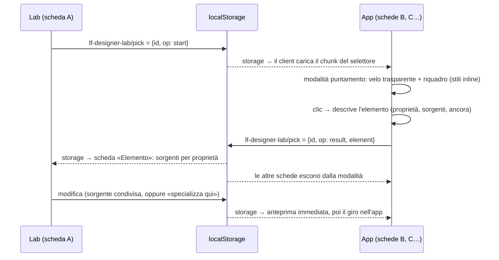

# L — Selettore di elementi (ispettore): analisi di implementazione (14/10/2026, sera)

> Bozza di lavoro di L, negli artefatti di sessione. Va nel piano del repo come **passo 5b** solo dopo il via.
> Base: codice del Lab al checkpoint dei passi 0–5 (HEAD `b631308` + modifiche non committate).

## Richiesta del developer (testuale)

> «anzi servirebbe al contrario avere qualcosa che mi permette, puntando un elemento, di avere un filtro per quelle
> proprietà, così lo modifico e posso farmi un giro nell'app per vedere che effetto ha sul resto. mi immagino che se un
> colore va specializzato a quel punto l'app deve creare un css path o qualcosa di simile a indicare il componente così
> che l'ia poi sappia a quale componente legare la nuova varabile. se servisse»

La lettura del coordinatore (1 punta → filtro sulle sorgenti; 2 modifica della sorgente condivisa e giro nell'app;
3 «specializza qui» con un'ancora nell'export) **regge**, con una precisazione: la specializzazione serve **anche
dal vivo**, non solo nell'export. La designer deve vedere l'elemento con il colore nuovo e il resto dell'app invariato.
Quindi «specializza» è un nuovo livello di modifica, con anteprima.

## Fatti verificati

- `data-testid`:
  - 2.276 attributi in 282 dei 331 componenti `.svelte`;
  - 1.783 statici, 1.670 id distinti;
  - 83 id scritti in più punti;
  - 493 con template (`lab-item-var-{…}`).

  Con la rotta è l'ancora più forte disponibile.
- **Nessuna posizione di sorgente nel DOM della build di debug:**
  - `__svelte_meta` compare solo in una sourcemap, perché `vite build --mode development` mantiene `NODE_ENV=production` e il compilatore Svelte non è in `dev`;
  - accendere `dev` cambierebbe il runtime di tutti gli E2E, quindi è escluso;
  - aggiungere attributi `data-lf-src` a ogni elemento cambierebbe il DOM degli E2E, quindi è escluso anche questo.
- **Corrispondenza regola caricata ↔ catalogo** (selettore normalizzato + proprietà + colore): esiste già, è il confronto per occorrenza del motore L2.
  Per gli elementi stilati da un `<style>` di componente dà `file:riga` esatti.
- **Cascata in Chrome:**
  - `CSSLayerBlockRule` distingue le regole nei layer (le utility di Tailwind stanno in `@layer utilities`);
  - un `!important` di foglio di stile vince anche sugli stili inline normali, quindi l'anteprima della specializzazione funziona su ogni elemento;
  - le varianti `dark:` di Tailwind v4 compilano in `:where(.dark, .dark *)`, con specificità 0.
- L'app non ha scorciatoie globali con Alt: nel codice compaiono solo controlli che le escludono.

## Come funziona con due schede



- **Avvio:**
  - pulsante «Punta un elemento» nel Lab;
  - nella scheda dell'app, la scorciatoia **Alt+Shift+D**, registrata solo se il Lab è già stato aperto in quel browser (flag `lf-designer-lab/seen`). Gli E2E e la gallery partono da contesti puliti, quindi non la registrano mai.
  - `Esc` annulla in tutte le schede; il primo risultato chiude la modalità ovunque.
- **Velo trasparente:**
  - copre la pagina, così l'elemento **non entra in `:hover`** e il colore letto è quello a riposo; l'elemento si trova con `document.elementsFromPoint`;
  - velo e riquadro usano solo stili inline, che il motore L2 non riscrive mai, e lo z-index massimo;
  - gli eventi vengono intercettati in fase di cattura, così modali e trappole del focus non li inghiottono.
- **Canale:** un'altra chiave dello stesso listener `storage` che il client inattivo ha già. Nessun costo nuovo da inattivo.

## Cosa calcola la scheda dell'app (descrizione dell'elemento)

Proprietà: `color`, `background-color`, `border-*-color`, `outline-color`, `fill`, `stroke`,
`text-decoration-color`, i colori di `box-shadow` e dei gradienti di `background-image`. `currentColor` rimanda a `color`.

Per ognuna la scheda raccoglie:
- il valore calcolato;
- le dichiarazioni candidate: regole con `el.matches()` che dichiarano la proprietà o la sua forma abbreviata, con valore, priorità, layer e foglio di stile;
- il valore risolto, con le `var()` risolte sull'elemento;
- la stessa proprietà presa dall'antenato, se è ereditata;
- lo stile inline e gli attributi SVG di presentazione.

**Vincitrice:** la candidata il cui colore risolto coincide con quello calcolato. Le altre si ordinano per importanza, presenza in un layer e ordine nel foglio. Un pareggio viene segnalato, non nascosto.

Un `<canvas>` dentro `[_echarts_instance_]` dà i colori del grafico per valore. Nella v1 non c'è riconoscimento della singola serie.

**Il caso che conta:** in scuro un testo `text-gray-500 dark:text-gray-400` prende il colore da
`html.dark .text-gray-500 { … !important }` di `app.css` (P1). Il selettore lo mostra come vincitore e indica come «scavalcata» la classe `dark:`.
È proprio quello che oggi la designer non riesce a vedere.

## Corrispondenza con il catalogo (nella scheda del Lab)

| Sorgente vincitrice | Modifica proposta | Occorrenze |
|---|---|---|
| `var(--x)`: palette, `--theme-*`, marchio, ruoli futuri | `css-var` su `--x` | definizioni e usi del catalogo |
| Regola con un colore letterale | `css-literal`, «solo questa occorrenza» preselezionata | `file:riga` esatti, dal confronto selettore + proprietà + colore |
| Classe Tailwind | `css-var` sulla variabile della classe | usi della classe, ristretti ai file candidati |
| Stile inline o attributo | proposta, senza anteprima | per valore, ristretti ai file candidati |
| Grafico | `chart-color` per valore | come oggi |

Il Lab apre l'editor esistente già impostato. Dalla stessa scheda si può scegliere **«Specializza qui»**.

## «Specializza qui»: nuovo livello `element`

- **Anteprima:** una regola iniettata `html[.dark] <selettore> { <proprietà>: <valore> !important }`, con lo stesso meccanismo di L1 (`engine/anchors.ts`).
- **Selettore generato:** ancorato al `data-testid` più vicino, più tag e classi dell'elemento, senza `.svelte-…`. Esempio: `[data-testid="transactions-table"] th`.
  - Vale in **ogni istanza del componente** nell'app: è la stessa portata della variabile di componente che l'agente creerà.
  - La designer lo vede scritto nell'editor, ma non lo modifica.
- Non tocca la sorgente condivisa: il resto dell'app resta com'è.

## Formato dell'ancora

```json
"anchor": {
  "route": "/transactions",
  "theme": "light",
  "testids": ["transactions-table", "transactions-page"],
  "css_path": "[data-testid=\"transactions-table\"] > table > thead > tr > th:nth-of-type(3)",
  "element": {"tag": "th", "classes": ["…"], "scope_class": "svelte-1utaimv"},
  "property": "color",
  "computed": "rgb(100, 116, 139)",
  "source": {"kind": "rule-literal", "selector": "th", "file": "src/lib/components/table/DataTable.svelte", "line": 1607},
  "selector": "[data-testid=\"transactions-table\"] th",
  "candidates": [
    {"file": "src/lib/components/table/DataTable.svelte", "line": 1607, "why": "matched-rule"},
    {"file": "src/routes/(app)/transactions/+page.svelte", "line": 710, "why": "testid"}
  ]
}
```

- **`source.kind`:** `var`, `rule-literal`, `tailwind-class`, `inherited`, `inline`, `attribute` oppure `chart`.
- **`candidates[].why`:** `matched-rule` (`file:riga` del catalogo), `testid` (dove è dichiarato il `data-testid`), `class-use` (uso della classe nei file del testid).
- **Nessun testo dell'elemento** nell'ancora: l'export non porta dati.

## Modifiche a schema, scanner, `verify-export`, skill

- **Export** (`lf-designer-lab/1`, solo aggiunte):
  - layer `element`, con `target` uguale al selettore generato, più `property`, `scope`, `from` (il valore calcolato), `to` e `anchor`;
  - `anchor` facoltativa anche sugli altri livelli quando la modifica nasce dal selettore, come contesto per l'agente;
  - l'import valida l'ancora: tipi, lunghezze, selettore sicuro, cioè senza `{`, `}`, `;`, `<`.
  - Resto su `/1` perché nessun export reale esiste fuori dai test e lo leggono solo i nostri strumenti, aggiornati insieme. Un passaggio a `/2` resta possibile se il coordinatore lo preferisce.
- **Scanner:**
  - nuova sezione `testids` del catalogo: per gli id statici `id → [[file, riga]]`, per quelli con template il prefisso con `file:riga`;
  - circa 60 KB in più;
  - fuori dalla parità con l'inventario Python.
- **`verify-export`:**
  - per ogni ancora, ogni candidato con `locate()` (in posto, spostato, mancante) e ogni `data-testid` della catena ancora presente nei sorgenti;
  - `anchor_status` per modifica e totali;
  - exit 1 se una modifica `element` non ha più alcun candidato.
- **Skill `designer-lab-apply`:** sezione `element`.
  - Non si tocca la sorgente condivisa.
  - Si crea una variabile del componente candidato, si lega la proprietà, si scrive il valore per tema.
  - Se la variabile spetta al livello dei temi (proprietario R/T), lo si segnala.

## Dove sta nel piano, test, costo, rischi

- **Piano:** nuovo **passo 5b — Selettore di elementi**, prima del 6. Il passo 6 estende test e documentazione a coprirlo.
- **Test unitari** (Vitest):
  - classifica delle candidate, funzione pura con liste sintetiche;
  - catena dei testid, percorso CSS, generazione ed escape del selettore (jsdom);
  - corrispondenza descrizione → catalogo, su un catalogo sintetico;
  - export, import e `verify-export` delle ancore;
  - indice dei testid dello scanner.
- **E2E** (`front-designer-lab`):
  - due pagine nello stesso contesto;
  - «Punta» nel Lab, poi `page.mouse.click` al centro di un elemento noto. Il `click()` di Playwright lo bloccherebbe il velo, che è lì apposta;
  - il pannello del Lab espone con attributi `data-*` la sorgente attesa (`DataTable.svelte:1607`);
  - «Specializza»: quel `th` cambia colore, mentre un altro elemento con lo stesso colore (`#64748b`, ad esempio la paginazione) resta com'è;
  - l'ancora finisce nell'export; `Esc` annulla;
  - neutralità: da inattivo nessun velo e nessun listener.
- **Costo:** medio, paragonabile al passo 3. File nuovi: `picker/{overlay,describe,cascade}.ts`, `anchor.ts`, `engine/anchors.ts`, `PickedElement.svelte`. Cambiano export, import, `verify-export`, scanner, skill e pagina developer.
- **Rischi:**
  1. La vincitrice è un'euristica: valore risolto uguale al valore calcolato. I pareggi sono segnalati; le regole di stato (`:hover`, `:focus`) compaiono come tali e non sono attive al momento del puntamento.
  2. Nei grafici niente singola serie nella v1.
  3. I testid sono una convenzione, non una garanzia: 49 componenti non ne hanno, 83 id sono ripetuti. I candidati possono essere più d'uno: decide l'agente, `verify-export` li controlla.
  4. Il selettore generato può prendere più elementi del previsto: la designer lo vede scritto.
  5. Dal DOM non si risale al file del componente: vedi i fatti verificati.
  6. Velo contro modali e trappole del focus: eventi in fase di cattura, z-index massimo.
  7. Neutralità garantita da chunk caricati solo su richiesta, nessun listener nuovo da inattivo e la scorciatoia solo dove il Lab è già stato aperto.

## Decisioni

A mio giudizio **nessuna decisione nuova di prodotto**:
- la portata di «specializza» è l'elemento in ogni istanza del suo componente: discende da «a quale componente legare la nuova variabile»;
- la scorciatoia Alt+Shift+D, solo dove il Lab è stato aperto, è un dettaglio d'uso suggerito dal coordinatore;
- lo schema resta `/1` con sole aggiunte: è una scelta tecnica.

Se il coordinatore lo ritiene, confermi i tre punti; altrimenti li porta al developer.
