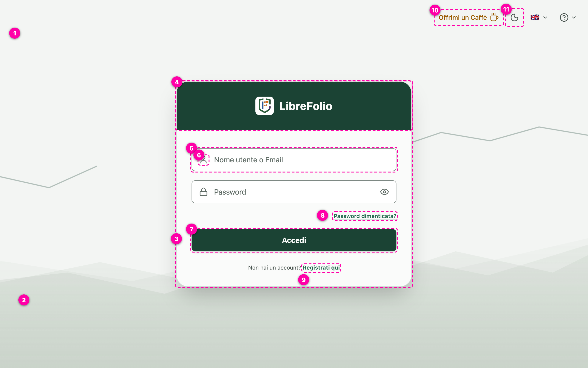
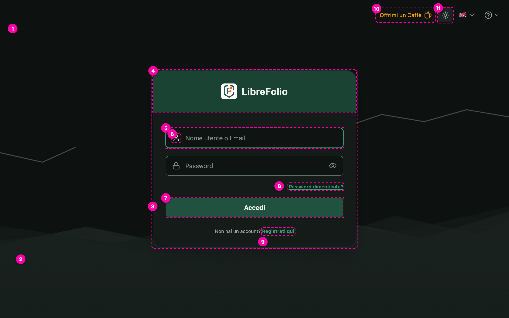
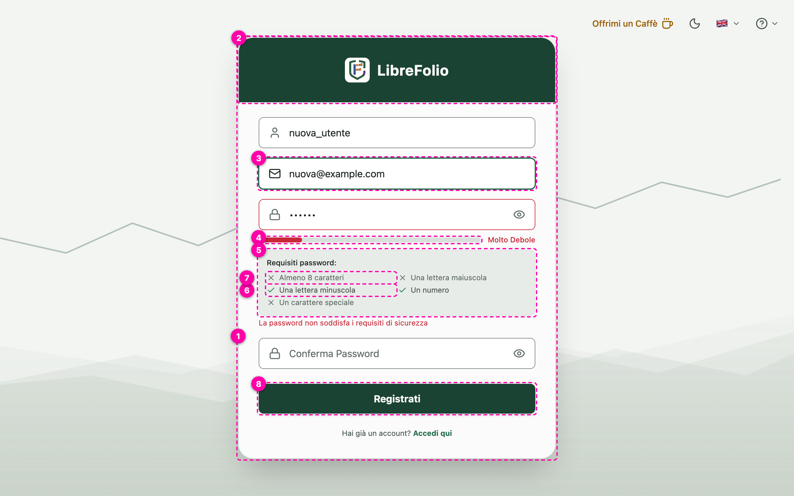
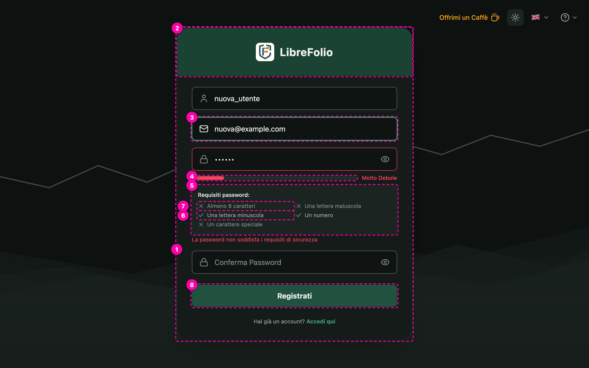
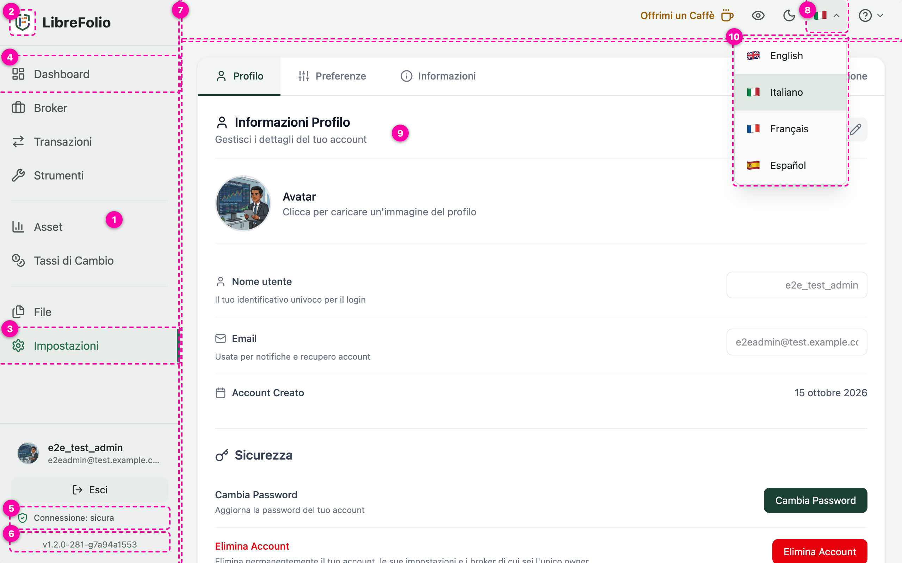
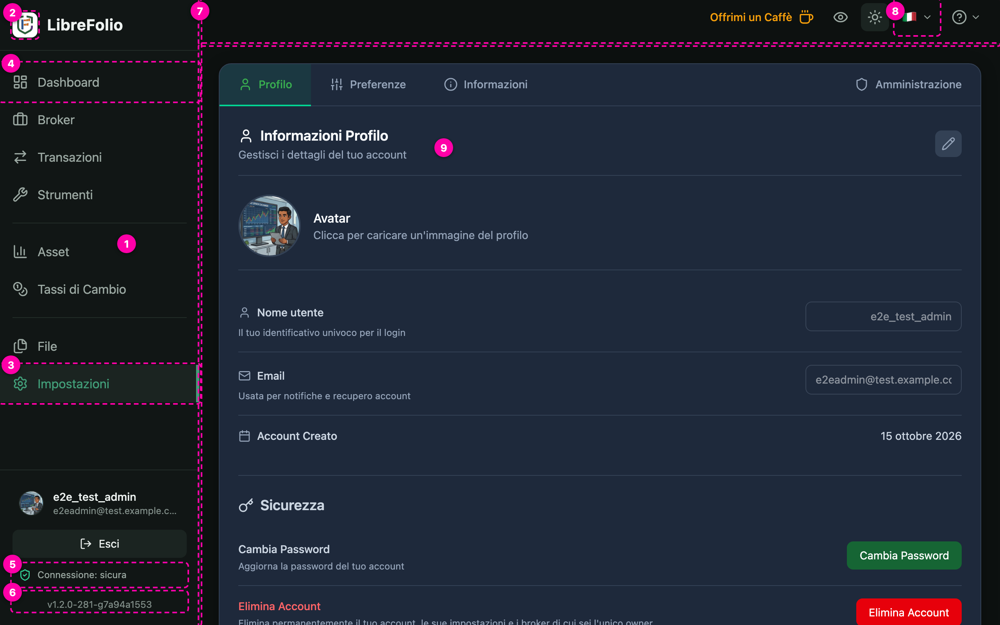
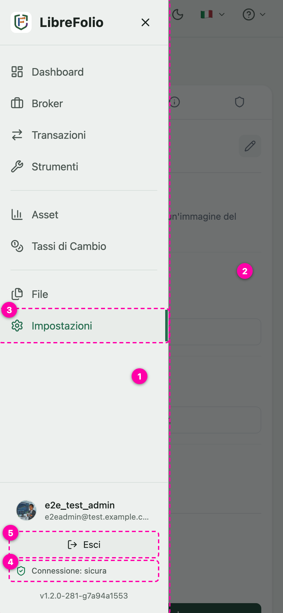
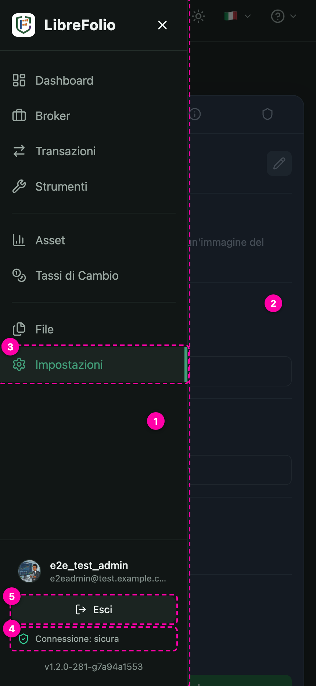
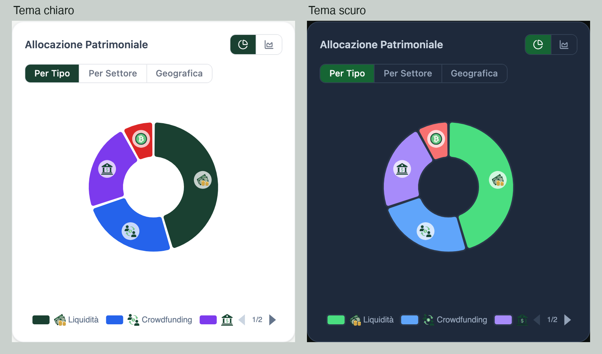
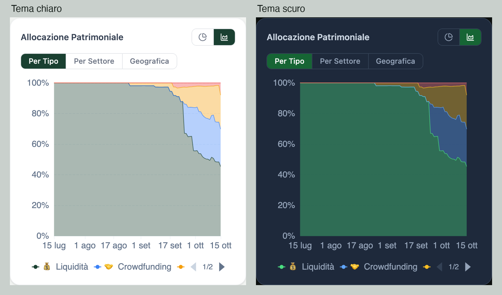

# Palette giro 2 — tutti i ruoli colore e le domande aperte

Contenuto: la tabella di tutti i ruoli colore; «Dove si trovano i colori», 8 schermate annotate; «Grafici», con tipi di asset, settori e tavolozze; le domande per la designer. Le immagini sono nella stessa cartella; `index.html` è la stessa cosa in versione da browser.

| Gruppo | Ruolo | Dove si usa | Chiaro | Scuro | Origine | Nota |
|---|---|---|---|---|---|---|
| Superfici | `--lf-surface-page` | Sfondo pagina: dietro i contenuti dell'app, login, errore, offline | `#F3F5F3` | `#0D1110` | Designer |  |
| Superfici | `--lf-surface-sidebar` | Menu laterale (barra neutra, D-T15) | `#EDF0EE` | `#111615` | Designer |  |
| Superfici | `--lf-surface-card` | Card / superficie 1: card, finestre modali, menu a tendina | `#FAFBFA` | `#151B19` | Designer |  |
| Superfici | `--lf-surface-panel` | Superficie secondaria: pannelli interni, box requisiti password, voce attiva della barra | `#E8ECE9` | `#1B2421` | Designer |  |
| Superfici | `--lf-surface-field` | Sfondo dei campi di input | `#FFFFFF` | `#0F1413` | Designer |  |
| Superfici | `--lf-surface-app` | Sfondo dell'app (= sfondo pagina) | `#F3F5F3` | `#0D1110` | Derivato |  |
| Superfici | `--lf-surface-hover` | Passaggio del mouse su righe, voci di menu (= superficie secondaria) | `#E8ECE9` | `#1B2421` | Provvisorio | sulla barra laterale quasi invisibile: vedi N1 |
| Superfici | `--lf-surface-neutral` | Tracce, scheletri di caricamento, etichette neutre (= bordo generale) | `#D8E0DC` | `#222C28` | Provvisorio |  |
| Superfici | `--lf-surface-inverse` | Fondo dei tooltip (= testo primario: scuro in chiaro, chiaro in scuro) | `#1C2420` | `#EDF2F0` | Provvisorio |  |
| Superfici | `--lf-surface-overlay` | Fondale dietro le finestre modali (#0D1110 al 60%) | `#0D1111 al 60%` | `#0D1111 al 60%` | Provvisorio | vedi Q13 |
| Superfici | `--lf-surface-logo` | Riquadro bianco dietro il logo | `#FFFFFF` | `#FFFFFF` | Provvisorio |  |
| Testo | `--lf-text-primary` | Testo primario | `#1C2420` | `#EDF2F0` | Designer |  |
| Testo | `--lf-text-secondary` | Testo secondario | `#4A5550` | `#9BA8A2` | Designer |  |
| Testo | `--lf-text-muted` | Testo attenuato: placeholder, icone non attive, testo disabilitato | `#616D67` | `#7F8C87` | Designer, corretto (contrasto) | suo valore #6E7A74 / #687570 |
| Testo | `--lf-text-placeholder` | Placeholder dei campi (= attenuato) | `#616D67` | `#7F8C87` | Derivato |  |
| Testo | `--lf-text-on-inverse` | Testo dei tooltip (= colore della card) | `#FAFBFA` | `#151B19` | Derivato |  |
| Bordi | `--lf-border-subtle` | Bordo generale e divisori | `#D8E0DC` | `#222C28` | Designer |  |
| Bordi | `--lf-border-input` | Bordo dei campi | `#7E8984` | `#606F6A` | Designer, corretto (contrasto) | suo valore #B2BEB8 / #313F3A |
| Brand e azioni | `--lf-brand` | Verde brand: testata della card di accesso (e riquadro del logo nella barra, in arrivo) | `#1B4334` | `#1B4334` | Designer |  |
| Brand e azioni | `--lf-on-brand` | Testo sul verde brand | `#FAFBFA` | `#EDF2F0` | Derivato |  |
| Brand e azioni | `--lf-action` | Verde azione: pulsanti principali | `#1B4334` | `#215240` | Designer |  |
| Brand e azioni | `--lf-action-hover` | Pulsante principale al passaggio del mouse | `#1E4F3B` | `#28634E` | Designer + provvisorio | scuro: tuo #28634E; chiaro: nostra proposta |
| Brand e azioni | `--lf-on-action` | Testo sui pulsanti principali | `#FAFBFA` | `#EDF2F0` | Derivato |  |
| Brand e azioni | `--lf-focus` | Focus e link attivi | `#236B4D` | `#429E79` | Designer |  |
| Brand e azioni | `--lf-link` | Link (= focus) | `#236B4D` | `#429E79` | Derivato |  |
| Brand e azioni | `--lf-selected` | Fondo di una voce selezionata (focus al 12%) | `#216B4A al 12%` | `#429C7B al 12%` | Provvisorio |  |
| Brand e azioni | `--lf-checked` | Controlli selezionati: caselle, interruttori accesi, giorni, preset (D-T16) | `#236B4D` | `#429E79` | Decisione D-T16 |  |
| Brand e azioni | `--lf-on-checked` | Segno dentro il controllo selezionato (= card, D-T16) | `#FAFBFA` | `#151B19` | Decisione D-T16 |  |
| Brand e azioni | `--lf-on-status` | Testo su un colore di stato pieno (= card) | `#FAFBFA` | `#151B19` | Derivato |  |
| Stati | `--lf-success` | Successo | `#18794E` | `#36D399` | Designer |  |
| Stati | `--lf-warning` | Avviso | `#9A5B00` | `#F59E0B` | Designer |  |
| Stati | `--lf-danger` | Errore | `#C82838` | `#F84361` | Designer, corretto (contrasto) | scuro: suo valore #F43F5E |
| Stati | `--lf-info` | Informazione | `#155EEF` | `#3F86FA` | Designer, corretto (contrasto) | scuro: suo valore #3B82F6 |
| Stati (tinte) | `--lf-success-soft` | Fondo tenue di successo: messaggi, badge | `#E9F0EB` | `#192420` | Provvisorio | ricetta: chiaro 8%, scuro 6% sulla card |
| Stati (tinte) | `--lf-success-line` | Bordo tenue di successo | `#C5DACC` | `#223E32` | Provvisorio | chiaro 25%, scuro 22% |
| Stati (tinte) | `--lf-success-on-soft` | Testo sul fondo tenue di successo | `#21553B` | `#B7E8CF` | Provvisorio | chiaro 60%, scuro 37% verso il testo |
| Stati (tinte) | `--lf-warning-soft` | Fondo tenue di avviso | `#F3EEE8` | `#20221C` | Provvisorio |  |
| Stati (tinte) | `--lf-warning-line` | Bordo tenue di avviso | `#E3D2C1` | `#403622` | Provvisorio |  |
| Stati (tinte) | `--lf-warning-on-soft` | Testo sul fondo tenue di avviso | `#66451D` | `#F3D5AE` | Provvisorio |  |
| Stati (tinte) | `--lf-danger-soft` | Fondo tenue di errore | `#F9ECEA` | `#221F1D` | Provvisorio |  |
| Stati (tinte) | `--lf-danger-line` | Bordo tenue di errore | `#F5CBC8` | `#432828` | Provvisorio |  |
| Stati (tinte) | `--lf-danger-on-soft` | Testo sul fondo tenue di errore | `#813130` | `#FAB9BA` | Provvisorio |  |
| Stati (tinte) | `--lf-info-soft` | Fondo tenue di informazione | `#E8EFFB` | `#182124` | Provvisorio |  |
| Stati (tinte) | `--lf-info-line` | Bordo tenue di informazione | `#C1D7FC` | `#1E3144` | Provvisorio |  |
| Stati (tinte) | `--lf-info-on-soft` | Testo sul fondo tenue di informazione | `#1A4A97` | `#ADCCF7` | Provvisorio |  |
| Finanza | `--lf-gain` | Guadagno (= successo) | `#18794E` | `#36D399` | Provvisorio |  |
| Finanza | `--lf-loss` | Perdita (= errore) | `#C82838` | `#F84361` | Provvisorio |  |
| Finanza | `--lf-donate` | «Offrimi un caffè» (= avviso) | `#9A5B00` | `#F59E0B` | Provvisorio |  |
| Sfondo del login | `--lf-art-hill-1` | Collina 1 (la più vicina) | `#9BAF9B al 25%` | `#1B2421` | Provvisorio | chiaro: salvia del giro 1 |
| Sfondo del login | `--lf-art-hill-2` | Collina 2 | `#9BB19B al 18%` | `#222C28` | Provvisorio |  |
| Sfondo del login | `--lf-art-hill-3` | Collina 3 (la più lontana) | `#9CAD9C al 12%` | `#171E1C` | Provvisorio |  |
| Sfondo del login | `--lf-art-line` | Linee sottili | `#1A4235 al 30%` | `#677570 al 60%` | Provvisorio | i pallini del render non ci sono: vedi N6 |

## Dove si trovano i colori — 8 schermate

### Accesso — tema chiaro

| # | Elemento | Colori (ruolo; ✓ = misurato nel browser e uguale) |
|---|---|---|
| 1 | Sfondo pagina | Fondo: `#F3F5F3` (`--lf-surface-page`) |
| 2 | Colline e linee dello sfondo | Colline: `#9BAF9B al 25%` (`--lf-art-hill-1`) `#9BB19B al 18%` (`--lf-art-hill-2`) `#9CAD9C al 12%` (`--lf-art-hill-3`) Linee: `#1A4235 al 30%` (`--lf-art-line`) |
| 3 | Card | Fondo: `#FAFBFA` (`--lf-surface-card`) ✓ Bordo: `#D8E0DC` (`--lf-border-subtle`) ✓ |
| 4 | Testata verde con il logo | Fondo: `#1B4334` (`--lf-brand`) ✓ Testo: `#FAFBFA` (`--lf-on-brand`) Riquadro del logo: `#FFFFFF` (`--lf-surface-logo`) |
| 5 | Campo: sfondo, bordo, testo | Fondo: `#FFFFFF` (`--lf-surface-field`) ✓ Bordo: `#7E8984` (`--lf-border-input`) ✓ Testo: `#1C2420` (`--lf-text-primary`) ✓ |
| 6 | Icona del campo / placeholder | Icona e placeholder: `#616D67` (`--lf-text-muted`) ✓ |
| 7 | Pulsante principale | Fondo: `#1B4334` (`--lf-action`) ✓ Testo: `#FAFBFA` (`--lf-on-action`) ✓ Al passaggio del mouse: `#1E4F3B` (`--lf-action-hover`) |
| 8 | Link | Testo: `#236B4D` (`--lf-link`) ✓ |
| 9 | Link «Registrati qui» | Link: `#236B4D` (`--lf-link`) ✓ Frase: `#4A5550` (`--lf-text-secondary`) |
| 10 | «Offrimi un caffè» | Testo: `#9A5B00` (`--lf-donate`) ✓ |
| 11 | Controlli in alto | Icone: `#4A5550` (`--lf-text-secondary`) ✓ |

### Accesso — tema scuro, campo «Nome utente» a fuoco

| # | Elemento | Colori (ruolo; ✓ = misurato nel browser e uguale) |
|---|---|---|
| 1 | Sfondo pagina | Fondo: `#0D1110` (`--lf-surface-page`) |
| 2 | Colline e linee dello sfondo | Colline: `#1B2421` (`--lf-art-hill-1`) `#222C28` (`--lf-art-hill-2`) `#171E1C` (`--lf-art-hill-3`) Linee: `#677570 al 60%` (`--lf-art-line`) |
| 3 | Card | Fondo: `#151B19` (`--lf-surface-card`) ✓ Bordo: `#222C28` (`--lf-border-subtle`) ✓ |
| 4 | Testata verde con il logo | Fondo: `#1B4334` (`--lf-brand`) ✓ Testo: `#EDF2F0` (`--lf-on-brand`) ✓ Riquadro del logo: `#FFFFFF` (`--lf-surface-logo`) |
| 5 | Campo a fuoco (anello di focus) | Fondo: `#0F1413` (`--lf-surface-field`) ✓ Bordo e anello di focus: `#429E79` (`--lf-focus`) ✓ Testo: `#EDF2F0` (`--lf-text-primary`) ✓ |
| 6 | Icona del campo / placeholder | Icona e placeholder: `#7F8C87` (`--lf-text-muted`) |
| 7 | Pulsante principale | Fondo: `#215240` (`--lf-action`) ✓ Testo: `#EDF2F0` (`--lf-on-action`) ✓ Al passaggio del mouse: `#28634E` (`--lf-action-hover`) |
| 8 | Link | Testo: `#429E79` (`--lf-link`) ✓ |
| 9 | Link «Registrati qui» | Link: `#429E79` (`--lf-link`) ✓ Frase: `#9BA8A2` (`--lf-text-secondary`) |
| 10 | «Offrimi un caffè» | Testo: `#F59E0B` (`--lf-donate`) ✓ |
| 11 | Controlli in alto | Icone: `#9BA8A2` (`--lf-text-secondary`) ✓ |

### Registrazione — tema chiaro, password debole con i requisiti

| # | Elemento | Colori (ruolo; ✓ = misurato nel browser e uguale) |
|---|---|---|
| 1 | Card | Fondo: `#FAFBFA` (`--lf-surface-card`) ✓ Bordo: `#D8E0DC` (`--lf-border-subtle`) ✓ |
| 2 | Testata verde | Fondo: `#1B4334` (`--lf-brand`) ✓ Testo: `#FAFBFA` (`--lf-on-brand`) |
| 3 | Campo a fuoco | Fondo: `#FFFFFF` (`--lf-surface-field`) ✓ Bordo e anello di focus: `#236B4D` (`--lf-focus`) ✓ |
| 4 | Barra di robustezza (3 stati) | Molto debole: `#C82838` (`--lf-danger`) Media: `#9A5B00` (`--lf-warning`) Forte: `#18794E` (`--lf-success`) Traccia: `#D8E0DC` (`--lf-surface-neutral`) ✓ |
| 5 | Box dei requisiti (superficie secondaria) | Fondo: `#E8ECE9` (`--lf-surface-panel`) ✓ Bordo: `#D8E0DC` (`--lf-border-subtle`) ✓ Testo: `#4A5550` (`--lf-text-secondary`) |
| 6 | Requisito soddisfatto | Spunta ✓: `#18794E` (`--lf-success`) |
| 7 | Requisito mancante | Croce ✗ e testo: `#616D67` (`--lf-text-muted`) |
| 8 | Pulsante principale | Fondo: `#1B4334` (`--lf-action`) ✓ Testo: `#FAFBFA` (`--lf-on-action`) ✓ |

### Registrazione — tema scuro, password debole con i requisiti

| # | Elemento | Colori (ruolo; ✓ = misurato nel browser e uguale) |
|---|---|---|
| 1 | Card | Fondo: `#151B19` (`--lf-surface-card`) ✓ Bordo: `#222C28` (`--lf-border-subtle`) ✓ |
| 2 | Testata verde | Fondo: `#1B4334` (`--lf-brand`) ✓ Testo: `#EDF2F0` (`--lf-on-brand`) ✓ |
| 3 | Campo a fuoco | Fondo: `#0F1413` (`--lf-surface-field`) ✓ Bordo e anello di focus: `#429E79` (`--lf-focus`) ✓ |
| 4 | Barra di robustezza (3 stati) | Molto debole: `#F84361` (`--lf-danger`) Media: `#F59E0B` (`--lf-warning`) Forte: `#36D399` (`--lf-success`) Traccia: `#222C28` (`--lf-surface-neutral`) ✓ |
| 5 | Box dei requisiti (superficie secondaria) | Fondo: `#1B2421` (`--lf-surface-panel`) ✓ Bordo: `#222C28` (`--lf-border-subtle`) ✓ Testo: `#9BA8A2` (`--lf-text-secondary`) |
| 6 | Requisito soddisfatto | Spunta ✓: `#36D399` (`--lf-success`) |
| 7 | Requisito mancante | Croce ✗ e testo: `#7F8C87` (`--lf-text-muted`) |
| 8 | Pulsante principale | Fondo: `#215240` (`--lf-action`) ✓ Testo: `#EDF2F0` (`--lf-on-action`) ✓ |

### App — tema chiaro, menu della lingua aperto (Impostazioni → Profilo)

| # | Elemento | Colori (ruolo; ✓ = misurato nel browser e uguale) |
|---|---|---|
| 1 | Barra laterale | Fondo: `#EDF0EE` (`--lf-surface-sidebar`) ✓ Bordo destro: `#D8E0DC` (`--lf-border-subtle`) Divisori: `#D8E0DC` (`--lf-border-subtle`) |
| 2 | Riquadro del logo | Riquadro (in arrivo: verde brand): `#FFFFFF` (`--lf-surface-logo`) ✓ |
| 3 | Voce attiva (fondo, testo, barretta) | Fondo: `#E8ECE9` (`--lf-surface-panel`) ✓ Testo e icona: `#236B4D` (`--lf-link`) ✓ Barretta: `#236B4D` (`--lf-focus`) ✓ |
| 4 | Voce normale | Testo e icona: `#4A5550` (`--lf-text-secondary`) ✓ Al passaggio del mouse: `#E8ECE9` (`--lf-surface-hover`) |
| 5 | Stato della connessione | Icona «sicura»: `#18794E` (`--lf-success`) Rete locale: `#9A5B00` (`--lf-warning`) Non sicura: `#C82838` (`--lf-danger`) |
| 6 | Versione (testo attenuato) | Testo: `#616D67` (`--lf-text-muted`) ✓ |
| 7 | Intestazione (sfondo dell'app) | Fondo: `#F3F5F3` (`--lf-surface-app`) ✓ Bordo inferiore: `#D8E0DC` (`--lf-border-subtle`) |
| 8 | Controlli in alto | Icone: `#4A5550` (`--lf-text-secondary`) Pulsante attivo: `#E8ECE9` (`--lf-surface-panel`) ✓ |
| 9 | Sfondo dell'app; le card dentro NON sono ancora migrate | Fondo: `#F3F5F3` (`--lf-surface-app`) |
| 10 | Menu a tendina (card, bordo, voci) | Fondo: `#FAFBFA` (`--lf-surface-card`) ✓ Bordo: `#D8E0DC` (`--lf-border-subtle`) ✓ Voce evidenziata: `#E8ECE9` (`--lf-surface-hover`) Testo: `#1C2420` (`--lf-text-primary`) |

### App — tema scuro (Impostazioni → Profilo)

| # | Elemento | Colori (ruolo; ✓ = misurato nel browser e uguale) |
|---|---|---|
| 1 | Barra laterale | Fondo: `#111615` (`--lf-surface-sidebar`) ✓ Bordo destro: `#222C28` (`--lf-border-subtle`) Divisori: `#222C28` (`--lf-border-subtle`) |
| 2 | Riquadro del logo | Riquadro (in arrivo: verde brand): `#FFFFFF` (`--lf-surface-logo`) ✓ |
| 3 | Voce attiva (fondo, testo, barretta) | Fondo: `#1B2421` (`--lf-surface-panel`) ✓ Testo e icona: `#429E79` (`--lf-link`) ✓ Barretta: `#429E79` (`--lf-focus`) ✓ |
| 4 | Voce normale | Testo e icona: `#9BA8A2` (`--lf-text-secondary`) ✓ Al passaggio del mouse: `#1B2421` (`--lf-surface-hover`) |
| 5 | Stato della connessione | Icona «sicura»: `#36D399` (`--lf-success`) Rete locale: `#F59E0B` (`--lf-warning`) Non sicura: `#F84361` (`--lf-danger`) |
| 6 | Versione (testo attenuato) | Testo: `#7F8C87` (`--lf-text-muted`) ✓ |
| 7 | Intestazione (sfondo dell'app) | Fondo: `#0D1110` (`--lf-surface-app`) ✓ Bordo inferiore: `#222C28` (`--lf-border-subtle`) |
| 8 | Controlli in alto | Icone: `#9BA8A2` (`--lf-text-secondary`) Pulsante attivo: `#1B2421` (`--lf-surface-panel`) |
| 9 | Sfondo dell'app; le card dentro NON sono ancora migrate | Fondo: `#0D1110` (`--lf-surface-app`) |

### Telefono — tema chiaro, menu laterale aperto sopra il fondale

| # | Elemento | Colori (ruolo; ✓ = misurato nel browser e uguale) |
|---|---|---|
| 1 | Barra laterale aperta | Fondo: `#EDF0EE` (`--lf-surface-sidebar`) ✓ |
| 2 | Fondale dietro la barra | Fondale: `#0D1111 al 60%` (`--lf-surface-overlay`) |
| 3 | Voce attiva | Fondo: `#E8ECE9` (`--lf-surface-panel`) ✓ Testo: `#236B4D` (`--lf-link`) ✓ Barretta: `#236B4D` (`--lf-focus`) ✓ |
| 4 | Stato della connessione | Icona «sicura»: `#18794E` (`--lf-success`) |
| 5 | Pulsante «Esci» | Fondo: `#E8ECE9` (`--lf-surface-panel`) ✓ Testo: `#1C2420` (`--lf-text-primary`) ✓ Al passaggio del mouse: `#D8E0DC` (`--lf-surface-neutral`) |

### Telefono — tema scuro, menu laterale aperto sopra il fondale

| # | Elemento | Colori (ruolo; ✓ = misurato nel browser e uguale) |
|---|---|---|
| 1 | Barra laterale aperta | Fondo: `#111615` (`--lf-surface-sidebar`) ✓ |
| 2 | Fondale dietro la barra | Fondale: `#0D1111 al 60%` (`--lf-surface-overlay`) |
| 3 | Voce attiva | Fondo: `#1B2421` (`--lf-surface-panel`) ✓ Testo: `#429E79` (`--lf-link`) ✓ Barretta: `#429E79` (`--lf-focus`) ✓ |
| 4 | Stato della connessione | Icona «sicura»: `#36D399` (`--lf-success`) |
| 5 | Pulsante «Esci» | Fondo: `#1B2421` (`--lf-surface-panel`) ✓ Testo: `#EDF2F0` (`--lf-text-primary`) ✓ Al passaggio del mouse: `#222C28` (`--lf-surface-neutral`) |

## Grafici: tipi di asset, settori e tavolozze

I grafici non sono ancora passati ai ruoli. Usano due tavolozze da 14 colori, una per la torta («Ora») e una per lo storico («Storico»), ciascuna in versione chiara e scura. Qui trovi le categorie da colorare, le tavolozze di oggi, come vengono assegnati i colori e le scelte che ci servono (GR1–GR5).

### Dove si vedono

Dashboard → riquadro «Allocazione Patrimoniale» (lo stesso riquadro c'è nel dettaglio di ogni broker). In alto a destra si sceglie la vista, torta (Ora) o aree (Storico); sotto, le schede Per Tipo, Per Settore, Geografica. Le due immagini sono della scheda Per Tipo, nell'anteprima, con i colori letti direttamente dal grafico.

| Categoria | Torta, chiaro | Storico, chiaro | Torta, scuro | Storico, scuro |
|---|---|---|---|---|
| Liquidità | `#1A4031` (colore 1) | `#1A4031` (colore 1) | `#4ADE80` (colore 1) | `#4ADE80` (colore 1) |
| Crowdfunding | `#2563EB` (colore 2) | `#3B82F6` (colore 2) | `#60A5FA` (colore 2) | `#60A5FA` (colore 2) |
| Azione | `#7C3AED` (colore 3) | `#F59E0B` (colore 3) | `#A78BFA` (colore 3) | `#FBBF24` (colore 3) |
| Cripto | `#DC2626` (colore 4) | `#EF4444` (colore 4) | `#F87171` (colore 4) | `#F87171` (colore 4) |

### Le categorie da colorare

**Tipi di asset: 11**, più la Liquidità. I sottotipi non hanno un colore proprio: prendono quello del loro tipo. Le ultime due colonne sono per te.

| # | Chiave | Nome | Emoji | Sottotipi | Tuo colore, chiaro | Tuo colore, scuro |
|---|---|---|---|---|---|---|
| 1 | `STOCK` | Azione | 📈 | — |  |  |
| 2 | `ETF` | ETF | 📊 | ETF azionario, ETF obbligazionario, ETF su materie prime, ETF immobiliare, ETF su cripto, ETF monetario |  |  |
| 3 | `BOND` | Obbligazione | 🏛️ | — |  |  |
| 4 | `CRYPTO` | Cripto | 🪙 | — |  |  |
| 5 | `FUND` | Fondo | 💼 | — |  |  |
| 6 | `HOLD` | Bene detenuto | ⏸️ | — |  |  |
| 7 | `CROWDFUND` | Crowdfunding | 🤝 | Crowdfunding immobiliare |  |  |
| 8 | `COMMODITY` | Materia prima | 🛢️ | — |  |  |
| 9 | `REAL_ESTATE` | Immobiliare | 🏠 | — |  |  |
| 10 | `INDEX` | Indice | 📉 | — |  |  |
| 11 | `OTHER` | Altro | 📦 | — |  |  |
| + | `Liquidity` | Liquidità | 💰 | Non è un tipo: è la cassa, che il sistema aggiunge da solo a ogni grafico |  |  |

**Settori: 14**, più Liquidità e Non classificato. ⚠️ = la torta e lo storico mostrano un'emoji diversa per lo stesso settore (due elenchi separati nel sistema): da uniformare.

| # | Chiave | Nome | Emoji nella torta | Emoji nello storico | Tuo colore, chiaro | Tuo colore, scuro |
|---|---|---|---|---|---|---|
| 1 | `Industrials` | Industriali | 🏭 | 🏭 |  |  |
| 2 | `Technology` | Tecnologia | 💻 | 💻 |  |  |
| 3 | `Financials` | Finanziari | 🏦 | 🏦 |  |  |
| 4 | `Consumer Discretionary` | Beni voluttuari | 🛍️ | 🛍️ |  |  |
| 5 | `Health Care` | Sanità | 💊 | 🏥 ⚠️ |  |  |
| 6 | `Real Estate` | Immobiliare | 🏢 | 🏠 ⚠️ |  |  |
| 7 | `Basic Materials` | Materie prime | ⛏️ | ⛏️ |  |  |
| 8 | `Energy` | Energia | ⚡ | ⚡ |  |  |
| 9 | `Consumer Staples` | Beni di consumo | 🛒 | 🛒 |  |  |
| 10 | `Telecommunication` | Telecomunicazioni | 📡 | 📡 |  |  |
| 11 | `Utilities` | Servizi pubblici | 🔌 | 💡 ⚠️ |  |  |
| 12 | `Corporate Bonds` | Obbligazioni societarie | 🏢 | 🏢 |  |  |
| 13 | `Government Bonds` | Titoli di Stato | 🏛️ | 🏛️ |  |  |
| 14 | `Other` | Altro | 📦 | 📦 |  |  |
| + | `Liquidity` | Liquidità (la cassa, aggiunta dal sistema) | 💵 | 💰 ⚠️ |  |  |
| + | `Unknown` | Non classificato (titoli senza settore) | ❓ | ❓ |  |  |

### Le tavolozze di oggi

Il numero a sinistra è la posizione in classifica: la categoria più grande prende il colore 1.

| # | Torta «Ora», chiaro | Torta «Ora», scuro | Storico, chiaro | Storico, scuro |
|---|---|---|---|---|
| 1 | `#1A4031` verde scuro (vecchio marchio) | `#4ADE80` verde brillante | `#1A4031` verde scuro (vecchio marchio) | `#4ADE80` verde brillante |
| 2 | `#2563EB` blu | `#60A5FA` blu | `#3B82F6` blu | `#60A5FA` blu |
| 3 | `#7C3AED` viola | `#A78BFA` viola | `#F59E0B` ambra | `#FBBF24` ambra |
| 4 | `#DC2626` rosso | `#F87171` rosso | `#EF4444` rosso | `#F87171` rosso |
| 5 | `#D97706` ambra | `#FBBF24` ambra | `#8B5CF6` viola | `#A78BFA` viola |
| 6 | `#0D9488` verde acqua | `#2DD4BF` verde acqua | `#06B6D4` ciano | `#22D3EE` ciano |
| 7 | `#BE185D` rosa | `#F472B6` rosa | `#84CC16` lime | `#A3E635` lime |
| 8 | `#4F46E5` indaco | `#818CF8` indaco | `#EC4899` rosa | `#F472B6` rosa |
| 9 | `#059669` smeraldo | `#34D399` smeraldo | `#F97316` arancio | `#FB923C` arancio |
| 10 | `#EA580C` arancio | `#FB923C` arancio | `#14B8A6` verde acqua | `#2DD4BF` verde acqua |
| 11 | `#6366F1` indaco chiaro | `#A5B4FC` indaco chiaro | `#6366F1` indaco | `#818CF8` indaco |
| 12 | `#0891B2` ciano | `#22D3EE` ciano | `#A3A3A3` grigio | `#D4D4D4` grigio |
| 13 | `#CA8A04` giallo | `#FACC15` giallo | `#A21CAF` fucsia | `#E879F9` fucsia |
| 14 | `#9333EA` porpora | `#C084FC` porpora | `#7E22CE` porpora | `#C084FC` porpora |

### Come vengono assegnati i colori oggi

- **Il colore va per posizione in classifica, non per categoria.** La categoria più grande prende il colore 1, la seconda il 2 e così via. Non esiste un colore fisso per «ETF» o per «Tecnologia»: cambiando portafoglio, broker, periodo, o semplicemente con il tempo, la classifica cambia e i colori si spostano.
- **Torta e storico usano due tavolozze diverse.** Coincidono nel colore 1 e hanno la stessa tinta ai posti 2 (blu) e 4 (rosso), ma dal 3 in poi divergono: al posto 3 la torta ha il viola, lo storico l'ambra. Nelle due schermate qui sopra «Azione» è viola nella torta e ambra nello storico.
- **Le classifiche sono diverse.** La torta ordina per peso di *oggi*, lo storico per peso *medio nel periodo*. Nei dati della gallery, per esempio, ETF è primo nella torta (verde) e Crowdfunding primo nello storico (verde): la stessa categoria cambia colore passando da «Ora» a «Storico».
- **Nello storico le aree sono trasparenti**: il riempimento è il colore della tavolozza al 53% di opacità sopra lo sfondo della card, il bordo al 70%. Per questo a schermo le aree appaiono più chiare nel tema chiaro e più cupe nel tema scuro; il colore pieno si vede solo nei pallini della legenda.
- **Per Tipo** i sottotipi (ETF azionario, ETF monetario…) restano nel colore della famiglia: nella torta come sfumature e anello esterno, nello storico come un'unica area, con il dettaglio solo nel riquadro al passaggio del mouse.
- **Per Settore** le categorie possono essere 16 (14 settori + Liquidità + Non classificato), ma i colori sono 14: dalla 15ª il giro ricomincia e due fette hanno lo stesso colore.
- **Geografica**: nella vista Ora è una mappa con la scala di verdi (tabella più sotto); nello storico ogni paese prende un colore per classifica, e con più di 14 paesi i colori si ripetono.
- **Chiaro e scuro vanno in coppia**: lo stesso posto ha la stessa tinta, più chiara nel tema scuro, così una categoria non cambia colore quando si cambia tema.

### Le altre tavolozze dei grafici

| Dove | Come | Chiaro | Scuro |
|---|---|---|---|
| Mappa «Geografica» (vista Ora) | Scala da 6 verdi, dal peso più basso al più alto | `#F0FDF4` `#BBF7D0` `#86EFAC` `#4ADE80` `#22C55E` `#16A34A` | `#1E3A2F` `#22543D` `#276749` `#2F855A` `#38A169` `#48BB78` |
| Linee dei broker in «Crescita del Portafoglio» | Una linea per broker: blu, ambra, viola, rosa, ciano, lime | `#2563EB` `#D97706` `#7C3AED` `#DB2777` `#0891B2` `#65A30D` | `#60A5FA` `#FBBF24` `#A78BFA` `#F472B6` `#22D3EE` `#A3E635` |
| Semi-ciambella delle quote (dettaglio broker → condivisione) | I primi 8 colori della torta chiara, **uguali anche in scuro**: il verde #1A4031 sullo sfondo scuro si vede poco | `#1A4031` `#2563EB` `#7C3AED` `#DC2626` `#D97706` `#0D9488` `#BE185D` `#4F46E5` | *nessuna: usa i chiari* |
| Indicatori tecnici (EMA, RSI…) nei grafici di asset e cambi | Colori di partenza delle linee; uno solo per entrambi i temi | `#3B82F6` `#F59E0B` `#8B5CF6` `#EC4899` `#06B6D4` `#84CC16` | *nessuna: usa i chiari* |
| Matrice di correlazione (analisi del rischio) | Rosso = vanno in direzioni opposte, centro = nessun legame, blu = vanno insieme | `#B91C1C` `#F8FAFC` `#1D4ED8` | `#B91C1C` `#334155` `#1D4ED8` |

### Cosa ci serve da te

#### GR1 · Colore fisso per categoria?

- **Cosa ci serve da te:** Ti proponiamo un colore fisso per ogni tipo (11 + Liquidità) e per ogni settore (14 + Liquidità + Non classificato), uguale in torta e storico e in ogni portafoglio. Se sei d'accordo, scrivi il colore chiaro e scuro nelle colonne vuote delle due tabelle del punto 3.2. Se preferisci tenere i colori per posizione, ci basta una tavolozza unica per torta e storico.

#### GR2 · Verde e rosso

- **Cosa ci serve da te:** Nel resto dell'app il verde vuol dire guadagno e il rosso perdita. Nei grafici a categorie oggi la categoria più grande è sempre verde (colore 1) e la quarta è rossa. Li teniamo fuori dalle categorie, o li riserviamo a qualcosa (per esempio la Liquidità)?

#### GR3 · Liquidità

- **Cosa ci serve da te:** Compare in tutti i raggruppamenti (tipo, settore, storico). Vuoi darle un colore suo, per esempio un neutro tranquillo, invece del colore della sua posizione?

#### GR4 · Sottotipi

- **Cosa ci serve da te:** Oggi sono sfumature del colore della famiglia, più l'anello esterno nella torta. Confermi le sfumature, o preferisci un'altra regola (per esempio solo più chiaro)?

#### GR5 · Le altre tavolozze dei grafici

- **Cosa ci serve da te:** Mappa, linee dei broker, indicatori, correlazione e semi-ciambella (tabella 3.5): per ora ci basta sapere se devono seguire la stessa famiglia di colori delle categorie. Il dettaglio in un giro successivo.

## Domande per la designer

Q1 è chiusa: verde focus (D-T16). Le scelte sui grafici (GR1–GR5) sono nella sezione 3.

### N1 · Barra laterale: voce attiva, passaggio del mouse, separazione dalla pagina

- **Dove si vede:** Qualunque pagina dopo l'accesso, barra a sinistra (desktop).
- **Oggi:** Voce attiva su superficie secondaria con testo e barretta a sinistra nel verde focus. Hover sulla superficie secondaria, che sulla barra quasi non si vede. Un bordo sottile separa barra e pagina, perché i due grigi sono quasi uguali.
- **Cosa ci serve da te:** I colori della voce attiva (fondo, testo, eventuale barretta) e dell'hover; se ti va bene il bordo o preferisci un altro modo di separare la barra. Il riquadro del logo diventa verde brand, come chiesto oggi.

### N2 · Colore della barra del telefono quando l'app è installata

- **Dove si vede:** Sul telefono, con LibreFolio installato come app: la barra di stato in alto (e in alcuni browser la barra degli indirizzi).
- **Oggi:** Verde #1A4031 in chiaro e #166534 in scuro: era legato alla vecchia barra laterale verde.
- **Cosa ci serve da te:** Verde brand #1B4334, oppure il grigio della barra laterale (#EDF0EE / #111615)?

### N3 · Bordo della card di accesso nel tema scuro

- **Dove si vede:** Pagina di accesso, tema scuro.
- **Oggi:** Il bordo usa il bordo generale #222C28 e si vede appena; nel tuo render sembra un filo più chiaro, circa #7F8883.
- **Cosa ci serve da te:** Il valore del bordo della card in scuro (e in chiaro, se diverso).

### N4 · Sottotitolo «Crea un account»

- **Dove si vede:** Accesso → «Registrati qui».
- **Oggi:** Nel giro 1 ci avevi chiesto di toglierlo, e non c'è più; nel render nuovo c'è di nuovo.
- **Cosa ci serve da te:** Lo rimettiamo? Se sì, il colore del testo sotto il nome, sulla fascia verde.

### N5 · Sei valori corretti per la leggibilità

- **Dove si vede:** Placeholder e icone dei campi, bordi dei campi, messaggi di errore e informazione in scuro.
- **Oggi:** Abbiamo scurito o schiarito di poco sei tuoi valori per raggiungere il minimo di contrasto WCAG (tabella sopra, origine «Designer, corretto»). Il bordo dei campi cambia di più.
- **Cosa ci serve da te:** Accetti le correzioni, o preferisci darci tu altri valori leggibili?

### N6 · Colline e linee dello sfondo del login in scuro

- **Dove si vede:** Pagina di accesso, tema scuro.
- **Oggi:** Colline nei toni della superficie secondaria e del bordo; linea grigia al 60%; i pallini sulle linee del tuo render non ci sono.
- **Cosa ci serve da te:** I colori di colline e linee nei due temi, e se vuoi i pallini.

### Q2 · Interruttore spento

- **Dove si vede:** Impostazioni → Preferenze: gli interruttori on/off.
- **Oggi:** Acceso = verde focus (deciso). Spento: proposta traccia nel colore del bordo dei campi e pallino chiaro.
- **Cosa ci serve da te:** Colore della traccia e del pallino quando l'interruttore è spento.

### Q3 · Pulsanti pieni rossi e arancio al passaggio del mouse

- **Dove si vede:** Impostazioni → Profilo (pulsante rosso); popup donazione («Offrimi un caffè»).
- **Oggi:** Proposta: lo stesso colore un poco più scuro.
- **Cosa ci serve da te:** Il colore hover di errore, avviso e donazione, oppure va bene «un poco più scuro».

### Q4 · Stato «modificato» nelle impostazioni

- **Dove si vede:** Impostazioni → Globali: cambiando un valore compare il segno «modificato» con i pulsanti salva e annulla.
- **Oggi:** Oggi arancio. Proposta: i colori dell'avviso.
- **Cosa ci serve da te:** È un avviso (arancio) o uno stato a sé, con un suo colore?

### Q5 · Pallino grigio «inattivo»

- **Dove si vede:** Impostazioni → Globali → log dello scheduler.
- **Oggi:** Oggi grigio. Proposta: il testo attenuato.
- **Cosa ci serve da te:** Il colore del pallino di stato neutro.

### Q6 · Codice nel testo e blocco «terminale»

- **Dove si vede:** Changelog (parole in codice); popup «Aggiornamento disponibile»; «Password dimenticata» (riquadro scuro con il comando).
- **Oggi:** Codice su una tinta leggera; il terminale resta scuro nei due temi.
- **Cosa ci serve da te:** Fondo e testo del codice; il terminale deve restare scuro anche in chiaro?

### Q7 · Evidenziazione dei risultati di ricerca

- **Dove si vede:** Changelog → cerca una parola: le occorrenze sono evidenziate.
- **Oggi:** Oggi giallo. Non abbiamo una proposta: l'avviso in chiaro è troppo bruno.
- **Cosa ci serve da te:** Il colore dell'evidenziazione nei due temi.

### Q8 · Ombra delle finestre

- **Dove si vede:** Qualunque finestra, per esempio Impostazioni → Cambia password.
- **Oggi:** Nero al 25% in chiaro e al 50% in scuro. Proposta: il nero ardesia #0D1110 con le stesse intensità.
- **Cosa ci serve da te:** Va bene, o un altro colore o intensità?

### Q9 · Tour guidato: alone e sfondo

- **Dove si vede:** Il tour iniziale (Impostazioni → Preferenze → Onboarding → rivedi il tour).
- **Oggi:** Alone smeraldo e sfondo nero al 45%. Proposta: alone nel verde focus al 40%, sfondo come il fondale delle finestre.
- **Cosa ci serve da te:** Va bene, o altri valori?

### Q10 · Avviso dentro un tooltip

- **Dove si vede:** Cambi → scelta del fornitore: il tooltip mostra un avviso giallo.
- **Oggi:** Il tooltip è scuro in chiaro e chiaro in scuro. Proposta: dentro il tooltip usare l'avviso dell'altro tema (#F59E0B sul tooltip scuro, #9A5B00 su quello chiaro).
- **Cosa ci serve da te:** Va bene?

### Q11 · Viola dell'AI Export

- **Dove si vede:** Strumenti → AI Export: pannello delle opzioni.
- **Oggi:** Oggi viola. Proposta: farlo rientrare nei colori dei grafici, che definiremo dopo.
- **Cosa ci serve da te:** Deve restare un accento a sé, o rientrare nei colori del brand o dei grafici?

### Q12 · Icone colorate della scheda «Informazioni»

- **Dove si vede:** Impostazioni → Informazioni.
- **Oggi:** Otto colori diversi (arancio, azzurro, ambra, rosa, viola, ciano, verde acqua, indaco). Proposta: farle rientrare nei colori dei grafici.
- **Cosa ci serve da te:** Le vuoi colorate (con quali colori) o tutte in un unico colore?

### Q13 · Fondale scuro dietro le finestre

- **Dove si vede:** Qualunque finestra, per esempio Impostazioni → Cambia password.
- **Oggi:** Oggi nero al 50%. Proposta: #0D1110 al 60%, un poco più scuro.
- **Cosa ci serve da te:** Va bene?
