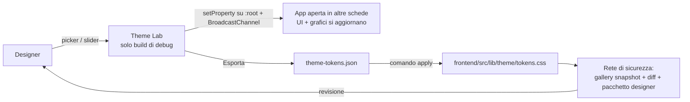

# Piano — Sistema colori a token + «Theme Lab» (modifica dei colori dal vivo)

> **Piano generale del programma colori**, di proprietà del coordinatore. Aperto il 14/10/2026 su `dev_release2` @ `27228466c` (v1.2).
> I piani dei workstream stanno nelle sottocartelle (`L-designerLab/`, `R-colorRefactor/`) e in `G-galleryDeterminism/`.
> Origine: richiesta della designer durante la review colori v1.2. Il pacchetto statico va bene per osservare, ma serve
> poter cambiare un colore e vedere subito l'effetto nell'app.
> Fonti: [`analysis/00_SINTESI.md`](analysis/00_SINTESI.md) (P1–P11), report 01–05 in `analysis/`, progetto del Lab in [`design-designerLab.md`](design-designerLab.md).
> Strumenti: `scripts/visual_review/` (snapshot della gallery, diff con classi di stabilità, pacchetto designer, server per la designer).

## ✅ Decisioni del developer (14/10/2026)

- **Designer Lab subito**, senza aspettare il report della designer (workstream **L**, progetto in `design-designerLab.md`).
  Pagina nascosta, solo nelle build di debug, con catalogo dei colori generato al build ed export per l'agente.
- **Fattorizzazione «a parità di aspetto» subito** (workstream **R**):
  - colori spostati in pochi punti centrali, senza cambiare un pixel;
  - ogni ondata deve dare una gallery dello stesso giorno `identical`, a parte le schermate già instabili.
- **Gallery deterministica** (workstream **G**, cartella 56): rende affidabile il cancello di R.
- **Ciò che cambia l'aspetto aspetta il report della designer.** Comprende:
  - rimozione degli override del tema scuro (P1);
  - unificazione green/emerald, errori in ambra, info sky/blue;
  - correzioni di contrasto;
  - palette dei grafici;
  - token per ruolo (fase B).
- **14/10 sera — il programma si sposta in `Phase_1/10_colorSystem`.** Contiene anche il materiale della designer, i
  materiali del coordinatore e le analisi dei workstream. Richiesta del developer.
- **14/10 sera — Sito MkDocs solo alla fine**, a colori definiti: immagini della documentazione, palette del tema MkDocs,
  pagine sullo stile. Decisione del developer, dettagli nel [README](README.md), «Chiusura del programma».

## 📥 Giro 1 della designer (14/10/2026 sera) → fase B

- **Materiale:**
  - [`designer-feedback/2026-10-14-round1-auth/`](designer-feedback/2026-10-14-round1-auth/README.md): note originali,
    due rendering, trascrizione;
  - [analisi e piano](designer-feedback/2026-10-14-round1-auth/analisi.md).
- **Richiesta:**
  - palette chiara «caldo naturale» e scura «Notte nel Bosco», 16 ruoli, per tutto il progetto;
  - icone nei campi di accesso;
  - via il sottotitolo «Crea un account»;
  - box dei requisiti della password leggibile, senza affidarsi al solo colore.
- **Piano proposto: workstream T (token e tema), a fasi.**
  1. **B1, fondamenta:** solo `app.css` e il nuovo `lib/theme/tokens.css`. Ruoli `--lf-*`, scale `gray` e `slate`
     ridefinite sui suoi valori, marchio, strato scuro sui ruoli.
  2. **B2:** stati.
  3. **B3:** schermate di accesso.
  4. **B4:** grafici, dopo il lotto B di R.
  5. **B5:** stili propri, dopo il lotto C di R.
  6. **B6:** pulizia di P1 con la migrazione delle pagine.

  Per la designer, il giro 2 si fa nel Designer Lab sulla build di T.
- **Decisioni del developer (14/10 sera)**, testuali in testa ad `analisi.md`:
  - **D-T1:** T si apre subito, in parallelo a R.
  - **D-T2:**
    - barra laterale = verde della testata della card di login, nei due temi;
    - `#F1EDE3`/`#131A17` = sfondo dell'app;
    - `#F7F4ED`/`#0F1412` = pagina di login;
    - la barra del titolo della PWA segue la barra laterale.
  - **D-T3: soluzione finale subito.**
    - Ruoli `--lf-*` e utility semantiche nei componenti, migrazione di tutto il frontend a ondate di sotto-agenti.
    - Niente ritintura delle scale Tailwind né del bianco: la «B1 per leve» qui sopra è superata.
    - I componenti rimasti indietro si vedono: vecchio aspetto nel rendering, gate a cricchetto nel build.
- **Schermate di accesso** (accordo col coordinatore 1.3, 14/10):
  - le modifiche visive le fa T per primo, compresa la chiave `auth.registerTitle`, tolta dai cataloghi in quello
    stesso cambio;
  - A aspetta il loro ingresso prima delle modifiche funzionali.
- **Della designer, ancora aperte:** cinque correzioni di contrasto e i ruoli mancanti.
- **14/10, 22:00 — approvata l'analisi di T.** Testuale: «Sì, approva T con tutte le raccomandazioni e le tue
  integrazioni».
  - Analisi in [`coordination/workstream-analyses/T-analisi-implementazione-20261014.md`](coordination/workstream-analyses/T-analisi-implementazione-20261014.md).
  - **Nomi:** ruoli `--lf-<gruppo>-<nome>` in `lib/theme/tokens.css`, utility `*-lf-<nome>` da `@theme inline`
    (tabella del §3.2 dell'analisi). Mai `dark:` sui ruoli; un elemento si migra tutto o niente.
  - **Spazio colore:** hex sRGB per i valori della designer, `color-mix(in oklab)` per i derivati, ponte sRGB per
    ECharts.
  - **Contrasto:** le 8 correzioni minime si applicano subito, commentate; la designer le conferma nel giro 2.
  - **P1:** eccezione `:where(:not([class*='-lf-']))` sulle quattro regole strutturali. La specificità non cambia e i
    componenti non migrati restano identici.
  - **Gate:** cricchetto R1–R5 (classi legacy M1; colori letterali M2 al posto della parte equivalente di W10/D7 di R,
    se R è d'accordo), grammatica G1–G4, contratto C1–C4.
  - **Piloti:** accesso (con `ForgotPasswordCard`, la barra in alto di `routes/+page.svelte`, `HelpMenu`: OK di A,
    solo classi); shell; `routes/+error.svelte` a T.
  - **Istruzioni per gli agenti:** T aggiorna la sezione «Design System» di `frontend.instructions.md`, la riga «Dark
    mode» di `copilot-instructions.md` e una skill in `.github/skills/design-tools/theme-roles/`.
  - **Rilasci:** nessun rilascio della 1.3 con la conversione dei neutri e degli stati a metà. Letta per intero
    (precisazione del coordinatore delle 22:05, comunicata alla 1.3), per un tag servono:
    - le ondate W1–W6 per neutri e stati;
    - B2;
    - B4, per i soli neutri e guadagno/perdita dei grafici;
    - B5, quindi anche i lotti C e D di R.

    Non bloccano solo le palette categoriali e dei dati. W4 dipende da FE8a e non da FE8b: le due modali di FE8b
    passano dal B5.
  - **Ordine:** T-1 fondamenta (nessun pixel); T-2 accesso (ingresso subito, A aspetta); T-3 shell; T-4 PWA dopo il
    lotto A di R; T-5 sfondo del login dopo G; ondate W1–W6; B6.

## 📥 Giro 2 della designer (15/10/2026) → T-8, DV, ondate

- **Materiale:** [`designer-feedback/2026-10-15-round2-palette/`](designer-feedback/2026-10-15-round2-palette/README.md),
  con originali, trascrizione e [analisi](designer-feedback/2026-10-15-round2-palette/analisi.md).
- **D-T17, approvato per intero** dal developer il 15/10 alle 15:03. Testuale: «archiviali opportunamente e poi dai
  mandato ai vari sotto agenti di realizzare quanto pianificato».
  - Barra laterale verde `#1B4334` nei due temi: **supera D-T15** (barra neutra).
  - Stati con fondi, bordi e testi tenui espliciti al posto della ricetta; avviso chiaro `#B45309`.
  - N1–N6, Q2–Q13 e i colori dei grafici GR1–GR5, con un colore fisso per ognuno degli 11 tipi e dei 14 settori.
- **D-T18:** il bordo dei campi (N5) resta al 3:1 di D-T6, con un hover nuovo uguale al testo attenuato. Developer,
  15/10 alle 15:50, dopo il confronto delle tre versioni (analisi, §2): «meglio mantenere la regola WCAG».
- **D-T19:** l'header è verde `#1B4334` anche su desktop, con la famiglia di colori della barra laterale. Developer,
  15/10 alle 15:50: «credo che la designer si aspetti che anche in desktop sia verde, non solo in mobile».
- **D-T20, integrazione progressiva.** T entra in `dev_release2` dopo la revisione del developer di T-8 sull'anteprima
  6160; da lì ogni gruppo di lotti delle ondate entra appena validato. Il target ha per un po' un aspetto misto; resta
  la regola del 14/10, nessun rilascio della 1.3 con W1–W4 a metà; a ogni ingresso la 1.3 rifà la galleria di
  riferimento. Developer, 15/10 alle 15:55.
- **D-T21, chi approva l'aspetto delle ondate:** il developer, dal contact sheet e dal diff della galleria; la designer
  rivede tutto insieme nel giro 3. Testuale: «si principalmente io, se lei è disponibile te lo faccio sapere».
  Sostituisce la «revisione della designer» a ogni ondata.
- **D-T22, DV approvato** dal developer il 15/10 alle 16:25: «Sì, approva DV così». Valgono le 12 raccomandazioni, con
  due precisazioni.
  - Punto 6: cambiano solo i colori proposti; quelli scelti a mano dall'utente restano.
  - Punto 8: nessuna copia delle emoji nel frontend. C'è una mappa sola, in `utils/asset/sector.py`, e il frontend la
    legge dall'endpoint dei settori.
- **Revisione dell'anteprima di T-8** (developer, 15/10 dalle 17:35):
  - via «Password Recovery»;
  - sul telefono, i controlli delle pagine d'accesso scorrono via con la pagina;
  - l'icona di KeePassXC sull'email va nel backlog di A.
- **D-T23, header neutro:** `--lf-surface-header` `#EDF0EE` in chiaro e `#111615` in scuro, con i controlli
  nell'aspetto di pagina; in scuro sparisce anche la lineetta della barra laterale. **Supera D-T19.** Developer, 15/10,
  dal confronto `header-confronto.png` (opzione A).
- **D-T24:** `theme-color` resta verde `#1B4334` nei due temi, anche con l'header neutro. Developer, 15/10.
- **D-T25 e D-T26, rosso e verde del tema scuro.** Developer, 15/10 alle 18:18–18:25, dai confronti sull'anteprima.
  - `--lf-danger` `#FF7A86` (era `#F84361`): 7,0:1 sulla card.
  - `--lf-success` `#5ED69A` (era `#36D399`): 9,6:1 sulla card.
  - Gli stati della barra verde sono allineati; `--lf-danger-solid` e `-hover` restano invariati.
  - La designer li rivede nel giro 3 (TC-8).
- **Codici delle sessioni** a una o due lettere, liberi ovunque (developer, 15/10: «per le lettere se 1 non basta
  usiamone 2»). Regola scritta in `.github/agents/release-coordinator.agent.md` e `coordinated-workstream.agent.md`.
- **Instradamento:**
  - T-8: ruoli e valori, con T-4 sbloccato da N2;
  - DV, figlio nuovo: i grafici;
  - ondate W1–W6: l'applicazione nei componenti;
  - L: Designer Lab per il giro 3.

  Dettagli nell'analisi, §6.

## 🔎 Review unica del developer (15/10 sera): T-8b, T-8c e DV

- **Una review e un ingresso** per T e DV, su richiesta del developer: ramo combinato `ec1ddba96` nel ramo di T, cioè T
  più il target `4294ba12a` più DV `ebd1dfff6`. T è il proprietario d'integrazione.
- **Esito (22:08):**
  - tema e cornice tutti corretti;
  - il meccanismo dei grafici funziona: colori costanti, sfumature dei sottotipi;
  - il problema è la lista dei colori.
- **Testuale:** «dividere il lavoro in 2: la parte tecnica, prendendo a casa le cose che ancora mancano, come il pac, e
  la parte di design, che per ora accettiamo, ma scrivi un report dettagliato che mandiamo alla designer [...] fatto
  questo, mergia il lavoro fatto, correggi gli aspetti tecnici e avanza sulle altre wave».
- **Design, alla designer:** pacchetto `LibreFolio_visual_review/package/grafici-giro3-2026-10-15.zip`, punti 2.1–2.9.
  - I verdi visti vengono dalle sue tabelle, applicate alla lettera da DV: Crowdfunding e Finanziari verde acqua; Obbligazione e Servizi pubblici ciano; Beni di consumo oliva; Liquidità salvia.
  - Anche la scala della mappa (6 verdi), la sequenza dello storico geografico e quella della semi-ciambella vengono da lei.
  - Il centro della correlazione è il pannello, con 1,1:1 sulla card.
  - Chiesta una lista definitiva.
- **Tecnico:**
  - **TD-1 (DV):** PAC, «Esposizioni — ideale vs reale». `PAC_EXPOSURE_BAR_COLORS` è ancora il verde vecchio `#1A4031` e il fluo `#00D681`: «reale» va nel colore della categoria della riga, «ideale» in un grigio neutro, tooltip compreso. La lista di revisione diceva il contrario: errore del coordinatore.
  - **TD-2 (T, W3 e W5):** i verdi e i rossi fluo dei KPI vengono da `toneClasses.ts` e passano a `--lf-gain`/`--lf-loss`. `timingEffectColor` (`chartColorScales.ts`) ha `rgba(22,163,74)`/`rgba(220,38,38)` fissi e va ricavato dagli stessi ruoli.
  - **TD-3 (T, W5):** sfondi e pulsanti della card «Allocazione Patrimoniale» sui ruoli (nota della designer del giro 2).
  - **TD-4 (T):** dopo l'ingresso, le ondate W1–W3 (prerequisiti soddisfatti), poi W4–W6.
- **Ingresso unico:** `dev_release2` = `a0915bef9` (15/10, 22:55), merge di `dd4be16ad`. Il CHANGELOG lo scrive la 1.3
  (`2be2f067c`).
- **D-T27, la notte del 15/10.** Testuale: «il tuo obiettivo è finire la migrazione e fattorizzazione dei colori, cercando
  comunque di seguire le direttive della designer, e poi a giochi fatti, possiamo sempre tornare e modificare solo i
  colori».
  - Stanotte i lotti validati entrano senza l'OK del developer per lotto: D-T21 è sospesa fino alla sua revisione del
    mattino.
  - La revisione si fa con `review/notte-15-16/cosa-guardare.md` (cartella di sessione del coordinatore), con l'anteprima
    6160 aggiornata e con la galleria di fine notte confrontata con G-13.

- **Esito della notte (16/10).**
  - 10 ingressi; m1 11.026 → 8.249 (col quarto lotto di T, `eb4040cd1`, alle 10:20), m2 83 → 54.
  - Galleria candidata `g-cand16a` verde contro il riferimento `g-ref13-r3`.
  - Il briefing è in `review/notte-15-16/briefing-mattina.md` (cartella di sessione del coordinatore).
- **D-T28, mattina del 16/10.** Testuale: «l'obiettivo intanto è fattorizzare e migrare al nuvo color design sistem, poi
  le rifiniture le facciamo nel tempo, anzi sono un pò deluso che abbiamo fatto solo il 22% in 1 gg, non riesci a mettere
  al lavoro più agenti?» e «è importante migrare il prima possibile i componenti prima di metterci a sviluppare funzioni
  grandi, quindi vedi tu.» Più: «hai il comando dei commit tu» (il push resta suo).
  - Cinque workstream nuovi, uno per area (IW, TR, AF, BK, IM, nella tabella sotto); DV prende rischio, dashboard,
    strumenti e grafici; T il resto, ed è l'unico che crea ruoli.
  - D-T27 resta valida: i lotti validati entrano senza l'OK per lotto. I piani di analisi dei nuovi workstream li
    approva il coordinatore, nel perimetro «solo migrazione 1:1 ai ruoli, senza decisioni di design»; vale salvo
    diversa indicazione del developer.
- **D-T29, mattina del 16/10.** Testuale: «nel migrare cerca di seguire i colori dei temi che la designer ci ha intanto
  dato, e anzi, crea un file skill comune in cui metti nero su bianco i 2 temi, i nomi, la palette principale e tutte le
  altre regole, così che in futuro i nuovi componenti vengono già fatti seguendo le regole, e cita questa skill dentro il
  file dell'agente frontend».
  - Lo skill comune lo scrive T, in `.github/skills/design-tools/design-system/`.
  - È citato in `.github/instructions/frontend.instructions.md`: non c'è un agente frontend in `.github/agents/`, e
    quelle istruzioni sono il file che il lavoro sul frontend segue. È citato anche nella riga dei colori di
    `.github/copilot-instructions.md`.
- **Esito del 16/10, sera.** 21 ingressi nel target fra le 11:02 e le 20:26, ognuno con l'albero uguale alla
  simulazione: T (skill, ruoli, scanner, resto della UI), G (G-18, builder, record), AF (lotti 1–9, AF-4, AF-6), IM,
  L-20, DV (W6, C4, TC-15, G-18 di `BackendTimingBar`, W6-e, W6-d), BK (lotto dei broker, L4), TR, IW. Cronaca nel
  [registro](coordination/registro.md).
  - **m1 8.249 → 697 nel target** alle 20:26: è migrato il 93,9 % delle 11.435 classi della v1.2. m2 54 → 2. Ogni ramo
    committato è nel target, e nessun file riservato alla 1.3 ha più classi da migrare.
  - **Il resto non è migrazione 1:1 e aspetta la designer:**
    - 561 classi sono colori di categoria;
    - 109 sono interruttori;
    - 27 non hanno ancora un ruolo.
  - Il resto aspetta la designer o la 1.3. Nella cartella di sessione del coordinatore:
    - i motivi, file per file: `designer/colori-residui-motivi.csv`;
    - le domande per lei: `designer/domande-per-la-designer.md`, 30 punti (35 dopo la notte del 16→17/10).
- **Regole nuove del 16/10:**
  - **Gate prima di ogni ingresso, sul merge col target:** `--check` più i tre gate Vitest dei colori
    (`tools/pre_entry_gates.sh`, nella cartella di sessione del coordinatore).
    - C4, che segnala le regole morte del rimappaggio scuro in `app.css`, sta solo nel gate Vitest.
    - Il 16/10 un ingresso l'ha rotto. L'ha corretto DV con `1c7b9def2`.
  - **Chi toglie l'ultimo uso di una classe toglie anche la sua regola** del rimappaggio scuro (C4).
  - **Due controlli prima di ogni checkpoint di migrazione**, scritti dal coordinatore:
    - `dark_only_check.py` trova le classi che hanno solo il colore `dark:`. Se la conversione lo toglie senza dare un
      ruolo, il colore scuro si perde: un campo torna bianco.
    - `native_field_check.py` trova i campi nativi già sui ruoli senza il ruolo del testo o del placeholder (G6).
  - **G-18 nella galleria** conta gli elementi misti composti a runtime, che il gate statico non vede. Sulla prima
    galleria completa ne ha trovati 2:
    - `BackendTimingBar`, corretto da DV;
    - `LotCustodyModal`, a BK (L4) dopo Y.
  - **I test non leggono le classi di colore:** usano `aria-pressed`, `data-selected`, `data-lifecycle` o il
    comportamento.
- **Scelte provvisorie, nella raccolta per la designer:**
  - i link su `text-lf-link`, il verde del fuoco;
  - le barre dei KPI con i colori di categoria (scelta a);
  - `ModalBase` `tone="danger"`;
  - nelle righe evidenziate delle select il testo passa da muted a secondary (TC-15).
- **Pausa 13:21–14:14**, su richiesta del developer. Il riepilogo è in `review/pausa-16-10/riepilogo-pausa.md`. Dalla
  ripresa, le domande per la designer si accumulano in un solo file, per un riepilogo unico.
- **Il pacchetto per la designer è rimandato** (17:52). Richiesto alle 16:12. Testuale: «lo zip della designer
  posticipalo, oggi non ha tempo».
  - Il riferimento della sera è la galleria `designer-16b` (`fa374e41d`, 2.862 PNG).
  - Il builder `build_designer_round.py` è nel target (`0ab2b6095`). Lo zip si farà su una galleria nuova.
- **21:06 del 16/10, il developer vede `DataTable` coi colori vecchi.** Testuale: «le DataTable e relativi componenti
  mostrano ancora in chiaro e scuro i vecchi colori, è perché non si è mergiato o ti è sfuggito?»
  - **Era sfuggito al coordinatore: un errore di misura.** I 583 token di componente di `lib/theme/components/*.css`
    erano ancora letterali di R-3, e il conteggio m1/m2 (classi Tailwind, hex nei `.svelte`/`.ts`) non li vedeva.
    Da allora `progress.py` conta anche i token di componente e i letterali di `lib/theme/*.ts`.
  - Decisione del developer, presa con una domanda: «Stasera: analisi brevi e lavoro leggero subito, slot pesanti
    quando la 1.3 libera la corsia».
- **Notte 16→17/10** (il developer dorme dalle 21:50; D-T27/D-T28; le domande per lui stanno in
  `review/notte-16-17/domande-bloccanti.md`, il briefing in `review/notte-16-17/briefing-mattina.md`, nella cartella di
  sessione del coordinatore). Ingressi della notte, ognuno con l'albero uguale alla simulazione e i controlli sul ramo
  unito (gate, `api sync`, `front check`):

  | Commit | Cosa |
  |---|---|
  | `70e798a4e` | L: inventario delle fonti di colore fuori dalle metriche (`L-designerLab/audit-colori-fuori-metrica.md`): ~506 punti in più |
  | `9016f47c3` | T: le tabelle (231 token di `table.css`), i 23 «ruolo-mancante» (D-T27, ruolo più vicino), la spec L3 |
  | `9d3607eb6` | AF: file, media e menu contestuale (334 token; `dialogs.css` e `files.css` cancellati) |
  | `b58108665` | T: `CompactCashCell` (12 token) |
  | `323c61b73` | DV: **B4**, i neutri di tutti i grafici sui ruoli (`chartNeutrals`), più 8 ruoli per i canvas e `resolve()` sempre in sRGB |
  | `55b53d8c1` | AF: `drawnColors.ts` sui ruoli (la griglia dell'anteprima file, i segnaposto, le iniziali) |
  | `6db57ebdb`, `9c831fcdc` | DV e G: lo skill (righe di `roleColors`/`drawnColors`) e il record della galleria della notte |

  - **Misure alle 04:40:** m1 697 → 674 (561 categorie, 109 interruttori, 4 senza ruolo); token di componente
    letterali 583 → 6, tutti categoriali; `chartTheme.ts` 277 → 152 letterali, tutti serie, categorie, stati e segni
    (DV-10); `drawnColors.ts` 32 → 3.
  - **Galleria della notte** di G, «prima» `778156983` e «dopo» `55b53d8c1`, stesso giorno, 78 test: 2.016 PNG per
    lato, 0 misti G-18. Foglio:
    `LibreFolio_visual_review/diffs/g-night17-prima-778156983__vs__g-night17-dopo-55b53d8c1/contact_sheet.it.html`.
  - **Decisioni della notte, da confermare col developer:** la tabella L3 del rischio passa al `selected` comune
    (la sua review 4 del 06/10 chiedeva un verde più chiaro di quello di `DataTable`); TD-3 resta (`action` per la card
    «Allocazione Patrimoniale», contrasto in scuro alla designer, punto 30).
  - **Trovati e sistemati:** FM6 di `tx-wac-formmodal` (TC-18), regressione dei `fix(db)` della sera, già corretta da
    W (`de901f228`); il runner che rifaceva il build per un `.DS_Store` (H-24); `resolve()` che restituiva `oklab()`.
  - **Errori del coordinatore:** la metrica cieca sui token (sopra); due volte una galleria completa non annunciata
    come blocco (16/10 17:22 e 17/10 02:01), con il carico a 172; un fast-forward chiesto a un figlio, subito rifatto
    dal coordinatore.
- **Regole nuove della notte:**
  - **Dopo una base merge che porta API nuove, `api sync` prima di `front check`:** il client generato è ignorato da
    git e un worktree lo tiene vecchio (27 errori finti in `features/backup/**`).
  - **Una galleria completa o grande si annuncia alla 1.3 come blocco quando la si programma**, non quando parte.
  - **Un ruolo letto da JS si chiede a DV** (`ChartRole` in `roleColors.ts`), con `PENDING_READERS` finché non ha un
    lettore; `color()` restituisce sempre `#rrggbb` o `rgba()`.

## 🛤️ Workstream e corsie

| Codice | Sessione | Cartella del piano | Corsia (porta + dati) | Stato |
|---|---|---|---|---|
| — | coordinatore | questo file | nessuna porta fissa (prove leggere); 6150 è usata dalla 1.3 per il server di review del developer (16/10) | — |
| L | `L - Designer Lab` | `L-designerLab/` | 6152 + `/tmp/librefolio-r2-l` | **integrato fino a L-20** (`460529690`) e all'**inventario delle fonti di colore fuori dalle metriche** (`70e798a4e`, 16/10 notte; L-21 e L-22 aperte). Prima: L-16, L-18. Aperte L-17, L-19, L-21 (il censimento a runtime di ECharts e delle librerie), L-22; sessione ferma |
| G | `G - Gallery deterministica` | `G-galleryDeterminism/` | 6153 + `/tmp/librefolio-r2-g` | **G-18 nel target** (`005ebcbf9`); builder del pacchetto del giro 3 (`0ab2b6095`); run filtrate per la 1.3 (`settings/plugins`, `settings/email`, `backup ready`); **galleria della notte del 17/10** con «prima» e «dopo» dello stesso giorno (2.016 PNG per lato, 0 misti; `9c831fcdc`). Aperte G-11, G-17, G-20 (solo il fallimento: il successo resta muto per P8, B-27 ritirata; `e2212f97c`), G-21 (X-R32) |
| R | `R - Fattorizzazione colori` | `R-colorRefactor/` | 6154, chiusa | **chiuso**, integrato in `dev_release2` (`8fd8e494b`, `23f6578f3`, `ed9fb6996`); sessione archiviata il 15/10 su richiesta del developer |
| — | server per la designer (`scripts/visual_review/designer_live.sh`) | — | 6160 + `/tmp/librefolio-color-review` | attivo sulla punta `ec6aa2007` (17/10, 04:39; tutti i lotti della notte), worktree `preview-colori`, DB nuovo, shell staccata `preview6160k` |
| T | `T - token e tema` | `T-tokensTheme/` | 6155 + `/tmp/librefolio-r2-t` | **integrato fino a `CompactCashCell`** (`b58108665`, 17/10 notte): skill comune `design-system` (`6e569084a`, D-T29), ruoli (`f043c1b58`), scanner e regola dei campi nativi (`be911db7e`), resto della UI e token di componente 1–2c (`4d8ae68c4`), le tabelle (231 token, `9016f47c3`), i 23 «ruolo-mancante» (D-T27), la spec L3, TC-18 chiuso. Fermo: interruttori e categorie aspettano la designer. **Unico che crea ruoli CSS** (`tokens.css`, `toneClasses.ts`) |
| DV | `DV - colori dei grafici` | `DV-chartColors/` | 6156 + `/tmp/librefolio-r2-dv` | **integrato fino a B4** (`323c61b73`, 17/10 notte): W6, W6-d, W6-e, TC-15, G-18 di `BackendTimingBar` e B4, cioè i neutri di tutti i grafici sui ruoli, più 8 ruoli per i canvas e `resolve()` in sRGB (B4b). Restano serie, categorie, stati e segni (DV-10), per la designer. Possiede `chartCategories.ts`, `chartPalettes.ts`, `chartTheme.ts`, `roleColors.ts` (i ruoli letti da JS, `ChartRole`) |
| IW | `IW - colori dell'import` | `IW-importColors/` | 6151 + `/tmp/librefolio-r2-iw` | **chiuso**, integrato (`e9b4ac6b0`, 16/10): `components/transactions/import/**`, `wizard/**` e le modali dell'import |
| TR | `TR - colori delle transazioni` | `TR-transactionColors/` | 6154 + `/tmp/librefolio-r2-tr` | **chiuso**, integrato (`e402d3b87`, 16/10). Categorie, interruttore e scrollbar aspettano la designer |
| AF | `AF - colori di asset e cambi` | `AF-assetFxColors/` | 6157 + `/tmp/librefolio-r2-af` | **area chiusa**, tutto nel target fino a `drawnColors` (`55b53d8c1`, 17/10 notte): lotti 1–9, AF-4, AF-6, AF-12 (la spec `image-crop`), i token di file, media e menu (334, `9d3607eb6`), `drawnColors.ts` (32 → 3). Restano AF-1 (designer), AF-2, AF-3, AF-5, AF-7, AF-8, AF-10, AF-11, AF-14. Revisione del developer da fare (piano AF, sezione 12) |
| BK | `BK - colori dei broker` | `BK-brokerColors/` | 6158 + `/tmp/librefolio-r2-bk` | **area chiusa** (`979d0a151`, 16/10): lotto dei broker (`939e4998a`) e L4 `LotCustodyModal` (205 → 20, con la prop mista di G-18 tolta). Area m1 1.153 → 159, tutte annotate: BK-1 69, BK-2 84, BK-3 4, BK-5 2, più i `<style>` di T (BK-6); aspettano la designer o il lotto degli interruttori di T |
| IM | `IM - colori delle impostazioni` | `IM-settingsColors/` | 6159 + `/tmp/librefolio-r2-im` | **chiuso**, integrato (`1248b7908`, 16/10) |

Superfici condivise e relativi proprietari:

| Superficie | Proprietario |
|---|---|
| `vite.config.ts`, `src/routes/+layout.svelte` | L |
| Moduli centrali dei colori (`lib/theme/**`) | T (`tokens.css`, `toneClasses.ts`); DV (`chartCategories.ts`, `chartPalettes.ts`, `chartTheme.ts`, `roleColors.ts`); R è chiuso |
| Meta `theme-color` in `app.html`, `static/offline.html`, `themeStore.ts` (D3) | R |
| `frontend/e2e/gallery.spec.ts` e fixture della gallery | G |
| `routes/(app)/assets/[id]/+page.svelte`, solo il nome del provider (G-4) | G |
| `app.css` | T. Un altro workstream toglie un selettore del rimappaggio scuro solo quando il gate C4 lo chiede, perché ha tolto l'ultimo uso, e lo dichiara nel checkpoint |
| `lib/theme/tokens.css` (nuovo) | T, unica eccezione alla proprietà di R su `lib/theme/**` |
| Catalogo del test runner | `test-author` |
| Questo piano, l'indice del backlog post-1.2 e la riconciliazione delle sezioni L, G, R | coordinatore |
| Le righe di stato delle sezioni L, G, R del backlog | il workstream della sezione, nei propri checkpoint |
| `CHANGELOG.md` `[Unreleased]`, cataloghi i18n | coordinatore della 1.3 |

Integrazione in `dev_release2`, solo per merge del coordinatore; il push lo fa il developer:

- **Ordine:** G, poi L, che è indipendente, poi i lotti di R (A, B, C, D), ognuno dopo il suo cancello gallery.
- **Coordinatore della 1.3:** lavora sullo stesso checkout (`Phase_1/`). Ci avvisiamo a vicenda prima di ogni merge,
  rebase o reset di `dev_release2`, e ognuno committa solo i propri percorsi, indicati uno per uno.
- **Spostamenti di cartelle della 1.3 (piano 43, FE2–FE11):** seguono i lotti di R.
  - Subito: le cartelle in cui R non tocca nulla.
  - Dopo il lotto A: `fx`, `assets`, `transactions`, PAC, `ui/feedback`, `ui/display`.
  - Dopo il lotto B: `charts`, `dashboard`, `risk`, `brokers`.
  - Dopo il lotto C: tabelle, media, `files` e dialoghi.

---

## 0. In breve

Sì, si può fare, e la base tecnica c'è già. Verificato sul CSS compilato:

- Tailwind v4 compila ogni classe colore come lettura di una variabile: `.text-red-500{color:var(--color-red-500)}`.
- Anche le trasparenze seguono la variabile: `bg-red-500/20` → `color-mix(in oklab,var(--color-red-500)20%,transparent)`.

Cambiare una variabile CSS a runtime ricolora quindi all'istante ogni elemento che la usa, senza ricompilare.

Il limite non è l'editor, è quanta parte dei colori passa oggi da variabili:

| Origine del colore | Quantità | Si modifica dal vivo oggi? |
|---|---:|---|
| Classi Tailwind (`text-emerald-600`, `bg-red-500/10`…) | ~10.700 | **Sì**, ma per *sfumatura di palette*, non per *ruolo* (cambiare `emerald-600` cambia tutti gli usi, qualunque significato abbiano) |
| `--theme-*` di `app.css` | 16 | Sì, ma agiscono solo in scuro e solo attraverso gli override `!important` (P1) |
| Hex nei grafici ECharts (opzioni costruite in JS) | ~1.000 | **No**: servono il modulo unico dei colori dei grafici e il ridisegno al cambio |
| Hex nei blocchi `<style>` (tabelle, file, media, conferme: P8) | ~600 | **No** finché non diventano `var(--…)` |

Strategia: l'editor diventa il **pannello di controllo** dell'architettura a token concordata (la «struttura» prima,
poi i valori). Una prima versione ridotta si può avere anche subito (§5, fase A).

---

## 1. Obiettivo

**Per la designer.** Apre l'app locale con dati di esempio e il **Theme Lab**. Per ogni ruolo colore, in chiaro e in scuro:
- vede il campione e lo modifica (OKLCH o hex);
- vede l'effetto **immediato** su tutte le pagine aperte, grafici compresi, e su una pagina campionario con tutti i componenti;
- vede il contrasto WCAG delle coppie testo/superficie e simula il daltonismo;
- salva varianti A/B e **esporta** un file di token da consegnare.

**Per gli sviluppatori.**
- Un comando applica il file esportato al file dei token.
- La rete di sicurezza (`scripts/visual_review/`) mostra l'effetto su tutte le 177 schermate e rigenera il pacchetto per la designer.

## 2. Architettura dei colori (prerequisito della versione completa)

### 2.1 Tre livelli di token (variabili CSS)
1. **Primitive**: le scale di colore (Tailwind v4 le espone già come `--color-<famiglia>-<sfumatura>`) e il marchio.
2. **Ruoli**: variabili come `--lf-surface-page`, `--lf-surface-card`, `--lf-surface-raised`, `--lf-text-primary`,
   `--lf-text-secondary`, `--lf-text-muted`, `--lf-border`, `--lf-border-input`, `--lf-brand`, `--lf-brand-contrast`,
   `--lf-focus`, `--lf-success`, `--lf-warning`, `--lf-danger`, `--lf-info`, `--lf-gain`, `--lf-loss`,
   `--lf-chart-cat-1…N`, `--lf-chart-axis`, `--lf-chart-grid`, `--lf-chart-tooltip-*`, `--lf-overlay`.
   - Definite per il chiaro (`:root, .light`) e per lo scuro (`html.dark, .dark`). Il selettore `.dark` serve a
     forzare il tema scuro su una parte di pagina, come nel campionario.
   - Valori iniziali = i valori prevalenti di oggi (tabella «Palette attuale» del pacchetto designer).
   - Nomi definitivi dal primo giro con la designer (vocabolario dei ruoli).
3. **Utility Tailwind semantiche**: con `@theme inline` le utility puntano direttamente ai ruoli
   (`bg-surface`, `text-muted`, `text-success`, `border-input`, `bg-brand`…). Così modificare `--lf-*` a runtime basta,
   anche dentro un sotto-albero forzato in scuro.

### 2.2 Nessun colore fuori dai token
- Hex nei `<style>` (P8) → `var(--lf-…)`.
- Grafici: un modulo unico, ad es. `lib/theme/chartTheme.ts`.
  - Legge i ruoli con `getComputedStyle`, una volta per revisione (in cache).
  - Fornisce le coppie gain/loss, la palette categoriale, gli assi, la griglia e i tooltip.
  - Un solo store `themeRevision` sostituisce i 17 `MutationObserver` dei grafici: si incrementa al cambio di tema
     **e** al cambio di token, e i grafici si ridisegnano.
- Gli helper che accettano solo `#rrggbb` (`hexToRgba`, la concatenazione `+ '88'`) diventano `color-mix()`, che vale per qualunque colore.

### 2.3 Fine degli override globali (P1)
Le regole `html.dark … !important` di `app.css` vengono rimosse man mano che i componenti passano alle utility
semantiche, perché in scuro cambia il valore del ruolo e non serve più riscrivere la classe. È il passaggio che cambia di
più l'aspetto in scuro: va fatto a ondate, con il confronto degli screenshot e le differenze approvate dalla designer.

### 2.4 Spazio colore (decisione)
**Raccomandazione:** token in OKLCH, coerenti con Tailwind v4 (P11). Il Lab segnala i valori fuori sRGB e i grafici usano lo stesso
valore della UI, così le due versioni (classi OKLCH e hex sRGB) smettono di divergere.

## 3. Theme Lab: lo strumento

### 3.1 Disponibilità e accesso
- **Solo nelle build di debug.** Si usa lo stesso interruttore di `src/lib/debug.ts`
  (`DEBUG_ENABLED = VITE_DEBUG === 'true' || import.meta.env.DEV`). Si attiva con `./dev.py server --debug` o con il dev server.
  Nelle build di release il minificatore lo elimina: le immagini Docker non lo contengono (da verificare con un test).
- **Accesso della designer.** Server di test sulla macchina dello sviluppatore, raggiungibile in rete locale.
  - `scripts/visual_review/designer_live.sh` ascolta già su `0.0.0.0:6160` con i dati della gallery; va aggiunta la build di debug.
  - Le modifiche restano nel **suo** browser.
  - In una fase successiva (opzionale): un'istanza demo dedicata, per non dipendere dalla macchina dello sviluppatore.

### 3.2 Il pannello
- Gruppi di ruoli: superfici, testi, bordi, marchio, stati, guadagno/perdita, grafici (categorie e neutri). Colonne chiaro e scuro.
- Per ogni token:
  - campione e valore;
  - campo di testo che accetta qualsiasi colore CSS;
  - **slider OKLCH** (L, C, H). Il selettore nativo `<input type="color">` gestisce solo sRGB in esadecimale: va bene come
    scorciatoia, non come editor principale;
  - avviso se il colore è fuori sRGB;
  - possibilità di agganciare il ruolo a una primitiva (es. «= emerald-600»).
- **Contrasto WCAG dal vivo** per le coppie dichiarate nel contratto dei token (testo su superficie, bordo dei campi su
  superficie, guadagno e perdita su superficie), con indicazione AA/AAA.
- **Simulazione del daltonismo** su tutta la pagina con filtri SVG `feColorMatrix`: protanopia, deuteranopia,
  tritanopia, acromatopsia. La designer non deve usare DevTools.
- **Varianti A/B**: salvare, richiamare e confrontare al volo.
- **Esporta / importa** `theme-tokens.json`:
  `{schema, base_commit, created_at, light: {ruolo: valore}, dark: {…}, notes}`, più un'anteprima del CSS risultante.

### 3.3 Applicazione dal vivo
- Le modifiche vanno in un `<style id="lf-theme-lab">` con `:root{…}` e `html.dark{…}`, perché tengono le due varianti di tema.
- Restano in `localStorage` anche dopo un ricaricamento; «Ripristina» per singolo token o per tutto.
- **Sincronizzazione tra schede** con `BroadcastChannel('lf-theme-lab')`: Lab in una finestra, app nell'altra (o su un
  secondo schermo), tutte le schede dello stesso indirizzo si aggiornano insieme.
- Ogni modifica incrementa `themeRevision`, quindi anche i grafici si ridisegnano.

### 3.4 Pagina campionario
Una rotta di debug, ad es. `/dev/theme-specimen`, mostra tutti i componenti nei loro stati, in chiaro e in scuro affiancati:
- bottoni primari, secondari e di pericolo; campi normali, in focus, in errore e disabilitati;
- badge, avvisi, toast;
- tabella con hover e selezione;
- modale, tooltip, menu, card KPI;
- grafici con dati di esempio: linea, candele, torta, treemap, barre.

La designer vede l'effetto di un token ovunque senza navigare l'app. Le pagine reali, aperte nelle altre schede,
restano la verifica finale.

### 3.5 Ritorno nel codice
- Un comando applica il file esportato, ad es. `./dev.py front theme apply theme-tokens.json` (oppure uno script in
  `scripts/visual_review/`):
  - riscrive `frontend/src/lib/theme/tokens.css` in modo deterministico, con ordine fisso e commenti generati;
  - valida nomi e valori e rifiuta i token sconosciuti.
- Subito dopo: snapshot della gallery, diff con il riferimento dello stesso giorno e nuovo pacchetto per la designer.

## 4. Test e guardie
- **Vitest**:
  - parser e serializzatore di `theme-tokens.json`;
  - conversioni di colore (OKLCH↔sRGB, gamut) e calcolo del contrasto;
  - `chartTheme` (lettura dei ruoli, cache per revisione).
- **Gate test**, stile dei `*.gate.test.ts` esistenti (es. `flagFont.gate.test.ts`): blocca nuovi hex e nuove classi di
  palette fuori dai file dei token, con un elenco di eccezioni motivate.
- **E2E smoke** del Lab (solo build di debug): cambio di un token, verifica del colore calcolato su un elemento noto e su un
  grafico, export e import.
- **Build di release**: verifica che il bundle non contenga il Lab.
- Test da adattare: `sourcePalettes.ts`/`.test.ts`, `colors.test.ts`, `assetTypeTables.test.ts`, `chartCoreHelpers.test.ts` (report 03 §6).
- I test li scrive `test-author`; la pagina developer (sistema dei token e Lab) `docs-writer`; la voce di changelog il coordinatore.

## 5. Fasi

| Fase | Contenuto | Dipende da | Dimensione | Valore per la designer |
|---|---|---|---|---|
| **A — Lab di palette** (subito, opzionale) → **sostituita da «Designer Lab v1»** (progetto in `design-designerLab.md`) | Pagina nascosta `/designer-lab`, solo nelle build di debug, con catalogo dei colori generato al build. Modifica dal vivo per valore: variabili CSS, colori dei fogli di stile (CSSOM), colori dei grafici (patch di ECharts). Export JSON + Markdown con file e riga per l'agente | niente: lavora sul codice di oggi | media | Regolazione dal vivo già durante il riallineamento; i suoi export diventano proposte concrete |
| **R — Fattorizzazione a parità di aspetto** (decisa il 14/10) | I colori dove stanno oggi spostati in pochi moduli centrali, **con gli stessi valori**. Le divergenze di oggi restano, ma con un nome (es. `lossLine` `#ef4444` / `lossBar` `#dc2626`), così la designer le vede e decide. Comprende: colori dei grafici in un modulo (e un solo store di revisione al posto dei 17 osservatori, se resta neutro); funzioni condivise per segno, stati e badge; gli hex nei `<style>` (P8) in variabili CSS locali con lo stesso valore; funzioni fragili (`hexToRgba`, `+ '88'`) robuste; refusi evidenti senza effetto visibile (meta `#156534`) | G per un cancello affidabile | grande, a ondate | Ogni sua decisione futura si applica in un punto; il Lab (L) vede già i colori raggruppati |
| **B — Architettura a token** | Ruoli e utility semantiche (§2.1); `chartTheme` e `themeRevision`; P8 in variabili; rimozione di P1 a ondate. Valori iniziali = quelli di oggi | nomi dei ruoli dal primo giro con la designer | grande (migrazione di ~10.000 classi a ondate) | Rende vero il «cambio un ruolo → cambia tutto» |
| **C — Theme Lab completo** | Modifica per ruolo, campionario, contrasto, daltonismo, varianti, export/import, comando apply | B (anche parziale: il Lab vede i ruoli già migrati) | media | Lo strumento richiesto |
| **D — Accesso senza lo sviluppatore** (opzionale) | Istanza demo con dati di esempio e Lab attivo | C | piccola-media | Lavora in autonomia |
| **Chiusura — Sito MkDocs** (decisione del 14/10) | A colori definiti e solo alla fine: immagini della documentazione dalla gallery, palette del tema MkDocs Material allineata al marchio, pagine developer sullo stile e sui colori | B completa e approvata dalla designer | piccola-media | La documentazione mostra l'app com'è |

Il codice di A non si butta: diventa la base di C, con l'aggiunta del livello dei ruoli.

**Già oggi, senza scrivere codice.** Con l'app di test aperta, la designer può provare a mano:
DevTools → Elements → `<html>` → Styles → regola `:root` → modifica `--color-emerald-600` (o un'altra) e l'intera app
si aggiorna. È la fase A, scomoda ma immediata.

## 6. Workstream, corsie e superfici condivise (coordinamento)

> Il 14/10 il workstream **R** anticipa la parte *neutra* (stesso aspetto) di C, U e S qui sotto. Le parti che
> cambiano l'aspetto restano a C, U, S e T, dopo il report della designer.

| Lettera | Workstream | File principali | Note |
|---|---|---|---|
| T | Token e tema | `app.css`, `lib/theme/tokens.css` (nuovo), `themeStore.ts`, `app.html`, `static/offline.html`, `manifest.json` | **Unico proprietario** di `app.css`; parte per primo; pubblica il «contratto dei token», cioè l'elenco di ruoli e coppie di contrasto |
| L | Theme Lab | `lib/dev/theme-lab/**` (nuovo), rotte `/dev/*`, gating di debug | Fase A subito; fase C sul contratto di T |
| C | Grafici | `lib/theme/chartTheme.ts` (nuovo), `lib/charts/**`, `components/charts/**`, `dashboard/**`, `risk/**`, `brokers/lots/**` | Dopo T |
| U | Sistemi CSS paralleli | `components/table/**`, `ui/media/**`, `files/**`, `ConfirmModal`, `ContextMenu` | Dopo T |
| S | Helper semantici | `lib/utils/**` (segno, stati, badge), `ui/feedback/**` | Dopo T |
| P | Migrazione delle pagine | `routes/**`, modali transazioni e import | Dopo T, S e U; a ondate |
| G | Determinismo della gallery (consigliato **prima** di B) | `frontend/e2e/gallery.spec.ts`, `frontend/e2e/fixtures/gallery*.ts`, `AnimatedBackground` (solo freeze in gallery) | Misura del 14/10, due esecuzioni identiche: 57 schermate stabili, 74 con rumore minimo, 19 medio, **27 instabili**. Cause viste: sfondo animato del login non congelato e scorrimento di pochi pixel nel pannello lotti. Più 4–5 test desktop falliti a ogni esecuzione completa, ogni volta diversi. Meno rumore significa che il cancello delle ondate di B vede di più |

- **Corsie (convenzione Release 2):** coordinatore 6150 con `/tmp/librefolio-r2-main`; figli dal 6151 con `/tmp/librefolio-r2-<lettera>`.
- **Superfici condivise e relativi proprietari:**

  | Superficie | Proprietario |
  |---|---|
  | `app.css` | T |
  | Catalogo i18n (se il Lab avrà testi tradotti) | un solo integratore |
  | Catalogo del test runner | `test-author` |
  | `CHANGELOG.md` | coordinatore |
  | Pagina developer della documentazione | `docs-writer` |

- **Cancello di ogni ondata:** gallery dello stesso giorno con diff contro il riferimento, usando le maschere del rumore.
  Le differenze vanno all'approvazione della designer.

## 7. Decisioni aperte (per lo sviluppatore)
1. **Fase A subito?** Raccomandato sì: è piccola, solo di debug e serve già al riallineamento.
2. **Forma del Lab:** pannello flottante apribile su qualunque pagina, rotta dedicata, o entrambi.
   Raccomandato: pannello flottante più la pagina campionario.
3. **Lingua del Lab:** è uno strumento di sviluppo; solo inglese, inglese e italiano, o le 4 lingue come il resto della UI?
   È un'eccezione alla regola della UI multilingue, da approvare.
4. **Spazio colore dei token:** OKLCH (raccomandato) o hex sRGB.
5. **Accesso della designer:** rete locale verso la macchina dello sviluppatore (subito) o istanza demo (fase D).
6. **Applicazione dell'export:** sottocomando di `dev.py` (coerente con la regola «sempre `./dev.py`») o script in `scripts/visual_review/`.
7. **Persistenza delle prove:** solo `localStorage` più file esportato (raccomandato, niente backend), oppure salvataggio nel profilo utente.

## 8. Definition of done (fase C)
- Ogni colore visibile (UI e grafici) deriva da un ruolo. Il gate test blocca nuovi hex e nuove classi di palette fuori dai token.
- Il Lab modifica ogni ruolo in chiaro e in scuro; l'effetto è immediato su tutte le schede aperte, grafici compresi.
- Esportazione → apply → diff della gallery: cambiano solo le schermate attese.
- Il Lab è assente dalle build di release (test).
- Ci sono la pagina developer (sistema dei token e Lab), la voce di changelog e i test elencati al §4.

## 9. Rischi
- **Migrazione di ~10.000 classi:** rischio di regressioni. Mitigazione: ondate, rete di sicurezza, gate test.
- **Rimozione degli override del tema scuro (P1):** cambia l'aspetto di migliaia di elementi. Mitigazione: diff prima/dopo con approvazione.
- **`<input type="color">` gestisce solo sRGB:** servono slider OKLCH propri.
- **Grafici che leggono variabili CSS:** costo di `getComputedStyle`. Mitigazione: cache per `themeRevision`.
- **Test che fissano palette e mappe:** vanno adattati (report 03 §6).
- **Accesso in rete locale:** firewall del Mac e dati di test. Nessun dato reale è coinvolto.
