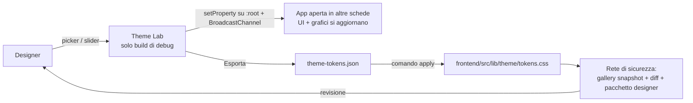

# Piano — Sistema colori a token + «Theme Lab» (modifica dei colori dal vivo)

> **Piano generale del programma colori**, di proprietà del coordinatore. Aperto il 14/10/2026 su `dev_release2` @ `27228466c` (v1.2).
> I piani dei workstream stanno nelle sottocartelle (`L-designerLab/`, `R-colorRefactor/`) e in `G-galleryDeterminism/`.
> Origine: richiesta della designer durante la review colori v1.2. Il pacchetto statico va bene per osservare, ma serve
> poter cambiare un colore e vedere subito l'effetto nell'app.
> Fonti: [`analysis/00_SINTESI.md`](analysis/00_SINTESI.md) (P1–P11), report 01–05 in `analysis/`, progetto del Lab in [`design-designerLab.md`](design-designerLab.md).
> Strumenti: `scripts/visual_review/` (snapshot della gallery, diff con classi di stabilità, pacchetto designer, server per la designer).

## ✅ Decisioni del developer (14/10/2026)

- **Designer Lab subito**, senza aspettare il report della designer (workstream **L**, progetto in `design-designerLab.md`).
  Pagina nascosta, solo nelle build di debug, con catalogo dei colori generato al build ed export per l'agente.
- **Fattorizzazione «a parità di aspetto» subito** (workstream **R**):
  - colori spostati in pochi punti centrali, senza cambiare un pixel;
  - ogni ondata deve dare una gallery dello stesso giorno `identical`, a parte le schermate già instabili.
- **Gallery deterministica** (workstream **G**, cartella 56): rende affidabile il cancello di R.
- **Ciò che cambia l'aspetto aspetta il report della designer.** Comprende:
  - rimozione degli override del tema scuro (P1);
  - unificazione green/emerald, errori in ambra, info sky/blue;
  - correzioni di contrasto;
  - palette dei grafici;
  - token per ruolo (fase B).
- **14/10 sera — il programma si sposta in `Phase_1/10_colorSystem`.** Contiene anche il materiale della designer, i
  materiali del coordinatore e le analisi dei workstream. Richiesta del developer.
- **14/10 sera — Sito MkDocs solo alla fine**, a colori definiti: immagini della documentazione, palette del tema MkDocs,
  pagine sullo stile. Decisione del developer, dettagli nel [README](README.md), «Chiusura del programma».

## 📥 Giro 1 della designer (14/10/2026 sera) → fase B

- **Materiale:**
  - [`designer-feedback/2026-10-14-round1-auth/`](designer-feedback/2026-10-14-round1-auth/README.md): note originali,
    due rendering, trascrizione;
  - [analisi e piano](designer-feedback/2026-10-14-round1-auth/analisi.md).
- **Richiesta:**
  - palette chiara «caldo naturale» e scura «Notte nel Bosco», 16 ruoli, per tutto il progetto;
  - icone nei campi di accesso;
  - via il sottotitolo «Crea un account»;
  - box dei requisiti della password leggibile, senza affidarsi al solo colore.
- **Piano proposto: workstream T (token e tema), a fasi.**
  1. **B1, fondamenta:** solo `app.css` e il nuovo `lib/theme/tokens.css`. Ruoli `--lf-*`, scale `gray` e `slate`
     ridefinite sui suoi valori, marchio, strato scuro sui ruoli.
  2. **B2:** stati.
  3. **B3:** schermate di accesso.
  4. **B4:** grafici, dopo il lotto B di R.
  5. **B5:** stili propri, dopo il lotto C di R.
  6. **B6:** pulizia di P1 con la migrazione delle pagine.

  Per la designer, il giro 2 si fa nel Designer Lab sulla build di T.
- **Decisioni del developer (14/10 sera)**, testuali in testa ad `analisi.md`:
  - **D-T1:** T si apre subito, in parallelo a R.
  - **D-T2:**
    - barra laterale = verde della testata della card di login, nei due temi;
    - `#F1EDE3`/`#131A17` = sfondo dell'app;
    - `#F7F4ED`/`#0F1412` = pagina di login;
    - la barra del titolo della PWA segue la barra laterale.
  - **D-T3: soluzione finale subito.**
    - Ruoli `--lf-*` e utility semantiche nei componenti, migrazione di tutto il frontend a ondate di sotto-agenti.
    - Niente ritintura delle scale Tailwind né del bianco: la «B1 per leve» qui sopra è superata.
    - I componenti rimasti indietro si vedono: vecchio aspetto nel rendering, gate a cricchetto nel build.
- **Schermate di accesso** (accordo col coordinatore 1.3, 14/10):
  - le modifiche visive le fa T per primo, compresa la chiave `auth.registerTitle`, tolta dai cataloghi in quello
    stesso cambio;
  - A aspetta il loro ingresso prima delle modifiche funzionali.
- **Della designer, ancora aperte:** cinque correzioni di contrasto e i ruoli mancanti.
- **14/10, 22:00 — approvata l'analisi di T.** Testuale: «Sì, approva T con tutte le raccomandazioni e le tue
  integrazioni».
  - Analisi in [`coordination/workstream-analyses/T-analisi-implementazione-20261014.md`](coordination/workstream-analyses/T-analisi-implementazione-20261014.md).
  - **Nomi:** ruoli `--lf-<gruppo>-<nome>` in `lib/theme/tokens.css`, utility `*-lf-<nome>` da `@theme inline`
    (tabella del §3.2 dell'analisi). Mai `dark:` sui ruoli; un elemento si migra tutto o niente.
  - **Spazio colore:** hex sRGB per i valori della designer, `color-mix(in oklab)` per i derivati, ponte sRGB per
    ECharts.
  - **Contrasto:** le 8 correzioni minime si applicano subito, commentate; la designer le conferma nel giro 2.
  - **P1:** eccezione `:where(:not([class*='-lf-']))` sulle quattro regole strutturali. La specificità non cambia e i
    componenti non migrati restano identici.
  - **Gate:** cricchetto R1–R5 (classi legacy M1; colori letterali M2 al posto della parte equivalente di W10/D7 di R,
    se R è d'accordo), grammatica G1–G4, contratto C1–C4.
  - **Piloti:** accesso (con `ForgotPasswordCard`, la barra in alto di `routes/+page.svelte`, `HelpMenu`: OK di A,
    solo classi); shell; `routes/+error.svelte` a T.
  - **Istruzioni per gli agenti:** T aggiorna la sezione «Design System» di `frontend.instructions.md`, la riga «Dark
    mode» di `copilot-instructions.md` e una skill in `.github/skills/design-tools/theme-roles/`.
  - **Rilasci:** nessun rilascio della 1.3 con la conversione dei neutri e degli stati a metà (W1–W4).
  - **Ordine:** T-1 fondamenta (nessun pixel); T-2 accesso (ingresso subito, A aspetta); T-3 shell; T-4 PWA dopo il
    lotto A di R; T-5 sfondo del login dopo G; ondate W1–W6; B6.

## 🛤️ Workstream e corsie

| Lettera | Sessione | Cartella del piano | Corsia (porta + dati) | Stato |
|---|---|---|---|---|
| — | coordinatore | questo file | 6150 + `/tmp/librefolio-r2-main` | — |
| L | `L - Designer Lab` | `L-designerLab/` | 6152 + `/tmp/librefolio-r2-l` | piano approvato il 14/10; branch `e-alfy-designer-lab`; passi 0–5 `6e967202e`, base allineata (`150f2716a`); passo 5b (selettore di elementi, §5.6 del progetto), poi passo 6 |
| G | `G - Gallery deterministica` | `G-galleryDeterminism/` | 6153 + `/tmp/librefolio-r2-g` | piano approvato il 14/10; branch `e-alfy-g-gallery-deterministica`; G-4 corretto, G-3 pronto, t* = 3600 ms (D1, developer); compito B in corso |
| R | `R - Fattorizzazione colori` | `R-colorRefactor/` | 6154 + `/tmp/librefolio-r2-r` | piano approvato il 14/10; branch `e-alfy-r-fattorizzazione-colori`; lotto A (W0–W2) `d80b9e0cd`, lotto B (W3–W5) `75c45d923`, base allineata a `dev_release2` (`f53d979ef`); prosegue con il lotto C; i cancelli A e B aspettano G |
| — | server per la designer (`scripts/visual_review/designer_live.sh`) | — | 6160 + `/tmp/librefolio-color-review` | su richiesta |
| T | `T - token e tema` | `T-tokensTheme/` | 6155 + `/tmp/librefolio-r2-t` | analisi approvata dal developer il 14/10 alle 22:00; branch `e-alfy-t-tokens-theme`; T-0 e T-1 in corso |

Superfici condivise e relativi proprietari:

| Superficie | Proprietario |
|---|---|
| `vite.config.ts`, `src/routes/+layout.svelte` | L |
| Moduli centrali dei colori (`lib/theme/**`, nuovi) | R |
| Meta `theme-color` in `app.html`, `static/offline.html`, `themeStore.ts` (D3) | R |
| `frontend/e2e/gallery.spec.ts` e fixture della gallery | G |
| `routes/(app)/assets/[id]/+page.svelte`, solo il nome del provider (G-4) | G |
| `app.css` | T (workstream token e tema), quando sarà aperto. Finora nessuno: aspettava il report della designer |
| `lib/theme/tokens.css` (nuovo) | T, unica eccezione alla proprietà di R su `lib/theme/**` |
| Catalogo del test runner | `test-author` |
| Questo piano, l'indice del backlog post-1.2 e la riconciliazione delle sezioni L, G, R | coordinatore |
| Le righe di stato delle sezioni L, G, R del backlog | il workstream della sezione, nei propri checkpoint |
| `CHANGELOG.md` `[Unreleased]`, cataloghi i18n | coordinatore della 1.3 |

Integrazione in `dev_release2`, solo per merge del coordinatore; il push lo fa il developer:

- **Ordine:** G, poi L, che è indipendente, poi i lotti di R (A, B, C, D), ognuno dopo il suo cancello gallery.
- **Coordinatore della 1.3:** lavora sullo stesso checkout (`Phase_1/`). Ci avvisiamo a vicenda prima di ogni merge,
  rebase o reset di `dev_release2`, e ognuno committa solo i propri percorsi, indicati uno per uno.
- **Spostamenti di cartelle della 1.3 (piano 43, FE2–FE11):** seguono i lotti di R.
  - Subito: le cartelle in cui R non tocca nulla.
  - Dopo il lotto A: `fx`, `assets`, `transactions`, PAC, `ui/feedback`, `ui/display`.
  - Dopo il lotto B: `charts`, `dashboard`, `risk`, `brokers`.
  - Dopo il lotto C: tabelle, media, `files` e dialoghi.

---

## 0. In breve

Sì, si può fare, e la base tecnica c'è già. Verificato sul CSS compilato:

- Tailwind v4 compila ogni classe colore come lettura di una variabile: `.text-red-500{color:var(--color-red-500)}`.
- Anche le trasparenze seguono la variabile: `bg-red-500/20` → `color-mix(in oklab,var(--color-red-500)20%,transparent)`.

Cambiare una variabile CSS a runtime ricolora quindi all'istante ogni elemento che la usa, senza ricompilare.

Il limite non è l'editor, è quanta parte dei colori passa oggi da variabili:

| Origine del colore | Quantità | Si modifica dal vivo oggi? |
|---|---:|---|
| Classi Tailwind (`text-emerald-600`, `bg-red-500/10`…) | ~10.700 | **Sì**, ma per *sfumatura di palette*, non per *ruolo* (cambiare `emerald-600` cambia tutti gli usi, qualunque significato abbiano) |
| `--theme-*` di `app.css` | 16 | Sì, ma agiscono solo in scuro e solo attraverso gli override `!important` (P1) |
| Hex nei grafici ECharts (opzioni costruite in JS) | ~1.000 | **No**: servono il modulo unico dei colori dei grafici e il ridisegno al cambio |
| Hex nei blocchi `<style>` (tabelle, file, media, conferme: P8) | ~600 | **No** finché non diventano `var(--…)` |

Strategia: l'editor diventa il **pannello di controllo** dell'architettura a token concordata (la «struttura» prima,
poi i valori). Una prima versione ridotta si può avere anche subito (§5, fase A).

---

## 1. Obiettivo

**Per la designer.** Apre l'app locale con dati di esempio e il **Theme Lab**. Per ogni ruolo colore, in chiaro e in scuro:
- vede il campione e lo modifica (OKLCH o hex);
- vede l'effetto **immediato** su tutte le pagine aperte, grafici compresi, e su una pagina campionario con tutti i componenti;
- vede il contrasto WCAG delle coppie testo/superficie e simula il daltonismo;
- salva varianti A/B e **esporta** un file di token da consegnare.

**Per gli sviluppatori.**
- Un comando applica il file esportato al file dei token.
- La rete di sicurezza (`scripts/visual_review/`) mostra l'effetto su tutte le 177 schermate e rigenera il pacchetto per la designer.

## 2. Architettura dei colori (prerequisito della versione completa)

### 2.1 Tre livelli di token (variabili CSS)
1. **Primitive**: le scale di colore (Tailwind v4 le espone già come `--color-<famiglia>-<sfumatura>`) e il marchio.
2. **Ruoli**: variabili come `--lf-surface-page`, `--lf-surface-card`, `--lf-surface-raised`, `--lf-text-primary`,
   `--lf-text-secondary`, `--lf-text-muted`, `--lf-border`, `--lf-border-input`, `--lf-brand`, `--lf-brand-contrast`,
   `--lf-focus`, `--lf-success`, `--lf-warning`, `--lf-danger`, `--lf-info`, `--lf-gain`, `--lf-loss`,
   `--lf-chart-cat-1…N`, `--lf-chart-axis`, `--lf-chart-grid`, `--lf-chart-tooltip-*`, `--lf-overlay`.
   - Definite per il chiaro (`:root, .light`) e per lo scuro (`html.dark, .dark`). Il selettore `.dark` serve a
     forzare il tema scuro su una parte di pagina, come nel campionario.
   - Valori iniziali = i valori prevalenti di oggi (tabella «Palette attuale» del pacchetto designer).
   - Nomi definitivi dal primo giro con la designer (vocabolario dei ruoli).
3. **Utility Tailwind semantiche**: con `@theme inline` le utility puntano direttamente ai ruoli
   (`bg-surface`, `text-muted`, `text-success`, `border-input`, `bg-brand`…). Così modificare `--lf-*` a runtime basta,
   anche dentro un sotto-albero forzato in scuro.

### 2.2 Nessun colore fuori dai token
- Hex nei `<style>` (P8) → `var(--lf-…)`.
- Grafici: un modulo unico, ad es. `lib/theme/chartTheme.ts`.
  - Legge i ruoli con `getComputedStyle`, una volta per revisione (in cache).
  - Fornisce le coppie gain/loss, la palette categoriale, gli assi, la griglia e i tooltip.
  - Un solo store `themeRevision` sostituisce i 17 `MutationObserver` dei grafici: si incrementa al cambio di tema
     **e** al cambio di token, e i grafici si ridisegnano.
- Gli helper che accettano solo `#rrggbb` (`hexToRgba`, la concatenazione `+ '88'`) diventano `color-mix()`, che vale per qualunque colore.

### 2.3 Fine degli override globali (P1)
Le regole `html.dark … !important` di `app.css` vengono rimosse man mano che i componenti passano alle utility
semantiche, perché in scuro cambia il valore del ruolo e non serve più riscrivere la classe. È il passaggio che cambia di
più l'aspetto in scuro: va fatto a ondate, con il confronto degli screenshot e le differenze approvate dalla designer.

### 2.4 Spazio colore (decisione)
**Raccomandazione:** token in OKLCH, coerenti con Tailwind v4 (P11). Il Lab segnala i valori fuori sRGB e i grafici usano lo stesso
valore della UI, così le due versioni (classi OKLCH e hex sRGB) smettono di divergere.

## 3. Theme Lab: lo strumento

### 3.1 Disponibilità e accesso
- **Solo nelle build di debug.** Si usa lo stesso interruttore di `src/lib/debug.ts`
  (`DEBUG_ENABLED = VITE_DEBUG === 'true' || import.meta.env.DEV`). Si attiva con `./dev.py server --debug` o con il dev server.
  Nelle build di release il minificatore lo elimina: le immagini Docker non lo contengono (da verificare con un test).
- **Accesso della designer.** Server di test sulla macchina dello sviluppatore, raggiungibile in rete locale.
  - `scripts/visual_review/designer_live.sh` ascolta già su `0.0.0.0:6160` con i dati della gallery; va aggiunta la build di debug.
  - Le modifiche restano nel **suo** browser.
  - In una fase successiva (opzionale): un'istanza demo dedicata, per non dipendere dalla macchina dello sviluppatore.

### 3.2 Il pannello
- Gruppi di ruoli: superfici, testi, bordi, marchio, stati, guadagno/perdita, grafici (categorie e neutri). Colonne chiaro e scuro.
- Per ogni token:
  - campione e valore;
  - campo di testo che accetta qualsiasi colore CSS;
  - **slider OKLCH** (L, C, H). Il selettore nativo `<input type="color">` gestisce solo sRGB in esadecimale: va bene come
    scorciatoia, non come editor principale;
  - avviso se il colore è fuori sRGB;
  - possibilità di agganciare il ruolo a una primitiva (es. «= emerald-600»).
- **Contrasto WCAG dal vivo** per le coppie dichiarate nel contratto dei token (testo su superficie, bordo dei campi su
  superficie, guadagno e perdita su superficie), con indicazione AA/AAA.
- **Simulazione del daltonismo** su tutta la pagina con filtri SVG `feColorMatrix`: protanopia, deuteranopia,
  tritanopia, acromatopsia. La designer non deve usare DevTools.
- **Varianti A/B**: salvare, richiamare e confrontare al volo.
- **Esporta / importa** `theme-tokens.json`:
  `{schema, base_commit, created_at, light: {ruolo: valore}, dark: {…}, notes}`, più un'anteprima del CSS risultante.

### 3.3 Applicazione dal vivo
- Le modifiche vanno in un `<style id="lf-theme-lab">` con `:root{…}` e `html.dark{…}`, perché tengono le due varianti di tema.
- Restano in `localStorage` anche dopo un ricaricamento; «Ripristina» per singolo token o per tutto.
- **Sincronizzazione tra schede** con `BroadcastChannel('lf-theme-lab')`: Lab in una finestra, app nell'altra (o su un
  secondo schermo), tutte le schede dello stesso indirizzo si aggiornano insieme.
- Ogni modifica incrementa `themeRevision`, quindi anche i grafici si ridisegnano.

### 3.4 Pagina campionario
Una rotta di debug, ad es. `/dev/theme-specimen`, mostra tutti i componenti nei loro stati, in chiaro e in scuro affiancati:
- bottoni primari, secondari e di pericolo; campi normali, in focus, in errore e disabilitati;
- badge, avvisi, toast;
- tabella con hover e selezione;
- modale, tooltip, menu, card KPI;
- grafici con dati di esempio: linea, candele, torta, treemap, barre.

La designer vede l'effetto di un token ovunque senza navigare l'app. Le pagine reali, aperte nelle altre schede,
restano la verifica finale.

### 3.5 Ritorno nel codice
- Un comando applica il file esportato, ad es. `./dev.py front theme apply theme-tokens.json` (oppure uno script in
  `scripts/visual_review/`):
  - riscrive `frontend/src/lib/theme/tokens.css` in modo deterministico, con ordine fisso e commenti generati;
  - valida nomi e valori e rifiuta i token sconosciuti.
- Subito dopo: snapshot della gallery, diff con il riferimento dello stesso giorno e nuovo pacchetto per la designer.

## 4. Test e guardie
- **Vitest**:
  - parser e serializzatore di `theme-tokens.json`;
  - conversioni di colore (OKLCH↔sRGB, gamut) e calcolo del contrasto;
  - `chartTheme` (lettura dei ruoli, cache per revisione).
- **Gate test**, stile dei `*.gate.test.ts` esistenti (es. `flagFont.gate.test.ts`): blocca nuovi hex e nuove classi di
  palette fuori dai file dei token, con un elenco di eccezioni motivate.
- **E2E smoke** del Lab (solo build di debug): cambio di un token, verifica del colore calcolato su un elemento noto e su un
  grafico, export e import.
- **Build di release**: verifica che il bundle non contenga il Lab.
- Test da adattare: `sourcePalettes.ts`/`.test.ts`, `colors.test.ts`, `assetTypeTables.test.ts`, `chartCoreHelpers.test.ts` (report 03 §6).
- I test li scrive `test-author`; la pagina developer (sistema dei token e Lab) `docs-writer`; la voce di changelog il coordinatore.

## 5. Fasi

| Fase | Contenuto | Dipende da | Dimensione | Valore per la designer |
|---|---|---|---|---|
| **A — Lab di palette** (subito, opzionale) → **sostituita da «Designer Lab v1»** (progetto in `design-designerLab.md`) | Pagina nascosta `/designer-lab`, solo nelle build di debug, con catalogo dei colori generato al build. Modifica dal vivo per valore: variabili CSS, colori dei fogli di stile (CSSOM), colori dei grafici (patch di ECharts). Export JSON + Markdown con file e riga per l'agente | niente: lavora sul codice di oggi | media | Regolazione dal vivo già durante il riallineamento; i suoi export diventano proposte concrete |
| **R — Fattorizzazione a parità di aspetto** (decisa il 14/10) | I colori dove stanno oggi spostati in pochi moduli centrali, **con gli stessi valori**. Le divergenze di oggi restano, ma con un nome (es. `lossLine` `#ef4444` / `lossBar` `#dc2626`), così la designer le vede e decide. Comprende: colori dei grafici in un modulo (e un solo store di revisione al posto dei 17 osservatori, se resta neutro); funzioni condivise per segno, stati e badge; gli hex nei `<style>` (P8) in variabili CSS locali con lo stesso valore; funzioni fragili (`hexToRgba`, `+ '88'`) robuste; refusi evidenti senza effetto visibile (meta `#156534`) | G per un cancello affidabile | grande, a ondate | Ogni sua decisione futura si applica in un punto; il Lab (L) vede già i colori raggruppati |
| **B — Architettura a token** | Ruoli e utility semantiche (§2.1); `chartTheme` e `themeRevision`; P8 in variabili; rimozione di P1 a ondate. Valori iniziali = quelli di oggi | nomi dei ruoli dal primo giro con la designer | grande (migrazione di ~10.000 classi a ondate) | Rende vero il «cambio un ruolo → cambia tutto» |
| **C — Theme Lab completo** | Modifica per ruolo, campionario, contrasto, daltonismo, varianti, export/import, comando apply | B (anche parziale: il Lab vede i ruoli già migrati) | media | Lo strumento richiesto |
| **D — Accesso senza lo sviluppatore** (opzionale) | Istanza demo con dati di esempio e Lab attivo | C | piccola-media | Lavora in autonomia |
| **Chiusura — Sito MkDocs** (decisione del 14/10) | A colori definiti e solo alla fine: immagini della documentazione dalla gallery, palette del tema MkDocs Material allineata al marchio, pagine developer sullo stile e sui colori | B completa e approvata dalla designer | piccola-media | La documentazione mostra l'app com'è |

Il codice di A non si butta: diventa la base di C, con l'aggiunta del livello dei ruoli.

**Già oggi, senza scrivere codice.** Con l'app di test aperta, la designer può provare a mano:
DevTools → Elements → `<html>` → Styles → regola `:root` → modifica `--color-emerald-600` (o un'altra) e l'intera app
si aggiorna. È la fase A, scomoda ma immediata.

## 6. Workstream, corsie e superfici condivise (coordinamento)

> Il 14/10 il workstream **R** anticipa la parte *neutra* (stesso aspetto) di C, U e S qui sotto. Le parti che
> cambiano l'aspetto restano a C, U, S e T, dopo il report della designer.

| Lettera | Workstream | File principali | Note |
|---|---|---|---|
| T | Token e tema | `app.css`, `lib/theme/tokens.css` (nuovo), `themeStore.ts`, `app.html`, `static/offline.html`, `manifest.json` | **Unico proprietario** di `app.css`; parte per primo; pubblica il «contratto dei token», cioè l'elenco di ruoli e coppie di contrasto |
| L | Theme Lab | `lib/dev/theme-lab/**` (nuovo), rotte `/dev/*`, gating di debug | Fase A subito; fase C sul contratto di T |
| C | Grafici | `lib/theme/chartTheme.ts` (nuovo), `lib/charts/**`, `components/charts/**`, `dashboard/**`, `risk/**`, `brokers/lots/**` | Dopo T |
| U | Sistemi CSS paralleli | `components/table/**`, `ui/media/**`, `files/**`, `ConfirmModal`, `ContextMenu` | Dopo T |
| S | Helper semantici | `lib/utils/**` (segno, stati, badge), `ui/feedback/**` | Dopo T |
| P | Migrazione delle pagine | `routes/**`, modali transazioni e import | Dopo T, S e U; a ondate |
| G | Determinismo della gallery (consigliato **prima** di B) | `frontend/e2e/gallery.spec.ts`, `frontend/e2e/fixtures/gallery*.ts`, `AnimatedBackground` (solo freeze in gallery) | Misura del 14/10, due esecuzioni identiche: 57 schermate stabili, 74 con rumore minimo, 19 medio, **27 instabili**. Cause viste: sfondo animato del login non congelato e scorrimento di pochi pixel nel pannello lotti. Più 4–5 test desktop falliti a ogni esecuzione completa, ogni volta diversi. Meno rumore significa che il cancello delle ondate di B vede di più |

- **Corsie (convenzione Release 2):** coordinatore 6150 con `/tmp/librefolio-r2-main`; figli dal 6151 con `/tmp/librefolio-r2-<lettera>`.
- **Superfici condivise e relativi proprietari:**

  | Superficie | Proprietario |
  |---|---|
  | `app.css` | T |
  | Catalogo i18n (se il Lab avrà testi tradotti) | un solo integratore |
  | Catalogo del test runner | `test-author` |
  | `CHANGELOG.md` | coordinatore |
  | Pagina developer della documentazione | `docs-writer` |

- **Cancello di ogni ondata:** gallery dello stesso giorno con diff contro il riferimento, usando le maschere del rumore.
  Le differenze vanno all'approvazione della designer.

## 7. Decisioni aperte (per lo sviluppatore)
1. **Fase A subito?** Raccomandato sì: è piccola, solo di debug e serve già al riallineamento.
2. **Forma del Lab:** pannello flottante apribile su qualunque pagina, rotta dedicata, o entrambi.
   Raccomandato: pannello flottante più la pagina campionario.
3. **Lingua del Lab:** è uno strumento di sviluppo; solo inglese, inglese e italiano, o le 4 lingue come il resto della UI?
   È un'eccezione alla regola della UI multilingue, da approvare.
4. **Spazio colore dei token:** OKLCH (raccomandato) o hex sRGB.
5. **Accesso della designer:** rete locale verso la macchina dello sviluppatore (subito) o istanza demo (fase D).
6. **Applicazione dell'export:** sottocomando di `dev.py` (coerente con la regola «sempre `./dev.py`») o script in `scripts/visual_review/`.
7. **Persistenza delle prove:** solo `localStorage` più file esportato (raccomandato, niente backend), oppure salvataggio nel profilo utente.

## 8. Definition of done (fase C)
- Ogni colore visibile (UI e grafici) deriva da un ruolo. Il gate test blocca nuovi hex e nuove classi di palette fuori dai token.
- Il Lab modifica ogni ruolo in chiaro e in scuro; l'effetto è immediato su tutte le schede aperte, grafici compresi.
- Esportazione → apply → diff della gallery: cambiano solo le schermate attese.
- Il Lab è assente dalle build di release (test).
- Ci sono la pagina developer (sistema dei token e Lab), la voce di changelog e i test elencati al §4.

## 9. Rischi
- **Migrazione di ~10.000 classi:** rischio di regressioni. Mitigazione: ondate, rete di sicurezza, gate test.
- **Rimozione degli override del tema scuro (P1):** cambia l'aspetto di migliaia di elementi. Mitigazione: diff prima/dopo con approvazione.
- **`<input type="color">` gestisce solo sRGB:** servono slider OKLCH propri.
- **Grafici che leggono variabili CSS:** costo di `getComputedStyle`. Mitigazione: cache per `themeRevision`.
- **Test che fissano palette e mappe:** vanno adattati (report 03 §6).
- **Accesso in rete locale:** firewall del Mac e dati di test. Nessun dato reale è coinvolto.
