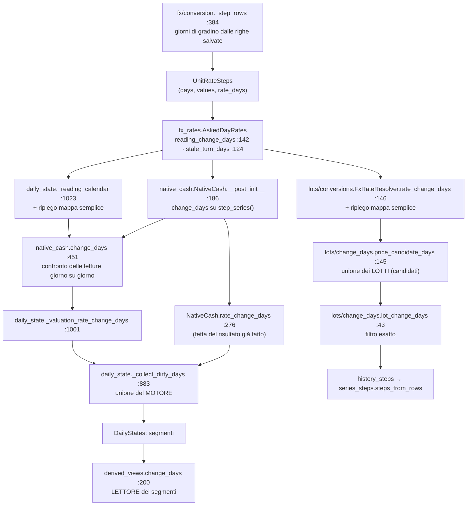

# Inventario: i «giorni in cui cambia qualcosa» — dove sono scritti, e la casa unica

> Ondata 6, giorno 1 (28/10/2026), MF, **sola lettura**. Base letta: `a99aee28f` (nessuna differenza di codice con
> `bc1d4c06c`). Origine: CHECK-ondata6 §«Quattro copie», regola 10 di `CLAUDE.md`. Piano:
> [plan-phase01FinancialMath](plan-phase01FinancialMath.prompt.md), «Ondata 6». Compagno:
> [analisi T-U1](analisi-T-U1-convert_bulk-20261028.md).

## 0. In una frase

Le «4 copie» non sono quattro copie piatte: sono **una pila** (chi produce i gradini → chi dice dove una lettura può
cambiare → chi unisce i giorni di un dominio → chi legge i segmenti già fatti). Le **duplicazioni vere** sono tre,
piccole: il ripiego «mappa semplice» scritto 2 volte, la regola «anche il giorno accanto» scritta 4 volte, e la fusione
di intervalli scritta 2 volte (`merged_windows` / `merged_spans`). Le due unioni di dominio (motore e lotti) **non**
vanno fuse: hanno inneschi diversi.

## 1. La pila, com'è oggi



## 2. Le sette voci del kickoff, una per una

| # | Voce | Che cos'è | Copia? |
|---|---|---|---|
| a | `fx/conversion._step_rows` (`:384`) | il **produttore**: per ogni finestra il primo giorno (con l'ancora) e ogni riga dentro | no — è la sorgente; file di X |
| b | `fx_rates.AskedDayRates.reading_change_days` (`:142`) | i giorni in cui la *lettura* di una coppia **può** cambiare: gradini + primo giorno di ogni finestra + giorno dopo l'ultimo | no — è il lettore dei gradini |
| c | `native_cash.change_days` (`:451`) | la primitiva «la lettura di oggi ≠ quella del giorno prima del calendario» (confronta i valori) | no — è già «the one home», dice la docstring |
| d | `NativeCash.rate_change_days` (`:276`) | fetta `[da, a]` del risultato di (c), calcolato una volta | no — vista |
| e | `lots/conversions.FxRateResolver.rate_change_days` (`:146`) | unione di (b) sulle finestre dei lotti, + ripiego mappa | **sì, il ripiego** |
| f | `daily_state._collect_dirty_days` (`:883`) | l'unione del motore: movimenti, cambi, bordi del viaggio, quotazioni, giorni «diventa vecchio», split, bordi | no — dominio |
| g | `derived_views.change_days` (`:200`) | legge gli inizi dei segmenti già calcolati da (f) + giorni extra | no — lettore (il nome inganna) |

In più, non nel kickoff:

| # | Voce | Che cos'è | Copia? |
|---|---|---|---|
| h | `daily_state._reading_calendar` (`:1023`) | (b) per le valute del motore, + il giorno prima di ognuno, + ripiego mappa | **sì, il ripiego e «il giorno accanto»** |
| i | `lots/change_days.price_candidate_days` (`:145`) / `lot_change_days` (`:43`) | unione dei lotti + filtro esatto del prezzo convertito | **sì, «il giorno dopo»** (×2) |
| j | `fx_rates.merged_windows` (`:43`) / `series_steps.merged_spans` (`:169`) | fondere intervalli sovrapposti o adiacenti | **sì, due nomi per una cosa** |

## 3. Le tre duplicazioni vere, con esempi

### 3.1 Il ripiego «mappa semplice → giorno e giorno dopo» (2 volte)

`daily_state.py:1036-1042` e `lots/conversions.py:156-159`: quando la mappa dei tassi non è un `AskedDayRates`, ogni
chiave `(valuta, giorno)` conta come «può cambiare il giorno e il giorno dopo».

- **In produzione non succede mai**: il motore passa sempre `AskedDayRates` (`engine.py:680`, o `{}` senza coppie) e il
  `FxRateResolver` mette in catena solo `AskedDayRates` dopo la prima mappa vuota. Il ripiego serve ai test che
  riempiono una mappa a mano.
- Esempio: mappa `{("USD","EUR",10/03): 0,92}` → giorni candidati `{10/03, 11/03}` in tutti e due i posti.
- Proposta: **una** funzione `reading_change_days(rates, source, destination)` nella casa che accetta tutte e due le
  forme; i due chiamanti la usano.

### 3.2 «Anche il giorno accanto» (4 volte, in due versi)

| Dove | Regola |
|---|---|
| `lot_change_days` (`lots/change_days.py:73`) | ogni giorno di cambio porta **il giorno dopo** (se nel calendario) |
| `price_candidate_days` (`:173`) | ogni seme porta **il giorno dopo** (se ≤ ultimo) |
| `AskedDayRates.reading_change_days` (`fx_rates.py:160`) | il **giorno dopo** l'ultimo di ogni finestra |
| `_reading_calendar` (`daily_state.py:1048`) | il **giorno prima** di ogni candidato (perché `change_days` confronta con il giorno precedente del calendario) |

Esempio (lotti): chiusura il 15/03 → giorni `{15/03, 16/03}` (la linea di prezzo del lotto chiuso si ferma il giorno
dopo). Esempio (motore): gradino USD/EUR il 10/03 → calendario `{09/03, 10/03}`, così `change_days` vede 0,91 → 0,92.

Proposta: `with_neighbour_days(days, *, after: bool, within: (first, last))` nella casa; i due dei lotti lo usano
così com'è; gli altri due restano (sono bordi di finestra, non «giorni accanto» di un cambio) — li cito solo per non
sorprendere chi legge.

### 3.3 `merged_windows` e `merged_spans` (2 nomi)

| | `fx_rates.merged_windows` | `series_steps.merged_spans` |
|---|---|---|
| fonde sovrapposti e adiacenti | sì | sì |
| `last < first` | **scartato in silenzio** | **`ValueError`** |
| ritorna | `tuple` | `list` |
| chiamanti | 1 (`AskedDayRates.__init__`) | 8 |

Esempio: `[(01/03, 03/03), (04/03, 04/03), (09/03, 09/03)]` → `[(01/03, 04/03), (09/03, 09/03)]` in tutti e due.

Proposta: tenere `merged_spans` (8 chiamanti, più severo); `AskedDayRates` filtra prima le finestre vuote (oggi le
scarta già `merged_windows`, quindi nessun comportamento cambia) e chiama `merged_spans`. `unit_rate_steps` già
**solleva** per una finestra rovesciata prima di arrivarci: il filtro protegge solo i test e i lettori costruiti a mano.

## 4. Cosa NON fondere

- **Motore (f) e lotti (i)**: il motore si ricalcola quando cambia un termine della formula (decisione 28) e confronta
  **i tassi**; i lotti confrontano **il prezzo convertito nella sua rappresentazione esatta** (`Decimal('1.10')` ≠
  `Decimal('1.1')`), perché le serie devono restare uguali al byte. La docstring di `lots/change_days.py` lo dice già.
  Stessa regola, due funzioni: giusto così.
- **`derived_views.change_days` (g)**: non produce giorni, legge i segmenti. Rinominarlo (`segment_days`?) chiarirebbe,
  ma tocca `portfolio_service.py:1254` dopo il passaggio ad AIX: **non lo propongo**.
- **`_step_rows` (a)**: è il produttore, file di X; resta.

## 5. La casa unica proposta

`backend/app/services/financial_math/change_days.py` (nuovo), import diretti, niente shim:

| Funzione | Da dove | Chi la usa |
|---|---|---|
| `change_days(read, currencies, days)` | spostata da `native_cash.py:451` | `NativeCash`, `DailyStateBuilder._valuation_rate_change_days` |
| `reading_change_days(rates, source, destination)` | unisce `AskedDayRates.reading_change_days` + i 2 ripieghi (§3.1) | `_reading_calendar`, `FxRateResolver.rate_change_days` |
| `with_neighbour_days(days, after=True, within=…)` | da `lots/change_days.py:73`, `:173` | `lot_change_days`, `price_candidate_days` |
| `merged_spans` | resta in `series_steps.py` (8 chiamanti); `merged_windows` tolta, e i suoi 19 usi nei test (`test_asked_day_rates.py`, `test_rate_change_days_on_steps.py`, `test_lots_analysis_pure.py`) passano a `merged_spans` | `AskedDayRates` + gli 8 |

`AskedDayRates.reading_change_days` resta come metodo (lo chiama la funzione), così come `stale_turn_days` (che usa il
predicato `is_stale_rate` di T-U1, P-2). **Nessun numero cambia**: prove = parità delle suite `financial-math`,
`portfolio-engine`, `roi-fifo-utils`, `api portfolio` senza toccare un atteso; i test di `change_days` spostati con
l'import nuovo.

## 6. La funzione pura per W6-12 (contratto che W2 aspetta)

Oggi `transactions/balances.py::_validate_broker_balances` (`:34-140`):
- i **saldi di partenza** vengono già dalla casa (`_get_balances_before_date` → `native_balances`, C-97, `:166`, `:204`);
- il **cammino** (`:98-112`) è a mano: per ogni giorno con transazioni somma `tx.amount` per valuta e alla fine del
  giorno cerca il primo saldo < 0, ricordando l'ultima riga del batch che l'ha abbassato.

Proposta in `native_cash.py` (la metà della cassa; le quantità restano fuori, come dice W-B19):

```python
@dataclass(frozen=True, slots=True)
class NegativeCash:
    day: date
    currency: str
    balance: Decimal
    #: The movements of ``currency`` on ``day`` that lowered it, in order: the caller picks the batch row to blame.
    reducers: tuple[CashMovement, ...]

def first_negative_cash(
    movements: Iterable[CashMovement],      # one broker, any order; sorted by (date, movement_id) inside
    *,
    opening: Mapping[str, Decimal] = {},    # balances before the first movement (native_balances of the earlier rows)
    check_days: Iterable[date] = (),        # extra days to check with no movement (the validator's from_date)
) -> NegativeCash | None:
    """The first day, in date order, on which a currency's balance ends below zero; None when none does."""
```

Esempio: saldo di partenza `{EUR: 100}`, movimenti `05/03 −60 EUR`, `05/03 −50 EUR`, `06/03 +30 EUR` →
`NegativeCash(day=05/03, currency="EUR", balance=−10, reducers=(−60, −50))`; il validatore incolpa l'ultima riga del
batch fra i `reducers` (oggi `last_cash_reducer`), e alza `BalanceValidationError` come adesso.

Tre punti da fissare con W2 (nel test, prima della cura):
1. **La quota**: il validatore usa `tx.amount` grezzo (la cassa del broker, non la parte dell'utente). La funzione somma
   `movement.amount`, **non** `movement.native` (che moltiplica per `share`); oppure W2 costruisce i movimenti con
   `share=1` (`cash_movement_from_transaction` lo fa di default). Consiglio: sommare `native` e chiedere `share=1`, così
   resta una regola sola con `native_balances`.
2. **Il filtro**: oggi `tx.amount != 0 and tx.currency`; `cash_movement_from_transaction` scarta `amount is None` o
   senza valuta e **tiene** gli zeri (che non cambiano un saldo): stesso risultato.
3. **L'ordine nel giorno**: il saldo si controlla a **fine giorno** (come oggi), quindi `+30` e `−60` nello stesso giorno
   non danno un rosso intermedio.

Una passata sola, nessuna I/O, nessun giorno di calendario costruito (R13-SEC7-3: una riga del 9999 non fa camminare
milioni di giorni).

## 7. Lotto e tempi

**change-days** (punto 8 del kickoff): §5 + §6 + T-U1a (stessi file: `native_cash.py`, `daily_state.py`,
`lots/conversions.py`). Peso ~1 g (0,5 change-days + 0,25 funzione pura + 0,25 T-U1a). Rossi prima: i test della
funzione pura (l'esempio sopra, il 9999, la quota) e di `with_neighbour_days`; il resto è parità.
