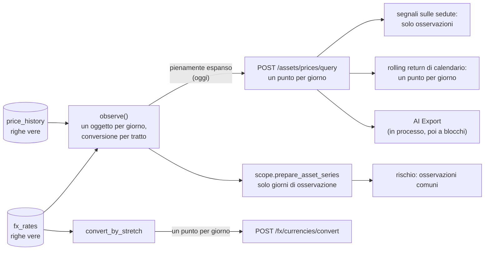
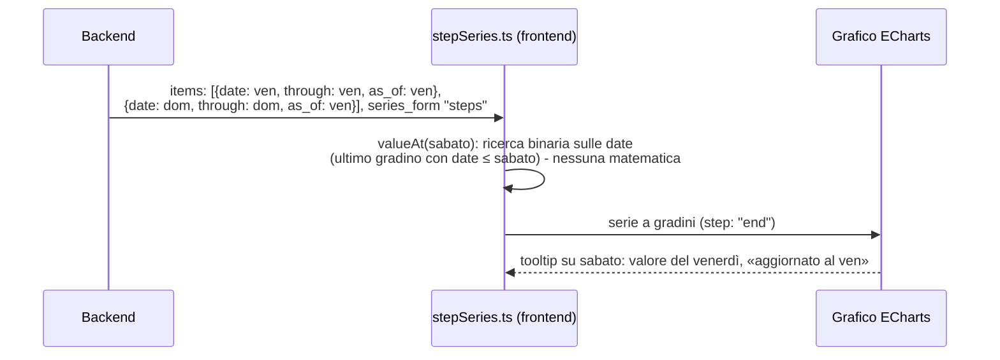

# Serie a gradini: estendere la regola «scrivi solo le novità» a tutte le serie giornaliere

Analisi in sola lettura, 24/10/2026. Nessun codice toccato, nessun server o test lanciato, `backend/data/prod/` mai letto.
Report del portafoglio, lotti e serie delle posizioni (#48) sono fuori: li analizza MF in `DECISIONI-DP4.md`
(letto: **non ha una sezione «Proposta del developer»**; propone la cura A «campionamento in backend» e, come
alternativa, la cura B «serie a tratti»; qui la B viene estesa agli altri sistemi).

**Base del codice.** Ramo Y `e-alfy-redesigned-spork` (`9ccc01c8a`) per tutto. Ramo X `e-alfy-cuddly-engine`
(`c5b5ff6b2`) controllato per plugin e prezzi: per `price_query.py`, `currencies.py` (FX), `market_series.py` e
`calendar_rolling_return` X è **più vecchio** di Y (mancano X-Q1/Q2/Q3, `observed_prices.py`, `stretch_conversion.py`),
quindi i numeri di riga sono quelli di Y. L'unica cosa che ho letto solo in X è il provider
`scheduled_investment` (stesse costanti in Y: `schemas/assets/scheduled_investment.py:36-43`).

---

## 0. Sintesi

1. **La regola «solo le novità» ha senso, ma non vale allo stesso modo per tutti.** Quasi tutte le serie fuori da report,
   lotti e #48 sono già «sulle osservazioni» (segnali sulle sedute, rischio, WAC, AI Export, provider programmati) oppure
   sono già limitate (FX e rischio: 100 anni; provider programmati: 1900–2200). Quelle che mandano **un punto per ogni
   giorno di calendario** sono due API: prezzi (`POST /assets/prices/query`) e cambi (`POST /fx/currencies/convert`),
   più la linea del rolling return di calendario che ne deriva.
2. **Un refuso nelle date fa esplodere davvero solo il report, i lotti e #48 (già di MF).** Per i prezzi il rischio c'è
   solo da API diretta: l'interfaccia chiede «Tutto» da 2000-01-01 (`dateRangeStore.svelte.ts:145`), mentre la query dei
   prezzi **non ha il tetto di 100 anni** che hanno FX e rischio, e il suo budget (1 000 000 punti) lascia passare
   un refuso all'anno 24 (circa 738 000 punti, circa 1,4 GB). **Da verificare con una prova** (l'ho letto nel codice, non l'ho
   lanciato). Cura: applicare `range_span_floor` anche ai prezzi, mezza giornata (X).
3. **Quali serie sono davvero «a gradini».** Prezzi e cambi: sì (un prezzo è un'osservazione). Indicatori sulle sedute,
   drawdown, rolling volatility/Sharpe/beta, serie di rischio: sì, e già sparsi. **Rolling return di calendario:
   a gradini con un insieme di novità più largo** (osservazioni più osservazioni + N giorni). **MWRR annualizzato: no**, cambia ogni
   giorno anche senza novità, e con più flussi non ha formula chiusa. Un'annualizzazione con un solo flusso invece sì.
4. **Cambio forex: la tua intuizione è già nel codice.** La novità di un valore in valuta di report è «prezzo nuovo
   oppure cambio nuovo» (`observed_prices.py`, `daily_state._collect_dirty_days`), e la risposta porta già **due età
   separate** (`AssetBackwardFillInfo`: `days_back` per il prezzo, `fx_days_back` per il cambio). Va solo riusata, e
   vanno allineati due punti oggi diversi (sezione 5.4).
5. **Forma comune proposta.** Ogni punto ha `date` (primo giorno in cui vale) e `through` (ultimo giorno), più
   `as_of` dei suoi componenti; la risposta dichiara `series_form: "steps"`. Il frontend non espande mai a giorni:
   cerca per data (`valueAt`) e disegna a gradini. Codice comune nel backend in `financial_math/series_steps.py`
   (puro) e nel frontend in `lib/utils/stepSeries.ts`, con un file di casi condiviso come Z-29.
6. **Una cosa importante: cambiare la forma della risposta non basta.** Il costo grosso è prima, quando il backend
   costruisce i punti. Per i prezzi la costruzione per tratti c'è già (`observe`), ma tiene un oggetto per giorno.
7. **Raccomandazione.** Per la 1.3 solo le protezioni piccole e quelle di MF: tetto di span sui prezzi (X), campionamento
   del report (MF, cura A), e **decidere ora la forma comune** nei documenti. L'adozione estesa (prezzi, cambi, rolling return,
   grafici) vale circa 10–13 giorni lordi e **può aspettare la 1.4**: i suoi benefici (weekend: −29 % di righe su un
   mercato a 5 giorni; fondi a NAV mensile: −97 %) sono reali ma non servono a evitare esplosioni.
   Per le serie senza formula chiusa (MWRR) basta il campionamento di MF; un tetto «solo per lei» non serve per il
   costo, e va tenuto solo come riserva (sezione 4.5).

---

## 1. Dove si decide oggi «un punto al giorno» (D1)

- D1 è nel piano MF `plan-phase01FinancialMath.prompt.md`, riga 3752: «la storia (e i prezzi/cambi dell'API) restano a un
  punto per giorno, oppure punti a gradini / campionati?». Decisione del developer, riga 3845: **«D1 un punto al giorno»**
  («è imperativo non sbagliare i calcoli, veloci sì, ma precisi»). Quindi D1 copre anche prezzi e cambi dell'API.
- Il campionamento Z-29 è nel backlog `BACKLOG_POST_1.2.md:8779`. Codice: `services/assets/price_sampling.py`
  (`choose_resolution`, `sample_dates`, `bucket_of`). **Non sta in `financial_math/`**: sono solo date, non matematica.
- Nel devWiki **non c'è nessuna pagina** su D1 o sul campionamento (cercato `Z-29`, `price_sampling`, `max_points`):
  la regola esiste solo nei piani. Da scrivere quando si decide (wiki-file).

---

## 2. Inventario delle serie giornaliere (esclusi report, lotti, #48)

Legenda **riempie**: «sì» = manda un punto per ogni giorno di calendario, anche weekend e feste, ripetendo l'ultimo valore
con `backward_fill_info`; «no» = manda solo giorni con un dato vero.

| # | Sistema | Endpoint / funzione, file:riga (Y) | Riempie i giorni senza dato? | Campionamento Z-29? | Chi lo legge nel frontend | Famiglia |
|---|---|---|---|---|---|---|
| 1 | **Storia prezzi di un asset** | `POST /assets/prices/query` `api/v1/assets/prices.py:150` → `PriceQueryOperations.get_prices_bulk` `price_query.py:454`; punti da `observed_prices.observe` `:271`, `point_of` `:64`, `fill_point` `:107` | **Sì**: ogni giorno dal primo prezzo (o dal seme) alla fine. Budget 1 000 000 punti (`date_range_limits.py:31`), **nessun tetto di span** (cercato `range_span_floor` in `price_query.py` e `prices.py`: non c'è) | Sì, solo se chiesto: `max_points`, `resolution`, `sample_like` (`price_sampling.py`); i segnali si riducono con `aggregation_profile` | Lista asset (schede: `routes/(app)/assets/+page.svelte:933,1432,1492`, `reducedPriceQuery.ts`, worker `priceProcessing.worker.ts`, `assetPriceDerived.ts`); dettaglio asset (`assets/[id]/+page.svelte:955`, `assetDetailPriceQuery.ts`); `PriceChartCompact/Full`, `LineChart`, `CandlestickChart` | a gradini (a) |
| 2 | **Cambi FX** | `POST /fx/currencies/convert` `api/v1/fx/currencies.py:435` (`convert_currency_bulk`); un punto per giorno e per conversione; calcolo per tratto con `convert_by_stretch` `fx/stretch_conversion.py:42` | **Sì**, ogni giorno. Tetto di span 100 anni (`currencies.py:495`, `range_span_floor`) | Sì (Z-29fx): `fx/sampling.py`, stessa regola dei prezzi | Lista FX (`reducedFxQuery.ts`), dettaglio (`fx/[pair]/+page.svelte:524`, `fxDetailConvertQuery.ts`), `stores/fxStoreRegistry.ts:285` (colma i buchi chiamando `/convert`) | a gradini (a) |
| 3 | **Segnali sulle sedute** (17 plugin: SMA, EMA, RSI, MACD, Bollinger, ATR, OBV, ADX, CCI, MFI, KAMA, PPO, ROC, StochRSI, Aroon, Donchian, NATR) | `signals/base.py:86` `computes_on_quote_days = True`; filtro `signals/execution.py:365` (`quote_day_points`, `signals/series.py:47`) | **No**: il plugin riceve solo i giorni con prezzo vero; l'uscita ha la data di quei giorni (test `test_signal_service.py:1720-1800`) | Sì, nelle risposte campionate (1, 2) | Grafici di asset e FX (`lib/charts/signals/`) | sulle osservazioni (a) |
| 4 | **Segnali su prezzi carry-forward** | `calendar_rolling_return/plugin.py` (`computes_on_quote_days = False` `:135`; legge `points_by_date` del calendario pieno) | **Sì**: un punto per ogni giorno del range visibile | idem | Dettaglio asset e FX (modalità «rolling return») | finestra mobile in giorni di calendario (c) |
| 5 | **Segnali su serie preparate** (`RISK_ROLLING_VOLATILITY`, `RISK_ROLLING_SHARPE`, `RISK_ROLLING_BETA`, `RISK_DRAWDOWN`) | `computes_on_quote_days = False` ma `uses_prepared_asset_series`; le date sono quelle del calendario comune delle osservazioni (`risk_adapters.py:30-44`, `market_series.py:397`) | **No**: solo giorni di osservazione | idem | Dettaglio asset | sulle osservazioni (a) |
| 6 | **Anteprima segnali** | `POST /signals/preview` `api/v1/signals.py:32` | No: i punti li manda il chiamante (curva finta) | n/a | Modale impostazioni grafico | n/a |
| 7 | **Rischio: serie datate** | `POST /risk/query` `api/v1/risk.py:65`; `RiskService.execute` `risk/service.py:58`; serie di `RiskComparisonOutput.series` `schemas/risk.py:1046`, `RiskDrawdownOutput.underwater_series` `:1321` | **No**: date = osservazioni comuni (`joint_return_dates`). In memoria `ObservedPrices` (`observed_prices.py:236`) tiene però **un oggetto per giorno** del range, entro il tetto di 100 anni (`risk/scope.py:83`) e il budget (`scope.py:339`) | No | `RiskAnalysisPanel.svelte:232,243`; `levels/l1/UnderwaterChart.svelte`, `l1Helpers.ts:66` | sulle osservazioni (a) |
| 8 | **Rischio: fascia di simulazione** | `schemas/risk.py:1130,1164` `RiskSimulationBandPoint(day, p05, p50, p95)` | Non è una storia: giorni dell'orizzonte futuro (`day` intero), fissati da `horizon_days` | n/a | `levels/l4/L4Simulation.svelte` | fuori tema |
| 9 | **Qualità dei dati del rischio** | `DataQualityReport.incomplete_valuation_dates` `schemas/portfolio.py:236`, riempita in `market_series.py:482` | Solo giorni di osservazione (non di calendario) | No | Banner qualità del rischio | (a) |
| 10 | **WAC nel tempo** | `POST /portfolio/wac` `api/v1/portfolio_api.py:67` | **No**: un punto per ogni transazione che cambia il WAC. **È già una serie a gradini sparsa**, senza `through` | No | **Nessuno**: cercato nel frontend, c'è solo il client generato `generated.ts:26195` | (a) |
| 11 | **AI Export** | `POST /ai-export/snapshot` `api/v1/ai_export.py:95`; legge i prezzi **in processo** da `get_prices_bulk` (`ai_export/components/technical_shared.py:404,583`, `asset_resources.py:268`) e li raggruppa in blocchi (`ai_export/temporal/policy.py`, `uniform.py`) | Riceve i punti riempiti, ma poi lavora **solo sulle osservazioni** (decisione `ai-export-technical-series-and-density-contract`: i giorni riportati non generano eventi, i cambi riportati sono esclusi dai rendimenti) | Ha il suo (profilo P/M/K per livello di dettaglio) | Il frontend mostra testo, non serie | (a), consumatore in processo |
| 12 | **Provider prezzi `scheduled_investment`** (X) | `asset_source_providers/scheduled_investment/plugin.py:600` | **No**: emette punti solo alle date di maturazione. Tetti già nel codice: date 1900–2200, span 36 525 giorni, 1 200 periodi, 10 000 eventi (`schemas/assets/scheduled_investment.py:36-43`) | n/a | passa dalla riga 1 | (a), già protetto |
| 13 | Scalari (fuori tema) | `period-changes` asset e FX, `prices/current`, `brokers/{id}/summary`, `market-data/summary` | Non sono serie | n/a | n/a | n/a |
| 14 | Galleria | `dev.py mkdocs gallery`: schermate Playwright | Non produce serie, legge gli stessi endpoint (controllo superficiale: da verificare) | n/a | n/a | n/a |

**Letture sbrigative da sapere.**
- Le righe 3, 5, 7, 9, 10, 11, 12 **non hanno il problema** dei giorni vuoti: non scrivono i giorni senza novità.
- Le righe 1, 2 e 4 sono le uniche del progetto (fuori da report, lotti, #48) con un punto per ogni giorno di calendario.
- La riga 7 ha un costo di memoria nascosto ma limitato (un oggetto di circa 100–200 byte per giorno, al massimo 36 525 per asset).

---

## 3. Quali serie sono davvero «a gradini»

Una serie è **a gradini** se, tra due novità, il valore del giorno è uguale a quello del giorno prima, e l'insieme delle
novità è noto. Un prezzo è un'osservazione: tra due osservazioni il valore «vero» non esiste, l'ultimo noto è
«stale» (vecchio) ma è l'unico che c'è.

| Famiglia | A gradini? | Perché (riga di codice) | Cosa fare quando non lo è |
|---|---|---|---|
| Prezzo di un asset, cambio FX | **Sì** | `fill_point` (`observed_prices.py:107`) copia la riga dell'ultimo giorno con dato | niente |
| Valore in valuta di report = prezzo × cambio | **Sì**, con novità = prezzo nuovo ∪ cambio nuovo | `observed_prices.py` converte «una volta per ogni coppia di righe»; `point_of:64` | niente (sezione 5) |
| Indicatore sulle sedute (SMA, EMA, RSI, MACD, …) | **Sì, e già sparso**: esiste solo nei giorni con prezzo vero | `signals/base.py:86`, `execution.py:365` | niente |
| Drawdown, rolling volatility, Sharpe, beta (finestre di **N osservazioni**) | **Sì**: cambiano solo con una osservazione nuova | date = calendario comune (`risk_adapters.py:30-44`); parametro in «observations» | niente |
| Rolling return di calendario (finestra di N **giorni**) | **Sì, con più novità**: cambia anche quando un prezzo **esce** dalla finestra | `calendar_rolling_return/plugin.py`: `_reference_target_date` e `points_by_date.get(...)` | mandare i gradini sull'insieme largo (4.3) |
| Rendimento annualizzato di una finestra (CAGR) | **No**: cambia ogni giorno con il tempo | `returns.py:127` `cumulative_to_annualized`, `(1+R)^(365/giorni) − 1` | formula chiusa dal backend, non dal frontend (4.4) |
| MWRR annualizzato con più flussi | **No** | `returns.py:849-897` `_mwrr_solve`: radice numerica | punti calcolati dove servono; riserva: tetto (4.5) |

**Un punto che cambia le carte: i prezzi riempiti non sono gli «input» di quasi nessun calcolo.** Il progetto, per
decisione del 30/09/2026, calcola gli indicatori **sulle sedute**, non sui giorni di calendario (`computes_on_quote_days`),
e il rischio usa un calendario comune di sole osservazioni. Il riempimento serve solo per **mostrare** una linea continua
e per il rolling return di calendario. Questo toglie quasi tutta la matematica «che cambia col tempo» dalle serie.

---

## 4. La domanda del developer: esiste una formula chiusa?

> «non esiste una formula chiusa per il calcolo di quel numero se niente nei parametri cambia eccetto l'orizzonte
> temporale? e stessa domanda per ogni altro segnale che debba essere calcolato giorno per giorno»

### 4.1 Prima la verifica sul codice: sulle osservazioni o sul calendario?

Ho cercato per ogni serie dell'inventario **su cosa** è calcolata. Risposta: **solo una serie dell'inventario è calcolata sul
calendario con prezzi ripetuti**, il rolling return di calendario. Tutto il resto è sulle osservazioni.

| Serie | Calcolata su… | Riga che lo prova |
|---|---|---|
| SMA, EMA, MACD, RSI, Bollinger, ATR, OBV, ADX, CCI, MFI, KAMA, PPO, ROC, StochRSI, Aroon, Donchian, NATR | **sedute** (osservazioni) | `signals/base.py:86` (`True` di default), `signals/execution.py:365-368` (filtro `quote_day_points`); l'RSI usa `pandas_ta_classic` con `talib=True` (`rsi/plugin.py:205`), cioè Wilder |
| `RISK_ROLLING_VOLATILITY`, `RISK_ROLLING_SHARPE`, `RISK_ROLLING_BETA`, `RISK_DRAWDOWN` | **osservazioni comuni** (calendario preparato) | `risk_adapters.py:30-44` (le date devono coincidere con `valuation_date` della serie preparata); `market_series.py:482-483` (`joint_valuation_dates`) |
| `CALENDAR_ROLLING_RETURN` | **calendario con prezzi ripetuti** | `plugin.py`: itera tutti i `price_points` (un punto per giorno), riferimento = punto del giorno `t − N` |
| Rischio (confronto, drawdown subacqueo) | osservazioni comuni | `risk_plugins/drawdown_summary/plugin.py:67` (zip su `dates`), `comparison/plugin.py:133` |
| Rendimenti per finestra, MWRR, TWRR, ROI | giorno di calendario (report) | `returns.py` — è la parte di MF/J, fuori da questo documento |

### 4.2 Le quattro famiglie

- **(a) resta costante** in un tratto senza novità.
- **(b) cambia solo con il tempo, con formula chiusa** a partire dall'ultimo valore.
- **(c) a gradini, ma con un insieme di novità più largo** (finestre mobili in giorni di calendario).
- **(d) nessuna formula chiusa.**

| Serie | Famiglia | Riga di codice / ragionamento |
|---|---|---|
| Prezzo e cambio riempiti | (a) | `fill_point` `observed_prices.py:107` |
| Valore convertito prezzo × cambio | (a) con novità = prezzo ∪ cambio | `point_of` `observed_prices.py:64` |
| 17 indicatori sulle sedute | (a): **non esistono** nei giorni senza prezzo, quindi non c'è niente da ripetere | `execution.py:365` |
| Drawdown | (a) | `drawdown/plugin.py:66` (`computes_on_quote_days = False`, ma su calendario preparato) |
| Rolling volatility / Sharpe / beta | (a) | finestre in **osservazioni** (`x-suffix: "observations"` in `rolling_sharpe/plugin.py:55`); il fattore di annualizzazione è uno solo per richiesta (`observed_annualization_factor`, `risk_adapters.py:64`) |
| Rolling return di calendario | **(c)** | vedi 4.3 |
| Rendimento annualizzato (finestra, lotto, posizione) | **(b)**, ma sono **scalari**, non serie | `returns.py:127`; usato in `lots/summary.py:120`, `portfolio/contributions.py:184,203`, `portfolio_service.py:822` (tutti di MF/J, fuori) |
| MWRR annualizzato (linea del report) | **(d)** con più flussi; **(b)** con un solo flusso | `returns.py:860` `_mwrr_solve`, linea in `portfolio_service.py:1235-1263` (di MF, fuori) |
| TWRR cumulato, ROI, NAV, P&L | (a) (analisi di MF) | `DECISIONI-DP4.md` sez. 2 |

**Ho trovato una sola serie (d)**: la linea del MWRR del report, che è di MF. Fuori dal report non c'è nessuna serie (d) e nessuna
serie (b) nelle API di serie: gli annualizzati con formula chiusa esistono solo come numeri singoli per lotto, posizione o periodo.

### 4.3 Famiglia (c): il rolling return di calendario

Valore del giorno `t`: `prezzo(t) / prezzo(t − N) − 1`, dove `prezzo(x)` è l'ultimo prezzo noto fino a `x`
(riferimento = punto del giorno `t − N` nel calendario pieno). Cambia quando entra una osservazione, e anche quando un
prezzo **esce** dalla finestra. Novità = `osservazioni ∪ (osservazioni + N)`.

**Esempio.** Prezzo 100 il 1 giugno, 110 il 20 giugno, nessun altro dato. N = 30.

| Giorno | Prezzo corrente | Riferimento (t−30) | Valore | Novità? |
|---|---|---|---|---|
| 1–19 giu | 100 | non c'è dato prima del 1 giu | — | 1 giu: sì (prima osservazione) |
| 20–30 giu | 110 | non c'è dato | — | 20 giu: sì (osservazione) |
| **1–19 lug** | 110 | 100 (il 1 giu) | **+10 %** | **1 lug = 1 giu + 30: sì** |
| **dal 20 lug** | 110 | 110 (il 20 giu) | **0 %** | **20 lug = 20 giu + 30: sì, nessun dato nuovo** |

Quindi per questa serie bastano 4 gradini (non 50 giorni), ma l'insieme va costruito dal backend:
`novità = osservazioni ∪ (osservazioni + N)`. Con prezzo e cambio insieme (asset in valuta estera visto in EUR) l'insieme
è `(giorni prezzo ∪ giorni cambio) ∪ (stessi + N)`. Non è una formula nuova: è la regola «ricalcola quando cambia un
termine» che il motore usa già (`daily_state._collect_dirty_days`, `lots/change_days.py`).

### 4.4 Famiglia (b): cambia con il tempo, ma con formula chiusa

**Nel codice di oggi non c'è nessuna serie (b) nelle API di serie.** Gli esempi del developer valgono se si calcolasse sul
calendario con prezzi ripetuti; il progetto ha deciso di **non farlo** (30/09/2026). Per completezza, cosa succederebbe
(ragionamento, non codice):

| Calcolo, se fosse sul calendario con prezzo fermo `P` | Famiglia | Formula |
|---|---|---|
| EMA, `α = 2/(n+1)` | (b) | `EMA_k = P + (EMA_0 − P)(1 − α)^k`: esatta |
| MACD = EMA corta − EMA lunga | (b) | differenza di due formule precedenti: esatta |
| PPO | (b) | rapporto di due EMA: esatto |
| RSI di Wilder | **(a)** | guadagno medio e perdita media si moltiplicano **dello stesso fattore** `(n−1)/n` a ogni giorno fermo; il rapporto resta uguale, quindi l'RSI **resta costante** (se la perdita media non è zero) |
| ATR, NATR | (b) | il vero range del giorno fermo è 0: `ATR_k = ATR_0 ((n−1)/n)^k` |
| SMA, Bollinger, ROC, Donchian su calendario | (c) | finestre: entra e esce un dato |
| KAMA, ADX, CCI, MFI, StochRSI, Aroon | **da verificare** | non analizzati; KAMA e Aroon dipendono da finestre, quindi probabilmente (c) |

Ma **non serve la formula**, perché questi indicatori **non vengono calcolati sul calendario**: la loro uscita ha già
solo le date delle sedute (`execution.py:365`). Se la risposta fosse a gradini, l'EMA di una domenica sarebbe un'invenzione:
il progetto ha scelto che «EMA 200 = 200 sedute».

**Dove (b) esiste davvero** sono gli annualizzati scalari, e per quelli la formula c'è già in una casa sola:
`returns.py:127` (`cumulative_to_annualized`, con un pavimento di 30 giorni: sotto, `None`), `returns.py:103` (`annualized_to_cumulative`), e gli interessi
composti a formula chiusa in `financial_math/interest.py`.

**Cosa fare per (b):**
1. **Non mandare gradini con un valore da ripetere**: l'annualizzato cambia ogni giorno, ripeterlo sarebbe sbagliato.
2. **Mandare il dato costante e basta.** Esempio: «+10 % cumulato, valido dal 1 al 29 luglio»; il numero annualizzato lo
   scrive il backend solo nei giorni che l'interfaccia mostra (campionamento A di MF), con la formula di `returns.py`.
   Ogni punto campionato costa O(1): non serve una soluzione numerica.
3. **Il giorno in cui il valore diventa definito è una novità**: sotto 30 giorni l'annualizzato è `None` (`returns.py:127`);
   il giorno 30 va nell'insieme delle novità.
4. **Il frontend non calcola la formula**, nemmeno se è «solo una potenza»: regola del progetto (matematica nel backend).

### 4.5 Famiglia (d): MWRR annualizzato (solo nel report, di MF)

Il MWRR è la radice `g = (1+r)^(1/365)` di `Σ Fᵢ · g^(T − tᵢ) = V`. Con **un solo flusso** diventa chiusa: `r = (V/F)^(365/giorni) − 1`
(famiglia (b), la stessa di `returns.py:127`).

**Esempio con NAV fermo.** Versamento di 100 al giorno 0, versamento di 100 al giorno 365 (NAV subito dopo = 210),
poi niente: nessuna novità, NAV sempre 210.

| Giorno | Equazione (con `x = g^365`) | MWRR annualizzato |
|---|---|---|
| 365 | `100x + 100 = 210` → `x = 1,10` | **10,0 %** |
| 730 | `100x² + 100x = 210` → `x = 1,03295` | **3,30 %** |
| 1095 | `x³ + x² = 2,1` → `x ≈ 1,0198` | **circa 1,98 %** |

Il numero scende da solo, senza nessuna novità. Dal giorno 730 in poi, con i flussi a giorni qualunque (esponenti non interi) **non c'è una
formula chiusa**: è una radice di un polinomio con esponenti frazionari.

**Scenari esplorati, in ordine (il developer vuole prima un equivalente, poi eventualmente un tetto):**

| # | Scenario | Esatto? | Cosa vede l'utente | Esito |
|---|---|---|---|---|
| 1 | **Formula chiusa** | solo con ≤1 flusso intermedio | uguale a oggi | si usa dove c'è un solo flusso; non basta come regola generale |
| 2 | **Riscrittura della radice**: tra due flussi vale `g^k · S(g) = V`, con `k` giorni dall'ultimo flusso e `S(g)` il valore dei flussi passati: stessa equazione con gli esponenti spostati di `k` | sì | uguale a oggi | già sfruttata da P1 (`_mwrr_solve` parte dalla radice del punto prima): pochi passi di Newton, **non risolve il numero di punti** |
| 3 | **Insieme di novità più largo** | no: per il MWRR **ogni giorno** è una novità, perché passa il tempo | nessuna riduzione di punti | scartato |
| 4 | **Gradino «valido al giorno dell'ultima novità»** | **no**: nell'esempio mostrerebbe 10,0 % anche il giorno 1095, dove il valore vero è 1,98 % | un numero sbagliato | scartato; accettabile solo se cambiasse il significato in «MWRR misurato all'ultima valutazione», con la data scritta |
| 5 | **Punti calcolati solo dove servono** (campionamento A di MF) | **sì**: ogni punto è il valore vero del suo giorno | linea più rada, valori identici | **scelto**: costo ∝ punti mostrati (≤ `max_points`), indipendente dagli anni |
| 6 | **Tetto «solo per il MWRR»**, oltre circa 200 anni non si calcola e resta «—» | n/a | «—» e una nota «periodo oltre 200 anni: tasso non calcolato, controlla le date» | **riserva**: vedi sotto |

**Perché il tetto non serve ora.** Con lo scenario 5 il costo non dipende dall'estensione: un refuso all'anno 24 costa quanto una
storia normale (le misure di MF: 0,6 s). Il tetto non evita nessun costo. Inoltre oggi il motore non va comunque prima del
1900 (`EARLIEST_RANGE_START`, `datetime_utils.py:106`: un anno 24 verrebbe riprodotto solo «al suo giorno»), quindi 200 anni **non scatterebbe mai**
finché esiste quel pavimento; scatterebbe solo dopo che D2 toglie i pavimenti.

**Se il developer lo vuole lo stesso (riserva), come farlo bene.**
- Una costante per questa serie: `MWRR_MAX_SPAN_DAYS = 73_050` (200 anni) in `financial_math/returns.py`, non nel frontend.
- Oltre, il punto è `None` con un motivo (`span_too_long`), come oggi `cumulative_to_annualized` dà `None` sotto i 30 giorni
  e il MWRR «non ha tasso dove la carta non lo ha» (D-MF5).
- Precedenti nel progetto per un tetto per-serie: `RANGE_SPAN_LIMIT_DAYS = 36 525` per le camminate, `SCHEDULE_MAX_SPAN_DAYS = 36 525`
  per i provider programmati. Il tetto più alto (200 anni) è una scelta del developer, non una regola esistente.
- L'utente vede «—» nella linea del MWRR e il resto del grafico (NAV, TWRR) resta intero.

---

## 5. Asset con cambio forex: «novità = prezzo nuovo oppure cambio nuovo»

### 5.1 La regola proposta

Il valore in valuta di report è `prezzo × cambio`. Prezzo e cambio hanno calendari diversi (borsa contro ECB, FED, BoE,
SNB; feste diverse; fornitori diversi; coppie `MANUAL` a mano). Quindi:

> **novità del valore = un giorno in cui cambia il prezzo (una riga di prezzo) OPPURE il cambio (una riga di cambio).**
> Ogni gradino porta **due date di partenza**: quella del prezzo e quella del cambio. L'età di ciascuno è `giorno − data`.

### 5.2 Esempio 1: ETF in USD visto in EUR, festa americana, ECB aperta

Giovedì **26/11/2026** (Thanksgiving: NYSE chiusa, ECB pubblica). Convenzione ECB: 1 EUR = X USD.

| Giorno | Prezzo USD (riga) | Cambio EUR/USD (riga) | Valore in EUR | Novità |
|---|---|---|---|---|
| Mer 25/11 | 100,00 (25/11) | 1,1600 (25/11) | 100/1,16 = **86,21** | prezzo e cambio |
| **Gio 26/11** | 100,00 (**età 1**) | **1,1700 (26/11)** | 100/1,17 = **85,47** | **solo il cambio** (il prezzo è del 25/11) |
| Ven 27/11 | **101,00 (27/11)** | 1,1700 | 101/1,17 = **86,32** | solo il prezzo |
| Sab 28, Dom 29 | 101,00 (età 1, 2) | 1,1700 (età 1, 2) | 86,32 | nessuna |

Il valore in EUR del 26/11 **cambia senza un prezzo nuovo**: se la regola guardasse solo il prezzo, il gradino sarebbe sbagliato.

### 5.3 Esempio 2: il contrario, ECB chiusa, NYSE aperta

Venerdì **01/05/2026** (festa del lavoro: TARGET chiuso, nessun cambio ECB; NYSE aperta).

| Giorno | Prezzo USD | Cambio | Valore in EUR | Novità |
|---|---|---|---|---|
| Gio 30/04 | 100,00 | 1,1700 (30/04) | **85,47** | prezzo e cambio |
| **Ven 01/05** | **102,00 (01/05)** | 1,1700 (**età 1**) | 102/1,17 = **87,18** | **solo il prezzo** |
| Lun 04/05 | 101,00 (04/05) | 1,1650 (04/05) | 101/1,165 = **86,70** | prezzo e cambio |

Il 01/05 il valore cambia con il prezzo, ma **il cambio è vecchio di un giorno**: la risposta lo dice con `fx_days_back = 1`.

### 5.4 Come lo trattano oggi il motore e le viste

| Dove | Cosa fa | Riga |
|---|---|---|
| Prezzo: segno «stale» | un prezzo ripetuto da più di **7 giorni** (`STALE_PRICE_THRESHOLD_DAYS`) è vecchio; vale anche per i cambi nel rischio | `platform/data_quality_thresholds.py:14`; `market_series.py:517-521` |
| Prezzo ripetuto (LOCF) | `AssetPriceSeries.resolve`: `CARRIED` con `price_backward_fill(actual_rate_date, days_back)` | `financial_math/price_marks.py:215-245` (`resolve`) |
| Cambio a una data | `convert_bulk`: ultimo cambio **usabile** fino al giorno, senza limite di tempo (`backward fill` illimitato) | `fx/conversion.py:131` |
| Cambi come gradini | `unit_rate_steps` (X, P3): per ogni coppia solo i giorni in cui il tasso cambia | `fx/conversion.py:334` |
| Prezzo × cambio in una serie | una conversione per ogni coppia di righe (prezzo, cambio), non per giorno | `assets/observed_prices.py:64,271` |
| **Due età in risposta** | `AssetBackwardFillInfo` = `BackwardFillInfo` (`actual_rate_date`, `days_back`) + `FxBackwardFillInfo` (`fx_rate_date`, `fx_days_back`) | `schemas/prices.py:AssetBackwardFillInfo`; `schemas/common.py:512,553` |
| Novità del motore del portafoglio | giorno «sporco» = movimenti ∪ cambio di una valuta tenuta ∪ **quotazione** ∪ **il giorno in cui un prezzo ripetuto diventa stale** (osservazione + 8) ∪ split | `daily_state._collect_dirty_days` `:880-910`, `_valuation_rate_change_days` `:964` |
| Novità dei lotti | giorno di cambio = prezzo convertito diverso (anche per la sola rappresentazione) | `financial_math/lots/change_days.py:41` |
| Contrario, per i segnali | una **seduta** è un giorno con prezzo vero, **non** un giorno con cambio nuovo | `signals/series.py:37` (`is_quote_day`) |
| Cambio `MANUAL` | pagina solo a mano: nessuna sincronizzazione automatica | `fx/sync.py:172` |

**Due incoerenze vere da segnalare (non le ho corrette):**
1. **L'età del cambio non arriva al report.** Nel motore `ValuationResult.stale` è calcolato **solo sul prezzo**
   (`daily_state.py:1155`), mentre nel rischio i cambi vecchi di oltre 7 giorni sono contati
   (`carried_forward_fx_points`, `market_series.py:520`) e il banner li mostra
   (`riskPanelController.svelte.ts:765`). Un asset in NOK visto in SEK con un cambio `MANUAL` scritto una volta
   all'anno resterebbe «non stale» nel report. Proposta: **stesso sette giorni, per prezzo e per cambio, due flag
   separati**, calcolati dal backend (una casa sola: `data_quality_thresholds.py`).
2. **Un indicatore sulle sedute ignora i giorni di solo cambio**: nell'esempio 5.2 la riga del 26/11 non è una seduta
   (il prezzo ha `days_back = 1`), quindi l'EMA in EUR di un asset USD non si muove, mentre il valore in EUR e il rolling
   return di calendario sì. È coerente con la decisione del 30/09, ma va scritto: **«novità = prezzo ∪ cambio» vale per i
   valori, non per gli indicatori sulle sedute**.

### 5.5 Come comunicare l'età

| Opzione | Pro | Contro |
|---|---|---|
| **Due età separate** (consigliata): `price_as_of`, `fx_as_of` e due flag `price_stale`, `fx_stale` | un'età è un fatto, non un'interpretazione; le due sorgenti sono diverse (borsa contro ECB); già nel contratto `AssetBackwardFillInfo` | un campo in più |
| La più vecchia | un solo badge | nasconde quale dei due è vecchio: l'utente non sa se sincronizzare prezzi o cambi |

L'interfaccia può mostrare **un badge solo, colorato dalla più vecchia**, e nel tooltip le due date. Quello che il frontend
non deve fare è decidere il sette: lo manda il backend come flag.

**Il giorno in cui un'età supera la soglia è una novità** (come nel motore: `daily_state.py:900-903`), così ogni gradino ha un flag
costante. Per un fondo a NAV mensile fa 2 punti al mese (osservazione e osservazione + 8) invece di 30.

---

## 6. La forma comune della risposta

### 6.1 Tre forme a confronto

| Forma | Esempio (weekend) | Giudizio |
|---|---|---|
| `date` + `days_covered` | Ven, `days_covered=3` | si rompe se la serie viene campionata o tagliata; è un conteggio, non una data |
| `date` + `through` | Ven, `through=Dom` | **consigliata**: una data assoluta, sopravvive al taglio, il frontend confronta date |
| La tua: punto del venerdì + punto della domenica «vecchio di 2 giorni» | Ven; Dom con `days_back=2` | equivalente a `through`; ha il vantaggio che l'ultimo punto coincide con la fine dell'intervallo, e lo svantaggio di una riga in più |

La mia proposta tiene **l'idea tua** (l'ultimo punto dice quanto è vecchio) dentro `through`: l'ultimo gradino ha
`through` = fine dell'intervallo richiesto e la sua età si legge come `through − as_of`.

### 6.2 Contratto

A livello di risposta (per ogni item):
- `series_form`: `"daily"` (oggi, predefinito) oppure `"steps"` (la serie dichiara di essere a gradini);
- `range`: `{start, end}` effettivi (dopo i tagli).

Per ogni punto a gradini:
- `date`: il primo giorno in cui il valore vale;
- `through`: l'ultimo giorno in cui vale (≤ `range.end`);
- `as_of`: per un prezzo, la data della riga; per un valore convertito, `price_as_of` e `fx_as_of`;
- `price_stale`, `fx_stale`: flag del backend (soglia di `data_quality_thresholds.py`).

Un punto senza `through` è un giorno solo (come oggi). Le serie campionate (Z-29) restano come sono (`resolution`,
`sample_bounds`): **il campionamento e i gradini sono cose diverse** (il primo serve ai pixel, il secondo ai giorni senza novità).
Combinati: si campiona il valore di fine intervallo con `valueAt(fine)`.

**Impatto sul contratto pubblico.** Campo opzionale a richiesta (`series_form` nella richiesta, predefinito `daily`):
nessuna rottura per chi esiste. L'AI Export legge i prezzi **in processo** (`technical_shared.py:404`): resta `daily` finché
non lo si migra.

### 6.3 Il frontend non deve espandere a giorni

La tua frase: «il frontend riempie il tratto ripetendo l'ultimo valore». **Se il frontend crea un array di giorni, il refuso
dell'anno 1 diventa un array di 739 912 elementi nel browser.** Quindi l'aiutante condiviso deve essere pigro:

| Funzione (`frontend/src/lib/utils/stepSeries.ts`) | Cosa fa |
|---|---|
| `valueAt(series, day)` | ricerca binaria: il gradino con `date ≤ day ≤ through`; `null` oltre `through` o prima del primo |
| `ageAt(point, day)` | `day − as_of` come sottrazione di date (come `daysBetween` di `dateOnly.ts`, aritmetica di calendario, non finanziaria) |
| `expandWindow(series, from, to, maxDays)` | l'unico punto che crea giorni: solo nella finestra visibile, con tetto |
| Il grafico | `series.step = 'end'` di ECharts 6: **oggi nessun grafico del progetto lo usa** (`grep step:` negli `charts/` non trova nulla), sarebbe una novità |

Il frontend già fa raggruppamenti per settimana/mese (`timeSeriesAggregation.ts`): con i gradini userebbe `valueAt(fine bucket)`.
Se il developer vuole **zero** sottrazioni, il tooltip mostra la data della fonte («prezzo del 24/10») invece dei giorni.

### 6.4 Dove vive il codice comune

| Dove | Cosa | Perché lì |
|---|---|---|
| `backend/app/services/financial_math/series_steps.py` (puro) | `change_days_union(*sets)`, `with_window_exits(days, N)` (famiglia (c)), `with_stale_turns(obs_days, threshold)`, `to_steps(points, key)`, `through_dates(...)` | è la regola «quando cambia un termine»; ora esiste in **quattro copie** (sotto); la regola del progetto vuole una casa sola |
| `backend/app/schemas/common.py` | `StepSeriesMeta` accanto a `BackwardFillInfo` | stesso posto del contratto dell'età |
| `backend/app/services/assets/price_sampling.py` | resta (sono solo date); in prospettiva accanto al nuovo modulo | non è matematica finanziaria |
| `frontend/src/lib/utils/stepSeries.ts` | `valueAt`, `ageAt`, `expandWindow` | accanto a `rangeChange.ts`, `reducedPriceQuery.ts` |
| `frontend/src/lib/components/charts/__tests__/stepSeriesCases.v1.json` e `backend/test_scripts/.../test_series_steps.py` | casi condivisi | stesso metodo di Z-29 (`compactDensityCases.json`, `aggregation_profiles.v1.json`) |

**Copie dello stesso concetto («giorni in cui cambia qualcosa») da riportare al coordinatore:**
1. `financial_math/portfolio/daily_state.py:880` `_collect_dirty_days`;
2. `financial_math/lots/change_days.py:41` `lot_change_days` (e `expand_to_days`, l'espansione in backend che questa proposta sposta al frontend per le API);
3. `financial_math/native_cash.py:452` `change_days` e `:277` `rate_change_days`;
4. `financial_math/fx_rates.py` `AskedDayRates.reading_change_days` e `fx/conversion.py:384` `_step_rows`.

---

## 7. Impatto e ordine

**Chi possiede cosa.** X: prezzi, cambi, `observed_prices`, plugin; J: numeri, rischio, segnali; Y: grafici; MF: matematica e
casa unica; Z: campionamento prezzi (Z-29); W: import (nessun impatto: non produce serie).

| Sistema | Cosa cambia | Proprietario | Giorni grezzi | Rischio di rottura | 1.3 o dopo |
|---|---|---|---|---|---|
| **Tetto di span ai prezzi** (`range_span_floor` come l'FX, `price_query.py:454`) | un `date_range` oltre 100 anni indietro viene tagliato | X | 0,5 | basso: l'interfaccia parte dal 2000 | **1.3** |
| **Report, lotti, #48** | campionamento A (decisione di MF) | MF, Y, J | 2–3 (stima di MF) | medio (valori identici, lettori da rivedere) | **1.3** (MF) |
| **Forma comune: contratto + aiutanti backend/frontend + file di casi** | `series_steps.py`, `StepSeriesMeta`, `stepSeries.ts`, documento | MF (backend), Y (frontend) | 2 + 0,5 test | basso (nuovo, opt-in) | decidere in **1.3**, scrivere in 1.4 |
| **Prezzi a gradini** (`series_form="steps"`) | `observe` emette tratti (non un oggetto per giorno), budget conteggiato in gradini, due età | X | 2–3 | **medio**: API pubblica (aggiunta opt-in), 5 lettori frontend, test di parità al bit | 1.4 |
| **Cambi a gradini** | `convert_by_stretch` risponde a tratti | X | 1,5–2 | medio (idem) | 1.4 |
| **Rolling return di calendario a gradini** | novità = osservazioni ∪ osservazioni + N, con `through` | X/J (plugin) | 1–1,5 | medio: le provenance (`current_price_days_back`…) oggi cambiano ogni giorno, andrebbero sostituite da date | 1.4 |
| **Segnali sulle sedute, rischio, WAC** | niente: già sparsi (il WAC può prendere `through`) | — | 0–0,2 | — | — |
| **AI Export** | niente finché resta `daily`; poi legge i gradini | Z/J | 1 (dopo) | alto se si tocca il contratto v1 | dopo la 1.4 |
| **Grafici** | `valueAt`, `step:'end'`, tooltip con età, lettori (lista asset, dettaglio asset, lista FX, dettaglio FX, worker) | Y | 2 | medio (nessun grafico usa `step` oggi) | 1.4 |
| **Segnale di età del cambio nel report** (5.4, punto 1) | `fx_stale` accanto a `stale` | MF/J | 0,5–1 | basso | 1.3 se si vuole il report coerente |
| **Test** (parità al bit weekend/feste, prezzo e cambio con feste diverse, refuso) | | test-author | 2–3 | — | con ciascun lotto |

**Totale della parte estesa (prezzi, cambi, rolling return, grafici, test): circa 10–13 giorni lordi.** Stime mie, non misurate.

**Criterio chiaro: quali serie possono davvero esplodere con un refuso nelle date.** Una serie esplode se (1) la sua
lunghezza dipende da una data **scritta a mano** o da un intervallo controllabile dall'utente, (2) la serie è costruita **un
punto per giorno** e (3) non ha **tetto, pavimento né budget** che la fermi.

| Serie | (1) Data a mano? | (2) Un punto al giorno? | (3) Protezione | Esplode? |
|---|---|---|---|---|
| Report, lotti, #48 | sì (transazioni) | sì | pavimento 1900 che MF vuole togliere | **sì, senza cura A** |
| Prezzi: riga a mano | sì (`POST /assets/prices`, nessuna prima data dal 19/10, N83) | sì | solo il budget di 1 000 000 punti; l'interfaccia chiede da 2000-01-01 | **sì solo da API** (738 000 punti passano il budget: da verificare con una prova) |
| Prezzi: da provider | no (le date le dà il fornitore) | sì | — | no |
| Cambi: riga a mano | sì (`POST /fx/currencies/rate`) | sì | **100 anni** (`currencies.py:495`) | no (al massimo 36 525 giorni) |
| Rischio | sì (date delle serie) | in memoria sì | 100 anni (`scope.py:83`) + budget J-50 | no |
| Segnali | derivano da prezzi/cambi | sulle sedute | come i prezzi; carico completo da 1900 (46 000 giorni) | no |
| AI Export | periodo scelto dall'utente (preset; **personalizzato: da verificare**) | sì in processo | come i prezzi | **da verificare** |
| WAC | sì (transazioni) | **no**: un punto per transazione | — | no |
| Provider programmati | sì (piano scritto a mano) | no, solo scadenze | 1900–2200, 100 anni, 1 200 periodi | no |

**Conclusione del criterio:** le serie che arrivano da un fornitore (prezzi sincronizzati, cambi BCE) non
esplodono con un refuso nelle date; quelle che nascono da date digitate (transazioni, prezzi e cambi manuali, piani)
esplodono solo dove manca un tetto. Fuori dal report c'è **un solo buco**: i prezzi da API. Si chiude con mezza giornata.
I gradini generali sono una **ottimizzazione di volume e di chiarezza**, non una difesa.

---

## 8. Cosa non ho potuto stabilire (da verificare)

| Cosa | Cosa ho controllato | Cosa serve |
|---|---|---|
| Un refuso all'anno 24 in una riga di prezzo, con richiesta da API che parte prima di quell'anno, produce circa 738 000 punti e supera il budget | Lettura di `price_query.py:454-650`, `_fill_span`, `date_range_limits.py`; `range_span_floor` non usato in `price_query.py` né `prices.py` | Una prova su una copia del DB (non l'ho fatta: non posso lanciare server né test) |
| Periodo «personalizzato» dell'AI Export | Solo i preset per lettura di `technical_shared.py` | Leggere come il frontend costruisce `period_start` |
| KAMA, ADX, CCI, MFI, StochRSI, Aroon su calendario (famiglia, tabella 4.4) | Non analizzati: il progetto non li calcola sul calendario | Solo se qualcuno decide di cambiare la regola del 30/09 |
| La galleria non produce serie | Solo `dev.py` e `backend/app` per «gallery» | Controllo dei test Playwright |
| ECharts 6 `step` | È una proprietà documentata delle serie a linea, ma nessun grafico del progetto la usa | Prova nel `LineChart.svelte` |
| Il numero dei punti realmente risparmiati nel weekend | Calcolo teorico: 7 giorni → 5 osservazioni più 1 punto di chiusura = −29 % per mercati a 5 giorni; −97 % per un NAV mensile (3 653 → 120 righe in 10 anni) | Misura su una copia del DB |
| Il ramo X ha cambi che Y non ha nell'area delle serie | Differenze dei 5 file confrontati: tutte a favore di Y | — |

**File di riferimento letti (percorsi assoluti).**
- `/home/alfy/Documenti/02_myRepo/LibreFolio_prj/salvataggi-worktrees-20261021/ondata5/DECISIONI-DP4.md`
- `/home/alfy/Documenti/02_myRepo/LibreFolio_prj/LibreFolio-worktrees/e-alfy-redesigned-spork/backend/app/services/assets/price_query.py`
- `.../backend/app/services/assets/observed_prices.py`, `price_sampling.py`, `.../backend/app/services/fx/conversion.py`, `stretch_conversion.py`, `sampling.py`
- `.../backend/app/api/v1/assets/prices.py`, `.../api/v1/fx/currencies.py`, `.../api/v1/risk.py`, `.../api/v1/portfolio_api.py`
- `.../backend/app/services/signals/` (`base.py`, `series.py`, `execution.py`, `risk_adapters.py`), `signal_plugins/`
- `.../backend/app/services/market_series.py`, `financial_math/returns.py`, `price_marks.py`, `portfolio/daily_state.py`, `lots/change_days.py`
- `.../LibreFolio_developer_journal/Release_2/Phase_1/11_financialMath/plan-phase01FinancialMath.prompt.md` (righe 3752, 3845, 4540)
- `.../LibreFolio_developer_journal/Release_2/Phase_0/BACKLOG_POST_1.2.md:8779` (Z-29)
