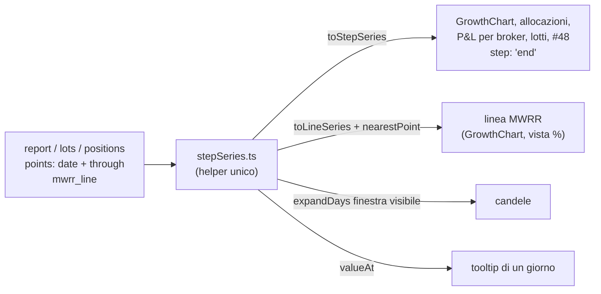

# MF-P4b — contratto della serie «a gradini» (cura B di D-P4)

MF, 25/10/2026. Questo contratto sostituisce la versione del 24/10 sulla cura A (il campionamento), che non vale più.
Base: `e-alfy-mf-matematica-finanziaria` a `445386f80`. Analisi e misure: `DECISIONI-DP4.md`, sezione «Proposta del
developer». Serie fuori dal report: `ANALISI-serie-a-gradini.md`, con la stessa forma.

**Decisioni del developer e del coordinatore (25/10):**
1. Una sola forma, `steps`: niente `series_form`, niente forma giornaliera, niente tetto. È una rottura del report.
2. Ogni punto ha `date` (il primo giorno in cui vale) e `through` (l'ultimo giorno); la risposta ha `range {start, end}`.
3. MWRR: i valori veri a inizio e a fine di ogni tratto, uniti da una retta. Nei tratti più lunghi di circa 2 mesi c'è un
   punto vero in più al mese, al massimo 24 per tratto. Il tooltip di un giorno interno mostra il punto vero più vicino,
   con la sua data.
4. La regola del «prezzo vecchio» si rifinisce: spariscono le novità spurie (il venerdì + 8). La soglia e i banner della
   UI non cambiano. Parità al bit.
5. Il cambio che diventa vecchio conta come novità: `fx_stale` entra nel report.
6. La qualità dei dati dà intervalli («dal… al…») invece delle date una per una.
7. Il frontend può fare piccole somme o moltiplicazioni; i conti complessi restano nel backend. Un solo helper centrale
   del frontend (Y) legge il formato nuovo e dà ai grafici quello che serve (§5).
8. L'AI Export legge i tratti per data, lato backend, con `value_at` (§6).

## 0. L'idea, con un esempio

Oggi una serie ha un punto per ogni giorno di calendario. Domani ha **un punto per ogni tratto senza novità**: il valore
vale da `date` a `through`, compresi.

Un ETF tenuto venerdì 23, sabato 24, domenica 25 e lunedì 26 ottobre, quotato venerdì e lunedì:

```json
[
  {"date": "2026-10-23", "through": "2026-10-25", "nav_value": {"code": "EUR", "amount": "10450.00"}},
  {"date": "2026-10-26", "through": "2026-10-26", "nav_value": {"code": "EUR", "amount": "10512.30"}}
]
```

Il sabato vale 10 450,00, cioè il valore del tratto che lo contiene. Il frontend lo trova con una ricerca per data,
senza nessun conto. Con un refuso all'anno 1 la serie ha 398 punti invece di 739 912.

**Che cosa è una novità.** È un giorno «sporco» del motore (`daily_state._collect_dirty_days`):
- un movimento: cassa, quantità, flusso esterno o trasferimento interno;
- una quotazione;
- un cambio che il giorno legge;
- un bordo di transito;
- uno split;
- il primo giorno della finestra;
- **il giorno in cui un prezzo diventa vecchio**, che con la regola rifinita conta solo se l'asset non ha una
  quotazione più nuova entro la soglia;
- **il giorno in cui un cambio diventa vecchio** (nuovo, §3).

Fra due novità ogni valore del report è identico, campo per campo: è la parità di P4. Fa eccezione il MWRR (§2).

## 1. La forma JSON

### 1.1 Comune a tutte le serie

- **Ogni risposta ha `range: {start, end}`**: la finestra effettiva, dopo i tagli (`start` ≥ il primo giorno con uno
  stato; `end` ≤ domani).
- **Ogni punto di una serie ha:**
  - `date`: il primo giorno in cui il valore vale;
  - `through`: l'ultimo giorno in cui vale, con `through` ≥ `date` e `through` ≤ `range.end`.
- **L'invariante, uguale per tutte le serie** (revisione di J): i tratti di una serie (di una chiave, per le serie per
  lotto, broker o posizione) sono **in ordine, senza sovrapposizioni e dentro `range`**. Possono esserci **buchi**: un
  giorno che nessun tratto copre non ha valore (`value_at` → `None`, `valueAt` → `null`).
  - Esempi di buco: un broker che nasce a metà finestra, un lotto chiuso, una posizione venduta, un giorno senza cambio
    in `market_price_history`.
  - La `history` del report non ha buchi: copre `range` da `range.start` a `range.end`, perché c'è uno stato in ogni
    giorno della finestra.
  - Un tratto che inizia prima di `range.start` è tagliato a `range.start`, con i valori del giorno di cambio precedente.
- Il modello di `date` + `through` si chiama `StepSpan` (`schemas/common.py`, nuovo). Ogni punto di serie lo estende.

### 1.2 `POST /api/v1/portfolio/report`

**`history`**: un punto per tratto. Campi di oggi meno quelli del MWRR, più `through`:

```json
"range": {"start": "2026-01-01", "end": "2026-10-25"},
"history": [
  {"date": "2026-01-01", "through": "2026-01-02",
   "cash_value": {"code": "EUR", "amount": "1200.00"},
   "market_value": {"code": "EUR", "amount": "9250.00"},
   "nav_value": {"code": "EUR", "amount": "10450.00"},
   "capital_baseline": {"code": "EUR", "amount": "10000.00"},
   "total_pnl": {"code": "EUR", "amount": "450.00"},
   "twrr": "0.045000", "roi": "0.045000"},
  {"date": "2026-01-03", "through": "2026-01-05", "...": "..."}
]
```

- `twrr` e `roi` sono costanti nel tratto: in un giorno fermo il fattore del TWRR vale 1 e il ROI non cambia.
- **Spariscono dai punti di `history`** i campi `mwrr_annualized` e `mwrr_cumulative`: cambiano anche senza novità, e
  vanno in `mwrr_line` (§2).

**`allocation_history.{type,sector,geography,asset}`**:

```json
"allocation_history": {"type": [
  {"date": "2026-01-01", "through": "2026-01-02", "components": [
    {"name": "ETF", "value": "62.10", "amount": "6489.45", "emoji": null, "id": null},
    {"name": "Liquidity", "value": "37.90", "amount": "3960.55", "emoji": null, "id": null}]}
]}
```

**`broker_pnl_history[].points`**: un tratto per broker, contiguo sui giorni in cui il broker esiste:

```json
"broker_pnl_history": [{"broker_id": 3, "broker_name": "Fineco", "points": [
  {"date": "2026-01-01", "through": "2026-01-02", "total_pnl": {"code": "EUR", "amount": "120.00"}}]}]
```

I tratti di ogni broker sono **massimali per quel broker** (revisione di test-author, 25/10): finiscono dove cambia il suo
P&L, non dove cambia la `history`. Un giorno in cui il broker non è nello stato è un buco della sua serie.

**`pnl_candles.points`** (può avere buchi: i giorni senza candela): la candela di un giorno fermo è quella dell'ultimo giorno calcolato, come oggi, quindi un
tratto ha una candela sola. Un giorno senza candela (valore MISSING) non ha punto, come oggi.

```json
"pnl_candles": {"hypothetical": true, "points": [
  {"date": "2026-01-05", "through": "2026-01-05", "open": {"code": "EUR", "amount": "440.00"}, "high": {"...": "..."}, "low": {"...": "..."}, "close": {"...": "..."}}]}
```

**Serie a eventi, invariate** (un punto per evento, senza `through`): `income_history`, `cost_history`,
`deposit_history`, `acquisition_funding`. Crescono con gli eventi, non con i giorni.

**`summary`, `positions_contribution`: invariati.** Sono valori di un giorno o di un periodo. Le card del MWRR e del TWRR
restano numeri singoli.

### 1.3 `POST /api/v1/portfolio/lots/analysis` (J)

Le storie per giorno diventano tratti per lotto, o per broker per il costo medio:

```json
"value_history": [
  {"lot_id": 12, "date": "2026-01-01", "through": "2026-01-02", "open_value": "1050.00", "proceeds": "0", "total_value": "1050.00", "original_cost": "1000.00", "pnl": "50.00", "income": "0"}],
"performance_history": [
  {"date": "2026-01-01", "through": "2026-01-02", "roi": "0.050000", "twrr": "0.050000"}]
```

- Vale per: `value_history`, `return_history`, `price_history`, `market_price_history`, `broker_wac_history`,
  `cumulative_wac_history` e `performance_history`.
- Vale l'invariante della §1.1, per chiave (lotto, o broker con il suo pool). Può avere buchi: per esempio
  `market_price_history` nei giorni senza cambio.
- Il primo tratto parte da `range.start` con i valori dell'ultimo giorno di cambio precedente. `range.start` =
  `max(display_from, computed_from)`, `range.end` = `actual_to`.
- I giorni di calcolo dei lotti sono più di quelli in cui cambia una chiave: le righe consecutive identiche di una
  chiave si uniscono, confrontando con `as_tuple` e non con `==` (`Decimal('1.10')` contro `Decimal('1.1')`). Lo fa
  `steps_from_rows` (§6).
- Non cambiano `lot_summary`, `gantt_topology`, `event_history`, `custody_history` (già a intervalli) e `income_events`.
- Nella risposta compare `range`.

### 1.4 `POST /api/v1/portfolio/positions-series` (#48, J)

Le serie per posizione diventano tratti, contigui da `first_date` a `last_date`:

```json
"series": [{"key": {"broker_id": 3, "asset_id": 7}, "first_date": "2026-01-01", "last_date": "2026-10-25",
  "points": [{"date": "2026-01-01", "through": "2026-01-02", "quantity": "10", "market_value": "1050.00",
              "cost_basis": "1000.00", "pnl": "50.00", "base": "1000.00", "pnl_percent": "0.0500",
              "valuation_source": "MARKET_PRICE", "complete": true}]}]
```

- La novità di una posizione è l'unione di:
  - i giorni in cui cambia il suo `PositionFrame` (già a tratti, `start`/`end`), più `frame.end + 1`;
  - i suoi eventi: vendita, provento, spesa, arrivo di un trasferimento;
  - i giorni di transito, compreso il punto «in viaggio»;
  - `date_from` e `date_from + 1`.
- L'asset sommato su più broker si calcola sull'unione dei giorni di cambio dei broker.
- Il `pnl` è costante nel tratto, perché valore e costo sono fermi e gli eventi sono confini. `pnl_percent` = `pnl` /
  `base` è costante anche lui.

## 2. Il MWRR della storia: `mwrr_line`

Il MWRR cambia anche senza novità, perché passa il tempo, e con più flussi non ha una formula chiusa (`DECISIONI-DP4.md`,
P1b). Per questo non sta nei punti a gradini ma in una **linea di punti veri**, nella risposta del report:

```json
"mwrr_line": [
  {"date": "2026-01-01", "annualized": null,       "cumulative": null},
  {"date": "2026-01-02", "annualized": "0.120000", "cumulative": "0.000310"},
  {"date": "2026-01-03", "annualized": "0.118400", "cumulative": "0.000615"}
]
```

- **Quali giorni.** Per ogni tratto della `history`, il suo `date` e il suo `through`. Nei tratti più lunghi di 62 giorni
  si aggiunge un punto ogni mese di calendario: l'ultimo giorno di ogni mese dentro il tratto, al massimo 24 per tratto,
  scelti equidistanti se i mesi sono di più. Senza duplicati, in ordine di data.
- **Il valore.** È quello che oggi la serie giornaliera dà in quel giorno, uguale al bit: `period_mwrr_series` sullo
  stesso periodo, con la stessa regola «capitale ≤ 0 → nessun tasso» e con P1c e P1d. Ogni punto è la soluzione singola
  che finisce lì (proprietà di P1), con la partenza calda dal punto prima.
- **Nessun tetto degli anni:** il costo segue i tratti. Con il refuso all'anno 1 sono circa 800 punti.
- **Cosa vede l'utente.** Una linea che unisce i punti veri. Il tooltip di un giorno interno mostra il punto più vicino,
  con la sua data: «MWRR al 31/03: 4,12 %».
- `annualized` e `cumulative` hanno lo stesso significato dei due campi di oggi. `cumulative` vale (1 + r)^(giorni/365) − 1
  dall'inizio del periodo (`returns.annualized_to_cumulative`).

## 3. Il «prezzo vecchio» rifinito e il cambio vecchio

- **Prezzo.** La soglia resta `STALE_PRICE_THRESHOLD_DAYS` = 7 (`platform/data_quality_thresholds.py`). È una novità
  soltanto il giorno osservazione + 8 dell'ultima osservazione di quell'asset prima di un buco più lungo della soglia.
  Oggi lo è dopo ogni osservazione. Il flag `stale` di ogni giorno resta identico, e così l'elenco `stale_prices` e i
  banner.
- **Cambio, nuovo.** Un cambio letto dal motore (valute dei titoli, delle quotazioni, della cassa) è vecchio quando
  l'ultima riga salvata della coppia è più vecchia di 7 giorni: la stessa soglia del rischio (`market_series.py:517-521`).
  - Il giorno in cui lo diventa è una novità.
  - Nel report entra `data_quality.stale_fx_pairs: List[{pair, last_rate_date, stale_days}]`, come `stale_prices`.
  - Per saperlo, il motore deve conoscere la data della riga di ogni gradino. **Verificato nel secondo checkpoint:**
    `UnitRateSteps` (`fx/conversion.py`) porta già `rate_days` (la data della riga di ogni gradino, anche quello
    d'ancoraggio) e `rate_day_at(day)`: è l'`as_of`, e `fx/conversion.py` non cambia. MF lo legge da
    `AskedDayRates.rate_day_at` / `stale_turn_days` (`financial_math/fx_rates.py`); X rivede quelle due funzioni.
  - Un banner nuovo «cambio vecchio» sarebbe una decisione di prodotto; il contratto porta solo il dato (§8).

## 4. La qualità dei dati a intervalli

In `DataQualityReport` (`schemas/portfolio.py:226`):

| Oggi | Domani |
|---|---|
| `incomplete_nav_dates: List[date]` | `incomplete_nav_ranges: List[DateSpan]` |
| `incomplete_book_value_dates` | `incomplete_book_value_ranges` |
| `incomplete_allocation_dates` | `incomplete_allocation_ranges` |
| `incomplete_valuation_dates` | `incomplete_valuation_ranges` |
| `missing_fx_pairs[].dates` (movimenti e giorni di valutazione insieme) | `dates` solo per i movimenti, più `ranges: List[DateSpan]` per i giorni di valutazione |

- `DateSpan` = `{start, end}`, compresi, con i giorni consecutivi fusi.
- I campi `*_dates` restano per ora, accanto agli intervalli: li legge il rischio (`risk/data_quality.py:140`). J li
  toglie quando sposta quel lettore sugli intervalli (coordinatore, 25/10). Né il frontend né l'AI Export li leggono.
- I messaggi degli `issues`, per esempio `INCOMPLETE_NAV` con `count`, `date_from` e `date_to`, restano uguali; il
  conteggio si calcola dagli intervalli.

## 5. L'helper centrale del frontend (Y)

**Un solo modulo**, per esempio `frontend/src/lib/utils/stepSeries.ts`, che legge il formato nuovo e dà ai grafici quello
che serve. Ammesse piccole somme e sottrazioni di date; nessuna formula finanziaria.

| Funzione | Cosa fa |
|---|---|
| `valueAt(points, day)` | ricerca binaria: il punto con `date ≤ day ≤ through`, `null` fuori. È il valore di quel giorno |
| `toStepSeries(points, pick)` | le coppie `[date, valore]` per ECharts con `step: 'end'`, più la chiusura all'ultimo `through`. **Un elemento per tratto, mai uno per giorno** |
| `toLineSeries(mwrrLine, pick)` | le coppie `[date, valore]` della linea del MWRR, così come arrivano |
| `nearestPoint(mwrrLine, day)` | il punto vero più vicino a `day`, con la sua data: per il tooltip del MWRR |
| `bucketValue(points, bucketEnd)` | `valueAt` sull'ultimo giorno di un bucket: per i raggruppamenti per settimana o mese che `timeSeriesAggregation.ts` già fa |
| `pointsBetween(points, from, to)` | i tratti che toccano `[from, to]`, tagliati ai bordi: per la candela di un bucket (`valueAt` per apertura e chiusura, massimo e minimo sui tratti che toccano il bucket) |
| `expandDays(points, from, to, maxDays)` | **l'unico punto che crea giorni**: solo per la scala a candele più fine di un tratto, nella finestra visibile e con un tetto (per esempio 1 000) |

Le scelte di presentazione sono di Y (revisione del 25/10):
- il tooltip del giorno puntato legge `valueAt`; quello del MWRR legge `nearestPoint`, con la data del punto vero;
- se i tratti veri ci stanno si disegnano quelli, altrimenti bucket per settimana o mese, con il badge Weekly/Monthly
  solo dove c'è un bucket;
- le aree impilate usano tratti allineati;
- una serie parziale finisce al suo `through`;
- un test e un gate verificano «mai un array di tutti i giorni»;
- un helper di test comprime le fixture giornaliere in tratti.

Il frontend **non** deve mai creare un array di tutti i giorni di `range`: con un refuso diventerebbe di 739 912
elementi.



## 6. Il lettore lato backend: `value_at` (Z, AI Export)

In `backend/app/services/financial_math/series_steps.py` (nuovo, MF, nel checkpoint piccolo):
- `value_at(points, day) -> point | None`: ricerca binaria su `date`, poi `day <= through`. **Restituisce il tratto, non
  un valore datato:** il giorno resta al chiamante. Funziona su ogni lista di punti di questo contratto (modelli pydantic,
  dataclass o dizionari con `date` e `through`).
- `points_between(points, start, end) -> list`: i tratti che toccano `[start, end]`, **tagliati ai bordi** (`date` =
  `max(date, start)`, `through` = `min(through, end)`). Una finestra che non tocca nessun tratto dà una lista vuota: per
  l'AI Export è un bucket vuoto.
- `steps_from_rows(rows, *, day, values, range_start, range_end, key=None, is_gap=None, ends=None) -> list[StepRow]`
  (chiesta da J):
  - prende le righe dei giorni di cambio (una o più chiavi), in ordine di giorno per chiave;
  - **unisce le righe consecutive identiche** di una chiave, confrontando `values(row)` con `as_tuple` sui Decimal;
  - calcola `through` (il giorno prima della riga successiva della chiave, oppure `ends[key]`, oppure `range_end`);
  - taglia ai bordi: il tratto che contiene `range_start` parte da lì;
  - una riga per cui `is_gap(row)` è vero chiude il tratto precedente e apre un buco.

  `StepRow` = `(row, date, through, key)`: il chiamante costruisce il suo punto con i campi della riga più `date` e
  `through`.
- I modelli pydantic `StepSpan` (`date`, `through`, con `through ≥ date`) e `DateSpan` (`start`, `end`, con
  `end ≥ start`), in `schemas/common.py`.
- La proprietà pubblica `AssetPriceSeries.observation_dates` (`price_marks.py`): i giorni con un'osservazione, in
  ordine. Serve ai lotti (J) per leggere i prezzi solo sui giorni candidati.

Una casa sola: J e #48 costruiscono i loro tratti con `steps_from_rows`, MF il report con la stessa regola. Niente copie.

**AI Export (Z, revisione del 25/10).** Il punto da cambiare è uno solo per due componenti:
`build_performance_bucket_rows` (`payloads/portfolio_broker.py:322`), usato da `portfolio_financial.py` e da
`broker_financial.py`.
- I valori di un bucket si leggono con `value_at` sui suoi estremi. Il giorno del dato (`min_date`/`max_date`) è
  `max(date del tratto, inizio del bucket)` del primo tratto che raggiunge l'estremo; a parità vince il più vecchio.
- Il terzo lettore è `broker_cost_efficiency._average_nav` (`:563`): diventa una **media pesata per la lunghezza** dei
  tratti (`through − date + 1` giorni), cioè una media sui giorni, non sui tratti.
- Nessun lettore dell'AI Export usa `mwrr_*`: non servono né `mwrr_line` né `period_mwrr`.
- Prova: un confronto sulle 6 copie, con 0 differenze; l'oracolo per giorno resta nel test.

**Rischio (J, assegnato dal coordinatore).** Due lettori che il contratto aveva dimenticato:
- `risk/data_quality.py:140-142` legge i quattro `incomplete_*_dates` → con gli intervalli il conteggio dei giorni è la
  somma dei giorni degli intervalli fusi;
- `risk/results.py:80-82` (`portfolio_twrr_returns`) legge `report.history` giorno per giorno → passa a `value_at` sui
  giorni di osservazione.

## 7. Chi fa cosa, e che cosa cambia per ognuno

Stime aggiornate dopo le revisioni: MF 3–3,5, J 2,5–3,5, Y 6–7, Z 1, cioè circa 13–15 giorni-persona.

| Chi | Che cosa | File | Stima |
|---|---|---|---|
| **MF** | `StepSpan`, `DateSpan`, `range`; storia, allocazioni, P&L per broker e candele a tratti dai segmenti; `mwrr_line`; regola rifinita del prezzo vecchio; cambio vecchio (`as_of` dei gradini, `stale_fx_pairs`); qualità dei dati a intervalli; `series_steps.py` (`value_at`, costruzione dei tratti) | `financial_math/series_steps.py` (nuovo), `financial_math/portfolio/{derived_views,daily_state,data_quality}.py`, `financial_math/fx_rates.py`, `fx/conversion.py` (con X), `portfolio_service.py`, `schemas/{common,portfolio,wac}.py`, `api/v1/portfolio_api.py` | 3–3,5 giorni |
| **J** | lotti a tratti con `steps_from_rows`: via `expand_to_days`, la lista `history_dates` e i cicli per giorno (prezzi solo sui giorni candidati, con `observation_dates` e i passi di `unit_rate_steps`); #48 a tratti dai `PositionFrame` e dagli eventi; i due lettori del rischio (§6) | `lots_analysis_service.py`, `financial_math/lots/change_days.py`, `financial_math/portfolio/position_series.py`, `risk/data_quality.py`, `risk/results.py`, sezioni lotti e #48 dello schema | 2,5–3,5 giorni |
| **Y** | `stepSeries.ts` (§5); `GrowthChart` (tutta la pipeline, che oggi ragiona per indice di giorno; la linea MWRR della vista %, `mwrrCum` in `growthChartData.ts`, da `mwrr_line`), allocazioni, P&L per broker, candele, grafici dei lotti e di #48; test Vitest ed E2E che contano i punti o leggono `history[i].mwrr_*`. `PerformanceChart` (barre dei contributi) non cambia | `lib/utils/stepSeries.ts` (nuovo), `lib/stores/portfolio/portfolioStore.svelte.ts`, `features/dashboard/**`, i grafici dei lotti | 6–7 giorni |
| **Z** | AI Export con `value_at` (§6): `build_performance_bucket_rows` e `_average_nav` pesata | `payloads/portfolio_broker.py`, `broker_cost_efficiency.py` | 1 giorno |
| test-author | i rossi di ognuno, prima del codice | — | dentro le stime |

**Ordine.**
1. MF, checkpoint piccolo: `series_steps.py` (`value_at`, `points_between`, `steps_from_rows`), i modelli `StepSpan`
   e `DateSpan`, e `AssetPriceSeries.observation_dates`. Il coordinatore lo unisce nei rami di J, Y e Z. Y può partire
   prima con `stepSeries.ts` (funzioni pure); Z con i rossi e l'oracolo.
2. In parallelo: MF il report, J lotti e #48, Y il frontend su risposte finte, Z l'AI Export.
3. Il treno.
4. Poi l'avviso per le date prima del 1900 (W) e, per ultimi, i pavimenti.

## 8. Le regole di parità dei test

1. **Espandere i tratti a giorni dà la risposta di oggi al bit.** Per ogni serie a tratti, ripetendo ogni punto per i
   giorni da `date` a `through` si ottiene la serie giornaliera di oggi, campo per campo: `as_tuple` dei Decimal, stessi
   `None`.
   - La prova: l'imbracatura di P4 (`ondata5/MF-p4/report_dump.py`), con l'albero di HEAD da `git archive` contro il
     nuovo, sulle 6 copie; il confronto espande i tratti prima di confrontare.
   - Fanno eccezione solo i campi cambiati di proposito: i `mwrr_*` tolti dalla storia, le date diventate intervalli,
     `range`, `mwrr_line` e `stale_fx_pairs`.
2. **`mwrr_line`.** Ogni punto è uguale al bit al MWRR della serie giornaliera di oggi nello stesso giorno. I giorni sono
   esattamente gli inizi e le fini dei tratti, più gli ultimi giorni dei mesi nei tratti di oltre 62 giorni (al massimo
   24 per tratto).
3. **Tratti massimali.** Due tratti consecutivi della stessa serie non hanno mai valori identici (con l'esponente): se lo
   sono, sono un tratto solo.
4. **Regola rifinita del prezzo vecchio.** Il flag `stale` di ogni giorno, `stale_prices` e i banner sono identici a
   oggi; ci sono meno novità.
   - Misura: copia senza crypto, da 337 a circa 283 tratti su 390 giorni (`ondata5/MF-p4c-segments-refined.log`).
5. **Cambio vecchio.** Su una copia con un buco nei cambi, `stale_fx_pairs` elenca la coppia con il giorno giusto, e il
   giorno + 8 è un confine di tratto.
6. **Qualità dei dati.** Gli intervalli coprono esattamente i giorni degli elenchi di oggi, con i consecutivi fusi.
7. **Costo.** Copia con un versamento all'anno 1 e pavimento abbassato nel solo processo; report «tutto»:
   - circa 398 tratti;
   - nessun giorno fermo costruito (contatore di `StateSegment.state_on`, come in P4);
   - memoria di picco < 50 MB con `tracemalloc`;
   - `mwrr_line` ≤ 2 × tratti + 24 × tratti lunghi.
8. **Lotti e #48 (J).** Regole 1 e 3 sulle loro storie, compresi il transito e l'asset sommato. Per i lotti, confronto
   con il giornaliero di HEAD su 16 coppie, una prova di mutazione e una prova di costo all'anno 1 (meno di 150 MB).
   L'ultimo punto della serie per posizione resta la riga del Periodo.
8b. **`series_steps.py` (MF).** `value_at` ai bordi e nei buchi; `points_between` taglia ai bordi e dà una lista vuota
   fuori da `range`; `steps_from_rows` unisce le righe uguali con `as_tuple` (e non unisce `1.10` con `1.1`), calcola
   `through`, taglia ai bordi, apre i buchi con `is_gap`, rispetta `ends`.
9. **Frontend (Y).**
   - Vitest su `stepSeries.ts`: `valueAt` ai bordi; `toStepSeries` dà un elemento per tratto; `expandDays` rispetta il
     tetto.
   - I grafici disegnano su un report finto con un tratto di 2 000 anni senza creare giorni.

## 9. La voce per il CHANGELOG (⚠️ Breaking changes)

Testo proposto, in inglese come le altre voci della sezione:

> - **Portfolio history series come as steps, not one point per day.** In `POST /api/v1/portfolio/report`
>   (`history`, `allocation_history`, `broker_pnl_history`, `pnl_candles`), `POST /api/v1/portfolio/lots/analysis`
>   (the daily lot histories) and `POST /api/v1/portfolio/positions-series`, each point now covers the days from its
>   `date` to its `through` (both included) during which nothing changed, and every response carries its `range`.
>   A day's value is the point whose `date ≤ day ≤ through`. The history's MWRR moves to `mwrr_line` (true values at
>   the start and end of each step, and monthly inside long steps); `history[].mwrr_annualized` and
>   `history[].mwrr_cumulative` are gone. The data-quality report gives date ranges (`incomplete_*_ranges`,
>   `missing_fx_pairs[].ranges`) instead of one date per day. A history with a date typed in the year 1 no longer
>   builds 740 000 points.

## 10. Domande chiuse (coordinatore, 25/10)

1. **`stale_fx_pairs`:** il contratto porta solo il dato. Il banner «cambio vecchio» è una domanda per il developer, che
   la porta il coordinatore.
2. **`unit_rate_steps` con `as_of` (`fx/conversion.py`):** lo scrive MF nel suo lotto, e X lo rivede.
3. **I punti mensili del MWRR:** restano come scritti (oltre 62 giorni, uno al mese, al massimo 24 per tratto), salvo un
   cambio del developer.
