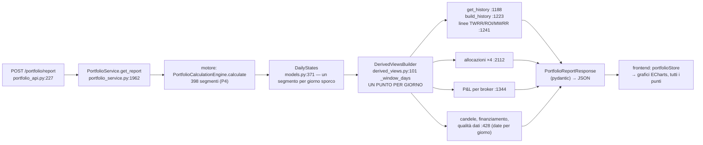

# D-P4 — perché una data sbagliata fa disegnare 740 000 punti, e come toglierlo

MF, 24/10/2026. Analisi senza codice. Base del codice: `e-alfy-mf-matematica-finanziaria` a `270e85a55`, con la cura
MF-P1d in verifica. Misure su copie del DB di prova, mai sui dati veri.

## In breve

- **Il motore non è più il problema.** Con P4 e MF5-2a calcola solo i giorni in cui cambia qualcosa. Con un versamento
  digitato all'anno 1 sono 398 giorni su 739 912: 0,11 s e circa 90 MB, quanto con il pavimento.
- **Il problema è l'uscita.** Dopo il motore, il backend ricostruisce **un punto per ogni giorno di calendario**, per
  ogni serie del report, e li manda tutti al frontend. È la regola D1, «un punto al giorno», decisa il 19/10.
  - Il report «tutto» costa circa **29 kB di memoria per giorno**: 46 317 giorni fanno 1,33 GB.
  - Con l'anno 1 sarebbero circa **21 GB** e **1,3 GB di JSON**. Per questo la misura dell'anno 1 l'ho fermata a 4,4 GB.
- **È un difetto, sì, ma di contratto, non di calcolo.** I giorni tutti uguali vengono saltati nel calcolo e poi
  ricopiati uno per uno nella risposta. Su una storia normale è innocuo (circa 3 650 punti in 10 anni). Senza
  pavimento non ha limite.
- **La cura che toglie la causa:** il report dei periodi lunghi viene **campionato in backend**. Il frontend dice quanti
  punti può disegnare, il backend costruisce solo i giorni del campione, leggendoli dai segmenti, e niente altro.
  - Ogni punto del campione è identico al punto giornaliero dello stesso giorno: non c'è stima né media.
  - È la stessa idea che i prezzi delle schede usano già (Z-29, `max_points`).
  - Costo stimato: 2–3 giorni tra MF (backend), Y (grafici) e i test.
- **Il tuo avviso nella UI va bene, ma da solo non basta.** L'import, il Bulk e l'API arrivano al backend anche senza
  il form. È una buona protezione contro il refuso; la difesa vera resta il campionamento.

## 1. Dove nascono i punti

**Che cosa fa ogni pezzo:**

| Pezzo | File e riga (`270e85a55`) | Punti con un refuso all'anno 1 |
|---|---|---|
| Motore | `financial_math/portfolio/daily_state.py:737` (`_segments`) | **398 segmenti**: lo stato esiste solo nei giorni che cambiano |
| Serie giornaliera degli stati | `financial_math/portfolio/models.py:371` (`DailyStates`) | Nessuno in memoria: un giorno fermo si costruisce solo quando qualcuno lo legge |
| **Espansione a un punto al giorno** | `financial_math/portfolio/derived_views.py:101` (`_window_days`); `build_history` `:120`, `build_performance_inputs` `:216`, `build_broker_pnl_history` `:150`, `build_allocation_history` `:291`, `build_asset_allocation_history` `:346` | **739 912 punti per serie** |
| Linee di rendimento | `portfolio_service.py:1226-1241`: un NAV per giorno, poi TWRR, ROI e una soluzione del MWRR per ogni giorno | 739 912 per linea |
| Qualità dei dati | `financial_math/portfolio/data_quality.py:428` (`incomplete_nav_dates`) e `portfolio_service._engine_missing_fx_pairs`: un elenco di **date** | fino a 739 912 date, se il NAV è incompleto da allora |
| Risposta API | `api/v1/portfolio_api.py:223-227` (`PortfolioReportResponse`) | tutto quanto sopra, in pydantic e poi in JSON |
| Frontend | `frontend/src/lib/stores/portfolio/portfolioStore.svelte.ts` chiede `include_history` senza campionamento; i grafici disegnano ogni punto | 739 912 punti da leggere e disegnare |
| Lotti «tutto» | `lots_analysis_service.py:259-260` (`history_dates`, ogni giorno) e `:447-543` (`expand_to_days`, 7 storie) | 739 912 punti per storia |

**Le misure.** Ogni sezione è misurata da sola, con `tracemalloc`. I tempi sono gonfiati dalla misura; quelli veri sono
più sotto. Log: `ondata5/MF-p4a-sections.log`. Script: `ondata5/MF-p4/measure_sections.py`.

| Sezione | Copia base (390 giorni) | Copia 1900 da 1960 (24 404 giorni) | Copia 1900 «tutto» (46 317 giorni) |
|---|---|---|---|
| Motore (da t=0) | 6,9 MB | 6,9 MB | 6,9 MB, 398 segmenti |
| Storia (punti più linee) | 27 MB | 244 MB | **442 MB** |
| di cui i punti (`build_history`) | 2 MB | 122 MB | 231 MB |
| Allocazioni, 4 dimensioni | 1 MB | 53 MB | 100 MB (185 268 righe) |
| P&L per broker | 1,7 MB | 109 MB | 207 MB (324 219 righe) |
| **Report intero più JSON** | **18 MB**, 0,9 MB di JSON | **704 MB**, 42 MB di JSON | **1 330 MB**, 79 MB di JSON |

- La memoria cresce in proporzione ai giorni, non ai segmenti: circa **28,8 kB per giorno** (704 MB per 24 404 giorni,
  1 330 MB per 46 317). Il JSON pesa circa 1,7 kB per giorno.
- Il motore resta a 7 MB in tutti e tre i casi: la crescita viene tutta dall'espansione.
- Tempi senza `tracemalloc` (misure del 23–24/10): con il pavimento, il «tutto» del 1900 impiega 16 s e arriva a 1,5 GB
  di picco del processo.
- Senza pavimento, all'anno 1 (739 912 giorni, cioè ×16): **circa 21 GB e 1,3 GB di JSON** per estrapolazione lineare.
  La misura vera l'ho fermata a 4,4 GB dopo 25 s, e cresceva.
- Lotti «tutto» con il pavimento: 2,0 s, 384 MB, 32 MB di JSON. ×16 fa circa 6 GB: non l'ho lanciato.

**Risposta alla tua domanda: il «giorno per giorno» è nel backend, dopo il motore.**
- Il calcolo salta i giorni in blocco, come pensavi.
- Ma le viste derivate (`derived_views.py`) e la storia dei lotti (`expand_to_days`) li **riespandono**, uno per giorno,
  per rispettare D1. Lo fanno prima di serializzare: la memoria esplode lì, in Python, non nel browser.
- Il frontend riceverebbe poi lo stesso volume, e non ha nessun campionamento per il report (ce l'ha solo per i prezzi,
  Z-29).

## 2. È un bug?

**Sì: la causa è la regola «un punto al giorno» applicata a un intervallo senza limite.** Il calcolo è giusto. Le
prove:
- Il motore produce 398 stati diversi; i 739 514 giorni restanti sono **copie esatte** dello stato precedente, tolti la
  data, il flusso del giorno (0) e il finanziamento degli acquisti (vuoto). Su questo si regge la parità di P4: 202 casi,
  0 differenze.
- Quasi tutte le serie del report sono quindi **costanti a tratti**: NAV, capitale, P&L, valore di mercato, allocazioni,
  P&L per broker, TWRR cumulato (un giorno fermo ha fattore 1) e ROI.
- **L'eccezione è il MWRR annualizzato.** Cambia anche nei giorni fermi, perché passa il tempo: lo stesso guadagno su un
  periodo più lungo è un tasso annuo più basso. Per lui un punto a tratti costanti non è esatto.

**Le cure possibili:**

| Cura | Cosa cambia | Toglie la causa? | Costo | Chi deve cambiare |
|---|---|---|---|---|
| **A. Serie campionata per i periodi lunghi** (consigliata) | Il report riceve `max_points`. Il backend sceglie il passo più fine che ci sta: giorno, settimana, mese, trimestre, anno, decennio. Costruisce solo quei giorni, leggendoli dai segmenti (`DailyStates.state_on`). Ogni punto è il valore vero di quel giorno, l'ultimo del suo intervallo. Il MWRR è calcolato solo in quei giorni, con la partenza calda di P1 | Sì: lavoro e memoria seguono i punti chiesti, non i giorni | **2–3 giorni**: backend MF 1–1,5 (`derived_views`, `get_history`, `get_report` e lo schema, più i lotti con `expand_to_days`); frontend Y 0,5–1 (`portfolioStore` passa `max_points`, i grafici leggono il passo); test | MF (casa unica: il campionamento delle serie del portafoglio sta in `financial_math`, accanto a quello di Z-29 per i prezzi, una regola sola dei passi), Y (grafici), J (lotti, `expand_to_days`) |
| **B. Serie a tratti** (solo i giorni che cambiano, con «vale fino a») | La risposta ha un punto per segmento, invece che uno per giorno | Sì per tutto tranne il MWRR, che resterebbe giornaliero o andrebbe campionato a parte | **4–6 giorni**: contratto nuovo per ogni serie; ogni grafico disegna a gradini; AI Export e ogni lettore della storia da rivedere | MF, Y (tutti i grafici della Dashboard), Z (AI Export), test |
| **C. Tetto di punti solo sul «tutto»** | Oltre N punti si taglia o si rifiuta | Toglie solo il sintomo, e va contro D1 | 0,5 giorni | MF |
| **D. Tenere il pavimento** | Nessuno | Toglie il sintomo, e non è quello che vuoi | 0 | — |

Due cose vanno in ogni caso, piccole:
- La qualità dei dati elenca le date una per una: `incomplete_nav_dates`, e le date delle coppie di cambio mancanti in
  `_engine_missing_fx_pairs`. Con un refuso antico possono essere centinaia di migliaia → passare a **intervalli**
  («dal… al…»). Costo 0,5 giorni, con il frontend del banner (Y).
- La serie per posizione di #48 (J) disegna anch'essa un punto al giorno per posizione: lo stesso campionamento le serve.

## 3. Che cosa costa ancora un refuso «0024» dopo la cura

Ipotesi: cura A, pavimento tolto, un versamento digitato «0024-03-01» invece di «2024-03-01». Sono circa 730 000 giorni
fino a oggi.

| Che cosa | Costo con la cura A | Oggi senza pavimento |
|---|---|---|
| Motore | ~0,1 s, ~90 MB (misurato all'anno 1: 0,11 s) | uguale |
| Report di 1 mese o 1 anno | ~0,6 s (misurato all'anno 1: 0,6 e 0,67 s) | uguale |
| Report «tutto», `max_points` = 1 000 | passo **decennio**: ~201 punti, ~0,2 s e qualche decina di MB, come un report di un anno (stima) | ~21 GB, il server cade |
| Lotti «tutto» | stesso passo: ~201 punti | ~6 GB |
| Grafico | **leggibile ma brutto**: una linea piatta a zero per 2 000 anni, poi tutta la storia vera schiacciata nell'ultimo punto o negli ultimi due | — |
| Qualità dei dati | con gli intervalli, una riga | fino a 730 000 date |

Il rischio che resta è solo **estetico e di lettura**: il grafico «tutto» diventa inutile finché l'utente non corregge la
data. Il refuso si vede subito, perché la Dashboard mostra «dal 24 d.C.». Non c'è più rischio per la memoria o per il
tempo del server.

## 4. L'avviso nella UI

Proposta tua: un avviso con conferma quando una data è prima del 1900. Dove dovrebbe stare:

| Punto d'ingresso | File (proprietario) | Basta l'avviso? |
|---|---|---|
| Form di una transazione | `frontend/src/lib/features/transactions/form/TransactionFormModal.svelte` (W/W2) | sì, per chi digita |
| Bulk editor | `routes/(app)/transactions/` più l'editor (W) | sì, con un avviso per riga e una conferma unica |
| Import BRIM, anteprima | il passo di revisione dell'import (W) | sì, come todo «data prima del 1900» sulle righe |
| Selettore della data | `frontend/src/lib/components/ui/date/CalendarMonth.svelte:224` (`min="1900"`): **oggi l'anno prima del 1900 non si può nemmeno scegliere** | va tolto il `min`, se no l'avviso non serve |
| API diretta e script | — | **no**: nessuna UI. Per questo serve la cura A in backend |

L'avviso protegge da un input che si può riconoscere: è coerente con la tua regola, niente bonifiche. Ma da solo **non
basta**. Un file importato da un broker, un client API o un restore di backup arrivano al backend senza passare dal
form; con il pavimento tolto, uno di loro con una data dell'anno 24 farebbe cadere il server, se non c'è la cura A.

## 5. Raccomandazione

1. **Cura A** (serie campionata per i periodi lunghi, costruita dai segmenti) **prima** di togliere i pavimenti. È la
   cura della causa: il backend non costruisce più punti che nessuno può disegnare.
2. In parallelo, **l'avviso nella UI**: form, Bulk e import, più il `min` del selettore da togliere. Mezza giornata per
   W/Y, con i testi in 4 lingue.
3. **Intervalli al posto delle date** nella qualità dei dati.
4. **Poi** i pavimenti, uno per lotto, come deciso.

**Esempio numerico.** Un portafoglio vero di 10 anni con un versamento digitato «0024» invece di «2024».

| | Report «tutto» | Lotti «tutto» |
|---|---|---|
| Oggi, con il pavimento | il refuso è rifiutato al salvataggio | — |
| Senza pavimento e senza cura A | ~730 000 punti per serie, ~21 GB: il server cade prima di rispondere | ~6 GB |
| Senza pavimento, con cura A | ~201 punti a passo decennale, **~0,2 s**: la Dashboard mostra «dal 24», l'utente vede il refuso e lo corregge | ~201 punti |

Su un portafoglio normale di 10 anni la cura A con `max_points` = 1 000 dà circa 520 punti settimanali invece di 3 650
giornalieri. Il grafico è identico all'occhio, e il report pesa e costa circa 7 volte meno.

---
**Prove.**
- `ondata5/MF-p4a-sections.log`: memoria per sezione, 3 copie.
- `ondata5/MF-floor-measure-before.log`: anno 1, prima delle cure del motore.
- `ondata5/MF-floor-verify.log`: anno 1, dopo MF5-2a (motore 0,11 s; report 1M 0,6 s).
- `ondata5/MF-p4-memory.log`: P4, 686 MB → 5 MB sulla copia del 1500.

Il piano MF ha la sezione «MF-P4a».

---

## Proposta del developer: una serie «a gradini» (solo i giorni con una novità)

Le sue parole, in breve: per i giorni senza novità non si scrive niente, tranne l'ultimo. Nel weekend ci sarebbero un
punto venerdì e uno domenica «vecchio di 2 giorni», e il frontend saprebbe ricostruire il sabato. Per l'anno 1, un punto
all'anno 1 e poi il primo punto recente. È l'opzione B della §2, con un'età scritta sull'ultimo giorno. Questa sezione è
coerente con `ANALISI-serie-a-gradini.md`, che vale per le serie fuori dal report: stessa forma, stessa scelta per il
MWRR.

### P1. Si può fare? Quali serie sono costanti fra due novità

**Sì, per quasi tutto il report.** È un fatto del motore, non un'ipotesi. Ogni giorno in cui un valore può cambiare è già
un «giorno sporco» (`daily_state._collect_dirty_days`):
- un movimento, cioè cassa, quantità, flusso esterno o trasferimento interno;
- una quotazione;
- un cambio che il giorno legge, per i titoli, per la cassa in valuta o per la cassa in transito;
- un bordo di transito;
- il giorno in cui un prezzo diventa vecchio;
- uno split.

Fra due giorni sporchi lo stato è identico campo per campo: è la parità di P4, 202 casi a 0 differenze.

| Serie | Costante fra due novità? | Perché |
|---|---|---|
| NAV, cassa, valore di mercato, costo, P&L, capitale, valori in transito, scomposizione della cassa | **sì** | sono campi dello stato, costanti nel segmento |
| Valori convertiti con un cambio che si muove nei giorni senza prezzo | **sì** | il giorno in cui il cambio letto cambia è sporco (`_valuation_rate_change_days`): diventa una novità |
| Investimenti programmati, interessi maturati (`scheduled_investment`) | **sì, ma non si risparmia nulla** | il fornitore scrive un «prezzo» ogni giorno, quindi ogni giorno è una novità. Esatto, nessun guadagno |
| Allocazioni (tipo, settore, geografia, asset), P&L per broker | **sì** | campi dello stato |
| Candele del P&L | **sì** | il giorno fermo porta la candela del giorno prima (oggi uguale) |
| TWRR cumulato | **sì** | in un giorno fermo il fattore è 1 |
| ROI | **sì** | capitale e P&L fermi |
| **MWRR annualizzato** | **no** | passa il tempo e il tasso cambia anche senza novità (P1b sotto) |
| **MWRR cumulato** | **no**, tranne con un solo flusso | è definito come (1 + r_ann)^(giorni/365) − 1 (`returns.annualized_to_cumulative`, `returns.py:103`); con più flussi cambia anche lui |
| TWRR annualizzato | non è una serie della storia (c'è solo il cumulato) | se servisse, (1 + cumulato)^(365/giorni) − 1 è una formula chiusa nel tempo |

### P1b. La domanda sul MWRR: c'è una formula chiusa?

**No, con più di un flusso. Sì, con un solo flusso.** La tua lettura è giusta.
- L'equazione è Σ Fᵢ · g^(T − tᵢ) = V, con g = (1 + r)^(1/365).
- Con un solo flusso F: g^(T − t) = V/F, quindi r = (V/F)^(365/(T − t)) − 1, chiusa.
- Con più flussi è la radice di un polinomio con esponenti frazionari: nessuna formula al variare di T, anche con V fermo.

Esempio (NAV fermo a 210, versamenti di 100 ai giorni 0 e 365, x = g^365):

| Giorno | Equazione | MWRR annualizzato | MWRR cumulato (x^(giorni/365) − 1) |
|---|---|---|---|
| 365 | 100x + 100 = 210 → x = 1,1000 | 10,00 % | 10,00 % |
| 730 | 100x² + 100x = 210 → x = 1,03295 | 3,30 % | 6,70 % |
| 1095 | x³ + x² = 2,1 → x ≈ 1,0198 | circa 1,98 % | circa 6,06 % |

Nessuna novità, eppure tutti e due i numeri scendono.

**Gli scenari esplorati, nell'ordine che hai chiesto (prima un equivalente esatto, il tetto per ultimo):**

| # | Scenario | Esatto? | Cosa vede l'utente | Costo |
|---|---|---|---|---|
| 1 | Formula chiusa | solo con un flusso | uguale a oggi | si usa dove c'è un solo flusso, ma non basta come regola |
| 2 | Scrivere una volta per tratto le quantità dell'equazione (flussi, giorni, V) e lasciar risolvere il frontend | sì | uguale a oggi | **no**: è una radice numerica nel frontend, contro «tutti i calcoli nel backend» |
| 3 | Un gradino «valido fino all'ultima novità» | **no**: nell'esempio direbbe 10 % al giorno 1095, dove il vero è 1,98 % | un numero sbagliato | scartato, a meno di cambiargli nome in «MWRR all'ultima valutazione» con la data scritta |
| 4 | **Due valori esatti per tratto**: il MWRR all'inizio e alla fine del tratto (il giorno prima della novità successiva, o la fine della finestra) | **sì**: due punti veri | una linea retta fra due valori veri. Il tooltip di un giorno interno mostra il punto più vicino con la sua data, non un valore inventato | **≤ 2 soluzioni per tratto**: con la partenza calda di P1 costa come la serie di oggi divisa per la lunghezza media dei tratti |
| 5 | Come il 4, più punti interni solo nei tratti lunghi (per esempio uno al mese, al massimo 24 per tratto) | sì, ogni punto è vero | una curva più fedele nei tratti di anni | ≤ 26 soluzioni per tratto |
| 6 | Tetto solo per il MWRR: oltre ~200 anni di orizzonte non si calcola e resta «—» | n/a | «—» con una nota «periodo oltre 200 anni» | 0. Ultima carta |

**Proposta: lo scenario 4**, con il 5 se Y vuole la curva più fedele nei tratti lunghi. Il costo segue i tratti, non gli
anni: con il refuso all'anno 1 sono circa 800 soluzioni invece di 739 912. Per questo **il tetto dei 200 anni non serve**.
P1c e P1d danno già «—» dove l'equazione non ha senso: underflow e flussi tutti nulli.

### P2. Che cosa conta come «novità», e quanti punti restano

Oggi una novità è uno dei giorni sporchi del motore (P1). Misure sulle copie di prova (log
`ondata5/MF-p4c-segments*.log`, script `ondata5/MF-p4/count_segments*.py`):

| Copia | Giorni | Novità oggi | Quota |
|---|---|---|---|
| Base (tutti gli utenti di prova hanno **crypto**, quotate anche nel weekend) | 390 | 390 | **100 %** |
| Base **senza crypto**, solo azioni ed ETF | 390 | 337 | **86 %** |
| Senza crypto, con la regola del «prezzo vecchio» rifinita (sotto) | 390 | 283 | **73 %** |
| Refuso al 1900 | 46 317 | 398 | 0,9 % |

**Una scoperta.** Oggi il weekend non sparisce, nemmeno senza crypto: 58 tratti iniziano di sabato o domenica. La causa è
la regola del «prezzo che diventa vecchio»: il motore segna come novità il giorno osservazione + 8 per **ogni**
osservazione, anche quando una quotazione più recente arriva prima (il venerdì + 8 è un sabato).
- La versione esatta segna il giorno + 8 solo se l'asset non ha una quotazione più nuova entro quei giorni. L'ho provata
  solo nel processo di misura, senza toccare il codice.
- Risultato: 283 novità invece di 337, e nel weekend restano 4 tratti (feste e transazioni nel weekend).
- È una cura piccola (0,5 giorni) e non cambia nessun numero; va provata con la parità.

**Un portafoglio vero di 10 anni** (3 652 giorni), con le quote misurate:

| Portafoglio | Punti oggi | Novità oggi | Novità con la regola rifinita |
|---|---|---|---|
| Solo azioni ed ETF | 3 652 | ~3 150 (86 %) | **~2 670 (73 %)** |
| Con crypto, o con un investimento programmato | 3 652 | 3 652 | 3 652 (ogni giorno ha un prezzo) |

**Il refuso all'anno 1** (misura di P4 e MF5-2a): 398 novità invece di 739 912 giorni. Report in forma a gradini: circa
400 punti più al massimo 2 MWRR per tratto. Costa come un report di un anno: motore 0,11 s, circa 18 MB di memoria del
report (la copia base da 390 giorni nella §1). Stima: **< 1 s e < 50 MB**, invece di circa 21 GB.

### P3. La forma della risposta

La stessa di `ANALISI-serie-a-gradini.md` §6, per tutte le serie:
- **Per la risposta:** `series_form: "daily" | "steps"` e la finestra effettiva `range: {start, end}`.
- **Per ogni punto:** `date` (primo giorno in cui vale) e `through` (ultimo giorno in cui vale).
  - Meglio di `days_covered`: è una data, sopravvive a un taglio della finestra, e il frontend confronta date senza
    contare.
  - L'idea della «domenica vecchia di 2 giorni» c'è lo stesso: l'ultimo tratto ha `through` = fine della finestra, e la
    sua età è il `through` meno la data della fonte (`as_of`, che i prezzi hanno già).
- **Per il MWRR:** ogni punto della storia porta anche `mwrr_annualized_end` e `mwrr_cumulative_end`, i valori veri del
  giorno `through` (scenario 4).
- **Il frontend non fa conti.** Un giorno interno ha il valore del tratto che lo contiene, trovato con una ricerca per
  data (`valueAt`). Il grafico usa `step: 'end'` di ECharts. Il MWRR è una linea fra i suoi punti veri.
- **Il frontend non deve creare un array di giorni:** il refuso diventerebbe 739 912 elementi nel browser.

Basta un campo per punto (`through`), più `series_form` per la risposta: dice al grafico «disegna a gradini» senza dover
indovinare dai dati.

### P4. Chi rompe, e quanto costa

| Lettore | Cosa cambia | Chi | Giorni |
|---|---|---|---|
| Report: storia, allocazioni, P&L per broker, candele | un punto per tratto con `through` (dai segmenti di P4: viene naturale); MWRR all'inizio e alla fine del tratto; `series_form`; qualità dei dati a intervalli | **MF** | **2–2,5** |
| Regola del «prezzo vecchio» rifinita (P2) | meno novità, stessi numeri | MF | 0,5 |
| Lotti (`expand_to_days` → tratti) | i costruttori girano già sui giorni di cambiamento (L1a): si tolgono l'espansione e la lista `history_dates` | **J** | 1–1,5 |
| #48, serie per posizione | i `PositionFrame` sono già tratti (`start`/`end`): si espongono così | J | 0,5–1 |
| Grafici del Cruscotto e del broker, candele, grafici dei lotti e di #48 | `stepSeries.ts` (`valueAt`, `step: 'end'`), il MWRR come linea fra punti, tooltip con la data della fonte, test e spec che contano i punti | **Y** | **3–4** |
| AI Export | legge `report.history` giorno per giorno in tre componenti (`portfolio_financial.py:354`, `broker_financial.py:321`, `broker_cost_efficiency.py:563`): o resta su `daily`, o li legge per data sui tratti, lato backend | Z (o chi ha l'AI Export) | 0,5–1 |
| Test di parità | espandere i tratti a giorni deve dare la risposta di oggi al bit | MF + test-author | dentro le stime |

**Totale: circa 8–10 giorni-persona, contro i 2–3 della cura A**, perché ogni grafico passa ai gradini.

**Le quattro copie di «giorni in cui cambia qualcosa»** (domanda del coordinatore): `_collect_dirty_days`, `lots/change_days.py`,
`native_cash.change_days` e `AskedDayRates.reading_change_days`/`_step_rows`.
- Non sono quattro copie della stessa cosa. Una è l'unione dei termini (il motore). Una confronta i prezzi convertiti
  (i lotti). Una è la regola «il giorno in cui un valore letto cambia» (`change_days`, già usata da motore e cassa
  nativa). Una è il calendario dei candidati, cioè l'ingresso della regola (MF5-2a).
- Con questa strada ha senso una casa comune, `financial_math/series_steps.py`, con l'unione delle novità e il
  `through`. `change_days` si sposterebbe lì, e `_collect_dirty_days` e `lot_change_days` la userebbero.
- Circa 1 giorno, con la parità, dopo i gradini. Non è necessario per partire.

**Il «prezzo vecchio» e il cambio** (incoerenza segnalata). Oggi il report segna vecchio solo il prezzo; il rischio
segna anche un cambio fermo da più di 7 giorni. Se si aggiunge `fx_stale` al report (proposta di `ANALISI`), il giorno in
cui un cambio diventa vecchio diventa una novità in più: pochi giorni, solo quando la BCE è chiusa a lungo.

### P5. Il confronto con la cura A, e la raccomandazione

| | **A**: campionamento | **B**: gradini (la proposta) |
|---|---|---|
| Esatto? | ogni punto è vero, ma i giorni fra due punti non ci sono | **ogni giorno è ricostruibile esatto**, tranne il MWRR fra i suoi due punti per tratto |
| Robustezza al refuso | sì, il costo segue i punti chiesti | **sì, il costo segue le novità**: il refuso costa quanto un anno normale |
| Portafoglio normale | da 3 650 a ~520 punti (con `max_points` = 1 000) | da 3 650 a ~2 670 (solo azioni, con la regola rifinita) o 3 650 (crypto) |
| Cosa vede l'utente | una linea più rada sui periodi lunghi | lo stesso grafico di oggi, a gradini nei weekend; il tooltip del sabato dice «valore del venerdì» |
| Contratto | parametro opzionale, nessuna rottura | serie nuova per ogni lettore (rottura accettata da te) |
| Costo | 2–3 giorni | 8–10 giorni |
| Tetto di sicurezza | sì, per chi non passa il parametro | **non serve più per il report**, se la forma a gradini è quella predefinita. Serve ancora per chi chiede `daily` (AI Export finché non migra) |

**Raccomandazione.** La tua strada è più robusta della A ed è esatta: la A riduce i punti per i pixel, la B li riduce
perché non ci sono. Consiglio **B**, a una condizione e con un ordine:
1. **MF prima:**
   - il report a gradini, con `series_form` richiesto dalla Dashboard, il MWRR con i due valori per tratto e la qualità
     dei dati a intervalli;
   - la regola del «prezzo vecchio» rifinita;
   - un tetto di 36 525 giorni **solo sulla forma `daily`**, che resta per chi la chiede (AI Export, test). 2,5–3 giorni.
2. **J** lotti e #48, **Y** i grafici, in parallelo sul contratto: circa 5 giorni.
3. **La condizione:** i pavimenti cadono solo quando la Dashboard e i lotti usano i gradini. Prima, un client con
   `daily` e il refuso chiede ancora troppo, ma il tetto lo limita.

Il campionamento A, a quel punto, non serve più per il refuso. Resta utile solo se un giorno un grafico vuole meno punti
per i pixel: si può aggiungere sopra i gradini (si sceglie un punto per bucket con `valueAt`).

**Esempio numerico.** Refuso «0024» su un portafoglio vero di 10 anni senza crypto:

| | Report «tutto» |
|---|---|
| Oggi, senza pavimento | ~730 000 punti, ~21 GB |
| Con la A | ~202 punti decennali |
| Con la B | **~2 670 tratti più 1 tratto lungo dal 24 al 2016**, e il MWRR con 2 valori in quel tratto. Ogni giorno resta esatto. Memoria simile al report di un anno |

**Stato dei file del passo 2a, fermato.** Non c'è codice di prodotto. Restano due file di test rossi di test-author, non
tracciati:
- `backend/test_scripts/test_services/test_financial_math/test_portfolio_sampling.py`
- `backend/test_scripts/test_services/test_price_sampling_long_steps.py`, che oggi non è raccolto da nessuna azione del
  runner

Con la B li cancella il coordinatore o test-author. Io non cancello niente.
