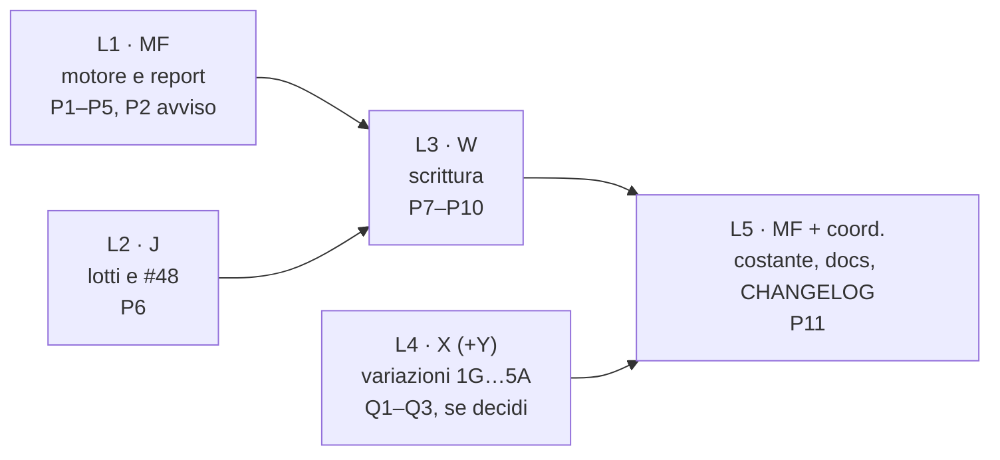

# Pavimenti delle date — inventario e piano di rimozione (MF, 26/10/2026)

Solo analisi, nessun codice. Basi lette (storia committata, non i worktree degli altri):

| Ramo | SHA | Cosa ci ho letto |
|---|---|---|
| MF `e-alfy-mf-matematica-finanziaria` | `01e180028` | motore, report, prezzi, cambi, transazioni (backend) |
| J `e-alfy-j-numeri-e-analisi` | `7336910f9` | lotti, #48, rischio, test (con P4b dentro) |
| W `e-alfy-w-import-e-transazioni` | `8db10d43d` | form, Bulk, import, l'avviso prima del 1900, `CalendarMonth` |
| Y `e-alfy-y-cruscotto-e-grafici` | `36eaffa4d` | frontend del cruscotto |
| Z `e-alfy-z-sospensione-e-risveglio` | `a8d1aab57` | AI Export |

I numeri di riga sono quelli del ramo indicato; dopo il treno vanno riletti.

## 0. L'idea in una riga, con un esempio

Il pavimento è il 1° gennaio 1900 (`EARLIEST_RANGE_START`, `backend/app/utils/datetime_utils.py:106`). Oggi:
- una transazione del 1850 **non si può scrivere** (422 `dateOutOfRange`, «Tra 1900-01-01 e domani»);
- se c'è già (scritta da una versione vecchia), il motore la **rigioca**, ma la storia **parte dal 1900** e il report
  avvisa con `TRANSACTIONS_BEFORE_FLOOR`.

Dopo la rimozione: la transazione del 1850 si scrive dopo una conferma (l'avviso di W c'è già), e la storia parte dal
1850. Il costo segue i tratti, non i giorni: con un refuso all'anno 1 la storia ha circa 398 punti, non 739 912.

Ci sono due famiglie di limiti, e solo la prima va tolta:
- **pavimenti del portafoglio** (la data più vecchia che il portafoglio accetta o mostra): si tolgono;
- **tetti di costo delle serie giornaliere che non sono a gradini** (prezzi e cambi di un asset, rischio, AI Export):
  sono un'ampiezza massima (100 anni) o un inizio di caricamento, non un rifiuto della data. **Restano**, salvo una tua
  decisione (§3).

## 1. Inventario

### 1.1 Pavimenti da togliere

| # | File:riga (ramo) | Valore | Cosa fa oggi | Proprietario |
|---|---|---|---|---|
| P1 | `services/financial_math/portfolio/engine.py:308` (MF) | 1900 | `actual_from = max(date_from, first_tx, 1900)`: nessuno stato prima del 1900 | MF |
| P2 | `engine.py:572-573`, `portfolio/models.py:612,656` (`RowsBeforeFloor`), `portfolio/data_quality.py:86,112,282-291`, `schemas/portfolio.py:179` (`IssueCode.TRANSACTIONS_BEFORE_FLOOR`), `portfolio_service.py:1117,2219` (MF) | 1900 | conta le righe prima del 1900 → avviso «la storia parte dal 1900». Il frontend non ha la chiave `dataQuality.transactionsBeforeFloor` (verificato su Y) | MF |
| P3 | `engine.py:674` (MF) | 1900 | cassa in transito: nessun cambio chiesto prima del 1900 | MF |
| P4 | `portfolio/daily_state.py:1011-1014` (MF) | 1900 | i calendari dei cambi di valutazione partono dal 1900 | MF |
| P5 | `financial_math/native_cash.py:526-545` (`_unit_windows`) (MF) | 1900 | prima del 1900 chiede il cambio solo nei giorni dei movimenti, dopo ogni giorno | MF |
| P6 | `services/lots_analysis_service.py:148-150` (`computed_from`), `:261` (`display_from`) (J) | 1900 | le storie dei lotti partono dal 1900 | J |
| P7 | `services/transactions/transaction_batch_stages.py:201-245` (`transaction_date_bounds`, `check_dates`), `schemas/transactions/batch.py:132-135` (`DATE_OUT_OF_RANGE`, params `{min, max}`) (MF = W) | 1900 … domani | **pavimento di scrittura**: form, Bulk e import (l'import conferma con lo stesso batch) | W |
| P8 | `frontend/src/lib/i18n/transactions/{en,it,fr,es}.json:280` (W): «Between {min} and {max}» / «Tra {min} e {max}»; `features/transactions/resolveValidationMessage.ts:61-63` | `{min}` | il messaggio del rifiuto | W |
| P9 | `frontend/src/lib/features/transactions/preFloorDate.ts:2-17` (W) | 1900 | l'avviso con conferma (W5-10). **Resta**: è la protezione dai refusi. Cambia solo il commento («il pavimento resta finché…») | W |
| P10 | `services/transactions/balances.py:65` (MF = W) | 1900 | data di comodo nel messaggio `LEDGER_UNREADABLE` quando manca `from_date` | W |
| P11 | `utils/datetime_utils.py:102-106` (`EARLIEST_RANGE_START` e il suo docstring), `utils/date_range_limits.py:12-13` (docstring) | 1900 | la costante | condivisa: l'ultimo lotto (§2, L5) |
| — | `frontend/src/lib/components/ui/date/CalendarMonth.svelte:224` `min="1900"` | 1900 | **già tolto da W in W5-10** (su `8db10d43d` non c'è più; c'è ancora su MF, J e Y finché non arriva il treno) | W ✅ |

### 1.2 Limiti dei prezzi e dei cambi di un asset (non del portafoglio): da decidere (§3)

| # | File:riga (MF) | Valore | Cosa fa | Proprietario |
|---|---|---|---|---|
| Q1 | `schemas/common.py:772-783` (`period_changes_as_of`, `PeriodChangesAsOf`), usato da `schemas/prices.py:502` e `schemas/fx.py:602` | ≥ 1900 | `as_of` e `range_start` delle variazioni 1G…5A delle liste Assets e FX. Il docstring dà la ragione vera: prima del 0006-01-01 il giorno di riferimento a 5 anni va prima dell'anno 1 e `date` va in overflow (500) | X |
| Q2 | `api/v1/assets/prices.py:47-52,198,303` (`_range_start_in_bounds`), `api/v1/fx/currencies.py:693` (testo) | 1900 … domani | `range_start` di `POST /prices/current` (la variazione sull'intervallo della pagina) | X |
| Q3 | `frontend/src/lib/utils/rangeChange.ts:16,58` (MF, Y, W uguali) | `'1900-01-01'` | il frontend alza `range_start` al 1900 prima di mandarlo (specchio di Q2) | Y (o X) |

### 1.3 Tetti di costo che restano (non sono pavimenti di data)

| # | File:riga (MF) | Valore | Perché resta |
|---|---|---|---|
| R1 | `utils/date_range_limits.py:21,68-72` (`RANGE_SPAN_LIMIT_DAYS`, `range_span_floor`): usati in `api/v1/fx/currencies.py:494,525`, `services/assets/refresh.py:287`, `services/risk/scope.py:82` | 100 anni prima della fine | serie **giornaliere** di prezzi, cambi e rischio (non a gradini): un intervallo di 2000 anni costruirebbe 740 000 punti per elemento |
| R2 | `services/assets/price_query.py:549-555,628` (Z-30) | carico «storia intera» dal 1900 | segnali a storia intera (drawdown) di un asset: la serie è giornaliera. Se `EARLIEST_RANGE_START` sparisce (L5), qui serve una costante propria (per esempio `FULL_HISTORY_LOAD_START`) o `range_span_floor` |
| R3 | `services/ai_export/runtime_service.py:104,195-200` (Z) | periodo ≤ 100 anni | i componenti camminano il periodo; il valore d'apertura arriva comunque dal motore, che parte da t=0 |
| R4 | `services/assets/base.py:45` (`ASSET_HISTORY_MIN_FALLBACK`), `services/fx/base.py:21` (`FX_HISTORY_MIN_FALLBACK`), usati da 4 plugin asset e 5 plugin FX | 1900 | il «min» che si chiede a un provider remoto: nessun provider ha dati prima. Non rifiuta niente |
| R5 | `schemas/assets/scheduled_investment.py:34-36,156-159` (`SCHEDULE_MIN_DATE`/`SCHEDULE_MAX_DATE`) | 1900 … 2200 | i periodi di un titolo a calendario vivo (bond, PAC): limite di prodotto, non di storia. Documentato in `user/assets/providers/scheduled-investment.en.md:42` |
| R6 | `utils/datetime_utils.py:119` (`latest_range_end`) e i suoi lettori | domani | il tetto in avanti: resta |

Le scritture di prezzi e cambi **non hanno più un pavimento** dal 19/10 (N83, `date_range_limits.py:10-13,74-78`, `fx/sync.py:37`).

## 2. Che cosa resta a proteggere dopo la rimozione

- **Il costo del motore e del report**: segue i tratti (P4b). La misura di prima (`ondata5/MF-floor-measure-before.log`, copia
  `typo0001`, pavimento abbassato solo nel processo) dava: motore 739 912 stati ma 398 segmenti, 114 MB; report «tutto»
  **interrotto oltre 4,4 GB**. Va rifatta sui gradini come porta di L1 (contratto P4b §8.7: circa 398 tratti, nessun
  giorno fermo costruito, picco < 50 MB con `tracemalloc`, `mwrr_line` ≤ 2 × tratti + 24 × tratti lunghi).
- **Il costo dei lotti e di #48**: segue i tratti di J. Porta di L2: copia `buy0001`, lotti «tutto» < 150 MB (contratto
  §8, J). La misura di prima dava 294 MB e 4,1 s solo su 1Y.
- **Il refuso**: l'avviso con conferma di W (form, Bulk, import: `preFloorDate.ts`, `TxFormBanners`, `TxBulkBanners`,
  `ReviewStep`) è l'unica barriera. È la regola «si protegge solo l'input rilevabile»: una data del 1850 non è un errore
  certo, quindi si chiede una conferma e non si rifiuta.
- **I bordi del calendario**: `date.min` (anno 1) è già gestito: FIFO, Yield on Cost, i calendari dei cambi
  (MF-SEC8-2b), lo stale `+8` vicino a `date.max`, `merged_spans`, `_month_ends_inside`.
- **Le serie giornaliere dei prezzi, dei cambi, del rischio e dell'AI Export**: restano limitate a 100 anni (R1–R3).

## 3. Decisioni per te (via coordinatore)

1. **Le variazioni 1G…5A e `range_start` (Q1–Q3).** Raccomando di abbassare il limite al **0006-01-01**: è il primo
   giorno in cui il riferimento a 5 anni non va in overflow, e così una vista «dal primo acquisto del 1850» ha la sua
   variazione vera. L'alternativa è tenere il 1900 come limite di prodotto delle liste di prezzi; oggi però una pagina
   che parte prima del 1900 viene alzata in silenzio al 1900 (`rangeChange.ts`), quindi la variazione mostrata non è
   quella della pagina.
2. **Il codice `TRANSACTIONS_BEFORE_FLOOR`.** Raccomando di toglierlo dall'enum (supporto legacy caso per caso): nessun
   lettore nel frontend, nessuna chiave i18n. L'alternativa è tenerlo deprecato e mai emesso.
3. **R1–R5 restano**: se li vuoi togliere, servono le serie giornaliere di prezzi e cambi a gradini, un lavoro nuovo di
   X, Y e Z fuori da D-P4.

## 4. Ordine dei lotti

L1 e L2 vanno in parallelo, su file distinti. **L3 viene per ultimo fra i pavimenti veri**: finché la scrittura è
chiusa, nessun utente può creare una riga prima del 1900 che il motore o i lotti tagliano. Se L3 arrivasse prima di L2,
una riga del 1850 entrerebbe e i lotti partirebbero dal 1900 in silenzio, senza più nemmeno l'avviso di P2.

### L1 · MF — motore e report (P1–P5, P2)

- **Codice**: tolto `EARLIEST_RANGE_START` da `engine.py:308` (frame), `:674` (transito), `daily_state.py:1014` (calendari),
  `native_cash.py:540-545` (finestre); tolti `RowsBeforeFloor`, `rows_before_floor` e l'avviso (P2); docstring e commenti
  R13-SEC8.
- **Test da cambiare**:
  - `test_portfolio_engine/test_engine_replay_floor.py` (31 riferimenti) e `test_replay_floor.py` (4): diventano «la
    storia parte dalla prima riga, anche prima del 1900, e costa quanto i tratti»;
  - `test_portfolio_engine/test_data_quality_report.py` (classe `TestTransactionsBeforeFloorIssue` e gli usi di
    `rows_before_floor`, 34 riferimenti): via;
  - `test_financial_math/test_native_cash.py` (2), `test_asked_day_rates.py` (6), `test_rate_change_days_on_steps.py`
    (5), `test_engine_state_segments.py` (2): le finestre e i calendari dal primo movimento;
  - `test_financial/test_date_range_bounds.py` (1), `test_fx_steps_service_parity.py` (7), `test_compound_growth_span_cost.py`
    (3), `test_api/test_portfolio_api.py` (6): da rileggere.
- **Test nuovi**:
  - prova di costo sull'anno 1: copia `typo0001`, report «tutto», circa 398 tratti, nessun giorno fermo costruito,
    picco < 50 MB;
  - MWRR, TWRR e ROI su 2025 anni: nessuna eccezione, `mwrr_line` finita (rischi §5.2).
- **Parità**: imbracatura `MF-p4/` sulle 7 copie. Le copie senza righe prima del 1900 (base, nocrypto) restano con 0
  differenze. Quelle con righe antiche cambiano di proposito: la storia parte prima e il periodo «tutto» del MWRR parte
  dalla prima riga. Le elenco caso per caso.
- **Stima**: 1–1,5 giorni.

### L2 · J — lotti e #48 (P6)

- **Codice**: `lots_analysis_service.py:150` (`computed_from`) e `:261` (`display_from`) senza il pavimento; #48
  (`position_series.py`) si verifica soltanto (oggi non ha un pavimento suo, ma legge il frame del motore).
- **Test**: `test_lots_analysis_pure.py` (1), `test_financial/test_lots_change_days_parity.py` (3),
  `test_lots_market_price_history.py`, `test_financial_math/test_lot_change_days.py`, `test_positions_series_steps_service.py`
  (3). Prova di costo `buy0001` lotti «tutto» < 150 MB.
- **Stima**: 0,5–1 giorno.

### L3 · W — scrittura (P7–P10)

- **Backend**: `check_dates` rifiuta solo dopo domani; `DATE_OUT_OF_RANGE` con `params {max}` (senza `min`).
  `balances.py:65`: al posto del 1900, la prima data del broker o `date.min`.
- **Frontend**: la chiave `transactions.errors.dateOutOfRange` diventa «On or before {max}» / «Entro il {max}» (4 lingue,
  `dev.py i18n`); `resolveValidationMessage.ts` e il commento di `preFloorDate.ts`. L'avviso con conferma resta com'è.
- **Test backend**: `test_transaction_decimal_places.py` (33 riferimenti), `test_transaction_edge_cases.py` (2),
  `test_brim_gap_fix.py` (1): una data del 1850 passa, una dopo domani no.
- **Test frontend**: `resolveValidationMessage.decimals.test.ts` (i testi «Between 1900-01-01 and …»), `preFloorDate.test.ts`,
  `TxFormBanners.test.ts`, `TxBulkBanners.preFloor.test.ts`, `TransactionFormModal.preFloor.test.ts`,
  `ReviewStep.preFloor.test.ts`, `TransactionBulkModal.test.ts`; E2E `transactions/transactions-modals.spec.ts` e
  `tx-import-report-set.spec.ts` (da rileggere: leggono il 1900).
- **Docs (docs-writer)**: `user/transactions/import/how-to.en.md:290-291`, `import/index.en.md:290-291`,
  `transactions/form.en.md` (il campo data).
- **Stima**: 1 giorno.

### L4 · X (+ Y) — variazioni 1G…5A (Q1–Q3), solo se decidi §3.1

- `schemas/common.py:778` passa a `date(6, 1, 1)` (overflow del riferimento a 5 anni); `prices.py:50` allo stesso limite;
  `rangeChange.ts:16` allo stesso valore (o il frontend non alza più e lascia rifiutare il backend).
- **Test**: `test_schemas/test_period_changes_bounds.py` (2), `test_api/test_period_changes_api.py`,
  `test_current_prices_bulk.py` (2), `test_bulk_limits.py` (2), `test_api/test_assets_prices.py`, `test_api/test_fx_api.py`;
  Vitest `rangeChange.test.ts`, `periodChanges.rangeChange.test.ts`, `assetDetailRangeChange.test.ts`; E2E
  `assets/asset-list.spec.ts`, `fx/fx-list.spec.ts`, `fx/fx-detail.spec.ts` (da rileggere).
- **Stima**: 0,5 giorni.

### L5 · MF + coordinatore — chiusura (P11)

- `EARLIEST_RANGE_START`: se non resta nessun lettore la costante si toglie; se L4 non si fa, resta come limite delle
  variazioni sotto un nome che lo dice. `price_query.py` (R2) prende una costante sua.
- Docstring di `date_range_limits.py`; `test_utilities/test_datetime_utils.py`.
- **CHANGELOG** (il coordinatore): le voci di 1.3 che oggi dicono «la storia parte dal 1° gennaio 1900» (`CHANGELOG.md:132`,
  `:367`) e «date fuori dal 1° gennaio 1900 – domani rifiutate» (`:353`, `:371` per L4) vanno riscritte: una voce sola,
  «Transactions before 1900 are accepted after a confirmation, and the histories start from them».
- **Docs**: le pagine di L3. La §9 di `portfolio-engine/index.en.md` non nomina il pavimento (verificato): resta com'è.
- **Stima**: 0,5 giorni.

## 5. Rischi rimasti

1. **I numeri cambiano per chi ha righe prima del 1900** (voluto): la storia parte prima, e il periodo «tutto» di MWRR e
   TWRR parte dalla prima riga. Le card «tutto» di quegli utenti cambiano valore. Va scritto nel CHANGELOG.
2. **Il MWRR su secoli**: `(1 + r)^(giorni/365)` con 2000 anni. Il solutore (P1, P1c) è provato su un secolo; sull'anno 1
   va provato che non dà `inf` o `nan` e che `annualized_to_cumulative` non va in overflow (Decimal regge, il float
   dello XIRR va verificato). È nei test nuovi di L1.
3. **Nessun cambio prima del 1900**: i provider non hanno dati prima (R4). Una riga in USD del 1850 senza cambio manuale
   va in `missing_fx_pairs` (date dei movimenti e intervalli, ormai economici) e il NAV di quei giorni è incompleto. È
   corretto, ma l'utente vedrà subito l'avviso dei cambi mancanti: il messaggio deve suggerire un cambio manuale
   (MANUAL), non una sincronizzazione che non trova niente.
4. **Provider di prezzi con una data antica**: chiedono «min» = 1900 (R4) e non danno di più. Un prezzo del 1850 esiste
   solo se scritto a mano (le scritture sono libere da N83). Il grafico dell'asset resta giornaliero e limitato a 100
   anni (R1, R2): l'asset di una transazione del 1850 mostra i prezzi solo dal 1925 in poi.
5. **AI Export**: il periodo resta di 100 anni al massimo (R3). Un portafoglio dal 1850 esporta «tutto» dal 1926; il
   valore d'apertura è giusto, perché il motore parte da t=0, ma i bucket prima del 1926 non ci sono. Z lo dichiara nel
   meta del periodo, come già fa per il taglio a domani.
6. **Rischio**: la finestra resta di 100 anni (R1, `risk/scope.py:82`), e le serie di rendimento giornaliere restano
   tali. Nessun cambiamento.
7. **Frontend e anni piccoli**: `Date.UTC` legge gli anni 0–99 come 1900–1999. W5-11 (`parseTypedDate`, `utcMs`) e Y
   (`dateOnly.ts`, `assetSetLevels.ts`) l'hanno già coperto; un grafico nuovo che usi `Date.UTC` direttamente
   reintrodurrebbe il bug (`shortYearDates.gate.test.ts` è la guardia).
8. **Il CHANGELOG di 1.3 si contraddice** finché L5 non arriva (le voci del pavimento e quelle dei gradini insieme).

## 6. Che cosa non ho fatto

- Nessun codice, nessun test lanciato. Inventario con `git grep` sulle refs indicate (storia committata), senza aprire
  altri worktree.
- Le misure di costo (§2) sono quelle di prima dei gradini: le porte di L1 e L2 le rifanno.
