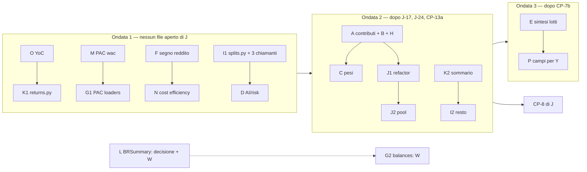

# Piano — fase 01, 11: MF · Matematica finanziaria (1.3.0)

> **Stato** (19/10/2026): 14 lotti dell'audit su 16 entrati; aperti E2 e L, in attesa del developer. Ripartenza del
> 19/10: nessuna decisione di prodotto da MF, implementazione solo dopo il via esplicito del coordinatore, carichi pesanti
> solo negli slot. Tabella qui sotto, «Stato dei lotti (19/10)». (Prima: ondata 1 dal 16/10, analisi `01b9758d8`, piano
> approvato dal developer alle 12:15, §6b, con D-MF5 = (b) e D-MF1 aperta.)
>
> - **Workstream MF** · worktree `LibreFolio-worktrees/e-alfy-turbo-waddle` · ramo `e-alfy-mf-matematica-finanziaria`
>   (rinominato dall'app all'avvio).
> - **Base**: `f77743d47c5082dac41fecb650d71960194b99e7` (`dev_release2`). Il worktree è nato a `dae4de4fa` (581 commit
>   indietro); il coordinatore l'ha portato in fast-forward. Tree pulito.
> - **Corsia**: `--test-port 6190 --data-dir /tmp/librefolio-r13-mf`, con
>   `PIPENV_CUSTOM_VENV_NAME=LibreFolio-SAUMUTtc pipenv run python dev.py test …`; un comando alla volta; prove leggere
>   solo con `vm.loadavg` a 1 minuto < 50; prove pesanti solo nello slot del coordinatore. Script e log nella cartella di
>   sessione, non in `/tmp`.
> - **Coordinatore**: «Release 1.3 planning», `928ffa97-f0c3-4975-a442-3de0c2c20fc7`.
> - **Fonti**: audit `11_financialMath/audit-matematica-finanziaria-20261016.md` (letto su `3d5ee174d`); decisioni
>   `decisioni-analisi-20261014.md` (P2, P19, P21, P22; punti 26–30); piano di J (`05_numbersAnalysis`, §3, §4, CP-3,
>   CP-4, CP-7, §5); piano 43 (inventario §2: R6–R11, L1–L2, O3–O4, S1–S3, W1–W5); backlog sezioni T, J, W (W-B19), Y,
>   MF; piano di Y, «Y12a — U8»; regole `financial-math.instructions.md`, `backend.instructions.md` («One Home»),
>   `ai-development.instructions.md` («Versions»), decisione 10.
> - **devWiki**: `graphify-out/graph.json` assente nel worktree (atteso). Lette direttamente:
>   `decisions/financial-math-one-home`, `decisions/financial-math-single-average-cost`,
>   `decisions/ai-export-version-bump-once-per-release`.
> - **Verifica**: tre agenti `explore` in sola lettura (servizi portafoglio/broker/lotti; AI Export, rischio, PAC,
>   transazioni; frontend) più letture mie (`daily_state.py`, `returns.py`, `fifo/engine.py`, `histories.py`,
>   `ledger_totals.py`, `portfolio_service.py` 815–900 e 1120–1140, `brokers/summary.py`). Nessun test, server o build.

## Stato dei lotti (19/10)

Riconciliato su `b2565a165` (base del 19/10). Commit = merge in `dev_release2` del lotto (più la riga del CHANGELOG
quando c'è). «Developer» = la scelta è una sua domanda, MF non decide.

| Lotto | Cosa | Stato | Dove è entrato |
|---|---|---|---|
| A | Contributo per posizione dal motore (CP-3, R4, P22) | ✅ | `536501541` |
| B | NAV e utile per broker dal motore | ✅ | `bcc644491` |
| C | Funzione «pesi» nella casa, HHI unico (D-MF7) | ✅ | `0eb85aa9b` |
| D | Rapporti, rendimenti di prezzo, annualizzazione | ✅ | `8d244d1c6`, `aca75c7ca`, D3 `482343eb3`, D4 `c2feaf3e4` |
| E | Sintesi del lotto nella casa (E1); corti nello storico di performance (E2) | E1 ✅, **E2 developer** (opzione (b)?) | E1 `e43dfae68` |
| F | Segno del reddito nei lotti e nell'AI Export (D-MF3) | ✅ | `8d244d1c6` |
| G | Quantità e cassa senza `SUM` SQL | ✅ (G2 fatto da C-97 e W-B19) | G1 `8d244d1c6`; G2 `bab52635d`, `6be11ecf3` |
| H | Finestra di detenzione nella casa (D-MF2) | ✅ | `bcc644491` |
| I | Caricatore degli split | ✅ | I1 `8d244d1c6`, I2 `3741b95b0` |
| J | `DailyStateBuilder` più lineare; ripartizione K/R all'arrivo (D-MF4) | ✅ | J1 `d93de2899`, J2 `04a5088ff` |
| K | Un MWRR solo (D-MF5 = b) | ✅ | `8d244d1c6` |
| L | `BRSummary.holdings`: togliere o valutare col motore (D-MF1) | **developer** | — |
| M | PAC: prova del cambio del WAC | ✅ | `8d244d1c6` |
| N | AI Export: efficienza dei costi con la quota | ✅ | `8d244d1c6` |
| O | Yield on Cost senza WAC convertito | ✅ | `8d244d1c6` |
| P | Campi del backend per il frontend (D-MF6); il consumo è di Y | ✅ (backend) | `536501541`, `d93de2899`, `aa4370905`, `c9b1162d4` |

Seguiti nati dal lavoro:

| Voce | Stato | Dove è entrato / chi |
|---|---|---|
| O2 (YoC con reddito netto negativo) | ✅ | `8d244d1c6` |
| W56 (anteprima del WAC arrotondata) | ✅ | `04a5088ff` |
| D3, SI1, SI2, J45a, SEC8-2a, SEC8-2b | ✅ | `482343eb3` (SI1 anche `16f8c74ed`) |
| SEC9a, SEC9c | ✅ | `dd416f5bb`, `29e30b6cc` |
| A2, SEC9e | ✅ | `4507f7507` |
| J45b, A4 | ✅ | `a228b9d30` |
| SEC9g | ✅ | `650c02b17` |
| A5 | ✅ | `aa52a43f7` |
| J45d | ✅ | `685d76dab` |
| A8 | ✅ | `bc466d969` |
| A9 | ✅ | `130002b5c` |
| J45c | ✅ | `ab74aafbf` |
| A7 (+ A6 lato doc) | ✅ | `09d29671d` |
| A10 (+ nit di A9) | ✅ | `4753b66f6` |
| J-14 (di J, fatto da MF) | ✅ | `f44340118` |
| A12 (N92) | ✅ | `5a6d71a1e` |
| K3, C2, J3, A3, A11, SEC9b | **developer** | domande aperte |
| A6 (allineare `daily_state` alla soglia della polvere) | dopo la 1.3 | — |
| A13 (tasso ricavato per divisione) | dopo la 1.3 | X, J, AI Export |
| J4 | di J | — |
| SEC9d, SEC9f | solo informazione | — |
| J-1 (di J) | voci 2, 5, 6, 7 chiuse; 8 senza oggetto | 8a (guardia) **sospesa**, test in `files/parked/` della sessione; 1 e 4 avevano il via il 17/10, non iniziate: aspettano un nuovo via; 3 = A13 |

## 0. Mandato

- Developer, P21 (16/10): «convertire al cambio del giorno della transazione, ogni calcolo nella valuta di
  destinazione»; poi «verifica che tutta la matematica sia fattorizzata in `financial_math` e rivedi gli algoritmi
  troppo contorti». Dopo l'audit: **«Tutti i 16 lotti nella 1.3, aprendo un workstream dedicato alla matematica accanto
  a J»**.
- Precisazioni del coordinatore: C prende da J i due difetti dei pesi (`portfolio_service.py` ~852/856); P solo backend
  (il frontend lo consuma Y; nessun `.svelte` senza OK); G tocca file di W e del PAC (prima chiedere).
- **Vietati finché i lotti aperti di J non entrano** (J-17, poi CP-13a, J-24, CP-7b, J-26): `portfolio_service.py`,
  `financial_math/portfolio/{daily_state,data_quality,models}.py`, `financial_math/price_marks.py`,
  `financial_math/lots/conversions.py`, `schemas/portfolio.py`, AI Export
  `{asset_core,asset_payloads,broker_financial,catalog,portfolio_financial}.py`, il drawdown (CP-13a). Lettura sì.

## 1. Stato reale (riverifica su `f77743d47`)

**Il codice del backend è identico a quello letto dall'audit** (`3d5ee174d`): fra le due HEAD solo giornale, skill e
il lotto ruoli del programma colori (`tokens.css`, `toneClasses.ts`, il gate dei token). CP-7a (`4f9e94420`) è già
dentro `3d5ee174d`. I numeri di riga dell'audit reggono, con gli scarti sotto.

### 1.1 Backend — righe dell'audit

| Riga dell'audit | Esito | Oggi | Nota |
|---|---|---|---|
| `portfolio_service.py:1586-1643` contributi | ✔ | `get_positions_contribution` 1467–1858, valutazione locale 1586–1645 | quantità da righe ×quota (1598), `_get_price_at_date` 489–495, cambio d'inizio a `date_from` (1623), di fine a `price_date_e` (1641), `_` scarta il mancante. Dal motore: realizzato, costo, redditi e costi, P&L di periodo |
| `:1812` «Other» a mano | ✔ | 1804–1812 | stessa formula di `period.period_other_result` (`period.py:112`), che `get_summary` usa (941) |
| `:1672/1683/1706` rapporti | ✔ | 1672, 1680–1683, 1706 | senza `gain_loss_ratio`, senza guardia di base negativa |
| `:720-747` variazione 1 giorno | ✔ | 720–747 | prezzo di ieri convertito alla sua data (729), rapporto a mano (733) |
| `:824-831` NAV per broker | ✔ | 820–846 | ricomposto: valore di mercato + `native_cash.value_at` + in transito e capitale dal motore. Il commento «re-values only when something happens» è superato (stati emessi ogni giorno, giorni sporchi da CP-6) |
| `:856/858` pesi | ✔ | 852–858 | `total_market = Σ or 1`; `nav_denominator = NAV if NAV > 0 else 1` → con NAV ≤ 0 il peso è `valore × 100` |
| `:360-396`, `:399-424` mini-FIFO | ✔ | 360–388, 399–424 | uno split è un'apertura/consumo semplice (T-B4); un trasferimento apre all'arrivo. Nessun test diretto |
| `:871-893` MWRR del sommario | ✔ **più largo** | 871–893 | guardie `engine_nav > 0` **e** `period_net_invested > 0`; la serie (`get_history` 1129–1135) non ha la seconda: **in un periodo con prelievi netti la card dice «—» e il grafico ha la linea** |
| 5 caricatori degli split | ✔ non identici | `portfolio_service.py:161`, `brokers/summary.py:225`, `lots_analysis_service.py:576-580`, `yield_on_cost.py:~806-852`, `portfolio/engine.py:213-226` | stessa join; colonne e validazione diverse (solo il motore valida il rapporto; YoC 10 colonne) |
| `brokers/summary.py:99-150, 242-253` | ✔ | idem | prezzo ultimo senza `as_of` e senza valuta. **Il frontend non legge `holdings` né `missing_fx_pairs`** (la pagina broker usa `cash_balances` e `total_value_base_currency`, che `summary.py` non valorizza mai). Lo leggono solo i test API |
| `lots_analysis_service.py:757-796` | ✔ | 712–~800 | tre convenzioni del rendimento di un lotto: sintesi `total_pnl/opening_value`, `_lot_returns` `(total + income)/cost − 1`, corto in `histories.py:~319` |
| costo residuo ×3 | ✔ | `lots_analysis_service.py:777`, `histories.py:472`, `payloads/portfolio_broker.py:173` | |
| `relative_return` | ✔ | `lots_analysis_service.py:773`, `histories.py:315` | |
| `histories.py:72` segno SHORT | **risolto: errato** | 63–72, `_open_value_on_date` 509 | un frammento corto entra nel NAV **positivo** (quantità positiva, nessun segno di direzione): nel ROI/TWRR della storia di performance un corto aperto pesa come un lungo. Va nel lotto E, con un rosso |
| `fifo/engine.py:877-878` `abs` reddito | ✔ | 877–878; anche 985–986 per FEE/TAX | |
| `fifo/engine.py:1125` peso nativo | ✔ | 1119–1125 | |
| `balances.py:136-150, 168-173` | ✔ (chiamanti più larghi) | `_get_balances_before_date` 126–144 (SUM 132–133), `get_asset_holdings` 166–171 (SUM 169) | `get_cash_balances` è già su `native_balances`. Chiamanti: convalida del batch (56), `get_balances_at_end_of` (148) → `brim_gap_fix.py:74`; `get_asset_holdings` → solo `brokers/summary.py:85` |
| PAC `loaders.py` | ✔ | 15–39, 42–76, 79–110 | SUM SQL di quantità (21) e cassa (94), nessuna quota né ruolo (da confrontare con i pesi del motore, che usano `effective_share`) |
| PAC `wac.py` | ✔ | 25–79, 168–200 | tolleranza `scale·1e-24`; `CostConversion` ha già `rate`, `rate_date`, `days_back` (`average_cost.py:109-117`) |
| `risk/service.py:544-549`, `:1154`; `comparison/plugin.py:58-66, :237` | ✔ | idem | annualizzazione osservata: a 0 giorni la casa solleva, il servizio dà None, il plugin ripiega sul fattore del contesto |
| AI Export: `portfolio_income.py`, `broker_cost_efficiency.py`, `technical_shared.py`, HHI ×2, `portfolio_broker.py` 369–399, `fx_core.py`, `drawdown_context.py:498`, `fx_timing_context.py` | ✔ | idem | `drawdown_context.py:498` **senza guardia sullo zero**; `fx_timing_context.py:332` un altro ciclo di rendimenti semplici |
| `yield_on_cost.py:452-460` | ✔ latente | 439–470 | l'unico chiamante (`portfolio_service.py:674-678`) passa la `wac_currency` della posizione |
| `DailyStateBuilder.build` | ✔ | 157–~780 | pre-frame 244–344, frame 346+; giorno pulito 389–429 (campi copiati a mano); riscalamento dei pool ~648–658; **`frame_start` mai passato in produzione** (`engine.py:401-414`), solo da 3 file di test |
| `engine.py:298-303` ramo vuoto | ✔ | 298–303 | solo un log, poi ricalcolo completo |
| MWRR | Δ (CP-4d) | `_solve_xirr` 410–448 (uno solo, verificato); `calculate_mwrr` 461–505; `calculate_mwrr_series` 508–597 | restano **due costruttori dei flussi** e **una seconda politica** nella serie (tetto adattivo, nuovo tentativo da 0,1, `|r|` più piccolo, 572–590). La riprova R2 è già uscita con CP-4d (il `noqa` di `get_report` la cita ancora: commento vecchio) |

### 1.2 Frontend — righe dell'audit

Tutte ✔, quattro file spostati in `features/`: `KpiSection.svelte:80-85, 93-102, 131-134, 243`;
`lotComparisonChartHelpers.ts:150-171`; `assetPriceDerived.ts:162, 184`; `assets/[id]/+page.svelte:557-562`;
`fxStoreRegistry.ts:64`; `risk/levels/levelHelpers.ts:359` (P19); `dashboard/ExposureTable.svelte:181` (W7 di Y).
Nel backend **nessun campo** di variazione del P&L a un giorno né di «timing effect».

### 1.3 Copie in più, non nell'audit

| Dove | Cosa | Lotto |
|---|---|---|
| `features/dashboard/ExposureTreemap.svelte:446-450` | G/L % di un gruppo (`gl / (value − gl)`) — W8 di Y | P |
| `features/dashboard/PerformanceChart.svelte:~200-210` | contributo % = valore/apertura — P4 di Y | P (dopo A) |
| `features/brokers/lots/unifiedLotsTableHelpers.ts:~140-170`, `lotWacPriceChartHelpers.ts:142`, `LotWacPriceChart.svelte:1413` | piè di tabella dei lotti, % sulla base, valore di un BUY — P5, V11 di Y | P |
| `portfolio_service.py:~700` | `current_price` convertito da sé con `_convert_to_base` accanto al `market_value` del motore | A |
| `portfolio_service.py:~1735`, `:1850-1851` | P&L delle sole posizioni a reddito (`income − fees`), guadagni/perdite lordi | A |
| `brokers/summary.py:145` | percentuale ×100 arrotondata a parte | L |
| `technical_shared.py` (lordo, `abs`) vs `risk/service.py` (netto, negativi rifiutati) | due definizioni di peso | C (varianti dichiarate) |
| piano 43, R7–R10 (`risk/metrics.py:461`, `:128`, `:208-222`, `riskfolio_worker.py:39-45`, `series_preparation.py:355-359`) | da cumulato a periodo, composizione, tasso → periodo, rendimento semplice | D (R11 resta a J, nei segnali) |
| piano 43, W4 (`broker_concentration_context.py:208-214, 409`, `technical_shared.py:1405-1441`, `technical_context.py:646-659`, `portfolio_broker_technical.py:157-191`) | quote % e rapporti di copertura, 3 copie | C (da verificare in apertura del lotto) |
| piano 43, O4 (`pac_allocator/source/portfolio_allocation_source.py`) | qty × `share_percentage`, `None` non gestito | G |

### 1.4 Già chiuso o contraddetto

- **Chiuso da CP-7a**: la divergenza SHORT storia/sintesi (−100 % a pareggio), T-B5, T-B6, la G/L % di
  `brokers/summary.py:141` (ora `gain_loss_ratio`), la conversione della chiusura alla data di chiusura (eccezione 6
  dell'audit).
- **Chiuso da CP-4d**: R2 (riprova MWRR a freddo) e il risolutore non verificato; resta la seconda politica (lotto K).
- **Chiuso da CP-4a–c**: `gain_loss_ratio` per le posizioni (`:717`, `:831`, `:913`), `rebase_to_period`, `period.py`.
- **Errato nell'audit**: nessuna riga; il punto «non verificato» (segno SHORT in `histories.py:72`) è un difetto vero.
- **Ancora del developer**: J-24 (consegna al costo d'un titolo estero) resta a J.

## 2. Sovrapposizioni e proposta di ripartizione

Quasi tutti i lotti dell'audit sono **voci già in coda a J** (piano J §4 e backlog T). Proposta, da confermare col
coordinatore (Q1):

| Voce di J / T | Contenuto | Lotto MF | Proposta |
|---|---|---|---|
| CP-3 (U5a: B8, V2/P2, R4, B19) — analisi di J del 16/10 06:20 | contributi e variazione a 1 giorno dal motore; TRANSFER per broker (P22 ✅) | A, B, parte di D | **a MF**, sull'analisi di J |
| CP-5 (U2, U6, T-B4) | `financial_math/splits.py`; finestre di detenzione; data del lotto più vecchio dopo uno split | I, H | **a MF** |
| CP-11, solo U3 e U7 (+ O4) | quote di proprietà; pesi | F, N, C, G (PAC) | **a MF**; U1 (piano dei cambi) e B15 restano a J |
| CP-12, solo le parti matematiche | U9 (rapporti, TWRR, HHI), T-B8 | C, D, E, F, N | **a MF**; T-B7, T-B9 (renderer) restano a J |
| CP-13 meno CP-13a | U8 lato backend per Y | P | **a MF**; CP-13a (P19, drawdown) resta a J |
| T-U4 residui R6–R10 | annualizzazione, composizione, rendimenti | D | **a MF**; R11 (gemelli pandas) a J con CP-10 |
| W-B19 (W) | cassa della convalida del batch | G | resta **a W**; MF prende la metà delle quantità solo col via di W |
| J-14, riga di W | G/L % di `brokers/summary.py` | L | già fatta da CP-7a |
| CP-8 (J) | `portfolio_service.py` → `services/portfolio/` | — | **dopo** l'ondata 2 di MF (piano 43 §P2.2: la matematica esce prima dello spostamento) |

Restano a J: J-17, CP-13a, J-24, CP-7b, J-26, J-10…J-12, CP-8, CP-9, CP-10 (resto), U1, U10, CP-14, T-B7, T-B9.

## 3. Lotti

Legenda: **Numeri** = cambia cifre che l'utente vede; **Prova** = come provo l'equivalenza o il cambio; **Peso** =
minimo / piccolo / medio / grande (nessuna stima di tempo).

### MF-A · Contributo per posizione dal motore (CP-3 di J)
- **Superfici**: `portfolio_service.py` (`get_positions_contribution` 1467–1858, `_get_price_at_date`,
  `_convert_to_base`, `get_report` 2010; `get_summary` ~700); `financial_math/portfolio/{engine,daily_state,models}.py`
  (istantanee delle posizioni a `period_start`, con `_build_position_state`); `financial_math/portfolio/` modulo nuovo
  per le regole di R4 (base, ripiego, finestra, chiusi); `ai_export/components/technical_shared.py:467-485` (eredita).
  Test: `test_financial/test_portfolio_service*.py`, `test_portfolio_cost_currency.py`, golden `native_cash_guard`;
  test nuovi della casa. Doc: dev `financial_math.md`, la pagina della Performance (teoria `performance-metrics`).
- **Numeri**: sì. Tabella Performance della Dashboard e del report (valore d'inizio/fine, delta non realizzato, %,
  annualizzato, riga «Other» che si riduce); pesi tecnici dell'AI Export. Cambiano: titoli senza quotazione a un
  confine (ora il segno di scambio, prima mancava), prezzo di fine vecchio in valuta estera (cambio del giorno di fine,
  non della quotazione), split dopo l'ultimo segno, cambio mancante (ora segnalato, mai scartato), ripartizione per
  broker d'un trasferimento nel periodo (P22: ogni broker il suo tratto; totale invariato), ordine degli unallocati
  (B19, solo ordine).
- **Dipendenze**: J-17 e J-24 dentro (stessi file); la decisione P22 c'è già. Prima di CP-8.
- **Prova**: rossi (test-author) — titolo con soli scambi ai confini; fine in USD con prezzo vecchio; split nel periodo;
  trasferimento a metà periodo per broker e totale; cambio mancante → valore None e coppia nella qualità dei dati; «Other»
  = `period_other_result`; R4 nella casa (base, ripiego, finestra, chiusi). Golden del motore identico (le istantanee in
  più non cambiano gli stati giornalieri).
- **CHANGELOG** (🐛 Fixed): «Dashboard Performance table: each position's start and end value now comes from the same
  valuation as the portfolio (trade prices, splits, the exchange rate of the period's end), so the "Other" line no
  longer absorbs valuation differences; a transfer during the period splits the result between the two brokers.»
- **Peso**: grande.

### MF-B · NAV e utile per broker dal motore
- **Superfici**: `portfolio_service.py:820-846` (legge `BrokerDailyContribution.nav_contribution` e `pnl_contribution`
  dell'ultimo stato; via il commento superato). Test: `test_broker_pnl_contributions.py`, `api portfolio`.
- **Numeri**: attesi **nessuno** oltre la polvere di conversione (stessa cassa nativa, stesse valutazioni del giorno).
- **Prova**: parità card ↔ contributo su corpus (golden, contributi per broker, broker con cassa estera, giorno senza
  eventi) a 0,01; se emerge uno scarto > polvere, lo dichiaro prima di cambiare.
- **Dipendenze**: con A. **Peso**: piccolo.

### MF-C · Una funzione «pesi» nella casa (+ HHI)
- **Superfici**: `financial_math/` modulo nuovo (pesi su un denominatore, varianti `net` e `gross` dichiarate, None
  se il denominatore ≤ 0; HHI e peso massimo); chiamanti `portfolio_service.py:852-858`, `derived_views.py:212-247`
  (`_alloc`, `build_allocation_history`), `risk/service.py:544-549` (resta il rifiuto dei negativi, D59),
  `technical_shared.py:467-485`, `broker_financial.py:205-212` e `broker_concentration_context.py:88-104` (una copia
  sola), W4 da verificare. Test: casa, `api portfolio`, AI Export broker, risk. Schema: descrizione di
  `nav_weight_percent`/`allocation_percent` (nullable) → `api sync`.
- **Numeri**: sì, solo nei casi limite. Con NAV ≤ 0 il peso sul NAV passa da `valore × 100` a «—»; con totale ≤ 0
  idem per l'allocazione. AI Export: HHI e peso massimo calcolati dai pesi non arrotondati (scarti alla 4ª cifra).
  Nota di J: da J-17 una posizione valutata al costo conta in entrambi i pesi (nessuna eccezione).
- **Dipendenze**: dopo J (vietati `portfolio_service.py`, `broker_financial.py`); dopo A per i pesi tecnici. Y W7
  toglie il ripiego del frontend (allineato: null → «—»).
- **Prova**: rosso per NAV ≤ 0 e totale 0; parità sui casi normali (stessi 0,01); HHI unico.
- **CHANGELOG** (🐛 Fixed): «Holdings: when the net worth is zero or negative, the weight on net worth shows "—"
  instead of a meaningless percentage.»
- **Peso**: piccolo-medio.

### MF-D · Rapporti, rendimenti di prezzo, annualizzazione, composizione
- **Superfici**: `returns.price_return`/`gain_loss_ratio`; una funzione Decimal della casa per il passo fra due
  cumulati (`(1+b)/(1+a) − 1`); AI Export `technical_shared.py:819`, `fx_timing_context.py:323-362` (e 332),
  `payloads/portfolio_broker.py:369-399`, `drawdown_context.py:498` (dopo CP-13a); rischio `risk/service.py:1154`,
  `comparison/plugin.py:58-66, 237` → `series_preparation.observed_annualization` e `risk/metrics.compounded_return`;
  R7–R10 del piano 43. La parte `portfolio_service.py` (733, 747, 1672, 1683, 1706) va in A; quella dei lotti in E.
- **Numeri**: nessuno, salvo i casi limite: base zero → None (oggi divisione per zero in `drawdown_context`), 0 giorni
  (una politica sola), ritorni non validi nel confronto (oggi composti in silenzio). Decimal vs float: identici al
  float stampato.
- **Prova**: parità prima/dopo sui test esistenti (`ai-export`, `risk-all -k comparison`, `series-preparation`), più
  test puri dei casi limite.
- **Versioni AI Export**: vedi Q2.
- **Peso**: piccolo (molti file, ognuno una riga).

### MF-E · Sintesi del lotto nella casa
- **Superfici**: `lots_analysis_service.py:712-~800` → `financial_math/lots/` (riusa `_value_snapshot_on_date`,
  `_lot_returns`); una formula del costo residuo (`:777`, `histories.py:472`, `portfolio_broker.py:173`); una
  convenzione del rendimento per direzione; `relative_return` → `price_return`; **segno dei corti nel NAV della storia
  di performance** (`histories.py:63-72`, `_open_value_on_date`); T-B8 (le due somme della sintesi FIFO dell'AI Export
  sullo stesso insieme di lotti, `payloads/portfolio_broker.py:532-622`).
- **Numeri**: sintesi dei lotti lunghi **nessuno** (identità; al più l'ultima cifra di 28). Storia di performance dei
  lotti con corti aperti: ROI/TWRR cambiano (oggi il corto pesa come un lungo). AI Export: le due somme di T-B8 sullo
  stesso insieme (cambiano solo con un costo ignoto).
- **Dipendenze**: dopo CP-7b (V1 tocca sintesi e `histories.py:267`) e J-24 (`lots/conversions.py` vietato).
- **Prova**: parità della sintesi su `lots-analysis-pure` e `roi-fifo-utils`; rossi per il corto nella storia e per
  T-B8.
- **CHANGELOG** (🐛 Fixed): «Lots performance history: an open short lot now counts against the value instead of as a
  holding.»
- **Peso**: medio.

### MF-F · Segno del reddito (FIFO e AI Export)
- **Superfici**: `fifo/engine.py:877-878` (pool di reddito col segno), da verificare `:985-986` (FEE/TAX: rimborsi);
  `ai_export/components/portfolio_income.py:340-385` su `native_cash.flows()`/`sums_by_date` con `effective_share` e
  segno; docstring corretto. Test: `roi-fifo-utils`, `lots-analysis-pure`, `ai-export` (portfolio_income). Doc: teoria
  `fifo-lot-analysis` (reddito), dev `lots_analysis_service.md`.
- **Numeri**: sì. Lotti: una correzione negativa di DIVIDEND/INTEREST riduce il reddito del lotto (oggi lo aumenta) →
  reddito e rendimento netto del lotto. AI Export: timeline dei redditi con le correzioni negative e, dalla pagina d'un
  broker, Editor/Viewer al 100 % (B9: «la regola della pagina da cui parte»).
- **Dipendenze**: nessun file vietato; d'accordo con J per `fifo/engine.py` (CP-7b/J-24 non toccano quelle righe).
  Decisione D-MF3.
- **CHANGELOG** (🐛 Fixed): «Lots: a negative dividend or interest correction now lowers the lot's income, as on the
  Dashboard.»
- **Peso**: piccolo.

### MF-G · Quantità e cassa senza `SUM` SQL
- **Superfici**: G1 PAC `pac_allocator/source/loaders.py:15-110` su `ledger_totals.position_quantities`,
  `native_cash.native_balances`, `price_marks` (ultimo prezzo ≤ `as_of`), con la quota (O4) da chiarire; G2 W
  `transactions/balances.py:126-144` (quantità della convalida su `position_quantities`; la cassa è W-B19 di W) e
  `get_asset_holdings` 166–171 (sparisce se L toglie `holdings`).
- **Numeri**: nessuno (Decimal esatto invece del float di SQLite; differenze solo oltre ~15 cifre). O4: se la quota
  manca nel PAC ed è un difetto, è un cambio da dichiarare (rosso prima).
- **Dipendenze**: G1 col via del proprietario del PAC (Q4); G2 col via di W (Q3).
- **Prova**: parità su `portfolio-allocation-source`, `pac-planner-*`, `transaction`, `brim-gap-fix`.
- **Peso**: piccolo-medio.

### MF-H · Finestra di detenzione nella casa (T-B4)
- **Superfici**: `portfolio_service.py:360-424` → `financial_math/` (FIFO delle quantità per broker, con gli split che
  riscalano invece di aprire/consumare); chiamanti `:663`, `:1584`, `:1703`. Test nuovi della casa.
- **Numeri**: sì. Data del lotto aperto più vecchio e annualizzato della Performance per le posizioni con uno split
  (oggi lo split apre un «lotto» datato allo split o consuma i più vecchi). Con D-MF2 = data d'origine, anche le
  posizioni trasferite.
- **Dipendenze**: dopo J (`portfolio_service.py`); con A (stessa funzione dei contributi). Decisione D-MF2.
- **CHANGELOG** (🐛 Fixed): «Performance: a stock split no longer resets the holding period used for annualized
  returns.»
- **Peso**: piccolo-medio.

### MF-I · Un caricatore degli split (`financial_math/splits.py`)
- **Superfici**: modulo nuovo (caricamento + validazione del motore + `_cumulative_split_ratio`, oggi in
  `daily_state.py:45`); punto di lettura del DB nominato nella regola 1 (`financial-math.instructions.md`, mappa);
  chiamanti `portfolio/engine.py:213-226`, `lots_analysis_service.py:576`, `yield_on_cost.py:~806`, poi
  `portfolio_service.py:161` e `brokers/summary.py:225` (o sparisce con L). Guardia `test_layer_boundaries.py`.
- **Numeri**: nessuno; con dati corrotti (rapporto ≤ 0) tutti i chiamanti rifiutano come il motore (oggi alcuni
  tacciono).
- **Dipendenze**: I1 (modulo + 3 chiamanti liberi) subito; I2 dopo J e con W/L.
- **Prova**: parità sui test di motore, lotti, YoC; test puro della validazione.
- **Peso**: piccolo.

### MF-J · `DailyStateBuilder` più lineare
- **J1, refactor puro**: togliere il pre-frame (244–344) e `frame_start` (mai passato in produzione) e il ramo vuoto
  `engine.py:298-303`; una sola `apply_pool_rule(tx, amount, sell_cost, pools)`; `collect_dirty_days(...)` pura;
  `dataclasses.replace` per i giorni puliti (con copie esplicite dei dict/set se qualcuno li muta: da verificare).
  I test che usano `frame_start` (`test_portfolio_engine_vnext.py`, `test_broker_pnl_contributions.py:390-407`,
  `test_broker_internal_flows.py` casi 09–10) si riscrivono sul comportamento equivalente con `date_from`
  (test-author). **Numeri**: nessuno.
- **J2, cambia numeri (decisione D-MF4)**: l'arrivo d'un trasferimento di cassa o d'un cambio valuta interno porta la
  ripartizione K/R della partenza (oggi tutto in K: «Approximate»); poi via il riscalamento dei pool se la deriva
  misurata sul corpus è 0. **Numeri**: la scomposizione della cassa fra capitale versato e rendimenti generati (Dashboard)
  dopo trasferimenti interni e conversioni di valuta: più rendimenti, meno capitale, totale invariato.
- **Dipendenze**: dopo J-17, J-24 (`daily_state.py`) e dopo A (che aggiunge le istantanee d'inizio periodo).
- **Prova**: J1 golden `eur_only_golden.json` identico, `portfolio-engine`, `roi-fifo-utils`, contributi per broker,
  candele, finanziamento degli acquisti: stati giornalieri uguali campo per campo su tutto il corpus (uno script di
  confronto prima/dopo nella cartella di sessione). J2 rossi prima.
- **CHANGELOG** (J2, 🐛 Fixed): «Dashboard cash breakdown: cash moved between brokers or converted between currencies
  keeps its share of generated returns instead of being counted as contributed capital.»
- **Peso**: J1 medio; J2 piccolo-medio.

### MF-K · Un MWRR solo
- **Superfici**: `returns.py` — un costruttore `_mwrr_flows(start, start_nav, flows, end, end_nav)` per
  `calculate_mwrr` e `calculate_mwrr_series`; una politica della radice (quella del punto singolo, verificata, più
  vicina a 0,1); la serie a freddo se il costo misurato regge (soglia proposta: +30 % al massimo sul tempo di
  `get_report` del DB popolato), altrimenti il sommario legge l'ultimo punto della serie. `portfolio_service.py:871-893`:
  il NAV iniziale di ripiego e le guardie nella casa, **le stesse della serie**. Commento `noqa` di `get_report`.
- **Numeri** (D-MF5 = **(b)**, developer 16/10): sì, nel grafico. Le guardie della card (investito netto del periodo
  > 0, NAV > 0) diventano della casa e valgono **per ogni punto** della serie, con quel giorno come fine del periodo:
  dove la card direbbe «—» il punto è «—», e l'ultimo punto è la card. In un periodo con prelievi netti la linea MWRR
  sparisce dal giorno in cui l'investito netto scende a zero o sotto. Con più radici, card = ultimo punto (0 casi nei
  20 000 di CP-4d).
- **Dipendenze**: K1 (`returns.py`) subito, su pezzi diversi da quelli di CP-13a (`required_recovery_return` dopo
  `price_return`); K2 (`portfolio_service.py`) dopo J.
- **Prova**: rossi — un punto con investito netto ≤ 0 è None; un NAV ≤ 0 è None; ultimo punto = `calculate_mwrr` sugli
  stessi dati; parità sul corpus e sulle 20 000 sequenze di CP-4d (`test_mwrr_verified_root.py`); misura di costo
  della serie a freddo.
- **CHANGELOG** (🐛 Fixed): «Dashboard: the money-weighted return line now follows the card: where the period has no
  net invested capital (net withdrawals), both show "—".»
- **Peso**: piccolo-medio.

### MF-L · `BRSummary.holdings`
- **Superfici**: `brokers/summary.py` (W), `schemas/brokers.py` (`BRSummary`, `BRAssetHolding`), `api sync`, test API
  dei broker. Due strade (D-MF1): **togliere** `holdings`, `missing_fx_pairs` e `total_value_base_currency` (mai
  valorizzato), con `get_asset_holdings`, `_holding_average_costs`, `_get_latest_prices_batch` e la copia degli split;
  oppure valutarli col motore (`get_report` filtrato sul broker), con `as_of` e valuta del prezzo.
- **Numeri**: nell'interfaccia nessuno (non li legge). API: rottura (via) o cifre corrette (motore).
- **CHANGELOG**: (via) ⚠️ Breaking: «`GET /brokers/{id}/summary` no longer returns `holdings`, `missing_fx_pairs` and
  `total_value_base_currency`; holdings and their value come from the portfolio report.» (motore) 🐛 Fixed: «… holdings
  are valued like the Dashboard, in the price's own currency and as of the requested date.»
- **Peso**: piccolo (via) / medio (motore).

### MF-M · PAC: prova del cambio del WAC dal costo medio
- **Superfici**: `pac_allocator/source/wac.py:25-79, 168-200` → `CostStep.conversion` (`rate`, `rate_date`,
  `days_back`); via `_load_current_wac_fx_rows` e `_rates_match`. Test `portfolio-allocation-source`, `pac-planner-*`.
- **Numeri**: nessuno atteso; l'evidenza «missing» può cambiare dove il riempimento all'indietro di `wac.py` differisce da
  quello di `convert_bulk` (da misurare; se succede, lo dichiaro con un rosso).
- **Dipendenze**: via del proprietario del PAC (Q4). **Peso**: piccolo.

### MF-N · AI Export: costi del broker con la quota effettiva
- **Superfici**: `broker_cost_efficiency.py:152-168` su `effective_share` (B9/O3); `:550-568` (NAV medio e rapporti)
  resta, dichiarato come fatto dell'AI Export, o va nella casa se un secondo chiamante lo vuole. Test: `ai-export`
  (broker adequacy, runtime).
- **Numeri**: sì, solo AI Export: dalla pagina d'un broker un Editor/Viewer vede turnover e rapporti pieni (oggi × 0).
- **CHANGELOG** (🐛 Fixed): «AI Export from a broker page: editors and viewers get the broker's full turnover and cost
  ratios.»
- **Peso**: piccolo.

### MF-O · Yield on Cost: il WAC convertito al cambio storico
- **Superfici**: `yield_on_cost.py:439-470`: una `wac_currency` ≠ valuta del report si rifiuta (conversione mancante
  dichiarata), mai convertita a `as_of`. Test YoC (`roi-fifo-utils`).
- **Numeri**: nessuno (l'unico chiamante passa la valuta del report). **Peso**: minimo.

### MF-P · Campi del backend per il frontend (U8 lato backend, per Y)
- **Superfici**: `schemas/portfolio.py` + `portfolio_service.py`/`financial_math/portfolio/`: variazione del P&L totale
  a un giorno (importo, % sul NAV di ieri, % sul P&L di ieri), «timing effect» (MWRR cumulato − TWRR), G/L % per
  gruppo della treemap (W8), contributo % della Performance (P4, da A), aggregato dei lotti e piè di tabella (P5, da
  E), valore d'un BUY nel grafico WAC (V11). `api sync` (dichiarato). Il consumo è di Y (Y12b); nessun `.svelte` mio.
- **Numeri**: le cifre dei KPI diventano quelle del backend (Decimal, stati del motore): scarti piccoli rispetto al
  calcolo dalla `history` in float.
- **Dipendenze**: dopo A, E, K; CP-13a (P19) resta a J. Decisione D-MF6 (cosa è misura interattiva).
- **Prova**: test della casa e dello schema; Y scrive i rossi del frontend.
- **CHANGELOG**: con Y, una riga 🔄 Changed: «Dashboard KPI deltas and lot aggregates are computed by the server.»
- **Peso**: medio.

## 4. Ordine (ondate)

1. **Ondata 1** (subito dopo il via, nessun file vietato): O, K1, M, G1, F, N, I1, D (AI tranne `drawdown_context`;
   rischio se J/X lo consentono rispetto a CP-9).
2. **Ondata 2** (dopo J-17, J-24 e CP-13a): A (+B, +H, parte `portfolio_service` di D), C, K2, I2, poi J1 e J2. Poi
   CP-8 di J.
3. **Ondata 3** (dopo CP-7b): E (+T-B8), poi P.
4. **Fuori sequenza**: L e G2 quando arrivano D-MF1 e il via di W.

Un checkpoint per lotto (o per coppia piccola: O+K1, M+G1, F+N); i lotti che cambiano numeri sempre da soli.

## 5. Decisioni per il developer (domande chiuse, con raccomandazione)

| # | Lotto | Domanda | Raccomandazione |
|---|---|---|---|
| D-MF1 | L | `GET /brokers/{id}/summary` restituisce `holdings` che nessuna pagina legge, con prezzi senza data limite né valuta. **(a)** toglierli (rottura dell'API, CHANGELOG ⚠️) **(b)** valutarli col motore | **(a)**: il report del portafoglio li dà già giusti; meno codice e una copia in meno |
| D-MF2 | H | Per una posizione arrivata con un trasferimento, la «detenzione» che annualizza parte **(a)** dall'arrivo nel broker **(b)** dall'acquisto d'origine | **(a)**, coerente con P22 («ogni broker risponde del suo tratto»); in ogni caso lo split non azzera più la data |
| D-MF3 | F | Una correzione negativa di dividendo o interesse nei lotti: **(a)** riduce il reddito, come la Dashboard **(b)** resta in valore assoluto | **(a)**; lo stesso per un rimborso di commissione o tassa, se il controllo lo conferma |
| D-MF4 | J2 | La scomposizione della cassa fra capitale e rendimenti dopo trasferimenti interni e cambi valuta: **(a)** l'arrivo porta la ripartizione della partenza (cambia quel grafico) **(b)** com'è oggi | **(a)**, togliendo il riscalamento solo se la deriva misurata è 0 |
| D-MF5 | K | In un periodo con prelievi netti la card MWRR dice «—» e il grafico ha la linea: **(a)** la card mostra il valore, come il grafico **(b)** il grafico si spegne come la card | **(a)**: il MWRR è definito anche con prelievi netti. ✅ **Decisa (b)** dal developer (16/10 12:15): «se non ci sono dati per la card, anche la linea è corretto che sparisca» |
| D-MF6 | P | **(a)** Variazione del P&L a un giorno, timing effect, G/L % dei gruppi: campi del backend. **(b)** L'aggregato dei lotti **selezionati** e le variazioni di prezzo/cambio su un intervallo scelto: misure interattive dichiarate nel codice (marcatore + guardia di Y), o anche loro dal backend | (a) sì; (b) dichiarate, tranne la tabella dei periodi fissi dell'asset (1G, 1S…), dal backend |
| D-MF7 | C | Con NAV ≤ 0 il peso sul NAV: **(a)** «—» **(b)** com'è oggi | **(a)** |

## 6. Domande per il coordinatore

- **Q1** — Ripartizione del §2 (MF prende CP-3, CP-5, U3/U7 di CP-11, la matematica di CP-12, CP-13 meno CP-13a;
  CP-8 dopo l'ondata 2). Serve l'OK di J sul suo piano e sul backlog.
- **Q2** — Versioni dell'AI Export: un builder rifatto con output identico byte per byte non sale (lettura della
  decisione `ai-export-version-bump-once-per-release`: conta il payload o un valore calcolato in altro modo); sale di
  +1 su `v1.2.0` (una volta per release, mappa compatta nello stesso cambio) chi cambia valori: C (concentrazione), F
  (`portfolio.income…`), N (efficienza dei costi), D dove un caso limite passa a None, E (T-B8). Confermi?
- **Q3** — W: `transactions/balances.py` (G2) e `brokers/summary.py` (I2, L). Proposta: G2 resta in W-B19 allargata
  alle quantità, MF dà la funzione (`position_quantities` c'è già) e rivede; L la scrive MF col via di W dopo D-MF1.
- **Q4** — Proprietario del PAC (`pac_allocator/source/`, toccato da J in CP-1): via per G1 e M.
- **Q5** — Rischio (D): `risk/service.py` e `comparison/plugin.py` prima di CP-9 (taglio del rischio, dopo PL2 di X)
  o dopo? Proposta: prima, tre righe, così CP-9 sposta il codice già pulito.
- **Q6** — Moduli nuovi in `financial_math/` (`splits.py`, pesi, finestre di detenzione, regole del rendimento di
  periodo d'una posizione): la mappa (`__init__.py`, `financial-math.instructions.md`, `backend.instructions.md`) la
  aggiorno io a ogni lotto; `splits.py` diventa un punto di lettura del DB nominato nella regola 1. OK?
- **Q7** — Slot pesanti: `all-backend` a fine ondata (1, 2, 3) e prima di ogni checkpoint che cambia numeri.

## 6b. Risposte e decisioni (16/10, 12:15–12:25)

- **Developer, alla lettera** (12:15, relayato dal coordinatore): «approvo il piano, con giusto dei chiarimenti, la
  pagina broker via api non è la stessa api di sashboard? sicuro che nessuno usa quei dati? […] il resto fino a 4 ok.
  riguardo 5 se non ci sono dati per la card, anche la linea è corretto che svompaia. su 6 pienamente daccordo. 7 ok».
  - D-MF2, D-MF3, D-MF4, D-MF6, D-MF7: come raccomandato. **D-MF5: (b)**. **D-MF1: aperta** (il coordinatore ha
    risposto alle sue domande e aspetta il sì).
- **Q1**: ripartizione accettata da J, CP-3 compreso, con **quattro vincoli**:
  1. `daily_state.py` resta di J fino all'ingresso di J-24: I1 non sposta `_cumulative_split_ratio` nell'ondata 1
     (lo scambio dell'import va nell'ondata 2). `lots_analysis_service.py` riapre con CP-7b: la modifica di I1 lì entra
     prima che CP-7b parta, oppure è una riga sola.
  2. `returns.py`: CP-13a aggiunge `required_recovery_return` subito dopo `price_return`, più la sua riga nelle tre
     mappe e in `financial_math.md`. K1 in parallelo, su pezzi diversi.
  3. **Versioni dell'AI Export**: J-17 ha già portato `asset.provenance` e `asset.positions_by_broker` a 2,
     `portfolio.provenance` e `broker.provenance` a 3: non salgono più nella 1.3. `catalog.py` e
     `snapshotDataRenderer.ts` sono nel diff di J-17: **ogni cambio di versione aspetta l'ingresso di J-17**; poi il
     renderer resta di J (D-J5): MF tocca solo le voci di `COMPACT_COMPONENT_VERSIONS` dei componenti che alza, nello
     stesso cambio, e avvisa J.
  4. `drawdown_context.py` (D): dopo CP-13a `remaining_to_peak_ratio` può essere None; se D alza i quattro componenti
     del drawdown, li fa accettare None.
- **Q2**: confermata con il vincolo 3: nessun aumento per un output identico byte per byte; +1 per release a chi
  cambia valori, mai due volte nella 1.3.
- **Q3**: confermata. G2 resta in W-B19 di W, allargata alle quantità: MF dà la funzione e rivede. L aspetta D-MF1 e poi
  il via di W.
- **Q4**: la sorgente del PAC è di J: G1 e M **dopo l'ingresso di J-17** (`test_portfolio_allocation_source.py` è nel
  suo diff).
- **Q5**: D prima di CP-9, ok (J d'accordo). **Q6**: ok; mappa aggiornata a ogni lotto; `splits.py` punto di lettura
  nominato nella regola 1. **Q7**: ok, gli slot si chiedono con l'elenco delle corse e la durata.
- **Ondata 1, rivista** (coordinatore, 12:25): O, K1, F, N, I1 (senza `daily_state.py`), D (gli aumenti di versione
  dopo J-17). M e G1 dopo J-17. Rossi prima con test-author; un lotto che cambia numeri sempre da solo; prove leggere sotto
  carico 50; nessun `.svelte` senza OK.
  - **Conseguenza del vincolo 3, mia lettura**: N e la metà AI Export di F (`portfolio_income.py`) cambiano valori, quindi
    vogliono l'aumento nello stesso cambio: entrano dopo J-17. Ora: F1 (FIFO), e di D solo le sostituzioni a output
    identico (AI Export senza aumento, rischio).

## 7. Rischi

- **A e J1 su `daily_state.py`** (1288 righe, il cuore dei numeri): rischio di regressione silenziosa. Contromisura:
  confronto campo per campo degli stati giornalieri prima/dopo su tutto il corpus del motore, golden identico, più
  `all-backend`.
- **Conflitti con J** (stessi file per tutta l'ondata 2) e con CP-8 (spostamento di `portfolio_service.py`): ordine del
  §4; mai due scrittori.
- **K a freddo**: costo della serie; misurato prima di scegliere.
- **AI Export**: versioni (Q2) e sonde: la sonda reale vuole i dati del developer (`real-data-copy`), da chiedere.
- **Test con `frame_start`** (J1): riscriverli senza perdere ciò che provano (capitale d'apertura, posizioni al primo
  giorno).
- **Macchina condivisa**: prove leggere sotto carico 50; nessuna prova pesante fuori slot.
- **Doc tradotte**: le pagine di teoria toccate (performance, lotti) lasciano debito di traduzione dichiarato.

## 8. Definizione di fatto (per lotto)

- Rosso prima (test-author), visto fallire per il motivo giusto, per ogni comportamento che cambia; valori che cambiano
  dichiarati nel piano prima del codice.
- Parità provata dove i numeri restano: test esistenti verdi con gli stessi conteggi, golden identico, confronto
  prima/dopo dove serve.
- Nessuna copia rimasta: grep della funzione sostituita a zero fuori dalla casa; mappa della casa aggiornata; guardia
  dei confini verde.
- ruff, black, dead code senza reperti nuovi; `api sync` dichiarato quando uno schema cambia.
- Doc EN (docs-writer), `mkdocs build` stretto e `check-links`; debito di traduzione dichiarato.
- Riga di CHANGELOG proposta (testo all'handoff; il file lo scrive il coordinatore).
- Righe del backlog MF chiuse con ✅, data e commit; righe del runner dichiarate.
- Porta 6190 libera (`lsof`), piano aggiornato a ogni passo, handoff FROZEN.

## 9. Test e specialisti

- **Selettori** (preambolo della corsia): `services financial-math`, `services roi-fifo-utils` (golden compreso),
  `services portfolio-engine`, `services lots-analysis-pure`, `utils roi-utils`, `api portfolio`, `api brokers`,
  `services broker`, `services transaction`, `services brim-gap-fix`, `services portfolio-allocation-source`,
  `services pac-planner-{core,evaluator,wire-numbers}`, `services ai-export` (con `-k` per componente),
  `services risk-all -k "comparison or annualiz"`, `services series-preparation`; a fine ondata `all-backend` nello slot.
- **test-author**: ogni rosso e ogni test riscritto (J1), file distinti per lotto, nessuna esecuzione senza corsia.
- **docs-writer**: dev `financial_math.md`, `transactions/lots_analysis_service.md`, `fifo_lot_engine.md`, pagine di
  teoria della performance e dei lotti; stamp solo per ritocchi puntuali.
- **Skill**: `ai-export-probe-tuning` (C, D, E, F, N), `test-triage` per i rossi non ovvi, `real-data-copy` solo su
  richiesta.

## 10. Avanzamento

### Analisi ✅ (2026-10-16)

- HEAD verificata `f77743d47`, tree pulito; riverifica dell'audit (§1), ripartizione (§2), schede (§3), ordine (§4),
  decisioni (§5), domande (§6).
- **⚠️ Fuori pista**: il worktree era nato a `dae4de4fa` (581 commit indietro): fermo e segnalato, fast-forward del
  coordinatore. Un errore del servizio ha interrotto il turno a metà analisi: ripresa dalla stessa HEAD, nessun file
  toccato.
- Riassunto mandato al coordinatore (16/10). Scritti solo il giornale: questo piano e le righe MF-A…MF-P nella sezione
  MF di `Phase_0/BACKLOG_POST_1.2.md`. Nessun codice, nessuna prova, nessun server. **FROZEN** in attesa
  dell'autorizzazione del developer, relayata alla lettera.
- ✅ Committato dal coordinatore: `01b9758d8` (`docs(journal): MF financial-math analysis and lots`).

### Ondata 1 (via del coordinatore, 16/10 12:25) — HEAD `01b9758d8`

- ✅ **Piano aggiornato** (12:30): §6b (decisioni, risposte Q1–Q7, i quattro vincoli di J), D-MF5 = (b) nella scheda
  di MF-K.
- **⚠️ Fuori pista**: le risposte Q1–Q7 non erano arrivate col via del piano (messaggio vuoto); richieste e ricevute
  alle 12:25.

#### MF-O — disegno (16/10)

- **Stato reale**: `_resolve_conversion_context` (`yield_on_cost.py:439-482`) converte `wac_per_unit` da
  `wac_currency` alla data `as_of`. L'unico chiamante (`portfolio_service.py:674-679`) passa
  `DailyPositionState.wac_currency`, che è **sempre** la valuta del report (`daily_state.py:844`): oggi la conversione
  è un'identità (`convert_bulk`, ramo `identity`, `fx/conversion.py:118`), senza provenienza (aggiunta solo se le valute
  differiscono). Due test fissano il comportamento latente: `test_yield_on_cost.py:~1380-1420` (WAC in ZAR, report in
  XTS, provenienza `("wac", as_of)`) e `test_converted_nonpositive_wac_is_typed_unavailable` (~1500-1570, WAC in USD
  che la conversione finta rende ≤ 0).
- **Disegno**: il WAC è un costo storico già nella valuta del report; un costo medio per unità non ha date, quindi non
  si può convertire «al cambio della sua transazione» (P21). Un `wac_currency` diverso dalla valuta del report è un
  errore del chiamante: **`ValueError`** all'ingresso di `calculate_yield_on_cost_for_positions`, mai una conversione.
  Via la richiesta `"wac"` a `convert_bulk`, `wac_by_key` (il WAC è quello d'ingresso) e il controllo «WAC convertito ≤
  0», che diventa irraggiungibile. Lo schema (`YieldOnCostFxProvenance.purpose` ammette ancora `"wac"`) resta: è di J
  (`schemas/portfolio.py`).
- **Numeri**: nessuno. Identità byte per byte nel percorso di produzione.
- **Test** (test-author, finito): rosso «un WAC in un'altra valuta si rifiuta» e «il WAC nella valuta del report non
  va mai a `convert_bulk`»; riscritti il test ZAR/XTS (WAC 10 XTS, nessuna provenienza `"wac"`) e quello del WAC
  convertito ≤ 0 (ora: dove il rifiuto si ferma — `"eur"` minuscolo accettato, WAC o valuta mancanti → `MISSING_WAC`).
  Nota del test-author: su `HEAD` un cambio mancante della coppia del WAC lasciava la posizione senza WAC mostrato; ora
  quel percorso non esiste più. `"wac"` resta ammesso nello schema e nel frontend (`YieldOnCostCell.svelte`), senza più
  produttori.
- ✅ **Codice** (16/10, solo scrittura, nessuna prova: carico ~100): `yield_on_cost.py` — `ValueError` all'ingresso
  per un `wac_currency` diverso dalla valuta del report (il messaggio dice «report currency»); via `wac_by_key`, il
  campo `purpose` di `_ConversionSpec` (le conversioni sono solo dei redditi; la provenienza scrive `"income"`), la
  conversione del WAC e il controllo irraggiungibile «WAC convertito ≤ 0»; `_input_wac` restituisce al chiamante il WAC
  d'ingresso (None senza valuta, come prima); parametri `converted_wac` → `wac`. `convert_bulk` con zero richieste
  ritorna senza query (`fx/conversion.py:105-106`).

#### MF-K1 — disegno (16/10)

- **Stato reale**: `calculate_mwrr` (`returns.py:461-505`) e `calculate_mwrr_series` (`:508-597`) costruiscono i flussi
  ognuno a modo suo (il primo una riga per flusso, la seconda sommati per data) e scelgono la radice in due modi (il
  punto singolo da 0,1; la serie dal punto precedente, con il tetto adattivo, il nuovo tentativo da 0,1 e il `|r|` più
  piccolo). La guardia della card (investito netto > 0, NAV > 0) e il NAV iniziale di ripiego stanno nel servizio
  (`portfolio_service.py:879-885`); il ripiego dà sempre `period_navs[0].nav` (riletto `rebase_to_period`, `:156-183`),
  cioè il NAV iniziale che la serie usa già.
- **Disegno** (solo `returns.py`, pezzi diversi da `price_return`/`required_recovery_return` di CP-13a):
  1. un costruttore dei flussi, sommati per data in `Decimal` prima del passaggio a `float`;
  2. una politica della radice: `_solve_xirr` da 0,1 per ogni punto (via `use_warm_start`, il tetto e il nuovo
     tentativo). Per costruzione `calculate_mwrr_series(navs, flussi)[i]` = `calculate_mwrr` sugli stessi dati fino a quel
     punto. Con il risolutore verificato di CP-4d calda e fredda coincidevano in tutte le 20 000 prove;
  3. la regola della Dashboard nella casa: `period_mwrr(...)` per la card e `period_mwrr_series(...)` per la linea, con
     la stessa guardia per ogni punto (flussi e NAV presenti, NAV > 0, investito netto fino a quel giorno > 0). K2 le
     aggancia nel servizio (dopo J): lì cambia la linea (D-MF5 b).
- **Numeri in K1**: nessuno atteso (le funzioni nuove non sono ancora agganciate). Prova: le 20 000 sequenze di CP-4d,
  vecchio contro nuovo, punto singolo e serie; ogni scarto si dichiara prima. **Costo**: la serie a freddo misurata
  contro quella calda su serie lunghe, prima di scegliere.
- **Test** (test-author): riscrittura dei test calda/fredda (`test_utilities/test_roi_utils.py`,
  `test_financial/test_roi_utils.py`, `test_financial_math/test_mwrr_verified_root.py`); rossi nuovi per
  `period_mwrr` e `period_mwrr_series` e per l'identità punto per punto serie = punto singolo.
- ✅ **Codice** (16/10, solo scrittura, nessuna prova): `returns.py` — `_MWRR_GUESS = 0.1`; `_flows_by_date` (somma per
  data in `Decimal`); `_mwrr_point` (l'unico solve: costruttore dei flussi, `_solve_xirr`, quantizzazione);
  `calculate_mwrr` e `calculate_mwrr_series` lo chiamano (via `use_warm_start`, il tetto e il nuovo tentativo); nuove
  `period_mwrr` e `period_mwrr_series` (guardia per punto: NAV > 0 e investito netto fino a quel giorno > 0, contato in
  avanti). Nessun chiamante dell'app passava `use_warm_start` (riletto: `portfolio_service.py:1132`).
- **Confronto preparato** (`files/k1/compare.py` nella cartella di sessione, con `old_returns.py` = `HEAD`): le 20 000
  sequenze di CP-4d, vecchio contro nuovo (punto singolo e serie), l'identità serie/prefisso a campione, e il costo
  su serie giornaliere di 1, 3 e 10 anni.
- ✅ **Confronto eseguito** (16/10, `nice -n 10`, carico 42–64, log `files/logs/k1_compare.log`): su 20 000 scenari e
  753 491 punti, `calculate_mwrr` vecchio ≠ nuovo **0**, serie calda vecchia ≠ serie nuova **0**, punto della serie ≠
  punto singolo sul prefisso (a campione) **0**. Costo della serie a freddo: 1 anno 0,027 → 0,089 s (×3,3), 3 anni 0,122
  → 0,161 s (×1,3), 10 anni 0,829 → 0,893 s (×1,08): sotto la soglia (+30 %) dove il tempo conta. Quindi la serie
  fredda resta e la card potrà leggere la stessa funzione (K2).
- **Test** (test-author, finito): `test_utilities/test_roi_utils.py` (due test riscritti: fissavano la politica del
  nuovo tentativo, 0,2 → 3,0, e la sequenza dei punti di partenza), `test_financial/test_roi_utils.py` (tre test calda/
  fredda → identità esatta col punto singolo), `test_mwrr_verified_root.py` (una serie sola; proprietà «ogni punto =
  punto singolo sul prefisso»; `use_warm_start` dà `TypeError`), `test_period_mwrr.py` nuovo (19 test).
  - **Trovati**: (1) i test di parità di CP-4d non potevano vedere la differenza dei costruttori: il generatore non ha
    mai due flussi nello stesso giorno; (2) la vecchia calda teneva la radice col `|r|` più piccolo anche dopo una radice
    verificata; (3) `period_mwrr` conta nell'investito netto anche i flussi prima del primo punto, che l'XIRR non vede:
    con gli ingressi della Dashboard (`rebase_to_period`) non succede, tenuto così e scritto qui.
- **Mappe di K1**: la riga di `returns.py` nelle tre mappe e in `financial_math.md` la tocca anche CP-13a
  (`required_recovery_return`, vincolo 2): la aggiorno (`period_mwrr`, `period_mwrr_series`) dopo il suo ingresso, per
  non scontrarci sulla stessa riga.

#### MF-F1 — il segno del reddito nei lotti (16/10)

- **Controllo di D-MF3 sui costi**: la Dashboard tiene il segno del reddito (`portfolio_service.py:629-631`,
  `signed_by_type`) ma conta FEE e TAX **in valore assoluto** (`absolute_by_type`, `costs_by_position`,
  `native_cash.py:300-315`), e lo schema li vuole < 0 (`schemas/transactions/transactions.py:192-195`). Quindi «come la
  Dashboard» vuol dire: reddito col segno, costi in assoluto. I pool FEE/TAX (`fifo/engine.py:~985`) restano.
- ✅ **Codice** (solo scrittura): `fifo/engine.py`, `_allocate_income_pools` — i pool sommano gli importi col segno;
  docstring. A valle `economic_events.py:161` tiene ogni reddito ≠ 0, negativi compresi.
- **Test** (test-author): `test_financial/test_fifo_signed_income.py`, nuovo (file nuovo: `test_fifo_lot_engine.py` e
  `test_lots_analysis_pure.py` sono di CP-7b). 17 test: 12 rossi attesi, 5 controlli (dividendo positivo, FEE e TAX in
  assoluto, FEE orfana, `build_income_economic_events` già col segno).
- **Trovati dal test-author**: (1) la timeline dei redditi dell'AI Export (`portfolio_income.py:379`) ha lo stesso `abs`
  → è la metà AI di F (F2), dopo J-17; (2) **Yield on Cost** somma già i redditi col segno: se nella finestra le
  correzioni superano i dividendi, il valore negativo è rifiutato dal validatore dello schema
  (`schemas/portfolio.py:335-340`) e il report va in errore → **MF-O2** nel backlog (schema di J); (3) un TAX nello
  stesso giorno d'una sola correzione si abbina come `SAME_DAY_INCOME`: comportamento invariato, solo annotato.
- **Numeri**: reddito e rendimento netto dei lotti con una correzione negativa di dividendo o interesse (prima la
  aumentava). AI Export: le righe dei lotti cambiano attraverso builder invariati, quindi nessun aumento di versione.
- **CHANGELOG** (🐛 Fixed): «Lots: a negative dividend or interest correction now lowers the lot's income, as on the
  Dashboard.»

#### MF-I1 — un caricatore degli split (16/10)

- ✅ **Codice** (solo scrittura): `financial_math/splits.py` nuovo (`SplitLink`, `load_split_links`: una query, righe
  come sono, ordinate per id; `is_valid_split_ratio`); chiamanti `portfolio/engine.py` (stesso `ValueError` per un
  rapporto inutilizzabile; via `AssetEvent`/`AssetEventType` dagli import), `yield_on_cost.py` (`_SplitRecord` →
  `SplitLink`; le sue regole più strette restano sue, il rapporto da `is_valid_split_ratio`; l'impronta delle dipendenze
  legge gli stessi campi), `lots_analysis_service.py` (il corpo di `_load_split_ratios` in una riga, più gli import:
  vincolo 1). Restano per l'ondata 2: `_cumulative_split_ratio` (`daily_state.py`), `portfolio_service.py:161`,
  `brokers/summary.py:225`, e una sesta copia trovata con la ricerca della regola 4: `transactions/auto_cost.py:75-79`
  (W: «questa riga è legata a uno split?», una query per riga) → `load_split_links(session, [tx])`, col via di W.
- ✅ **Mappe**: docstring di `financial_math/__init__.py` (punti di lettura del DB, modulo `splits`),
  `financial-math.instructions.md` (tabella, regola 1), `backend.instructions.md` (tabella). La pagina dev
  `financial_math.md` col docs-writer, a fine ondata.
- **Test** (test-author, finito): `test_financial_math/test_splits.py`, nuovo, su SQLite privato, 29 casi. **Numeri**:
  nessuno.
- **Trovati dal test-author**: `asset_events.value` e `transactions.quantity` sono `NOT NULL` (il `None` del tipo è
  difensivo; un test costruisce uno schema copiato apposta per il NULL); Yield on Cost deve continuare a scartare le
  righe senza asset prima del suo indice (fatto: il filtro resta in `_load_split_records`); i lotti non validano il
  rapporto (`_load_split_ratios`): un rapporto 0 arriverebbe al FIFO come divisione per zero — lo schema degli eventi lo
  impedisce all'ingresso; da guardare con I2.

#### MF-D (prima parte) — sostituzioni a output identico (16/10)

- **Perimetro ora**: solo le sostituzioni che danno lo stesso numero, byte per byte, quindi nessun aumento di versione
  (vincolo 3) e nessun `algorithm_version` del rischio. Restano fuori: `drawdown_context.py:498` (dopo CP-13a, con il
  None del vincolo 4), i casi limite che diventerebbero None (vogliono l'aumento, dopo J-17), e R7–R9 del 43
  (`period_returns_from_cumulative`, `compounded_return`, tasso → periodo): sono la matematica in `float` delle serie del
  rischio, che per le istruzioni del rischio («Series statistics stay in `risk/metrics.py`») resta lì; la scrivo come
  gemella dichiarata nella pagina dev con il docs-writer. R10 (`series_preparation.py`) usa già `price_return`.
- ✅ **Codice** (solo scrittura):
  - `ai_export/components/technical_shared.py` (rendimento del secchio), `fx_timing_context.py` (rendimento sui giorni,
    del periodo, volatilità giornaliera, distanze dal minimo e dal massimo) → `returns.price_return`; le guardie sullo
    zero e sul segno restano dov'erano;
  - `ai_export/components/payloads/portfolio_broker.py`: il rendimento fra due TWRR cumulati e quello dal primo punto
    → `price_return(1 + TWRR_a, 1 + TWRR_b)`, cioè il rendimento fra i due livelli di ricchezza (stessa espressione,
    stesso None col denominatore zero); l'indice base 100 resta un livello;
  - `risk/service.py` e `risk_plugins/comparison/plugin.py`: il fattore d'annualizzazione osservato →
    `series_preparation.observed_annualization` (stessa espressione; le guardie dei 0 giorni restano ai chiamanti, ognuno
    col suo ripiego); `_compounded` → `risk.metrics.compounded_return` per più di un rendimento (un rendimento solo resta
    com'è, per non aggiungere un arrotondamento all'ultima cifra).
- **Numeri**: nessuno. Prova: i test dei componenti e del rischio verdi senza toccare le attese.

#### Ondata 1 — statici e rossi (16/10)

- ✅ **Statici** (13:00, `files/wave1.sh lint`): ruff segnalava l'ordine degli import in `lots_analysis_service.py`
  (I001: `splits` dopo `returns`), black voleva su una riga il `return_from_first_ratio` di `portfolio_broker.py`;
  corretti, poi ruff e black puliti sui 19 file del backend toccati.
- ✅ **Rossi sul codice vecchio** (12:53–12:54, `files/wave1.sh red`, `nice -n 10`, carico < 50): il codice del
  prodotto tolto con `git apply -R` (patch `files/wave1/code.patch`, sha256 `23e6867c…`, più `splits.py` messo da parte),
  i test nuovi tenuti; poi rimesso, stesso sha256.
  - `services financial-math`: **49 failed**, 414 passed — `test_splits.py` 29 (`ModuleNotFoundError`),
    `test_period_mwrr.py` 19 (18 `AttributeError`, più `TestOneFlowBuilder` che legge i flussi costruiti: due flussi
    dello stesso giorno passati separati), `test_the_warm_start_keyword_is_gone` 1 (`DID NOT RAISE TypeError`);
  - `utils roi-utils`: **2 failed**, 7 passed — i due test che fissavano la politica del nuovo tentativo;
  - `services roi-fifo-utils -k "test_yield_on_cost or test_fifo_signed_income or test_roi_utils"`: **14 failed**, 123
    passed — F1 12 (`14 ≠ 6`, `+4 ≠ −4`), O 2 (`DID NOT RAISE ValueError`; il WAC mandato a `convert_bulk`).
  - Ogni rosso per la ragione dichiarata; i controlli verdi.
- **Verdi sul codice nuovo** (`files/wave1.sh green`, `nice -n 10`, ognuna col carico < 50):
  - ✅ `services financial-math` **464 passed** (i 463 del rosso più la guardia dei confini sul modulo nuovo:
    `test_a_layer_module_imports_no_orchestration_service_api_or_feature[splits.py]`; 12:54);
  - ✅ `utils roi-utils` **9 passed**;
  - ✅ `services roi-fifo-utils` **757 passed** (intero: golden del motore, lotti, Yield on Cost, servizio del
    portafoglio, FIFO col segno);
  - ✅ `services lots-analysis-pure` **162 passed**; `services portfolio-engine` **40 passed** (anche i test di
    `frame_start`, intatti);
  - ✅ `services ai-export -k "technical or fx_timing or portfolio_broker"` **307 passed** (attese invariate: le
    sostituzioni di D danno gli stessi numeri);
  - ✅ `services risk-all -k "comparison or risk_service or annualiz"` **183 passed**.
  - Porta 6190 mai aperta (le categorie `services`/`utils` non avviano il backend condiviso).
- ✅ **Doc** (docs-writer, nessuna build né stamp): dev `financial_math.md` (mappa: `splits.py`; passo 2 del motore:
  `load_split_links()` e il `ValueError`; regola 1: i link degli split come punto di lettura; selettore
  `financial-math`; pagine di teoria: riga `splits.py` → `instruments/asset-events/split.md`); dev
  `transactions/fifo_lot_engine.md` (reddito col segno, costi in assoluto; la riga `economic_accumulators_by_lot`, che
  diceva «positive magnitudes» anche per il reddito); teoria `fifo-engine/fifo-lot-analysis.en.md` (una frase: una
  correzione negativa abbassa il reddito del lotto). **Debito di traduzione**: solo `fifo-lot-analysis` (un paragrafo),
  oltre a J-25 di J sulla stessa pagina — non stampata.
  - **Trovato dal docs-writer**: la pagina di teoria di Yield on Cost dice il reddito ≥ 0 e i negativi non supportati,
    mentre il codice li somma: è MF-O2.
- ✅ **MkDocs** (13:07–13:10, `nice -n 10`): `mkdocs build` stretto verde (125,9 s; 3 076 URL relativi risolti);
  `check-links` verde (97). `git diff --check` pulito. Porta 6190 libera.

#### Checkpoint ondata 1 — 🧊 FROZEN (16/10, ~13:12), su `01b9758d8`

Due commit, perché un lotto che cambia numeri va da solo:
1. **O + K1 + I1 + D (nessun numero cambia)** — `refactor(math): one MWRR solve, split loader, YoC WAC contract`.
2. **F1 (cambia numeri dei lotti)** — `fix(lots): signed dividend and interest corrections`. CHANGELOG (🐛 Fixed): «Lots:
   a negative dividend or interest correction now lowers the lot's income, as on the Dashboard.»

Restano dell'ondata 1, bloccati: N, F2 e gli aumenti di versione di D (dopo J-17), M e G1 (dopo J-17),
`drawdown_context.py` (dopo CP-13a), le mappe di `returns.py` (dopo CP-13a).

- ✅ Committati dal coordinatore: `30b464272` (O+K1+I1+D), `bf05b43b6` (F1), `f8cbc6fd2` (giornale). HEAD verificata.
  `all-backend` sullo slot 1 dopo le 14:45, sulla revisione combinata (il coordinatore aggiorna prima la base).
- **MF-O2** assegnata a MF nell'ondata 2, dopo J-17 (schema in `schemas/portfolio.py`); il sesto caricatore degli split
  (`auto_cost.py`, W) va in I2 col via di W chiesto dal coordinatore.

#### Analisi in attesa dello slot (16/10, dalle 13:21, sola lettura; nessun test nell'albero prima di `all-backend`)

- **MF-N — disegno**: `_load_broker_ownership_share` (`broker_cost_efficiency.py:152-158`) legge la sola
  `share_percentage`; passa a leggere anche `role` e a restituire `native_cash.effective_share(role, share)` (un Editor o
  un Viewer → 1; un proprietario senza quota → 1; l'accesso mancante resta l'errore di oggi). La descrizione del campo
  `ownership_share_ratio` (`:294`) dice «share_percentage»: diventa «la quota che il report applica a questo broker».
  Componente `broker.cost_efficiency` v1 → **v2** (vincolo 3, dopo J-17) con la voce in `COMPACT_COMPONENT_VERSIONS`.
  Rossi: Viewer con quota 0 → turnover pieno e `ownership_share_ratio` 1; Editor con quota 0,5 → 1; proprietario 0,5
  → 0,5 (controllo); proprietario senza quota → 1. File: `test_ai_export_components_broker_adequacy.py` (usa
  `_patch_activity`, cioè scavalca il caricatore: i rossi del caricatore vogliono un test sul DB o un patch del
  `select`; da decidere col test-author).
- **MF-F2 — disegno**: `portfolio_income.py:340-385` legge la quota grezza (`None` → 1) senza ruolo e `abs(amount)`.
  Diventa: ruolo e quota → `effective_share`; importo col segno. Il docstring (`:26-28`, «exactly like the report's
  `period_income`») torna vero. Componente `portfolio.income_timeline` v1 → **v2** dopo J-17. Rossi: correzione negativa
  → importo negativo; Viewer/Editor → quota 1; proprietario con quota → scalato (controllo). File:
  `test_ai_export_components_portfolio_income.py` (c'è già `test_ownership_share_scales_native_amount`).
- **MF-K2 — disegno** (`portfolio_service.py`, dopo J): card `get_summary` (`:871-893`) → `period_mwrr(period_navs,
  period_cfs, date_to or today, engine_nav)` al posto della guardia e del ripiego locali; linea `get_history`
  (`:1129-1135`) → `period_mwrr_series(period_nav_snapshots, period_cash_flows)`. Il primo punto resta fissato a 0
  (`:1189-1195`, definizione della crescita dall'inizio del periodo). Riletto: gli snapshot sono gli stati giornalieri
  del motore fino a `date_to` (`derived_views.build_performance_inputs`, `:168-198`) e `engine_nav` è il NAV dello stato
  a `valuation_date` (`:599`): con `date_to` dato, l'ultimo snapshot è `(date_to, engine_nav)` e card = ultimo punto per
  costruzione; il rosso lo fissa anche senza `date_to` (oggi). Il «timing effect» del frontend
  (`mwrr_cumulative − twrr`) segue la card.

#### ⏸️ Pausa del developer (16/10, 13:22) — 🧊 FROZEN

- HEAD `f8cbc6fd2`; sporco solo questo piano (le analisi di N, F2, K2 qui sopra); nessun comando né specialista in corso;
  porta 6190 libera.
- **Prossimo passo** al via: aggiornamento di base dal coordinatore → prove leggere sulla revisione combinata →
  `all-backend` nello slot 1 (dopo le 14:45); poi N e F2 (con l'aumento di versione) appena entra J-17.

#### Ripresa (16/10, 14:14) — base aggiornata

- ✅ Merge del coordinatore `e19b3376a` (genitori `f8cbc6fd2` + `dev_release2` `04dcf3a37`), pulito; il piano sporco
  intatto. Entrati: configurazione, chiave d'istanza, controllo dei segreti dei plugin, `batch_edits.py`, la regola del
  costo nelle transazioni, il catalogo del runner (`_backend_services.py`, righe d'altri) e la galleria: nessun file di
  MF. `all-backend` nello slot 1 verso le 15:30 (chiusura 16:15), su chiamata del coordinatore.
- ✅ **Prove leggere sulla revisione combinata** `e19b3376a` (14:14–14:31, `files/wave1.sh green`, `nice -n 10`, ognuna
  col carico < 50; log `files/logs/merged/`): `financial-math` 464, `roi-utils` 9, `roi-fifo-utils` 757,
  `lots-analysis-pure` 162, `portfolio-engine` 40, `ai-export -k "technical or fx_timing or portfolio_broker"` 307,
  `risk-all -k "comparison or risk_service or annualiz"` 183: gli stessi conteggi di prima del merge, 0 falliti.
- Slot spostato dal coordinatore a ~15:45 (la verifica della galleria di G si allunga).
- ✅ **Prerequisiti dello slot** (OK del coordinatore 15:02; `files/slot.sh prep`, carico < 50): `npm ci` dal lock in
  `frontend/` (15:11, exit 0; npm segnala lo script `postinstall` di `esbuild` non approvato, senza effetto sulla
  build), `dev.py front build --debug` (15:12, verde, svelte-check senza diagnostiche). Artefatti ignorati da git.
- **⚠️ Fuori pista**: il worktree non aveva `node_modules` né la build del frontend, che il backend condiviso di
  `all-backend` costruirebbe dentro i suoi 300 s d'avvio: chiesto e ottenuto l'OK prima dello slot.

#### C-97 (W, decimali) e il lotto G1 (16/10, 15:33)

- **Decisione del developer** (via coordinatore): le somme SQL di quantità e importi passano in Python (`Decimal`), così
  il rumore dei REAL di SQLite non arriva a vista coi decimali in più. G1 (loader del PAC) ne è una parte; W fa
  `balances.py` e `assets/crud.py`. Da accordare con W la casa unica della somma.
- **Censimento** delle `func.sum` di quantità e importi in `services/`: `transactions/balances.py:132, 133, 169` (W),
  `assets/crud.py:282` (W), `pac_allocator/source/loaders.py:21, 94` (MF, G1). Le altre (`assets/crud.py:507-508`,
  `risk/eligibility.py:258`) contano righe, non importi.
- **Proposta a W** (15:35): nessuna funzione nuova, la casa c'è ed è pura — `ledger_totals.position_quantities` e
  `native_cash.native_balances` con `cash_movement_from_transaction`, su righe leggere; i filtri restano nella query, la
  soglia della polvere o il «≠ 0» al chiamante; una variante ripetuta la aggiunge MF alla casa, coi test.
- ✅ **Accordo con W** (15:39): bastano le due funzioni, nessuna variante. W fa `transactions/balances.py`
  (`_get_balances_before_date`, cassa e quantità; `get_asset_holdings`) e `assets/crud.py:282`, con la soglia della
  polvere sul risultato; MF i loader del PAC dopo J-17. Differenza verificata da W: `position_quantities` salta le righe
  a quantità 0 (dove la somma SQL dava una riga a 0, la casa non dà la riga); i suoi tre lettori leggono la riga mancante
  come zero. **Per G1**: `load_holding_rows` ha già `having(quantity_sum != 0)`, quindi la riga mancante coincide; la
  cassa (`native_balances`) tiene le righe a zero come la somma SQL. Il cammino giorno per giorno di
  `_validate_broker_balances` (W-B19) resta a W, fuori da C-97a.

#### `all-backend` nello slot 1 (16/10, dalle 16:04; chiusura 16:55)

- Via del coordinatore alle 16:03: `--workers 2 all-backend` su `e19b3376a` (più il piano), `files/slot.sh all`, log
  `files/logs/slot/all_backend.log`. Carico alto (altre due corse pesanti): un `ReadTimeout` da 30 s passa dal
  test-triage prima d'essere chiamato rosso.
- **Esito** (16:04–17:01; chiusura spostata dal coordinatore alle 17:10): **6/7 categorie verdi**; passate parallele
  16 222 + 1 171 passed, 7 skipped; DB 19/19; mock data ok. **API rossa per un test solo**:
  `test_brim_scalable_api.py::TestScalableAccounts::test_transfers_merged_across_the_two_brokers_come_back_as_duplicates`,
  `httpx.ReadTimeout` (30 s) sulla `POST /brokers/import/files/{id}/parse` del primo file, nel worker 1 delle API
  (1 failed, 669 passed). Porta 6190 libera; slot liberato alle 17:01.
  - **⚠️ Fuori pista**: il runner ha ricostruito la documentazione all'avvio (198 s, sito vecchio dopo il merge), non
    messi in conto.
- **Triage** (skill `test-triage`):
  1. *forma della risposta*: no, nessuna asserzione: la richiesta non è tornata entro 30 s;
  2. *orologio*: il test usa un `TIMEOUT = 30` fisso per richiesta; la parse gira nel pool di processi di BRIM
     (`brim/brim_parse_pool.py`, `parse_file_offloaded`), poi `_report_set_truth` e la ricerca dei candidati;
  3. *il codice di MF*: nessun modulo toccato dall'ondata 1 è sul percorso della parse (né `financial_math`, né
     `portfolio_service`, né `lots_analysis_service`, né i componenti AI o del rischio: grep su `services/brim*` e
     sull'endpoint, `api/v1/brokers.py:909-1000`).
  - Prova: il test da solo, col carico sotto 50 (`api brim-scalable`, log `files/logs/slot/triage_brim_scalable.log`).
  - **Verdetto** (17:08): **environment / lentezza**, non di MF. Il coordinatore lo riconosce come noto (J e H l'hanno
    visto: avvio a freddo del pool di processi della parse BRIM oltre i 30 s del test) → **J-30, a W**. La prova da solo
    aspettava ancora il carico (150 alle 17:07): fermata prima di partire, per non avere due comandi nella corsia; corsia
    libera.

#### J-17 è entrato (16/10, ~17:05) — cosa si apre

- **J a MF** (diretto): restano di J `portfolio/daily_state.py` e `portfolio/models.py` (fino a J-24), un pezzo di
  `returns.py` e le mappe (CP-13a: `required_recovery_return`), `risk/metrics.py` (`drawdown_episodes`),
  `schemas/risk.py` e i due plugin del drawdown (CP-13a), `lots_analysis_service.py` e `lots/*` (CP-7b). **Liberi**:
  `price_marks.py`, `portfolio/data_quality.py`, `schemas/portfolio.py`, `portfolio_service.py`, i file AI Export di
  J-17, `planner/source.ts`, i cataloghi `dataQuality/*` e `pacAllocator/*`. Il renderer resta di J: MF tocca solo le
  voci di `COMPACT_COMPONENT_VERSIONS` dei componenti che alza, e lo dice a J.
- **Versioni già usate da J-17 nella 1.3** (non si rialzano): `asset.provenance` 2, `asset.positions_by_broker` 2,
  `portfolio.provenance` 3, `broker.provenance` 3, `portfolio.positions` 2, `broker.positions` 2.
- **Per C**: una posizione `ESTIMATED_AT_COST` ha `current_value` = il costo e conta in entrambi i pesi. **Per D**:
  `remaining_to_peak_ratio` diventa nullable con CP-13a.
- **Sbloccati ora**: M e G1 (PAC), N e F2 (con l'aumento di versione), MF-O2 (schema libero). `portfolio_service.py`
  è libero: anche A, B, H, C (parte servizio), K2 e I2 (parte servizio) possono partire, ma **A e J1 toccano
  `daily_state.py`/`models.py`** (le istantanee d'inizio periodo): aspettano J-24.

#### Ondata 1b (16/10, dalle ~17:15) — base `9243493b7` (J-17 dentro)

- ✅ Base verificata: merge del coordinatore `9243493b7` (genitori `e19b3376a` + `dev_release2` `ce5954329`). J-17 ha
  toccato `schemas/portfolio.py`, `catalog.py`, `snapshotDataRenderer.ts`, `daily_state.py`, `data_quality.py`,
  `models.py`, `price_marks.py`, `lots/conversions.py` e il test della sorgente del PAC; nessuno dei miei file.
- **MF-M — codice** ✅ (solo scrittura): `pac_allocator/source/wac.py` — via `_load_current_wac_fx_rows` (finestra
  per coppia e «l'ultima riga ≤ data della transazione»: una seconda risoluzione del cambio, gemella del riempimento
  all'indietro di `convert_bulk`); al suo posto `_load_wac_fx_rows(keys)`, una lettura delle righe **esattamente** a
  `(base, quote, rate_date)` che la conversione del costo ha usato, per la loro `source` e per fallire chiuso se la riga
  è cambiata o sparita (`_rates_match` resta). Equivalenza: con `use_cache=False` il costo è calcolato nella stessa
  richiesta, quindi la riga di `rate_date` è proprio l'ultima ≤ data della transazione; cambia solo il caso «una riga più
  nuova inserita dopo il costo» (prima mancante, ora disponibile: la conversione l'avrebbe già presa). −55 righe.
- **MF-G1 — codice** ✅: `pac_allocator/source/loaders.py` — `load_holding_rows` e `load_cash_by_broker` leggono le
  righe e sommano in Python con `ledger_totals.position_quantities` e `native_cash.native_balances` (C-97, accordo con
  W); stessa forma d'uscita (tuple `(broker, asset, quantità)` ordinate; cassa per valuta con le righe a zero).
  `load_latest_prices` resta: la sezione `prices` del PAC riporta le quotazioni salvate (data e fonte), non valuta; se
  il PAC le usa per valorizzare, è una domanda a parte (annotata, nessun lotto).
- **MF-N — codice** ✅: `broker_cost_efficiency.py` — `_load_broker_ownership_share` legge ruolo e quota e restituisce
  `effective_share`; descrizioni del campo e della classe; `broker.cost_efficiency` v1 → **v2** (spec del modulo e
  segnaposto del catalogo).
- **MF-F2 — codice** ✅: `portfolio_income.py` — importo col segno, quota del report (`effective_share`); i docstring
  tornano veri; `portfolio.income_timeline` v1 → **v2**. Renderer di J: solo le due voci nuove in
  `COMPACT_COMPONENT_VERSIONS` (`{1, 2}`), da dire a J.
- **MF-K2 — codice** ✅: `portfolio_service.py` — la card legge `period_mwrr(period_navs, period_cfs, date_to or
  today, engine_nav)` (stessi ingressi di prima: il NAV iniziale è sempre `period_navs[0].nav`, riletto
  `rebase_to_period`; stesse guardie), la linea `period_mwrr_series`; via `period_start_nav_perf` e il commento della
  riprova MWRR nel `noqa` di `get_report` (la riprova era uscita con CP-4d). Ruff e black puliti sui file toccati.
- **Test** (4 test-author in parallelo, file distinti, nessuna esecuzione): M+G1 `test_portfolio_allocation_source.py`;
  N `test_ai_export_components_broker_adequacy.py`; F2 `test_ai_export_components_portfolio_income.py`; K2
  `test_financial/test_portfolio_mwrr_card_and_line.py` (nuovo).
  - **N** (finito): 8 casi in `TestCostEfficiencyReportShareRule`, su SQLite privato in memoria: Viewer a quota 0 → 1,
    Editor 0,5 → 1, proprietario senza quota → 1 (oggi `None`: il componente diceva «nessun accesso»; schema copiato
    con la colonna nullable, perché in produzione è `NOT NULL` default 1), il componente intero (turnover 1000,
    `fees_to_turnover` 10/1000; oggi turnover 0 e rapporto «non applicabile»), versione 2. Controlli: proprietario 0,5 e
    0, accesso mancante.
  - **F2** (finito): 14 casi (11 rossi su `HEAD`): correzioni negative col segno nelle righe, nei totali e nei secchi
    (FULL e COMPACT), quota del report (Viewer 0 → 1, Editor 0,5 → 1), totale come `period_income`, versione 2 nel
    catalogo e nella busta (con `schema_version` 1, che il renderer compatto richiede). Lo stub del caricatore ora
    risponde a entrambe le query. Trovato: nulla rifiuta importi negativi; un INTEREST negativo (interessi passivi, se un
    importatore li scrive così) ora si sottrae, come in `period_income`; il docstring di modulo (~:50) dice ancora «non
    collegato al catalogo»: vecchio, non di MF.
  - **M+G1** (finito): G1 3 test nuovi (somme esatte, righe a zero, nessun `sum(` né `group by` nell'SQL, filtri e
    parametri); M 1 riscritto, 1 sostituito (`_load_wac_fx_rows` legge alla data esatta), 1 riscritto con il caso
    «riga cancellata», 2 nuovi di guardia (tolleranza dentro/fuori; una riga più nuova non sostituisce quella della
    data). Quattro test esistenti alimentavano i caricatori veri con righe aggregate: ora con righe singole
    (`_HoldingLedgerRow`, `_CashLedgerRow`). **Corretto su sua segnalazione**: `_load_wac_fx_rows` restituisce solo le
    chiavi chieste (prima anche le righe in più che la lettura poteva restituire). Trovato: la quota si applica una volta
    sola, a valle (`entities.py`): i caricatori devono dare il broker intero (i test lo fissano con una quota 0,25).
  - **K2** (finito): `test_financial/test_portfolio_mwrr_card_and_line.py`, 12 test (5 rossi su `HEAD`): prelievi netti
    (storia intera e `date_from`): dal giorno del prelievo la linea non ha MWRR (oggi ~2,02 → 1,84 annuo); confronto
    giorno per giorno linea ↔ card con `date_to` di quel giorno; valore azzerato con investito netto > 0 (oggi −72,86 %
    annuo costante e cumulato che scende dopo lo svuotamento). Verdi prima e dopo: card nei due casi, quattro combinazioni
    `date_from`/`date_to` con card = ultimo punto esatto. Trovati: l'AI Export legge l'MWRR solo dal sommario (nessun
    effetto); il grafico della Dashboard fa già un buco su un valore mancante; il golden `eur_only_golden.json` non ha
    punti con valore o investito netto ≤ 0 (invariato). **Simile, fuori da D-MF5**: il TWRR ha la stessa spaccatura col
    valore ≤ 0 (card senza TWRR, linea piatta a −0,5) → da proporre come voce, non in K2.
  - **O2** (finito): `test_yield_on_cost.py` — rosso: correzioni oltre il reddito (+10, −30, WAC 12,5) →
    `UNAVAILABLE`/`negative_net_income`, reddito per unità −2, WAC d'ingresso (oggi `ValidationError`); controlli +10/−10
    (0, `net_zero`) e +30/−10 (0,2: la correzione si sottrae). `ExposureTable.test.ts` — il motivo nel tipo locale e un
    test della cella (chiavi, `data-testid`, `aria-label` e tooltip), rosso perché manca la chiave e la mappatura;
    selettore `front-utility component-unit`. Docstring di `test_positive_income_sources_window_inclusive_and_asset_linked_only`
    allineato a D-MF3 (diceva «solo positivi»; il test non ha righe negative).
- ✅ **Doc di 1b** (docs-writer, nessuna build né stamp): teoria `yield-on-cost.en.md` (reddito col segno; il motivo
  `negative_net_income`), `performance-metrics/index.en.md` (due «non-negative»), `user/dashboard/positions.en.md` (il
  motivo nuovo nel riquadro dei «—»), dev `architecture/patterns/ai_export_composition.md` (la quota del report, il
  reddito col segno, le v2), teoria `mwrr.en.md` (sezione nuova «When No MWRR Is Shown»), dev
  `frontend/data-quality-banner.md` (riga `MWRR_NOT_CALCULABLE`), `user/dashboard/charts.en.md` (diceva che la linea
  MWRR spariva col banner: falso). Debito di traduzione: `yield-on-cost`, `mwrr` (pipeline); `performance-metrics/index`,
  `user/dashboard/positions`, `user/dashboard/charts` (piccoli). Frase proposta per `financial_math.md` (riga di
  `returns.py`, dopo CP-13a) salvata nella cartella di sessione.
- **⚠️ Fuori pista — trovato dal docs-writer, corretto**: con un intervallo che comincia prima del primo giorno del
  portafoglio, `rebase_to_period` apre a NAV 0 e lascia fuori il flusso del deposito del primo giorno (è già dentro il
  primo NAV): la guardia «investito netto = −Σ flussi» vedeva 0, e la card diceva «—» (`MWRR_NOT_CALCULABLE`) per un
  portafoglio con un solo deposito; con D-MF5 anche la linea sarebbe sparita (una regressione per ogni portafoglio più
  giovane dell'intervallo). **Cura** (`returns.py`, il mio pezzo di K1): l'investito netto è il capitale che il solve
  vede, `NAV del primo snapshot + flussi dopo di esso fino alla fine` (`_net_invested`). Identico al vecchio dentro la
  storia (il flusso sintetico d'apertura vale proprio il primo NAV) e senza `date_from` a parte il P&L del primo giorno;
  **cambia la card** nel caso del portafoglio giovane: da «—» a un valore. Da dichiarare al coordinatore; rossi chiesti
  ai test-author di K1 (`test_period_mwrr.py`) e di K2 (il caso di servizio).
  - ✅ **Decisione N54 del coordinatore** (17:35, da rivedere col developer): dentro K2, con la riga 🐛 nel CHANGELOG.
    «Investito netto = NAV del primo snapshot + i flussi dopo»; un solo deposito è il caso più semplice e deve dare un
    valore. Rossi in più: intervallo che parte esattamente il primo giorno; portafoglio giovane con un prelievo dopo il
    primo giorno (che non esaurisce il capitale; e il caso limite che lo porta ≤ 0). Doc: corretto l'esempio di
    `data-quality-banner.md` (riga 181: il fattore scatenante diventa un prelievo oltre l'investito; riga 106: la
    definizione); la sezione nuova di `mwrr.en.md` dice già «il valore d'apertura più depositi meno prelievi».
  - **CHANGELOG di K2** (🐛 Fixed), proposta: «Dashboard: the money-weighted return (MWRR) now follows one rule for the
    card and the chart line: where the period has no net invested capital, both show "—"; and a portfolio younger than
    the selected range now gets its MWRR instead of "—".»
  - ✅ **Rossi di N54** (test-author): `test_period_mwrr.py` sezione 7, 9 casi (6 rossi sulla guardia di prima: portafoglio
    giovane, flussi prima del primo snapshot in entrambi i versi, «il primo NAV, non i flussi del primo giorno»; 3
    verdi: il ribasamento dentro la storia è invariato); `test_portfolio_mwrr_card_and_line.py` 14 casi in più (26):
    deposito singolo con intervallo prima (card e linea) rossi, intervallo dal primo giorno verde (guardia), prelievo che
    lascia 700 rosso, prelievo che porta l'investito a 0 o −200 (confine ≤ 0) rosso. Le 12 attese di prima non cambiano
    (in ogni scenario il primo NAV vale i depositi del primo giorno). Trovato: anche il ROI semplice ha lo stesso punto
    cieco → in MF-K3 (backlog), con il TWRR.

#### Ondata 1b — statici e rossi (16/10, dalle 17:53, dopo la fine della pausa della galleria)

- ✅ **Statici** (`files/wave1b.sh lint`): ruff e black puliti (15 file), `theme-roles --check` pulito, `i18n check`
  stretto verde (4 783 chiavi).
- ✅ **Rossi sul codice di `HEAD`** (17:53–18:00, `files/wave1b.sh red`: prodotto tolto con `git apply -R`, patch
  sha256 `1f51adf1…`, rimesso con lo stesso sha256; test nuovi tenuti; ognuna col carico < 50):
  - `services portfolio-allocation-source`: **13 failed**, 85 passed (G1 5, M 4, e i 4 test esistenti che ora
    alimentano i caricatori con righe singole);
  - `services ai-export -k "broker_adequacy or portfolio_income or dataset_analysis_catalogs"`: **17 failed**, 121
    passed (N 6, F2 11). **Uno dei 6 di N è un controllo che fallisce nel setup** (`test_missing_access_row_still_raises_access_error`:
    vincolo FK, l'utente 2 non esiste nel DB privato): difetto del test, rimandato al test-author;
  - `services roi-fifo-utils -k "test_yield_on_cost or test_portfolio_mwrr_card_and_line"`: **16 failed**, 73 passed
    (K2 e N54 15, O2 1: la `ValidationError` del YoC negativo);
  - `front-utility component-unit MF-O2`: **1 failed** (la chiave e la mappatura del motivo mancano);
  - `services financial-math -k test_period_mwrr`: **6 failed**, 22 passed (sezione 7, la guardia N54).
- ✅ **Controllo di N corretto** (test-author): il setup inseriva l'accesso dell'altro utente prima dell'utente
  (`user_id` è una FK senza relazione ORM); ora prima l'utente, `flush`, poi l'accesso, e un controllo che l'unica riga
  d'accesso del broker sia dell'altro utente. Verde nella corsa qui sotto.
- ✅ **Verdi sul codice nuovo** (18:01–18:19, `files/wave1b.sh green`, ognuna col carico < 50):
  - `dev.py api sync` verde, nessun file tracciato cambiato (i generati sono ignorati da git);
  - `front-utility component-unit` **4 093 passed** (158 file);
  - `services portfolio-allocation-source` **98 passed**; `services pac-planner-wire-numbers` **39 passed**;
  - `services ai-export` **1 056 passed** (intero, 7 min; compreso il controllo corretto);
  - `services roi-fifo-utils` **831 passed** (golden del motore compreso: invariato);
  - `services financial-math` **473 passed**; `api portfolio` **51 passed**.
  - Porta 6190 libera; `git diff --check` pulito.
- ✅ **MkDocs** (18:24): `mkdocs build` stretto verde (46 s, nessun avviso); `check-links` verde (97).

#### Checkpoint ondata 1b — 🧊 FROZEN (16/10, ~18:27), su `9243493b7`

Quattro commit, uno per lotto che cambia numeri:
1. **M + G1** (nessun numero) — `refactor(pac): WAC FX evidence at the cost's date, sums via the home`.
2. **N + F2** (AI Export, v2) — `fix(ai-export): report share and signed income in two components`. CHANGELOG 🐛:
   «AI Export: the income timeline keeps negative corrections and both it and the broker cost evidence count the
   broker share as the report does (editors and viewers see the whole broker).»
3. **K2 + N54** (Dashboard) — `fix(portfolio): one MWRR rule for card and line`. CHANGELOG 🐛: la proposta sopra.
4. **O2** (Yield on Cost) — `fix(yoc): negative net income shows a reason`. CHANGELOG 🐛: «Yield on Cost: when
   corrections exceed the income of the last year, the holding shows "—" with the reason instead of an error.»

- ✅ Committati dal coordinatore: `5a4e42085` (M+G1), `4f678deaf` (N+F2), `e3424c7f4` (K2+N54), `2650a7da4` (O2),
  `2b9adb538` (giornale). HEAD verificata. Prossimo: CP-13a di J entra in dev (~18:50), poi l'aggiornamento di base
  (conflitto atteso solo in `developer/backend/financial_math.md`, lo risolvo io), poi `all-backend` nello slot 2 dopo A
  (~19:15), poi l'ingresso.

#### MF-C — disegno (16/10, sola lettura, in attesa dell'aggiornamento di base)

- **Stato reale**: le quote «parte / totale × 100» stanno in quattro posti con regole diverse —
  `portfolio_service.py:~846-852` (`allocation_percent` su `Σ current_value or 1`; `nav_weight_percent` su
  `NAV if NAV > 0 else 1`: con NAV ≤ 0 il peso diventa `valore × 100`), `derived_views.py:212-247` (`_alloc` e
  `build_allocation_history`, `Σ or 1`, la liquidità negativa ammessa: J-20), `risk/service.py:~545-551` (float, solo
  valori ≥ 0, errori di composizione, D59), `technical_shared.py:467-485` (pesi lordi `|end_value|`, vuoto se il totale ≤
  0). L'HHI e il peso massimo due volte, identici (`broker_financial.py:205-212`, `broker_concentration_context.py:88-104`,
  «Mirrors exactly»), sui `nav_weight_percent` già arrotondati.
- **Disegno**: un modulo nuovo `financial_math/weights.py` con
  - `share_of(part, total) -> Decimal | None` (non arrotondato; None quando il totale è ≤ 0) e la variante a denominatore
    con segno per le fette d'allocazione (`allocation_shares`, che tiene la regola di oggi: totale 0 → tutte 0; la
    liquidità negativa ammessa come dice J-20);
  - `concentration(weights_percent) -> (peso massimo |w|, HHI)`: una copia sola, stessi ingressi di oggi (i pesi
    arrotondati del contratto), quindi nessun numero cambia e nessuna versione sale;
  - chiamanti: i due pesi delle posizioni (D-MF7), `_alloc`/`build_allocation_history`, i pesi del rischio (stessi float),
    i pesi lordi tecnici, le due copie dell'HHI.
- **Numeri**: solo D-MF7 — `nav_weight_percent` «—» con NAV ≤ 0 (oggi `valore × 100`), e per coerenza
  `allocation_percent` «—» con un totale dei valori ≤ 0 (oggi diviso per un totale negativo o per 1). Il resto identico.
  Y toglie il ripiego del frontend (W7). Descrizione dei due campi in `schemas/portfolio.py` (nullable), `api sync`.
- **Rossi** (test-author): NAV ≤ 0 → peso «—»; totale ≤ 0 → allocazione «—»; casi normali identici; HHI e peso massimo
  dalla casa uguali a oggi su un corpus; i pesi del rischio identici (float).
- **CHANGELOG** (🐛 Fixed): «Holdings: when the net worth is zero or negative, the weight on net worth shows "—" instead
  of a meaningless percentage.»
- ✅ **Codice** (16/10, ~19:40, via del coordinatore 19:36, sul ramo così com'è): `financial_math/weights.py` nuovo
  (`share_of`, `percent_of`, `slice_percents`, `gross_weights`, `concentration`); chiamanti `portfolio_service.py` (i due
  pesi delle posizioni, None su un totale ≤ 0: D-MF7), `portfolio/derived_views.py` (`_alloc`,
  `build_allocation_history`: stessa regola di oggi), `risk/service.py` (`share_of` dentro la stessa guardia, stessi
  float), `technical_shared.py` (`gross_weights`), `broker_financial.py` e `broker_concentration_context.py`
  (`concentration`: una copia sola, stessi ingressi; il docstring «Mirrors exactly» ora dice la funzione comune).
  Descrizioni dei due campi in `schemas/portfolio.py` (già `Optional`). Mappe: docstring, `financial-math.instructions.md`,
  `backend.instructions.md`, albero di `financial_math.md`. Ruff pulito, import verde. Test al test-author
  (`test_weights.py` puro con la parità delle vecchie formule, `test_holding_weights.py` di servizio per D-MF7).
  - **AI Export**: `portfolio.positions`/`broker.positions` copiano i due pesi (`payloads/portfolio_broker.py:676-677`,
    già `| None`); con NAV ≤ 0 il peso diventa null e l'HHI e il peso massimo, che saltano i null, diventano null invece
    d'un numero enorme. Valori nuovi attraverso builder invariati (le chiamate a `concentration` sono identiche): nessun
    aumento di versione.
  - ✅ **Rossi** (16/10 19:52, `files/lotc.sh red`: prodotto rovesciato + `weights.py` messo da parte, test tenuti;
    patch `cc45d3a6…`, ripristino con hash identico): `services financial-math test_weights` **92/92 rossi**
    (`ModuleNotFoundError`); `services roi-fifo-utils holding_weights` **6 rossi, 3 verdi** (i casi ordinari): NAV −70
    → 63000.00 / 30000.00, NAV 0 → 70000.00 / 30000.00, HHI 4,869·10⁹ e 5,8·10⁹, allocazione −166.67 / 266.67 e
    5000.00 / −5000.00.
  - ✅ **Verdi** (19:53–20:01, `files/lotc.sh green`): `api sync` exit 0 (client generato ignorato, nessun file
    tracciato cambia); `services financial-math` 581; `services roi-fifo-utils` 840; `services ai-export` 1056;
    `services risk-all test_risk_service` 84; `api portfolio` 51 (20:04).
  - ✅ **Statici** (`files/lotc.sh lint`): ruff e black puliti (11 file); `mkdocs build` strict exit 0 (3076 URL
    relativi risolti); `git diff --check` pulito; porta 6190 libera.
  - ✅ **Doc** (docs-writer `mf-c-docs`): `user/dashboard/positions.en.md:51` (il Peso mostra «—» con un patrimonio
    netto ≤ 0) e `risk-metrics/concentration.en.md:82` (con un NAV ≤ 0 né peso massimo né indice, null). Nessun link
    nuovo. Debito di traduzione: +1 riga per pagina (it/fr/es).
  - **⚠️ Fuori pista — MF-C2**: il test-author nota che `slice_percents` (le fette dei grafici d'allocazione) divide
    ancora per 1 su una somma 0 e cambia segno su una somma negativa: `{Azioni: 500, Liquidità: −500}` → 50000 / −50000.
    È la regola d'oggi, tenuta identica apposta (la carta diceva «stessa regola di oggi»; D-MF7 riguarda i pesi delle
    posizioni) e fissata nei test di parità. Docstring di `slice_percents` reso esplicito; proposta al developer come
    **MF-C2** nel backlog (cambierebbe grafico, schema `AllocationItem.value` obbligatorio e dataset AI Export).
- ✅ **Ondata 1b in dev** (coordinatore, treno 128): merge `8d244d1c6`; il mio ramo è già allo stesso albero
  (`f5c6e8bba`), niente aggiornamento per C. L'`all-backend` di J su J-24 + la mia 1b coprirà anche me su dev.
- **J-24 (J, 18:33)** tocca anche `portfolio/engine.py` (un pezzo nella raccolta dei cambi, ~:480-540) e una frase di
  `valuation_semantics` in `ai_export/components/portfolio_financial.py` e `broker_financial.py` (senza versione).
  `portfolio_service.py` no: i commenti «Realized G/L of the SELLs» (~:658, ~:1605) diventano «SELLs and priced
  outgoing ADJUSTMENTs» → li porto io in MF-A se riscrivo quei pezzi. **Sovrapposizione con C**: anche C tocca
  `broker_financial.py` (`_concentration_metrics`, altro pezzo) → detto a J; il coordinatore ordina gli ingressi.
- **J per MF-D** (18:40): dopo CP-13a, su una perdita totale (drawdown −1, solo per arrotondamento)
  `remaining_to_peak_ratio` e `maximum_drawdown_trough_to_peak_ratio` sono null con l'avviso non degradante
  `total_loss_no_recovery`; `drawdown_context.py` li vuole ancora non null su `ok`/`partial`
  (`DrawdownContextPayload._SUCCESS_REQUIRED_FIELDS` ~:151, `PortfolioAssetDrawdownRow` ~:423), quindi oggi la sezione
  cade con una sola diagnostica (prima di CP-13a era un `failed` onesto). Quando D alza quei componenti: accettare null
  con l'avviso, o un payload «non disponibile» onesto.

#### Aggiornamento di base 3 (16/10, 18:39) — merge di `dev_release2` `0452e592c` (CP-13a, C-97a, X-R28, H-12, AF)

- Merge aperto dal coordinatore nel mio worktree. Un conflitto: `developer/backend/financial_math.md`, la riga del
  selettore `services financial-math` (la mia aggiungeva `splits.py`, quella di CP-13a `required_recovery_return()`).
  **Risolto additivo**: entrambe, più `test_period_mwrr.py`; `git add` solo di quel file (la sola risoluzione).
  `returns.py` e `__init__.py` uniti da soli.
- **Mappe di `returns.py`** (attese da K1, ora che CP-13a è dentro), **non messe nella fusione**: docstring di
  `financial_math/__init__.py`, `financial-math.instructions.md`, `backend.instructions.md`, l'albero e un paragrafo
  nuovo dopo l'albero in `financial_math.md` (`period_mwrr()`/`period_mwrr_series()`: la regola della Dashboard, D-MF5
  e N54; `calculate_mwrr*` restano i solve nudi). Vanno nel prossimo checkpoint.
- ✅ **Prove leggere sulla revisione combinata** (18:42–18:45, `nice -n 10`, carico < 50; log `files/logs/merge2/`):
  `services financial-math` **488 passed** (473 + i test di CP-13a), `services roi-fifo-utils` **831 passed**,
  `utils roi-utils` **9 passed**; ruff e black puliti sulla casa (27 file); `mkdocs build` stretto verde (46 s, nessun
  avviso), `check-links` verde (97). Verificato con le mappe nuove nel worktree (non ancora nella fusione).
- ✅ Committati dal coordinatore: merge `4e880a93d` (genitori `2b9adb538` + `0452e592c`), mappe `a0480977e`, piano
  `f5c6e8bba`. HEAD verificata, pulita. Build di debug del frontend rifatta prima dello slot (18:45, verde: il merge
  aveva cambiato `YieldOnCostCell`, il renderer e i colori).

#### `all-backend` nello slot 2 (16/10, dalle 18:55; chiusura 19:45)

- `--workers 2 all-backend` su `f5c6e8bba`, `files/slot.sh all`, log `files/logs/slot2/all_backend.log`.
- **Esito** (18:55–19:34, 39 min 37 s): **6/7 categorie verdi** — DB 19/19, Services, Utils, Schema, **API** (stavolta
  verde, nessun J-30) ed E2E; passate parallele 5 902 + 6 184 + 85 + 2 963 + 1 048 + 785 + 1 082 + 769 passed,
  7 skipped, 0 failed. **External rossa per 2 test**:
  `test_external/test_brim_providers.py::TestCreditAgricoleCanonicalCharacterization::test_csv_freezes_entire_output[securities]`
  e `::test_xlsx_matches_entire_literal_csv_output[securities]` («complete … parse output drifted»: le transazioni
  analizzate differiscono dal fissato). Porta 6190 libera; slot liberato alle 19:34.
- **Triage**: (1) non è forma né orologio: è un confronto con un'uscita fissata; (2) **il codice di MF non è sul
  percorso**: il mio diff rispetto a `dev_release2` `0452e592c` non tocca `brim*`, `db/` né moduli che il plugin del
  Crédit Agricole o `services/brim` importano (grep vuoto); (3) in `0452e592c` è appena entrato `bab52635d` (C-97a, W:
  «keep quantity and price decimals», `RealDecimal`, «a value a BRIM plugin computes is rounded with
  round_computed_value»), che cambia proprio le cifre che il parser produce. **Verdetto**: non di MF; lo stesso rosso è
  atteso su `dev_release2` → al coordinatore per W (C-97a), senza rilanci nella mia corsia.
- **MF-O2** non ancora: tocca anche `features/dashboard/YieldOnCostCell.svelte` (il tipo dei motivi e l'etichetta) e i
  cataloghi `dashboard/*`: serve l'OK del coordinatore per il `.svelte`.
- **J sulle versioni** (17:17): ok le due voci (v1 nella 1.2.1, quindi v2 nella regola). Il segnaposto del catalogo è
  già a `version=2` per entrambe (il test `test_ai_export_dataset_analysis_catalogs.py` confronta i due lati);
  `snapshotDataRenderer.test.ts` non ha casi di ripiego v2 per questi componenti (solo `asset.ohlc_returns` e
  `portfolio.summary`): niente da spostare. All'aggiornamento di base: se la mappa confligge, tenere le voci di J-17 e
  le mie.
- **Coordinatore** (17:2x): sì a `YieldOnCostCell.svelte` (2 righe, nessuna classe di colore; `theme-roles --check`
  nelle prove leggere); le due voci di `COMPACT_COMPONENT_VERSIONS` sono di MF.
- **MF-O2 — codice** ✅ (solo scrittura): `schemas/portfolio.py` — `YieldOnCostUnavailableReason.NEGATIVE_NET_INCOME`;
  `yield_on_cost.py` — un reddito netto per unità < 0 dà `UNAVAILABLE` con quel motivo, la provenienza col reddito
  negativo e il WAC d'ingresso (prima: `ValidationError` e report in errore); `YieldOnCostCell.svelte` — il motivo nel
  tipo e la sua etichetta; chiave `dashboard.yieldOnCostReasons.negativeNetIncome` nei 4 cataloghi `dashboard/*` con
  `dev.py i18n add` (EN «Corrections exceed the income of the last year.», IT/FR/ES). Test al test-author
  (`test_yield_on_cost.py`, `ExposureTable.test.ts`). Da fare: `api sync` (enum nuovo nell'OpenAPI), pagina di teoria
  di Yield on Cost (dice i negativi «non supportati»).

#### Lotto C committato (16/10, ~20:15)

- ✅ Committato dal coordinatore: `3fcce359d` (fix) + `1ade8056f` (giornale); HEAD verificata `1ade8056f`, pulita. Entra
  dopo J-24 (i conflitti attesi in `broker_financial.py`/`portfolio_service.py` sono in altri pezzi). MF-C2 va nelle
  domande al developer. I tre `.svelte` del cruscotto (`PositionsPanel`, `ExposureTable`, `LotCustodyModal`) sono
  della squadra colori finché entrano: il lotto C non li tocca.

#### MF-I2 — il resto dei caricatori degli split (16/10, dalle 20:16)

- **Via**: coordinatore (20:16) — `portfolio_service.py:161` e `brokers/summary.py` liberi; `transactions/auto_cost.py`
  di W: chiesto a W, che risponde **(a)** (20:2x): i 4 righi li faccio io, il suo ramo aggiunge solo `_handover_cost`
  (~:140) e non tocca 70–95 né gli import; nessun suo commit aggiunge `AssetEventType.SPLIT`.
- **Disegno** (correzione della carta §3): i tre caricatori rimasti sono **repliche di WAC** (anteprima del WAC,
  costo medio del sommario del broker, costo automatico) e la ripartizione per split della casa
  (`average_cost.cost_movement_from_transaction(split_linked=True)` → `SPLIT_RESCALE`) legge la **quantità della riga**,
  mai il rapporto. Quindi «tutti i chiamanti rifiutano un rapporto ≤ 0 come il motore» non vale qui: rifiutarlo
  sarebbe un cambio di comportamento senza un numero da proteggere. I2 è una sostituzione a uscita identica.
- ✅ **Codice** (solo scrittura): `financial_math/splits.py` — `split_linked_ids(db, transactions) -> set[int]` sopra
  `load_split_links` (nessun giudizio del rapporto), docstring del modulo coi lettori nuovi; `portfolio_service.py`
  (~:157, fascia del WAC: l'impronta della cache resta `tuple(sorted(split_linked_row_ids))`), `brokers/summary.py`
  (`_holding_average_costs`) e `transactions/auto_cost.py` (`is_split_linked = db_tx.id in await
  split_linked_ids(self.session, [db_tx])`): niente più query in linea, import di `AssetEvent`/`AssetEventType` tolti
  dove non servono più. Autoflush mai spento in `backend/app` (grep vuoto): l'`asset_event_id` letto dal DB è quello
  in memoria. Mappe: docstring del pacchetto, `financial-math.instructions.md` (riga di `splits.py` e regola 1),
  albero e regola 1 di `financial_math.md`. Ruff/black puliti, import verdi. Dopo: `AssetEventType.SPLIT` resta solo in
  `splits.py` e `event_suggestions.py` (la mappa tipo d'evento → tipo di transazione dell'interfaccia).
- **Prova** (test-author `mf-i2-tests`): `TestSplitLinkedIds` in `test_splits.py` (rosso: nome assente); guardia in
  `test_layer_boundaries.py` (`AssetEventType.SPLIT` solo in quei due file; rosso: i tre caricatori); parità nuova del
  sommario del broker con uno split (`test_financial/test_broker_summary_splits.py`, verde prima e dopo). Parità
  esistente: `api portfolio-wac` (`test_portfolio_wac.py:430-600`, anteprima e costo automatico con split) e
  `services transaction-cost-basis-rule` (~:292).
- **Numeri**: nessuno. **CHANGELOG**: nessuna riga (rifattorizzazione interna).
- ✅ **Rossi** (20:29, `files/i2.sh red`: prodotto rovesciato, test tenuti; patch `c1bd623f…`, ripristino con hash
  identico): `services financial-math "TestSplitLinkedIds or test_layer_boundaries"` **8 rossi, 43 verdi** — i 7 casi
  di `split_linked_ids` (nome assente) e la guardia, che elenca `brokers/summary.py:225`, `portfolio_service.py:162`,
  `transactions/auto_cost.py:79`; `services roi-fifo-utils broker_summary_splits` **9/9 verdi** (parità, come atteso).
- ✅ **Verdi** (20:29–20:32, `files/i2.sh green`): `services financial-math` 591; `services roi-fifo-utils` 849;
  `api portfolio-wac` 12; `services transaction-cost-basis-rule` 73; `services broker` 73; `api brokers` 34.
- ✅ **Statici** (`files/i2.sh lint`): ruff/black puliti (8 file); `mkdocs build` strict exit 0; `git diff --check`
  pulito; porta 6190 libera.
- **Lotto C in dev** (coordinatore, 20:3x): merge `0eb85aa9b` (treno 135), subito dopo J-24 (`31a59bdb1`); CHANGELOG
  `6319a7dbf`. Per A/B/H/J1/J2 serve J-24 nella base: chiesto l'aggiornamento dopo il commit di I2.
- Guardia, lacuna nota (test-author): un confronto con la stringa `"SPLIT"` (`AssetEvent.type == "SPLIT"`) sfuggirebbe;
  oggi le uniche `== "SPLIT"` sono `event.kind` degli eventi già classificati in memoria (`fifo/engine.py:137`,
  `lots_analysis_service.py:930`, `yield_on_cost.py:623`), non caricatori del DB: non aggiunta.

#### Ondata 2 — B, H, poi A (16/10, dalle 20:40) — base `45ae068cc` (J-24, lotto C, I2 commit `291423296`)

- **Base**: il coordinatore committa I2 (`291423296` + `e4e0d8aab`) e fonde la punta di dev (`45ae068cc`, genitori
  `e4e0d8aab` + `6319a7dbf`: J-24, lotto C, A, W-B53…), pulita; HEAD verificata. I2 entra da sola (`3741b95b0`, treno
  136). `daily_state.py`/`models.py` miei per J1 (nessun ramo aperto lì).
- **J** (20:4x): CP-7b resta fuori da `portfolio/{daily_state,models,engine}.py`, `portfolio_service.py`,
  `technical_shared.py`; **legge** soltanto `price_marks.py`; tocca `lots_analysis_service.py`,
  `lots/{prices,conversions,histories}.py`, un docstring di `fifo/engine.py`, e una descrizione di
  `schemas/portfolio.py` (~:829, `LotSummarySchema.value_source`, J-28). Nessuna sovrapposizione.

##### MF-B — le card dei broker dal motore
- **Lettura** (verificata su `45ae068cc`): la card sommava le `current_value` delle posizioni di `position_states_end`
  sopra la soglia della polvere + la cassa `native_cash.value_at(valuation_date)` + il valore in transito della fetta;
  il commento diceva «il motore rivaluta un giorno solo quando succede qualcosa». Ma i giorni «sporchi» del motore
  comprendono ogni giorno di prezzo (`daily_state.py:394`), di cambio della cassa (`:380`) e di cambio delle
  valutazioni (`:383`), gli split, gli stale; e `_revalue_foreign_cash` rivaluta la cassa estera con lo stesso
  `value_at`. Quindi `nav_contribution` dello stato del giorno di valutazione = la card, salvo la polvere: il motore
  conta anche le posizioni con 0 < quantità ≤ 0,00001, che la card scartava (e il titolo no).
- ✅ **Codice**: `portfolio_service.py` — `net_worth` = `nav_contribution`, `gain_loss` = `pnl_contribution` della fetta
  di `last_state`; via `broker_market_values`; `cash_total` invariato (`value_at`). Le card ora sommano esattamente il
  titolo. `models.py`: commento di `in_transit_contribution` (non lo somma più la card; lo leggono i test del motore).
- **Numeri**: solo la polvere (valore d'un residuo ≤ 0,00001 unità, in genere < 0,01) entra nella sua card come già nel
  titolo. **CHANGELOG**: nessuna riga (sotto il centesimo; da confermare col rosso).
- **Prova** (test-author `mf-bh-tests`): invarianti Σ card = titolo e card = posizioni + cassa (+ transito) su cassa
  estera rivalutata dopo l'ultimo movimento, giorno senza eventi, posizione al costo, transito, polvere (rosso su HEAD
  solo la polvere).

##### MF-H — la finestra di detenzione nella casa (T-B4, T-U6)
- **Correzione della carta**: D-MF2 = **(a)**, l'arrivo al broker (la carta diceva ancora «data d'origine», dalla D-7
  del piano 43): i trasferimenti restano come oggi; cambia solo lo split.
- ✅ **Codice**: `financial_math/holding_window.py` nuovo — `QuantityMove`, `quantity_moves(transactions,
  split_linked_ids)`, `oldest_open_lot_date(moves)` (FIFO delle quantità per broker; lo split riscala i lotti aperti di
  `(tenuto + q) / tenuto` e ne tiene le date), `closed_position_window(moves, dust)` (lo split non apre né chiude);
  soglia da `data_quality_thresholds` (infrastruttura ammessa dalla regola (a) dello strato). `portfolio_service.py`:
  via `_oldest_open_lot_date`, `_closed_position_window` e `deque`; `get_summary` e `get_positions_contribution` leggono
  gli id degli split con `splits.split_linked_ids` (I2) e chiamano la casa. Mappe: docstring del pacchetto, le due
  istruzioni, albero di `financial_math.md`. Ruff/black puliti, import verde.
- **Numeri**: la colonna nascosta «Oldest open lot» delle posizioni e l'annualizzato della Performance per le posizioni
  con uno split seguito da una vendita parziale (split in avanti) o con più lotti prima d'uno split all'indietro.
- **CHANGELOG** (🐛 Fixed): «Performance: a stock split no longer resets the holding period used for annualized
  returns.»
- **Prova** (test-author `mf-bh-tests`): puro `test_holding_window.py` (parità coi vecchi algoritmi senza split; split
  avanti/indietro; finestra dei chiusi); servizio `test_holding_window_service.py` (rossi su HEAD: le due date e
  l'annualizzato; il trasferimento resta all'arrivo). Doc (docs-writer `mf-h-docs`): `net-annualized-return.en.md`,
  `user/dashboard/positions.en.md`.

##### MF-A — disegno (16/10, sola lettura su `45ae068cc`)
- **Oggi** (`get_positions_contribution`, ~:1489-1881): il motore gira da t=0 (`date_from=None`) e le righe si valutano
  da sé ai confini: `_get_price_at_date` (sole quotazioni di mercato, prezzo grezzo), `_convert_to_base` al giorno
  d'inizio ma, alla fine, **al giorno della quotazione**; un cambio mancante dà `None` e la coppia è scartata (`_`);
  nessun segno di scambio, nessuno split dopo l'ultima quotazione, nessuna stima al costo (J-17); quantità dai movimenti
  grezzi × quota. La riga «Other» non usa le righe (è `pnl − ugl_delta − realizzato − proventi + costi` del motore),
  quindi le righe e «Other» non chiudono il totale quando le valutazioni divergono.
- **Il motore ha già tutto**: `_build_position_state` (valutazione del giorno con segni, split, stima al costo, coppia
  mancante), il pool del costo del giorno, e `_internal_pair_value` (il valore all'arrivo d'una coppia interna, lotto
  41). `position_states_start` oggi è l'istantanea del primo giorno del frame e **nessuno la legge**.
- **Disegno**:
  1. `DailyStateBuilder`/`engine.calculate(period_start=…)` (opt-in, nella chiave della cache del blob): l'istantanea
     `position_states_start` diventa quella della **fine del giorno `period_start`** (lo stesso confine di
     `period.period_boundaries` e di `qty_at_start` di oggi: movimenti con data ≤ `date_from`), giorno reso «sporco».
     `get_report` e `get_positions_contribution` passano `date_from`.
  2. Valore e non realizzato d'inizio e fine di ogni riga dalle istantanee (`market_value`, `cost_basis`,
     `unrealized_pnl`, `missing_fx_pair` → qualità dei dati); quantità del motore (quota già applicata). Polvere: la
     soglia di oggi per «venduta del tutto».
  3. **P22**: per ogni coppia interna d'un titolo fra due broker con arrivo nel periodo, il mittente chiude il suo
     tratto al valore all'arrivo (`_internal_pair_value`, il transito resta suo), il ricevente lo apre a quel valore:
     ± (valore all'arrivo − costo spostato) nel delta non realizzato delle due righe; totale invariato. Il motore
     espone queste coppie per titolo (oggi le dà solo per broker).
  4. Regole R4 nella casa (`financial_math/portfolio/contributions.py`): % sul valore d'inizio, base di ripiego (costo
     di fine) per l'annualizzato, finestra `max(date_from, lotto aperto più vecchio)` (H), annualizzato dei chiusi sul
     costo venduto e la finestra dei chiusi (H). `portfolio_service` resta orchestrazione.
  5. Via `_get_price_at_date`/`_convert_to_base` da questo percorso (restano per la variazione a 1 giorno di
     `get_summary`, che è P/D-MF6, non A). Commenti «Realized G/L of the SELLs» → «SELLs and priced outgoing
     ADJUSTMENTs» (J-24). Ordine degli unallocati (B19): già `access_order` (verificare).
- **Invariante nuova** (test): Σ righe `period_unrealized_delta` = `ugl_delta` del motore (stesse istantanee, in transito
  escluso da entrambi), quindi righe + «Other» = P&L del periodo.

##### B+H — prove (16/10, sera; carico alto, attese fino a 27 min)
- ✅ **Test** (test-author `mf-bh-tests`): `test_financial/test_broker_cards.py` (3 invarianti × 7 scenari: due broker EUR,
  giorno senza eventi, cassa USD rivalutata dopo l'ultimo movimento, posizione al costo, titolo e cassa in transito,
  polvere); `test_financial_math/test_holding_window.py` (75: parità coi vecchi algoritmi su 18 flussi senza split,
  split avanti/indietro/3:1/su niente, finestra dei chiusi, `quantity_moves`); `test_financial/test_holding_window_service.py`
  (split reali con le ADJUSTMENT collegate; il trasferimento resta all'arrivo). Lacuna nota: uno split su una posizione
  vuota è ignorato da `oldest_open_lot_date` ma entra nel totale corrente di `closed_position_window` (come nel motore);
  dato incoerente, non fissato.
- ✅ **Doc** (docs-writer `mf-h-docs`): `net-annualized-return.en.md:100` (lotti per broker, lo split riscala e tiene
  le date), `user/dashboard/positions.en.md:45`. Debito: it/fr/es delle due pagine.
- ✅ **Rossi** (21:25, `files/bh.sh red`; patch `4a8b9c37…`, `holding_window.py` `03accdfc…`, ripristino identico):
  `services financial-math test_holding_window` **75/75 rossi** (`ModuleNotFoundError`); `services roi-fifo-utils
  "broker_cards or holding_window_service"` **7 rossi, 21 verdi** — B: solo `dust-residual` nei 3 test (card A
  4999.998 contro il titolo 8220: la polvere mancava); H: le 4 attese (date dello split / del secondo acquisto,
  annualizzato su 211 giorni invece di 305).
- **Verdi** (`files/bh.sh green`): `services financial-math` 667, `services roi-fifo-utils` 891 (21:26-21:28); il resto
  in attesa del carico.

##### MF-A — rossi scritti (test-author `mf-a-tests`, 16/10 ~21:55; non ancora eseguiti)
- `test_financial/test_positions_contribution_engine.py` (62; ~26 rossi attesi): segno di scambio all'inizio (uno e due
  acquisti: oggi `None` e delta 400 invece di 200), quotazione USD vecchia alla fine (oggi al cambio della quotazione:
  960 invece di 750), split dopo l'ultimo segno (2000 invece di 1000), posizione al costo (oggi `None`), P22 nello
  stesso giorno e con transito nel periodo (A 200 / B 300 e A 300 / B 200; oggi A −200 / B 700); verdi di parità:
  transito a cavallo dell'inizio e della fine, EUR ordinario, cambio mancante (`None`). Ogni scenario passa per
  `get_report` e per `get_summary` + `get_positions_contribution`. Invariante: Σ `period_unrealized_delta` =
  `period_unrealized_gain_loss_delta` del sommario, Σ `period_pnl` + Σ `other_effects` = `period_pnl` (polvere per riga
  nascosta). P22: fissati i delta, non `end_value` di A né `start_value` di B (0 o V: da decidere nel codice, regola 1
  → 0).
- `test_financial/test_portfolio_engine/test_period_start_snapshot.py` (17; 12 rossi `TypeError`): `period_start` da
  t=0 = l'istantanea d'un giro con `date_from=D`; stati giornalieri invariati; prima del primo movimento vuota;
  **cache del blob**: un giro senza `period_start` non deve rispondere per uno con, e viceversa.
- **⚠️ Fuori pista — due scoperte del test-author**:
  1. *Cache del blob* (`engine.py` ~:283): `blob_from <= actual_from and blob_to == actual_to` → un giro da t=0 in cache
     risponde già a un `date_from` più tardo con l'istantanea del primo giorno del frame. Innocuo oggi (nessuno legge
     `position_states_start` in produzione), da chiudere con `period_start` nella chiave.
  2. *Quotazione di mercato prima d'uno split*: `_market_value_for` considera una quotazione di mercato già «sull'asse
     delle unità correnti» (si presume che il fornitore riscriva lo storico); senza una quotazione dopo lo split il
     valore raddoppia, nel motore come oggi nella tabella. Il caso è stato costruito con un ultimo segno di scambio (che
     il motore riscala). **Domanda di contratto per il developer** (area valutazione, J): riscalare anche le quotazioni
     di mercato precedenti a uno split quando non ne esiste una successiva? Non fissato in nessun verso.

##### MF-P — contratti concordati con Y (16/10, 22:00-22:11)
- **Unità**: frazione ovunque (0,05 = 5 %), come `twrr_percent`, `gain_loss_percent`, `period_pnl_percent`.
- **R17** (in `PortfolioSummary`): `pnl_change_1d: Currency|None`, `pnl_change_1d_vs_total_pnl_percent`,
  `pnl_change_1d_vs_nav_percent` (Δ / |base|, segno di Δ; None con base 0 o senza D−1), `timing_effect_percent`
  (`mwrr_cumulative_percent − twrr_percent`, None se uno manca). «Il giorno prima» = lo stato del motore del giorno di
  calendario precedente (`state_as_of(D−1)`), non il punto precedente della serie.
- **W8**: `summary.holding_groups: list[{broker_id, asset_type|None (None = livello broker), gain_loss, gain_loss_percent}]`;
  Σ G/L / Σ costo (valore − G/L) con `gain_loss_ratio(…, positive_base=False)`, solo i titoli con valore e G/L noti
  (oggi il frontend mette nella base il valore d'un titolo senza G/L) → riga 🐛 con Y.
- **P4**: nessun campo nuovo; Y usa `period_pnl_percent` (= `period_pnl / |start_value|`); con A migliorano i valori.
- **V11**: `opening_value` sugli eventi BUY dei lotti, nella valuta di `unit_price`; con MF-E dopo CP-7b (file di J).
- **P5**: piè delle righe visibili e ribasamento del grafico WAC = misure interattive dichiarate da Y; il totale fisso
  dei lotti è già del backend (`LotSummarySchema`).
- **Periodi fissi dell'asset (1G, 1S…)**, eccezione di D-MF6(b): non sono in Y12b; li calcola il frontend nell'area di
  X (`lib/utils/assetPriceDerived.ts:193-196` `computePeriodDelta`, `AssetTable.svelte:239-248`; FX
  `routes/(app)/fx/+page.svelte:236-240`) → proprietario da decidere col coordinatore e X.
- **Date**: R17 + W8 il 17/10 mattina, prima di A; A il 17/10; V11 dopo CP-7b e MF-E (~18/10).
- ✅ **Verdi** (resto): `api portfolio` 51 (21:53, avvio lento sotto carico); `services ai-export` intera **interrotta dal
  limite di 600 s del runner** (`_common.run_command`, carico 60-240) — guasto d'infrastruttura, nessun test rosso;
  rifatta a pezzi: «portfolio or broker» **341 passed** (4 min 49), il resto 516 passed prima di un altro limite,
  `structural_invariants` da solo 77 passed / 0 failed prima del limite (controlli di definizioni e cataloghi, nessun
  legame con sommario o contributi), file 15-22 **198 passed**. Nessun rosso in tutta la categoria; la coda di
  `structural_invariants` resta al cancello del coordinatore.
- ✅ **Statici** (`files/bh.sh lint`): ruff/black puliti; `mkdocs build` strict 0; `git diff --check` pulito; porta libera.
- **Due commit** (B non cambia numeri oltre la polvere, H sì): toppe in `files/bh_split/` — `B.patch` (sha
  `a9128b0f…`, `portfolio_service.py` card + `models.py`) si applica su HEAD; `H_portfolio_service.patch` (sha
  `80108161…`) si applica sopra B. Verificato con un indice temporaneo; la versione «solo B» compila e passa ruff.
- I rossi di A (`test_positions_contribution_engine.py`, `test_portfolio_engine/test_period_start_snapshot.py`) restano
  fuori dal checkpoint (rossi voluti, non ancora curati).

#### B+H committati ed entrati; notte (16/10, 23:15)
- Coordinatore: `e229adc26` (B, dalla toppa), `e5d287287` (H), giornale `c2feebaa8`; entrati in dev `bcc644491` (CHANGELOG
  🐛 MF-H); il suo cancello su dev comprende `ai-export`. I rossi di A restano non tracciati. HEAD verificata `c2feebaa8`.
- Risposte: MF-P come concordato con Y; **tabella dei periodi fissi (D-MF6 b): il campo del backend lo faccio io in P,
  X lo consuma** (`assetPriceDerived.ts`, `AssetTable.svelte`, `fx/+page.svelte`); la quotazione prima d'uno split va
  nella lista del developer (mattina, con J); A: avanti coi rossi; versioni AI Export: una volta per componente per
  release, controllare `COMPACT_COMPONENT_VERSIONS`.
- **Regola della notte** (developer a letto): una domanda solo sua → nel piano + al coordinatore, e si passa oltre.

##### MF-P (1) — R17 e W8 (16/10, dalle 23:16)
- ✅ **Codice**: `returns.py` — `change_ratio(change, base)` (change / |base|, segno della variazione; None su base 0),
  `group_gain_loss(pairs)` (solo coppie valore e G/L note, costo = valore − G/L, `gain_loss_ratio(…, positive_base=False)`),
  `timing_effect(mwrr_cumulative, twrr)`; `portfolio/period.py` — `DayChange`, `day_change(states, as_of)` (stati
  `state_as_of(as_of)` e `state_as_of(as_of − 1 giorno di calendario)`); `schemas/portfolio.py` — `HoldingGroupGainLoss`
  e i campi `timing_effect_percent`, `pnl_change_1d`, `pnl_change_1d_vs_total_pnl_percent`, `pnl_change_1d_vs_nav_percent`,
  `holding_groups` in `PortfolioSummary`; `portfolio_service.get_summary` li riempie (gruppi: broker prima, poi tipi in
  ordine alfabetico). Mappe aggiornate. Ruff/black puliti; `api sync` exit 0 (client non tracciato); schema a Y.
- **Prova**: test-author `mf-p-r17w8-tests` (puri in `test_financial_math/`, servizio in `test_financial/`), rossi su
  HEAD per assenza dei nomi/campi.
- **Numeri**: campi nuovi; i valori che il frontend mostrerà cambiano solo dove il suo calcolo divergeva (serie
  campionata; titoli senza G/L nel gruppo). CHANGELOG con Y (🔄 e 🐛 W8).
- ✅ **Test R17/W8** (test-author `mf-p-r17w8-tests`): `test_financial_math/test_returns_change_and_groups.py` (37),
  `test_financial_math/test_period_day_change.py` (12), `test_financial/test_summary_day_change_and_groups.py` (18: R17 su
  cinque libri a mano, nato il giorno di valutazione, `get_report` con un giorno di intervallo dove il KPI di oggi tace,
  timing = MWRR − TWRR e None con D-MF5; W8 su nove titoli: ordine, titoli senza G/L fuori dalla base — 235/3000 contro
  il 235/3500 del frontend —, al costo conta, gruppi tutti ignoti `(None, None)`).
- ✅ **Rossi R17/W8** (00:00, `files/p.sh red`: R17/W8 tolto, A tenuto; toppa `p_split/R17_portfolio_service.patch` al
  contrario, ripristino con confronto byte): `financial-math` **49/49 rossi**, `roi-fifo-utils` **18/18 rossi**.

##### MF-A — codice (16/10 notte)
- ✅ **Motore**: `portfolio/models.py` — `InternalAssetTransfer` (partenza, arrivo, titolo, mittente, ricevente, valore
  all'arrivo, costo spostato), campi `internal_asset_transfers` e `position_states_start_date` di
  `PortfolioCalculationResult`; `portfolio/daily_state.py` — `period_start` (default il primo giorno del frame: test
  esistenti invariati), istantanea alla fine di quel giorno (reso «sporco»), `_internal_pairs()` estratto da
  `_internal_transfer_flows` (stessa firma: i test che lo sostituiscono reggono) e `_internal_asset_transfers()`
  (valore = `_internal_pair_value`, costo = passo del pool del mittente se completo); `portfolio/engine.py` —
  `calculate(period_start=…)` e **chiave della cache del blob con `period_start or date_from`** (chiude il difetto
  trovato dal test-author).
- ✅ **Casa**: `portfolio/contributions.py` nuovo — `transfer_tract_adjustments` (P22: partenza e arrivo nel periodo,
  ± (V − C)), `period_return_on_start`, `window_start`, `annualized_period_return`, `closed_position_annualized` (le
  regole R4 di oggi, identiche: 4 decimali, |inizio|, ripiego sul costo di fine).
- ✅ **Servizio**: `get_positions_contribution` legge le istantanee del motore (quantità con la quota, valore,
  non realizzato, costo di fine se completo); polvere come oggi (nessun valore proprio); **un confine tenuto con il
  non realizzato ignoto rende ignoto il delta** (prima: il lato noto meno zero); ripiego: un risultato condiviso preso
  per un altro inizio → nuovo giro con `period_start`; `get_report` passa `period_start=date_from` quando chiede i
  contributi; via `_boundary_cost`, la quota e i movimenti in `position_info` (ordine delle righe invariato); commenti
  «SELLs and priced outgoing ADJUSTMENTs» (J-24). `_get_price_at_date`/`_convert_to_base` restano per la variazione
  a 1 giorno delle posizioni di `get_summary`.
- **⚠️ Fuori pista — golden EUR-only** (`fixtures/native_cash_guard/eur_only_golden.json`): rosso atteso su
  `get_positions_contribution` e `get_report.positions_contribution`. Rivisto riga per riga: ETF@A fine 996,18 → 991,32
  (= `current_value` della posizione, segno di scambio più recente: prima la tabella e le posizioni divergevano), HOLD@B
  `null` → 250,25 / delta 0 (al costo, J-17), STOCK A→B (P22): A +13,488 sul tratto, STOCK@B delta resta `null` (costo
  incompleto: con la regola dell'ignoto). Rigenerato con `LIBREFOLIO_TEST_REGEN_NATIVE_CASH_GUARD=1` (sha finale
  `a306e8d6…`); la variante «solo R17/W8» (`files/a/golden.r17.json`, sha `2be086ba…`) differisce da HEAD per sole
  aggiunte (i campi nuovi) e va nel commit di R17/W8.
- ✅ **Rossi A** (23:27, `files/a.sh red`: file di A sostituiti dalle versioni pre-A, R17/W8 tenuto; ripristino con
  hash): **38 rossi, 41 verdi** come previsto (snapshot 10 + cache 2; contributi: segno di scambio 4, USD 2, split 2,
  al costo 2, P22 4, invariante 12).
- ✅ **Verdi A** (00:04-00:10, dopo la regola dell'ignoto e il golden): test nuovi 79; `roi-fifo-utils` 988;
  `financial-math` 717; `api portfolio` 51.
- **Coordinatore (00:28)**: T-R1, metà rischio chiusa da CP-9a di J (dev `c4eeaef14`: `risk/data_quality.py` legge
  `load_configured_fx_pair_sets` dalla casa, il rischio non importa più `PortfolioService`). Resta: `portfolio_service`
  importa il privato `_compute_tx_fingerprint` del motore → da fare in MF (file mio) quando ci ripasso. Per MF-D: R6 è
  ora `risk/results.py::portfolio_twrr_returns` (`drawdown_context.py` invariato); aggiornare la base prima di toccare
  `risk/`.
- ✅ **AI Export, versioni (J, 00:2x)**: regola scritta (`ai-development.instructions.md` §Versions) «mai per valori nuovi
  attraverso un builder invariato». Tecnici: nessun aumento (stessa regola d'universo e formula dei pesi).
  Performance (`portfolio/broker/asset.performance`): nessun aumento — i campi sono già `Optional` nel contratto e
  nessuna stringa di semantica descrive i confini come «solo mercato» o i trasferimenti (verificato:
  `portfolio_financial.py`, `broker_financial.py`, `asset_core.py`, `payloads/portfolio_broker.py`,
  `asset_payloads.py`). Precedenti: CP-7a/CP-7b. `ai-export` verde: 341 + 647 (00:15-00:27).
- ✅ **Descrizioni dello schema** (API, non AI Export): `AssetPeriodContribution.period_unrealized_delta`, `start_value`,
  `end_value` dicono la valutazione del portafoglio, P22 e l'ignoto; `api sync` exit 0.
- ✅ **T-R1, resto** (coordinatore 00:28): `engine._compute_tx_fingerprint` → `compute_tx_fingerprint` pubblico, importato
  da `portfolio_service.get_report`; docstring d'un test aggiornato
  (`test_orphan_transfer_after_broker_delete.py:728`).
- ✅ **Doc A** (docs-writer `mf-a-docs`): `period-pnl.en.md:150-160`, `portfolio-engine/index.en.md` §7 (termine
  T(a,b), regola dell'ignoto, identità della somma, esempio A +200 / B +300), `user/dashboard/positions.en.md:96-97`,
  `developer/backend/financial_math.md` (albero, chiave della cache, `period_start`, `internal_asset_transfers`, giorni
  ricalcolati); **contraddizione corretta** in `developer/backend/transactions/wac.md:413-416` (descriveva
  `_boundary_cost`). Lasciati: §5 definisce il non realizzato come NAV − Book (transito incluso) mentre `period.py` usa
  MV − costo (§7 ora lo dice); l'annualizzato dei chiusi non è documentato in `period-pnl`/`net-annualized-return` →
  backlog. Debito di traduzione: `period-pnl`, `index` §7, `positions` (it/fr/es).
- **Light freeze CP-10b** (coordinatore): `signal_service.py`, `signal_runtime.py`, `signal_annotations.py`,
  `signal_plugins/base.py`, `risk/signal_helpers.py` vietati; `technical_shared.py` e i `rolling_*` solo import di J;
  nessuno nel mio delta.
- **Due commit**: `files/p_split/P.patch` (sha `18c0ecc8…`, 12 file, +1463/−9) = R17/W8 da solo su HEAD (versioni
  «solo R17» di `portfolio_service.py`, schema, golden, mappe; i 3 file di test nuovi). Verificato: si applica a HEAD
  in un indice temporaneo; l'albero «HEAD + P» estratto in `/tmp` importa, passa ruff e i 49 test puri.
  **⚠️ Fuori pista**: `pipenv run` dalla cartella temporanea ha creato un `Pipfile` lì (cancellato con la cartella);
  nessuna installazione, venv condiviso intatto (nessun `dist-info` né file nuovo negli ultimi 15 minuti). Il resto
  del diff è A.
- ✅ **Finali sull'albero combinato** (00:39-00:41): `roi-fifo-utils` 988, `financial-math` 717, `api portfolio` 51;
  ruff/black puliti (15 `.py`; lo script passava il golden `.json` ai linter: corretto); `mkdocs build` strict 0;
  `git diff --check` pulito; porta libera.
- **Coordinatore (00:49)**: CP-7b di J entrato (`48da9bf3c`): MF-E sbloccato (aggiornamento di base quando parto).
  Y già risposto alle 22:00-22:11. **MF-D** dopo CP-9a (già in dev `c4eeaef14`: `risk/service.py` diviso in
  `risk/{scope,replay,results,data_quality}.py`; R6 in `risk/results.py::portfolio_twrr_returns`): da concordare
  direttamente con J quando parto. Ordine mio: commit P e A → aggiornamento di base → MF-E (sintesi del lotto, segno
  dei corti, T-B8, V11) → J1/J2 → D-rest → campo dei periodi fissi con X.

#### P e A committati; aggiornamento di base 4 (17/10, 00:49)
- Coordinatore: `f191dfbf9` (P, da `P.patch`), `9a1d57bfa` (A + giornale); merge di dev `b58108665` (CP-7b, CP-9a,
  decisione 47) pulito → HEAD **`f2bd62ba1`** verificata. CP-10b non ancora dentro.
- **Validazione combinata** chiesta (decisione 47 — gambe di trasferimento orfane — accanto a P22): `financial-math`,
  `roi-fifo-utils` (contiene l'orfano e i test di A), `api portfolio`, `ai-export` a pezzi (`files/a.sh combined`).
- **W-B56 → MF-W56** (W e coordinatore, 00:49): d'accordo; arrotondo alla facciata `compute_wac_iterative` con
  `round_computed_value(…, Transaction, "cost_basis_override")` (D6), non nella casa; copre anteprima, «congela» e costo
  automatico. Dopo MF-E, rossi prima. Riga nel backlog. Anche **MF-A2** (doc dei chiusi e §5) nel backlog.
- **W su MF-W56** (01:0x): il rosso «il costo automatico lo scrive arrotondato» non può rileggere dal DB (`RealDecimal`
  rilegge già a 12 decimali / 15 cifre: 100/3 → `33.333333333333` comunque; W lo fissa in
  `test_transaction_decimal_places.py`, `AUTO_COST_OF_HUNDRED_OVER_THREE`, che resta verde): leggere il valore prima
  che sia salvato — `wac_results` del batch, `POST /portfolio/wac`, o l'attributo ORM prima della scadenza. W-B58 (W,
  in corso) aggiunge un terzo limite a `decimal_limit_issue` e cambia il docstring di `round_computed_value`, non il
  comportamento: nessuna sovrapposizione.
- ✅ **Validazione combinata su `f2bd62ba1`** (00:51-01:06, `files/a.sh combined`): `financial-math` 774,
  `roi-fifo-utils` 995 (con l'orfano della decisione 47 e i test di A), `api portfolio` 51, `ai-export` 341 + 647
  (senza `structural_invariants`). Nessun rosso: decisione 47 e P22 convivono.

#### P e A entrati; MF-E (17/10, dalle 01:10) — HEAD `5c9ad06d7` (ff del coordinatore)
- Coordinatore: P + A in dev `536501541`, riga 🐛 `151488582`; piano committato `5c9ad06d7`; HEAD ff verificata. La
  riga MF-W56 del backlog va col prossimo checkpoint.

##### MF-E — analisi (su `5c9ad06d7`, CP-7b dentro)
- **Sintesi del lotto** (`lots_analysis_service._build_lot_summaries` ~:713-852): valore aperto, valore totale e P&L per
  direzione, rendimento relativo (`latest / reference − 1`), P&L di mercato, totale, netto, rendimenti, annualizzato.
  Le stesse regole stanno già in `lots/histories.py` (`_value_snapshot_on_date`, `_lot_snapshot_on_date`,
  `_lot_returns`): la convenzione del rendimento per direzione **coincide già** (corto: `costo + valore totale`,
  cioè P&L + proventi sul costo) — nessun divario da curare lì.
- **Costo residuo** scritto tre volte: sintesi (`opening_value * open / original`), storie (`open * (cost /
  original)`), AI Export `payloads/portfolio_broker.py::lot_residual_cost_basis` (`cost * |open| / |original|`).
- **T-B8** (`payloads/portfolio_broker.py::summarize_fifo_asset_rows`): `open_value` e `unrealized_pnl` sommano i lotti
  aperti dove ciascuno è noto; i conteggi della copertura contano quelli dove sono noti entrambi → sommare entrambi su
  `valued_open_rows`. `portfolio/broker.fifo_summary` sono già v2 nella 1.3: da confermare con J che basta.
- **V11**: `opening_value` sugli eventi BUY/ADJUSTMENT_IN = il costo d'origine del lotto convertito alla data
  d'apertura (`original_cost` = quantità × prezzo unitario del lotto), nella valuta di `unit_price`.
- **⚠️ Corti nella storia di performance (E2) — domanda del developer**: `build_performance_history` somma il valore
  aperto d'un lotto corto come quello d'un lungo; e i flussi non contano né la vendita d'apertura del corto (+) né i
  riacquisti (−). Correggere il segno da solo non basta: con un NAV negativo il TWRR (`(V1 − V0)/V0`) dà il segno
  sbagliato (una passività che cresce sembra un guadagno) e il ROI semplice non ha capitale investito. Scelte:
  **(a)** la storia di performance d'un asset conta solo i lotti lunghi (documentato; il P&L d'un corto resta nella
  sintesi del lotto, rendimento sul ricavo) — **raccomandata**; **(b)** corti col segno giusto e flussi completi, con
  rendimenti su |esposizione| (una convenzione da definire); **(c)** com'è oggi. Notte: scritta qui e mandata al
  coordinatore; E2 attende, E1 procede.
- **E1 — disegno**: `financial_math/lots/summary.py` nuovo con le cifre della sintesi (funzione pura, i campi di oggi,
  stessa composizione P&L di mercato / realizzato / proventi / costi), `lot_value(direction, …)` comune a sintesi e
  storie, `residual_cost(...)` comune a sintesi, storie e AI Export, `relative_return` → `returns.price_return`; il
  servizio resta mappatura. T-B8 e V11 come sopra. **Numeri**: nessuno nella sintesi e nelle storie (parità); T-B8 cambia
  le due somme dell'AI Export solo con un lotto di valore noto e P&L ignoto; V11 campo nuovo.
- **J (01:2x)**: `portfolio/broker.fifo_summary` erano già **v2 nella 1.2.1** rilasciata (B3b) → T-B8 è un cambio di
  builder → **v3** (+1 sull'ultima release), segnaposto del catalogo e `COMPACT_COMPONENT_VERSIONS` `[1, 2, 3]` nello
  stesso cambio; `lot_residual_cost_basis` nella casa a uscita identica: nessun aumento (e `fifo_lots` resta v2 se le
  righe non cambiano). Coordinatore (01:3x): via alle due voci della mappa e ai segnaposto v3; casi di ripiego del test
  v3 → v4 come J-17; **sonda AI Export di fumo** al checkpoint (`ai-export-probe-tuning`) coi test dei due componenti.

##### MF-E1 — codice (17/10 notte)
- ✅ `financial_math/lots/summary.py` nuovo: `residual_cost`, `lot_value`, `LotSummaryFigures`, `lot_summary_figures`
  (la composizione della sintesi di oggi, riga per riga: valore aperto a mercato o al costo residuo in modo stimato,
  totale/P&L per direzione — un lungo senza costo tiene il valore e perde il P&L —, P&L di mercato, totale, netto,
  rendimenti sul costo, annualizzato; `relative_return` → `price_return`). Prende proventi, riacquisti e realizzato già
  noti (niente import di `histories`: nessun ciclo).
- ✅ `lots_analysis_service._build_lot_summaries`: conversioni, data di chiusura e mappatura; le cifre dalla casa; via
  gli import inutili. `lots/histories.py`: `_value_snapshot_on_date` e `_lot_snapshot_on_date` usano `lot_value` e
  `residual_cost` (al costo: `costo × aperto / originale` invece di `aperto × (costo / originale)`: al più l'ultima
  delle 28 cifre).
- ✅ AI Export: `payloads/portfolio_broker.py::lot_residual_cost_basis` delega a `residual_cost`; **T-B8**
  (`summarize_fifo_asset_rows`: `open_value` e `unrealized_pnl` su `valued_open_rows`, docstring);
  `portfolio/broker.fifo_summary` **v3** (definizioni e segnaposto del catalogo); `COMPACT_COMPONENT_VERSIONS`
  `[1, 2, 3]` per i due (`snapshotDataRenderer.ts`); test del renderer al test-author.
- ✅ **V11**: `LotTimelineEventSchema.opening_value` (BUY/ADJUSTMENT_IN = costo d'origine convertito alla data
  d'apertura, la `original_cost` della sintesi, nella valuta di `unit_price`); `api sync`.
- ✅ Mappe: docstring del pacchetto `lots`, le due istruzioni, albero di `financial_math.md`. Ruff/black puliti.
- ✅ **Test E1** (test-author `mf-e1-tests`): `test_financial_math/test_lots_summary_house.py` (50: `residual_cost` ×
  tre vie — formula di HEAD scritta, delega viva, regole —, `lot_value` lungo/corto); T-B8 in
  `test_ai_export_components_portfolio_broker_financial.py` (tre lotti aperti, e lo specchio «P&L noto, valore
  ignoto»; **aggiornato** `test_summary_takes_its_currency_…[market-value-only]`, che fissava il vecchio `open_value`;
  `TestFifoComponentVersion` ora `fifo_summary` = 3, `fifo_lots` = 2); catalogo
  (`test_fifo_summary_components_are_version_3_on_both_sides_of_the_catalog`); V11 in
  `test_financial/test_lots_analysis_service.py` (EUR, USD, ADJUSTMENT-in prezzato nel 2048; mancanza di cambio →
  None); `snapshotDataRenderer.test.ts` (v3 compatte e identiche alla v1; ripiego YAML ora a v4).
- ✅ **Rossi E1** (01:19, `files/e1.sh red`; toppa `4b0ef393…`, `summary.py` `0cea343d…`, ripristino identico):
  `financial-math test_lots_summary_house` **50/50**; `ai-export` mirato **7** (T-B8 ×2, il test aggiornato, versioni
  ×4); `roi-fifo-utils opening_event` **2/2**; `front-ai-export unit` **4** (v3 ripiegavano in YAML).
- **Sonda AI Export di fumo**: **bloccata nel mio worktree** — nessun DB di produzione
  (`backend/data/prod/sqlite/app.db`, predefinito di `--source-db`) e nessuna credenziale
  (`LIBREFOLIO_AI_EXPORT_PROBE_PASSWORD*`); il checkout principale non lo leggo. Da chiedere al coordinatore: la
  esegue lui (o J) su dev dopo l'ingresso, oppure mi indica un `--source-db` e le credenziali.
- ✅ **Verdi E1** (01:21-01:39, `files/e1.sh green` e `ai`): `financial-math` 825, `roi-fifo-utils` 997,
  `lots-analysis-pure` 177, `front-ai-export unit` 568, `api portfolio` 51, `ai-export` 345 + 647 (senza
  `structural_invariants`). Statici: ruff/black (13 `.py`), prettier dei due file TS, `mkdocs build` strict 0 (dopo la
  doc), `git diff --check` pulito, porta libera.
- ✅ **Doc E1** (docs-writer `mf-e1-docs`): `ai_export_composition.md:436-439` (le quattro somme di mercato sullo stesso
  insieme, v3), `lots_analysis_service.md` (riga `summary.py` nella tabella, `opening_value` degli eventi d'apertura,
  percorso di valutazione; corretti `:351`, `:411`, `:414` che citavano variabili sparite), `fifo_lot_engine.md:406`.
  Solo pagine dev (nessun debito di traduzione).
- **Due commit**: `files/e1_split/E1a.patch` (sha `d7c950c6…`, 13 file: casa, servizio, storie, delega AI Export
  dell'`lot_residual_cost_basis` senza T-B8, V11 nello schema e nel servizio, test della casa e di V11, mappe e doc dev
  dei lotti) — verificata su un indice temporaneo e su un albero estratto in `/tmp` (import, 50 test puri; con
  `PIPENV_PIPFILE` del mio worktree, nessun `Pipfile` vagante). Il resto è **E1b** (T-B8 + v3: `portfolio_broker.py`
  restante, `broker_financial.py`, `portfolio_financial.py`, `catalog.py`, `snapshotDataRenderer.ts` e il suo test, i due
  test dell'AI Export, `ai_export_composition.md`) + giornale.

#### E1 committato; aggiornamento di base 5 (17/10, 01:49) — HEAD `0c198968c`
- Coordinatore: `dc91c2ac0` (E1a, toppa `d7c950c6…`), `570af3d09` (E1b + giornale); merge di dev `5beecac3d` (CP-10b,
  X-R35/37, H) pulito → HEAD `0c198968c` verificata. La sonda AI Export la esegue J su dev dopo l'ingresso (copia
  privata e credenziali, come per J-26).
- ✅ **Validazione combinata** (01:50-02:03, `files/e1.sh combined`): `front-ai-export unit` 568, `financial-math` 825,
  `lots-analysis-pure` 177, `api portfolio` 51, `ai-export` 345 + 647. Verde → ingresso con la riga 🐛 di E1b.
- **Y (P4)**: le percentuali dei componenti nel tooltip della Performance (`PerformanceChart.svelte:548`) → scelta
  **(a)**: quattro frazioni in `AssetPeriodContribution` (`period_unrealized_delta_percent`,
  `period_realized_gain_loss_percent`, `period_income_percent`, `period_fees_taxes_percent`; base |start_value|,
  4 decimali come `period_pnl_percent`, None senza base o senza componente; costi positivi). **MF-P4b**, commit proprio,
  prima di J1 (detto al coordinatore).
- **E1 entrato** (coordinatore): dev `e43dfae68`, riga 🐛 `f32a04f46`; HEAD ff a `f32a04f46` verificata.

##### MF-P4b — le frazioni dei componenti (17/10, dalle 02:05)
- ✅ **Codice**: `AssetPeriodContribution` + `period_unrealized_delta_percent`, `period_realized_gain_loss_percent`,
  `period_income_percent`, `period_fees_taxes_percent` (descrizioni: base |start_value|, 4 decimali, ognuno arrotondato
  da sé — la somma può differire da `period_pnl_percent` nell'ultima cifra); `get_positions_contribution` li riempie con
  `contributions.period_return_on_start` sui valori mostrati dalla riga; docstring della funzione della casa.
- ✅ **Test** (test-author `mf-p4b-tests`): `TestComponentPercents` in `test_positions_contribution_engine.py` (3 × 2
  percorsi: tenuto all'inizio — 0.0373 / 0.0500 / 0.0123 / 0.0026, uno arrotonda su e uno giù —, aperto nel periodo,
  riga di soli proventi → None).
- ✅ **Rossi** (02:08, `files/p4b.sh red`, toppa `4c08ae2b…`, ripristino identico): **6/6**. ✅ **Verde mirato**
  (02:09): 6/6.
- ⏸️ **Congelamento della galleria fino a ~03:30** (coordinatore): niente `api`, E2E, `all-backend` né `ai-export`
  grande; leggere solo sotto 50. Il resto dei verdi (`roi-fifo-utils`, `financial-math`, poi `api portfolio` e
  `ai-export` a pezzi) fermato a carico 163 e rimandato.

##### MF-J1 — `DailyStateBuilder` più lineare (17/10, dalle 02:20; codice durante il congelamento, nessuna prova)
- **Lettura**: il pre-frame (≈100 righe) è una seconda replica «solo contabile» con approssimazioni proprie (il ricavo
  intero d'una SELL in K, un arrivo di cassa in K); `frame_start` non è mai passato dal motore, e **ogni chiamante di
  produzione passa `date_from=None`** (il motore parte dal primo movimento): il pre-frame serve solo ai test che
  chiamano il motore o il costruttore con un `date_from` più tardo.
- ✅ **Codice**: `daily_state.py` — via `frame_start` e il pre-frame; **una replica sola**, con le stesse regole ogni
  giorno, da `replay_from = min(date_from, primo movimento)` a `date_to`, **stati emessi da `date_from`**;
  `period_start` di default `date_from`; `_collect_dirty_days(...)` (stessa raccolta, la soglia «inizio» ora
  `replay_from`; i tre confini del transito in un insieme filtrato, per la complessità); `_apply_pool_rule(...)`
  statico (le regole K/R/W d'un movimento, con W restituito e la spesa d'un BUY da K/R); giorno pulito con
  `dataclasses.replace` (verificato: il vecchio giorno pulito passava **tutti** i campi del modello, quindi `replace`
  dà lo stesso stato; i contenitori copiati come prima). `engine.py`: via il ramo vuoto «estensione in avanti» della
  cache del blob. Ruff/black puliti, import verde. Copie pre-J1 in `files/j1/`.
- **Numeri**: produzione nessuno (`replay_from` = `date_from` = primo movimento: stessi giorni sporchi, stessa
  replica). Cambiano solo le chiamate con `date_from` più tardo (test): K/R/W esatti invece delle approssimazioni.
- **Prova** (test-author `mf-j1-tests`): test con `frame_start` riscritti sul comportamento equivalente; invariante
  «stati da D = stati della replica dal primo movimento» (rossa su HEAD dove il pre-frame approssimava);
  contenitori non condivisi; `_apply_pool_rule`. Prove quando il carico e il congelamento lo permettono.
- ✅ **Test J1** (test-author `mf-j1-tests`): riscritti sul comportamento equivalente (`date_from` più tardo) i test con
  `frame_start` — `test_portfolio_engine_vnext.py` (classe `TestDateFromAfterTheFirstMovement`),
  `test_broker_pnl_contributions.py`, `test_broker_internal_flows.py` (casi 09/10 `*_date_from`), e anche
  `test_daily_state_builder.py`, `test_signed_income.py`, `test_acquisition_funding.py`, docstring di
  `test_native_cash.py`, `test_foreign_cash_revaluation.py`, `test_fx_only_days.py`; nuovo
  `test_portfolio_engine/test_single_replay.py` (50: finestra = replica intera su sette libri × D quieto/D di movimento,
  tutti i campi; numeri esatti; contenitori non condivisi; `_apply_pool_rule` ×30). **Previsione smentita**: un arrivo
  di cassa collegato prima di D è verde su HEAD (pre-frame e frame avevano la stessa regola «tutto in K», che è J2);
  le differenze vere del pre-frame: l'ordine delle regole del giorno (caricamento invece di aggiunte prima) e la
  mancata clamp di fine giorno — fissate entrambe.
- ✅ **Rossi J1** (02:47, `files/j1.sh red`: `daily_state.py`/`engine.py` rovesciati, P4b tenuto; toppa `65ebdbfe…`,
  ripristino identico): `test_single_replay` **39 rossi / 11 verdi**; `portfolio-engine` 41 verdi (riscritti, verdi
  anche su HEAD).
- ✅ **Verdi leggeri** (02:48-03:15): `portfolio-engine` 41; `financial-math` 825; `roi-fifo-utils` 1052 + **1 rosso
  atteso**: il golden EUR-only. Classificato per percorso JSON: 56 aggiunte (i quattro `*_percent` di P4b in
  `get_positions_contribution` e `get_report`, nulli perché `start_value` 0) + **4 valori di J1** in
  `W2/engine.calculate` (la chiamata diretta col `date_from` della finestra, cioè il vecchio percorso del pre-frame):
  contribuito 12047.586 → 12020.610, generato 9.590 → 36.566 — **ora uguali a `W2/get_history`** (replica da t=0) per
  gli stessi giorni: J1 chiude una divergenza. Rigenerato (`golden.final` sha `696716ad…`); variante «solo P4b»
  (`files/j1/golden.p4b.json`, sha `52d41ef3…`, generata coi due file di J1 messi da parte e ripristinati) per il commit
  di P4b. Poi `roi-fifo-utils` **1053** verde.
- Pesanti (`api portfolio`, `ai-export` a pezzi) dopo la fine del congelamento della galleria. Doc J1 al docs-writer
  (`mf-j1-docs`): `financial_math.md:129,150`, `wac.md:302`, teoria `portfolio-engine/index.en.md:291-294` (debito di
  traduzione). Due descrizioni del runner (`_backend_services.py` ~:959 e ~:2033) dicono ancora «pre-frame/frame»: al
  coordinatore (superficie condivisa).

##### MF-J2 — disegno (17/10, 03:0x; codice dopo il commit di J1)
- **Regola (D-MF4 = (a))**: la gamba in partenza d'un CASH_TRANSFER / FX_CONVERSION interno collegato registra la sua
  ripartizione (`from_r`, `from_k` sull'importo di partenza); la gamba d'arrivo la riprende in proporzione:
  `R += importo_arrivo × from_r / importo_partenza`, il resto in K. Lo stesso broker (cambio valuta) o due broker.
- **Ordine nel giorno**: un arrivo la cui partenza non è ancora stata vista quel giorno (ordine degli id) è rinviato
  alla fine del giorno; senza partenza (dati incoerenti) resta il ripiego di oggi, tutto in K.
- **Riscalamento dei pool** (`# 4g`, `scale = cash_like / pool_sum` quando la somma dei pool si scosta dalla cassa di
  più di 0,01): dopo J2 misurare se scatta ancora sul corpus (golden, DB di prova popolato); se mai → toglierlo, con
  un test che lo dimostri; altrimenti lasciarlo e documentare quando scatta.
- **Numeri**: la scomposizione della cassa fra capitale versato e rendimenti generati (Dashboard) dopo trasferimenti
  interni e cambi valuta: più rendimenti, meno capitale, totale invariato. CHANGELOG 🐛 già proposto nella carta.
- ✅ **Doc J1** (docs-writer `mf-j1-docs`): `financial_math.md:118,128-137,155,163-168`, `wac.md:280,302,303`,
  `portfolio-engine/index.en.md` §9 «One Daily Replay» (`:287-294`), `performance-metrics/index.en.md:28`. Debito: §9
  e `:28` in it/fr/es. Nota del docs-writer verificata: `_preload_fx_rates()` carica i cambi da `date_from`; con un
  `date_from` più tardo i giorni rigiocati prima non trovano i cambi di valutazione, ma non sono emessi e `date_from` è
  sempre ricalcolato: nessun effetto sugli stati restituiti (in produzione `date_from` = primo movimento). Docstring di
  `engine.calculate` (`period_start` senza nome → lo stato di `date_from`) corretto.
- ✅ Statici: ruff/black (16 `.py`), `mkdocs build` strict 0, `git diff --check` pulito.
- **Toppa P4b** (`files/j1/P4b.patch`, sha `7deeebc1…`, 5 file: schema, `contributions.py`, `portfolio_service.py`, test
  di P4b, golden «solo P4b»): si applica a HEAD su un indice temporaneo. Il resto è J1 (+ golden finale).
- Pesanti: slot 2 se avanza ≥ 20 min prima delle 03:50, altrimenti dopo le 04:45 (coordinatore).

#### P4b e J1 committati; aggiornamento di base 6 (17/10, 03:2x) — HEAD `ca2f00c35`
- Coordinatore: `5e30d875e` (P4b, toppa `7deeebc1…`), `d5096b925` (J1); merge di dev `8ef48dedb` pulito → HEAD
  `ca2f00c35` verificata. `api portfolio` + `ai-export` a pezzi nello slot dopo le 04:45 (o prima delle 03:50), poi
  l'ingresso. Le due righe del runner («pre-frame/frame», `_backend_services.py:959`, `:2033`) le correggo io nel
  checkpoint di MF-W56: fatto (solo testo).

##### MF-W56 — il WAC dell'anteprima arrotondato alla colonna (17/10, dalle 03:15)
- Rossi al test-author (`mf-w56-tests`): facciata con WAC periodico (dentro il limite della colonna, uguale a
  `round_computed_value`), WAC esatto che tiene la forma, costo automatico dal batch letto **prima** del salvataggio
  (avviso di W: `RealDecimal` rilegge già a 12 decimali), eventualmente il «congela».
- ✅ **Slot 2 su `ca2f00c35`** (P4b + J1; W56 tolto dall'albero per la corsa e rimesso, sha identico): `api portfolio`
  51, `ai-export` 345 + 647. **⚠️ Fuori pista**: l'avviso del blocco della galleria (anticipato alle 03:35) mi è
  arrivato a corsa finita; due pezzi di `ai-export` sono partiti alle 03:36 e 03:38, dentro il blocco. Detto al
  coordinatore; d'ora in poi controllo i messaggi fra un pezzo e l'altro.
- ✅ **MF-W56 — codice**: `compute_wac_iterative` arrotonda `wac.amount` con `round_computed_value(…, Transaction,
  "cost_basis_override")` (333.333…3 → 333.333333333333; `100.00` resta `100.00`); `average_cost` resta esatto;
  `running_wac` dei passi resta esatto (serie del grafico, non un input — d'accordo col test-author). Doc:
  `developer/backend/transactions/wac.md` passo 9.
- ✅ **Test W56** (test-author `mf-w56-tests`): `test_financial/test_wac_rounded_to_column.py` (19: facciata periodica
  ×4 — anche 1000000/3, il limite delle 15 cifre —, esatta ×3 che tiene la forma, batch `auto`/`auto-detail` creato o
  aggiornato ×8 letto con una spia prima del salvataggio, «congela» ×4).
- ✅ **Rossi** (03:25, toppa `12bc994e…`): **16 rossi / 3 verdi** (gli esatti). ✅ **Verdi** (03:26-03:30): nuovi 19,
  `roi-fifo-utils` 1072, `transaction-cost-basis-rule` 80, `portfolio-allocation-source` 98,
  `pac-planner-wire-numbers` 39. **Da fare dopo il blocco (04:35)**: `api portfolio-wac`.
- **P4b + J1 entrati** (coordinatore): dev `d93de2899`. Sovrapposizione col blocco annotata, «nessun danno». MF-W56:
  `api portfolio-wac` dopo il blocco, nello slot 1 dopo B. Y avvisato per le quattro frazioni.

##### MF-J2 — codice e misura (17/10, dalle 03:45)
- ✅ **Codice** (`daily_state.py`): `_move_linked_cash(...)` — la partenza d'un CASH_TRANSFER / FX_CONVERSION interno
  collegato esce da R poi da K e registra `(da R, importo)` col suo id in `transfer_splits`; l'arrivo (`paired_tx.id`)
  porta la stessa **quota** in R (`importo_arrivo × da_R / importo_partenza`) e il resto in K; arrivo senza partenza
  nota → K, come prima. Nel giorno gli arrivi la cui partenza è dello stesso giorno vanno in fondo
  (`_is_linked_cash_arrival`). `_apply_pool_rule(..., transfer_splits=None)`: senza dizionario il comportamento di J1
  (i suoi test restano verdi). Complessità: il ramo dei trasferimenti in una funzione propria. Ruff/black puliti.
- ✅ **Misura del riscalamento dei pool** (strumento temporaneo `LIBREFOLIO_TEST_MF_RESCALE_LOG`, rimosso; registro in
  `files/j2/rescale_triggers.log`): **186 scatti** su `portfolio-engine` + `roi-fifo-utils` dopo J2 — la maggior parte
  con cassa in transito (`it_cash` 200, 400, 475, 1000: la partenza ha già lasciato i pool, la cassa la conta ancora),
  il resto con cassa negativa (scoperto: K tenuto a zero). La deriva **non è 0** → secondo la carta il riscalamento
  **resta**; da documentare quando scatta.
- **Golden EUR-only**: rosso atteso — dopo il trasferimento interno dello scenario W1 il generato passa da 0.750 a
  18.658 e il versato da 11556.426 a 11538.518, totale 11557.176 invariato: è D-MF4 (a). Da rigenerare dopo i rossi.
- Rossi al test-author (`mf-j2-tests`).
- **⚠️ Fuori pista — doc e codice divergevano già**: la teoria (`portfolio-engine/index.en.md` §6, riga del CASH
  TRANSFER: «Arrival Leg: K_d += κ, R_d += ρ») e `deposited-capital.en.md:229` («move R and K from source to
  destination») descrivevano già il trasporto della ripartizione; il codice metteva l'arrivo tutto in K
  («Approximate»). J2 allinea il codice alla doc (D-MF4). Da aggiungere alla doc solo la quota quando le due gambe
  hanno importi diversi (cambio valuta, due date) e il cambio valuta nello stesso broker; il «proportional
  reconciliation» del transito è il riscalamento misurato sopra.
- ✅ **Rossi di J2** (2026-10-17, test-author `mf-j2-tests`): `test_portfolio_engine/test_transfer_keeps_returns.py`,
  37 casi. `files/j2.sh red` (patch `daily_state.py` sha `2c28164d…`, `git apply -R`, rossi, riapplicata, stesso sha):
  **33 failed / 4 passed** sul `daily_state.py` di HEAD, per i motivi giusti (15 `TypeError` di `_apply_pool_rule` senza
  `transfer_splits`, 11 `AttributeError` di `_move_linked_cash`, 7 asserzioni «versato 1300 / generato 0» invece di
  1000 / 300 e simili); verdi i 4 perni di parità (finestra di transito, partenza ignota, arrivo da fuori perimetro,
  partenza senza rendimenti).
- ✅ **Verdi di J2** (`files/j2.sh green`): nuovi 37; `portfolio-engine` 41; `financial-math` 825; `roi-fifo-utils`
  1108 + 1 rosso atteso, il golden.
- ✅ **Golden rigenerato e rivisto per percorso JSON** (`files/j2.sh regen`, `files/golden_diff.py`): 106 percorsi,
  **solo** `cash_from_contributed_capital`/`cash_from_generated_returns` (W1 giorni 11–24, W2 4–6, in
  `engine.calculate`, `get_history`, `get_report.history`: 11556.426 → 11538.518 e 0.750 → 18.658, somma 11557.176
  invariata) e i pool di fine di B (K 949.75 → 931.842, R 0.75 → 18.658: ±17.908). `native_cash_guard` verde.
- ⚠️ **Fuori pista — lo scarto fra le due gambe** (segnalato da docs-writer): con la regola «la quota viaggia» il
  divario Y − X (lo spread d'una conversione rispetto al cambio di riferimento, o il movimento del cambio durante il
  transito) finiva in parte in K, cioè un risultato di cambio contato come capitale versato, contro il §6 («an exchange
  result is a result, not a contribution»: un utile in R, una perdita da R poi da K come una FEE). **Correzione**:
  l'arrivo riporta in K ciò che la partenza ha preso da K (κ) e in R ciò che ha preso da R (ρ); il divario va in R con
  la regola del risultato di cambio (se R < 0, K assorbe). Con Y = X è identica alla quota: golden EUR invariato. Caso
  della conversione 650 EUR → 715 USD a 0,92: versato **1000** / generato **307,80** (prima della correzione
  1004,20 / 303,60): il versato torna uguale al capitale di riferimento. Test (test-author) e doc (docs-writer)
  riallineati in corso.
- ⚠️ **Fuori pista — MF-J3, difetto separato, pre-esistente** (segnalato da test-author e docs-writer, provato con
  `files/j2/probe_external_inflow.py` su HEAD e su J2, stessi numeri): una gamba `linked_external_*` (trasferimento che
  attraversa il confine del perimetro, vista filtrata per broker: `portfolioStore` manda `broker_ids`) entra nel
  capitale di riferimento ma non nei pool. Perimetro {B}, 650 da A: versato 0 / generato 650; B con K 100, R 100 prima:
  425 / 425 invece di 750 / 100. Non dentro J2 (altro comportamento, decisione del developer): riga **MF-J3** nel
  backlog.
- ✅ **Regola del risultato** (2026-10-17, `_move_linked_cash`): l'arrivo con una partenza nota `(ρ, X)`:
  `K_d += X − ρ`, `R_d += ρ + (Y − X)`, se `R_d < 0` allora `K_d += R_d`, `R_d = 0`; partenza ignota o `X = 0` → tutto
  in K. Test riallineati (test-author, 43 casi): `j2.sh red` (patch `defd7613…`) **38 failed / 5 passed** su HEAD;
  verdi nuovi 43, `portfolio-engine` 41, `financial-math` 825, `roi-fifo-utils` 1114 + golden.
- ⚠️ **Fuori pista — la terza fonte del divario: le quote di proprietà** (dal golden). In W1 il trasferimento va da A
  (100 %) a B (50 %): ogni gamba è pesata dalla quota del suo broker, quindi X = 400 e Y = 200. Nessuna gamba è un flusso
  esterno: il capitale di riferimento resta 13700 e il **P&L totale del motore scende di 200 all'arrivo** (01-12: +15,82
  → −184,18, letto nel golden). Con la regola della quota la cassa da rendimenti restava 18,66 con un P&L di −184; con
  la regola del risultato la perdita consuma R (35,816 portati + 0,75 di B) e poi 163,434 di K: generato 0, versato
  11557,176 (somma invariata). Rispetto a prima di J2 il golden cambia di poco: 0,75 di B da generato a versato
  (W1 giorni 11–24, W2 4–6; pool di fine di B: K 949,75 → 950,50, R 0,75 → 0); conti rifatti a mano. La regola del
  risultato è coerente col P&L del motore in tutti e tre i casi (spread di conversione, cambio in transito, quote
  diverse). Docstring generalizzato («a result», tre fonti); doc (docs-writer) e un caso di quote diverse (test-author)
  in corso.
- **CHANGELOG proposto (🐛 Fixed)**: «Dashboard cash breakdown: cash moved between brokers or converted between
  currencies keeps the returns it carried, instead of being counted as contributed capital; a gain or loss between the
  two legs (exchange rate, ownership share) counts as a result.»
- ✅ **J2 chiuso in corsia** (2026-10-17, 04:26–04:27, carico 20): test-author ha aggiunto
  `TestBrokersOwnedAtDifferentShares` (perdita: A 100 % → B 50 %, ρ 300, divario −200 → B K 100 / R 100, generato = P&L
  100; guadagno: B → A, divario +200 in R; perdita oltre i rendimenti: K assorbe). `j2.sh red` (patch `d76d7706…`):
  **40 failed / 6 passed** su HEAD, patch riapplicata con lo stesso sha; verdi: nuovi **46**, `roi-fifo-utils`
  **1118** (golden compreso), `portfolio-engine` 41, `financial-math` 825; ruff/black puliti. Mutazioni (test-author):
  «la quota al posto dei pool» → 13 rossi; «senza il travaso in K» → 5; «senza riordino nello stesso giorno» → 1.
  Doc (docs-writer): `portfolio-engine/index.en.md` riga 157 (trasferimento e conversione, formule dell'arrivo, le tre
  fonti del divario), 159–163 (esempi, partenza ignota, stesso giorno, transito), 204–207 (due derive del
  riscalamento: transito, scoperto); `deposited-capital.en.md:229`; `financial_math.md` 132–140. `mkdocs build`
  stretto exit 0, `check-links` exit 0 (97). Debito di traduzione it/fr/es: la riga del trasferimento, i due paragrafi
  dopo, l'esempio del transito, la riga 229 (con un link e un'icona nuovi).
- **Non toccati, verificato**: i test AI Export che leggono la scomposizione
  (`portfolio_broker_integration`, `portfolio_broker_financial`) non hanno trasferimenti né conversioni;
  `frontend/e2e/dashboard-report.json` è una risposta registrata.
- ⚠️ **Fuori pista — MF-J4** (test-author): l'avviso «share mismatch» del classificatore scatta solo per le coppie su
  giorni diversi. Riga nel backlog, non toccato.
- **Da fare in slot**: `api portfolio` (combinato W56 + J2), `api portfolio-wac` (W56).

#### W56 e J2 committati; aggiornamento di base 7 (17/10, 04:29) — MF-D resto

- Coordinatore: `c129e82a9` (W56), `4a99eb8be` (J2 + giornale); merge di dev `ec6aa2007` pulito → HEAD **`b05b80201`**
  verificata, albero pulito. `api portfolio-wac` + `api portfolio` nello slot 1 dopo la gallery; MF-J3 al developer,
  MF-J4 a J. Prossimi: **MF-D resto** (sblocca CP-10d di J: lo spostamento di `series_preparation.py` in
  `services/market_series.py`), poi MF-P2.
- **Riverifica sul codice** (b05b80201):
  - `series_preparation.py:67-82` `observed_annualization` e `:173-178` `_price_return_value` (già su
    `returns.price_return`): la matematica che J vuole fuori prima dello spostamento (piano J, «Fuori da CP-10»).
    Chiamanti di `observed_annualization`: `risk/results.py:92` (`portfolio_twrr_returns`, R6 di CP-9a),
    `risk_plugins/comparison/plugin.py:234`; test `test_series_preparation.py:447`.
  - `drawdown_context.py:498` **è già protetto**: i prezzi ≤ 0 danno la riga `UNAVAILABLE` prima (`:490`); l'audit
    («senza guardia sullo zero») era impreciso. Resta una copia di `price_return` in float.
  - Nota di J (18:40) confermata: CP-13a lascia `remaining_to_peak_ratio` null su una perdita totale (avviso
    `total_loss_no_recovery`, `risk/metrics.py:400`), ma `DrawdownContextPayload._SUCCESS_REQUIRED_FIELDS` (`:151`) e
    `PortfolioAssetDrawdownRow._validate_row` (`:446`) lo vogliono non null → la sezione cade. Raggiungibile solo per
    arrotondamento (un rendimento che in float vale −1,0: prezzo che crolla di oltre 16 ordini; TWRR a −1 + 1e-16).
  - R7–R9 (`risk/metrics.py`: `compounded_return`, `period_returns_from_cumulative`, `daily_risk_free_rate`,
    `wealth_index`): nessuna pagina dev le nomina (grep vuoto).
  - Versioni a v1.2.1 dei 4 componenti del drawdown: tutte 1 (`git show v1.2.1:…drawdown_context.py`).
- **Proposta** (a J e al coordinatore, 04:3x):
  - **D1, numeri identici**: `observed_annualization` (verbatim) e `float_price_return` (l'ex `_price_return_value`,
    pubblico) in `financial_math/returns.py`; chiamanti `series_preparation.py`, `risk/results.py`,
    `comparison/plugin.py`; nessuna riesportazione; test spostato (test-author); doc: mappa della casa + le gemelle
    float del rischio dichiarate (docs-writer).
  - **D2, AI Export**: perdita totale accettata (null solo con `current_drawdown_ratio <= -1`) nei due validatori;
    `:498` → `float_price_return` sui close Decimal (stessa strada della serie del rischio); 4 componenti 1 → 2,
    mappa compatta `[1, 2]` ×4 (annunciata al coordinatore prima di scriverla), segnaposto del catalogo, casi di
    ripiego del renderer v2 → v3. Rossi prima.
- **Via** (coordinatore, 04:3x): D1 e D2, comprese le 4 voci della mappa compatta («nessun altro ha
  `snapshotDataRenderer.ts` aperto»); dopo l'ingresso di D2, J fa la sonda (un caso portafoglio + uno broker col
  drawdown), come per E1. **J** (04:3x): D1 e D2 vanno bene, niente incrocia CP-10c, CP-10d, CP-13a; ordine **D1 prima,
  poi CP-10d**; **non rinominare `_MIN_ANNUALIZATION_DAYS`** in `returns.py` (il test di parità di CP-14b,
  `measureSignal.test.ts`, legge quel nome dal testo del file).
- ✅ **Codice D1** (2026-10-17):
  - `financial_math/returns.py`: `float_price_return(start, end) -> float` (l'ex `_price_return_value`, pubblico; il
    messaggio dell'errore è nuovo, nessun test lo legge) e `observed_annualization` (verbatim); docstring del modulo.
  - `series_preparation.py`: tolte le due funzioni, importate dalla casa; `__all__` senza `observed_annualization`
    (nessuna riesportazione). `risk/results.py`, `risk_plugins/comparison/plugin.py`: import dalla casa. Import ordinati
    (ruff I001), ruff/black puliti.
  - Mappe della casa: `financial-math.instructions.md` (riga `returns.py`), `backend.instructions.md` (riga 80),
    `financial_math/__init__.py`.
- ✅ **Codice D2** (2026-10-17):
  - `drawdown_context.py`: `_is_total_loss(current_drawdown_ratio)` (≤ −1); `DrawdownContextPayload._validate_success`
    salta `remaining_to_peak_ratio` solo sulla perdita totale; `PortfolioAssetDrawdownRow._validate_row` idem (gruppi
    con nome, non indici: un primo tentativo con `is not` sul valore era sbagliato — con il campo None avrebbe tolto ogni
    None — corretto prima di ogni prova); `_observed_price_points` tiene i close Decimal; il rendimento di `:498` →
    `float_price_return`; docstring del payload; 4 `ComponentSpec` `version=2`.
  - `catalog.py`: `version=2` sui 4 segnaposto. `snapshotDataRenderer.ts`: 4 voci `[1, 2]` e il commento. ruff/black e
    Prettier puliti.
- In corso: test-author `mf-d-tests` (D1 `test_financial_math/test_series_returns.py`, spostamento del test di
  `observed_annualization`; D2 rossi del drawdown, versioni, casi del renderer v2/v3), docs-writer `mf-d-docs`
  (`financial_math.md` con le gemelle float R7–R9, `risk/architecture.md`, `ai_export_composition.md`). Script
  `files/d.sh` (red1, red2, green1, green2, lint).
- ⚠️ **Fuori pista — la caduta oltre 2⁵³** (test-author): la fixture 1e6 → 1e-11 dà un rendimento float di −1,0
  esatto, la ricchezza va a 0 e `drawdown_episodes` solleva `ValueError` (`underwater_drawdown`, «finite and
  positive»), già su HEAD: **una sola quotazione cattiva faceva cadere tutta la sezione** dello snapshot. Cura in D2
  (stessa funzione, stesso aumento): la riga di quell'asset diventa `failed` con `risk_execution_error`, senza metriche,
  e `logger.exception` — la regola del rischio per un guasto non dichiarato (`risk/service.py:218`: «nostro», loggato,
  mai un verdetto sui dati); le altre righe e la sezione restano. Un primo giro la marcava `unavailable` con
  `invalid_observed_prices`: corretto prima di ogni prova per coerenza col rischio. La fixture della perdita totale per
  arrotondamento (riga OK con `remaining_to_peak_ratio` null) è quella già convalidata da CP-13a: 1 → 1E-10 → 1E-20.
- **Riga del runner** (dichiarata): `AI_EXPORT_PURE_TEST_PATHS` (`services ai-export-pure`) + 
  `test_ai_export_components_drawdown_total_loss.py`, primo elemento.
- ✅ **Rossi** (2026-10-17, `files/d.sh`, carico < 50): **D1** (`red1`, patch D2 `9b1876ea…` e D1 `e3032ee3…` tolte,
  rimesse con lo stesso sha): `financial-math test_series_returns` → errore di raccolta, `ImportError` di
  `float_price_return` (atteso). **D2** (`red2`, solo D2 tolta): `ai-export-pure drawdown` **13 failed / 7 passed**
  (4 `ValidationError` della perdita totale, 3 `ValueError` della caduta profonda, punti float, i 16 ulp del percorso
  del rendimento −0.05296734734142261 vs …272, 4 versioni); `ai-export "drawdown or catalog"` **5 failed** (versioni);
  `front-ai-export unit` **8 failed** (v2 → YAML di ripiego). Tutti per il motivo giusto.
- ✅ **Verdi**: D1 — `financial-math` **847**, `series-preparation` **22**, `risk-all` (comparison, results,
  annualizzazione, TWRR, KPI storici) **198**; D2 — `ai-export-pure` **323**, `ai-export "drawdown or catalog or
  registry or version"` **183**, `front-ai-export unit` **585**; pezzi `ai-export` «portfolio or broker» **348**, «resto»
  **648** (`structural_invariants` al cancello del coordinatore). ruff/black (8 file), Prettier puliti.
- ✅ **Doc** (docs-writer): `financial_math.md` :41–58 (gemelle float dichiarate, `#float-twins`), :69, :111–122, :509,
  :532; `risk/architecture.md` :59, :356–358; `ai_export_composition.md` :171 (ancora), :210–220, :226–238 (perdita
  totale, percorso del rendimento, riga `failed`). `mkdocs build` stretto exit 0, `check-links` exit 0. Solo pagine dev
  (nessun debito di traduzione).
- **Copie rimaste** (grep): `schemas/risk.py:514`, `:595` ricalcolano il fattore per l'invariante del contratto (gli
  schemi non importano servizi) → riga **MF-D3** nel backlog. `signals/risk_adapters.observed_annualization_factor`
  legge il fattore preparato (non è una copia); `risk/quant/resampling.py:235` converte una lunghezza di blocco (altro).
- ✅ **Slot 1** (05:05–05:11, su `b05b80201`, patch D messa da parte e rimessa, sha `1895560c…`): `api portfolio-wac`
  **12**, `api portfolio` **51**; porta 6190 libera. W56 + J2 pronti all'ingresso.

#### MF-D entrato; MF-P2 — analisi (17/10, 05:13)
- Coordinatore: D1 `b8215253c`, D2 `4aa2d8cc3`, giornale `76510d787`; base aggiornata (dev `611b07074`), validazione
  combinata verde su `e3e6632fd` (`financial-math` 851, `series-preparation` 22, `ai-export-pure` 323,
  `front-ai-export unit` 585, `risk-all` parte del confronto 198); **MF-D entrato** in dev `aca75c7ca` + 🐛; HEAD
  ff a **`1c37ad0f0`**. La sonda la fa J.
- **MF-P2 — stato reale** (lettura, nessun codice):
  - Asset: `frontend/src/lib/utils/assetPriceDerived.ts:105-201` — `DELTA_PERIODS` (1W 7, 1M 30, 3M 91, 6M 182,
    1Y 365, 2Y 730, 3Y 1095, 5Y 1825) più `1D`; `computePeriodDelta` = ultimo punto vs il punto ≤ (data dell'ultimo
    − N giorni di calendario), ×100, float; gira anche nel Web Worker (`priceProcessing.worker.ts:80`). Sorgente: la
    serie densa e riempita all'indietro di `POST /assets/prices/query` (`services/assets/price_query.py:398`,
    `_build_backward_filled_series`), sull'intervallo scelto; `target_currency` opzionale. Le colonne visibili
    (`assets/+page.svelte:325`) sono i periodi ≤ l'intervallo caricato.
  - FX: **seconda copia** di `DELTA_PERIODS` e di `computePeriodDelta` in `routes/(app)/fx/+page.svelte:174-210`, con
    l'inversione della coppia (`displayFxDelta`, `fxStoreRegistry.ts:65`: con la coppia girata il rendimento è
    `ref/last − 1`); i dati vengono da `POST /fx/currencies/convert` (conversioni per giorno), non da una serie.
  - Consumatori: `components/assets/AssetTable.svelte:238-264`, `components/fx/FxTable.svelte`.
  - Il Δ primo→ultimo sull'intervallo scelto (`deltaPercent`) resta misura interattiva (D-MF6 b), dichiarata.
- **Proposta a X** (05:2x): funzione della casa sui punti datati (ancora = `as_of`; riferimento = ultimo prezzo ≤
  `as_of − N`; None senza riferimento o con un valore ≤ 0; per l'FX anche il verso inverso) + un elenco dei periodi
  nel backend restituito nella risposta; forma del campo da concordare (risposta esistente vs endpoint dedicato).
- **X** (05:2x): Q1 (a) due endpoint dedicati, l'FX in `POST /fx/currencies/period-changes`; Q2 (a) `as_of` =
  `dateEnd` (fissare con un test l'1D a 0 nel fine settimana); Q3 tiene la regola delle colonne (periodi ≤ intervallo
  scelto: nessun cambio visibile in questo lotto; mostrare tutto è una proposta UX a parte) → `days` in ogni periodo e
  `1D` nella lista; Q4 (a). Prestazioni: una query raggruppata per giorno, non una serie per asset. File: scrivo io il
  backend, X rivede in sola lettura; moduli nuovi `services/assets/period_changes.py` e `services/fx/period_changes.py`,
  rotte e schemi in coda ai file esistenti, `price_query.py` intatto. Il frontend è di X dopo il mio ingresso.
- **Coordinatore** (05:2x): **MF-D4** dopo MF-P2 — uno SPLIT già salvato con rapporto ≤ 0 fa sollevare il motore
  (`financial_math/portfolio/engine.py:226`) e il report risponde 500; deciso: rapporto non valido = split mancante (non
  applicato) + avviso di qualità dei dati (codice da concordare con J, p. es. `INVALID_SPLIT_RATIO`), mai un'eccezione;
  X-R47 chiude la scrittura. Rossi prima.
- ✅ **Codice MF-P2** (2026-10-17):
  - ⚠️ **Fuori pista — il cambio del giorno**: la conversione della serie di oggi (`price_query.py:483`) converte ogni
    punto riempito **alla sua data di valutazione** `p.date`, non a quella del prezzo; l'FX della pagina è
    `convert_bulk` per giorno (rotte CHAIN comprese). Quindi la regola comune è «un valore per ogni giorno valutato»:
    la prima versione della casa (punti memorizzati + ricerca all'indietro, con `reference_date`) è stata riscritta prima
    di ogni prova.
  - Casa (`returns.py`): `FIXED_PERIODS` (1D…5Y con i giorni), `fixed_period_dates(as_of)`, `FixedPeriodChange(key, days,
    change_ratio, inverse_change_ratio)`, `fixed_period_changes(values, as_of)` (ancora = valore su `as_of`, riferimento =
    valore su `as_of − giorni`; None su mancante o ≤ 0). `_MIN_ANNUALIZATION_DAYS` intatto (J).
  - `services/assets/period_changes.py`: una query raggruppata per giorno valutato (`MAX(date) ≤ giorno GROUP BY
    asset_id` unito ai close), `_Valuation` per asset (nativo = valuta dell'ancora, un giorno in un'altra valuta → None +
    errore; con `target_currency` → `convert_bulk` al giorno valutato, un lotto per tutta la richiesta; errori unici, al
    massimo 10). `services/fx/period_changes.py`: un solo `convert_bulk` (1 base → quote a ogni giorno) per tutte le
    coppie, i due versi dalla casa.
  - Schemi in coda: `schemas/prices.py` (`FAPeriodChangesQueryItem`, `FAPeriodChange`, `FAPeriodChangesResult`,
    `FAPeriodChangesResponse`), `schemas/fx.py` (`FXPeriodChangesRequest` con base ≠ quote, `FXPeriodChange`,
    `FXPeriodChangesResult`, `FXPeriodChangesResponse`). Rotte in coda: `POST /assets/prices/period-changes`,
    `POST /fx/currencies/period-changes` (login richiesto). `api sync` exit 0 (client non tracciato). Mappe della casa
    aggiornate. ruff/black puliti.
- In corso: test-author `mf-p2-tests` (casa, parità col `computePeriodDelta` del frontend su serie densa), test-author
  `mf-p2-api-tests` (servizi e API, parità col price query e col convert), docs-writer `mf-p2-docs`.
- ✅ **Test** (test-author):
  - casa: `test_financial_math/test_fixed_period_changes.py`, 20 test — parità esatta (Decimal) col
    `computePeriodDelta` della pagina Asset, con quello della pagina FX e col suo verso invertito, su serie dense
    ricostruite (port di `_build_backward_filled_series`, col seme); l'1D a 0 nel fine settimana e nei festivi (X);
    l'inverso `(1+c)(1+i)=1`; ≤ 0 → None; mutazioni (riferimento un giorno prima 16 rossi, inverso come −c 11, float 12…).
  - servizi: `test_services/test_period_changes.py`, 20 test (DB condiviso, asset con nomi unici, coppie FX che nessun
    altro usa — AMD/BDT, AMD/SZL, AMD/LSL, BBD/BZD, MVR/SCR — datate 1980–1987, pulite prima e dopo): parità col price
    query reale (nativo e in valuta, cambio che si muove nel fine settimana) e col `convert_bulk` per giorno; ordine
    della richiesta; asset sconosciuto; valuta estera; cambio mancante (un errore per giorno valutato: fissato così).
  - API: `test_api/test_period_changes_api.py`, 4 test (401, 422 su base = quote, forma, numeri delle pagine via
    `/assets/prices/query` e `/fx/currencies/convert`); aiutanti condivisi `fixtures/period_changes/`.
  - **Righe del runner** (dichiarate): `_backend_services.py` — `services_period_changes` dopo `services_asset_signals`,
    `add_test(cat, "period-changes", …)` dopo `asset-signals`; `_backend_api.py` — `api_period_changes` dopo
    `api_assets_price`, `add_test(api, "period-changes", …)` dopo `assets-price`.
- **Differenze dalla pagina di oggi** (lette nel codice dai due test-author, tutte miglioramenti, da dire a X):
  1. **fuso orario**: le due pagine calcolano il giorno di riferimento nell'ora locale del browser (`setDate`,
     `toISOString`): con l'ancora in ora solare e il riferimento in ora legale cade un giorno prima (Europa/Roma:
     2025-11-15 − 30 → 2025-10-15 invece di 10-16); il backend usa giorni di calendario esatti;
  2. valuta mista in nativo → null + errore (la pagina confrontava close in valute diverse);
  3. conversione mancante con `target_currency` → null + errore (il price query tiene il close nativo);
  4. prezzo ≤ 0 → null (la pagina Asset rifiutava solo lo 0);
  5. intervallo caricato corto: l'1D c'è comunque (il backend legge lo storico).
- **Per X** (docs-writer): `isPortfolioAffectingMutation()` (`frontend/src/lib/stores/portfolio/portfolioMutation.ts:102-107`)
  conta ogni POST sotto `/api/v1/assets/prices` come scrittura tranne `/query` e `/sync`: `/period-changes` va aggiunto,
  o ogni chiamata segnerebbe vecchie le viste del portafoglio (e la riga di `developer/frontend/state/domain-state.md`).
- ✅ **Rossi** (`files/p2.sh red`, 05:47, patch `1f0a6268…`, moduli nuovi messi da parte e rimessi con lo stesso sha):
  `financial-math test_fixed_period_changes` → `ImportError` di `FIXED_PERIODS`; `services period-changes` →
  `ImportError` di `FXPeriodChangesRequest`. **Verdi**: `financial-math` **871**, `services period-changes` **20**,
  `services fx-core` **42**. ruff/black (16 file) puliti; `git diff --check` pulito.
- ✅ **Doc** (docs-writer): `assets/architecture.md` L21, L248–269 (`#fixed-period-changes`), L527; `fx/architecture.md`
  L87–88, L143–162; `financial_math.md` L69, L124–134, L552. `mkdocs build` stretto exit 0, `check-links` exit 0. Due
  docstring corretti dopo il suo appunto («routes»: `convert_bulk` non triangola).
- **Da fare in slot**: `api period-changes`, `api assets-price` (le rotte nuove stanno nello stesso router).

#### MF-P2 entrato; R13-SEC7-2 — DoS della Scheduled Investment (17/10, 06:0x)
- Coordinatore: MF-P2 committato `ed954008e`, base `ba2cd3cf6` (slot 2: `api period-changes` 6, `api assets-price` 18,
  `financial-math` 871, `period-changes` 20, `fx-core` 42), **entrato** in dev `aa4370905`, HEAD ff **`aa4370905`**.
  **MF-D4 fermo** (J unico scrittore di `engine.py`, `data_quality.py`, `schemas/portfolio.py`, `portfolio_service.py`,
  i18n `dataQuality.*` per J-43b e SEC7-1): riparte sulla base con l'ingresso di J, accordo con J tenuto — (a) le righe
  restano il riscalamento, cade solo il rapporto; `IssueCode.INVALID_SPLIT_RATIO`, `group_key="invalid_split_ratio"`,
  `dataQuality.invalidSplitRatio` `{count}`, `affected_asset_ids/names`, CTA `navigate_asset`; `InvalidSplitEvent(event_id,
  asset_id, date)` in `models.py`, `PortfolioCalculationResult.invalid_split_events`; la chiave i18n la scrivo io con
  `dev.py i18n`; punti dei pezzi suggeriti da J (dopo `MISSING_COST_BASIS`, campo prima di `missing_fx`, ecc.).
- **R13-SEC7-2** (E, MEDIUM 8/10): le date dei periodi sono controllate solo in ordine
  (`schemas/assets/scheduled_investment.py:220-241`); `_accrual_days` (`scheduled_investment/plugin.py:168-211`) cammina
  un giorno alla volta; `POST /assets/provider/probe` (prova a secco, ogni utente) con un piano dall'anno 1 al 9999
  DAILY → ~3,65 M giorni due volte (storia + `_compute_value_at`), in thread che il timeout di 15 s non ferma, e ~0,7 GB
  in cache per piano; salvato su un asset condiviso blocca anche la sincronizzazione.
- **Riverifica** (`aa4370905`):
  - schema: `FAInterestRatePeriod` solo `end ≥ start`; `FAScheduledInvestmentSchedule.validate_schedule_continuity`
    solo sovrapposizioni/buchi; `grace_period_days` solo ≥ 0; nessun limite al numero di periodi.
  - `_compute_maturation_dates` DAILY costruisce un insieme di tutti i giorni; `_generate_schedule_values` mette in
    cache (`maxsize=256`, 48 h) un dict con un valore per data di maturazione: DAILY = un valore al giorno.
  - **Quadratico**: in `get_history_value` ogni data di maturazione del periodo di mora chiama
    `_compute_late_interest_value`, che col COMPOUND rifà il ciclo giornaliero dalla scadenza a quella data.
  - La sonda: storia dagli ultimi 7 giorni a oggi; `validate_params` gira **dentro** il thread (errore
    `INVALID_PARAMS` per operazione, HTTP 200); l'assegnazione (`bulk_assign_providers`) non valida i parametri; la
    sincronizzazione sì (`refresh.py:148`): con lo schema limitato un piano salvato fuori misura fallisce subito, non
    blocca.
- **Decisione notturna N73** (da rivedere; mia, su delega del coordinatore):
  - periodi con le date in **[1900-01-01, 2200-12-31]**; durata dal primo inizio all'ultima fine **≤ 100 anni**
    (36 525 giorni); **≤ 1 200 periodi** (100 anni mensili); `grace_period_days` **≤ 36 525**;
  - la mora si valuta al massimo fino al **2200-12-31** (le date oltre non si emettono);
  - in cache solo i risultati **≤ 3 660 punti** (10 anni giornalieri); oltre, ricalcolati a ogni chiamata, mai salvati.
  - Perché: 100 anni coprono ogni titolo a scadenza reale e il modello di un perpetuo; 1900–2200 esclude solo date
    impossibili per un titolo vivo; il tetto della cache tiene il caso peggiore a ~256 × 1 MB.
- **Piano di cura**: limiti nello schema (`ValueError` → `INVALID_PARAMS` come oggi; dove lo schema è un modello
  dell'API, 422); in `financial_math/interest.py` una forma chiusa del composto giornaliero
  `compound_growth(start, end, annual_rate, convention)` = Π (1 + r · frazione del giorno) — ACT/365 e ACT/360 una
  potenza, ACT/ACT una potenza per anno, 30/360 per mese (passi da 0, 1, 2, 3 trecentosessantesimi); la mora COMPOUND
  con la forma chiusa (valore corrente) e incrementale fra date consecutive (storia): lineare; nessuna cache sopra il
  tetto. Rossi prima (test-author); rivedono J (CP-14) ed E.
- ✅ **Codice SEC7-2** (2026-10-17, solo scrittura, poi i rossi):
  - `schemas/assets/scheduled_investment.py`: costanti `SCHEDULE_MIN_DATE`, `SCHEDULE_MAX_DATE`, `SCHEDULE_MAX_SPAN_DAYS`,
    `SCHEDULE_MAX_PERIODS`, `LATE_INTEREST_MAX_GRACE_DAYS` (N73); validatori sulle date del periodo, sul numero dei
    periodi e sulla durata (in `validate_schedule_continuity`), sulla mora.
  - `financial_math/interest.py`: `compound_growth(start, end, annual_rate, convention)` = Π (1 + r · f(d−1, d)) in forma
    chiusa (ACT/365 e ACT/360 una potenza; ACT/ACT una per anno, l'anno di d−1; 30/360 per mese, passi da 0/1/2/3
    trecentosessantesimi, `_thirty_360_daily_steps`). **Verifica** (script mio, 1 200 intervalli casuali, 4 convenzioni,
    contro il prodotto giorno per giorno a precisione 60): scarto relativo massimo **4,1·10⁻²⁵**.
  - plugin: `_late_compound_growth` (grazia al tasso dell'ultimo periodo, poi quello di mora), `_compute_late_interest_value`
    COMPOUND = V · crescita in forma chiusa; `_late_interest_values` (COMPOUND incrementale fra date emesse
    consecutive: una passata; SIMPLE in forma chiusa per data); la storia della mora fino a `SCHEDULE_MAX_DATE` al
    massimo; `_CACHE_MAX_POINTS = 3 660` (sopra, calcolato e mai salvato).
  - Effetto sul golden dell'accrual (di J, CP-14a/b): `services synthetic-yield` 1 rosso, `accrual_golden`, **solo** le
    chiavi `late_interest_value_at` dei casi COMPOUND, alle ultime 2–3 cifre su 28 (~10⁻²³ relativo; es. 14072,65031608087426483844185
    → …844314): la forma chiusa è più esatta dell'arrotondamento a ogni passo; da rigenerare dichiarato. Verdi
    `synthetic-yield-integration` 15, `scheduled-investment-param-change` 3.
  - **Il «422»**: lo schema rifiuta con `ValueError`; dalla sonda arriva come `INVALID_PARAMS` per operazione (HTTP 200,
    come ogni altro parametro non valido), dalla sincronizzazione come errore dell'asset, subito: nessun lavoro lungo. Un
    422 sulla sonda chiederebbe di validare prima dei thread (cambio di contratto della sonda per tutti i fornitori):
    da decidere con E/J, non fatto.
- ✅ **Rossi e reperti di test-author** (primo giro): 3 file nuovi —
  `test_schemas/test_scheduled_investment_bounds.py` (limiti, `INVALID_PARAMS`), `test_financial_math/test_compound_growth.py`
  (forma chiusa vs prodotto giorno per giorno, 169 casi), `test_services/test_scheduled_investment_cost_bounds.py`
  (mora COMPOUND = vecchio ciclo, storia = valore per data, guardia di costo deterministica sulle chiamate di
  `calculate_day_count_fraction`, tetto della cache, orizzonte); 221 verdi sull'albero, 22 rossi su HEAD per il motivo
  giusto. Righe del runner aggiunte (dichiarate): `_backend_schemas.py` → `scheduled-investment-bounds`,
  `_backend_services.py` → `scheduled-investment-cost-bounds` (dopo `synthetic-yield-integration`).
- ⚠️ **Fuori pista — tre buchi della mia prima cura** (trovati da test-author): (1) scadenza esattamente sul 2200-12-31 →
  il ramo «senza mora» emetteva un punto dopo l'orizzonte → ora `elif … and not schedule.late_interest`; (2) la mora
  SIMPLE in ACT/ACT restava super-lineare (la frazione cicla gli anni dalla scadenza: 41 s fino al 2200) → (3) l'importo
  del `MATURITY_SETTLEMENT` di mora differiva dall'ultimo prezzo nelle ultime cifre → ora il valore stesso della griglia.
  Per (2) avevo scritto un ACT/ACT O(1) (una divisione esatta, arrotondata una volta): **rompeva** il contratto di J
  (`test_day_count_conventions.py::TestACTACTYearEnds::test_span_across_a_leap_year_end`, somma per anno cifra per cifra) e
  l'additività al 1° gennaio (22 270 intervalli su 148 840 a 1 ulp) → **tornato indietro**: la stessa somma anno per
  anno, nello stesso ordine, con il prefisso degli anni interi in `lru_cache(4096)` (`_act_act_years_before`): cifre
  identiche (20 000 intervalli casuali, `str` uguali a HEAD), costo ammortizzato. In più la storia COMPOUND della mora
  cresce dalla scadenza su tutta la griglia (il valore d'una data non dipende più dalla finestra letta); la SIMPLE
  valuta solo le date emesse e l'ultima.
- **Misure** (un processo, `nice 10`, carico ~35): piano tipico 5 anni MONTHLY 13 ms la prima volta, poi in cache; il
  caso peggiore ammesso (100 anni DAILY, fuori cache) ~130 ms il valore corrente, ~250 ms la storia intera; scadenza 1950
  con mora DAILY COMPOUND fino a oggi ~70 ms (7 giorni) / ~150 ms (intera); **l'attacco anno 1–9999 DAILY rifiutato in
  0,6 ms** (`INVALID_PARAMS`).
- `start_date="min"` di `get_history_value` solleva su HEAD e sull'albero (`start_date < min(cached)` col letterale):
  difetto preesistente, fuori perimetro → riga **MF-SI1** nel backlog.
- ⚠️ **Fuori pista — il memo e il contesto Decimal** (test-author): `_act_act_years_before` in cache restituiva la
  somma arrotondata nel contesto di chi l'aveva riempita per primo (60 cifre in un `localcontext`, poi 60 cifre anche nel
  contesto normale). Nessun effetto oggi nel prodotto (l'unico `localcontext` di `backend/app`, `ledger_totals`, non
  chiama le frazioni), ma un accoppiamento nascosto → `precision` e `rounding` del chiamante nella chiave del memo.
  Riprova: 60 cifre nel `localcontext`, 28 fuori.
- ✅ **Test finali** (test-author, terzo giro): `test_act_act_fraction.py` riscritto (uguaglianza `str` col ciclo di HEAD
  su 18 intervalli e 8 490 coppie, lunghe serie da un inizio, additività al 1° gennaio su ~13 000 tagli, costo
  ammortizzato), sezione H (indipendenza dalla finestra, 4 convenzioni × DAILY/MONTHLY), guardia di costo SIMPLE ACT/ACT
  col memo. Mutazioni: (a) tolta → gli 8 casi H rossi; memo spento → i 5 test di costo rossi, le cifre verdi.
- ✅ **Rossi** (`files/sec7.sh red`, 06:38, patch prodotto `78587084…`, rimessa con lo stesso sha):
  `schemas scheduled-investment-bounds` **13 failed / 5 passed**; `financial-math "test_compound_growth or act_act"` →
  errore di raccolta (`ImportError` di `compound_growth`); `services scheduled-investment-cost-bounds` **13 failed / 50
  passed** (costo, cache, orizzonte).
- ✅ **Verdi** (06:39–06:41): `scheduled-investment-bounds` 18, `schemas assets` 70, `financial-math` **1076**,
  `scheduled-investment-cost-bounds` 63, `synthetic-yield-integration` 15, `scheduled-investment-param-change` 3,
  `utils day-count` **43** (il contratto ACT/ACT di J verde), `utils provider-core-cache` 46; `synthetic-yield` 23 + il
  golden rosso atteso.
- ✅ **Golden rigenerato e rivisto** (`files/sec7.sh regen`): **44 percorsi**, tutti `late_interest_value_at` dei casi con
  mora COMPOUND (s2 ×8, s3 compound ×4), scarto relativo massimo **1,05·10⁻²⁵**; nient'altro (values, value_at,
  auto_events, mora SIMPLE). Cambio dichiarato nel commento del golden in `test_synthetic_yield.py` (come CP-14b).
  `synthetic-yield` **24** verde.
- ✅ **Doc** (docs-writer, due giri): `provider_scheduled_investment.md` (L36–56 «Bounds», L122, L136–154 mora, L156–175
  cache con il tetto e i tempi misurati, L214 ACT/ACT col memo), `financial_math.md` (L71, L555 — anche
  `test_act_act_fraction.py`, ritocco mio —, L583), utente `scheduled-investment.en.md` L40–47 (nota «Limits of a
  schedule»). `mkdocs build` stretto exit 0 (anche dopo il mio ritocco), `check-links` exit 0. **Debito di traduzione**
  it/fr/es della pagina utente: una nota in più (`admonition-count`, `admonition-type`, link `#late-interest`).
- ruff/black (11 file) puliti, `git diff --check` pulito, porta libera.

#### SEC7-2 entrato; MF-SI1 + la nota di J (17/10, 06:46)
- Coordinatore: SEC7-2 committato `db5486ae9` + giornale `d6927b129`, base `bda5c80d6` (dev `0dc58c70b`); combinata
  leggera verde (`financial-math` 1076, `synthetic-yield` 24, `synthetic-yield-integration` 15, `cost-bounds` 63,
  `scheduled-investment-bounds` 18, `day-count` 43, `mkdocs build` stretto 0) → **entrato** dev `7198d8028`, CHANGELOG
  `c8ea9ddd4`, HEAD ff **`c8ea9ddd4`**. N73 adottata per la revisione; il 422 sulla sonda non serve (`INVALID_PARAMS` è
  il contratto). J: golden accettato; **nota non bloccante**: la storia COMPOUND della mora (prodotto lungo la griglia) e
  la data singola (forma chiusa) differiscono nelle ultime cifre per lo stesso giorno → allinearle se costa poco, nel
  lotto di MF-SI1. E: chiuso; note sotto soglia (tetto opzionale su `asset_events`, la sonda senza limite per utente) al
  mio backlog. Prossimi: **MF-SI1**, poi analisi in sola lettura di **SEC7-1b** (il motore fuori dal ciclo degli eventi;
  nessuna modifica a `engine.py`, di J).
- ✅ **MF-SI1 — codice**: `get_history_value` — `effective_start` per `"min"` = il più presto fra il primo valore e il primo
  evento manuale (altrimenti `end_date`); i due confronti col letterale (l'ancora del valore iniziale, i tre filtri degli
  eventi) usano `effective_start`. ⚠️ **Fuori pista — più largo del previsto**: `refresh.py:164` passa `"min"` quando
  l'asset non ha prezzi, quindi **la prima sincronizzazione di ogni nuovo asset Scheduled Investment falliva**
  (`CALCULATION_ERROR`). Decisione mia: `"min"` arriva al primo evento manuale anche se precede il piano (letto una sola
  volta, alla prima sincronizzazione: un evento prima sarebbe perso per sempre); prima del piano l'ancora del valore
  iniziale, come una partenza esplicita anticipata.
- ✅ **La nota di J — allineamento esatto**: invece di portare la data singola sulla griglia, `compound_growth` diventa
  **O(1)** nell'intervallo e la storia usa la stessa forma chiusa data per data: storia, valore corrente e chiusura
  coincidono (`str` uguali, misurato sulle 4 convenzioni); l'indipendenza dalla finestra vale per costruzione; sparisce
  il passaggio lungo la griglia. ACT/ACT: primo anno, una potenza per gli anni comuni interi e una per i bisestili,
  ultimo anno (identico a HEAD con ≤ 1 anno intero; 9 su 12 000 intervalli ≤ 800 giorni a 1,1·10⁻²⁷); 30/360: conteggi
  dei passi come differenze di conteggi in forma chiusa fino a ciascuna data (interi: identici al ciclo per mese su
  30 000 intervalli). `_compound_growth` in `lru_cache(4096)` con la tariffa **come scritta** nella chiave (`0.05` e
  `0.050` sono Decimal uguali con cifre diverse: con tasso 0 `1.000…` contro `1`), e precisione/arrotondamento.
- **Misure** (mora DAILY COMPOUND da una scadenza nel 1900): finestra di 7 giorni 40–130 ms (HEAD 120–270 ms, il
  passaggio lungo la griglia); storia intera fino al 2200 (≈110 000 punti) 1,9 s ACT/365, 2,9 s ACT/ACT, 3,9 s 30/360
  (HEAD 1,5–1,7 s); valore corrente 1–2 ms; il timeout della storia nella sincronizzazione è 55 s. Il segmento della
  grazia, uguale per ogni data dopo, viene dal memo.
- Suite esistenti verdi sull'albero (06:53–06:55): `scheduled-investment-bounds` 18, `schemas assets` 70,
  `financial-math` 1076, `cost-bounds` 63, `synthetic-yield` **24 (golden intatto)**, `synthetic-yield-integration` 15,
  `param-change` 3, `day-count` 43, `provider-core-cache` 46.
- Test: test-author `mf-si1-tests` — `test_scheduled_investment_min_start.py` (8 casi; 4 rossi su HEAD per il
  `TypeError`; mutazioni sbagliate prese), in corso l'adeguamento a «primo evento» e i test dell'allineamento, dell'O(1) e
  della chiave del memo. Riga del runner aggiunta (dichiarata): `scheduled-investment-min-start` (pura). Doc:
  docs-writer `sec7-2-docs`, secondo seguito.

#### SEC7-1b — analisi in sola lettura: il motore fuori dal ciclo degli eventi (17/10, ~07:1x; nessuna modifica)
- **Il reperto** (E, R13-SEC7 reperto 1, `08_email/plan-phase01Email.prompt.md` ~:4720): `builder.build()` gira sul ciclo
  degli eventi (`financial_math/portfolio/engine.py:424`), CPU pura; J taglia la fine dell'intervallo (SEC7-1), qui la
  seconda metà: spostare il calcolo in un thread. `engine.py` è di J: niente modifiche mie.
- **Che cosa riceve il costruttore** (`engine.py:402-423`): `classified_txs` (`ClassifiedTransaction` con **istanze ORM
  `Transaction` vive**, `tx` e `paired_tx`), `in_transit_intervals` (gambe ORM), `price_map`/`ohlc_map`/`fx_rate_map`
  (tuple e dict già caricati), `average_costs` (dataclass), `native_cash` (`NativeCash`: movimenti e tassi già convertiti
  da un solo `convert_bulk`, nessuna sessione dentro), `mark_series` (costruite sul ciclo da `build_asset_price_series`,
  osservazioni normalizzate), `split_history` (tuple). Tutto è caricato **prima**; il costruttore non fa I/O.
- **Attributi ORM pigri**: il costruttore legge solo **colonne** (`tx.id, amount, quantity, broker_id, type, asset_id,
  date, currency, cost_basis_override, cost_basis_currency`, `paired_tx.id`, `departure_leg.currency`,
  `arrival_leg.date`); nessuna relazione (`related_transaction` è la sola, pigra, mai letta: il classificatore usa la
  colonna `related_transaction_id`); nessuna colonna `deferred`. Le sessioni nascono con `expire_on_commit=False`
  (`db/session.py:173`), nessun `rollback`/`expire`/`refresh` nei percorsi del motore. Quindi leggere quelle istanze da
  un altro thread non tocca la sessione. **Il rischio residuo**: un attributo scaduto o una relazione letta in futuro
  farebbe un caricamento pigro dal thread → `MissingGreenlet`. Guardia proposta: un test che costruisce col sessione
  chiusa e le istanze `expunge`-ate (un caricamento pigro solleverebbe `DetachedInstanceError`), oppure `raiseload` sulla
  relazione nei test.
- **Sessioni**: la sessione non entra nel thread (tutte le `await self.db.execute` sono prima e dopo); nessun chiamante
  usa la stessa sessione in concorrenza (`gather`/`create_task` assenti in `portfolio_service.py`, `risk/`,
  `ai_export/`, `pac_allocator/source/distribution.py`): mentre il thread lavora la coroutine della richiesta è sospesa
  e nessun'altra tocca quelle istanze.
- **Stato condiviso**: nel percorso del costruttore solo costanti (`classifier.py` insiemi di tipi) e le `lru_cache` di
  `interest.py` (thread-safe; chiave con contesto Decimal e tariffa scritta, SEC7-2); la cache dei blob
  (`_portfolio_blob_cache`) si scrive sul ciclo dopo l'`await`. Il contesto `decimal` è per thread: l'app non cambia mai
  il contesto globale (nessun `getcontext().prec =`/`setcontext`), quindi il thread ha lo stesso 28/HALF_EVEN; da tenere
  così (un test di parità lo fisserebbe).
- **Costo e comportamento**: `to_thread` costa decine di µs, niente rispetto al calcolo; il GIL resta (Python puro),
  quindi nessun parallelismo, ma il ciclo riprende il GIL ogni 5 ms (intervallo di commutazione) → le altre richieste
  rallentano invece di fermarsi. Un thread non si cancella: con il client disconnesso il calcolo finisce comunque e il
  risultato si butta (la scrittura in cache è dopo l'`await`, non avviene) — con il tetto della durata di SEC7-1 è
  limitato. L'esecutore predefinito (`min(32, cpu+4)` thread) è condiviso da ~75 `to_thread`: tanti report pesanti
  insieme lo occuperebbero.
- **Proposta per J** (scrittore di `engine.py`):
  1. `result = await loop.run_in_executor(_ENGINE_EXECUTOR, builder.build)` con un **esecutore dedicato** piccolo
     (`ThreadPoolExecutor(max_workers=2, thread_name_prefix="portfolio-engine")`): limita la concorrenza dei calcoli
     pesanti e non affama gli altri `to_thread`; in alternativa `asyncio.to_thread(builder.build)` (minimo).
  2. Test (rossi prima, test-author): il costruttore gira fuori dal thread del ciclo (nome del thread o un ticker che
     avanza durante un calcolo lungo); golden `native_cash_guard` identico; la guardia degli attributi pigri sopra.
  3. Fuori perimetro ma simile: i post-calcoli di `portfolio_service` (viste derivate, contributi) e il replay del
     rischio restano sul ciclo; col tetto della durata sono limitati: da misurare prima di spostarli.
- **Coordinatore** (06:59): analisi buona. Dopo l'ingresso di J-43/SEC7-1 **`engine.py` passa a me** (J va su F5/J-44 nel
  frontend), unico scrittore, in quest'ordine: (1) **MF-D4** (rapporto non valido = split mancante +
  `INVALID_SPLIT_RATIO`, come concordato con J); (2) **SEC7-1b = J-45** (passata a me): esecutore dedicato
  `ThreadPoolExecutor(max_workers=2, thread_name_prefix="portfolio-engine")` e i 3 rossi (costruzione fuori dal thread
  del ciclo, golden identico, guardia degli attributi pigri); rivedono J ed E. Prima: chiudere MF-SI1 → checkpoint.
- ✅ **Test MF-SI1 + allineamento** (test-author `mf-si1-tests`, due giri): `test_scheduled_investment_min_start.py` (10
  casi: «min» = la chiamata esplicita a `min(primo inizio, primo evento)`, l'evento prima del piano con l'ancora alla sua
  data, piano vuoto con e senza eventi, parità delle partenze esplicite); `test_scheduled_investment_late_alignment.py`
  (32: valore corrente il giorno D = chiusura della storia su D, per `str`, 4 convenzioni × DAILY/MONTHLY × 3 finestre;
  la chiusura di mora = ultima chiusura = forma chiusa); `test_financial_math/test_compound_growth_span_cost.py` (costo
  indipendente dall'intervallo: ≤ 48 chiamate di `calendar`, 46 col 30/360 in dicembre; conteggi 30/360 = ciclo per mese
  di HEAD esatti; ACT/ACT = prodotto per anno ≤ 1e-26 su intervalli corti, ≤ 1e-22 dal prodotto a 60 cifre su quelli
  lunghi; il memo tiene `0.000` e `0` distinti e il contesto). Mutazioni: sei rotture, tutte prese. Docstring di
  `test_scheduled_investment_cost_bounds.py` e di `min_start` allineati.
- **Riga del runner** (dichiarata): `scheduled-investment-late-alignment` (pura), oltre a `scheduled-investment-min-start`;
  descrizione di `scheduled-investment-cost-bounds` corretta («closed form per date, bounded day counts»).
- ✅ **Rossi** (`files/si1.sh red`, 07:05, patch prodotto `367626ec…` = `interest.py` + plugin, rimessa con lo stesso sha):
  `scheduled-investment-min-start` **6 failed / 4 passed** (`CALCULATION_ERROR`); `scheduled-investment-late-alignment`
  **32 failed** (la storia a griglia di HEAD: …726649 contro …726644); `financial-math test_compound_growth_span_cost`
  **2 failed / 33 passed** (ACT/ACT 251, 30/360 6 001 chiamate).
- ✅ **Verdi** (07:05–07:07): `min-start` 10, `late-alignment` 32, `financial-math` **1111**, `cost-bounds` 63,
  `synthetic-yield` **24 (golden intatto, byte per byte)**, `synthetic-yield-integration` 15, `param-change` 3,
  `scheduled-investment-bounds` 18, `day-count` 43, `provider-core-cache` 46, `asset-source-refresh` 18. ruff/black puliti,
  `git diff --check` pulito, porta libera.
- ✅ **Doc** (docs-writer, terzo giro): `provider_scheduled_investment.md` L51, L74 («History range»: `"min"`), L141–155
  (forma chiusa per data), L171–180 (tempi), L220–226 (`compound_growth` O(1) e i memo); `financial_math.md` L71,
  L517–527. `mkdocs build` stretto 0, `check-links` 0. Pagina utente invariata.

#### MF-SI1 entrato; MF-D4 — uno split col rapporto non valido conta come mancante (17/10, 07:1x)
- Coordinatore: MF-SI1 committato `f37b1d0ea` + giornale `8535de2b2`, base `576296a21` (dev `46c66f0c8`: J-43/SEC7-1,
  X-R47, H-37, Z-24), combinata leggera verde (`financial-math` 1111, `synthetic-yield` 24, `-integration` 15,
  `min-start` 10, `late-alignment` 32, `cost-bounds` 63, `asset-source-refresh` 18) → **entrato** dev `16f8c74ed`,
  CHANGELOG `4c767685f`, HEAD ff **`4c767685f`**. J: OK (forme chiuse ≤ 4e-24, passi 30/360 400/400; nota: l'ACT/ACT
  che salta gli anni può differire nelle ultime cifre dal prodotto per anno su intervalli di più anni, nessun golden lo
  fissa). **`engine.py` è mio** (J-43/SEC7-1 entrati): MF-D4, poi J-45/SEC7-1b.
- ✅ **Codice MF-D4** (opzione (a), concordata con J):
  - `portfolio/models.py`: `InvalidSplitEvent(event_id, asset_id, date)` (frozen, prima di `PortfolioCalculationResult`);
    `PortfolioCalculationResult.invalid_split_events` (dopo `realized_sales`, prima di `missing_fx`).
  - `portfolio/engine.py`: nel caricamento degli split la riga resta in `split_linked_tx_ids` (riscalamento: costo
    tenuto, mai capitale in natura), un rapporto non valido non crea `SplitRecord` (nessun prezzo di scambio
    precedente viene riportato alle unità nuove; le quotazioni di mercato non lo sono mai) e va in `invalid_split_events` (una per evento, per id); niente più `ValueError` (il report
    rispondeva 500). La chiave della cache tiene già le righe e i record: correggere il rapporto la cambia.
  - `schemas/portfolio.py`: `IssueCode.INVALID_SPLIT_RATIO` dopo `MISSING_COST_BASIS`. `data_quality.py`: parametro
    `invalid_split_assets` dopo `missing_cost_basis_assets`, blocco WARNING dopo quello di `MISSING_COST_BASIS`
    (`dataQuality.invalidSplitRatio`, `{count}` = asset, `affected_asset_ids/names`, CTA `navigate_asset`,
    `group_key="invalid_split_ratio"`). `portfolio_service.py`: `_invalid_split_assets(engine_result)` e l'argomento in
    entrambe le chiamate (sommario e report).
  - Lotti: `fifo/engine.py::classify_events` salta lo SPLIT col rapporto non valido (la riga resta legata allo split:
    né ADJUSTMENT né riscalamento; nessuna riga SPLIT nella cronologia del lotto); YoC invariato (rende già il broker non
    disponibile).
  - i18n: `dataQuality.invalidSplitRatio` con `dev.py i18n add` nella sorgente `dataQuality/` (4 lingue, terminologia di
    `events.saveError.invalidSplitRatio`); `i18n check` stretto verde. `api sync` exit 0 (enum nuovo; client non
    tracciato). Il frontend non mappa i codici (il banner è generico): nessun `.svelte`.
  - Suite esistenti verdi col codice: `financial-math` 1111, `roi-fifo-utils` **1178** (golden del motore),
    `portfolio-engine` 41, `lots-analysis-pure` 177, `event-split-ratio` 78 (non fissava il `raise`).
- In corso: test-author `mf-d4-tests` (motore, report, servizio, lotti, parità YoC e split valido), docs-writer
  `mf-d4-docs`.
- ✅ **Doc MF-D4** (docs-writer): `data-quality-banner.md` L22, L102 (riga `INVALID_SPLIT_RATIO`), L137–138 (la
  regola), L149, L182 (come provocarlo: dopo X-R47 solo righe salvate prima o scritte nel DB); `assets/events.md`
  L150–154; `financial_math.md` L145–152 (il passo 2 del motore senza `ValueError`); `lots_analysis_service.md` L120;
  `fifo_lot_engine.md` L202 (la regola di `classify_events`, condizionale). `mkdocs build` stretto 0 (carico 38),
  `check-links` 0 (lanciato per errore a carico 56: segnalato).
- ⚠️ **Fuori pista — «quotazioni»**: il rapporto dello split riporta alle unità nuove solo i segni **derivati dagli
  scambi** (`daily_state.py:1026-1029`, `mark.estimated`), mai le quotazioni di mercato: docstring di `models.py`,
  `data_quality.py` e commento di `engine.py` corretti («no ratio restates a trade price observed before it»).
- **Residui segnalati dal docs-writer, da portare al coordinatore**: (1) lotti contro WAC: il FIFO salta la riga legata
  allo split non valido, le righe del WAC (`average_cost_lines`) ne applicano la quantità come uno split → le quantità
  dei lotti e del pool divergono per quell'asset, una vendita dopo può dare `FIFO_SOURCE_QUANTITY_MISSING`
  (dato corrotto: il report del portafoglio lo segnala); (2) la CTA `navigate_asset` può essere un vicolo cieco per un
  evento del fornitore (non modificabile per id, `EVENT_NOT_EDITABLE`; non cancellabile con transazioni legate,
  `EVENT_IN_USE`): area di X; (3) `test_event_split_ratio.py:335` ha ancora il messaggio del 500 (a test-author);
  (4) la sezione della copertura dei test in `data-quality-banner.md` era già vecchia (39 test / 7 codici): non toccata.
- ✅ **Test MF-D4** (test-author `mf-d4-tests`): `test_financial/test_portfolio_engine/test_invalid_split_ratio.py`
  (puro, 40: guardie del rapporto, `InvalidSplitEvent`, il blocco del report, FIFO che salta la riga per ogni rapporto
  non valido e riscala con 2 e 0,5) e `test_financial/test_invalid_split_ratio_ledger.py` (DB, annullato in rollback:
  motore — nessuna eccezione, l'evento registrato, la riga resta `SPLIT_RESCALE`, costo 1000 e capitale invariati,
  prezzo non riportato; un evento su due broker = un record; due eventi = due record per id —, `get_summary` e
  `get_report` con e senza sommario: un solo `INVALID_SPLIT_RATIO`, nessun `MISSING_COST_BASIS`; lotti: 10 a 100 senza
  riga dello split; YoC `UNAVAILABLE`/`INVALID_SPLIT`; rapporto 2: tutto come prima). Su HEAD i lotti sollevavano per
  ogni rapporto non valido (0 `DivisionByZero`, −2 `Lot cost invariant violated`, None `Expected Decimal value`,
  NaN/Inf `InvalidOperation`). Prosa di `test_event_split_ratio.py` (docstring, messaggio a :335) aggiornata, nessuna
  asserzione toccata. Nessuna riga del runner: `roi-fifo-utils` gira tutto `test_financial/`.
- ✅ **Rossi** (`files/d4.sh red`, 07:26, patch prodotto `df239e79…`, rimessa con lo stesso sha):
  `roi-fifo-utils invalid_split_ratio` **49 failed / 18 passed** — `ValueError` del motore 18, lotti 23
  (`DivisionByZero`, `Expected Decimal value`, invariante, `InvalidOperation`), parametro/codice/campo mancanti 7.
- ✅ **Verdi** (07:26–07:37, attese per carico): `invalid_split_ratio` 67, `roi-fifo-utils` **1245** (golden),
  `portfolio-engine` 41, `lots-analysis-pure` 177, `financial-math` 1111, `event-split-ratio` 78,
  `utils gate-i18n-catalog` 176. ruff/black puliti. **Da fare in slot**: `api portfolio` (enum nuovo, report).
- ✅ **Residui MF-D4** (coordinatore): (1) divergenza FIFO/WAC accettata (dato corrotto e segnalato); (2) l'evento del
  fornitore col rapporto non valido non modificabile né cancellabile → **X-R56** di X (un refresh del fornitore lo
  scarta).
- ✅ **MF-D4 slot e ingresso**: slot 1 su `4fab57400` (carico a 5 min 47): `api portfolio` **51**, `roi-fifo-utils`
  1245, `portfolio-engine` 41, porta libera → **entrato** dev `c2feaf3e4`, CHANGELOG `7e6cf7914`, HEAD ff
  **`7e6cf7914`**.

#### J-45 = R13-SEC7-1b — il motore fuori dal ciclo degli eventi (17/10, 07:4x)
- ✅ **Codice** (`portfolio/engine.py`, unico scrittore): `_ENGINE_EXECUTOR = ThreadPoolExecutor(max_workers=2,
  thread_name_prefix="portfolio-engine")` a livello di modulo; `result = await
  asyncio.get_running_loop().run_in_executor(_ENGINE_EXECUTOR, contextvars.copy_context().run, builder.build)`.
  ⚠️ **Fuori pista — il contesto**: `run_in_executor`, a differenza di `asyncio.to_thread`, non copia i `contextvars`
  (il contesto dei log di structlog, il `request_id`): passato esplicitamente con `copy_context().run`. Commento sul
  perché è sicuro (solo colonne caricate, nessuna sessione).
- Suite esistenti verdi col codice (07:4x): `roi-fifo-utils` **1245** (golden `native_cash_guard` compreso, ora
  attraverso l'esecutore), `portfolio-engine` 41, `financial-math` 1111, `portfolio-allocation-source` 98 (il PAC chiama
  il motore).
- ✅ **Test (17/10, 08:0x)** — test-author, un file nuovo
  `test_financial/test_portfolio_engine/test_engine_off_the_loop.py` (6 test, nessuna riga di runner: lo prende
  `roi-fifo-utils`): (1) la ricostruzione gira su un worker `portfolio-engine_N`; (2) il ciclo fa 5 giri mentre `build`
  è bloccato su un `threading.Event` (limite 5 s); (3) parità puro ciclo/worker, esponenti Decimal compresi (rosso con
  precisione 12 nel worker); (4) guardia: nessuna lettura di `related_transaction` e nessun caricamento pigro
  (`AttributeImpl._fire_loader_callables`) durante `build`, su un registro con `paired_tx` dei tre tipi collegati e
  gambe in transito; (4b) autoverifica della guardia; (5) il `request_id` di structlog e la maschera
  `secrets_in_flight` arrivano dentro `build`. Mutazioni provate dal test-author: senza `copy_context().run` → (5)
  rosso; `_ = tx.related_transaction` nel giro del builder → (4) rosso; senza guardia quella lettura è silenziosa (le
  due gambe sono nella identity map).
- ✅ **Docs (docs-writer)**: `financial_math.md` passo 6 + sezione `#### 🧵 Off the Event Loop {: #off-the-event-loop }`;
  `async.md` una frase nell'avviso «Event Loop Blocking Rule» (descrittiva: rischio e segnali restano su `to_thread`).
  mkdocs build strict exit 0, check-links 97 validi.
  ⚠️ **Fuori pista — commenti corretti in `engine.py`** dopo il riscontro del docs-writer: niente «~75» chiamanti
  (oggi 97 chiamate `to_thread` in 33 file); nessun contesto di richiesta structlog legato in `backend/app` (il
  contesto copiato porta i `contextvars`, la maschera dei segreti compresa); non ogni sessione ha
  `expire_on_commit=False`, quindi il commento poggia su «`calculate()` non fa commit né expire».
  Nota non corretta: `_ENGINE_EXECUTOR` non è chiuso allo shutdown (come l'esecutore predefinito di `to_thread`); una
  ricostruzione in corso tiene il processo fino alla fine.
- ✅ **Rossi** (`files/j45.sh red`, carico 25): `engine.py` invertito → **2 failed, 4 passed** (1: «ran on thread
  'MainThread'»; 2: «waited 5.0s … saw 0 ticks»); patch reinserita, sha `5dd46e44…` uguale.
- ✅ **Verdi** (`files/j45.sh green`): `engine_off_the_loop` 6, `roi-fifo-utils` **1251**, `portfolio-engine` 41,
  `financial-math` 1111, `portfolio-allocation-source` 98. ruff/black puliti, `git diff --check` pulito, porta 6190
  libera. Non eseguito: `api portfolio` (pesante, nello slot del coordinatore).
- ✅ **Slot 2 su `ae4f41297`** (J-45 + dev `7f8e69be6`, albero pulito; carico a 5 min < 50 alle 08:20): `api
  portfolio` **51**, `roi-fifo-utils` **1251**, `portfolio-engine` 41, porta 6190 libera.
- ✅ **Revisione J: OK, un LOW di sola doc** (08:3x): «Off the Event Loop» e la docstring del test (l. 8–12, 22–24,
  127) dicevano il contesto structlog (`merge_contextvars`: nessuno chiama `bind_contextvars`) e `expire_on_commit=False`
  come argomento. Corretti: la copia porta oggi la maschera dei segreti e il contesto `decimal` (tenuto da `decimal` in
  una contextvar: la ricostruzione calcola con precisione e arrotondamento della richiesta); l'invariante vero è «solo
  righe caricate dalle query di `calculate()`, che non fa commit, rollback né expire». La pagina cita ora il file di
  test. `engine_off_the_loop` 6/6, ruff/black puliti, mkdocs build strict exit 0, check-links 97. Backlog **MF-J45b**
  (nessun single-flight tra lettura e scrittura della cache `portfolio_blob`).
- ✅ **J-45 entrato** (08:30): dev `15d414a69`, CHANGELOG 🐛 `b5d9f627f`, HEAD ff **`b5d9f627f`**.

#### W-B69 — il costo Auto su un pool illeggibile (17/10, 08:1x; da W, rilascio bloccante)
Assegnato dal coordinatore (W occupato con SEC7-3, file aperti). Perimetro: `auto_cost.py` e `lone_transfer_legs.py`;
**vietati** `transaction_batch_stages.py`, `batch_creates.py`, `transaction_service.py`, `batch_costs.py` (W: la metà
batch, `autoCostUnreadable`, la prende W dopo SEC7-3 tramite la cucitura). Revisore: W.
- Difetto: da W-B58 (`db/real_decimal.py`) un valore salvato che non è un numero (testo, REAL ±inf) si rilegge `None`.
  `compute_wac_iterative` salta la riga (quantità `None`), conta l'importo come 0 (`abs(tx.amount) if tx.amount else 0`:
  un acquisto gratis) o il costo come ignoto: il costo Auto scritto resta sbagliato per sempre. Prima di W-B58 il calcolo
  sollevava (`TypeError`) e i passi lo trattavano (decisione 1 delle gambe sole); ora no → 2 rossi in
  `test_lone_transfer_legs.py` (470050 convertita a 20 EUR invece di restare TRANSFER; lo script offline esce 0).
- ✅ **Codice** (bozza di W, `files/wb69_for_mf/auto_cost_edits_reference.py.txt` della sessione W, rivista e applicata):
  - `UnreadablePoolError(count)` in `auto_cost.py`: solo il conteggio, mai un id (il pool può essere il broker di un
    altro utente: un TRANSFER ricevuto media quello del partner);
  - `_unreadable_pool_rows(broker, asset, as_of, excluded)`: gli stessi filtri di `compute_wac_iterative`; conta le righe
    con quantità o importo letti `None`, o un costo salvato (non `IS NULL` in SQL) ma letto `None`;
  - `_auto_cost` solleva prima di `compute_wac_iterative` (nessun file di J/portfolio_service toccato);
  - **cucitura per W**: `_compute_wac_for_auto_items(..., unreadable: list | None = None)`: con la lista, l'item va in
    `(operation, index, count)` senza costo né risultato; senza, rilancia;
  - `lone_transfer_legs.py`: solo docstring e commento (il `except Exception` per riga c'era già: decisione 1).
  - `delete_by_broker` fallisce intero senza toccarlo: calcola tutti i costi prima di cambiare righe, e
    `BrokerService.delete_bulk` chiude il savepoint del broker con `message=str(e)` (il conteggio, nessun id).
  ⚠️ **Fuori pista — il parcheggio**: la patch scritta durante l'attesa dello slot J-45 è stata tolta dall'albero
  (`files/wb69/code_draft1.patch`, sha `ec54e3db…`) per far girare lo slot sulla revisione J-45 pura, poi rimessa dopo
  l'ingresso (stesso sha).
- ✅ **Rossi lone legs** (`files/wb69.sh red`, prodotto invertito): `services lone-transfer-legs` **2 failed, 18
  passed** (`…cost_cannot_be_computed…`: 470050 risposta convertita; `…offline_script…`: exit 0);
  `transaction-cost-basis-rule` 80 (base, senza i rossi di W). **Verde** lone legs **20/20**.
- ✅ **I rossi di W per la mia metà** (08:35): un file nuovo, autonomo, `test_services/test_auto_cost_unreadable_pool.py`
  (17 test, copiato tale e quale dalla cartella di W, sha `1272a3d3…`), registrato come `services
  auto-cost-unreadable-pool` in `scripts/test_runner/_backend_services.py` (solo righe aggiunte: funzione + `add_test`).
  `test_transaction_cost_basis_rule.py` non toccato (la metà batch di W resta lì).
  Rossi (`files/wb69.sh red`, prodotto invertito): `auto-cost-unreadable-pool` **8 failed, 9 passed** (raise ×4: 100/50/50/50
  EUR invece del raise; conteggio ×2; cancellazione (c) ×2: riuscita e 100 EUR scritti sul superstite); guardie verdi.
  `lone-transfer-legs` 2 failed, 18 passed; `transaction-cost-basis-rule` 80.
- ✅ **Verdi** (`files/wb69.sh green`): `lone-transfer-legs` **20**, `auto-cost-unreadable-pool` **17**,
  `transaction-cost-basis-rule` 80, `broker` 79, `db post-migration-orphan-pairs` 47, `roi-fifo-utils` 1251;
  `check-orphans` exit 0; ruff/black puliti; `git diff --check` pulito; porta 6190 libera.
- ✅ **Docs** (docs-writer): `wac.md` nuova sezione `### 🚫 Unreadable pool {: #unreadable-pool }` + un punto nell'elenco
  del costo Auto; `service.md` paragrafo «An unreadable pool (W-B69)» nella cancellazione del broker;
  `database/index.md` la conversione delle gambe sole nomina `UnreadablePoolError` e il motivo W-B58. Nessuna traduzione
  per queste pagine. mkdocs build strict exit 0, check-links 97. Da aggiornare quando W cabla la cucitura: l'ultimo
  paragrafo di `#unreadable-pool` dice che oggi il batch propaga l'errore (`batch_costs.py:32-36`, e il `_handover_cost`
  della separazione a `:44`).
- Non eseguito: `api transactions-wac`/`portfolio-wac` (pesanti: slot).
- ✅ **W-B69 entrato** (08:5x): dev `c61a2db4d`, CHANGELOG 🐛 `94e170ae1`, HEAD ff **`94e170ae1`**. W rivede a posteriori.

#### MF-SEC8-2 — la ricostruzione da una data remota (R13-SEC8 di E, MEDIUM 7/10) — analisi (17/10, 09:0x)
Richiesta (coordinatore, 08:3x): una transazione già salvata con data `0001-01-01` fa camminare ogni ricostruzione per
~740 000 giorni, e con J-45 occupa i due worker. W mette il pavimento in scrittura (N74: 1900 ≤ data ≤ oggi+1 anno, in
SEC7-3); a MF il pavimento in lettura per le righe vecchie: motore, `lots_analysis_service.py:135,233` (J rivede),
`native_cash._unit_requests` (`:485-501`). Rossi prima.

**Stato reale (HEAD `94e170ae1`)** — le camminate giorno per giorno che partono dalla prima transazione:
1. `engine.py:265-266` `actual_from = first_tx_date` senza `date_from` (o il sentinella «min» →
   `platform/date_sentinel.py`): il builder **emette** uno stato per giorno da `0001` (740 k `DailyPortfolioState`).
2. `daily_state.py:300` `_replay_from = min(date_from, *movement_days)`: il giro (`:305-627`) visita ogni giorno, i giorni
   fermi con un `replace()` e la copia dei contenitori.
3. `daily_state.py:907/913` `_calendar(_replay_from − 1, date_to)`: un calendario di ogni giorno per le valute di prezzi e
   asset e per la cassa in transito. ⚠️ Con una riga datata **esattamente `0001-01-01`** `date.min − 1 giorno` solleva
   `OverflowError` → 500 (non una camminata).
4. `native_cash.py:485-501` `_unit_requests`: una richiesta `(valuta, giorno)` per ogni giorno dal primo movimento estero →
   740 k richieste a `convert_bulk`.
5. `engine.py:574-579` `_preload_fx_rates`: ogni giorno di ogni intervallo di cassa in transito da `interval.start_date`.
6. `lots_analysis_service.py:135` `computed_from = transactions[0].date` → `_load_prices(date_from=…)`,
   `lots/conversions.py:183-186` (bisogni FX di ogni giorno da `computed_from`), `:233` `history_dates`.
Fuori dalla camminata ma stessa classe (`date.min − 1`): `classifier.py:217` (coppia con arrivo `0001-01-01`),
`yield_on_cost.py:631` (provento `0001-01-01`): **non** nel lotto, riga di backlog.

**Scelta: saltare, non ripiegare.** Spostare le righe pre-pavimento al 1900-01-01 (ripiegare le mappe per giorno) cambierebbe
l'ordine dei movimenti dentro un giorno (aggiunte prima delle riduzioni) contro il cursore dei passi di costo medio
(`_next_cost_step`, ordine `(date, id)`): rischio. Invece:
- (a) **emissione e richieste da ≥ 1900**: `actual_from = max(REPLAY_FLOOR, …)` nel motore e nell'analisi lotti
  (`computed_from`, `display_from`); nessuno stato, prezzo, calendario o richiesta di cambio prima del pavimento;
- (b) **il giro salta i giorni fermi prima di `date_from`** (nessuno stato emesso lì): da un giorno sporco al successivo
  (`bisect` sui giorni sporchi ordinati). Le righe pre-pavimento si rigiocano **nel loro ordine e con le loro date**,
  identiche a oggi; il costo diventa O(giorni sporchi). Uscita identica anche per i dati normali (un `replace()` di uno
  stato fermo cambia solo la data e azzera flusso esterno e funding: idempotente), che ne guadagnano quando `date_from` è
  dopo la prima transazione;
- (c) **calendari dei cambi e richieste dal pavimento**: `daily_state.py:907/913`, `native_cash._unit_requests`,
  `engine._preload_fx_rates` (transito) partono da `max(…, REPLAY_FLOOR)`. Prima del 1900 nessun fornitore ha storia
  (`FX_HISTORY_MIN_FALLBACK`, `ASSET_HISTORY_MIN_FALLBACK` = 1900-01-01): uscita identica salvo un cambio manuale datato
  prima del 1900, che non conta più come variazione.
- **Il pavimento**: una costante sola con N74 di W. Proposta: `REPLAY_FLOOR`/`EARLIEST_RANGE_START = date(1900, 1, 1)` in
  `backend/app/utils/datetime_utils.py`, accanto a `latest_range_end()` (R13-SEC7-1); SEC7-3 la importa (o la rinomina
  all'ingresso). Da accordare con W.

**Numeri visibili**: nessuno per dati dal 1900 (golden invariato). Con righe pre-1900 (dati corrotti): la storia del
Cruscotto/report e quella dei lotti partono dal 1900-01-01 invece che dalla prima riga; quantità, cassa, costi e pool
includono le righe vecchie come oggi. Il 500 di `0001-01-01` sparisce.

**Superfici**: `utils/datetime_utils.py` (costante); `financial_math/portfolio/engine.py` (`actual_from`, transito in
`_preload_fx_rates`); `financial_math/portfolio/daily_state.py` (salto, calendari); `financial_math/native_cash.py`
(`_unit_requests`); `services/lots_analysis_service.py` (`computed_from`, `display_from`; J rivede);
`financial_math/lots/conversions.py` (solo se il giro non parte da `computed_from` già limitato: parte da lì → nessuna
modifica). Docs: `financial_math.md` «The Days the Engine Recomputes» + `lots_analysis_service.md`. Conflitti: nessuno
aperto (engine/daily_state miei; lots_analysis di J ma J è sul frontend).

**Prova** (test-author, rossi prima; data pre-pavimento **1800-01-01** per rossi rapidi, più un caso `0001-01-01`):
- motore: libro con un BUY 1800 in USD, report in EUR, `calculate(date_from=None)`: primo stato emesso 1900-01-01 (oggi
  1800 → rosso); quantità e cassa del primo stato includono la riga 1800 (verde prima e dopo); `_calendar` mai più lungo di
  `date_to − 1900 + 2` giorni (spia: rosso); i `replace()` dei giorni fermi prima di `date_from` = 0 (spia: rosso);
- `0001-01-01` con un asset non in valuta di report: `calculate` non solleva (oggi `OverflowError` → rosso);
- `native_cash._unit_requests` (puro): un movimento estero del 1800 → la prima richiesta è del 1900 (rosso);
- lotti: BUY 1800 + quotazioni: `computed_date_from` 1900, storie dal 1900, il lotto c'è (rosso sulle date);
- equivalenza: golden `roi-fifo-utils` (1251), `portfolio-engine`, `financial-math`, `lots-analysis-pure`, `api
  portfolio` + `api lots-analysis` nello slot.
**CHANGELOG 🐛 proposto**: «Una transazione con una data remota (p. es. l'anno 1) non fa più ricalcolare a ogni report
centinaia di migliaia di giorni: le storie partono al più presto dal 1° gennaio 1900.»
**Stima**: media (~1 h codice, ~1 h test-author, prove leggere + uno slot). **Rischio**: il giro principale del builder
(salto) → golden + suite come prova d'uscita identica.
**Domande chiuse** (raccomandazione in grassetto):
1. Salto (righe pre-pavimento rigiocate esatte) **(raccomandato)** o ripiego al 1900-01-01?
2. Avviso di qualità dati per righe pre-1900: **no ora, riga di backlog** (N74 impedisce le nuove) / sì in questo lotto?
3. Le altre `date.min − 1` (`classifier.py:217`, `yield_on_cost.py:631`): **backlog** / dentro il lotto?
- ✅ **Decisioni** (coordinatore, 08:5x): 1 salto; 2 nessun avviso ora → backlog **MF-SEC8-2a**; 3 le altre `date.min − 1`
  → backlog **MF-SEC8-2b**; 4 `EARLIEST_RANGE_START = date(1900, 1, 1)` in `utils/datetime_utils.py`. W (N74, SEC7-3,
  `TRANSACTION_DATE_MIN` in `transaction_batch_stages.py`) si allinea alla mia costante nel suo lotto successivo: io non
  importo la sua. Prima dell'ingresso: golden 1251 + `api portfolio` nello slot. J rivede `lots_analysis_service.py`.
  ⚠️ **Fuori pista**: non esiste un'azione `api lots-analysis`; l'analisi lotti è coperta da
  `test_financial/test_lots_analysis_service.py` e `test_date_range_bounds.py` (`roi-fifo-utils`) e l'endpoint da `api
  portfolio`.
- ✅ **Codice** (09:0x):
  - `utils/datetime_utils.py`: `EARLIEST_RANGE_START` con il perché.
  - `portfolio/engine.py`: `actual_from = max(date_from, first_tx_date, EARLIEST_RANGE_START)` (o senza `date_from`);
    `_preload_fx_rates`: transito di cassa da `max(interval.start_date, EARLIEST_RANGE_START)`.
  - `portfolio/daily_state.py`: `ordered_dirty_days = sorted(dirty_days)`; nel ramo del giorno fermo, prima di `date_from`
    salto al giorno sporco successivo (`bisect_right`; oltre l'ultimo → `date_to + 1`); `_valuation_rate_change_days`:
    i due calendari da `max(_replay_from, EARLIEST_RANGE_START)`.
  - `native_cash._unit_requests`: `day = max(first[currency], EARLIEST_RANGE_START)` (docstring del modulo e funzione).
  - `lots_analysis_service.py`: `computed_from = max(transactions[0].date, EARLIEST_RANGE_START)`, `display_from` idem.
  - ruff/black puliti, import freschi ok.
- ✅ **Suite esistenti col codice** (`files/sec82.sh base`): `roi-fifo-utils` **1251** (golden identico), `portfolio-engine`
  41, `financial-math` 1111, `lots-analysis-pure` 177.
- ✅ **Test** (test-author `sec82-tests`, 09:0x–09:2x; nessuna riga di runner: i due file nuovi in `test_financial/` →
  `roi-fifo-utils`, gli altri in file registrati):
  - NUOVO `test_portfolio_engine/test_replay_floor.py` (puro, 12): il pavimento è `EARLIEST_RANGE_START`; nessun
    `replace()` prima di `date_from` (HEAD 49 301); calendari dal 1899-12-31 al più presto (HEAD 1889-12-31); un movimento
    `0001-01-01` non solleva (HEAD `OverflowError` a `:907`/`:913`); guardie: le righe 1890 rigiocate esatte (cassa 800,
    costo 1075, capitale 1700, NAV 2040; K 1075, R 15 a fine), un `date_from` prima del primo movimento, `period_start`
    prima del pavimento fotografato.
  - NUOVO `test_portfolio_engine/test_engine_replay_floor.py` (SQLite privato in memoria, 6): `calculate` con `date_from`
    None / `0001-01-01` / 1899-06-01 → primo stato 1900-01-01; `_preload_fx_rates` col doppio di `convert_bulk`: il
    transito dal 1900-01-01 esatto.
  - `test_native_cash.py` classe `TestUnitRequestsStartAtTheFloor` (+5): giorno proprio del movimento pre-pavimento + dal
    1900; due movimenti pre-pavimento; guardia GBP/USD; **nessun `ValueError`** per un saldo contato prima del pavimento.
  - `test_lots_analysis_pure.py` classe `TestALotOpenedBeforeTheFloor` (+4): `computed_date_from` 1900, prezzi, storie e
    marcatori dal 1900, cambi giornalieri dal 1900; guardia: il lotto 1890 intero.
  ⚠️ **Fuori pista — un 500 nuovo evitato**: il test-author ha trovato che il solo pavimento in `_unit_requests` rompeva
  l'invariante «un saldo estero contato ha un cambio a ogni giorno successivo»: con un cambio salvato prima del 1900,
  `NativeCash.value_at(d)`/`exchange_results(d, …)` per `d` tra il movimento e il pavimento sollevavano `ValueError`
  (raggiungibile col sentinella «min» via `portfolio_service`). Cura: prima del pavimento si chiedono anche i giorni
  propri dei movimenti (costo limitato dai movimenti). Mutazioni colte: pavimento senza giorni propri, solo il primo
  giorno, pavimento tolto.
  ⚠️ **Fuori pista — commenti che dicevano troppo** (docs-writer): «nessun prezzo o cambio prima del 1900» → solo le
  richieste per giorno; la conversione di ogni movimento resta alla sua data. Corretti `datetime_utils.py`, `engine.py`,
  `lots_analysis_service.py`.
- ✅ **Docs** (docs-writer `sec82-docs` + mio ritocco): `financial_math.md` (passo 2 del motore, «Off the Event Loop»
  annullamento, `#recomputed-days` salto + riquadro «Why: R13-SEC8», calendari), `lots_analysis_service.md` (il pavimento
  di `computed_from`/`display_from`), `wac.md` (richieste dei cambi unitari, giorni propri prima del pavimento). Nessuna
  traduzione. mkdocs build strict exit 0, check-links exit 0.
- ✅ **Istruzioni**: `.github/instructions/financial-math.instructions.md` regola 7 «solo `localcontext()`, mai
  `getcontext()`» (richiesta del coordinatore). Verificato in Python: sotto `copy_context().run` il worker ha lo stesso
  oggetto `Context` della richiesta, e un `prec` cambiato là cambia la richiesta.
- ✅ **Rossi** (`files/sec82.sh red`, prodotto invertito, sha `a89d0f68…` uguale dopo): `replay_floor` **11 failed, 7
  passed**; `financial-math native_cash` **2 failed**, 140 passed; `lots-analysis-pure` **3 failed**, 178 passed (16).
- ✅ **Verdi** (`files/sec82.sh green`): `replay_floor` 18, `roi-fifo-utils` **1269** (golden invariato + 18),
  `portfolio-engine` 41, `financial-math` **1116**, `lots-analysis-pure` **181**, `portfolio-allocation-source` 98;
  `check-orphans` exit 0; ruff/black puliti; `git diff --check` pulito; porta 6190 libera.
- Da fare: slot `api portfolio` prima dell'ingresso; J rivede `lots_analysis_service.py`.
- ✅ **MF-SEC8-2 committed** (fix + journal, tip `c233ac717`); **base** `fddeb819a` = mio + dev `d28a6d7df`, pulito.
  Revisione J: **OK**; un LOW di doc (la gamba di trasferimento non si riporta al primo NAV: le serve il prezzo del suo
  giorno) → applicato in `lots_analysis_service.md` dentro MF-P2b. Slot `api portfolio`: in coda dal coordinatore.

#### MF-P2b — i limiti degli endpoint dei cambi a periodo fisso (17/10, 09:4x; nota di E, R13-SEC8)
- **Difetto**: le liste di `POST /assets/prices/period-changes` e `POST /fx/currencies/period-changes` non hanno un
  massimo; il servizio degli asset fa **una query raggruppata per giorno distinto** (10 per `as_of` distinto), quindi N
  voci con `as_of` tutti diversi sono 10·N query; `as_of` prima di ~0006-01-01 fa sollevare `OverflowError` a
  `fixed_period_dates` (`as_of − 1826 giorni`) → 500.
- **Decisione** (coordinatore, 09:4x, sulla mia proposta): tetto alla lista (asset **10 000**: la lista degli asset non è
  paginata e il frontend manda tutti gli asset elencati; FX **1 000** coppie), **≤ 5 `as_of` distinti** per richiesta,
  `as_of ≥ EARLIEST_RANGE_START`; nessun tetto superiore (un `as_of` futuro è innocuo). X rivede le rotte.
- ✅ **Codice**:
  - `schemas/common.py`: `PERIOD_CHANGES_MAX_AS_OF_DAYS = 5`, `period_changes_as_of()` e il tipo
    `PeriodChangesAsOf = Annotated[date, AfterValidator(period_changes_as_of)]`.
  - `schemas/prices.py`: `PERIOD_CHANGES_MAX_ASSETS = 10_000`; `FAPeriodChangesQueryItem.as_of: PeriodChangesAsOf`;
    descrizione di `change_ratio` resa univoca («(prezzo su as_of ÷ prezzo su as_of − days) − 1», il nit di X-R53).
  - `schemas/fx.py`: `PERIOD_CHANGES_MAX_PAIRS = 1_000`; `FXPeriodChangesRequest.as_of: PeriodChangesAsOf`; le due
    descrizioni rese univoche.
  - rotte `api/v1/assets/prices.py` e `api/v1/fx/currencies.py`: `Annotated[List[…], Body(max_length=…)]` (→ `maxItems`
    nell'OpenAPI) e il controllo degli `as_of` distinti → `HTTPException(422)`.
  ⚠️ **Fuori pista**: il validatore riusabile `_as_of_bound = field_validator("as_of")(…)` scartato (in pydantic v2 un
  nome con `_` rischia di diventare attributo privato): tipo `Annotated` con `AfterValidator`. Sonda in-process
  (`TestClient` su un'app di prova): 3 voci 200, 4 voci 422, `maxItems` 3 nell'OpenAPI; 1899-12-31 e 0005-12-31
  rifiutati, 1900-01-01 accettato, entrambi gli schemi.
  - Docs: `assets/architecture.md` e `fx/architecture.md`, punto **Request** di «Fixed-Period Changes» (EN-only).
- ✅ **Test** (test-author `p2b-tests`, 09:4x–09:5x):
  - NUOVO `test_schemas/test_period_changes_bounds.py` (puro, 12): i due schemi rifiutano 1899-12-31, 0005-12-31,
    0005-12-30, 0001-01-01 (8 rossi su HEAD: accettati), accettano 1900-01-01 e 9999-12-31 (nessun tetto superiore).
    Registrato: `schemas period-changes-bounds` in `scripts/test_runner/_backend_schemas.py` (funzione + `add_test`,
    `isolation="pure"`; righe del test-author).
  - `test_api/test_period_changes_api.py` sezione «BOUNDS OF A REQUEST» (18 casi `[assets|fx]`): al tetto 200, oltre 422
    (il `detail` porta il numero); 5 `as_of` distinti 200, 6 → 422 (il `detail` nomina `as_of`); prima del 1900 → 422 con
    `loc ["body", 0, "as_of"]`; dal 1900 → 200. Asset: l'id `2**62 − 1` ripetuto (10 query vuote, nessuna scrittura);
    FX: AWG/TMT, sola lettura. Rossi su HEAD (dal codice): oltre il tetto 200; il sesto `as_of` 200; 1899-12-31 e
    0005-12-31 200, 0005-12-30 e 0001-01-01 500.
  - Descrizione di `api period-changes` in `_backend_api.py` estesa (MF-P2b).
  ⚠️ **Fuori pista — 1825, non 1826**: il 5Y di `FIXED_PERIODS` è 1825 giorni; l'ultimo `as_of` che va in
  `OverflowError` è **0005-12-30** (0005-12-31 dà 200 oggi). Corretti docstring e docs.
- ✅ **Rossi leggeri** (`files/p2b.sh red`, prodotto invertito, sha `cb4da187…` uguale dopo): `schemas
  period-changes-bounds` **8 failed, 4 passed**; `services period-changes` 20 (invariato).
- ✅ **Verdi leggeri** (`files/p2b.sh green`): `period-changes-bounds` 12, `services period-changes` 20, `schemas
  scheduled-investment-bounds` 18, `financial-math returns` 141. `api sync` exit 0 (client generato non tracciato:
  `.max(10000)`, `.max(1000)`). ruff/black puliti, mkdocs build strict 0 e check-links 0, `check-orphans` 0, `git diff
  --check` pulito.
- ✅ **Slot** (`files/p2b.sh slot`, via del coordinatore 09:5x, carico a 5 min 28; insieme allo slot J-10 di J e a un
  giro API breve di H): P2b invertito (sha `def2eac8…`, uguale dopo) → la revisione `fddeb819a` = SEC8-2 pura:
  **SEC8-2 `api portfolio` 51**; P2b **rossi `api period-changes` 12 failed, 12 passed** (oltre il tetto ×2 e sesto
  `as_of` ×2: 200 invece di 422; prima del 1900 ×8: 200, o 500 per 0005-12-30 e 0001-01-01); P2b rimesso → **verdi
  `api period-changes` 24/24**; porta 6190 libera.
- ✅ **MF-SEC8-2 entrato**: dev `e119c71bc`, CHANGELOG 🐛 `91f4de9cb`. **MF-P2b committed** sul mio ramo: `58500cad0`
  (fix) + `a275ec8af` (journal); l'ingresso aspetta la revisione delle rotte di X. HEAD **`a275ec8af`**, albero pulito.

#### X-R59 — il Δ dell'intervallo intero dal backend (regola 10) — analisi (17/10, 10:1x)
Richiesta (coordinatore, 09:4x): il Δ dell'intervallo intero delle schede degli asset e il Δ Abs/Δ % del FX si calcolano
ancora nel browser; stessa direzione di MF-P2. Analisi prima.

**Stato reale (HEAD `a275ec8af`)** — i calcoli nel browser (float):
- `frontend/src/lib/utils/assetPriceDerived.ts:128-150` `computeDerivedPriceState()`: `deltaAbs = last − first`,
  `deltaPercent = (last − first) / first × 100` sul primo e l'ultimo punto della serie caricata; chiamata da
  `assets/+page.svelte:820` e dal worker `workers/priceProcessing.worker.ts:80`.
- `frontend/src/lib/stores/fxStoreRegistry.ts:65-70` `displayFxDelta(firstRate, lastRate, inverted)`: Δ assoluto e % del
  cambio mostrato (invertito: `1/r`); letta da `components/fx/FxTable.svelte:113` (colonne Δ Abs, Δ %),
  `components/fx/FxCard.svelte:100`, `routes/(app)/fx/[pair]/+page.svelte:297` (→ `FxPriceSummary.svelte`).
- Fuori perimetro: `charts/signals/MeasureSignal.ts` e `MeasurePanel.svelte` (lo strumento di misura interattivo:
  eccezione dichiarata dalla regola 6 di `financial-math.instructions.md`).

**Che cosa vede l'utente oggi** (da riprodurre): il primo punto della serie è il valore sul giorno d'inizio (riempito
all'indietro senza limite dall'ultimo prima), **oppure, se non ce n'è nessuno prima, il primo valore dentro l'intervallo**:
- asset: `price_query._build_backward_filled_series` senza seme parte da `min(price_map)` (X-R55);
- FX: la serie per giorno di `/fx/currencies/convert` scarta i giorni senza cambio, quindi parte dal primo giorno con un
  cambio.
L'ultimo punto è il valore su `dateEnd` (riempito all'indietro).

**Perché non sulla risposta della serie**: lo store FX compone la serie da lacune caricate a parte
(`ensureFxRangeLoaded`: `getMissingIntervals` → `merge` → `getRange`) e la pagina asset riusa una cache: un Δ attaccato
alla risposta di `/prices/query` o `/fx/currencies/convert` non sarebbe quello dell'intervallo mostrato. **Casa giusta**:
l'endpoint dei cambi a periodo fisso (MF-P2), già chiamato con `as_of = dateEnd`, con un `range_start` esplicito.

**Proposta**:
- `financial_math/returns.py`: `range_change(anchor, reference)` → `change_abs`, `change_ratio` (e per FX
  `inverse_change_abs = 1/anchor − 1/reference`, `inverse_change_ratio`), in Decimal, sopra `price_return`; nessun valore da
  un'ancora o un riferimento mancante o ≤ 0 (come `fixed_period_changes`).
- Richiesta: `range_start: Optional[PeriodChangesAsOf]` (≥ 1900, ≤ `as_of`, se no 422) negli item asset e FX.
- Risposta: `range_change: {reference_date, change_abs, change_ratio[, inverse_change_abs, inverse_change_ratio]} | null`;
  `reference_date` = il giorno del valore di riferimento (il `range_start`, o il primo giorno con un valore dopo).
- Servizi: asset → il valore su `range_start` dalla query raggruppata esistente (un giorno in più nel set dei giorni) e,
  solo per gli asset senza, una query raggruppata `MIN(date) … date > range_start AND date <= as_of GROUP BY asset_id`
  + la chiusura; FX → `convert_bulk` su `range_start` e, per le coppie senza, `MIN(FxRate.date)` per coppia nella stessa
  finestra con i limiti `usable` di X-R38. Nessuna camminata giorno per giorno. Tetto: `range_start` distinti dentro
  `PERIOD_CHANGES_MAX_AS_OF_DAYS` (un giorno valutato in più ciascuno).
- Frontend (X, dopo l'ingresso, come MF-P2): `assetPriceDerived.ts` (via `deltaAbs`/`deltaPercent`), `displayFxDelta` via,
  `FxTable`/`FxCard`/`fx/[pair]` + `FxPriceSummary`, la scheda asset, il worker; la pagina di dettaglio FX fa una
  chiamata per la sua coppia.

**Numeri visibili**: nessuno con la regola (a) sotto (stesso primo e ultimo punto); sparisce solo il rumore del float
(`7.000000000000001`). Con la (b) le schede di un asset o di una coppia la cui storia inizia dentro l'intervallo
mostrerebbero «—» invece del Δ dal primo valore.

**Prova**: test-author, rossi prima: casa (`range_change`, Decimal, invertito, ≤ 0/mancante); servizi (riferimento sul
giorno d'inizio, riempito da prima, primo valore dentro l'intervallo, nessun valore, valuta diversa); **equivalenza**: per
un asset e una coppia di prova, `range_change` = primo/ultimo punto di `/prices/query` e di `/fx/currencies/convert` sullo
stesso intervallo (API, slot). Frontend: i test di X.
**Superfici mie**: `financial_math/returns.py`, `schemas/prices.py`, `schemas/fx.py`, `services/assets/period_changes.py`,
`services/fx/period_changes.py`, i test, `api sync`, docs (`financial_math.md`, `assets/architecture.md`,
`fx/architecture.md`). Conflitti: nessuno aperto (X non ha questi file; il frontend è suo dopo).
**Stima**: backend medio-piccolo (~1 h codice + test-author + uno slot API).
**Domande chiuse** (raccomandazione in grassetto):
1. Riferimento senza valore su `range_start`: **(a) il primo valore dentro l'intervallo (come oggi)** / (b) null.
2. Forma: **`range_start` opzionale + `range_change` negli endpoint di MF-P2** / un endpoint nuovo.
3. Δ assoluto: **nella valuta dell'ancora (asset nativi) e quota per base (FX), più l'inverso per le coppie mostrate
   invertite** / solo il %.
4. Le pagine di dettaglio FX (`fx/[pair]`, `FxPriceSummary`): **dentro (una chiamata per la coppia)** / dopo.
- ✅ **Z-25 contro P2b** (coordinatore, 10:0x): `git merge-tree --write-tree a275ec8af 4b711e803` pulito (rc 0, albero
  `b7f626f3`). Semantica: Z-25 limita `/prices/query` e `/fx/currencies/convert` a `MAX_BULK_ITEMS = 1 000` con un
  `detail` strutturato (`{"code": "bulk_too_many_items", …}`), P2b a 10 000/1 000 con l'errore di pydantic e una stringa.
  **Decisione** (coordinatore): tetto **1 000** = `MAX_BULK_ITEMS`, `detail` strutturati (`bulk_too_many_items` +
  `period_changes_too_many_days`); P2b entra com'è dopo la revisione di X; l'allineamento nel checkpoint di X-R59 dopo
  il merge di Z-25 nel mio ramo, più una riga in Z-27 (sezione di Z): la regola di divisione della web app vale anche per
  period-changes.
- ✅ **Decisioni X-R59** (coordinatore, 10:0x, N80 per il developer; X può porre il veto su 2 e 4): 1 (a) il primo valore
  dentro l'intervallo; 2 `range_start` + `range_change` sugli endpoint di MF-P2; 3 Δ assoluto nella valuta dell'ancora /
  quota per base + l'inverso; 4 pagine di dettaglio FX dentro. Base: P2b (`a275ec8af`).
- ✅ **Codice X-R59** (10:1x):
  - `financial_math/returns.py`: `RangeChange` (frozen) e `range_change(reference, anchor)` sopra `price_return`; tutto
    None con un valore mancante o ≤ 0.
  - `schemas/prices.py`: `range_start: Optional[PeriodChangesAsOf]` + validatore `range_start ≤ as_of`;
    `FARangeChange {reference_date, change_abs, change_ratio}`; `FAPeriodChangesResult.range_change`.
  - `schemas/fx.py`: idem, `FXRangeChange` con i campi inversi; il controllo `range_start ≤ as_of` nel validatore esistente.
  - `services/assets/period_changes.py`: `range_start` aggiunto ai giorni valutati; `_first_prices_inside()` (una query
    raggruppata `MIN(date)` per finestra, solo per gli asset senza prezzo su o prima di `range_start`); `_Valuation`
    valuta il giorno di riferimento (con `target_currency` convertito al cambio di quel giorno) e `range_change()`.
  - `services/fx/period_changes.py`: `range_start` nella stessa chiamata `convert_bulk`; `_first_rate_days_inside()`
    (`MIN(FxRate.date)` per coppia salvata, limiti `usable` di X-R38) e una seconda `convert_bulk` per quelle coppie;
    `_range_change()`.
  - rotte: `range_start` distinti ≤ `PERIOD_CHANGES_MAX_AS_OF_DAYS` → 422 (stile P2b; si allinea con Z-25).
  - Sonda in memoria: 3 → 3.21: abs 0.21, ratio **0.07** esatto; uguali → 0; None/0 → tutto None; `range_start` dopo
    `as_of` e prima del 1900 rifiutati. ruff/black puliti.
- ✅ Suite esistenti col codice: `schemas period-changes-bounds` 12, `services period-changes` 20, `financial-math
  returns` 141.
- ✅ **Test** (test-author `xr59-tests`, 10:1x–10:2x): casa `TestRangeChange` (31) in
  `test_financial_math/test_fixed_period_changes.py`; schema (24) in `test_schemas/test_period_changes_bounds.py`; servizio
  `TestAssetRangeChange`/`TestFxRangeChange` in `test_services/test_period_changes.py` (helper `first_carried_day` in
  `fixtures/period_changes/seeds.py`); API (equivalenza con `/prices/query` e `/fx/currencies/convert`, 6 `range_start` →
  422, `range_start > as_of` → 422) in `test_api/test_period_changes_api.py`.
- ✅ **Docs** (docs-writer `xr59-docs`): `financial_math.md`, `assets/architecture.md`, `fx/architecture.md`.
  ⚠️ **Fuori pista**: il validatore condiviso diceva «as_of» anche per `range_start` → `ValidationInfo.field_name`.
- ✅ **Rossi leggeri** (prodotto invertito): schema **24 failed**, servizio **18 failed** (2 guardie + 20 esistenti
  verdi), casa **31 failed**. **Verdi**: schema 36, servizio 40, `financial-math` 1147.
- ✅ **P2b entrato** (dev `c9b1162d4`, 🐛 `46bbbb1e3`; X OK su tutto). **Base**: lavoro di X-R59 messo da parte
  (`files/xr59/wip_before_merge.patch`, sha `612e111b…`, albero pulito), ff a dev **`46bbbb1e3`** (P2b + Z-25 `d0bc7a547`),
  `git apply --3way` pulito, indice ripulito con `git restore --staged` (l'albero di lavoro intatto).
- ✅ **Allineamento a Z-25** (decisione del coordinatore): `schemas/common.py::period_changes_request_refusal(items)` — un
  solo posto — `MAX_BULK_ITEMS` (1 000) → `bulk_too_many_items_detail` di Z; > 5 `as_of` o `range_start` distinti →
  `{"code": "period_changes_too_many_days", "message", "field", "max_days", "days"}`; le due rotte la chiamano per prima.
  Via `Body(max_length)`, `PERIOD_CHANGES_MAX_ASSETS`, `PERIOD_CHANGES_MAX_PAIRS`. Backlog: riga in **Z-27** (la regola di
  divisione in lotti vale per period-changes).
- ✅ **La quotazione dal vivo della pagina di dettaglio asset** (nota di X, `assets/[id]/+page.svelte:494-514`: con
  l'intervallo che finisce oggi l'ultimo valore è `live.currentPrice`, non una chiusura salvata). Scelta **(c)**: `POST
  /assets/prices/current?range_start=…` (parametro di query opzionale, prima del 1900 → 422); ogni risultato porta
  `range_change` (`FARangeChange`, spostato prima di `FACurrentPriceItem`) da
  `services/assets/period_changes.py::live_range_changes()`: ancora = il prezzo corrente (dal vivo o di ripiego), nella
  sua valuta; riferimento = la regola di period-changes (le stesse due query raggruppate); formula = `range_change` della
  casa. Scartate: (a) eccezione dichiarata e (b) rapporto nel browser (due case della formula). Nota: il percorso dal
  vivo salva già la quotazione di oggi come riga, ma solo quando la quotazione è datata oggi; (c) è esatta sempre.
- ✅ Suite leggere dopo allineamento e (c): schema 36, servizio 40, `financial-math` 1169 (la base nuova). ruff/black
  puliti, `import backend.app.main` ok.
- ✅ **Test, secondo giro** (test-author, 10:3x–10:4x): `period_changes_request_refusal` puro (21 casi, in
  `test_period_changes_bounds.py`); API adattate ai tetti di Z (1 000, `detail["code"]`, i numeri) e `/prices/current`
  (`range_start` prima del 1900 → 422; senza → `range_change` null; con → uguale al `range_change` di period-changes con
  `as_of` = giorno della quotazione); servizio `TestLiveRangeChange` (13 casi).
  ⚠️ **Fuori pista** (test-author): alle 10:43 la fixture `seeded` di `test_period_changes.py` è girata una volta sul DB
  della corsia (pytest ha importato una seconda copia del modulo senza le sue patch): seminato e ripulito, nessun residuo
  (verifica in sola lettura); nessuna mia prova era in corso (l'ultima finita alle 10:35).
- ✅ **Docs, secondo giro** (docs-writer): righe Request di `#fixed-period-changes` riscritte (tetti di Z, `range_start`),
  la sezione `#current-quotes-range-change` per `/prices/current`, la frase in `financial_math.md`. Mio ritocco: il punto
  «A failure» (sotto).
  ⚠️ **Fuori pista** (docs-writer): un errore in `live_range_changes()` avrebbe reso 500 tutto `/prices/current` dopo la
  scrittura della riga di oggi → isolato in un `try` suo: registrato, `range_change` tutto null, le quotazioni restano.
- ✅ **Rossi** (`files/xr59.sh red`, prodotto invertito, sha `e3f2fa6e…` uguale dopo): schema **38 failed**, 12 passed;
  servizio **32 failed**, 22 passed; casa **31 failed**. **Verdi**: schema **50**, servizio **54**, `financial-math`
  1169. `api sync` exit 0; mkdocs build strict 0, check-links 0; `check-orphans` 0; `git diff --check` pulito.
- ✅ **Slot** (via del coordinatore 10:59, carico a 5 min 44; `files/xr59.sh slot` su `46bbbb1e3` + X-R59): prodotto
  invertito (sha `e3f2fa6e…`, uguale dopo) → `api period-changes` **17 failed, 19 passed** (tetto ×2, sesto `as_of` ×2,
  sesto `range_start` ×2, `range_start > as_of` ×2, le due risposte con `range_change`, le due equivalenze con
  `/prices/query` e `/fx/currencies/convert`, `/prices/current` prima del 1900 ×4 e la sua equivalenza); rimesso → **36/36**;
  `api assets-price` **21**; `api current-price-persistence` **5**; porta 6190 libera.
- **Frontend** (X, dopo l'ingresso): `assetPriceDerived.ts` (via `deltaAbs`/`deltaPercent`), `fxStoreRegistry.displayFxDelta`
  via, `FxTable`/`FxCard`/`fx/[pair]` + `FxPriceSummary`, la scheda asset e il worker leggono `range_change` di
  period-changes con `range_start` = inizio dell'intervallo; la pagina di dettaglio asset con l'intervallo che finisce oggi
  lo legge da `/prices/current?range_start=…`. Divisione in lotti da 1 000 (Z-27).
- ✅ **X-R59 committed**: `a8de6b584` + `c0b4b6f05`; l'ingresso aspetta la revisione di X (quella di J su `returns.py` può
  seguire). Nessuna riga di CHANGELOG (il 🔄 va col lotto frontend di X).

#### MF-SEC8-2b — `date.min − 1 giorno` (17/10, 11:1x)
Assegnato dal coordinatore (tecnico, senza decisioni). HEAD **`c0b4b6f05`**.
- **Stato reale**: `classifier.py:217` irraggiungibile in produzione (l'unico chiamante, `:135`, salta le coppie dello
  stesso giorno: l'arrivo è almeno `date.min + 1`), ma il metodo statico solleva da solo per una coppia su `date.min`;
  `yield_on_cost.py:631` (provento su `date.min`) e **cinque punti in più dello stesso tipo** in `fifo/engine.py`
  (`:877` pool di proventi, `:1075-1109` FEE/TAX: `previous_day`, le partecipazioni di D−1, `previous_day − 1`) sollevano
  `OverflowError`.
  ⚠️ **Fuori pista**: lo stesso tipo in `transactions/promotion.py:315` e `transactions/event_suggestions.py:63`
  (`date − tolleranza`): area di W, segnalato al coordinatore, non toccato.
- ✅ **Codice**: `utils/datetime_utils.py::day_before(day) -> date | None` (None per `date.min`); classificatore:
  confronto delle date prima di sottrarre; YoC: `_eligible_position_quantity(cutoff=None)` → 0 →
  `INCOME_WITHOUT_ELIGIBLE_QUANTITY`; FIFO: pool di proventi su `date.min` → nessun lotto idoneo (orfano); FEE/TAX: le
  regole dello stesso giorno restano, quelle di D−1 non trovano nulla (`_holding_operations(cutoff=None)` → None); via
  `timedelta` dal motore FIFO. ruff/black puliti.
- ✅ Suite esistenti col codice: `roi-fifo-utils` **1285** (golden e YoC compresi), `portfolio-engine` 41,
  `financial-math` 1169, `lots-analysis-pure` 181.
- ✅ **Test** (test-author `sec82b-tests`, 11:1x–11:2x): **14 rossi** su HEAD `c0b4b6f05` (ogni sito coperto a sé:
  classificatore, YoC `:631`, motore FIFO `:877/:1075/:1080/:1088/:1095/:1109`), 167/167 sul mio codice.
  `test_utilities/test_datetime_utils.py` (`day_before`), `test_portfolio_engine/test_scope_classifier.py`
  (`TestInTransitWindowAtDateMin`), `test_financial/test_fifo_lot_engine.py` (`TestEconomicsOnDateMin`), NUOVO
  `test_financial/test_yield_on_cost_date_min.py` (puro). Trovato un sito in più: `yield_on_cost.py:174`
  (`as_of − 364`).
- ✅ **W-B71 e il merge** (coordinatore, 11:2x): W ha già curato `promotion.py`/`event_suggestions.py` con
  `shift_date(value, days)` (satura a `date.min`/`date.max`) in `utils/datetime_utils.py`. Lavoro 2b messo da parte
  (`files/sec82b/wip_before_merge.patch`, sha `f504dac9…`, più il file di test nuovo a parte), albero pulito; merge dev
  `6eaf0774c` → **`f4a1e374f`** (genitori `c0b4b6f05` + `6eaf0774c`). Rimesso con `--3way`: un conflitto in
  `test_datetime_utils.py` (i test di `shift_date` di W e quelli di `day_before`, nello stesso punto) → risolto
  tenendo entrambi; indice ripulito con `git restore --staged`.
- ✅ **Una casa**: `day_before()` spostata accanto a `shift_date()`, con la docstring sul quando: `shift_date` per il
  bordo di una finestra (può fermarsi al limite del calendario), `day_before` dove «il giorno prima» deve esistere (le
  partecipazioni a cui va un provento o un costo) e si legge «niente» quando non c'è. `yield_on_cost.py:174` →
  `shift_date(as_of_date, -364)` (la finestra dell'anno parte al più presto da `date.min`). Test chiesto al
  test-author. ruff/black puliti.
- ✅ **Test, secondo giro** (test-author): `test_trailing_year_starts_on_date_min_at_the_earliest` (puro, con
  `_load_transaction_context` sostituito); su HEAD `f4a1e374f` **15 rossi**, 183 verdi; sul mio albero **198/198**. La
  risoluzione del conflitto in `test_datetime_utils.py` verificata.
- `utils datetime` verde **44/44**. ⚠️ **Fuori pista**: un rosso con il solo `datetime_utils.py` invertito non vale (il
  motore FIFO non importa più `day_before`: `ImportError` prima di ogni test, infrastruttura); il rosso vero inverte i
  quattro file di 2b insieme (`files/sec82b.sh red`), dopo che il test-author di 2a ha finito di scrivere in
  `test_financial/`.

#### MF-SEC8-2a — un avviso per le righe prima del 1900 — analisi (17/10, 11:2x)
Serve un codice nuovo del banner: tocca le superfici di J (`data_quality.py`, `schemas/portfolio.py`) e il catalogo
i18n condiviso; quindi prima un'analisi (richiesta del coordinatore).
- **Proposta** (il modello di MF-D4 / `INVALID_SPLIT_RATIO`):
  - motore: `PortfolioCalculationResult.rows_before_floor` (quante righe dello scope sono datate prima di
    `EARLIEST_RANGE_START`, e la più vecchia), contato in `calculate()` dalle righe già caricate;
  - `IssueCode.TRANSACTIONS_BEFORE_FLOOR`, gravità **warning**, `group_key="transactions_before_floor"`,
    `message_i18n_key="dataQuality.transactionsBeforeFloor"`, params `{count, earliest}`; **nessuna CTA** (non esiste un
    «apri le transazioni filtrate»: il messaggio dice di correggerne le date);
  - `build_data_quality_report(rows_before_floor=…)`, i due punti di `portfolio_service` che lo chiamano; la chiave i18n
    nelle 4 lingue con `dev.py i18n add`; `api sync` (l'enum dell'API); docs `data-quality-banner.md`.
  - Il banner del frontend è generico: nessun `.svelte`.
- **Fuori**: l'analisi lotti (i suoi avvisi sono per asset), l'AI Export.
- **Domande chiuse** (raccomandazione in grassetto): 1 gravità **warning** / info; 2 CTA **nessuna** / `navigate_asset`
  quando tutte le righe vecchie hanno un asset; 3 i18n: **scrivo io la chiave con `dev.py i18n add`** (come in MF-D4) /
  il coordinatore.
- ✅ **Decisioni** (coordinatore, 11:2x): warning, nessuna CTA, la chiave la scrivo io; `data_quality.py` e
  `schemas/portfolio.py` liberi (J non ci lavora).
- ✅ **Codice**: `models.py` `RowsBeforeFloor(count, earliest)` + `PortfolioCalculationResult.rows_before_floor`;
  `engine.py` lo calcola dopo il build (viaggia nella cache blob); `IssueCode.TRANSACTIONS_BEFORE_FLOOR`;
  `data_quality.py` blocco warning (`message_params` `{count, earliest}`, `group_key`, nessuna CTA); `portfolio_service.py`
  le due chiamate; chiave `dataQuality.transactionsBeforeFloor` in 4 lingue con `dev.py i18n add` (`i18n check`
  rigoroso pulito). Docs: `data-quality-banner.md` (riga della tabella, regola, come provocarlo), `financial_math.md`.
  mkdocs build strict 0, check-links 0. ruff/black puliti, `import backend.app.main` ok.
- ✅ **Test** (test-author `sec82a-tests`, 11:2x–11:4x): `test_portfolio_engine/test_data_quality_report.py`
  (`TestTransactionsBeforeFloorIssue`; `TestReportSentences`: un controllo nuovo che ogni `message_i18n_key` del
  costruttore abbia la frase nelle 4 lingue, e che quella del pavimento nomini `{count}` e `{earliest}`);
  `test_portfolio_engine/test_engine_replay_floor.py` (`TestRowsBeforeFloorRecord`, `TestTheRowsBeforeTheFloorAreCounted`:
  0001-01-01 e 1890-01-01 → `(2, 0001-01-01)`, un giorno 1900-01-01 non conta, solo le righe dello scope). Non coperto:
  il passaggio nel servizio (nessun test economico pilota `get_summary`/`get_report`: lo copre `api portfolio` in uno
  slot). Il conteggio è su tutto lo scope, qualunque finestra: giusto, la storia parte dal 1900 in ogni caso.
- ✅ `api sync` exit 0 (l'enum `IssueCode`).

#### MF-SEC8-2a + 2b — prove nella corsia (17/10, 11:4x–12:0x)
- ✅ **Rossi 2b** (`files/sec82b.sh red`, i 4 file di prodotto di 2b invertiti insieme, sha `c6d9163e…` uguale dopo):
  `utils datetime` **5 failed**; `roi-fifo-utils` **10 failed** (classificatore 1, FIFO 7, YoC 2); `financial-math` 1176
  verdi. Totale 15, come il test-author.
- ✅ **Rossi 2a** (`files/sec82a.sh red`, modelli/motore/costruttore/enum/servizio + le 4 fonti i18n invertiti, sha
  `980af70d…` uguale dopo): `roi-fifo-utils` **16 failed**, esattamente l'elenco del test-author.
- ✅ **Verdi** (insieme): `utils datetime` 44, `roi-fifo-utils` **1345**, `portfolio-engine` 41, `financial-math` 1176,
  `lots-analysis-pure` 181, `portfolio-allocation-source` 98, `utils gate-i18n-catalog` 176; `check-orphans` 0;
  `git diff --check` pulito; porta 6190 libera.
- ✅ **Committed**: `e864827d3` (2b), `871f75a38` (2a), `f252acb4a` (journal). **Slot** `api portfolio` **51** su
  `f252acb4a`, porta libera (nessun test dell'API ha una riga prima del 1900: il passaggio dell'avviso nell'API non è
  provato; il caso API va nel prossimo lotto, approvato dal coordinatore).

#### MF-D3, MF-SI2, MF-J45a (17/10, 12:0x; decisioni del coordinatore)
- **MF-D3**: uno schema può importare una funzione **pura** di `financial_math` (mai servizi o I/O). ✅ Codice:
  `returns.observations_per_year(n_observations, calendar_days)` (ValueError per giorni ≤ 0), usata da
  `observed_annualization` e dai due validatori di `schemas/risk.py` (prima `n_observations * 365 / calendar_days`
  scritto a mano). Nome scelto per non urtare il campo `annualization_factor` degli schemi. Regola 8 in
  `.github/instructions/financial-math.instructions.md`; `financial_math.md` (riga sotto `observed_annualization`).
- **MF-SI2**: ✅ `SCHEDULE_MAX_EVENTS = 10_000` (`asset_events` `max_length`) accanto ai limiti N73; sonda: 30 al minuto
  per utente, `PROBES_BY_USER = SlidingWindowLimiter(30, 60)` in `api/v1/assets/providers.py`, 429
  `PROBE_RATE_LIMITED` con `Retry-After` (lo stile di `api/v1/email.py`), contato prima di chiamare il fornitore. Docs:
  `provider_scheduled_investment.md` (tabella dei limiti), `assets/architecture.md` («Provider Probe»). Pagina utente
  tradotta non toccata (limite raro: nessun debito di traduzione).
  ⚠️ **Rischio dichiarato**: ogni scelta di un risultato di ricerca nel modale asset fa due sonde (prova + metadati);
  il server di prova condiviso serve tutte le specifiche E2E con lo stesso utente: 30 al minuto può dare 429 falsi nelle
  suite. Da dire al coordinatore (una variabile per alzarlo nel runner, se vuole).
- **MF-J45a**: ✅ `_ENGINE_EXECUTOR` creato al primo uso da `_engine_executor()` (sotto un lucchetto);
  `shutdown_engine_executor()` lo toglie e chiama `shutdown(wait=False, cancel_futures=True)`; un avvio dopo (un'app di
  prova, lo stesso processo) ne crea uno nuovo. `app_lifespan.SHUTDOWN_STEPS`: `Step("portfolio-engine", …)` dopo
  `quant-pools` (legato tardi). `test_app_lifecycle.py` controlla l'ordine relativo: un passo in mezzo è ammesso.
  Docs: `financial_math.md` «Off the Event Loop».
- ruff/black puliti; `import backend.app.main` ok. In corso: test-author `d3-tests`, `si2-tests`, `j45a-tests`.
- ✅ **Test D3** (test-author `d3-tests`): `test_series_returns.py` (17 nuovi: valori, moltiplica-poi-divide, giorni ≤ 0,
  delega con uno stub) e `test_risk_schemas.py` (i due validatori leggono la casa: con lo stub il vero fattore è
  rifiutato; identità del nome). HEAD **17 + 3 rossi**; albero 39 e 91 verdi.
  ⚠️ **Fuori pista** (test-author): `schemas/risk.py` caricava scipy attraverso `returns.py` → import di scipy spostato
  dentro `_solve_xirr` (l'unica funzione che lo usa): `import backend.app.schemas.risk` non carica più scipy (verificato).
- ✅ **Test SI2** (test-author `si2-tests`): `test_scheduled_investment_bounds.py` (10 000 accettati, 10 001 `too_long` →
  `INVALID_PARAMS`) e NUOVO `test_services/test_probe_rate_limit.py` (puro: la rotta chiamata direttamente, limitatore
  privato con orologio finto: 429, `Retry-After`, per utente, dopo la finestra). Registrato `services probe-rate-limit`
  (`isolation="pure"`, righe del test-author). Su HEAD rossi, sull'albero 30/30. ⚠️ **Fuori pista**: il commento di
  `SCHEDULE_MAX_EVENTS` sbagliava il conto («un secolo di cedole giornaliere»: sono 27 anni) → corretto.
- ✅ **Test J45a** (test-author `j45a-tests`): `test_engine_off_the_loop.py` (`TestTheExecutorIsShutDownWithTheApp`) e
  `test_app_lifecycle.py` (il passo `portfolio-engine` dopo `quant-pools`).
- ✅ **Rossi nella corsia** (17/10, 12:21; `files/d3si2j45a.sh red`: per ogni lotto si toglie solo il suo prodotto, poi
  lo stesso sha256 rimesso — d3 `1eb7b6af…`, si2 `b7aeb36e…`, j45a `95e72a63…`): D3 `services financial-math
  series_returns` **17 rossi** / 22, `schemas risk` **3** / 88; SI2 `schemas scheduled-investment-bounds` **3** / 19,
  `services probe-rate-limit` **1 rosso + 7 errori** (il fixture non trova `PROBES_BY_USER` da sostituire: la ragione
  giusta); J45a `services roi-fifo-utils engine_off_the_loop` **3** / 6, `services app-lifecycle` **2** / 51.
- ✅ **Verdi** (12:22–12:24, carico 25–40): `services financial-math` **1193** (confini dei livelli compresi),
  `schemas risk` **91**, `schemas scheduled-investment-bounds` **22**, `services probe-rate-limit` **8**,
  `services app-lifecycle` **53**, `services roi-fifo-utils` **1348**, `services portfolio-engine` **41**,
  `services synthetic-yield` **24**.

#### R13-SEC9 (E) — con X-R59, prima del suo ingresso (17/10, 12:1x; priorità sopra D3/SI2/J45a)
- **SEC9-1** `POST /prices/current`: ✅ 422 `bulk_too_many_items` oltre `MAX_BULK_ITEMS` prima di ogni lettura; il
  servizio recupera una volta per id distinto (`dict.fromkeys`), riscrive la riga di oggi una volta, risponde un elemento
  per id richiesto nell'ordine; `_live_quote_item` rilegge la cache di 2 minuti dopo il semaforo; `range_change` sugli id
  distinti. ⚠️ **Fuori pista**: la prima stesura restituiva solo gli id distinti → corretto il `return` finale.
- **SEC9-2**: ✅ `convert_bulk` e `_first_rate_days_inside` a blocchi di `FX_PAIRS_PER_QUERY = 500` coppie.
- **SEC9-3**: ✅ i 500 di `/prices/query` e `/prices/current` con un messaggio generico, l'eccezione nel log.
- **SEC9-4**: ✅ `range_start` su `/current` fra 1900-01-01 e `latest_range_end()` (422).
- Docs: `assets/architecture.md` («Current Quotes and Today's OHLC», il limite di `range_start`), `fx/architecture.md`
  (`#convert-bulk-window`). Suite leggere esistenti col codice: `services fx-conversion` 44, `services period-changes` 54.
- In corso: test-author `sec9-tests`, `j45a-tests`.
- ✅ **Revisione di X su X-R59** (OK, nulla di bloccante; 17/10, 12:32), dentro questo lotto:
  1. (LOW) test in-process: `live_range_changes` che solleva → 200, quotazioni presenti, ogni `range_change` tutto null
     (guardia: verde anche su HEAD).
  2. **Decisione sulla regola della casa** (N80, «nessun numero visibile cambia»): `range_change(reference, anchor)` con
     **anchor = 0 e reference > 0 → `change_ratio` −1, `change_abs` −reference, inversi None** (un prezzo svalutato a
     0: un prestito di crowdfunding, un titolo delistato; la card mostrava −100 %, «—» sarebbe stata una regressione).
     None resta per reference ≤ 0 e anchor < 0. `fixed_period_changes` ora **delega** a `range_change` (una regola sola:
     prima ripeteva il filtro `> 0` a mano). Descrizioni degli schemi (`FAPeriodChange`, `FARangeChange`,
     `FXPeriodChange`, `FXRangeChange`) e doc (`financial_math.md`, `assets/architecture.md`, `fx/architecture.md`).
     Nota: l'API non scrive mai un prezzo ≤ 0 né un cambio ≤ 0 (`close_must_be_positive`, `FXRateUpsert gt=0`); lo 0 viene
     da righe scritte prima delle regole o da un fornitore. Il quoto live 0 passa.
  3. Nit: `FARangeChange.change_ratio` «((Price on as_of or the live price) ÷ reference price) − 1».
  4. Nit: `range_start` su `/current` limitato **dal parametro** (`Annotated[…, Query(…), AfterValidator(
     _range_start_in_bounds)]`): 422 standard, `loc ["query","range_start"]` (provato in-process: 1899-12-31 e
     domani+1 → 422; 1900-01-01 e domani → 200).
- ✅ **Y D1** (coordinatore, 12:48): `POST /prices/current?range_start=&target_currency=` — `range_change` nella valuta
  chiesta: il riferimento al cambio del suo `reference_date`, il prezzo al cambio di oggi (`today_date()`, la data UTC,
  come la pagina converte il quoto live: `assetDetailLive.svelte.ts`), un solo `convert_bulk`; un'estremità già nella
  valuta non si converte; cambio mancante → `reference_date` presente, variazioni null. Le quotazioni restano native.
  Nessun campo `currency` nuovo in `FARangeChange` (romperebbe gli insiemi di chiavi fissati nei test API di
  period-changes; Y sa la valuta che manda): proposta a X come opzione. Provato in-process con stub (USD 100→120 in EUR
  a 0,5→0,4: −2, −4 %; GBP senza cambio: null; EUR: nessuna conversione).
- In corso: test-author `sec9-tests` (SEC9 + X 1/2/4 + D1). Test-author `sec82a-api`: ✅ il caso API di 2a
  (`TestTransactionsBeforeFloorDataQuality`, `test_portfolio_api.py` 2218–2359): l'API rifiuta le date prima del 1900
  da N74 → due righe 1899 inserite con l'ORM dietro `verify_test_database()`, sommario e report; controllo con un
  secondo broker; rosso atteso su `f4a1e374f` (nessun avviso).
- ✅ **Test SEC9 + X + D1** (test-author `sec9-tests`, verificati in Python puro con HEAD da `git show`, nessuna corsia):
  NUOVI `test_services/test_current_prices_bulk.py` (24: id ripetuto recuperato e riscritto una volta; una chiave di
  cache in attesa dello slot → una chiamata; 1 001 id rifiutati prima di ogni lettura; `range_start`/`target_currency`
  rifiutati dal parametro, 422 su `loc`/`type`; variazione una volta per id distinto e con la valuta passata; i 500 non
  ripetono l'errore; guardie: X punto 1, 1 000 id, limiti inclusi) e `test_services/test_fx_pairs_per_query.py` (6:
  1 000 e 1 035 coppie per `convert_bulk` e `_first_rate_days_inside`, coppie al principio/metà/fine lette; barriera:
  questo SQLite rifiuta un OR così lungo). Modificati `test_fixed_period_changes.py` (`zero-anchor` tolto dai rifiutati,
  `TestAnchorOfZero` 9) e `test_period_changes.py` (`TestWrittenDownToZero`: chiusura 0 seminata via ORM, nativa e in
  BDT, quoto live 0; D1 in `TestLiveRangeChange`: riferimento al cambio del suo giorno, prezzo a quello di oggi, un'estremità
  già nella valuta, cambio mancante su una delle due, riferimento interno all'intervallo). Righe del runner:
  `services current-prices-bulk`, `services fx-pairs-per-query` (`isolation="pure"`).
  ⚠️ **Fuori pista** (dal test-author): (a) un cambio 0 salvato non arriva mai a −1: `convert_bulk` salta un cambio sotto
  1E-10 (X-R38) → tolte le promesse «−1» dalle descrizioni FX e dalla doc FX; (b) «come le pagine lo mostravano» era vero
  solo per la card intera: le colonne 1G…5Y mostravano «—» → −100 % lì è un cambio voluto da X, dichiarato nei
  docstring e nella doc; (c) la rilettura della cache dopo il semaforo reggeva solo perché nessun `await` separava il
  rilascio dalla scrittura → la scrittura della cache è ora **dentro** il blocco del semaforo; (d) residui: MF-SEC9a/b/c
  nel backlog (altri 500 con `str(e)` e `DELETE /prices` senza tetto; `Currency.validate_code` accetta nomi e numeri;
  la sessione condivisa fra task paralleli nei ripieghi). Il test-author non ha fatto la variante FX di C (irraggiungibile).
- ✅ **Rossi nella corsia** (13:02, carico 24–31; `files/sec9.sh red`, prodotto tolto = 9 file con `returns.py` e
  `schemas/risk.py` insieme per non avere un ImportError; sha256 `7425c31e…` uguale dopo): `current-prices-bulk`
  **16 rossi** / 8 guardie; `fx-pairs-per-query` **4** / 2 (OperationalError «Expression tree is too large»);
  `financial-math fixed_period_changes` **9** / 52 (None dove −1); `period-changes` **6** / 54 (4 TypeError
  `target_currency`, 2 None dove −1). Nessun ImportError.
- ✅ **Verdi** (13:03–13:05): `current-prices-bulk` 24, `fx-pairs-per-query` 6, `financial-math` **1203**,
  `period-changes` 60, `fx-conversion` 44, `schemas period-changes-bounds` 50, `schemas risk` 91,
  `current-price-storable` 27, `current-price-bootstrap` 8, `range-ceiling` 50; `probe-rate-limit` 8 (dopo il 429
  dichiarato nel decoratore della sonda, `responses={429: …}`: la docstring costruita con `.format()` non arrivava
  all'OpenAPI).
- ✅ `api sync` ×2 (OpenAPI: `range_start` e `target_currency` di `/current`, 429 della sonda, descrizioni);
  `mkdocs build` stretto rc 0, `check-links` 97 validi; ruff/black puliti (il runner riformattato solo sulla riga mia);
  `git diff --check` pulito.
- Da fare nello slot (`files/sec9.sh slot`): rosso del caso API di 2a (`git diff 871f75a38^ 871f75a38` dei 5 file di
  prodotto, tolto e rimesso), poi `api portfolio`, `api period-changes`, `api assets-price`,
  `api current-price-persistence`, `api fx`.
- ✅ **Slot** (13:10–13:20, `files/sec9.sh slot`, GO del coordinatore; HEAD `f252acb4a`): rosso del caso API di 2a con
  il prodotto di `871f75a38` tolto (`git diff 871f75a38^ 871f75a38` dei 5 file, sha `35dad4f9…`): **1 rosso** (liste
  degli avvisi vuote nelle tre sezioni); rimesso: `engine.py` + `app_lifespan.py` tornano allo sha di J45a
  (`95e72a63…`), gli altri 4 puliti. Verdi: `api portfolio` **52**, `api period-changes` **36**, `api assets-price`
  **21**, `api current-price-persistence` **5**, `api fx` **25**. Porta 6190 libera (`lsof` rc 1).
- ✅ **SI2, l'interruttore** (coordinatore, 13:10: «yes», `0` = off, le corsie spente con lo stesso meccanismo di
  `LIBREFOLIO_LOGIN_LIMIT`, documentato in configurazione e `.env.example`, test propri del limitatore; niente campo
  `currency` in `FARangeChange`: il consumatore è ora Y, lo chiederà se serve):
  `config/plugins.py` (sezione di X: la ricerca degli asset) `probe_rate_limit()` — 30 senza valore, `0` spento, intero
  fino a 10 000, altrimenti `ValueError` col nome e il valore; `api/v1/assets/providers.py` `probe_limiter()` letto
  all'avvio: `0` → None con un avviso nel log, un valore inutilizzabile → errore nel log e 30 (mai spento per sbaglio);
  la rotta conta solo con un limitatore. `dev.py server --test`: `env["LIBREFOLIO_PROBE_RATE_LIMIT"] = "0"` accanto a
  `LIBREFOLIO_LOGIN_LIMIT`. `.env.example` (riga commentata), `admin/configuration.en.md` (riga nella tabella delle
  opzioni principali), `developer/backend/assets/architecture.md` («Provider Probe»), `developer/architecture/security.md`
  (le impostazioni proprie delle corsie). 429 del decoratore: «più di quanto `LIBREFOLIO_PROBE_RATE_LIMIT` permette».
  Provato in-process: `''`→30/60, `0`→None, `45`, ` 12 `, `abc`/`-1`/`1.5`/`10001`→30.
  ⚠️ **Fuori pista**: `black` su `dev.py` l'ha riformattato tutto (il file non è in forma black): rimesso da HEAD (solo
  mie modifiche) e riapplicate le tre righe; gli errori di ruff in `dev.py` sono quelli di HEAD.
  Prove leggere: `services config-env-example` 38, `services probe-rate-limit` 8, `services config-misc` 12;
  `api sync`, `mkdocs build` stretto, `check-links` 97. Debito di traduzione: `admin/configuration` ne aveva già (351
  errori strutturali in `translate-validate`, preesistenti); la riga nuova si aggiunge, nessuno stamp.
- In corso: test-author `si2-override-tests` (test propri del limitatore in `test_probe_rate_limit.py`).
- ✅ **Test dell'interruttore** (test-author `si2-override-tests`): 11 funzioni / 41 casi in `test_probe_rate_limit.py`
  (lettura del valore, `probe_limiter()` con avviso/errore registrati da un registratore al posto di `providers.logger`,
  rotta col limite spento e con 2, l'avvio di una corsia: `dev.cmd_server` in-process con ogni lancio sostituito, il seam
  di `test_dev_designer_lab_banner.start_server`; un avvio senza `--test` non lo tocca: guardia). 14 mutanti in memoria,
  ognuno preso. Riga del runner `probe-rate-limit` aggiornata (descrizione, `print_info`, commento PURE).
  **Corsia** (13:4x, carico 41–46; prodotto tolto = `config/plugins.py`, `providers.py`, `dev.py`, sha `987eae96…`
  uguale dopo): rosso **38 falliti + 10 errori**, 1 guardia; verde **49**; `config-env-example` 38.
- ✅ Chiusura: ruff pulito; black pulito tranne `test_portfolio_api.py` (hunk 1348–1834, preesistenti; la classe nuova
  2218–2359 non toccata); `git diff --check` pulito; porta 6190 libera. Albero: 33 modificati, 3 nuovi (test).
  **CHECKPOINT READY** inviato (due lotti), FROZEN.

#### Committato `ad399d383` + `35ceba12f`; merge di dev `d1976bca8` (17/10, 13:3x)
- Due conflitti, risolti per somma: `BACKLOG_POST_1.2.md` (Z-27 chiusa da Z, Z-28, Z-29 di dev + il mio punto «Anche i
  cambi a periodo fisso» dentro Z-27; il «Dettagli» di dev, che cita la stessa sezione Z-25 e due di Z-27) e
  `developer/architecture/security.md` (il conftest di dev che rimette `LIBREFOLIO_LOGIN_LIMIT` prima di ogni test + la
  mia frase su `LIBREFOLIO_PROBE_RATE_LIMIT=0`). Contro dev le due risoluzioni aggiungono solo righe mie. Fusioni
  automatiche controllate (entrambi i lati): `prices.py` (docstring di R13-SEC9-2), `providers.py` (il rifiuto degli split
  senza costo), `fifo/engine.py` (cifre trattenute di una ricostruzione fallita), `.env.example`, i18n `dataQuality`.
- Prove: `mkdocs build` stretto rc 0, `check-links` 97, `services probe-rate-limit` 49, `services financial-math` 1211,
  `services roi-fifo-utils` 1366, `utils gate-i18n-catalog` 176, `i18n check` stretto, `import backend.app.main`, ruff.
  ⚠️ **Fuori pista**: carico a 1 minuto 52,6 all'avvio (soglia 50), non atteso. Porta 6190 libera.
- In stage solo i due file risolti; FROZEN per il commit del coordinatore.

#### Lotto entrato; MF-SEC9a — le scritture in blocchi, i tetti di scrittura, la sonda letta a ogni chiamata (17/10, 13:4x)
- Coordinatore: il lotto è **entrato** (`79ae5787c` → dev `482343eb3`; CHANGELOG `04955c498`; X ed E OK); worktree
  portato a `04955c498`. Backlog: chiuse MF-D3, MF-SI1 (era entrata con `f37b1d0ea` → `16f8c74ed`, riga rimasta
  aperta), MF-SI2, MF-J45a, MF-SEC8-2a, MF-SEC8-2b; MF-SEC9a «in corso»; nuova MF-SEC9d (tetto globale per fornitore,
  solo informazione, da E).
- **Richiesta** (E, via coordinatore): (1) `fx/storage.py:139`/`:262`, `price_store.py:461`, `fx/sync.py:234` un termine
  OR per elemento → blocchi come `FX_PAIRS_PER_QUERY`, più un tetto sulla rotta (≥ ciò che serve all'import) e un test
  della taglia d'un import; (2) la sonda letta a ogni chiamata, come `login_limit_enabled()`; (3) informazione: tetto
  globale per fornitore; più i tre 500 con `str(e)` e il tetto di `DELETE /prices`.
- **Misura** (SQLite in memoria, `/tmp/libreFolio_mf_or_probe.py`, HEAD): `upsert_rates_bulk` e `delete_rates_bulk`
  passano a 990 elementi e falliscono a 1 001 («Expression tree is too large»). ⚠️ **Fuori pista**: l'import CSV della
  pagina FX salva con `POST /fx/currencies/rate`, che chiama `upsert_rates_bulk` **un elemento alla volta**: l'import
  d'ogni taglia passa già (lento); fallisce la **cancellazione** di più di 1 000 giorni non consecutivi
  (`FxDataEditorSection` manda un intervallo per serie di giorni consecutivi) con un 500 che ripete l'SQL
  (`Bulk deletion failed: {e!s}`). Lo stesso per `DELETE /assets/prices`. `fx/sync.py:234`: con ~46 valute le coppie
  superano 1 000; il rifiuto era preso per «tabella mancante» e ogni cambio contato come nuovo (nessun 500).
- **Codice**:
  - NUOVO `utils/sql_chunks.py`: `OR_TERMS_PER_QUERY = 500`, `chunks()`; `fx/conversion.FX_PAIRS_PER_QUERY =
    OR_TERMS_PER_QUERY` (un valore, il nome che le query FX conoscono).
  - `fx/storage.py`: `upsert_rates_bulk` legge le chiavi salvate a blocchi e fa `INSERT … ON CONFLICT` a blocchi (sei
    valori per riga: sotto il limite delle variabili), un commit; `delete_rates_bulk` legge a blocchi e conta per coppia
    (prima: per ogni cancellazione un giro su tutte le righe trovate, quadratico).
  - `price_store.bulk_delete_prices`: un DELETE per blocco, i conteggi sommati, un commit.
  - `fx/sync._stored_rates()`: la lettura per il confronto a blocchi.
  - `utils/date_range_limits.MAX_BULK_WRITE_ITEMS = 10_000` (file di Z, aggiunta): `POST`/`DELETE /fx/currencies/rate`
    (elementi), `DELETE /assets/prices` (intervalli di tutti gli asset) → 422 `bulk_too_many_items` prima di ogni
    lettura. Scelta mia (regola del coordinatore: ≥ ciò che serve all'import): i cambi giornalieri dal 1999 sono ~7 000
    righe in una richiesta.
  - 500 generici + log: `POST /prices`, `DELETE /prices`, `POST /prices/sync`; FX: il 500 della cancellazione, il testo
    d'errore per elemento dell'upsert e del «delete all» (nessun `{e!s}`); `fx/currencies.py` non aveva un `logger`.
  - Sonda: `PROBES_BY_USER` sostituito da `probe_limiter()` letto a ogni sonda, `PROBES_BY_LIMIT` (un limitatore per
    valore, i conteggi ritrovati), avviso/errore una volta per valore (`_PROBE_SETTING_LOGGED`), una chiamata
    all'import (il log d'avvio resta). Provato in-process (`/tmp/libreFolio_mf_probe_percall.py`).
  - Docs: `assets/architecture.md` («Provider Probe», «Writes» nei limiti delle richieste di massa),
    `fx/architecture.md` (nuovo `#rate-write-limits`), `admin/configuration.en.md` (la riga della sonda: letta a ogni
    prova).
- In corso: test-author `sec9a-tests` (file puro `test_bulk_writes_chunked.py`, `test_probe_rate_limit.py` adattato,
  un caso API della taglia d'un import).
- ✅ **Test** (test-author `sec9a-tests`, verificati in Python puro su SQLite in memoria, HEAD da `git show`):
  NUOVO `test_bulk_writes_chunked.py` (42: `chunks()`; barriera — questo SQLite rifiuta un OR di 1 500; i tre servizi a
  500, 501 e 1 500 termini con valori e conteggi esatti; `_stored_rates` e il confronto della sincronizzazione su 1 035
  coppie, 46 valute: HEAD conta 45 cambi invece di 2; le rotte: DELETE FX di 1 500 giorni separati 200, POST FX di
  1 500 righe come guardia, i tre tetti > 10 000 → 422 prima d'ogni scrittura e 10 000 passano, gli 8 messaggi d'errore
  senza SQL, la guardia del 400 di dominio di `POST /prices`); `test_probe_rate_limit.py` adattato (seam
  `probe_limiter`, `PROBES_BY_LIMIT` vuoto per test; nuovi: valore nuovo alla sonda dopo, valore che torna = stesso
  limitatore, un log per valore); `test_fx_api.py::test_rates_of_an_import_written_and_deleted_by_separate_days`
  (coppia MAD/PKR, di nessun altro test: POST 1 500 cambi — guardia —, DELETE di 1 500 giorni separati — rosso su HEAD,
  500 —, 10 001 elementi → 422). Riga del runner `services bulk-writes-chunked` (pura); testi di `probe-rate-limit`
  aggiornati. Notati e non fissati dal test-author (preesistenti): cancellazioni FX sovrapposte contano la stessa riga;
  un asset in due elementi di `DELETE /prices` riporta il conteggio dell'ultimo.
- ✅ **Rossi nella corsia** (14:11, carico 27–32; `files/sec9a.sh red`, prodotto tolto = 8 file + `sql_chunks.py`
  rimosso, sha `0a4096f9…`/`f29e2054…` uguali dopo): `bulk-writes-chunked` **29 rossi** / 13 guardie;
  `probe-rate-limit` **15** / 37.
- ✅ **Verdi** (14:12–14:16; un'attesa a carico 57,9): `bulk-writes-chunked` 42, `probe-rate-limit` 52, `fx-conversion`
  44, `fx-pairs-per-query` 6, `fx-core` 42, `fx-sync-service` 35, `period-changes` 60, `current-prices-bulk` 24,
  `config-env-example` 38. ruff/black puliti, `git diff --check`, `api sync`, `mkdocs build` stretto, `check-links`.
  Porta libera.
- Da fare nello slot (`files/sec9a.sh slot`): rosso del caso API (prodotto tolto), poi `api fx`, `api assets-price`,
  `api current-price-persistence`, `api fx-sync`.
- ✅ **Slot** (14:18–14:24, GO del coordinatore; tetto 10 000 approvato): rosso del caso API con il prodotto tolto — 500
  `Bulk deletion failed: (sqlite3.OperationalError) Expression tree is too large…` con l'SQL nel dettaglio —; rimesso
  (sha uguali). Verdi: `api fx` **26**, `api assets-price` **21**, `api current-price-persistence` **5**, `api fx-sync`
  **10**. Porta 6190 libera. **CHECKPOINT READY** inviato, FROZEN.

#### MF-SEC9a committato; il resto di SEC9a (BRIM, WAC) e MF-SEC9c (17/10, 14:2x)
- Coordinatore: SEC9a committato `34cc1a58b` + `d63558abb` (entra dopo E; Z-X-R65 entra dopo e si fonde). Scelta (c),
  nell'ordine **BRIM → PAC `wac.py` → MF-SEC9c**; scrittura OK solo su `search_asset_candidates_bulk` (H lavora su
  `BRIMProvider._create_transaction`, W-B75, nello stesso file) e su `_load_wac_fx_rows`. Revisori W e H.
- **BRIM** `brim/brim_provider.py` `search_asset_candidates_bulk`: fino a 5 condizioni per titolo distinto (ISIN ×2,
  ticker, nome ×2): un rendiconto con ~250 titoli passava i mille termini. ✅ Una SELECT per blocco di condizioni,
  unione per id (`universe_by_id`), poi ordinata per `display_name` (unico e non nullo: l'ordine è quello di SQL, il
  punto di codice di SQLite è quello di Python). Docstring («una sola andata e ritorno»: una per blocco).
- **WAC** `pac_allocator/source/wac.py` `_load_wac_fx_rows`: un termine per (coppia, data) delle conversioni del costo;
  ✅ letto a blocchi, unito. Il test esistente (2 chiavi → una sola istruzione) resta valido.
- **MF-SEC9c** `services/assets/price_query.py`: ✅ la `gather` fa solo le quotazioni (`_live_one`, che non tocca la
  sessione); dopo, `_last_readable_prices()` legge l'ultima riga d'ogni asset senza quotazione in una query raggruppata
  (`MAX(date) … GROUP BY`), e solo un asset con l'ultima chiusura illeggibile passa, da solo, per il vecchio
  `_last_readable_price` a pagine. Doc: `assets/architecture.md` (il ripiego). Suite esistenti verdi col codice:
  `current-prices-bulk` 24, `current-price-storable` 27, `current-price-bootstrap` 8, `provider-cooldown` 66.
- In corso: test-author `sec9a-rest-tests` (NUOVO `test_bulk_reads_chunked.py`), `sec9c-tests`
  (`test_current_prices_bulk.py`).
- ✅ **Test BRIM/WAC** (test-author `sec9a-rest-tests`): NUOVO `test_bulk_reads_chunked.py` (8: due barriere — un OR di
  1 500 rifiutato, **un `or_()` annidato conta ogni termine** —; 300 terne ISIN+ticker+nome e 150 solo nome uguali,
  terna per terna, alla ricerca per asset — id, confidenze, ordine, auto-selezione —, con nomi ASCII misti, accenti,
  greco, CJK; la guardia di 50 terne; WAC a 500, 501 e 1 510 chiavi). Riga del runner `services bulk-reads-chunked`.
  ⚠️ **Fuori pista** (dal test-author): la prima cura BRIM restava rossa — SQLAlchemy scrive `or_(a, or_(b, c))` piatto,
  quindi i 7 ILIKE del nome contano per SQLite uno per uno e un blocco di 500 condizioni ne aveva 1 100 → le 7 colonne
  ora sono condizioni separate (`conditions.extend`), stesso significato. La soglia reale su HEAD era quindi ~90 titoli
  con ISIN, ticker e nome (11 termini), non ~250.
- ✅ **Corsia** (14:37, `files/sec9ar.sh`; prodotto tolto = `brim_provider.py` + `wac.py`, sha `9224f507…` uguale
  dopo): rosso **3** (2 BRIM `OperationalError`, 1 WAC) / 5 guardie; verdi `bulk-reads-chunked` 8, `db brim-bulk` 7
  (la parità esistente), `portfolio-allocation-source` 98, `brim-provider-base` 39.
- ✅ **Test SEC9c** (test-author `sec9c-tests`, in `test_current_prices_bulk.py`): `_WatchedSession` conta le
  istruzioni in volo; 20 asset senza quotazione (senza fornitore, fornitore che fallisce, in pausa) → mai più d'una
  istruzione in volo (HEAD: 20); i ripieghi leggibili in **una** istruzione raggruppata, solo gli illeggibili da soli
  (HEAD: 6 istruzioni per 6 asset); 3 guardie (la chiusura leggibile sotto ±inf anche oltre una pagina, la pausa col suo
  rifiuto, l'ordine della richiesta). **Corsia** (14:39; prodotto tolto `price_query.py`, sha `2a7b7007…` uguale dopo):
  rosso **2** / 27; verdi `current-prices-bulk` 29, `current-price-storable` 27, `current-price-bootstrap` 8,
  `provider-cooldown` 66. Descrizione del runner aggiornata.
- **Revisione di E su MF-SEC9a** (entrato: dev `dd416f5bb`, CHANGELOG `942934dd6`), dentro questo lotto:
  (1) LOW-1 ✅ `delete_rates_bulk`: le date di ogni coppia ordinate una volta con i loro id, ogni cancellazione per
  bisezione (`bisect_left`/`bisect_right`, conteggio `max(0, hi − lo)`): era una scansione per cancellazione, ~4 s di
  ciclo al tetto. (2) BRIM: la soglia reale su HEAD è 91 titoli con tutti i campi — già curata con le condizioni piatte;
  chiesto al test-author il caso a 100 (rosso) e a 90 (guardia). (3) Nit ✅: docstring di `sql_chunks.py` (i siti, e
  che un `or_()` annidato conta ogni termine), di `delete_rates_bulk` e di `bulk_delete_prices`; il conteggio per
  intervallo di quest'ultimo resta → backlog MF-SEC9e. (4) Backlog ✅ MF-SEC9f (`scheduler/jobs.py:100`, ~1 000 coppie;
  `engine.py:133` sicuro). (5) Il coordinatore porta dev al prossimo checkpoint (Z-30 tocca `get_prices_bulk` in
  `price_query.py`, altra funzione). Doc FX: la bisezione in `#rate-write-limits`.
- In corso: test-author `sec9a-tests` (rosso LOW-1 sul conto dei passi), `sec9a-rest-tests` (BRIM a 100/90).
- ✅ **Rossi della revisione di E** (test-author): `test_delete_rates_bulk_matching_is_bisection_not_a_scan` (date
  contate: ≤ 4⌈log₂(D+1)⌉ confronti per cancellazione, 2 000 × 2 000; HEAD supera il tetto alla 22ª — la scansione intera
  sarebbe ~6 milioni) e la guardia contro una scansione a forza bruta su richieste casuali (5 semi; sovrapposizioni,
  fine < inizio, coppia assente, giorni singoli); BRIM `[100-triples]` (rosso, appena oltre i 91 di E) e la guardia a
  50/90. **Corsia** (14:48): BRIM/WAC rosso **4** / 6 (`9224f507…`), LOW-1 rosso **2** / 47 (`56565953…`, solo
  `storage.py` tolto); verdi `bulk-writes-chunked` 49, `fx-core` 42, `bulk-reads-chunked` 10, `db brim-bulk` 7,
  `portfolio-allocation-source` 98, `brim-provider-base` 39. ruff/black/diff-check, `mkdocs build` stretto, `check-links`.
  Porta libera. Slot chiesto (`files/sec9ar.sh slot`: `api current-price-persistence`, `assets-price`, `brim`,
  `brim-scalable`, `fx`).
- ✅ **Slot** (14:53–14:57, GO del coordinatore, carico 23): `api current-price-persistence` 5, `api assets-price` 21,
  `api brim` **118**, `api brim-scalable` 2, `api fx` 26. Porta libera. Nota del coordinatore per l'aggiornamento di
  base: X-R65 (dev `c726b9d89`) rifiuta date di cambi e prezzi dopo domani; nella revisione combinata `DAY0` di
  `test_bulk_writes_chunked.py` è passato al 1990 (`f6324af9e`) — da tenere alla fusione; i miei casi nuovi restano lontani
  da oggi (API dal 2003 per ~3 000 giorni, gli altri a pochi anni dal 2001–2004). **CHECKPOINT READY** inviato, FROZEN.

#### Lotto entrato (dev `29e30b6cc`); MF-SEC9e → MF-A2 → riconciliazione del backlog, poi l'analisi di J45b (17/10, 15:0x)
- Coordinatore: il lotto BRIM/WAC/SEC9c è **entrato** (corsa combinata verde su `e650780a0`; dev `29e30b6cc`,
  CHANGELOG 🐛 `79d4ca239`); worktree portato a `79d4ca239`. Scelta: **1 → 2 → 3**, poi un'analisi breve di MF-J45b.
- **MF-SEC9e** ✅ codice `price_store.bulk_delete_prices`: gli intervalli di ogni asset, da tutti gli elementi che lo
  nominano, fusi in intervalli di giorni disgiunti (limiti inclusi, giorni adiacenti uniti); i conteggi con una
  `COUNT … GROUP BY asset_id` per blocco di intervalli, la cancellazione con una DELETE per blocco, un commit: ~40
  istruzioni al tetto invece di 10 000 `COUNT`. Ogni risultato porta il conteggio distinto del suo asset (una riga una
  volta sola, un asset in due elementi contato su entrambi); la somma per asset = `total_deleted`. ⚠️ **Fuori pista**:
  la richiesta vuota costruiva `FABulkDeleteResponse(deleted_count=0, …)` (campo inesistente, `success_count`
  mancante) → un 500: corretta. Provato in memoria (`/tmp/libreFolio_mf_sec9e_probe.py`: sovrapposizione 7, asset in
  due elementi 9 + 1 = 10, richiesta vuota). Doc: `assets/architecture.md` («Writes»). `bulk-writes-chunked` esistente
  49 verde.
- **MF-A2**: docs-writer `mf-a2-docs` in corso.
- **Riconciliazione** ✅ della sezione MF del backlog: i lotti entrati con il loro merge in dev (da `git log --merges`):
  A `536501541`; B, H `bcc644491`; C `0eb85aa9b`; D prima parte `8d244d1c6` (ondata 1 + 1b), resto `aca75c7ca`, D3
  `482343eb3`, D4 `c2feaf3e4`; E1 `e43dfae68` (E2 aperto: developer); F1+F2, G1, K1+K2, M, N, O, O2 `8d244d1c6`; G2 aperto
  (W); I1 `8d244d1c6`, I2 `3741b95b0`; J1 `d93de2899`, J2 `04a5088ff`; P `536501541`, P4b `d93de2899`, P2 `aa4370905`,
  P2b `c9b1162d4` (consumo di Y); W56 `04a5088ff`; L aperto (D-MF1). Più SEC9a, SEC9c chiuse.
- In corso: test-author `sec9e-tests`.
- ✅ **MF-A2** (docs-writer `mf-a2-docs`): `portfolio-engine/index.en.md` §5 nuovo «🔀 Two Unrealized Figures»
  (`#two-unrealized-figures`: NAV − Book = [MV − OCB] + [titoli in transito], la cassa in transito si annulla; dove
  appare ciascuna cifra), §7 vi rimanda; `period-pnl.en.md` (ΔUGL = MV − OCB, transito escluso; il paragrafo delle
  posizioni chiuse nel periodo); `net-annualized-return.en.md` nuovo «🔚 Positions Closed in the Period»
  (`#closed-in-period`: CostSold, finestra da max(t₀, prima apertura) alla chiusura, minimo 30 giorni, ricaduta, esempio).
  Riferimenti: `contributions.closed_position_annualized`, `holding_window.closed_position_window`,
  `portfolio_service` `_period_realized_sales`, `daily_state.py` (`ug = nav − book`), `period.py`. `mkdocs build`
  stretto 0, `check-links` 97. Debito di traduzione (it/fr/es, nessuno stamp): un H3 e un ancoraggio nuovi in `index`,
  due link nuovi in `period-pnl`, la sezione nuova di `net-annualized-return`. ⚠️ **Fuori pista**: la ricaduta della
  regola delle posizioni chiuse (meno di 30 giorni → annualizzato sull'intero periodo) → backlog MF-A3 (domanda);
  la card «Unrealized change» collegata a `book-value` → backlog MF-A4 (doc).
- ✅ **Test SEC9e** (test-author `sec9e-tests`, sezione 8 di `test_bulk_writes_chunked.py`): 8 funzioni / 20 casi —
  una riga in due intervalli contata una volta (3), un asset in due elementi contato su entrambi (2), richiesta vuota
  nel servizio e nella rotta (2), istruzioni contate dal motore (≤ ⌈intervalli/500⌉ + 2; HEAD 2 000), riferimento a forza
  bruta su richieste casuali (5 semi); guardie: limiti inclusi, `end` = `start`, adiacenti, disgiunti casuali (6).
  **Corsia** (15:21; prodotto tolto `price_store.py`, sha `9b485a18…` uguale dopo): rosso **14** / 55; verdi
  `bulk-writes-chunked` **69**, `current-price-storable` 27 (attese a carico 100 e 51). ruff/black/diff-check,
  `mkdocs build` stretto, `check-links`. Slot chiesto (`files/sec9e.sh slot`: `api assets-price`,
  `api current-price-persistence`).
- ✅ **Slot** (GO col carico a 5 minuti < 50: atteso dalle 15:33, partito 15:40; HEAD `79d4ca239`): `api assets-price`
  **22**, `api current-price-persistence` **5**. Porta libera. Coordinatore: MF-A3 alle domande del developer; MF-A4 (doc)
  nel prossimo lotto. **CHECKPOINT READY** inviato, FROZEN.

#### SEC9e + A2 entrati (dev `4507f7507`); MF-J45b + MF-A4 (17/10, 15:4x)
- Coordinatore: SEC9e + A2 **entrati** (dev `4507f7507`, merge `1baa652a2`, CHANGELOG `98b364b45`; corsa combinata
  verde); worktree portato a `98b364b45`. Revisioni a posteriori: E su SEC9e, J sulle pagine di teoria. Via a **J45b**
  (J rivede `engine.py`) + **MF-A4** (`api sync`, unico scrittore). Da fissare nei test: il futuro chiuso nel `finally`
  **prima** di togliere la chiave; il risultato condiviso mai modificato dai consumatori (report, sorgente PAC, AI Export).
- **MF-J45b** ✅ codice `financial_math/portfolio/engine.py`: dopo il mancato colpo della cache, `_IN_FLIGHT[(blob_key,
  actual_from, actual_to)]` (un `asyncio.Future`) — il primo costruisce, gli identici attendono con `asyncio.shield` e
  ricevono lo stesso oggetto (come un colpo della cache); nel `finally` il futuro si chiude con `_LeaderGone` se non è
  fatto (e `exception()` lo segna letto), **poi** la chiave si toglie; chi aspettava ricostruisce (il primo a ripartire
  guida gli altri); un futuro d'un altro ciclo d'eventi è ignorato. Passi 6–12 spostati **invariati** in
  `_compute_uncached` (14 argomenti per nome, trovati con `ast`; il diff è solo di aggiunte: il blocco resta al suo posto
  sotto la nuova intestazione). Nessuna chiave sugli argomenti della richiesta: un ricaricamento dopo una modifica non
  deve ricevere una costruzione di prima (le impronte sono nella chiave). Lettura in sola lettura: nessun consumatore
  modifica il risultato in luogo (grep). Suite col codice: `portfolio-engine` 41, `roi-fifo-utils` 1386. Doc:
  `financial_math.md` «Off the Event Loop» → «One build per key at a time» (`#single-flight`).
- **MF-A4** ✅: la card **Unrealized change** in `user/dashboard/kpi-cards.{en,it,fr,es}.md` ora rimanda a `period-pnl`
  (MV − OCB) invece di `book-value` (NAV − Book), con il titolo di ciascuna lingua; ritocco puntuale in tutte e quattro →
  `translate-stamp --file user/dashboard/kpi-cards.en.md` (solo quella voce in `.translate-hashes.json`). Descrizioni di
  `period_unrealized_gain_loss_{start,end,delta}` (`schemas/portfolio.py`): valore di mercato − costo aperto, transito
  escluso. `api sync` (OpenAPI verificato), `mkdocs build` stretto, `check-links`.
- In corso: test-author `j45b-tests`.
- ✅ **Test J45b** (test-author `j45b-tests`): NUOVO `test_engine_single_flight.py` (in `test_financial/`: lo raccoglie
  `services roi-fifo-utils`; nessuna riga di runner), 12 casi su costruzioni vere (SQLite privato, un registro di 15
  transazioni), tenute e contate da `compute_average_costs` con un `asyncio.Event`, `_IN_FLIGHT` sostituito da un
  dizionario che registra: 2 e 5 richieste → una costruzione, lo stesso oggetto (quello della cache); il capo fallisce o è
  cancellato → un'altra costruzione guidata da un seguace, nessuna attesa infinita; un seguace cancellato non tocca il
  volo; altro intervallo/perimetro/valuta → costruzioni separate; nessun «never retrieved»; **la chiave tolta sempre a
  futuro già chiuso** (requisito 1); **guardia** (requisito 2): istantanea profonda di ogni risultato, uguale dopo
  `get_report` (tutti i flag), `get_summary`, `get_history`, `get_positions_contribution`, la sorgente PAC e tre
  componenti dell'AI Export. 7 mutanti presi. Nota → backlog MF-J45c (il report in cache `portfolio_layer2`, condiviso
  allo stesso modo, senza guardia).
- ✅ **Corsia** (16:20; prodotto tolto `engine.py`, sha `3604589d…` uguale dopo): rosso **9** / 12 (3 guardie); verdi
  il file 12, `roi-fifo-utils` **1398**, `portfolio-engine` 41, `app-lifecycle` 53. Slot chiesto (`files/j45b.sh slot`:
  `api portfolio`, `api portfolio-wac`).
- ✅ **Slot** (16:22–16:27, GO del coordinatore, carico 22; HEAD `98b364b45`): `api portfolio` **52**, `api portfolio-wac`
  **12**. Porta libera. CHANGELOG: 🔄 (prestazioni), non 🐛 (coordinatore). **CHECKPOINT READY** inviato, FROZEN.

#### J45b + A4 entrati (dev `a228b9d30`); MF-SEC9g — la classificazione BRIM fuori dal ciclo (17/10, 16:3x)
- Coordinatore: J45b + A4 **entrati** (dev `a228b9d30`, 🔄 `633e30ca9`); worktree a `633e30ca9`. Coda: **SEC9g**, poi
  **MF-A5** (+ nota di doc), dalla revisione di J di MF-A2 (le tre pagine coincidono col motore). Backlog: chiuse MF-J45b,
  MF-A4; nuove MF-SEC9g, MF-A5, MF-A6 (polvere e identità del §7, dopo la 1.3), MF-A7 (`oldest_open_lot_date` senza
  soglia, dopo la 1.3).
- **MF-SEC9g** ✅ codice `brim_provider.py`: `_candidate_view` legge una volta dall'oggetto ORM ciò che serve
  (`_CandidateView`: id, nome, ISIN, ticker, `other_text` serializzato una volta, i campi del nome);
  `_classify_candidates(unique, views)` pura — stesse cinque priorità, ISIN e ticker esatti da un indice che tiene
  l'ordine dell'universo, un pattern LIKE compilato una volta per ago (`_contains_matcher`, `_contains` tolto) —
  chiamata con `await asyncio.to_thread(...)`; via il `noqa: C901` della funzione di massa (ora semplice). Docstring e
  `brim/architecture.md` («Candidate search»). Suite esistenti col codice: `bulk-reads-chunked` 10, `db brim-bulk` 7,
  `brim-provider-base` 39 (⚠️ **Fuori pista**: partite col carico a 1 minuto 54,8, soglia non attesa).
- In corso: test-author `sec9g-tests`.
- ✅ **Test SEC9g** (test-author `sec9g-tests`, in `test_bulk_reads_chunked.py`): classificazione fuori dal ciclo (thread di
  ogni compilazione LIKE registrato + il ciclo risponde a una coroutine a metà classificazione; HEAD: 150 000 compilazioni
  su 150 000 sul thread del ciclo); lavoro limitato contato (≤ una compilazione per ago, ≤ un dump di `identifier_other`
  per asset; HEAD 150 000 e 60 000); guardie: parità a taglia (300 estrazioni su 1 011 asset, jolly, codici in minuscolo,
  titolari doppi) e ordine dei colpi esatti. 6 mutanti presi. Il percorso per asset confronta i codici in modo sensibile
  alle maiuscole (SQLite `=`): un ISIN salvato in minuscolo non è mai EXACT — preservato dall'indice. **Corsia** (16:45;
  prodotto tolto `brim_provider.py`, sha `780769b3…` uguale dopo): rosso **2** / 14; verdi `bulk-reads-chunked` 14,
  `db brim-bulk` 7, `brim-provider-base` 39, `utils gate-event-loop-io` 14. Testi del runner aggiornati. ruff/black,
  diff-check, `mkdocs build` stretto, `check-links`. Slot chiesto (`files/sec9g.sh slot`: `api brim`, `api brim-scalable`).
- ✅ **Slot** (in coda; partito 16:53 col carico a 5 minuti < 50, HEAD `633e30ca9`): `api brim` **118**, `api brim-scalable`
  **2**. Porta libera. **CHECKPOINT READY** inviato, FROZEN.
- **MF-A5 — analisi** (sola lettura, durante l'attesa dello slot): la riga del mittente nell'esempio di J fa +125 =
  ΔUGL −100 + Realizzato +125 + ritocco del tratto +100; `closed_position_annualized` divide per il solo costo venduto
  (500) → 25 %. **Decisione del coordinatore: (1) + (2)**, un predicato condiviso: (1) il `cost_moved` dei trasferimenti
  interni il cui tratto la riga conta (la condizione di `transfer_tract_adjustments`) entra nella base → 12,5 %; (2) se
  un'unità è uscita altrimenti (fuori perimetro, in transito alla fine, valore o costo ignoto, ADJUSTMENT senza costo)
  → la regola generale. CHANGELOG 🐛 con i numeri che cambiano. Dopo il checkpoint di SEC9g, rossi prima.

#### SEC9g entrato (dev `650c02b17`); MF-A5 — il costo spostato nella base delle posizioni chiuse (17/10, 17:0x)
- Coordinatore: SEC9g **entrato** (dev `650c02b17`, merge `acbbd42ba`); worktree a `203197f5a`; W rivede a posteriori.
- **MF-A5** ✅ codice (decisione (1) + (2), un predicato condiviso):
  - `contributions.py`: `counted_tract(transfer, date_from, end)` — partito dopo l'inizio, arrivato entro la fine,
    valore all'arrivo e costo spostato noti — usato da `transfer_tract_adjustments` e dal nuovo
    `transfer_costs_moved_out` (per riga mittente: costo spostato e quanti); `closed_position_base(cost_sold, sales,
    moved_out, exits)`: costo venduto + costo spostato quando ogni uscita è coperta, altrimenti None (la regola generale);
  - `holding_window.exits_in(moves, date_from, end)`: le uscite di quantità del periodo, gli split a parte;
  - `portfolio_service.get_positions_contribution`: `per_sales` (le vendite che entrano nel costo venduto), `moved_out`,
    la base passata a `closed_position_annualized`.
  - Effetto: l'esempio di J 25 % → 12,5 % (prima dell'annualizzazione); un'uscita non coperta (fuori perimetro, in
    transito alla fine, valore o costo ignoto, ADJUSTMENT senza costo, **anche una vendita fuori dal Realizzato**) →
    regola generale. Vendite pure: invariate.
  - Doc: `net-annualized-return.en.md` (CostOut = C_s + C_m, la nota di J «soglia della polvere», i casi di ricaduta, il
    secondo esempio), `period-pnl.en.md` (la frase delle chiuse), mappa della casa (`financial-math.instructions.md`,
    `financial_math.md`: `exits_in`). Suite esistenti col codice: `financial-math` 1224, `roi-fifo-utils` 1398.
- In corso: test-author `a5-tests`.
- ✅ **Test A5** (test-author `a5-tests`, valori calcolati a mano): NUOVO `test_financial_math/test_portfolio_contributions.py`
  (tabella di verità di `counted_tract` a 16 righe e i giorni di confine; `transfer_tract_adjustments` uguale alla copia di
  HEAD — guardia; `transfer_costs_moved_out`; `closed_position_base`; l'esempio di J 0,1250 contro 0,2500) e
  `TestExitsIn` in `test_holding_window.py`; in `test_financial/test_positions_contribution_engine.py`
  `TestClosedPositionBase` (5 casi, percorso report e autonomo): l'esempio di J, perimetro solo A, in transito alla fine,
  guardia delle vendite pure, uscita solo per trasferimento. ⚠️ **Cambio di comportamento da dichiarare** (caso 5): una
  posizione uscita **solo** per trasferimento interno, senza vendite, prima annualizzava con la regola generale (nessun
  costo venduto), ora con la regola delle chiuse sul costo spostato (100/1 000 su 61 giorni invece di 100/1 100 su 105).
  20 mutanti presi. Nessuna riga di runner (cartelle già registrate).
- ✅ **Corsia** (17:21; prodotto tolto = `contributions.py`, `holding_window.py`, `portfolio_service.py`, sha
  `5fe8c58a…` uguale dopo): `financial-math -k "contributions or holding_window"` rosso **78** / 84;
  `roi-fifo-utils test_positions_contribution_engine` rosso **8** / 70. Verdi: `financial-math` **1309**,
  `roi-fifo-utils` **1408**, `portfolio-engine` 41 (attese a carico 73–75). Slot chiesto (`files/a5.sh slot`:
  `api portfolio`).
- ✅ **Slot** (17:29, GO col carico a 5 minuti < 50; HEAD `203197f5a`): `api portfolio` **52**. Porta libera. Riga 🐛
  approvata con i tre effetti. **CHECKPOINT READY** inviato, FROZEN. Dopo: J45d (le eccezioni vere ai seguaci,
  `_LeaderGone` solo per la cancellazione) + la nota di doc di J sull'intervallo esatto.

#### MF-A5 entrato (dev `aa52a43f7`); MF-J45d — un errore della costruzione va subito a chi aspettava (17/10, 17:3x)
- Coordinatore: MF-A5 **entrato** (dev `aa52a43f7`, merge `2b08c2647`, 🐛 `c5ff1f68d`); worktree a `c5ff1f68d`. J ha
  rivisto J45b (OK) con due punti: (1) BASSO, una costruzione che fallisce sempre (dati corrotti) era ritentata dai
  seguaci uno dopo l'altro — il k-esimo aspettava k costruzioni —; (2) nota di doc sull'intervallo esatto. Fatti qui (J45d).
- ✅ **Codice** `engine.py`: `except Exception as error` → `flight.set_exception(error)` (+ `exception()` per segnarlo
  letto) e `raise`; `else` → `set_result`; nel `finally` `_LeaderGone` resta solo per la cancellazione (una
  `BaseException`): allora i seguaci ricostruiscono. Commenti e docstring di `_LeaderGone` allineati.
- ✅ **Doc** `financial_math.md` `#single-flight`: chiave per intervallo **esatto** — la cache risponde anche a un inizio
  più tardo, il volo no: una richiesta identica con un inizio più tardo costruisce da sé (nota di J); il fallimento va a
  tutti subito, la cancellazione lascia ricostruire.
- In corso: test-author `j45d-tests` (adattare `test_engine_single_flight.py`).
- ✅ **Test J45d** (test-author `j45d-tests`, `test_engine_single_flight.py`): nuovo `TestTheLeaderFails` (un capo e 3
  seguaci, la costruzione solleva: una sola costruzione, tutti e quattro sollevano lo **stesso** oggetto d'errore, un solo
  volo chiuso con quell'errore e la sua chiave tolta a volo già chiuso; poi una richiesta identica ricostruisce e
  riesce); la cancellazione invariata (i seguaci ricostruiscono); il volo «retrieved» anche per il fallimento. Mutanti:
  `except BaseException`, niente `exception()`, `_LeaderGone` per i fallimenti, copia dell'errore — presi.
  ⚠️ **Compromesso da dichiarare** (dal test-author): un errore **transitorio** del capo («database is locked»,
  l'esecutore spento) ora fa fallire anche i seguaci, che prima ricostruivano e potevano riuscire.
- ✅ **Corsia** (17:47; prodotto tolto `engine.py`, sha `383a938a…` uguale dopo): rosso **1** / 11 (`TestTheLeaderFails`);
  verdi il file 11, `roi-fifo-utils` **1407**, `portfolio-engine` 41, `app-lifecycle` 53 (attese a carico 55–87). ruff,
  black, diff-check, `mkdocs build` stretto, `check-links`. Porta libera.

#### J45d entrato (dev `685d76dab`); MF-A8 — il lato ricevente della base delle chiuse (17/10, 17:5x)
- Coordinatore: J45d **entrato** (dev `685d76dab`, merge `6a6725ad9`, nessuna riga di CHANGELOG, nessuno slot); il
  compromesso degli errori transitori resta salvo richiesta di J. Il fast-forward è arrivato con le modifiche di A8 già
  nell'albero: intatte sopra `685d76dab`.
- **Revisione di J di MF-A5** (OK sul lato mittente) → **MF-A8**: una riga che riceve unità da un tratto contato le
  misura dal valore all'arrivo (−tratto) ma la base delle sue vendite è il costo storico. Scelta: **la preferita di J**,
  Σ(V_arrivo − C_spostato) dei tratti ricevuti nella base — numeratore e base contano le unità ricevute dallo stesso
  valore (P22, il tratto del ricevente parte da V); l'annualizzazione sul tempo di volo resta anche per «spostato e poi
  venduto», che una ricaduta perderebbe; su una catena A→B→C la riga di mezzo dà (V₂ − V₁)/V₁. ✅ Codice:
  `contributions.transfer_tracts_moved_in` (stesso `counted_tract`), `closed_position_base(..., moved_in)` con base
  **> 0** (prima ≠ 0), `portfolio_service` lo passa. Doc: `net-annualized-return.en.md` (il termine Σ(V_a − C_a), il
  rovescio nell'esempio). Backlog: MF-A5 chiusa, MF-A8 in corso.
- In corso: test-author `a8-tests`.
- ✅ **Test A8** (test-author `a8-tests`): in `test_portfolio_contributions.py` `TestTransferTractsMovedIn`,
  `TestClosedPositionBaseMovedIn`, `TestMovedInExamples` (J 0,10 contro 0,12; arrivo in perdita 0,10 contro 0,08; catena
  45/600 contro 45/500) e la guardia di `closed_position_base` senza `moved_in` (copia di HEAD); in `TestClosedPositionBase`
  (report e autonomo) l'esempio di J e la catena con B attraversato, più la guardia «in transito all'inizio». 11 mutanti
  presi. Seguito → backlog **MF-A9** (una riga ricevente ancora aperta annualizza sul costo storico: C 5/500 invece di
  5/645).
- ✅ **Corsia** (18:11; prodotto tolto `contributions.py` + `portfolio_service.py`, sha `6c86b61b…` uguale dopo):
  `financial-math -k contributions` rosso **64** / 88; `roi-fifo-utils test_positions_contribution_engine` rosso **4** /
  80. Verdi: `financial-math` **1386**, `roi-fifo-utils` **1413**, `portfolio-engine` 41. ruff, black, diff-check,
  `mkdocs build` stretto, `check-links`. Porta libera. Slot chiesto (`files/a8.sh slot`: `api portfolio`).
- ✅ **Slot** (GO; partito 18:18, HEAD `685d76dab`): esito qui sotto. Coordinatore: la scelta di A8 è giusta; **MF-A9** nella
  1.3 come prossimo lotto (analisi inviata: solo le righe senza valore iniziale, base `end_cost + Σ(V_a − C_a)` quando la
  riga non ha uscite nel periodo — esatto —, altrimenti il costo alla fine com'è, limite dichiarato: il trasferimento non
  porta la quantità). Revisione Z-32 (c) `QUOTE_IN_MINOR_UNIT`: OK, nessun rilievo. **CHECKPOINT READY** inviato, FROZEN.

#### A8 entrato (dev `bc466d969`); MF-A9 — la riga ricevente aperta (17/10, 18:2x)
- Coordinatore: A8 **entrato** (dev `bc466d969`, merge `4f9f29e8e`, clausola 🐛 `770928213`); worktree a `770928213`.
- **MF-A9** ✅ codice: `annualized_period_return(..., moved_in=None)` — senza valore iniziale la base di ricaduta è
  `end_cost` (≠ 0, com'era) o, con `moved_in`, `end_cost + moved_in` (> 0); `get_positions_contribution` calcola
  `row_exits` una volta e passa `moved_in` solo se `row_exits == 0` (tutte le unità ricevute ancora tenute: esatto).
  Limite dichiarato: con uscite nel periodo la base resta il costo alla fine (il trasferimento non porta la quantità).
  Doc: `net-annualized-return.en.md` (la ricaduta della base: + Σ(V_a − C_a), il limite). Backlog: A8 chiusa, A9 in corso.
- ✅ **Test A9** (test-author `a9-tests`): in `test_portfolio_contributions.py` la guardia
  `TestAnnualizedPeriodReturnWithoutMovedInUnchanged` (copia di HEAD, 11 casi) e `TestAnnualizedPeriodReturnMovedIn`
  (C 5/645 = 0,0078 contro 5/500; arrivo in perdita base 400; al costo; base ≤ 0 → `None`; il valore iniziale vince;
  `moved_in=None` = HEAD); in `test_positions_contribution_engine.py` `TestOpenPositionMovedInBase` (report e autonomo):
  la catena di A8 letta fino al 16/05 (`_passed_through_held_longer`, chiusura 130) — sul periodo di A8 la finestra di C
  è 28 giorni, sotto i 30 dell'annualizzazione, `None` prima e dopo —, C **0,066576** (5/645, 44 giorni) contro HEAD
  0,086045; guardie: un BUY a 645 dà lo stesso numero, e la riga ricevente poi venduta in parte resta sul costo alla fine
  (1,370355, il limite dichiarato). Mutanti presi tutti. Note: `moved_in=0` con costo alla fine negativo → `None`
  (prima un numero; coerente con `> 0` di `closed_position_base`, lo tengo); la riga tenuta all'inizio e ricevente ha
  solo test puri (vince il valore iniziale).
- ✅ **Corsia** (18:33; prodotto tolto `contributions.py` + `portfolio_service.py`, sha `a751853b…` uguale dopo):
  `financial-math contributions` rosso **32** / 164 (tutti `TypeError … 'moved_in'`); `roi-fifo-utils
  test_positions_contribution_engine` rosso **2** / 88 (C 0,086045 ≠ 0,066576, entrambi i percorsi). Verdi:
  `financial-math` **1430**, `roi-fifo-utils` **1433**, `portfolio-engine` 41. ruff, black, diff-check; `mkdocs build`
  stretto e `check-links` verdi (dopo la doc). Porta libera. Slot chiesto (`files/a9.sh slot`: `api portfolio`).
- ✅ **Slot** (GO 18:37; partito 18:38, HEAD `770928213`): `api portfolio` **53** passati; porta 6190 libera.
  Coordinatore: il `> 0` resta; il caso «costo alla fine negativo con `moved_in` → «—»» va solo qui, senza clausola
  CHANGELOG. Revisione J di MF-A8: OK; nit doc preso: in `net-annualized-return.en.md`, dopo il termine $V_a − C_a$, la
  frase «CostOut non è solo costo storico: per le unità ricevute la base tiene il loro valore all'arrivo». `mkdocs
  build` stretto + `check-links` verdi dopo il nit. Rinomina CP-10d (`series_preparation` → `market_series`): A9 non
  importa nessuno dei due. **CHECKPOINT READY** inviato, FROZEN.

#### A9 entrato (dev `130002b5c`); il prossimo lotto senza decisioni (17/10, 18:5x)
- Coordinatore: A9 **entrato** (dev `130002b5c`, merge `22eb7510f`, clausola CHANGELOG `5726486bc`); worktree a
  `5726486bc`. Backlog: chiuse con ✅ MF-A9, e le già entrate senza segno MF-A2 e MF-SEC9e (`4507f7507`), MF-SEC9g
  (`650c02b17`).
- Richiesta: proporre la voce senza decisioni più utile per la 1.3. Proposta inviata (in attesa): MF-A7 + il lato doc
  di MF-A6 (la soglia della polvere in `oldest_open_lot_date`, letta da Holdings `:814` e dalla finestra di ricaduta
  `:1724`), poi MF-J45c (guardia sul report L2 condiviso); SEC9f e SEC9d restano informazione.
- Coordinatore (18:48): **1 poi 2** — MF-A7 con la riga 🐛 e la doc «polvere a parte» di MF-A6 (l'allineamento di
  `daily_state.py` resta dopo la 1.3), poi MF-J45c (la guardia). Rossi prima; revisore J. I ✅ del backlog viaggiano col
  checkpoint di A7.

#### MF-A7 — la soglia della polvere in `oldest_open_lot_date` (17/10, 18:5x)
- ✅ **Codice**: `holding_window.oldest_open_lot_date(moves, dust=QUANTITY_DUST_THRESHOLD)` — i lotti aperti più vecchi
  che insieme tengono `dust` o meno (il residuo d'una vendita) sono messi da parte: la data è quella del primo lotto
  oltre il quale l'aperto cumulato supera `dust`, None se tutta la posizione tiene `dust` o meno (come
  `closed_position_window` e le righe). Cumulato e non per lotto: una posizione aperta (> polvere) ha sempre una data,
  anche fatta di lotti minuscoli. Nessun cambio ai chiamanti.
  Numeri visibili: colonna «Lotto aperto più vecchio» di Esposizione (`get_summary` :814) e Performance (:1767) — una
  riga chiusa a polvere dice «—» (prima la data del residuo), una riga col residuo vecchio e un acquisto nuovo dice la
  data dell'acquisto; l'annualizzato della regola generale (:1724) parte dal lotto vero (finestra più corta) e, per
  una riga chiusa a polvere in ricaduta, da `date_from` come una chiusa a zero. L'annualizzato di Esposizione usa la
  prima transazione: invariato.
- ✅ **Doc**: `net-annualized-return.en.md` (inizio finestra: i lotti di polvere messi da parte, MF-A7); MF-A6 lato doc:
  `portfolio-engine/index.en.md` §7 e `period-pnl.en.md` «polvere a parte» (la riga non tiene un residuo ≤ 1e-5, lo
  stato del portafoglio sì). Solo EN: debito di traduzione vero, niente stamp.
- **Fuori pista**: i verdi pre-test danno 4 rossi in `TestParityOnSplitFreeStreams` (`dust-residual`,
  `dust-residual-in-tranches`): il corpus di parità fissava il comportamento di HEAD sulla polvere (D1), che A7 cambia
  apposta. Riparazione autorizzata al test-author `a7-tests` (attesa None, HEAD come «prima»).
- ✅ Lanciato: test-author `a7-tests` (rossi puri e di servizio). Script `files/a7.sh` (PRODUCT = `holding_window.py`;
  rossi `financial-math holding_window`, `roi-fifo-utils test_holding_window_service`; slot `api portfolio`).
- ✅ **Codice, ritocco**: ruff C901 (12 > 10) → la riesecuzione FIFO in `_open_lots(moves)`, `oldest_open_lot_date` fa
  solo la scansione della polvere. Stesso comportamento.
- ✅ **Test A7** (test-author `a7-tests`): puro `TestDustResidualIsNotAnOpenLot` (residuo prima d'un acquisto nuovo → D3;
  solo polvere, sotto e alla soglia → None; 0,000011 resta aperto; soglia sul cumulato; split che alza o abbassa un
  residuo) e `TestTheDustIsAParameterOfTheOldestOpenLot` (`dust=0` = HEAD su tutto il corpus; soglie maggiori; il
  default è quello della piattaforma). Riparato il corpus di parità: `dust-residual`, `dust-residual-in-tranches`
  attendono None, HEAD (D1) tenuto come «prima» in `DUST_SET_ASIDE_BY_MF_A7`; `test_oldest_open_lot_date_is_heads`
  sul corpus senza polvere. Servizio `TestDustResidual`: Esposizione e riga aperta datano dall'acquisto dopo il
  residuo (annualizzato 0,741177 su 120 giorni, HEAD 0,243821 su 305); riga chiusa a polvere → None; la sua ricaduta
  parte da `date_from` (−0,166700 su 365, HEAD −0,196064 su 305, il caso di J); guardie: la regola chiusa invariata,
  un residuo sopra la polvere resta aperto. 9 mutanti, tutti presi dal puro; il servizio prova che entrambi i
  consumatori usano la regola.
- ✅ **Corsia** (19:04; prodotto tolto `holding_window.py`, sha `3be9bc4f…` uguale dopo): `financial-math
  holding_window` rosso **45** / 86 (34 `TypeError … 'dust'`, il resto sulle date); `roi-fifo-utils
  test_holding_window_service` rosso **4** / 9. Verdi: `financial-math` **1474**, `roi-fifo-utils` **1439**,
  `portfolio-engine` 41. ruff, black, diff-check; `mkdocs build` stretto e `check-links` verdi. Porta libera. Slot
  chiesto (`files/a7.sh slot`: `api portfolio`).
- ✅ **Slot** (GO 19:12; HEAD `5726486bc`): `api portfolio` **53** passati; porta 6190 libera. Riga CHANGELOG 🐛
  approvata dal coordinatore. **CHECKPOINT READY** inviato, FROZEN. Poi MF-J45c (analisi: i quattro consumatori di
  `get_report` — `risk/scope.py`, `ai_export` `asset_resources`, `payloads/portfolio_broker`, `fx_core` — non
  modificano il report in luogo; l'API lo serializza: guardia sola, istantanea profonda prima e dopo).

#### A7 entrato (dev `09d29671d`); MF-J45c — la guardia del report L2 condiviso (17/10, 19:1x)
- Coordinatore: A7 **entrato** (dev `09d29671d`, merge `b7bf1ca6b`, CHANGELOG 🐛 `5af05312b`); worktree a `5af05312b`.
- **MF-J45c**: guardia sola, nessun cambio di prodotto previsto. `get_report` restituisce l'oggetto in cache L2 tale e
  quale (`return cached`, ~:1992). Consumatori: API (serializza), `risk/scope.py:178`, `load_portfolio_report`
  (`ai_export/components/payloads/portfolio_broker.py:899`, memoizzato per richiesta, letto da `broker_financial`,
  `broker_cost_efficiency`, `portfolio_broker_technical`, `portfolio_financial`, `portfolio_income`…),
  `asset_resources.py:259`, `fx_core.py:313`. Lettura statica: nessuna scrittura in luogo trovata.
- In corso: test-author `j45c-tests` — file nuovo in `test_financial/` (lo copre `roi-fifo-utils`), istantanea
  strutturale profonda di ogni report memorizzato in L2 prima e dopo i consumatori, precondizione «hit» per ciascuno,
  metatest che l'istantanea vede una scrittura, mutanti che scrivono nel report.
- ✅ **Test J45c** (test-author `j45c-tests`): `test_financial/test_portfolio_l2_report_shared.py` (nuovo, 847 righe; base
  SQLite privata, due broker, EUR e USD). `TestTheCachedReportIsShared` (due chiamate → lo stesso oggetto, letto dalla
  cache); `TestTheCachedReportIsNotMutatedByItsConsumers` (`_L2Watch`: ogni report memorizzato con l'istantanea
  all'ingresso; due passate, la seconda tutta da L2 — 33 di 42 chiamate; consumatori: la rotta vera `POST
  /portfolio/report` con la serializzazione di FastAPI, `RiskService.execute` su tre perimetri (tutte le analitiche del
  portafoglio tranne simulazione e ottimizzazione, in processi figli), `AiExportSnapshotService.build_snapshot` per gli
  8 dataset pubblici e i 67 componenti dei quattro domini, `model_dump`/`model_dump_json`/`jsonable_encoder`);
  `TestTheSnapshotSeesAWrite` (esponente d'un Decimal, append, inversione, campo annidato, dict; un tipo ignoto
  solleva). 6 mutanti (loader AI Export che ordina o riscrive un Decimal, rischio che ordina, `serialize_response` che
  ordina la storia, append d'una riga, `generated_at`): tutti rossi col percorso. **Nessuna scrittura di prodotto**.
  Nota: i risultati del rischio portano l'oggetto `data_quality` del report in cache tale e quale (`merge_data_quality`
  riusa le voci annidate): un secondo riferimento, oggi senza scritture.
- ✅ **Corsia** (19:44, nessun cambio di prodotto, nessuno slot): `roi-fifo-utils test_portfolio_l2_report_shared` **4**;
  `roi-fifo-utils` **1443**; `financial-math` **1474**. ruff, black, diff-check. Il runner raccoglie tutta
  `test_financial/` (`_backend_services.py:994`, registrata a `:2399`): nessuna riga nuova. Porta libera.
  **CHECKPOINT READY** inviato, FROZEN.

#### J45c entrato (dev `ab74aafbf`); MF-A10 — le finestre alla quota del proprietario, più il nit di A9 (17/10, 19:5x)
- Coordinatore: J45c **entrato** (dev `ab74aafbf`, mio `6119fccd0`); worktree a `ab74aafbf`, pulito. J ha rivisto A7 e
  A9: OK. **GO per MF-A10 + il nit di A9**; poi l'analisi di **J-14** (sola lettura, passata da J: le copie del realizzato
  e del G/L % da portare alla regola 26). MF-A11 (proposta di J sulla base unica delle righe aperte) nelle domande del
  developer. Backlog: ✅ J45c e A7; nuove MF-A10 (in corso) e MF-A11 (da decidere).
- ✅ **Codice A10**: `holding_window.quantity_moves(transactions, split_ids, share=Decimal("1"))` scala ogni quantità
  per la quota, come il motore (`daily_state.py:380`, `effective_share(role, share_percentage)`, costante per broker);
  `get_summary` (~:675) e `get_positions_contribution` (~:1660) passano `lot_shares[broker_id]` dagli `accesses`.
  `oldest_open_lot_date`, `closed_position_window`, `exits_in` vedono così la quantità della riga. Quota 0: ogni moto è
  0, nessuna finestra (il motore non muove nulla). Numeri visibili: solo broker con s < 1 e un residuo grezzo in
  (polvere, polvere/s] — la data «Lotto aperto più vecchio» e la finestra dell'annualizzato dal lotto vero; una chiusa
  a polvere/quota ha la sua finestra chiusa invece della ricaduta.
- ✅ **Nit di A9** (J): la condizione è `row_exits == 0` — nessuna unità uscita nel periodo, prima o dopo l'arrivo; allineati
  docstring di `annualized_period_return`, commento in `get_positions_contribution` e prima frase del paragrafo in
  `net-annualized-return.en.md`.
- ✅ **Doc A10**: `net-annualized-return.en.md` — le quantità sono quelle del motore alla quota (esempio 50 %: 0,000012 →
  0,000006, polvere per la finestra come per la riga); «chiusa» con la quantità alla quota.
- ✅ **Test A10** (test-author `a10-tests`): puro `TestQuantityMovesAtTheOwnersShare` (30 casi: la quota scala ogni
  quantità e tiene date, ordine e split; il caso di J 2015 → 2024 a ½; chiusa a polvere/quota → la data della vendita;
  default = broker intero sul corpus; split avanti e indietro a ½; quota 0; `exits_in` invariato a ogni quota
  positiva). Servizio `TestCoOwnedBrokerShare` (7): Esposizione e riga aperta datano dall'acquisto dopo il residuo
  (0,741177 su 120 giorni, HEAD 0,243821 su 305); chiusa a polvere/quota 0,432922 su 185 giorni (HEAD None); tenuta
  all'inizio: regola chiusa 0,152568 su 245 (HEAD generale 0,090900 su 365); guardie: broker intero (proprietario 100 %
  ed editor con quota 0 registrata), residuo sopra polvere/quota. `share_percentage` è una frazione 0–1 (vincolo CHECK).
  Helper `_scope` con `role`/`share` opzionali, default = prima. 11 mutanti presi (quota ignorata, divisa, invertita nei
  chiamanti, solo agli split, tutto tranne gli split, default ½, solo in uno dei due chiamanti, `closed_position_window`
  o il lotto più vecchio grezzi, `share_percentage` senza `effective_share`).
  **Trovato** (test-author, non fissato): a broker intero un residuo 0,000012 (> polvere) lascia una riga tenuta con costo
  alla fine 0,0012 e l'annualizzato della regola generale vale **1 774 600,33** (HEAD e ora): la base di ricaduta
  minuscola. La proposta MF-A11 di J (base = costo alla fine + `closed_position_base`) lo cura; annotato su MF-A11.
  Quota 0: `exits_in` 0 contro `per_sales` > 0 (il motore emette vendite a zero), innocuo (finestra `(None, None)`).
- ✅ **Corsia** (19:59; prodotto tolto `holding_window.py` + `portfolio_service.py`, sha `fd531c23…` uguale dopo):
  `financial-math holding_window` rosso **30** / 131 (tutti `TypeError … 'share'`); `roi-fifo-utils
  test_holding_window_service` rosso **4** / 16 (i valori di HEAD nel messaggio). Verdi: `financial-math` **1504**,
  `roi-fifo-utils` **1450**, `portfolio-engine` 41. ruff, black, diff-check, `mkdocs build` stretto, `check-links`. Porta
  libera. Slot chiesto (`files/a10.sh slot`: `api portfolio`).
- Coordinatore (20:03): slot A10 approvato, **attendere il suo segnale** (tre corse pesanti: H, B, Y). **J-14 approvata**
  dopo l'ingresso di A10 (`period_identity_residual` + `is_reconciled` in `period.py`, parità esatta, nessun aumento di
  versione); `ai_export/components/{portfolio_financial,broker_financial}.py` **liberi**. La variazione d'un giorno →
  **MF-A12** (backlog), dopo J-14 se resta piccola. Il caso 1 774 600 va nella domanda di A11 al developer.
- ✅ **Slot** (segnale 20:05; HEAD `ab74aafbf`): `api portfolio` **53** passati; porta 6190 libera. **CHECKPOINT READY**
  inviato, FROZEN.

#### J-14 — analisi (sola lettura, 17/10, 20:0x; base `ab74aafbf`)
Passata da J (coordinatore, 19:48): le copie del realizzato e della G/L % da portare alla regola 26 (costo al cambio
dell'acquisto, proventi al cambio della vendita). Inventario di J (piano 05, «Inventario del punto 26», 15/10)
riverificato sul codice di oggi:

| # | Superficie (inventario) | Oggi | Esito |
|---|---|---|---|
| 1 | motore: `_realized_sale` | `RealizedSale`: proventi al cambio della vendita − costo WAC storico | riferimento, nulla |
| 2 | lotti: `lots/histories.py:160-182`, chiusure `lots_analysis_service.py:1042-1045` | `known_realized_pnl`/`known_cumulative_proceeds` (`histories.py:269-290`) e le righe di chiusura (`lots_analysis_service.py:1106-1122`) leggono `lots/conversions.convert_closure` (`:90-112`): gamba del lotto al cambio d'apertura, gamba di chiusura al cambio della chiusura, `realized_gain` della casa | **chiusa da CP-7a** (`4f9e94420`) |
| 3 | sintesi del lotto `lots_analysis_service.py:728-770` | `financial_math/lots/summary.py` (`lot_value`, `lot_summary_figures`: `market_pnl = pnl − realized` sui valori già convertiti) | **chiusa da CP-7a** |
| 4 | AI Export `payloads/portfolio_broker.py:604-606`, `:775-776` | ora `:614-616` (somme `_sum_complete("realized_pnl")`, `_sum_optional("unrealized_pnl")` delle righe dei lotti) e `:825-826` (`lot.realized_pnl`, `lot.market_pnl`): legge la sintesi già convertita | eredita; nessuna aritmetica finanziaria propria; nessun aumento di versione (regola «never for new values through an unchanged builder», CP-7a) |
| 5 | AI Export: identità del periodo `portfolio_financial.py:489`, `broker_financial.py:434` | ora `portfolio_financial.py:491-495` e `broker_financial.py:432-436`, identiche: `residual = pnl − (ΔUGL + realized + income − fees + other)`, `reconciled = |residual| < CONVERSION_DUST` | **aperta**: duplicato senza cambio di valore |
| 5b | (nuovo) `portfolio_service.py:1854` (`get_positions_contribution`) | `period_other_result = pnl − ΔUGL − realized − income + fees` scritto in linea, mentre `get_summary` (`:942`) chiama la casa `period.period_other_result` | **aperta**: duplicato, stesso ordine delle operazioni della casa → valori identici al bit |
| 6 | G/L % posizioni e broker `portfolio_service.py:824`, `:939` | `returns.gain_loss_ratio` (`:730`, `:842`, `:915`) | **chiusa da CP-4** |
| 7 | `brokers/summary.py:119-135` (W) | `gain_loss_ratio(..., positive_base=False)` (`:140`) | **chiusa da CP-7a** |

**Il resto di J-14 = 5 + 5b, senza cambio di valore.**
- Casa: in `financial_math/portfolio/period.py`, accanto a `period_other_result`, `period_identity_residual(pnl,
  ugl_delta, realized, income, fees_taxes, other_result) -> Decimal` con **l'associazione di oggi**
  (`pnl − (ugl_delta + realized + income − fees_taxes + other_result)`: Decimal a 28 cifre, un altro ordine potrebbe
  cambiare l'ultima cifra d'un residuo di conversione e quindi il valore esportato) e il predicato
  `is_reconciled(residual)` (`|residual| < CONVERSION_DUST`, da `native_cash`).
- Chiamanti: `portfolio_financial._build_portfolio_reconciliation`, `broker_financial._build_broker_reconciliation`;
  `get_positions_contribution` chiama `period_other_result`.
- Prove: test puri con la copia di oggi scritta per esteso (parità esatta, esponente compreso, su un corpus con
  residui di conversione a molte cifre, zero, negativi, al bordo di `CONVERSION_DUST`); i test esistenti dei due
  componenti di riconciliazione e `api portfolio` invariati. Nessun rosso di comportamento: nulla cambia. AI Export:
  nessun aumento di versione dei componenti (stessi valori dallo stesso builder); una sonda mirata solo se J la vuole.
- Superfici: `period.py` (casa), `portfolio_service.py`, `ai_export/components/{portfolio_financial,broker_financial}.py`
  — erano nella lista vietata del kickoff finché i lotti di J aperti allora non entravano: da confermare col
  coordinatore. Doc: nessuna (la pagina `period-pnl` descrive già l'identità).
- Taglia: piccola (~25 righe di prodotto, un file di test puri), corsia `financial-math` + `ai-export` dei due
  componenti; slot `api portfolio` per il servizio.

**Trovato di passaggio, fuori da J-14 (stessa regola «una casa»)**: in `get_summary` la variazione d'un giorno delle
posizioni è scritta in linea — `price_change_1d = ((corrente − precedente) / precedente).quantize(0.0001)` (`:745`) e
`gain_loss_change_1d_percent = (variazione / |valore precedente| × 100).quantize(0.01)` con la guardia
`|precedente| > 0,01` (`:759`) — accanto a `returns.price_return` e `returns.change_ratio`. Valori: `price_return` fa
`fine/inizio − 1`, non `(fine − inizio)/inizio`; dopo il quantize a 4 decimali coincidono salvo un pareggio al bordo
dell'arrotondamento (da provare con un corpus). Proposta: voce MF a sé, dopo J-14, se il coordinatore la vuole.

#### A10 entrato (dev `4753b66f6`); J-14 — l'identità del periodo nella casa (17/10, 20:1x)
- Coordinatore: A10 **entrato** (dev `4753b66f6`, miei `dddadd359` + `e80766d69`, CHANGELOG 🐛 `e6d3e61e0`); worktree a
  `e6d3e61e0`, pulito. **GO per J-14**, poi MF-A12. Revisore post-ingresso di A10: J.
- ✅ **Codice J-14** (nessun cambio di valore): `financial_math/portfolio/period.py` + `period_identity_residual(pnl,
  ugl_delta, realized, income, fees_taxes, other_result)` (`pnl − (ugl_delta + realized + income − fees_taxes +
  other_result)`, l'associazione dell'AI Export) e `is_reconciled(residual)` (`|residual| < CONVERSION_DUST`, importata da
  `native_cash`: nessun ciclo). Chiamanti: `ai_export/components/portfolio_financial._build_portfolio_reconciliation`,
  `broker_financial._build_broker_reconciliation` (l'import di `CONVERSION_DUST` sostituito da quello della casa), e
  `portfolio_service.get_positions_contribution` chiama `period_math.period_other_result` (stesso ordine: identico al
  bit). Versione dei componenti invariata: stesso valore, stessa bandiera calcolata allo stesso modo (devWiki
  `ai-export-version-bump-once-per-release`, punto 1; approvato dal coordinatore). Doc sviluppatore:
  `developer/backend/financial_math.md`, mappa del pacchetto (`period.py` … «e il suo residuo»). ruff (anche `I`), black,
  import a freddo verdi.
- In corso: test-author `j14-tests` (parità esatta con la copia di oggi, la ricerca d'un caso in cui l'associazione conta,
  il bordo di `CONVERSION_DUST`, il componente legato alla casa).
- ✅ **Test J-14** (test-author `j14-tests`): in `test_period_and_unit_costs.py` `TestPeriodIdentityResidual` (parità con la
  copia di HEAD, `_same_decimal`, 144 casi brevi + 15 625 a molte cifre; l'identità si chiude col suo termine;
  **l'associazione conta**: con conversioni per divisione — `/1,19533`, `/1,27229` — quattro raggruppamenti alternativi
  danno `0E-23`, `1E-22`, `4E-23` o l'esponente diverso, dove oggi `6E-23`/`0E-23`: due casi fissati), `TestIsReconciled`
  (bordo di `CONVERSION_DUST` sui due segni, parità, la costante è quella di `native_cash` e la funzione la segue) e
  `TestPeriodOtherResultInPositionsContribution` (la copia in linea di `get_positions_contribution` a molte cifre: verde
  su HEAD per costruzione); in `test_ai_export_components_portfolio_broker_financial.py`
  `TestReconciliationFromTheHouse` (portafoglio e broker: residuo e bandiera della casa e di oggi su 4 casi a molte
  cifre, sotto e alla soglia; il componente chiama la casa una volta per costruzione — guardia strutturale). Mutanti:
  associazione scambiata, `<=`, soglia 1e-8, componente reinlineato (altra o stessa associazione), `period_other_result`
  riordinato: tutti presi.
- ✅ **Corsia** (20:23; prodotto tolto `period.py`, `portfolio_service.py`, i due componenti, sha `3e1965c5…` uguale dopo):
  `financial-math test_period_and_unit_costs` rosso **18** / 26, `ai-export
  test_ai_export_components_portfolio_broker_financial` rosso **10** / 132 (tutti `AttributeError` sui nomi nuovi di
  `period`). Verdi: `financial-math` **1523**, quel file **142**, `roi-fifo-utils` **1450**, `portfolio-engine` 41,
  `services ai-export` intera **1093**. ruff, black, diff-check, `mkdocs build` stretto, `check-links`. Porta libera.
- **Fuori pista**: `services ai-export` intera lanciata a mano con il carico a 1 minuto a **66** (sopra 50: la regola delle
  prove leggere); la corsa è passata, ma il controllo del carico andava fatto prima — d'ora in poi solo dagli script con
  `wait_load`.
- Backlog: J-14 sta nella sezione di J — non la tocco; al coordinatore la chiusura.
- ✅ **Slot** (GO 20:32; HEAD `e6d3e61e0`): `api portfolio` **53** passati; porta 6190 libera. Il coordinatore chiude J-14
  nella sezione di J all'ingresso. Revisione post-ingresso di Z-33 (`60170aae5`, `price_store.redate_provider_rows`):
  OK; LOW — l'ordine «dal più recente» vale solo per bersagli in avanti (`target > stored`; l'unico chiamante lo
  rispetta), da dire nella docstring o rifiutare; nit — un commento sul `flush()` per riga (la chiave unica fra gli
  spostamenti). **CHECKPOINT READY** inviato, FROZEN.

#### J-14 entrato (dev `f44340118`); MF-A12 — la variazione d'un giorno nella casa (17/10, 20:4x)
- Coordinatore: J-14 **entrato** (dev `f44340118`, miei `8cc5661bc` + `c17e7ba11`), chiusa nella sezione di J (`efef5c876`);
  worktree a `efef5c876`, pulito. **GO per MF-A12**. La revisione di Z-33 è passata a Z.
- ✅ **Codice A12** (`portfolio_service.get_summary`, ~:745/:760): `price_change_1d =
  price_return(prev_price_base, current_price).quantize(0,0001)` (prima `((c − p)/p).quantize(0,0001)`: stessa semantica,
  segno compreso — `c/p − 1` —, possibile differenza solo a un pareggio d'arrotondamento a 28 cifre);
  `gain_loss_change_1d_percent = (change_ratio(variazione, valore precedente) × 100).quantize(0,01)` (prima `variazione /
  |precedente| × 100`: identico al bit, `a / b * 100` è `(a / b) * 100`). La guardia di materialità `|precedente| > 0,01`
  e gli arrotondamenti di colonna restano al chiamante. ruff, black verdi.
- In corso: test-author `a12-tests` (parità, ricerca d'un pareggio, guardia del punto di chiamata).
- ✅ **Test A12, prima stesura** (test-author `a12-tests`): puro `TestDayChangeColumnsFromTheHouse` (percentuale identica al
  bit su 4 280 casi; variazione di prezzo uguale fuori dai pareggi su 3 360; ricerca dei pareggi; prezzo negativo; prezzo
  fermo; `change_ratio` non è la guardia di materialità), servizio nuovo `test_financial/test_summary_day_change_house.py`
  (punto di chiamata, guardia di materialità, il pareggio fino alla colonna).
- **Fuori pista — il pareggio è reale**: con i prezzi convertiti per divisione `c/p − 1` e `(c − p)/p` differiscono a
  ogni mossa esattamente a metà della 4ª cifra (USD 200,00 → 202,47 a 1,08: 0,0124 contro 0,0123 di HEAD; il ritorno
  esatto è 0,01235, la casa arrotonda meglio). Per moltiplicazione o senza conversione: nessuna differenza. Ma sulla riga
  di un pareggio la colonna % (`change_ratio` sui valori, l'associazione di HEAD) resta 1,23: le due colonne del giorno
  si separerebbero. E su HEAD, con un prezzo negativo, le due colonne hanno già segni opposti (prezzo `(c−p)/p`, %
  `variazione/|valore|`). Chiesto al coordinatore: (1, raccomandata) `change_ratio(corrente − precedente, precedente)`
  per la colonna del prezzo — identica al bit per ogni prezzo positivo, la riga coerente anche ai pareggi, il prezzo
  negativo prende il segno della mossa; (2) `price_return` com'è ora.
- Coordinatore (21:08): **opzione 1** (N92). ✅ Codice: `price_change_1d = change_ratio(corrente − precedente,
  precedente).quantize(0,0001)` (`price_return` non più usata lì); la % invariata. Identica al bit per ogni prezzo
  positivo (stessa associazione), pareggi compresi; una riga lunga ha le due colonne d'accordo; un prezzo negativo
  prende il segno della mossa (−10 → −12,5: −25 %, HEAD +25 %), come la %; per un corto la % ha il segno opposto per
  costruzione (valore, non prezzo). Riga CHANGELOG 🐛 approvata. Test-author `a12-tests` rigira le puntine (pareggio →
  parità, prezzo negativo → rosso, chiamata di `change_ratio` due volte).
- ✅ **Test A12 rigirati** (test-author `a12-tests`, N92): puro — prezzi positivi identici al bit su tutta la griglia,
  pareggi compresi (980 casi di pareggio, ≥100 dove `price_return` arrotonderebbe diverso); `test_the_declared_tie` ora
  parità (0,0123; `price_return` darebbe 0,0124); prezzo negativo −10 → −12,5 = −0,2500 (HEAD +0,2500), su tutta la
  griglia negativa il valore di HEAD col segno opposto; prezzo negativo fermo `"0.0000"` (HEAD `"-0.0000"`). Servizio
  `test_summary_day_change_house.py`: `change_ratio` chiesto due volte (prezzo, poi valore), una sola sotto la guardia di
  materialità, la riga del pareggio a 0,0123/1,23 (parità), il prezzo negativo −0,2500/−25,00. Tutti i mutanti presi.
  **Correzione**: «le due colonne d'una riga lunga coincidono anche al pareggio» non vale in generale — con 12,5 unità
  q·p e q·c arrotondano alla 28ª cifra e la riga dà 0,0123/1,24 (com'era su HEAD: la % non cambia); commento del codice
  riscritto («stessa associazione: un pareggio arrotonda come prima»).
- ✅ **Corsia** (21:15; prodotto tolto `portfolio_service.py`, sha `ebb94aa5…` uguale dopo): `financial-math
  test_returns_rebase_and_ratios` 96 verdi anche su HEAD (parità, per costruzione); `roi-fifo-utils
  test_summary_day_change_house` rosso **3** / 1 (chiamata assente ×2, segno del prezzo negativo). Verdi:
  `financial-math` **1543**, `roi-fifo-utils` **1454**, `portfolio-engine` 41. ruff, black, diff-check. Porta libera.
  Slot chiesto (`files/a12.sh slot`: `api portfolio`).
- ✅ **Slot** (GO 21:17; HEAD `efef5c876`): `api portfolio` **53** passati; porta 6190 libera. **CHECKPOINT READY** inviato,
  FROZEN. In coda: revisione di X-R45 (siti del PAC `pac_allocator/source/fx_quotes.py` e `wac.py`, dev `b690c0785`, di X
  `629304ab3`).
- Revisione X-R45 (siti del PAC, `629304ab3`, dev `b690c0785`), sola lettura: **OK**. `fx_quotes`: `max(date)` fra le
  righe utilizzabili, unione sul vincolo unico `(date, base, quote)` → la riga è quella; la stessa regola dell'ancora di
  `convert_bulk`. `wac._load_wac_fx_rows`: rilegge la riga scelta da `convert_bulk` con la stessa clausola, difensiva.
  Nit: il ramo `saved_fx_invalid` (`rate > 0`) è irraggiungibile dal DB. Domanda fuori perimetro (preesistente): la
  ricerca in `build_planner_fx_quotes` usa la coppia della richiesta, non quella normalizzata — una coppia chiesta al
  rovescio non trova la sua riga, salvo che i chiamanti mandino coppie già normalizzate.

#### A12 entrato (dev `5a6d71a1e`); J-1 — riconciliazione (sola lettura, 17/10, 21:3x; base `5d87dec28`)
- Coordinatore: A12 **entrato** (dev `5a6d71a1e`, miei `29aa1a8a5` + `9a633d9a7`, CHANGELOG `5d87dec28`); worktree a
  `5d87dec28`. Prossimo: **J-1** (le copie della matematica comune fuori dall'inventario del 43, lista di J), sola
  lettura: stato per voce, poi proposta; in particolare la doppia lettura dei buchi nei cambi.

| # | Voce di J-1 | Oggi | Stato |
|---|---|---|---|
| 1 | 365 in `risk/metrics.py:741` (→ U4a, CP-10) | `calendar_days_to_observations` (`:741-751`) è **l'unica** conversione giorni → osservazioni (5 chiamanti: `asset_set_var`, `historical_var`, `simulation` ×2, `quant/models.py`, `quant/resampling.py`); l'inversa è in linea in `quant/resampling.py:235` (`block_length × 365 / steps_per_year`); `quantlib_worker.py:116,195` è la convenzione di calendario verificata da J (J-49, non un difetto) | **aperta (casa)**: una funzione, ma nel rischio e non in `financial_math`; l'inversa in linea |
| 2 | G/L % `portfolio_service.py:824` (→ CP-4) | `returns.gain_loss_ratio` (`:730`, `:842`, `:915`) | **chiusa** (CP-4, `58f8e3967`) |
| 3 | `series_preparation.py:184` fattore di cambio ricavato dal close (→ U1, CP-11) | ora `market_series.py:167` (`fx_rate = close / native_close`), più due gemelli: `ai_export/components/asset_resources.py:209` e `assets/price_query.py:651-652` (`fx_factor = convertito / originale`, X6 del 43) | **aperta**: il tasso usato da `convert_bulk` si ricava tre volte per divisione |
| 4 | `fx.py:717` inversione nella catena (→ U1, file di X) | quattro copie di «tasso orientato»: `fx/conversion.py:78` (passo della rotta), `fx/storage.py:55` (normalizzazione per il salvataggio), PAC `evaluation/scenario.py:90` (`fx_rate`, `ExactRatio`), PAC `source/wac.py:157` (prova del WAC) | **aperta**: nessuna casa per `1/rate` secondo l'ordine alfabetico |
| 5 | `fx_timing_context.py:361-362` rendimenti dal minimo/massimo (→ MF-D) | `returns.price_return` (`:362-363`) | **chiusa** (MF-D, `30b464272`) |
| 6a | `CompoundSignal.ts:69` curva what-if (Y, R19) | eccezione dichiarata (`@financial-math-exception`, `annualizes: true`) nel gate `financialMathExceptions.gate.test.ts` | **chiusa** (`37c441a76`) |
| 6b | `levelHelpers.ts:359` rendimento che recupera una perdita (Y) | ora `features/risk/levels/levelHelpers.ts:408/442` legge i campi del backend (`maximum_drawdown_trough_to_peak_ratio`, `remaining_to_peak_ratio` ← `returns.required_recovery_return`) | **chiusa** (CP-13a + Y, `c3d0a7fa7`) |
| 7 | quantità per posizione a una data (→ MF-G) | `ledger_totals.position_quantities` letta da `transactions/balances.py` (`:168`, `get_asset_holdings :216`) e da MF-G1; il `cumulative_qty` del motore è lo stato corrente del replay (alla quota), non un conteggio a una data | **chiusa** per le quantità (C-97, `bab52635d`; MF-G1); la metà della cassa è W-B19 di W |
| 8 | doppia lettura dei buchi nei cambi (CP-6 → U1) | vedi sotto | **senza oggetto** (una regola sola già oggi); resta la staleness silenziosa |

**Voce 8, verificata nel codice.**
- `convert_bulk` (`fx/conversion.py:91-277`) riempie all'indietro **senza limite** («Uses unlimited backward-fill», da
  sempre: nessuna «finestra» da superare, la premessa di CP-6), saltando le righe inutilizzabili
  (`usable_fx_rate_clause`, X-R38/X-R45).
- Il motore chiede un tasso per **ogni giorno valutato** (`engine._preload_fx_rates :596-708`: ogni giorno di
  `[actual_from, actual_to]` per le valute di prezzi e asset, ogni giorno di transito della cassa, ogni data di
  transazione e di gamba): la lettura a giorno esatto di `DailyStateBuilder._convert` (`daily_state.py:928-935`) trova
  sempre il tasso già riempito; manca solo prima del primo tasso utilizzabile.
- La cassa nativa (`compute_native_cash`, `rates_until = actual_to`, `engine.py:524-529`) chiede, con la **stessa**
  chiamata, un tasso per ogni giorno dalla prima movimentazione; la bisezione di `_rate_at` (`native_cash.py:194-199`)
  porta avanti solo sui giorni non chiesti — dopo `actual_to`, o fra i movimenti anteriori a `EARLIEST_RANGE_START` —
  che il motore non valuta mai; e `_foreign_value` (`:226-234`) **solleva** invece di valutare un saldo contato senza
  tasso.
- Dunque oggi un buco nei cambi si legge in un modo solo. Il residuo vero è un altro: **il riempimento è illimitato e
  silenzioso per i cambi** — i prezzi hanno `STALE_PRICE` (`data_quality.py:225`), i cambi nessun avviso: un NAV può
  poggiare su un tasso vecchio di anni senza che la qualità dei dati lo dica.

**Proposta.**
- (8a) Una **guardia** che fissa la regola unica, senza codice: su un libro con un buco nei cambi, `fx_rate_map` del
  motore e i `unit_rates` della cassa nativa coincidono su ogni (valuta, giorno) comune, e valgono l'ultimo tasso
  utilizzabile prima del buco. test-author, `test_financial/`.
- (8b) **Da decidere (developer)**: un avviso `STALE_FX` quando il riempimento supera una soglia (la stessa di
  `STALE_PRICE`?), dai `(rate_date, backward_fill_applied)` che `convert_bulk` già restituisce; nessun valore cambia
  (codice nuovo, schema, i18n). Sconsigliato: un limite al riempimento (i valori sparirebbero).
- (1) `calendar_days_to_observations` e la sua inversa (oggi in linea in `resampling.py:235`) in `financial_math/returns.py`,
  accanto a `observations_per_year` / `observed_annualization`; i 6 import aggiornati; nessun valore cambia (parità
  esatta, int). File del rischio (J). Piccola.
- (3) Il tasso, non ricavato: `price_query` conosce il tasso che ha usato — portarlo sul punto (`backward_fill_info` o un
  campo) e leggerlo in `market_series` e `asset_resources` invece di `close / native_close`. Valori: la divisione d'un
  prodotto per il suo fattore restituisce il tasso salvo l'arrotondamento a 28 cifre (differenze all'ultima cifra,
  da misurare). File di X (`price_query`, schema dei prezzi), di J (`market_series`) e AI Export; media; dopo il PL4 di
  X come previsto da D-J17.
- (4) Una funzione «tasso orientato» nella casa — `oriented_rate(stored, source, destination)`, generica sul tipo
  (`Decimal` e `ExactRatio`: `type(rate)(1) / rate`) — per i quattro siti; nessun valore cambia. File di X (fx, PAC).
  Piccola.
- Coordinatore (21:34): **8a GO** (sola guardia); **1 GO dopo l'OK di J**; **4 GO**, la scrivo io, rivede X (prima
  controllare che nessuno dei 4 file sia aperto: X è su X-R16/48b altrove); **3 dopo la 1.3** → backlog **MF-A13** con
  il piano di misura; **8b** (`STALE_FX`) nelle domande del developer (avviso sì, limite al riempimento no). Ordine
  8a → 1 → 4. In corso: test-author `j1-8a-tests`.

#### Ripartenza del 19/10 — contabilità (base `b2565a165`)
- Coordinatore: fermo del developer la sera del 17/10; ripartenza il 19/10 con tre regole (nessuna decisione di prodotto
  da MF; implementazione solo col via esplicito; niente carichi pesanti senza slot). Fase 1: la guardia 8a di J-1
  (`test_fx_gap_single_reading.py`, non tracciato) messa da parte in `files/parked/` della sessione (sha256
  `aa979ad6…`, identica) e tolta dal worktree; giornale committato dal coordinatore (`8d3853062`), merge di
  `dev_release2` (`97c6cdd99`), base `b2565a165`.
- ✅ Contabilità: tabella «Stato dei lotti (19/10)» in testa; backlog MF — ✅ su G (G2 fatta da C-97 `bab52635d` e
  W-B19 `6be11ecf3`), P (backend entrato, consumo di Y), A10, A12; riga ✅ nuova per J45d (`685d76dab`); stato sulla
  voce ombrello e su A6.

#### N74 — «Perché il motore cammina ogni giorno?» Analisi per il developer (19/10, sola lettura; base `b2565a165`)

**La domanda, testuale.** «Il vero problema non è che metto una data molto vecchia, ma che il portafoglio dovrebbe
calcolare solo i giorni in cui ci sono dati, e nel mezzo se nulla è cambiato saltare e usare le formule compatte per
calcolare in 1 passaggio il valore che avrebbe dovuto calcolare in modo iterativo, perché non lo fa?»

**La risposta breve.** In gran parte **lo fa già**. Il cuore del motore calcola davvero solo i giorni in cui succede
qualcosa; i giorni fermi li copia. Quello che resta legato ai giorni di calendario sono quattro cose intorno al cuore:
il report riparte sempre dalla prima transazione, il motore consegna comunque un «fotogramma» per ogni giorno, i cambi
si chiedono un giorno alla volta, e la storia e la linea del MWRR si costruiscono per ogni giorno. Con una data sbagliata
nel 1900 il motore calcola 393 giorni veri su 46 312, ma il report impiega 4–6 secondi invece di 0,2.

##### 1. Dove e perché cammina giorno per giorno

- **Il cuore salta già i giorni fermi.** `DailyStateBuilder.build` (`financial_math/portfolio/daily_state.py:300-340`)
  scorre i giorni, ma calcola davvero solo i «giorni sporchi» di `_collect_dirty_days` (`:820-850`): una transazione,
  un prezzo nuovo, un cambio che varia, l'inizio o la fine di un trasferimento in viaggio, uno split, il giorno in cui un
  prezzo diventa vecchio, l'inizio del periodo. Ogni altro giorno è una **copia** del precedente (`replace`, `:315-334`).
  Prima dell'inizio del periodo non copia nemmeno: salta direttamente al giorno sporco successivo (R13-SEC8).
- **Ma il report parte sempre da zero.** `PortfolioService.get_report` (`portfolio_service.py:2067`) chiama il motore
  con `date_from=None` («sempre da t=0 per i valori cumulati»), e così fanno `get_history` (`:1230`) e altri tre
  chiamanti (`:1353`, `:1402`, `:1571`). Il motore allora considera «periodo» tutto, dalla prima transazione a oggi
  (`engine.py:303`), e consegna **un fotogramma per ogni giorno di calendario** di quel tratto, anche se la pagina
  mostra un mese. Il motivo è la cache: un solo calcolo da t=0 (cache del motore 24 ore, `engine.py:42`) serve tutte le
  finestre (1M, 1A, tutto), e la vista taglia il pezzo che serve.
- **I cambi si chiedono un giorno alla volta.** `_preload_fx_rates` (`engine.py:596-708`) chiede un tasso per ogni
  giorno e ogni valuta straniera del tratto (92 624 richieste con due valute dal 1900); la cassa nativa fa lo stesso
  dalla prima movimentazione in valuta (`native_cash._unit_requests`, `:487`). `convert_bulk` risponde riempiendo
  all'indietro, quindi la maggior parte delle risposte è lo stesso tasso ripetuto.
- **Le viste costruiscono ogni giorno prima di tagliare.** `DerivedViewsBuilder.build_history`
  (`derived_views.py:75-102`) crea ~15 importi per **ogni** giorno da t=0, e solo dopo `get_history` tiene quelli della
  finestra. La linea del MWRR (`returns.period_mwrr_series`, `:743`) risolve un'equazione (XIRR) per **ogni giorno** della
  finestra, da capo.

##### 2. Chi ha davvero bisogno della serie giornaliera

| Uscita | Ha bisogno di ogni giorno? | Di cosa ha bisogno davvero |
|---|---|---|
| Grafici (NAV, allocazione, candele, P&L per broker) | sì, ma **solo nella finestra mostrata** | un punto per giorno della finestra; per finestre lunghe basterebbe meno (scelta di prodotto) |
| Linea del TWRR / ROI | sì, nella finestra (è una linea) | il NAV ai giorni dei flussi e agli estremi; la linea quotidiana è solo il disegno |
| Card del TWRR | no | il NAV ai giorni dei flussi e agli estremi |
| MWRR, card | no | i flussi e il NAV d'inizio e di fine |
| MWRR, linea | sì, nella finestra | un'equazione per punto; il valore cambia anche nei giorni fermi (passa il tempo) |
| P&L del periodo, KPI, tabella Performance | no | lo stato al primo e all'ultimo giorno, più i flussi e le vendite in mezzo |
| Lotti (FIFO) | no | solo gli eventi (motore a parte) |
| Qualità dei dati | no | gli eventi (un prezzo che invecchia è già un «giorno sporco») |
| AI Export, rischio | sì, nella finestra dello scope | la serie della finestra (drawdown, rendimenti giornalieri) |

In breve: **nessuna** uscita ha bisogno dei giorni **prima** della finestra; servono solo i cumulati portati fino al
suo inizio, e il motore li sa già portare saltando da evento a evento.

##### 3. Si può passare a un calcolo per eventi? Cosa servirebbe

Il cuore è già per eventi. Servono quattro passi, dal più piccolo al più grande:

1. **La storia solo per la finestra.** `build_history` riceve la finestra e costruisce i punti solo lì. Nessun numero
   cambia. Piccolo. Guadagno misurato: ~3 s su 4–6 nel caso del 1900 con finestra 1M.
2. **Il motore dall'inizio della finestra.** I cinque chiamanti passano `date_from` della finestra invece di `None`: il
   motore porta i cumulati saltando da evento a evento e consegna fotogrammi solo nella finestra. Medio. Rischi: ogni
   cumulato deve restare identico al bit (pool K/R/W, costo medio, flussi esterni, prima data del portafoglio); la
   qualità dei dati potrebbe elencare cose diverse (i giorni con un prezzo o un cambio mancante **fuori** dalla finestra
   oggi passano dai fotogrammi da t=0): da verificare prima, e se cambia ciò che l'utente vede è una **decisione tua**;
   la cache non sarebbe più condivisa fra 1M, 1A e «tutto».
3. **I cambi come «gradini».** Invece di un tasso per giorno, per ogni coppia i soli giorni in cui il tasso cambia, e fra
   un gradino e l'altro lo stesso tasso. Nessun numero cambia (è la stessa regola di `convert_bulk`). Medio: motore e cassa
   nativa insieme.
4. **Tutto per segmenti** («dal giorno A al giorno B nulla cambia»), con le formule compatte negli intervalli fermi: NAV
   costante, fattore del TWRR 1, ROI costante. Il MWRR invece cambia anche nei giorni fermi, perché passa il tempo:
   per la linea servirebbe comunque un calcolo per punto, oppure meno punti (scelta di prodotto). Le posizioni con
   interessi che maturano (investimenti programmati) oggi hanno un «prezzo» per ogni giorno, quindi ogni giorno è
   sporco: per saltarli servirebbe la formula composta (`interest.compound_growth`, `interest.py:133`) al posto dei
   punti giornalieri. Grande: tocca il motore, tutte le viste, l'AI Export e il rischio.

Un limite naturale: un portafoglio vero ha un prezzo quasi ogni giorno di borsa (circa 252 su 365), quindi i giorni
sporchi sono già il 70 % dei giorni. Il calcolo per eventi guadagna molto solo dove non succede nulla per anni: è
proprio il caso della data sbagliata, non quello normale.

##### 4. Misure (corsia MF, copie del DB di prova, solo letture)

Script e risultati: `files/n74/` della sessione (`measure.py`, `run.sh`, `results.jsonl`, `profile_*.txt`,
`mwrr_bench.py`). DB: copia di `/tmp/librefolio-r13-mf/sqlite/app.db` (30 utenti, 100 transazioni dal 30/09/2025,
prezzi e cambi per ~1 anno); utente `e2e_test_admin`; report completo (sintesi, storia, allocazioni, Performance,
redditi, costi, versamenti), cache vuote, due prove per finestra. Varianti: la stessa copia con **una** transazione
in più al 1900-01-02 (versamento in EUR, versamento in USD, acquisto). Macchina condivisa, carico 17–35: le cifre
ballano del ±50 %.

| Caso | Giorni nel tratto | Giorni calcolati | Report, finestra 1M | 1A | «Tutto» |
|---|---|---|---|---|---|
| DB di prova così com'è | 385 | 385 | 0,16–0,26 s | 0,18–0,25 s | 0,18–1,1 s |
| + versamento EUR al 1900 | 46 312 | 393 | 3,8–4,2 s | 4,0–4,3 s | 31–56 s |
| + versamento USD al 1900 | 46 312 | 393 | 5,2–5,3 s | 4,7–5,7 s | 9–14 s |
| + acquisto al 1900 | 46 312 | 394 | 4,3–4,5 s | 4,5 s | 12–15 s |

Dove va il tempo (1900, finestra 1M, profilo): il motore ~1,6 s (di cui 92 624 richieste di cambio ~0,2–0,5 s, i
46 312 fotogrammi ~0,4–0,9 s); la storia costruita per tutti i 46 312 giorni e poi tagliata ~3,2 s (557 686 oggetti
creati). Con «tutto»: la linea del MWRR, 46 312 equazioni, **46 s su 56**.

Portafogli veri, senza errori (prova pura, nessun DB): la linea del MWRR su 10 anni costa 0,45 s con un versamento al
mese e 1,35 s con uno alla settimana; il TWRR 0,01 s. A 40–70 µs per giorno, 10 anni (3 650 giorni) costano al motore
~0,2 s e alla storia ~0,25 s. Le cache (report 30 min, motore 24 h) assorbono le aperture ripetute; si paga alla prima
apertura dopo ogni cambio di dati (per esempio dopo il sync notturno dei prezzi).

##### 5. Costo, rischi, consiglio

| Passo | Numeri che cambiano | Costo | Rischio | Guadagno |
|---|---|---|---|---|
| Tenere il limite del 1900 (N74) | no | già fatto | nessuno | protegge dal caso peggiore |
| 1. Storia solo nella finestra | no | piccolo | basso (test di parità) | ~3 s nel caso del 1900; poco nei casi veri |
| 3. Cambi a gradini | no | medio | medio (motore e cassa nativa) | ~0,5 s nel caso del 1900; poco nei casi veri |
| 2. Motore dall'inizio della finestra | forse la qualità dei dati (da verificare; se sì, decisione tua) | medio | medio-alto (cumulati, cache) | i fotogrammi solo nella finestra |
| MWRR con meno punti nelle finestre lunghe | la linea, a «tutto» (decisione tua) | piccolo | basso | i secondi di «tutto» |
| 4. Tutto per segmenti | no, se fatto bene | grande | alto (ogni vista, AI Export, rischio) | solo nei casi con anni vuoti |

**Consiglio di MF.**
- Tenere il limite del 1900 come protezione: con lui il caso peggiore è 46 000 giorni, non 740 000.
- Fare il passo **1**, piccolo e senza cambi di numeri, e misurarlo di nuovo.
- Il passo **3** dopo, se le misure lo giustificano.
- Per il passo **2** serve prima una verifica (la qualità dei dati) e forse una tua decisione; per la linea del MWRR
  una tua decisione sulla risoluzione a «tutto».
- **Non** riscrivere tutto per segmenti adesso: costa molto, rischia molto, e nei portafogli veri i giorni con prezzi
  sono già la maggioranza.

**Domande per te.**
1. Il passo 1 (storia solo nella finestra, nessun numero cambia): lo faccio quando dai il via? Consiglio: **sì**.
2. Il passo 2 potrebbe cambiare ciò che la qualità dei dati elenca (i buchi di prezzi e cambi fuori dalla finestra).
   Lo verifico in sola lettura e te lo porto con le opzioni? Consiglio: **sì, ma dopo il passo 1**, guardando le misure.
3. La linea del MWRR a «tutto» con meno punti (uno a settimana o al mese oltre i 2 anni)? Consiglio: **no per ora**:
   nei portafogli veri costa sotto i 2 secondi.

- ✅ Analisi N74 scritta (sezione qui sopra), sola lettura; misure leggere su copie del DB della corsia (carico 17–35,
  `nice`), nessun server, nessun `dev.py test`. **⚠️ Fuori pista**: la prima prova del MWRR puro aveva il segno dei flussi
  sbagliato (qui un versamento è negativo): rifatta. Una frase sulla qualità dei dati, non verificata, riscritta come
  «da verificare».

#### J-1 voci 1, 4, 8a — via del developer (19/10, 11:31; base `8eb783b0b`)
- Coordinatore, testuale del developer: «se ci sono funzioni matematiche fuori dal layer giusto è corretto che le
  fattorizzi». Via per 1, 4 e 8a; per la 1 le 6 condizioni di J; ogni valore che cambia va dichiarato prima come domanda
  se tocca numeri mostrati; rossi prima. **Slot pesante** fino alle 14:00 sulla corsia 6190, carico a 1 minuto < 50.
- ✅ **8a**: test rimesso da `files/parked/` (sha256 `aa979ad6…`, identico). Corsia: `roi-fifo-utils
  test_fx_gap_single_reading` **5** verdi (guardia, nessun cambio di prodotto).
- ✅ **Codice voce 1** (nessun valore cambia): `financial_math/returns.py` + `DAYS_PER_YEAR = 365` (usato da
  `observations_per_year` e dalle due conversioni: nessun 365 nuovo), `positive_annualization_factor` (spostato dal
  rischio, stesso messaggio), `calendar_days_to_observations` (spostato tale e quale), `observations_to_calendar_days`
  (nuova, l'inversa di `resampling.py:235`). `risk/metrics.py`: via le due definizioni e la voce di `__all__`, importa
  il validatore della casa per i suoi 7 usi; **nessuno shim** (verificato: `risk.metrics` non ha più né l'una né
  l'altra). Chiamanti aggiornati: `asset_set_var`, `historical_var`, `simulation`, `quant/models.py`,
  `quant/resampling.py` (import + `:235`). Mappa della casa: `backend.instructions.md`, `financial_math.md`,
  docstring di `financial_math/__init__.py`. Nessun `algorithm_version` toccato.
- ✅ **Codice voce 4** (nessun valore cambia): nuovo `financial_math/fx_rates.py` — `oriented_rate(rate, source,
  destination)`, `rate` se `source < destination`, altrimenti `type(rate)(1) / rate` (Decimal ed `ExactRatio` del PAC,
  senza importare il PAC); involuzione, quindi serve anche alla normalizzazione per il salvataggio. Siti:
  `fx/conversion.py` (passo della rotta), `fx/storage.py::normalize_rate_for_storage` (`min`, `max`, `oriented_rate`:
  identico anche con `base == quote`), `pac_allocator/evaluation/scenario.py::fx_rate`, `pac_allocator/source/wac.py`
  (prova del WAC). ruff (anche `I`), black, import a freddo verdi. Mappa della casa aggiornata.
- In corso: test-author `j1-items-tests` (parità con le copie di HEAD, rossi per assenza, guardie strutturali, i due
  test esistenti che importano dal vecchio percorso). Script `files/j1.sh` (`red`, `light`, `slot`).
- ✅ **Test J-1** (test-author `j1-items-tests`): `test_financial_math/test_observation_calendar.py` (20 test, 146 casi:
  parità con le copie di HEAD — `observations_per_year`, `calendar_days_to_observations` sulla griglia e i casi
  fissati, `observations_to_calendar_days` contro l'espressione in linea della divulgazione su 1..400 × fattori, il
  validatore; il viaggio di andata e ritorno con il suo limite dimostrato, `|ritorno − d| ≤ 365/(2s) + ½` quando l'andata
  dà ≥ 1, e la regione in cui dà 0 a parte; «non rifiuta nulla di oggi» da `resolve_block_length`; le divulgazioni di
  `test_risk_simulation.py` incrociate; nessuno shim, un solo validatore, i chiamanti tengono la funzione della casa,
  nessun `* 365 /` in `resampling.py`) e `test_financial_math/test_fx_rates.py` (24 test, 37 casi: parità con le quattro
  espressioni di HEAD, Decimal ed `ExactRatio`, codici uguali, tasso zero; involuzione esatta per `ExactRatio`, entro due
  arrotondamenti per Decimal; registratori ai quattro siti, il WAC guidato come in `test_portfolio_allocation_source.py`;
  la casa non importa né PAC né fx). Test esistenti, solo il percorso d'importazione: `test_risk_metrics_oracle.py:49`
  (e la docstring ~:3541), `test_risk_metrics.py:502`. 15 mutanti presi tutti. Grep del vecchio percorso: zero (il
  file di guardia nomina i nomi vecchi apposta).
- ✅ **Corsia** (11:55; prodotto tolto, 12 file + `fx_rates.py`, sha `711944c8…`/`b4a49175…` uguali dopo):
  `financial-math test_observation_calendar` rosso **133** / 13 (parità verdi anche su HEAD), `test_fx_rates` rosso
  **29** / 8, `risk-oracle` errore di raccolta su HEAD (il test importa dalla casa). Verdi leggeri: 8a **5**,
  `financial-math` **1727**, `risk-oracle` **214**.
- ✅ **Slot pesante** (11:57–12:05, HEAD `8eb783b0b`, carico 15–35): `roi-fifo-utils` **1494**, `portfolio-engine` 41,
  `risk-all` **918** (uguale: nessun conteggio cambiato), PAC `pac-planner-core` 270, `-evaluator` 170, `-oracle` 24,
  `-policies` 50, `-solver` 40, `-proof` 30, `-wire-numbers` 39, `-report` 56, `-service` 80,
  `portfolio-allocation-source` 98; FX `fx-conversion` 44, `fx-core` 42, `fx-pairs-per-query` 6, `fx-sync-service` 38,
  `db fx-rates` 6, `api fx` 33; `api pac-planner-tool` 12; `api portfolio` 55. ruff, black (18 file), diff-check,
  `mkdocs build` stretto, `check-links`. Porta libera. **CHECKPOINT READY** inviato, FROZEN sul lotto; poi il piano
  «formule veloci» (ordine del coordinatore), poi l'analisi MF-E2.

#### Piano «formule veloci» — togliere i pavimenti all'indietro (19/10, sola lettura; base `068d5dd51`)

**Il principio del developer, testuale.** «Se voglio leggere e salvare più indietro devo poterlo fare, dare la colpa poi
agli engine che devono calcolare tanto non è una scusa, esistono formule rapide, quelle devono usare.»

**Obiettivo.** Togliere ogni pavimento e tetto all'indietro; restano solo «non oltre domani» (`latest_range_end`) e il
budget delle richieste in blocco (`MAX_BULK_ITEMS`, `MAX_BULK_ITEM_DAYS`). Prima si tolgono i cammini per giorno di
calendario, **poi** i pavimenti: un pavimento tolto prima della cura riapre il caso dei 740 000 giorni.

Fonti: l'analisi N74 qui sopra; due esplorazioni in sola lettura (prezzi/cambi; rischio/lotti), riverificate nei punti
citati; un prototipo misurato (MWRR, sotto). Nessun codice di prodotto.

##### 1. I pavimenti di oggi

| Pavimento | Valore | Dove | Che cosa protegge | Va tolto dopo |
|---|---|---|---|---|
| N74, scrittura delle transazioni | 1900-01-01 | `transactions/transaction_batch_stages.py:167-179`, `schemas/common.py:746-752` | un errore di battitura che fa camminare il motore | P1–P4 |
| R13-SEC8, inizio di stati, storia e cambi | 1900-01-01 (`EARLIEST_RANGE_START`, `utils/datetime_utils.py:106`) | `portfolio/engine.py:303`, `:685`; `daily_state.py:917`; `native_cash.py:504-509`; lotti `lots_analysis_service.py:141`, `:251`; `transactions/balances.py:65` | i cammini per giorno del motore, della cassa nativa e dei lotti | P1–P4, L1 |
| N83, date di prezzi e cambi salvati | [1900, domani] (`stored_date_bounds`, `utils/date_range_limits.py:74-77`) | scritture a mano (`api/v1/fx/currencies.py:126-135`, `api/v1/assets/prices.py:73`), refresh (`assets/refresh.py:738`), `fx/sync.py:38-39` | un prezzo all'anno 1 che fa camminare il riempimento | Q1–Q3 (resta «domani») |
| N75 / X-R55, 100 anni dalla fine | `RANGE_SPAN_LIMIT_DAYS` = 36 525 (`date_range_limits.py:20`, `range_span_floor` `:67-71`) | FX `currencies.py:478`, `:508`; refresh `refresh.py:307`; rischio `risk/scope.py:82` | i cammini senza dati propri dove fermarsi | Q1–Q3, R1 |
| SEC8-1b, finestra del replay del rischio | inizio ≥ `range_span_floor(fine)` (`risk/scope.py:71-85`) | ogni richiesta del rischio (`risk/service.py:64-65`), replay storico (`risk/replay.py:49-51`), stress (`risk_plugins/stress/plugin.py:320-321`) | il riempimento dei prezzi giorno per giorno | Q1, R1 |
| Z-30, caricamento della storia completa dei segnali | inizio del caricamento ≥ 1900 (`assets/price_query.py:345-353`) | `get_prices_bulk` | una riga del 0001 che fa camminare un giorno visibile per ~740 000 giorni | Q1, S1 |
| AI Export, periodo massimo | `_MAX_PERIOD_YEARS` prima della fine (`ai_export/runtime_service.py:192-202`) | `prepare_request` | i componenti che camminano il periodo | P2, Q1 (da confermare col proprietario dell'AI Export) |

Restano: `latest_range_end` (domani), `MAX_BULK_ITEMS`, `MAX_BULK_ITEM_DAYS` (che dopo Q1 conterà le righe e i gradini,
non i giorni). `ASSET_HISTORY_MIN_FALLBACK` / `FX_HISTORY_MIN_FALLBACK` (1900, `assets/base.py:44`, `fx/base.py:21`)
non sono pavimenti dei dati dell'utente: sono l'inizio di default d'una richiesta «min» al fornitore.

##### 2. I cammini per giorno e cosa usare al posto

| # | Cammino (oggi) | Al posto | Numeri | Chi |
|---|---|---|---|---|
| **P1** | linea del MWRR: un'equazione XIRR **da capo** per ogni giorno (`returns.period_mwrr_series` `:743`, `_solve_xirr` `:598`); su 125 anni Newton da 0,1 trabocca e ogni punto scandisce la griglia di 801 valori | **partenza calda dimostrata**: con un solo cambio di segno nei flussi (regola dei segni di Cartesio, vale anche per esponenti reali) la radice è unica, quindi partire dalla radice del giorno prima dà la stessa radice; con più cambi di segno, la partenza da 0,1 di oggi | identici (prototipo: **0 differenze** su 46 311 punti) | MF |
| **P2** | la storia: ~15 importi per **ogni** giorno da t=0, poi il taglio alla finestra (`derived_views.build_history` `:75-102`, `portfolio_service.get_history` `:1206`); così allocazioni, candele, P&L per broker | costruire solo i giorni della finestra | identici | MF |
| **P3** | i cambi del motore e della cassa nativa: un tasso per giorno per valuta (`engine._preload_fx_rates` `:596-708`; `native_cash._unit_requests` `:487`) | **gradini**: per ogni coppia i soli giorni in cui il tasso usabile cambia, con la stessa regola di `convert_bulk` (ultimo usabile ≤ giorno, riempimento senza limite, rotte a più gambe = unione dei gradini delle gambe); la lettura del giorno con una bisezione (`native_cash._rate_at` lo fa già) | identici | MF + X (una funzione «gradini» in `fx/conversion.py`) |
| **P4** | il motore consegna **un fotogramma per giorno** da t=0 (`daily_state.py:300-340`: i giorni fermi sono copie, `replace` con copia dei contenitori) | **segmenti**: un fotogramma per giorno sporco con «vale fino a», e i giorni della finestra letti dal segmento (senza copie); il motore da t=0 resta (la cache serve tutte le finestre), ma costa solo i giorni sporchi | identici (parità su ogni campo) | MF |
| **Q1** | prezzi: `price_query._build_backward_filled_series` (`:174-222`) emette un punto per giorno di calendario dal primo prezzo; il rischio, i lotti e l'AI Export lo usano | una lettura interna **per osservazioni** (le righe salvate + «portato da A a B», il marcatore `backward_fill_info` c'è già); l'API pubblica resta di un punto per giorno **solo nella finestra visibile** | identici nella finestra | X |
| **Q2** | conversione dei prezzi: un `convert_bulk` per ogni giorno riempito (`price_query.py:569-660`) | convertire solo ai giorni di cambiamento (giorni dei prezzi ∪ giorni dei tassi): in mezzo prezzo e tasso sono costanti | identici | X |
| **Q3** | conversione FX dell'API: una richiesta a `convert_bulk` per giorno (`currencies.py:522-538`), due volte (blocco visibile e blocco dei segnali) | le righe salvate della coppia + i gradini (P3); le coppie a catena hanno un tasso dove ogni gamba ne ha uno (`fx/sync.py:87-90`) | identici | X |
| **Q4** | refresh: un controllo per giorno contro la cache (`refresh.py:303-316`, `walk_floor`) | confronto con il minimo e il massimo della cache e i giorni di seduta | identici | Z / X |
| **R1** | rischio: la finestra limitata (SEC8-1b) perché il riempimento dei prezzi cammina; il replay storico idem (`risk/replay.py:33-75`). La serie canonica è **già per osservazioni** (`market_series.prepare_asset_series_set` `:205-395`) | leggere i prezzi per osservazioni (Q1); la storia del portafoglio il rischio la usa (`risk/scope.py:176-193` chiede `include_history`; `risk/results.py:72-100` legge il TWRR del report **nei soli giorni d'osservazione**, concatenando quelli saltati): dopo P2/P4 costa la sola finestra | identici | J |
| **L1** | lotti: `history_dates` = ogni giorno da t=0 (`lots_analysis_service.py:252`), moltiplicato per i lotti nelle storie (`lots/histories.py` `:80`, `:338`, `:401`, `:474`), i fabbisogni di cambio per giorno × valuta (`lots/conversions.py:167-185`), il costo medio per giorno (`lots/average_cost_lines.py:43-50`) | giorni d'evento (transazioni, chiusure, prezzi salvati, tassi) con «portato» in mezzo; il costo medio solo ai giorni delle transazioni; `last_day_without_observation` in forma chiusa (`lots/prices.py:43-55`) | identici; i grafici dei lotti devono accettare serie a gradini (da verificare con Y) | J |
| **S1** | segnali: vogliono una serie giornaliera densa e un riscaldamento in giorni di calendario (`signals/planning.py:68-82`; `price_query.py:340-358`; `currencies.py:504-513`) | espandere la serie densa **solo** per finestra visibile + riscaldamento; i segnali «a storia completa» lavorano sulle righe salvate (punti di seduta) | identici | X |

##### 3. Misure, prima e dopo, sul caso 1900

Stesso banco dell'analisi N74 (copie del DB della corsia, `e2e_test_admin`, una transazione al 1900-01-02).

| | Prima (misurato) | Dopo (misurato o stimato) |
|---|---|---|
| Linea del MWRR, «tutto», 46 311 punti | 21,4 s (prototipo, a freddo); 46 s nel report del profilo | **0,38 s**, 0 differenze (prototipo `files/n74/mwrr_warm.py`); senza errori 1,66 → 0,02 s, 0 differenze |
| Storia, finestra 1M | ~3,2 s (557 686 oggetti) | ~31 punti: millisecondi (stima: costo lineare nei punti costruiti) |
| Cambi del motore + cassa nativa | 92 624 + 46 337 richieste, 0,2–0,6 s | qualche centinaio di gradini (stima: le righe di `fx_rates` della coppia, 4 185 in tutto il DB) |
| Fotogrammi del motore | 46 312 (0,4–0,9 s di copie) | 393 giorni sporchi (stima: come il DB senza errori, ~0,03 s) |
| Report, finestra 1M / 1A | 3,8–5,7 s | ~0,2–0,3 s (stima: il costo del DB senza errori, 0,16–0,26 s, più i gradini) |
| Report, «tutto» | 9–56 s | ~1 s (stima): resta da costruire e serializzare un punto per giorno della finestra visibile, 46 312 punti per la storia — vedi D1 |
| Prezzi / cambi / rischio / lotti con un prezzo al 0001 | oggi impediti dai pavimenti (N83, Z-30, SEC8-1b) | da misurare con Q1–L1, dopo la cura di ciascuno |

##### 4. Costo, rischi, ordine

| Passo | Costo | Rischio | Chi |
|---|---|---|---|
| P1 MWRR a partenza calda | piccolo | basso: 0 differenze misurate; il criterio di Cartesio è un teorema; il resto resta com'è | MF |
| P2 storia solo nella finestra | piccolo | basso: parità campo per campo | MF |
| P3 cambi a gradini | medio | medio: la stessa regola di `convert_bulk` (rotte, righe inutilizzabili) in due lettori | MF + X |
| P4 segmenti nel motore | medio-grande | medio-alto: ogni consumatore degli stati giornalieri (viste, sintesi, periodo, contributi, AI Export, rischio) | MF |
| Q1–Q3 prezzi e cambi per osservazioni | medio | medio: contratti dell'API, budget in blocco da ricontare | X |
| Q4 refresh | piccolo | basso | Z / X |
| R1 rischio | piccolo-medio dopo Q1 | medio: i test r2/r4/r6/g2/g3 di `test_risk_replay_range_bounds.py` fissano il pavimento | J |
| L1 lotti | medio | medio: grafici dei lotti a gradini | J (+ Y per i grafici) |
| S1 segnali | medio | medio: riscaldamento in punti o in giorni | X |
| Togliere i pavimenti | piccolo | basso, **se** i passi sopra sono fatti; da riscrivere: `test_engine_replay_floor.py`, `test_replay_floor.py`, `test_range_ceiling.py`, `test_risk_replay_range_bounds.py`, `test_bulk_limits.py` (BL-L), `test_period_changes_bounds.py`, `test_date_range_bounds.py` | ognuno il suo |

**Ordine proposto**: P1 → P2 → P3 → P4 (MF, lotti separati, rossi o parità prima) · in parallelo Q1 → Q2 → Q3 → S1 (X)
e Q4 (Z) · poi R1 e L1 (J) · per ultimo, un lotto per pavimento, quando i suoi cammini sono curati.

**Rischi trasversali.**
- **Il contratto «un punto per giorno»** dell'API (storia, prezzi, cambi) resta: con «tutto» e una data del 1900 la storia
  ha 46 312 punti (qualche MB di JSON). La cura del calcolo non lo cambia: serve una decisione (D1).
- **Date prima dell'anno 100 nel frontend**: in JavaScript `Date.UTC(24, …)` vale 1924; le date dell'anno 1–99 vanno
  verificate in ogni grafico e campo prima di togliere il pavimento delle transazioni (Y).
- **`date.min`**: l'aritmetica Python sulle date all'anno 1 (MF-SEC8-2b l'ha già curata in un punto) va ricontrollata dove
  si sottrae un riscaldamento.

**Decisioni per il developer.**
- **D1** — Con una finestra molto lunga, la storia (e i prezzi/cambi dell'API) restano a un punto per giorno, oppure
  punti a gradini / campionati? Consiglio: **per ora un punto per giorno nella finestra visibile**; il calcolo diventa
  veloce lo stesso, e il campionamento è una scelta di interfaccia da fare a parte.
- **D2** — I pavimenti si tolgono tutti alla fine, uno per uno dopo la cura dei loro cammini (consigliato), o prima
  qualcuno? Consiglio: **alla fine**, uno per lotto.
- **Coinvolgere J** (rischio R1, lotti L1) e **X** (Q1–Q3, S1, e la funzione dei gradini di P3) tramite il coordinatore.

#### MF-E2 — gli short nello storico di performance dei lotti, opzione (b): analisi (19/10, sola lettura; base `068d5dd51`)

**Decisione del developer**: opzione **(b)**, segni giusti e flussi completi. Il suo principio, testuale: «se i numeri vanno
in negativo, bisogna mostrarli e comunicarli perché è la scelta dell'utente».

##### Oggi

- **Dove**: `financial_math/lots/histories.py::build_performance_history` (`:56-200`), la serie ROI/TWRR dell'asset nei
  lotti dello scope (analisi `PERFORMANCE_HISTORY` di `/lots/analysis`, `lots_analysis_service.py:494-551`).
- **Il valore**: un frammento corto ha la quantità positiva (`abs`, `fifo/engine.py:232-234`), e `_open_value_on_date`
  (`:612-617`) la somma come un lungo: un corto aperto vale **+q·p** invece di **−q·p**. Nei giorni valutati al costo
  `_cost_at_opening` (`:203-208`) dà None per un corto: quel giorno non ha punto.
- **I flussi**: ogni BUY è un versamento (`:116-122`), quindi il riacquisto d'un corto c'è già; la **vendita che apre il
  corto no** (i proventi entrano solo dalle chiusure dei lotti **lunghi**, `:133-144`).
- **Le linee** partono dal primo flusso (`:186-191`): per un corto solo, dal giorno del riacquisto.
- **Chi lo legge**: solo l'API e i test. Né il web app né l'AI Export chiedono `PERFORMANCE_HISTORY` (grep: nessun uso
  fuori dal client generato). Test che lo fissano: `test_lots_performance_history_at_cost.py`,
  `test_lots_analysis_pure.py`, `test_lots_analysis_service.py`, `test_lots_transfer_scope_boundary.py`,
  `test_lots_transfer_in_transit_at_date_to.py`, `test_lots_failed_analysis_withholding.py`, `test_portfolio_api.py`.

##### Segni e flussi giusti non bastano: serve una convenzione per i rendimenti

Con il corto al segno giusto il «valore» dello scope è negativo (un debito), e i rendimenti di oggi dividono per il
valore (TWRR) o per il capitale versato (ROI). Esempio (calcolato con le funzioni della casa, `files/n74/e2_example.py`):
**vendo allo scoperto 10 a 100** il 5/1 (incasso 1 000), il prezzo scende a 90 e a 80, **ricompro 10 a 80** l'8/1
(pago 800). Guadagno: **+200**, il 20 % dell'incasso.

| | 5/1 | 6/1 | 7/1 | 8/1 |
|---|---|---|---|---|
| **Oggi** (corto come un lungo, la vendita non conta) | — | — | — | ROI **−100 %**, TWRR **−180 %** |
| (b) senza convenzione nuova (segni giusti, rendimenti di oggi) | ROI 0 | TWRR **−10 %** | TWRR **−20 %** | ROI 0, TWRR −20 %: il segno è sbagliato (un debito che cala sembra una perdita) e il ROI non ha capitale |
| **(b) + convenzione 1** (consigliata) | ROI 0 | ROI **+10 %**, TWRR **+10 %** | ROI **+20 %**, TWRR **+22,2 %** | ROI **+20 %**, TWRR **+22,2 %** |

Le convenzioni possibili:
1. **Base = esposizione lorda** (consigliata). TWRR: ogni sotto-periodo divide per |valore dei lunghi| + |valore dei
   corti| all'inizio. ROI: guadagno diviso il capitale lordo impegnato, costo dei lunghi comprati + incasso dei corti
   venduti. Per un asset **solo lungo non cambia nulla** (la base resta il valore e il versato). Per un corto il ROI
   coincide con il rendimento sull'incasso della sintesi del lotto (E1). Il TWRR (+22,2 %) è più alto del ROI (+20 %)
   perché si concatena su un'esposizione che cala col prezzo: è il rendimento d'un corto ribilanciato ogni giorno, la
   definizione corrente; va scritto nella doc.
2. **Base = nozionale d'apertura costante** (l'incasso del corto per tutta la vita). Il ROI viene uguale alla 1; un TWRR
   concatenato su una base fissa non ha senso (darebbe +21 %), e non concatenarlo vuol dire non avere più un TWRR.
   Sconsigliata.
3. **Rendimenti «—» finché c'è un corto aperto**, solo importi. Va contro il principio («mostrarli e comunicarli»).
   Sconsigliata.

##### Cosa cambia

- **Numeri**: solo `performance_history` di `/lots/analysis` per un asset con lotti **corti** nello scope; oggi nessuna
  pagina la mostra. Asset solo lunghi: identici (prova di parità). Il valore e il rendimento per lotto (`value_history`,
  `return_history`) e la sintesi del lotto tengono già conto della direzione (`lots/summary.lot_value`): non cambiano.
- **Codice**:
  - `lots/histories.py`: valore dei frammenti corti a −q·p; nei giorni al costo, un corto vale **−la sua quota
    d'incasso d'apertura** (al cambio della vendita, regola 26), invece di nessun punto (domanda D3); il flusso della
    vendita d'apertura, +incasso al cambio della vendita.
  - `financial_math/returns.py`: due varianti della casa, una serie TWRR su una base data e un ROI su un capitale dato,
    con il comportamento di oggi quando la base è il valore (le funzioni della Dashboard restano uguali).
- **Schema e API**: nessun campo nuovo (gli stessi `roi`, `twrr` di `PerformanceHistoryPoint`).
- **Doc**: la pagina dell'analisi dei lotti (la convenzione degli short) e una riga CHANGELOG 🐛.

##### Costo, rischi, test

- **Costo**: piccolo-medio (un file della casa, le due varianti, i test).
- **Rischi**:
  - lungo e corto insieme su broker diversi (l'esposizione lorda lo regge, un valore netto vicino a zero no);
  - i giorni al costo dei corti;
  - i trasferimenti di corti non esistono («fase 1», `fifo/engine.py:453-459`): niente casi di confine nuovi.
- **Test** (test-author, rossi prima):
  - il corto dell'esempio (oggi −100 % / −180 %; dopo +20 % / +22,2 %);
  - un lungo e un corto insieme su due broker;
  - un giorno al costo con un corto aperto;
  - una vendita allo scoperto in un'altra valuta (incasso al cambio della vendita);
  - **parità** campo per campo per gli asset solo lunghi su `test_lots_performance_history_at_cost.py` e
    `test_lots_analysis_pure.py`;
  - le due varianti pure della casa.

##### Domande per il developer

- **D1** — La convenzione dei rendimenti con gli short: **(1) esposizione lorda** (consigliata), (2) nozionale
  costante, (3) «—» con un corto aperto?
- **D2** — Con la (1), per lo stesso corto il TWRR (+22,2 %) e il ROI (+20 %) differiscono: va bene così, spiegato nella
  doc? Consiglio: **sì**, è la definizione corrente.
- **D3** — Nei giorni senza prezzo (valutati al costo), un corto aperto vale la sua quota d'incasso con il segno meno
  (come un lungo vale il suo costo)? Consiglio: **sì**.

#### P1 — la linea del MWRR più veloce, esatta (19/10, via del coordinatore 12:19; base `ff9930b26`)
- Decisioni del developer sul piano: **D1 un punto al giorno** («è imperativo non sbagliare i calcoli, veloci sì, ma
  precisi»); **D2 i pavimenti alla fine, uno per lotto**; **tutto il piano nella 1.3**. Via per **P1**: rossi prima,
  parità al bit con il calcolo di oggi (casi esistenti, caso 1900, casi con più cambi di segno), mutazioni, slot a
  richiesta. Poi P2, P3 (con la funzione a gradini di X, coordinata dal coordinatore), P4, lotti separati.
- ✅ **Codice, prima stesura**: `_flow_sign_changes` (Cartesio), `_XIRR_GRID_RATES`, `_mwrr_solve(..., warm_start)`,
  le due serie con la radice precedente come partenza quando i segni cambiano una volta sola.
- **⚠️ Fuori pista — la prima stesura non era esatta**: la prova di parità sulle copie del DB (`files/n74/p1_parity.py`,
  la serie nuova contro una copia di HEAD, al bit) ha trovato **377 punti diversi** sulla copia con un BUY al 1900,
  finestra «tutto» (HEAD 0,639518, nuova 379,189396). Causa: `_is_xirr_root` «verifica» anche punti dove il VAN è solo
  piatto e vicino a zero (tassi altissimi su 125 anni); il Newton caldo ci è scivolato sopra. Cartesio parla delle radici
  vere, non di quelle numeriche.
- ✅ **Codice, seconda stesura (esatta per costruzione)**: `_solve_xirr` diviso nei suoi due passi senza cambiarne il
  comportamento — `_newton_xirr` (Newton da x0, verificato) e `_bracketed_xirr` (la griglia con Brent, la radice più
  vicina a x0), più `_xirr_scale`. `_mwrr_solve`: (1) sempre prima il Newton freddo da 0,1, cioè il primo passo di oggi —
  se riesce, è la risposta; (2) solo se fallisce, il Newton dal tasso del punto prima, accettato solo con un solo cambio
  di segno, un valore d'apertura diverso da zero (altrimenti il VAN si annulla per underflow e la griglia raccoglie
  zeri esatti), la radice dentro la griglia, e un vero cambio di segno del VAN attorno a essa (`_changes_sign_at`): allora
  la scansione troverebbe proprio quella radice; (3) altrimenti la scansione di oggi. Il calcolo della card
  (`calculate_mwrr`) resta freddo.
- ✅ **Prova di parità al bit** (sola lettura, copie del DB della corsia, 4 copie × 3 finestre): **0 differenze** su
  tutte, compresa quella del BUY al 1900; anche `calculate_mwrr_series` 0 differenze. Tempi della serie, «tutto», caso
  1900 EUR: HEAD 31,1 s → **4,3 s** (circa 7×; la prima stesura, non esatta, dava 0,38 s: il Newton freddo provato a ogni
  punto è il prezzo dell'esattezza); DB senza errori 0,71 → 0,02 s.
- In corso: test-author `p1-tests` (rossi strutturali e di costo, parità con la copia di HEAD sui casi dei test
  esistenti, casi lunghi, più cambi di segno, la falsa radice, mutanti).
- **⚠️ Fuori pista — due altri buchi di parità trovati dal test-author** (prima di scrivere i test, nel suo banco con la
  copia di HEAD; nessun test esistente cambiato): (1) 5 test esistenti sostituiscono `returns._solve_xirr` con un finto,
  e la seconda stesura non lo chiamava più → decisione mia: **B** (prodotto, comportamento uguale: ogni risoluzione che
  non può prendere la scorciatoia — la card, il primo punto, apertura 0, segni ≠ 1 — passa da `_solve_xirr`) + **A** (nei
  3 test di serie ancora rossi il finto si sposta su `_newton_xirr`, asserzioni parola per parola, una riga di
  commento); (2) **VAN mal condizionati** (termini enormi che si annullano): il Newton caldo trova una radice vera che la
  scansione di HEAD rifiuta (`None`), 212 serie su 3 000 costruite, più un bordo di overflow → **PFIX**: il candidato
  caldo serve solo a trovare il suo intervallo della griglia, e la risposta è la chiamata Brent di HEAD su
  quell'intervallo con i test della scansione (`_bracketed_xirr_at`); altrimenti la scansione intera; il controllo
  dell'apertura sul float (`1E-400` è ≠ 0 come Decimal, 0,0 come float). (3) Prova sul DB: il caso 1900 EUR ha la radice
  **esattamente 0** (valore costante), sul punto della griglia 10⁰ − 1, con VAN esattamente 0,0: la scansione la tiene
  come «zero esatto», il mio intervallo no → nessun guadagno → aggiunta la regola dello zero esatto della scansione.
- ✅ **Prova di parità al bit dopo PFIX e lo zero esatto** (4 copie × 3 finestre): **0 differenze** ovunque. Tempi
  della serie, «tutto»: caso 1900 EUR 20,1 → **3,6 s**; DB senza errori 0,81 → 0,02 s; casi 1900 USD/BUY 1,1 → 0,6 s.
- ✅ **Test P1** (test-author `p1-tests`): `test_financial_math/test_mwrr_warm_start.py` nuovo, 109 test (40 rossi su HEAD per
  assenza, 69 verdi per costruzione): unità (`_flow_sign_changes`, `_changes_sign_at`, `_bracketed_xirr_at` — la radice
  della scansione al bit, lo zero esatto, i cinque None); strutturali (le chiamate del contratto per ogni punto, la
  partenza calda uguale al tasso precedente al bit, ogni tasso tenuto uguale a `_solve_xirr(flussi, 0,1)` al bit); costo
  (≤ 40 valutazioni del VAN per punto: HEAD 549,7 / 298,2 / 569,6, ora 22,6 / 22,4 / 13,1); parità con HEAD (i casi dei
  test esistenti, le 10 storie del file con DB rifatte come input puri, lunga storia 3 % e 6 %, dieci anni, valore
  costante, più radici, radice fuori griglia, 1900, bordo di overflow, mal condizionati, underflow, VAN che si annulla);
  una dimostrazione per ogni guardia; le due debolezze di HEAD **conservate** e fissate (prodotto che va in underflow nel
  test del segno; `_is_xirr_root` su VAN mal condizionati), con un commento: lotto a parte possibile. 16 mutanti presi
  tutti. Test esistenti ritoccati (A, solo il bersaglio del finto): `test_period_mwrr.py::TestOneFlowBuilder::
  test_one_flow_per_date_summed_in_decimal`, `test_utilities/test_roi_utils.py::
  test_calculate_mwrr_series_includes_intermediate_cash_flows` e `…_starts_every_point_from_the_default_guess`.
- ✅ **Corsia** (13:18; prodotto tolto `returns.py`, sha `32b770d3…` uguale dopo): `financial-math
  test_mwrr_warm_start` rosso **40** / 69; `utils roi-utils` rosso **2** / 7 (i due test ritoccati usano `_newton_xirr`).
  Verdi: `financial-math` **1836**, `utils roi-utils` 9, `roi-fifo-utils` **1494** (con `test_portfolio_mwrr_card_and_line`
  sul DB), `portfolio-engine` 41. ruff, black, diff-check; doc sviluppatore (`financial_math.md`, il paragrafo del MWRR:
  la serie al bit, più veloce sulle storie lunghe); `mkdocs build` stretto e `check-links` verdi. Porta libera. Slot
  `api portfolio` da chiedere.
- ✅ **Slot** (13:22, HEAD `ff9930b26`): `api portfolio` **55** passati; porta 6190 libera. Il coordinatore porta al developer
  le due debolezze di HEAD come domanda per un lotto a parte. **CHECKPOINT READY** inviato, FROZEN.

#### P2 — storia e viste costruite solo per la finestra (19/10, via del coordinatore; base `bbbc085d2`)
- Regole come P1: parità al bit con il calcolo di oggi su copie del DB e su più finestre (caso 1900 compreso), rossi
  prima, mutazioni, slot a richiesta. Revisione di P1 chiesta a J dal coordinatore.
- ✅ **Codice** (`financial_math/portfolio/derived_views.py`, `portfolio_service.py`): `DerivedViewsBuilder._window`
  (bisezione sulle date degli stati, uno al giorno, in ordine) e le viste con la finestra: `build_history`,
  `build_broker_pnl_history`, `build_pnl_candles` su `[da, a]`; `build_acquisition_funding` su `(da, a]` (una serie di
  flussi: un BUY del giorno d'inizio è del periodo prima, come il taglio di oggi in `get_acquisition_funding`);
  `build_performance_inputs(date_from)` restituisce solo ciò che `rebase_to_period` tiene — gli stati dall'apertura (l'ultimo
  ≤ `date_from`, altrimenti il primo) e i flussi dopo l'apertura, con la base di capitale dell'apertura come punto di
  partenza del delta — così il periodo ribasato è lo stesso. I cinque chiamanti in `portfolio_service.py` (`get_summary`,
  `get_history` ×2, `get_broker_pnl_history`, `get_pnl_candles`, `get_acquisition_funding`) passano la finestra; i loro
  tagli restano (ora non tolgono più nulla). Non toccati: `build_allocation_history` (filtrava già per `date_from`) e il
  rapporto sulla qualità dei dati (scandisce ogni giorno; restringerlo cambierebbe ciò che elenca).
- ✅ **Prova di parità al bit** (sola lettura, `files/n74/p2_parity.py`): `get_report` con tutte le sezioni, il servizio di
  HEAD (`git show HEAD:…/portfolio_service.py`, che chiama le viste senza finestra — le viste nuove senza finestra fanno
  esattamente ciò che facevano) contro quello nuovo, JSON confrontato campo per campo. **4 copie × 16 finestre, 0
  differenze**: tutto, 1A, 1M, a metà, prima del primo stato, un giorno, fine nel passato, inizio su un deposito, inizio
  esattamente su un BUY (10 punti di finanziamento) e il giorno prima (11), da deposito a deposito, da BUY a BUY, un giorno
  su un BUY, tutta prima della storia, fine sul primo stato, il primo giorno. Ogni sezione popolata dove i dati ci sono
  (storia, P&L per broker, candele, finanziamento, depositi, TWRR/MWRR/ROI della card).
- Tempi, caso 1900 (46 312 giorni): finestre 1A/1M/a metà/un giorno **6–10 s → 1,1–2,9 s**; «tutto» invariato (stesso
  lavoro). DB senza errori: invariato (0,1–1 s). **⚠️ Fuori pista**: nella prima misura «tutto» sembrava 4 s più lento;
  invertendo l'ordine si vede che è più lenta sempre la seconda esecuzione del processo (il JSON della prima resta in
  memoria), non il codice.
- **⚠️ Fuori pista — un buco di parità trovato dal test-author** (test-author `p2-tests`, sul suo banco con le copie di
  HEAD): `get_broker_pnl_history` con una finestra **senza alcuno stato** (inizio dopo l'ultimo stato, o inizio > fine)
  dava `[]`, HEAD ogni broker con la serie vuota. Dall'API non si raggiunge (`get_report` porta `date_from` al più a
  `date_to`, e gli stati finiscono lì; è l'unico chiamante), per questo il confronto 4 × 16 non l'ha visto. Cura nel
  servizio, non nella vista: se la finestra non ha punti, ogni broker della storia con la serie vuota, nell'ordine di
  HEAD. Con una finestra non vuota l'elenco è già lo stesso: ogni stato del motore porta tutti i broker dell'ambito
  nello stesso ordine (un solo punto di costruzione su `all_broker_ids`, i giorni quieti copiano il dizionario).
  Confronto rifatto dopo la cura: base 16 finestre + BUY al 1900 6 finestre, **0 differenze**.
- **Coda dopo P2** (coordinatore, 13:46, due sì del developer): (1) **MF-P1b**, le due debolezze del MWRR già presenti
  (prodotto dei segni in underflow, `_is_xirr_root` che scarta radici vere), lotto a parte con i valori che cambiano
  dichiarati prima; (2) **MF-E2** approvata con la convenzione dell'esposizione lorda e le D1–D3: prima il piano breve
  (`lots/histories.py` è aperto da J con L1a; ordine e merge dal coordinatore), poi il via; (3) P3 quando c'è la
  funzione «a gradini» di X; (4) P4. Backlog: righe MF-FV e MF-P1b, E2 aggiornata.
- ✅ **Test P2** (test-author `p2-tests`): `test_financial_math/test_windowed_views.py` nuovo, **278 test**, puri (nessun DB,
  sotto `services financial-math`; nessuna riga nuova nel runner). (1) Parità: 19 finestre con nome × 4 viste, tutte le
  289 coppie di estremi, il bordo `(da, a]` del finanziamento, una storia di 46 312 giorni dal 1900; confronto su ordine
  delle chiavi, codici, importi come `Decimal` e come `str`. (2) Dati di performance: per ogni `d` da 3 giorni prima a 3
  dopo la storia, `rebase_to_period` sui dati con la finestra = sui dati interi, e le serie TWRR, ROI semplice e MWRR
  uguali; al più gli snapshot della finestra + 1. (3) Costo: ogni stato registra i campi letti; ogni vista e ognuno dei
  6 punti di chiamata del servizio legge solo i giorni della sua finestra. (4) Collegamento: ognuno dei 6 punti passa
  la finestra; l'uscita JSON del servizio uguale con e senza finestra (42 casi). (5) Il P&L per broker su una finestra
  vuota uguale a HEAD (12) e l'**invariante del motore**, prima non fissato da nessun test: ogni stato di un vero
  `DailyStateBuilder` porta tutti i broker dell'ambito nello stesso ordine (6). Rossi su HEAD **214** (202 per assenza
  dei parametri, 6 di costo — un vero rosso di costo per ogni vista —, 6 di collegamento). Mutanti tutti presi (estremi
  della bisezione, `exclusive_start`, apertura −1 e `max(…, 0)`, base di capitale, snapshot d'apertura, `date_to`
  ignorato, scansione lineare e «costruisci tutto poi taglia», i 6 punti di chiamata, il ripiego del P&L per broker in
  6 varianti, l'invariante del motore in 4); `states[opening:]` per i flussi è un mutante **equivalente** (il delta
  dell'apertura è 0), confermato. Nessun test esistente toccato.
- ✅ **Corsia** (14:12; prodotto tolto `derived_views.py` + `portfolio_service.py`, sha `a20ea021…` uguale dopo):
  `financial-math test_windowed_views` rosso **214** / 64. Verdi: `financial-math` **2114** (1836 + 278), `utils roi-utils`
  9, `roi-fifo-utils` **1494**, `portfolio-engine` 41. ruff, black, diff-check; doc sviluppatore (`financial_math.md`, un
  paragrafo sulle viste con la finestra); `mkdocs build` stretto e `check-links` verdi. Slot `api portfolio` da chiedere.
- ✅ **Slot** (14:16, HEAD `bbbc085d2`): `api portfolio` **55** passati; porta 6190 libera. **CHECKPOINT READY** inviato,
  FROZEN. Revisione di J chiesta dal coordinatore, come per P1. Poi la coda: P1b, E2 (piano breve), P3, P4.

#### P1b — le due debolezze del MWRR già presenti (19/10, via del coordinatore 14:17; base `325e78fc8`)
- Via del developer («ok») come lotto a parte; i valori che cambiano dichiarati nel checkpoint (quali serie, quali
  casi, se serve una riga di CHANGELOG). Rossi prima.
- ✅ **Codice** (`financial_math/returns.py`): (1) `_opposite_signs(a, b)` — entrambi diversi da zero e di segno opposto,
  letti dai segni — al posto di `a * b < 0.0` nei tre punti: la scansione (`_bracketed_xirr`), l'intervallo di P1
  (`_bracketed_xirr_at`) e la guardia di P1 (`_changes_sign_at`); il prodotto di due VAN piccolissimi andava in underflow
  a −0,0 e la radice vera si perdeva. (2) `_is_xirr_root`: come prima, oppure — se la tolleranza non basta — il VAN cambia
  segno entro ±1e-9 del tasso (una radice vera così vicina, più precisa del test di tolleranza): un VAN mal condizionato
  (termini enormi che si annullano) non dipende più dagli ultimi bit della radice. Accetta solo **di più** di HEAD, mai
  di meno. Doc sviluppatore: `financial_math.md`, il paragrafo del MWRR.
- In corso: test-author `p1b-tests` (rossi dalla sezione 6 di `test_mwrr_warm_start.py`, le premesse dei test di P1 che
  poggiavano sulle debolezze, la parità di P1 caldo = freddo, la tabella dei valori che cambiano, i mutanti); misura sulle
  copie del DB.
- ✅ **Misura sulle copie del DB** (sola lettura, `files/p1b/p1b_db.py`: la card `period_mwrr` e la linea
  `period_mwrr_series` di HEAD contro le nuove, al bit): copia base, **tutti** gli utenti × EUR/USD × 14 finestre (tutto,
  1A, 6M, 3M, 1M, da inizio anno, trimestri) — ~120 000 punti, 504 card: **0 cambi**; le tre copie col 1900, utente
  admin × EUR/USD × 6 finestre — ~284 000 punti, 36 card: **0 cambi**. Sui dati veri nessun numero mostrato cambia.
- **⚠️ Fuori pista — la prima stesura aveva un difetto suo e spostava una scelta** (test-author `p1b-tests`, corpora
  contro la copia di HEAD, verifica a 80 cifre): (1) leggere i segni invece del prodotto fidava anche i VAN subnormali
  (~1e-320), che sono rumore d'arrotondamento: **22 radici false nuove** nel corpus estremo (periodi che aprono a 0 e
  durano più di ~77 anni, la classe del 1900; HEAD era già sbagliato su tutti e 22, P1b li cambiava in altri valori
  sbagliati); il prodotto di HEAD li filtrava per caso. (2) La verifica allargata valeva anche per la radice di Newton:
  con più radici, quella di Newton (più lontana da 0,1) passava prima della scansione — un cambio di *quale* radice si
  mostra, non richiesto (12 punti della serie semplice in un portafoglio realistico, mai sulla linea della Dashboard).
- ✅ **Codice, seconda stesura**: (1) `_npv_noise_floor(flussi) = 4 · (Σ|importi| + n) · ulp(0)` — l'errore dei termini che
  vanno in underflow, quattro volte — e `_opposite_signs(a, b, soglia)`: segni opposti con entrambi i valori sopra la
  soglia; (2) `_is_xirr_root` torna quello di HEAD (Newton, freddo e caldo, invariato: la scelta della radice resta di
  HEAD), la verifica allargata è `_is_bracketed_xirr_root`, solo per le radici di Brent (scansione e intervallo di P1). Il
  caso 1720 di test-author torna al valore di HEAD (lo zero esatto falso della griglia: è una **terza** debolezza, fuori
  da questo lotto, da proporre a parte).
- ✅ **Misura sulle copie del DB, seconda stesura** (`files/p1b/db2.jsonl`): base 36 utente×valuta, 122 339 punti, 504
  card; copie col 1900 6 × 6 finestre, 283 620 punti, 36 card: **0 cambi**.

##### ⏸ PAUSA GENERALE 19/10 18:12 (developer) — stato materializzato
- **HEAD `325e78fc8`**, nessun commit di P1b. Sporchi 4 file (codice a metà, NON committare senza il ciclo):
  `financial_math/returns.py` (seconda stesura, completa), `test_financial_math/test_mwrr_warm_start.py` (test-author
  `p1b-tests`, completo: 199 test), `mkdocs_src/docs/developer/backend/financial_math.md` (paragrafo MWRR aggiornato alla
  seconda stesura), questo piano. Istantanea del diff: `files/p1b/wip_20261019_1815.patch` (sha256 `dcb0e5b2…`).
  Prove e sonde in `files/p1b/` (harness di test-author `compare.py`, `verify_changes.py`, `run_tests.py`, `mutants/`,
  `out2_*`, `out3_*`, `compare2_*.json`, `res2_*.json`; i miei `p1b_db.py`, `db_base.jsonl`, `db_typo.jsonl`,
  `db2.jsonl`; i log della corsia copiati da /tmp in `files/p1b/logs/`). Porta 6190 libera, nessuna corsa attiva.
- **Fatto**: codice seconda stesura (soglia di rumore, verifica allargata solo sulle radici di Brent, Newton come HEAD);
  copie del DB 0 cambi (due stesure); test-author round 2: `test_mwrr_warm_start` **199 passati** in corsia (carico 35),
  `test_mwrr_verified_root` 38, `test_period_mwrr` 28, `utils roi-utils` 9; rossi contro la copia di HEAD **63**; i due
  perni (caso 1720 del rumore subnormale, caso 670 di Newton) verdi su HEAD e rossi sulla prima stesura; mutanti tutti
  presi salvo due equivalenti (verifica allargata valutata per prima; `isfinite` tolto da `_is_bracketed_xirr_root`);
  soglia 0 presa dal perno 1720, soglia 1e-100 dai test della debolezza 1, Newton con la verifica allargata dal perno
  670. Parità P1 caldo = freddo: 0 fallimenti su 616 143 punti. Costo: storie lunghe invariate (22,5 e 13,1 VAN a
  punto), mal condizionati 316 (HEAD 691), realistici 112 (= HEAD).
- **Tabella dei valori che cambiano (HEAD → P1b, da dichiarare al developer come domanda)**: input dei test esistenti
  6 589 punti, 0 cambi; famiglie 4 815, None→valore 34, valore→altro 3 (lo zero falso del 1900 → la radice vera), card
  None→valore 3; **realistici, 1000 portafogli: 480 983 punti, None→valore 2 496 (debolezza 2), card None→valore 20,
  nessun valore→altro**: dopo perdite quasi totali la Dashboard mostrerebbe un MWRR fra −41 % e −100 % l'anno dove oggi
  mostra «—»; mal condizionati 3000: None→valore 12 055, card 1 100; estremi 700: None→valore 1 997, valore→altro 282
  (gli zeri falsi della griglia sostituiti dalla radice vera, verificati a 60 cifre), card None→valore 126, valore→altro
  30. **Radici false introdotte: 0**, salvo un punto estremo impreciso (apre il 1848 a 0, 10 000 versati l'8/12/2011,
  valore 10 246,56 il 10/12/2011: HEAD 94,499259 falso, P1b 84,211901, vera 84,212040 — il VAN è subnormale vicino alla
  radice e Brent si ferma 1,4e-4 prima: limite di precisione, più vicino del valore di HEAD). Copie del DB: 0 cambi.
- **Non fatto / prossimo passo esatto** (alla ripresa, con il carico sotto 50):
  1. `ruff`/`black --check` su `test_mwrr_warm_start.py` e `services financial-math test_mwrr_warm_start` una volta (l'ultima
     modifica di test-author è una frase del docstring; la corsa di conferma è stata interrotta dalla pausa).
  2. Creare `files/p1b.sh` da `files/p1.sh` (P = `backend/app/services/financial_math/returns.py`; W/L = `p1b`; rossi
     `services financial-math test_mwrr_warm_start` con il prodotto tolto e rimesso, sha uguale); verdi `financial-math`,
     `utils roi-utils`, `roi-fifo-utils`, `portfolio-engine`; slot `api portfolio` dal coordinatore; `mkdocs build` e
     `check-links`.
  3. Checkpoint con la **domanda al developer** sui valori che cambiano (la tabella sopra; il punto 1848; riga di
     CHANGELOG 🐛 proposta: «Il MWRR mostra il rendimento anche dopo perdite quasi totali e su storie lunghissime, dove
     prima restava vuoto o dava una radice falsa»), più la **terza debolezza** da proporre a parte: gli zeri esatti
     falsi della griglia (tutti i termini in underflow, periodi che aprono a 0) tenuti come radice quando non ce n'è una
     vera più vicina (caso 1720 di test-author: HEAD e P1b 12,803843, la vera ≈ 4,4e7 fuori griglia → dovrebbe essere
     None).
- **In coda dopo P1b** (dal coordinatore): revisioni **L1a** (J), il **rovescio di X-R45** già entrato, **Z-29a**,
  l'**analisi N78 con W**; poi MF-E2 (piano breve), P3 (funzione «a gradini» di X), P4. P2: revisione di J chiesta dal
  coordinatore, poi l'ingresso in `dev_release2`.

##### ▶ Ripresa 20/10 (coordinatore 08:47)
- Coda del coordinatore, decisa durante la pausa: (1) P3 — la funzione «a gradini» la scrive **X** in `fx/conversion.py`
  dopo il rovescio di X-R45, revisore MF; se arrivo a P3 prima, aspetto o passo a P4; (2) revisioni: **L1a** di J
  (`197a421fd`, ramo `e-alfy-j-numeri-e-analisi`, base `d2303c81f`: giorni di cambiamento in `lots/change_days.py`,
  bisezione in `lots/prices.py`, `trim_dates` tolto da `lots/histories.py`; da verificare la completezza dei giorni — FX
  d'un giorno senza prezzo, split, chiusure parziali, `at_cost_until + 1` — e l'identità con `Decimal('1')`); il
  **rovescio di X-R45** (`c720e25cb`: J-1 e P1/P2 non toccati, `oriented_rate` intatto, `test_fx_gap_single_reading.py`
  solo docstring, `convert_bulk`/period changes filtrano ancora); **Z-29a v3** (`37c3ec3ee`, `services/assets/price_sampling.py`:
  i valori disegnati restano quelli di oggi); **N78-bis / N78-1** con W (il costo d'un ADJUSTMENT in uscita:
  `fifo/engine.py:245`, `lots/histories.py:124`/`:691`, `lots/conversions.py:235`, `portfolio/engine.py:637`, decisione 47).
  Ordine dato alla ripresa: L1a → Z-29a v3 → N78-1; X-R45 dopo.
- ✅ **P1b, passi leggeri** (08:47, carico 27): diff uguale all'istantanea della pausa (`returns.py`, test, doc); `ruff`,
  `black --check`, diff-check verdi; `files/p1b.sh` creato (P = `returns.py`). **Corsia** (`/tmp/librefolio-r13-mf` non
  serve: test puri): `financial-math test_mwrr_warm_start` con il prodotto tolto **63 rossi** / 136, sha `3e4f72a9…` uguale
  dopo; verde **199**. La corsa più ampia (`financial-math`, `roi-utils`, `roi-fifo-utils`, `portfolio-engine`,
  `api portfolio`) nello slot che il coordinatore assegna dopo A e J.
- ✅ **Esempio per il developer** (`files/p1b/example_card.py`, corpus realistico di test-author, seme 1): realistic/178 — un
  piano di 30 anni (1994→2024), 55 versamenti per 64 286,87 €, nessun prelievo, picco ~11 854 € nel 2003, valore finale
  122,44 €: card HEAD «—» → P1b **−60,6100 %** l'anno; la radice a 60 cifre (bisezione in `Decimal`) è −0,606100. Perché
  HEAD la scartava: al tasso −60 % per 30 anni il primo versamento pesa ~10¹² volte, i termini del VAN arrivano a ~10¹⁵ e
  si annullano; l'errore d'arrotondamento (~0,1) supera la tolleranza ammessa (1e-7 × 65 409 ≈ 0,0065). Altri due:
  realistic/110 (40 anni) −55,28 %, realistic/63 (30 anni) −59,00 %.
- **⚠️ Fuori pista — dati veri non misurabili ora**: la copia di riferimento è alla revisione Alembic
  `005_release_1_3_0_schema` (in `dev_release2` le migrazioni 005–011 sono state riunite); il mio ramo (base `325e78fc8`,
  134 commit dietro) non la conosce. Per la skill niente scorciatoie: la copia di lavoro `/tmp/librefolio-r2-mf-realdata`
  **non è stata creata**. La misura sui dati veri si fa dopo un aggiornamento della base (chiesto al coordinatore).
- ✅ **Decisione del developer su P1b** (coordinatore, 20/10 09:0x), parola per parola: «P1b: il developer ha scelto **A**,
  mostrare il valore, con la riga 🐛 nel CHANGELOG come l'hai scritta tu (09:0x, 20/10).» La riga proposta: «**The
  money-weighted return (MWRR) after near-total losses.** On portfolios that lost almost everything over many years, the
  card and the chart line showed "—" where a rate exists; they now show it.» La misura sui dati veri si rifà dopo
  l'aggiornamento della base, al checkpoint di P1b (coordinatore); lo slot della corsa più ampia dopo A e J. La terza
  debolezza va in `PROSSIMI_LAVORI` come domanda per dopo.
- **Bozza per `Phase_1/PROSSIMI_LAVORI.md`** (il file c'è solo in `dev_release2`, non nella mia base: la aggiungo dopo
  l'aggiornamento della base, al checkpoint di P1b), sotto un nuovo `### MF · Matematica finanziaria`:

  > #### MF-P1c · Il MWRR sui periodi lunghissimi che aprono a zero: gli zeri falsi della griglia
  >
  > - **Chi**: MF.
  > - **Cos'è**: su un periodo che apre a valore 0 e dura più di ~77 anni (la classe dell'errore di battitura al 1900),
  >   tutti i termini del VAN vanno in underflow a 0,0 da un certo tasso in su: la scansione della griglia tiene quel
  >   punto come «zero esatto» e la Dashboard mostra un MWRR falso dove dovrebbe mostrare «—» (es. 12,80 contro una
  >   radice vera di ~4,4·10⁷, fuori scala). Oggi e dopo P1b è uguale: P1b non lo tocca. La cura (uno zero esatto è
  >   radice solo se il VAN cambia davvero segno attorno, sopra la soglia di rumore) farebbe **sparire** valori mostrati
  >   oggi (valore → «—»): domanda al developer, con i conteggi sui corpora e sui dati veri.
  > - **Stato**: ❌ non iniziato; domanda per dopo (coordinatore, 20/10).
  > - **Dove**: [piano 11, «P1b — le due debolezze del MWRR già presenti», «PAUSA GENERALE 19/10» e «Ripresa
  >   20/10»](11_financialMath/plan-phase01FinancialMath.prompt.md).

#### Revisione L1a di J (20/10; `197a421fd`, base `d2303c81f`) — ✅ OK, nessun blocco
- Letta dagli oggetti git (sola lettura; copie in `files/reviews/l1a/`). Ogni ingresso per giorno dei costruttori, e chi
  lo rende un giorno di cambiamento:
  - prezzo convertito (`market_prices`) e prezzo stimato con il suo flag: confronto per rappresentazione
    (`as_tuple`); il prezzo è convertito **al cambio del giorno** (`fx_resolver.convert(mark, ccy, current_date)`), quindi
    un cambio FX nuovo in un giorno senza prezzo nuovo cambia il convertito e diventa giorno di cambiamento; un cambio
    mancante dà None (None ≠ valore). ✅ Coperto anche dal libro `fx-daily` del test di parità (HUF chiuso ogni lunedì,
    cambio ogni giorno, 5 giorni senza cambio);
  - frammenti attivi (`start ≤ d < end`), aperture, chiusure (anche parziali), prefissi di proventi/acquisti/redditi/costi
    e date «ignoto da», passi delle linee del costo medio: tutte in `analysis_event_dates`; split: transazioni
    collegate + frammenti (libro `split`) ✅;
  - giorni a costo: `at_cost_until + 1` ✅; la bisezione di `last_day_without_observation` è corretta perché
    `AssetPriceSeries.resolve` dà MISSING **solo** prima della prima osservazione (porta avanti senza limite) ✅;
  - fine della serie d'un lotto (`basis.last_date` = il giorno prima d'una chiusura senza cambio, o l'ultima chiusura):
    il giorno di chiusura è un giorno di cambiamento senza riga, e `expand_to_days` smette di copiare lì ✅; l'ultimo
    giorno di `history_dates` resta l'ultimo dei giorni di cambiamento ✅;
  - storia di performance: tutti i flussi (transazioni, chiusure SELL, eventi di trasferimento, gambe al bordo) cadono su
    giorni di cambiamento; tolti i giorni quieti, il TWRR perde solo fattori `1 + 0`.
- **L'identità con `Decimal('1')`** (sonda `files/reviews/l1a/twrr_identity.py`, 4 000 serie casuali, NAV a zero e
  negativi, flussi): serie solo sui giorni di cambiamento (+ il giorno dopo) contro ogni giorno, al bit (`as_tuple`):
  **0 differenze su 121 102 confronti** (TWRR, ROI, indice di ricchezza, e i giorni quieti contro la riga copiata). Il
  rendimento d'un giorno quieto è `0E(e−e) = Decimal('0')`, quindi `1 + 0 = Decimal('1')` e `x · 1 = x` con lo stesso
  esponente. Solo con NAV a esponente positivo (artificiali: questo percorso somma da `Decimal("0")`, esponente ≤ 0)
  cambia la **rappresentazione** interna dell'indice (es. `-0E-136` contro `-0E-134`), mai TWRR o ROI in uscita.
- Note, nessuna bloccante: (n1) ogni ingresso per giorno che arriverà dopo (anche **MF-E2**: i flussi d'apertura degli
  short sono datati dalle transazioni, i riacquisti dalle chiusure, quindi già coperti) va registrato in
  `lot_change_days`/`analysis_event_dates`, altrimenti la parità si rompe in silenzio; (n2) i 150 s rimasti sul caso
  1900 sono il ciclo dei prezzi convertiti, uno per giorno (`resolve` + `convert` su 46 000 giorni): terreno di P3 (i
  cambi a gradini); (n3) `_same_amount` per rappresentazione è prudente: un prezzo scritto in un altro modo costa un giorno
  di cambiamento in più, mai un valore sbagliato; (n4) `expand_to_days` copia le righe con `model_copy` (superficiale):
  va bene finché nessuno modifica un oggetto annidato dopo.

#### Revisione Z-29a v3 di Z (20/10; `37c3ec3ee`, la semantica) — ✅ OK, nessun blocco
- Letta dagli oggetti git (copie in `files/reviews/z29a/`). Il grafico compatto di oggi (`LineChart.svelte`
  `chooseStaticResolution` + `timeSeriesAggregation.ts`): giornaliero se `giorni / larghezza ≤ 1,3`, altrimenti
  settimanale se `settimane / larghezza ≤ 1,3`, altrimenti mensile; poi `aggregateLineSeries` tiene **l'ultimo punto
  presente** di ogni secchio (settimana ISO lun–dom, mese di calendario).
- Il backend: `choose_resolution` con `max_points` = la soglia; `sample_dates` = l'ultimo giorno di ogni secchio da quello
  di F a quello della fine, l'ultimo tagliato alla fine; il valore d'ogni data = `_fill_point` sull'ultima riga ≤ data,
  **la stessa funzione del riempimento giornaliero** (che ha un punto per ogni giorno di calendario da F alla fine,
  quindi l'ultimo punto del secchio è proprio la sua fine). Le righe lette bastano: il seme (ultima riga prima
  dell'intervallo), la prima nell'intervallo, l'ultima riga di ogni secchio (una istruzione, `max(date)` con la colonna
  nuda di SQLite: univoca perché `(asset_id, date)` è `UNIQUE`), e per `sample_like` l'ultima riga ≤ F′; il secchio
  settimanale in SQL (`date(d, '-6 days', 'weekday 1')`) è il lunedì ISO, il mensile `%Y-%m`. Nessun filtro sul `close`
  nullo, come il riempimento giornaliero. Conversione di valuta per punto, alla sua data, prima di staccare il primo. Il
  test di Z usa come oracolo la risposta giornaliera (punto 6 del contratto). ✅
- **La traduzione larghezza → `max_points`** (`floor(1,3 · w)` nella tabella dei casi: 290 → 377, 291,5 → 378): sonda mia
  su tutte le larghezze a passi di 0,25 fino a 10 000, 0,1 fino a 4 000 e 0,01 fino a 400: **0 divergenze** dalla
  regola del browser in virgola mobile (`count / w ≤ 1,3`). ✅
- `sample_like`: passo e secchi della scheda, F′ = max(F_scheda, F_bersaglio), la scheda giornaliera porta il bersaglio
  giornaliero da F′; i riferimenti controllati prima di leggere, e prima del taglio al tetto (un seguace e la sua scheda
  hanno lo stesso intervallo, quindi stanno o tutti e due prima o tutti e due dopo il tetto). Budget: campione + 2,
  prudente. `include_price: false`: niente punti e niente estremi, come oggi. ✅
- Note per il consumo (Z-29b / Y), nessuna sul backend: (n1) la tabella dei casi oggi la legge solo il test del backend:
  il lato Vitest di Z-29b deve leggerla con la regola del browser, `chooseStaticResolution` e il `max_points` inviato;
  (n2) **a un ridimensionamento che cambia il passo, rifare la richiesta**: mai riaggregare un campione settimanale in
  mesi (l'ultimo fine-settimana del mese non è il fine mese che il browser disegna oggi), mai tornare al giornaliero da un
  campione; (n3) la base della vista in percentuale e il colore leggono `sample_bounds.first` (F), non `prices[0]` (la
  fine del primo secchio).

#### N78-1 con W — preparazione (20/10, in attesa della bozza di W; codice letto su `dev_release2`, `files/reviews/n78/`)
- La domanda del developer: «in una rettifica in uscita, che PMC dovremmo segnare? … se esce, è come fosse una vendita,
  modifica le quantità non il PMC». Che cosa fa oggi il costo d'un ADJUSTMENT in uscita (`cost_basis_override`):
  - **PMC (costo medio)**: niente. `average_cost.cost_movement_from_transaction`: ogni quantità negativa è una
    `REDUCTION` senza costo; il costo medio di ciò che resta non cambia, con o senza costo dichiarato. ✅ già oggi;
  - **prezzi**: niente. `price_marks`: un ADJUSTMENT non è mai un prezzo (P2, J-17);
  - **Dashboard** (`daily_state.py` ~:418, J-24): con il costo, il capitale scende del **valore consegnato**
    (`|q| × cost_basis_override` al cambio del giorno) e la differenza dal costo storico (PMC × q) è **realizzata**;
    senza costo l'uscita non tocca il capitale: è una correzione di quantità (le unità «spariscono», perdita pari al loro
    valore di mercato);
  - **lotti FIFO** (`fifo/engine.py:245`, `_apply_adjustment_out`): consuma i lotti come una vendita, al prezzo per unità
    dichiarato (0 senza costo; il costo FIFO del lotto stesso con `hands_over_at_own_cost`, le gambe al bordo di J-10);
    realizzato del lotto = dichiarato − costo del lotto;
  - **performance dei lotti** (`lots/histories.py` ~:124): con il costo, un flusso in uscita pari al valore dichiarato;
  - **decisione 47**: la gamba che cede d'un TRANSFER orfano diventa ADJUSTMENT-out al costo Auto (PMC) del suo broker.
- I tre modi possibili d'un'uscita senza «PMC da scrivere», e il loro effetto (da confrontare con la bozza di W):
  (a) **al costo** (PMC per il Dashboard, costo FIFO del lotto per i lotti, `hands_over_at_own_cost`): realizzato 0; il
  capitale scende del costo; il P&L totale perde il guadagno non realizzato di quelle unità; **il TWRR del giorno vede
  un rendimento falso** −q·(mercato − costo)/NAV (il NAV scende del valore di mercato, il flusso è il costo);
  (b) **al valore di mercato del giorno** (come le gambe al bordo di J-10): realizzato = q·(mercato − PMC), capitale −
  valore di mercato, P&L continuo, TWRR neutro; serve un prezzo quel giorno (senza: al costo, come i giorni a costo);
  (c) **correzione di quantità** (oggi senza costo): nessun flusso, le unità spariscono come perdita.
  Il PMC resta invariato in tutti e tre: «modifica le quantità non il PMC» vale già. La scelta vera è **a che valore
  escono** (realizzato, capitale, TWRR), e se un'uscita dichiarata al costo di decisione 47 resta coerente con essa.

#### Revisione del rovescio di X-R45 (20/10; `c720e25cb`, già in `dev_release2`) — ✅ OK
- I miei lotti non sono toccati: nessun file di `financial_math/`, `risk/`, `risk_plugins/` né `portfolio_service.py` nel
  diff (J-1 voce 1, P1, P2); `financial_math/fx_rates.py` identico byte per byte al mio J-1 (`068d5dd51`); `oriented_rate`
  ancora importato e usato nei 4 punti (`fx/conversion.py`, `fx/storage.py`, `pac_allocator/evaluation/scenario.py`,
  `pac_allocator/source/wac.py`). ✅
- `test_fx_gap_single_reading.py`: solo due frasi del docstring (il nome del filtro, ora i limiti in linea di
  `convert_bulk`). ✅
- `convert_bulk` (X-R38) e i period changes (X-R59) filtrano ancora: la condizione in linea `rate >= minimo AND rate <
  primo rifiutato` è la stessa dell'`usable_fx_rate_clause` tolta. ✅
- Nota per X, nessuna bloccante: nei lettori del PAC una riga storica non utilizzabile ora può vincere (decisione del
  developer: «vince l'ultima riga salvata»). `wac.py` controlla `rate > 0` prima d'invertire (un `inf` invertito dà 0 →
  prova incompleta, nessun errore); in `fx_quotes.py` lo 0 ricade su `allocation.saved_fx_invalid` (il mio appunto
  «irraggiungibile» di X-R45 torna raggiungibile, quindi utile), ma un `inf` storico passa `> 0` e diventa una quota:
  `rate.is_finite()` accanto a `> 0` lo chiuderebbe.
- ✅ **Checkpoint P1b** (coordinatore, 09:0x): `b970284de` «fix(financial-math): MWRR after near-total losses (P1b)»,
  poi il merge di `dev_release2` (`ecc7ac667`) → HEAD **`ea0fd0346`**, albero pulito. Revisione combinata, passi leggeri
  (carico 14): `ruff`, `black --check` verdi; `financial-math test_mwrr_warm_start` **199** verdi; `returns.py` invariato dal
  merge.
- ✅ **Dati veri** (skill `real-data-copy`; copia di lavoro `/tmp/librefolio-r2-mf-realdata` presa dal riferimento alla
  `005`, nessun server, il motore direttamente): la card `period_mwrr` e la linea `period_mwrr_series` prima e dopo P1b,
  ambito intero e ciascun broker × EUR/USD × 26 finestre (tutto, 1A, 6M, 3M, 1M, da inizio anno, trimestri): **156
  linee, 93 062 punti, 156 card, 0 cambi**. Per E2 (lettura aggregata, `mode=ro&immutable=1`: il motore aveva lasciato il
  DB in WAL e `mode=ro` da solo non apre): nessun broker ammette lo scoperto e nessuna quantità progressiva va sotto
  zero: **nessuno short nei dati veri**. Copia di lavoro e file derivati **cancellati** (`ls` come prova).
- ✅ **MF-P1c** aggiunto in `Phase_1/PROSSIMI_LAVORI.md`, nuova sezione «MF · Matematica finanziaria».

#### MF-E2 — piano breve (20/10, sola lettura; base `ea0fd0346`)
- **Approvato** (developer, 19/10): opzione (b), segni giusti e flussi completi; convenzione **(1) esposizione lorda**;
  D2 sì (TWRR e ROI d'uno stesso corto possono differire, spiegato nella doc); D3 sì (nei giorni al costo un corto vale
  −la sua quota d'incasso). Riverificato su `ea0fd0346`: l'analisi del 19/10 regge, le righe sono le stesse
  (`lots/histories.py` 724 righe; `build_performance_history` `:57-201`, `_open_value_on_date` `:635`, `_cost_at_opening`
  `:204`, flussi `:117` BUY, `:135-145` solo chiusure SELL di lotti LONG, linee dal primo flusso `:187-192`). Chi legge
  `PERFORMANCE_HISTORY`: ancora solo l'API e 6 file di test; né il web app né l'AI Export. **Dati veri: nessuno short**
  (misura del 20/10), quindi nessun numero dei dati veri cambia.

##### Cosa si scrive
1. **Valore** (`lots/histories.py`): `_open_value_on_date` → un valore **firmato**: −q·p per un frammento SHORT; nei
   giorni al costo `_cost_at_opening` dà per un corto −(quota dell'incasso d'apertura, `lot.cumulative_proceeds ·
   q / original_quantity`, al cambio della data d'apertura, regola 26), invece di None. Lo stesso per i due usi al
   confine (`_boundary_leg_cost`, `_moved_cost`): i trasferimenti di corti non esistono («fase 1»,
   `SHORT_TRANSFER_NOT_SUPPORTED`), quindi lì non cambia nulla, ma la funzione resta una.
2. **Flussi**: per ogni lotto SHORT dello scope, aperto dentro lo scope, un flusso **+incasso** (al cambio della sua
   data d'apertura) il giorno d'apertura: la vendita allo scoperto porta denaro fuori dalla posizione, come i proventi
   d'una vendita d'un lungo. Il riacquisto è già un versamento (ogni BUY). Un SELL che chiude dei lunghi e apre un
   corto è diviso dal FIFO: i proventi dei lunghi dalle chiusure (come oggi), l'incasso del corto dal lotto. Senza
   cambio → `invalid_external_flow_from`, come per gli altri flussi.
3. **Base dei rendimenti** (due varianti pure nella casa, `financial_math/returns.py`; le funzioni della Dashboard non
   cambiano):
   - TWRR: ogni sotto-periodo divide per l'**esposizione lorda** del giorno prima, |valore dei lunghi| + |valore dei
     corti|, invece del NAV. Senza corti l'esposizione lorda **è** il NAV (stessa somma di valori non negativi, stesso
     `Decimal`): uguale al bit;
   - ROI: guadagno (NAV + flussi cumulati, il numeratore di oggi) diviso il **capitale impegnato** = il capitale netto
     dei lunghi di oggi (`max(0, −flussi cumulati dei lunghi)`) **+** l'incasso cumulato delle vendite allo scoperto
     (E2-Q1). Senza corti è il
     ROI di oggi, al bit. Il riacquisto d'un corto è un flusso del corto, non dei lunghi: con un BUY che riacquista e
     apre un lungo insieme, la parte di riacquisto la dà la chiusura del lotto SHORT. Vedi la domanda E2-Q1.
4. **L1a di J** (non ancora in HEAD; tocca lo stesso file): i flussi nuovi sono datati da transazioni e lotti, già nei
   giorni di cambiamento di `analysis_event_dates`; l'esposizione lorda cambia solo quando cambia il prezzo o un
   frammento, anch'essi giorni di cambiamento; il rendimento d'un giorno quieto resta `0`. Se E2 entra dopo L1a, la
   parità «ogni giorno contro solo i giorni di cambiamento» va rifatta con i libri di J più un libro con un corto.
   L'unico tocco comune è la funzione `trim_dates` che L1a toglie: nessun conflitto di testo atteso.
5. **Doc**: la pagina dell'analisi dei lotti (`mkdocs_src/docs/developer/backend/transactions/lots_analysis_service.md`):
   la convenzione dei corti, l'esempio, perché TWRR e ROI differiscono; `financial_math.md` per le due varianti. Riga di
   CHANGELOG 🐛 proposta: «**Lots analysis: performance history with short positions.** An open short was counted as if
   it were owned and its sale was missing, so the history showed a loss on a profitable short; it now counts the short
   as a debt and its sale as money out, and measures returns on the gross exposure.»

##### Numeri che cambiano
Solo `performance_history` di `/lots/analysis`, solo per un asset con un lotto **corto** nello scope (nessuna pagina la
mostra; nessuno short nei dati veri). L'esempio del 19/10, vendo allo scoperto 10 a 100 e ricompro a 80: oggi ROI
−100 %, TWRR −180 %; dopo ROI **+20 %**, TWRR **+22,2 %**. Valori, rendimenti per lotto e sintesi del lotto: invariati.

##### Prove (test-author, rossi prima)
- rossi: l'esempio (oggi −100 %/−180 %, dopo +20 %/+22,2 %); un lungo e un corto sullo stesso asset in due broker; un SELL
  che chiude un lungo e apre un corto lo stesso giorno, e un BUY che riacquista e apre un lungo; un giorno al costo con un
  corto aperto (oggi nessun punto, dopo −la quota d'incasso); un corto venduto in un'altra valuta (incasso al cambio della
  vendita); un corto senza cambio (la serie si ferma come oggi per un flusso senza cambio);
- **parità al bit** per gli asset solo lunghi: ogni test esistente dei 6 file invariato e verde, più un confronto
  prima/dopo campo per campo su casi casuali solo lunghi (HEAD caricato a parte, come P1/P2) e su copie del DB;
- le due varianti pure della casa: senza corti uguali al bit alle funzioni di oggi;
- mutanti: segno del valore corto, flusso d'apertura assente o col segno sbagliato, base = NAV invece dell'esposizione
  lorda, capitale senza l'incasso dei corti, cambio alla data sbagliata.
- Corsia: `services roi-fifo-utils`, `services financial-math`, `api portfolio` (slot).

##### Stima e rischi
- Piccolo-medio: un file della casa più le varianti, ~1 giornata con i test.
- Rischi: lungo e corto insieme (l'esposizione lorda lo regge; un NAV netto vicino a zero no, per questo la base non è il
  NAV); la sovrapposizione con L1a (ordine e merge del coordinatore); la parità al bit sugli asset solo lunghi è la
  garanzia per tutti gli altri utenti.

##### Domanda (una, di dettaglio, nel perimetro già approvato)
- **E2-Q1** — Nel ROI, il capitale dei corti è l'**incasso cumulato** delle vendite allo scoperto (come i lunghi contano
  il versato), **non** l'incasso dei soli corti ancora aperti: dopo il riacquisto il ROI resta +20 % (con i soli corti
  aperti la base diventerebbe 0 e il ROI sparirebbe, o +100 % con l'incasso meno il riacquisto). Consiglio: **sì,
  incasso cumulato**, è la stessa logica del capitale versato dei lunghi e dà il +20 % approvato nell'esempio.

#### Revisione della firma della funzione «a gradini» di X per P3 (20/10, sola lettura) — ✅ OK, con note
- Fonte: la firma riportata dal coordinatore (la sezione «P3, la funzione a gradini» del piano 03 non è ancora committata
  sul ramo di X, `2fb8e3707`; l'altro worktree non lo leggo). `unit_rate_steps(session, {(src, dst): [(first, last), …]})`
  → `UnitRateSteps(days, values, rate_days, at(day))`, uguale a `convert_bulk(Currency(1))` su ogni giorno chiesto.
- **Decisione 1 di X (nessuna unione delle gambe): giusta, corregge il mio piano.** `convert_bulk` legge solo le righe
  salvate della coppia in ordine alfabetico, mai le gambe: le coppie a catena hanno righe salvate solo dove ogni gamba ne
  ha una (`compute_chain_rate` alla sincronizzazione). La riga P3 della tabella «formule veloci» («rotte a più gambe =
  unione dei gradini delle gambe») è **sbagliata**: vale la riga salvata della coppia.
- **Il giorno non chiesto** (`daily_state.py:802`, `:818`, `:932`, `:1084`; `fx_rate_map.get` → None): a mio carico, come
  deciso. Nel consumo P3 tengo il dominio chiesto: una lettura fuori dagli intervalli chiesti per quella valuta dà None,
  come oggi; la parità sull'uscita intera (P2: `get_report` campo per campo, copie del DB, caso 1900) lo verifica.
- Note per X (nessuna bloccante):
  (n1) **gli stessi conti di `convert_bulk`**: il valore è `Decimal("1") * rate` o `Decimal("1") / rate` (non
  `rate` e non `oriented_rate`: oggi `convert_bulk` divide con `amount / rate`; il valore coincide, ma la stessa espressione
  toglie ogni dubbio sulla rappresentazione), calcolato nello stesso contesto `decimal` (sul ciclo d'eventi, non nel
  thread del motore); meglio ancora una sola funzione che `convert_bulk` e i gradini usano tutte e due, così non si
  separano;
  (n2) **lo stesso filtro delle righe** (i limiti in linea di X-R38, `usable_fx_rate_bounds()`, nell'àncora e nella
  finestra) e lo stesso **spezzettamento** a `FX_PAIRS_PER_QUERY` coppie (R13-SEC9): un'unica condizione condivisa con
  `convert_bulk`;
  (n3) `rate_days` = la data della riga usata (`results[i][1]` di `convert_bulk`), il primo gradino d'un intervallo
  parte dal primo giorno chiesto con la riga dell'àncora; prima della prima riga usabile → None;
  (n4) due righe consecutive con lo stesso valore restano due gradini: va bene, i giorni di cambiamento del motore e della
  cassa nativa confrontano i **valori** (`native_cash.change_days`) e io li tengo così;
  (n5) coppia identica (`src == dst`): `convert_bulk` dà `Decimal("1")`; né il motore né la cassa nativa la chiedono:
  rifiutarla con un errore, o dare `Decimal("1")`, purché scritto;
  (n6) l'oracolo dei test di X: per ogni giorno di ogni intervallo, `at(day)` contro `convert_bulk` **al bit**
  (`as_tuple()`) e `rate_days` contro la data restituita; con coppia diretta e inversa, righe inutilizzabili in mezzo
  (0, `inf`, ≥ 10¹⁴), buchi, àncora prima del primo giorno, giorni prima della prima riga, valori uguali consecutivi,
  intervalli disgiunti e sovrapposti della stessa coppia, più di `FX_PAIRS_PER_QUERY` coppie.

#### MF-E2 — via (coordinatore, 20/10 09:14; base `ea0fd0346`)
- «E2: hai il via. Per E2-Q1 decido io, e la risposta è sì: la base sono i ricavi cumulati, perché è l'unica lettura che
  dà il +20 % già approvato.» Rossi prima, poi il codice; la parità si rifà dopo L1a (base aggiornata dal coordinatore).
- **Contratto per i test** (da `build_performance_history`, `lots/histories.py`):
  - NAV del giorno = Σ frammenti aperti dello scope: LONG +q·p, SHORT **−q·p** (p il prezzo convertito del giorno, scala
    `compute_holding_value`); nei giorni al costo LONG +quota di costo (oggi), SHORT **−quota dell'incasso d'apertura**
    (`cumulative_proceeds · q / original_quantity`, al cambio della data d'apertura);
  - flussi: quelli di oggi **più**, per ogni lotto SHORT aperto nello scope, **+incasso** nel giorno d'apertura al cambio
    di quel giorno (senza cambio: `invalid_external_flow_from`, come gli altri);
  - esposizione lorda = Σ |valori| dei frammenti; TWRR: `r_t = (NAV_t + CF_t − NAV_{t−1}) / esposizione_{t−1}`, 0 quando
    l'esposizione del giorno prima è 0;
  - ROI: `(NAV_t + Σ CF≤t) / capitale_t`, capitale = `max(0, −Σ flussi dei lunghi ≤ t)` + `Σ incassi dei corti ≤ t`
    (E2-Q1); i flussi dei corti sono l'incasso d'apertura e il costo di riacquisto (le chiusure dei lotti SHORT); il resto
    d'un BUY che riacquista e apre un lungo è un flusso dei lunghi; capitale 0 → ROI 0, come `calculate_simple_roi`;
  - **senza alcun lotto SHORT nello scope: le funzioni di oggi, invariate** (parità al bit per costruzione);
  - quantizzazione e date delle linee come oggi (dal primo flusso).
- ✅ **Slot pesante 2, P1b** (09:35–09:37; HEAD `b87d5d957` = `ea0fd0346` + il giornale): `financial-math` **2204**, `utils
  roi-utils` 9, `roi-fifo-utils` **1509** (1 deselezionato: il file rosso nuovo di E2 di test-author,
  `-k "not test_lots_performance_history_short"`), `portfolio-engine` 41, `api portfolio` **55**; carico 18–27; porta 6190
  libera (`files/p1b_slot.sh`, log in `files/logs/p1b_slot/`). Slot liberato.
- ✅ **Rossi E2** (test-author `e2-tests`): `test_lots_analysis_pure.py` (227 = 198 + 29: classe
  `TestShortPositionsInThePerformanceHistory`, 9, con un oracolo `Decimal` indipendente, e `TestLongOnlyParity`, 20 semi
  fissati come letterali, che `"0"` e `"0.000000"` distinguono) e `test_financial/test_lots_performance_history_short.py`
  (1, attraverso `get_lots_analysis`, un broker con scoperto e uno senza). Test esistenti cambiati, con il motivo
  (cambiano apposta per D3 e per il cambio d'apertura): `TestCollectPerformanceFxNeeds::…short…` (ora chiede la valuta del
  corto alla data d'apertura), `TestPerformanceHistoryAtCost::test_guard_…short…` → `test_d3_…` (−quota d'incasso),
  `test_p4_…` ×2 (il GBP corto ora conta). Esempio misurato oggi: nessun punto fino all'8/1, poi ROI −1, TWRR −1,8.
- ✅ **Codice E2**: `returns.calculate_twrr_series`/`calculate_twrr_period_series` con `exposure_by_date=` e
  `calculate_simple_roi_series` con `capital_by_date=` (solo per nome, None di base: il percorso di oggi non cambia);
  `lots/histories.py`: `build_performance_history` passa al ramo dei corti solo con un lotto SHORT aperto nello scope
  (`_signed_nav_on_date`, `_proceeds_at_opening` con `residual_cost`, `_record_buyback` per BUY e ADJUSTMENT-in che chiudono
  corti, `_committed_capital_by_date` lineare), l'incasso d'apertura come flusso, le parti del corto conservate quando si
  portano sul primo NAV; `lots/conversions._need_short_proceeds_rates`. Doc: `lots_analysis_service.md` (il punto di
  `build_performance_history()`, corretto anche il «nessun ripiego al costo» superato da J-33, e la riga dei cambi),
  `financial_math.md` (la mappa). **⚠️ Fuori pista**: un ADJUSTMENT-in chiude i corti come un BUY (motore FIFO,
  `close_reason="BUY"` al suo costo): per il contratto la sua parte che copre un corto è del lato corto; senza costo
  nessun flusso e il debito sparisce (correzione di quantità), coerente con l'ADJUSTMENT-out senza costo.
- ✅ **Corsia** (09:51–09:53, carico 30–39; prodotto tolto i tre file, sha `3dd0cef8…` uguale dopo): `lots-analysis-pure`
  **12 rossi** / 215, `roi-fifo-utils test_lots_performance_history_short` **1 rosso**; verdi: `lots-analysis-pure` 227,
  il test DB 1, `financial-math` **2204**, `utils roi-utils` 9, `roi-fifo-utils` **1510**, `portfolio-engine` 41. ruff,
  black, diff-check; `mkdocs build` stretto e `check-links` verdi. In corso: i mutanti sulla mia cura, i test
  dell'ADJUSTMENT-in, il confronto con la cura di riferimento di test-author. Slot `api portfolio` da chiedere.
- ✅ **Mutanti sulla cura e confronto** (test-author, 3° giro): tutti presi salvo due equivalenti; 3 test nuovi
  (ADJUSTMENT-in con costo che copre un corto = lato corto; senza costo nessun flusso e debito estinto; incasso portato sul
  primo NAV resta del lato corto) → `lots-analysis-pure` **230**. **⚠️ Fuori pista — un'incoerenza della mia cura**: il
  capitale contava ogni flusso ≤ t, il guadagno (`calculate_simple_roi_series`) e il TWRR solo i flussi datati in un giorno
  con NAV: con un corto e un flusso in un giorno senza NAV, capitale e guadagno su flussi diversi (660 libri su 3 000 del
  corpus di test-author). **Scelta (a)**, nel perimetro: il capitale conta solo i flussi dei giorni con NAV, gli stessi del
  guadagno (`_committed_capital_by_date`). **Difetto preesistente scoperto**: un flusso in un giorno senza NAV dopo il
  primo è perso da ROI e TWRR, **anche per i soli lunghi** (oggi; nel servizio serve un giorno con prezzo ma senza cambio,
  raro): curarlo (b) cambia numeri mostrati → domanda al developer, lotto a parte (MF-E2b). Nota: un ADJUSTMENT-in di vecchia
  forma (importo senza costo) che copre un corto è chiuso dal motore a prezzo 0, quindi l'importo resta del lato lungo
  (forma che l'app oggi non scrive).
- ✅ **(a) fissata** (test-author, 4° giro): `test_a_flow_on_a_day_without_nav_is_left_out_of_the_capital_as_of_the_gain`
  [S1, S2] → `lots-analysis-pure` **232**; i mutanti «ridatazione tolta» e «capitale con i flussi dei giorni senza NAV»
  ora presi; «smistamento tolto» diventa equivalente (sui soli lunghi il ramo nuovo legge gli stessi flussi: 0 su 1 000
  semi), lo smistamento torna una rete di sicurezza; confronto con la cura di riferimento su (a): **0 differenze** su 2 057
  libri con corti e su 1 000 solo lunghi. Esempio del difetto preesistente sui soli lunghi: `files/e2/gap_defect_long_only.py`.
- ✅ **Corsia finale** (10:05–10:07, carico 11–45; prodotto tolto i tre file, sha `9a493888…` uguale dopo):
  `lots-analysis-pure` **17 rossi** / 215, il test DB **1 rosso**; verdi: `lots-analysis-pure` **232**, il test DB 1,
  `financial-math` **2204**, `utils roi-utils` 9, `roi-fifo-utils` **1510**, `portfolio-engine` 41. Porta libera.
  Slot `api portfolio` chiesto al coordinatore.
- **Riga di CHANGELOG 🐛 proposta** (la scrive il coordinatore): «**Lots analysis: performance history with short
  positions.** An open short was counted as if it were owned and its sale was missing, so the history showed a loss on a
  profitable short; it now counts the short as a debt and its sale as money out, and measures returns on the gross
  exposure.»
- **Domanda per il developer, MF-E2b** (difetto preesistente, lotto a parte): nello storico di performance dei lotti un
  acquisto o una vendita in un giorno senza valore (nel servizio: un giorno il cui prezzo non ha cambio verso la valuta del
  rapporto), dopo il primo giorno con valore, non entra mai in ROI e TWRR, mentre le sue quote sono nel valore del giorno
  dopo. Esempio, solo lunghi, prezzo fermo a 100 il 5 e il 7/1, nessun valore il 6/1; acquisto di 10 il 5/1 e di altri 5 il
  6/1: oggi ROI +50 % e TWRR +50 % il 7/1 (il vero è 0 %); con una vendita di 5 il 6/1: −50 % / −50 %. Opzioni: (A,
  consigliata) spostare il flusso al primo giorno con valore successivo, in `calculate_simple_roi_series` e
  `calculate_twrr_period_series` (cambia solo storie con un giorno così; la Dashboard ha un NAV ogni giorno, va verificato
  che non cambi); (B) lasciare com'è.
- ✅ **Slot 1 del coordinatore** (10:11–10:15, atteso il carico sotto 50; HEAD `b87d5d957`): `api portfolio` **55**; porta
  6190 libera. MF-E2b la porta il coordinatore al developer. **CHECKPOINT READY** inviato, FROZEN. La parità di E2 si rifà
  dopo L1a (base aggiornata dal coordinatore).

#### MF-E2b — i flussi dei giorni senza valore (20/10, via 10:39; base `2e23bd03c` = E2 `1c8a63b72` + `dev_release2` `f73514a77`, con L1a)
- **Decisione del developer, A** (dal coordinatore, testuale): «Il difetto è nel calcolo, non nella transazione, che resta
  al suo giorno. Quando il calcolo salta un giorno senza valore, i flussi di quel giorno passano al primo giorno
  calcolabile. Nell'esempio: il 7/1 dà (1500 − 500) / 1000 − 1 = 0 %, e il ROI ha capitale 1500 e guadagno 0.»
- ✅ **Base dopo il merge, corse leggere** (10:40, carico 33–50): `lots-analysis-pure` 232, `financial-math
  test_lot_change_days` 66, `roi-fifo-utils test_lots_change_days_parity` 180, il test DB degli short 1: verdi.
- **Disegno**: una regola in `returns.py` per `calculate_simple_roi_series` e `calculate_twrr_period_series` (e quindi
  `calculate_twrr`, `calculate_twrr_series`): ogni flusso conta sul primo snapshot datato quel giorno o dopo; dopo l'ultimo
  non conta, come oggi. `_committed_capital_by_date` (E2) usa la stessa regola al posto del filtro `snapshot_dates`. I
  chiamanti: la Dashboard (`portfolio_service` card e storia: uno snapshot per ogni giorno, i flussi solo in quei giorni →
  nessun cambio, prova sulle copie del DB) e i lotti. Con L1a la regola regge: un giorno di cambiamento senza NAV ha il
  giorno dopo tra i giorni di cambiamento, e il prossimo giorno con NAV è lo stesso nei due calcoli (ogni giorno / solo i
  giorni di cambiamento), perché un cambio che torna disponibile è a sua volta un giorno di cambiamento.
- ✅ **Prova della Dashboard pronta** (`files/e2b/dashboard_parity.py`, `returns.py` di HEAD contro il nuovo sugli ingressi
  di `get_summary`/`get_history`); collaudo HEAD contro HEAD sulla copia base: 648 serie, 209 816 punti, 324 card, 0
  differenze.
- In corso: test-author (A: la parità di L1a con un libro con uno short; B: i rossi di E2b).
- ✅ **Job A, la parità di L1a con un corto** (test-author): `test_l1a_parity_a_short_bought_back_in_part_across_days_without_a_rate`
  in `test_lots_performance_history_short.py` (gli aiuti di J importati, il suo file non toccato), 18 casi (6 finestre di J
  × 3 ambiti), verdi oggi; un corto venduto di mercoledì e ricomprato in parte, prezzi lun/mer/ven con una settimana
  vuota, chiusure in VND senza cambio dal 21 al 25/2. Il mutante «senza le date d'apertura dei lotti» letto alla lettera
  non può diventare rosso (le transazioni e i frammenti nominano gli stessi giorni, come nota J in `change_days.py`); tolte
  dal risultato: 9/18 rossi; senza le chiusure 10/18; senza «il giorno dopo» 6/18; cieco ai prezzi 15/18.
- ✅ **Rossi E2b** (test-author): `test_financial_math/test_returns_gap_flows.py` nuovo (22: 10 rossi, 12 verdi — il dopo
  l'ultimo snapshot e la garanzia della Dashboard, 10 lotti di 40 serie casuali con ogni flusso in un giorno con snapshot,
  cifra per cifra); in `test_lots_analysis_pure.py` `TestGapFlowsInThePerformanceHistory` (L1, acquisto e vendita: 0 %/0 %)
  e S1/S2 ripensati (piatti 0/0, più due casi a 90: S1 10 %/5 %, S2 3,3333 %/5 %, che distinguono un capitale ancora
  filtrato); i letterali di parità dei semi 3, 4, 7, 10, 47 aggiornati (ognuno ha uno scambio in un giorno senza NAV; i vecchi
  in commento); `test_financial/test_roi_utils.py::TestSimpleROISeries::test_cf_between_snapshots_is_missed` →
  `…_counts_on_the_next_snapshot` (ROI [0, 0] → [0, 0,05]). Totale rossi oggi: 22, tutti per asserzione.
- ✅ **Codice E2b**: `returns.flows_by_snapshot_date` (pubblica, nella casa): ogni flusso sommato, nell'ordine dato e da 0,
  sul primo snapshot datato quel giorno o dopo (`bisect_left`), dopo l'ultimo sulla sua data (nessuno la legge);
  `calculate_simple_roi_series` e `calculate_twrr_period_series` la usano; `_committed_capital_by_date` somma per snapshot da
  tre mappe della stessa funzione. Doc: `lots_analysis_service.md` (il punto di `build_performance_history()`),
  `financial_math.md` (la mappa).
- ✅ **Corsia** (11:01–11:04, carico 21–26; prodotto tolto `returns.py` + `histories.py`, sha `4ba0f024…` uguale dopo):
  rossi `lots-analysis-pure` **11** / 225, `financial-math test_returns_gap_flows` **10** / 12, `roi-fifo-utils
  test_roi_utils` **1** / 59; verdi `lots-analysis-pure` **236**, `financial-math` **2293**, `utils roi-utils` 9,
  `roi-fifo-utils` **1708**, `portfolio-engine` 41. ruff, black, diff-check; `mkdocs build` e `check-links` verdi.
- ✅ **Dashboard invariata** (`files/e2b/dashboard_parity.py`, `returns.py` di HEAD contro il nuovo sugli ingressi di
  `get_summary`/`get_history`, ogni utente × EUR/USD × 9 finestre): copie base, 1900 EUR, 1900 USD, 1900 BUY — 2 592 serie,
  20 128 604 punti, 1 296 card, **0 differenze**.
- In corso: i mutanti sulla cura (test-author); poi lo slot `api portfolio` e il checkpoint.
- ✅ **Mutanti sulla cura E2b** (test-author): nessuno scarto dalla sua tabella; nuovo `bisect_right` al posto di
  `bisect_left` preso da 75 test (i 20 semi di parità, i 10 lotti della Dashboard cifra per cifra…). Batteria di L1a (178 di
  J + 18) sulla cura: **0 rossi**; corsa leggera `test_returns_gap_flows` 22, test DB degli short 19. **⚠️ Fuori pista**: le
  due righe di E2 che ridatavano sul primo NAV i flussi del lato corto erano tornate superflue (`flows_by_snapshot_date`
  mette già un flusso prima del primo NAV sul primo): tolte, un commento al loro posto; corse leggere rifatte (11:22, carico
  9): `lots-analysis-pure` 236, `test_lot_change_days` 66, parità di L1a 180, test DB degli short 19.
- **Riga di CHANGELOG 🐛 proposta**: «**Lots analysis: a trade on a day without a value now counts.** A purchase or a sale
  on a day the performance history could not value (a price without an exchange rate) was left out of its ROI and TWRR,
  while its units were in the next day's value; it now counts on the next day that has one.»
- ✅ **Slot pesante 2** (11:31, HEAD `2e23bd03c`, carico 9): `api portfolio` **55**; porta 6190 libera. **CHECKPOINT READY**
  inviato, FROZEN. Poi P3, dopo l'aggiornamento della base con la funzione «a gradini» di X (`b8c2f614b`, treno 3).

#### P3 — i cambi a gradini nel motore e nella cassa nativa (20/10, via 11:39; base `2f4ab1962` = E2b `bf748bbc3` + giornale `636dc8db2` + `dev_release2` `6e1761121`, con la funzione di X `b8c2f614b`)
- ✅ **Revisione combinata, corse leggere** (11:39–11:41, carico 19–41): `lots-analysis-pure` 240, `financial-math` 2293,
  `utils roi-utils` 9, `roi-fifo-utils` 1713, `portfolio-engine` 41.
- **La funzione di X** (`fx/conversion.py`): `unit_rate_steps(session, {(src, dst): [(primo, ultimo), …]})` →
  `UnitRateSteps(days, values, rate_days)` con `at(day)`: su ogni giorno delle finestre il valore di
  `convert_bulk(Currency(1))` al bit; fuori dalle finestre l'ultimo gradino ≤ giorno (il dominio è del chiamante).
- **Disegno del lato consumatore**:
  - **motore** (`portfolio/engine.py::_preload_fx_rates`): le stesse necessità di oggi, come **finestre** per valuta
    (`[date_from, date_to]` per le valute dei prezzi e degli asset, un giorno per ogni data di transazione, flusso esterno,
    gamba di trasferimento prima dell'intervallo, arrivo; i giorni del transito dal pavimento di oggi), una chiamata a
    `unit_rate_steps`, e al posto del dizionario per giorno una **vista** (`financial_math/fx_rates.AskedDayRates`): `get`
    dà il gradino solo in un giorno chiesto, None altrove — il dominio di oggi per costruzione; i lettori di `daily_state.py`
    (`.get`) non cambiano;
  - **cassa nativa** (`native_cash.compute_native_cash`): i movimenti ancora con `convert_bulk`; le quote unitarie con
    `unit_rate_steps` sulle finestre di `_unit_requests` (i giorni dei movimenti prima del pavimento, poi
    `[max(primo, pavimento), fine]`), e `NativeCash.unit_rates` la stessa vista per `(valuta, giorno)`: `_rate_at` (l'ultimo
    valore ≤ giorno) e il calendario dei giorni di cambiamento leggono i **gradini**, non ogni giorno. Equivalenza: tra due
    gradini il valore non cambia, quindi l'ultimo valore ≤ giorno e il confronto col giorno di calendario precedente danno
    lo stesso risultato sul calendario sparso;
  - le viste restano `Mapping` interi (i test costruiscono `DailyStateBuilder(fx_rate_map={…})` e `NativeCash(unit_rates={…})`
    con dizionari; il test 8a di J-1 itera `.items()`): l'iterazione cammina i giorni, ma la usano solo i test.
- Prove previste: rossi strutturali (nessuna richiesta per giorno; i gradini letti al posto dei giorni), parità della vista
  col dizionario di oggi in ogni giorno chiesto e None fuori, `NativeCash` con i gradini = con il dizionario (valori, giorni
  di cambiamento, `value_at`), e **parità su tutta l'uscita** di `get_report` (albero di HEAD da `git archive` contro il
  nuovo, processi separati, JSON confrontato) sulle 4 copie del DB, con i tempi del caso 1900.
- ✅ **Rossi P3** (test-author `p3-tests`): `test_financial_math/test_asked_day_rates.py` nuovo (187, puro: la vista contro il
  dizionario di oggi chiave per chiave e cifra per cifra su 30 semi e 9 forme di finestre, `.get` None fuori dalle finestre,
  `fixed_destination`, `step_series`; `NativeCash(vista)` = `NativeCash(dizionario)` su `value_at` ogni giorno,
  `rate_change_days`, `exchange_results`, saldi; il costo: `_rate_days` non più lunghi dei gradini) e
  `test_financial/test_fx_steps_service_parity.py` (15, SQLite privata per test: la mappa del motore = `convert_bulk` sulle
  necessità di oggi, nulla negli altri giorni; righe legacy 0 / 1E-19 / 1E+19 / inf, coppie salvate invertite, un buco oltre
  l'àncora; transito prima del 1900; cassa nativa = dizionario denso; **tutto `get_report` al bit** con i lettori densi di
  HEAD sostituiti; i 5 rossi di costo: oggi il precarico dà 189 voci a `convert_bulk`, 62 → 6 002 voci da 30 a 3 000 giorni,
  la cassa nativa 273 voci per 7 movimenti, 530 → 18 350). Rossi su HEAD: **160** (155 per assenza, 5 di costo). Decisione
  sul contratto: il precarico **non chiama più** `convert_bulk`; la cassa nativa sì, per gli importi dei movimenti
  (`importo / tasso` non è `importo × (1/tasso)` all'ultima cifra). 14 test esistenti stubbano `convert_bulk` con una sessione
  finta e fissano i giorni chiesti: vanno portati alle finestre (meccanica, non valori).
- ✅ **Codice P3** (il disegno sopra, con i punti 1–8 di test-author): `fx_rates.AskedDayRates` (+ `merged_windows`, che
  lascia fuori una finestra rovesciata; `step_series` solo con una destinazione fissa, con la precondizione scritta; un giorno
  d'altro tipo → assente; con `fixed_destination` le altre coppie ignorate; sola lettura); `engine._preload_fx_rates` a
  finestre con una chiamata `unit_rate_steps`, niente `convert_bulk`; `native_cash.compute_native_cash` con `_unit_windows` e
  la vista, `NativeCash.__post_init__` legge i gradini (`_step_rate_series`) da una vista, `_rate_series` da un dizionario.
  Docstring del modulo della cassa nativa e di `_preload_fx_rates` aggiornate. Sui nuovi test: 187 + 15 verdi, 8a 5 verdi; i
  14 vecchi rossi come previsto (9 + 2 + 2 + 1). In corso: i 14 portati alle finestre, la docstring di 8a, i mutanti (test-author);
  la parità di tutto `get_report` sulle copie del DB (albero di HEAD contro il nuovo).
- ✅ **Parità di tutto `get_report`** (`files/p3/report_dump.py`; l'albero di HEAD `2f4ab1962` da `git archive` contro il
  worktree, processi separati, ogni sezione in JSON; ogni utente × valuta di base e USD × 5 finestre sulla copia base, l'utente
  degli errori di battitura sulle copie del 1900): **330 rapporti, 0 differenze**. Tempi, somma dei 10 rapporti per copia del
  1900: 54,5 → 42,8 s, 56,9 → 40,7 s, 53,9 → 40,9 s (finestra 1M: 3,0 → 1,3 s, 6,0 → 1,4 s); «tutto» 27–29 → 23–26 s; copia base
  22,3 → 21,4 s. Il resto del costo del caso 1900 non è nei cambi: è il terreno di P4.
- ✅ **I 14 test esistenti portati alle finestre** (test-author): `test_native_cash.py` 9 (il doppio `FakeSteps` con gli stessi
  tassi di `FakeFx`; `forbidden_fx` blocca anche `unit_rate_steps`), `test_portfolio_engine_vnext.py::TestPreloadFxRates` 2,
  `test_engine_replay_floor.py::TestTransitRatesStartAtTheFloor` 2, `test_broker_internal_flows.py::TestPreloadTransferLegRates`
  1, con l'aiuto condiviso `test_services/_unit_steps_double.py`: gli stessi giorni scritti come finestre, ogni asserzione di
  valore conservata. 8a: solo la docstring (il nuovo flusso; i mutanti rimisurati: (a) riespresso 3 rossi, (b)/(e) non più
  mascherati 2, (c) 5, (d) 3 con la sua seconda porta (d′) in `unit_rate_steps` 5). +10 test per i punti 1–8 del contratto
  (`test_asked_day_rates.py` 197). Mutanti M1–M8 sulla mia cura: nessuno scarto; il filtro della destinazione fissa sulle sole
  finestre è un mutante equivalente (tenuto come cintura).
- ✅ **Corsia** (12:52–12:54, carico 16–20; prodotto tolto i tre file, sha `7467b3e5…` uguale dopo): `test_asked_day_rates`
  **165 rossi** / 32, `test_fx_steps_service_parity` **5 rossi** / 10; verdi `financial-math` **2490**, `utils roi-utils` 9,
  `roi-fifo-utils` **1728**, `portfolio-engine` 41; dopo le note di doc: `test_asked_day_rates` 197, il DB 15, 8a 5,
  `test_layer_boundaries` verde. Doc: `fx/architecture.md` (il paragrafo dei gradini, il caricamento della finestra),
  `transactions/wac.md` (due chiamate), `transactions/price_resolver.md`, `financial_math.md` (pipeline, `_read_rate`, la mappa,
  i moduli che leggono `convert_bulk`), `backend.instructions.md` (la mappa della casa), `financial_math/__init__.py`;
  `mkdocs build` stretto e `check-links` verdi. Slot `api portfolio` da chiedere.
- ✅ **Slot 1** (13:16, HEAD `2f4ab1962`, carico 14): `api portfolio` **55**; porta 6190 libera. **CHECKPOINT READY** inviato,
  FROZEN. Riga ⚡ proposta: «**Faster portfolio reports on long histories.** The exchange rates a report needs are read as
  the days they change, not one day at a time: on a history that starts in 1900 a one-month report now takes about 1.4 s
  instead of 3–6 s, with the same numbers.»

#### P4 — analisi breve (20/10, sola lettura; base `d1f75a3df` = P3 `e71012c67` + giornale)
**Misure** (copia del 1900 EUR, 46 313 giorni, cache vuote; `files/p4/`: `time_sections.py` a orologio senza profilatore,
`profile_engine.py` dentro il thread del motore, `memory_states.py` con `tracemalloc`):

| | «tutto» | 1A |
|---|---|---|
| `get_report` | **13,0 s** (+ 1,0 s di JSON, **85 MB**) | **1,44 s** |
| motore (`calculate`) | **0,65 s** (di cui 0,4 s le 45 919 copie dei giorni fermi) | 0,78 s |
| storia (`get_history`) | 5,9 s: linea del MWRR 3,6 s, punti 1,6 s, TWRR 0,4 s | 0,04 s |
| P&L per broker | 3,9 s (7 broker × 46 313 punti: ~2 s di oggetti pydantic) | 0,01 s |
| allocazioni | 1,0 s | 0,02 s |

**Che cosa vuol dire.** Dopo P1–P3 il motore costa ~1 s anche sul caso del 1900: i segmenti di P4 sul caso di oggi non
cambierebbero quasi nulla. Il costo di «tutto» è **l'uscita stessa**: un punto al giorno (D1) per 46 313 giorni in sei serie,
1,5 milioni di oggetti, 85 MB. Ma il motore **conserva uno stato per ogni giorno da t=0 per qualunque finestra** (la cache unica
di 24 ore serve tutte le finestre): **176 MB per 46 313 stati (3,8 kB l'uno)**. Senza pavimenti, un errore di battitura all'anno
1 (~740 000 giorni) darebbe per **ogni** rapporto, anche di un mese, ~12 s di copie e **~2,8 GB in cache** per ambito e valuta:
è questo che P4 deve togliere prima dei pavimenti.

**Disegno (P4).**
- Il motore conserva **solo gli stati dei giorni sporchi** (segmenti: uno stato vale fino al giorno prima del successivo) e dà
  `daily_states` come una **sequenza pigra** (`Sequence`): `len`, indice, fetta e iterazione producono la copia di un giorno
  fermo come oggi (`replace` con `date`, `external_cash_flow = 0`, `acquisition_funding = None`, contenitori copiati), solo
  quando la si legge. Memoria e tempo del motore ∝ giorni sporchi.
- I lettori che scandiscono **ogni** giorno passano ai segmenti: il rapporto sulla qualità dei dati (gli insiemi di un giorno
  fermo sono quelli del suo stato sporco; i conteggi dei giorni = la lunghezza del segmento), la storia delle allocazioni
  (finestra come P2), `period.state_as_of` e `period_boundaries` (bisezione sugli inizi dei segmenti invece di una lista di
  tutte le date a ogni chiamata), il ciclo di `portfolio_service` su tutti gli stati (~:347) e il ripiego del P&L per broker;
  `DerivedViewsBuilder._window` con l'aritmetica delle date (niente lista di tutte le date).
- Sette moduli in tutto (`daily_state`, `engine`, `models`, `derived_views`, `data_quality`, `period`, `portfolio_service`);
  l'AI Export e il rischio passano dal rapporto.
- **Prove**: la parità di tutto `get_report` al bit (albero di HEAD contro il nuovo, come P3) sulle 4 copie e su più finestre;
  test di costo (memoria e copie ∝ giorni sporchi); un audit di chi **modifica** uno stato dopo averlo letto (una copia creata
  alla lettura non conserva una modifica tra due letture: oggi ogni giorno ha i suoi contenitori); una copia del DB con un
  errore all'anno 1500 (~190 000 giorni) per le misure prima/dopo, estrapolate all'anno 1.
- **Costo**: medio-grande (2–3 giorni con i test). **Rischio**: medio-alto (ogni lettore degli stati), contenuto dalla parità
  sull'uscita intera.

**Ciò che P4 non cambia, e la domanda per il developer (D-P4).** Con «un punto al giorno» (D1), il rapporto «tutto» d'una storia
dall'anno 1 avrebbe ~740 000 punti in ogni serie: ~200 s e ~1,3 GB di JSON (16× quello di oggi), e la linea del MWRR da sola
~60 s. Non è calcolo ma volume d'uscita. Opzioni: (A, consigliata) l'API tiene un punto al giorno, e la Dashboard chiede la
storia **campionata** per i grafici lunghi, come Z-29 fa per i prezzi delle schede (`max_points`: l'ultimo punto d'ogni
settimana/mese, uguale al punto giornaliero) — lavoro di Y/Z, dopo P4; (B) accettare il volume (solo un errore di battitura lo
produce); (C) un tetto di punti sul solo «tutto» (contro D1). Facoltativo, lotto a parte (P4b): la linea del MWRR senza il peso
di `scipy.optimize.newton` (un Newton scritto a mano con gli stessi passi e la stessa verifica, uguale al bit: il profilo dà
~70 % del tempo a `numpy.isclose` e alle chiamate di scipy).

**Ordine proposto**: P4 → (D-P4) → i pavimenti, uno per lotto (N74 per ultimo).

#### P4 — via (coordinatore, 20/10 14:28)
- «P4: hai il via. Segmenti e `daily_states` pigri, con le prove che hai elencato (la parità bit per bit di tutto
  `get_report`, i test di costo, l'audit di chi modifica uno stato, la copia del DB con il refuso dell'anno 1500). Prima i
  rossi.» **D-P4** al developer con la raccomandazione A (coordinatore). **P4b** (Newton scritto a mano, al bit) in coda come
  lotto separato, dopo P4.
- ✅ **Audit di chi modifica uno stato** (sola lettura, prima dei rossi): nessun codice di produzione assegna un campo di
  `DailyPortfolioState` o modifica un suo contenitore dopo la costruzione (grep su tutti i 39 campi e sui metodi dei
  contenitori in `backend/app`); il calcolo d'un giorno sporco non legge i campi di `previous_state` (solo i totali del ciclo):
  tenere i soli stati calcolati e fare la copia d'un giorno fermo alla lettura dà gli stessi stati. `date_from` e il primo giorno
  del replay sono sempre sporchi (`_collect_dirty_days`), quindi il primo stato emesso è calcolato. La cache del blob restituisce
  il risultato com'è. Sette moduli leggono `daily_states`: le scansioni piene (qualità dei dati, storia delle allocazioni,
  `period.state_as_of`/`period_boundaries`, `_engine_missing_fx_pairs`, il ripiego del P&L per broker, `DerivedViewsBuilder._dates`)
  passano ai segmenti o alla bisezione con `key`.
- ✅ **Copia del DB con il refuso all'anno 1500** (`files/n74/data_typo_1500`, dalla copia del 1900 EUR, il DEPOSIT 167 al
  1500-01-02); per misurarla prima dei lotti dei pavimenti il pavimento si abbassa **solo nel processo di misura**
  (`P4_FLOOR`, `files/p4/memory_states.py`). **Prima** (codice di oggi): 192 410 stati, **720 MB tenuti**, 3,7 kB a stato,
  17–18 s con `tracemalloc` acceso.
- In corso: test-author `p4-tests` (i rossi).

### Revisione N78-1k (ondata 4) — MF rivede, W scrive

Base `c1b4ba49c` (= `dev_release2` `c042f2481`). MF in sola lettura: nessun codice in `financial_math/` mentre W è aperto.

- ✅ **Parere sull'analisi di W** (2026-10-22): `salvataggi-worktrees-20261021/ondata4/MF-parere-N78-1k-turno1.md`.
  > **Note implementazione**: i numeri della tabella P/M sono giusti (ricalcolati su `daily_state.py`, `returns.py:546`,
  > `derived_views.py:211-219`), ma valgono solo con un lotto solo, gambe nello stesso giorno e gamba B al PMC di A. Casa unica:
  > il modulo `linked_adjustments.py` tiene solo il predicato (il valore d'uscita c'è già: passo del costo medio e
  > `_own_fifo_cost`); un solo punto di marcatura FIFO (non nel motore); il flusso dei lotti dai `proceeds` delle chiusure
  > `ADJUSTMENT_OUT`; YOC senza codice (legge solo i lotti aperti). Casi mancanti: gamba B senza costo o ≠ PMC (P&L del totale
  > +500 / −100 inventati), più lotti nella vista FIFO (−6,25 % di TWRR dei lotti), gambe in giorni diversi (classificatore:
  > intervallo «contanti» a 0). Domande nuove Q-N78-1k-3 (costo della gamba B) e Q-N78-1k-4 (giorni diversi).
  > **⚠️ Fuori pista**: l'Auto cost di una rettifica collegata in entrata fa la media del proprio broker, non del partner
  > (`services/transactions/auto_cost.py:265`, solo TRANSFER): con P il «totale 0» non è garantito dai dati.
- ✖️ Revisione del diff di W — superata (2026-10-22): il developer ha chiuso Q-N78-1k senza codice di calcolo; W rifiuta
  una coppia di rettifiche collegate all'inserimento (`0af0f3593`, «proteggere l'inserimento, niente bonifiche»). Le domande
  Q-N78-1k-3/4 cadono con lei.
- ✖️ P4/D-P4 «fuori dalla 1.3» — no: il developer le tiene nella 1.3 («formule veloci», 19/10); P4 e i floor vanno in ondata 5.

### Ondata 5 (kickoff 23/10/2026) — HEAD `1fd80c481` (= `dev_release2`, treni 9 e 10)

Sessione MF come sotto-agente del coordinatore (Claude Code, Linux). Worktree `LibreFolio-worktrees/e-alfy-turbo-waddle`,
ramo `e-alfy-mf-matematica-finanziaria`, HEAD verificato `1fd80c481d2e…` (uguale al kickoff), albero pulito. Corsia: porta
`6193`, dati `/tmp/librefolio-r13-mf`. Treno **11b** per tutti i lotti (MF5-1 P4, MF5-2 pavimenti, MF5-3 B5, MF5-4 P1c) e
le revisioni (W-B87, X5-2, J5-1, numeri prima del gate). Graphify non disponibile nel worktree (ignorato): letti piano e backlog.

#### Ripresa dopo la migrazione (23/10)
- ⚠️ **Perso con la migrazione da macOS**: la cartella di sessione con `files/p4/` (`time_sections.py`, `profile_engine.py`,
  `memory_states.py`), `files/p3/report_dump.py`, le 4 copie del DB (base + tre del 1900) e la copia col refuso al 1500; i
  rossi `p4-tests` di test-author non sono mai arrivati in un commit (il salvataggio `e-alfy-mf-matematica-finanziaria.*` ha
  solo il piano). **Da rifare**: l'imbracatura di parità (albero di HEAD da `git archive` contro il worktree, processi
  separati, JSON confrontato), le copie del DB nella corsia (popolata, poi una riga al 1900 e una al 1500 inserite nella
  copia, mai via API), e i rossi P4.
- ✅ **Verifica delle righe del kickoff** (23/10): `portfolio/models.py:413` `daily_states: list[DailyPortfolioState]`;
  `daily_state.py:312-339` copia ogni giorno fermo da `date_from` in poi (prima di `date_from` salta già al giorno sporco
  successivo, R13-SEC8, `:313-318`); lettori pieni: `portfolio_service.py:347` (`_engine_missing_fx_pairs`), `:371`/`:947`/
  `:1878` (`period_boundaries`/`period_pnl`), `:1333` (P&L per broker), `derived_views.py:76` (`_dates`), `:259`
  (allocazioni), `period.py:30` e `:84` (liste di tutte le date), `data_quality.py:134`.

#### MF5-1 · P4 — forma dei segmenti (primo messaggio, per J)
- ✅ **Forma proposta** (23/10, inviata al coordinatore; il codice arriva con P4):
  - `StateSegment` (frozen, slots): `start` (il giorno calcolato, `state.date == start`), `end` (l'ultimo giorno in cui
    vale, incluso: il `start` del segmento dopo − 1, o `date_to`), `state: DailyPortfolioState` (mai modificato).
  - Dentro un segmento ogni campo è costante tranne tre: `date`; `external_cash_flow` (0 nei giorni fermi);
    `acquisition_funding` (None nei giorni fermi). Motivo: ogni giorno con un movimento, una quotazione, un cambio di tasso
    letto, un bordo di transito, un prezzo che diventa vecchio, uno split, `date_from` e `period_start` è sporco
    (`daily_state.py:804-834`).
  - `DailyStates(Sequence[DailyPortfolioState])` in `models.py`: `segments` (tupla crescente e contigua), `first_date`,
    `last_date`, `len` = giorni di calendario, indice/fetta/iterazione **costruiscono** il giorno fermo come oggi (`replace`
    con i contenitori copiati), `segment_at(day)`, `state_as_of(day)`, `iter_segments(date_from, date_to)` (tagliati alla
    finestra). `PortfolioCalculationResult.daily_states: DailyStates` (vuoto = `DailyStates(())`, falso come la lista).
  - Per #48 (J): frame per posizione **sugli stessi segmenti**, a richiesta (`include_positions`, chiave di cache come le
    candele), scritti dal motore (MF): bozza `PositionFrame` (broker, asset, quantità, valore di mercato, fonte, costo,
    costo completo, flusso del giorno = 0 nei giorni fermi); la somma dei valori = `state.market_value` nello stesso ordine.
    Campi e senso dei flussi: li fissa J nel contratto, MF li scrive nel motore (dopo P4, checkpoint a parte).

#### Revisione X5-2 (Z-35) — domanda di X sugli split
- ✅ **Risposta** (23/10, sola lettura): il motore **non** applica il rapporto di split alla quantità: la quantità cambia solo
  con le rettifiche ADJUSTMENT legate all'evento (`daily_state.py:391`, `:396-397`); il rapporto riscrive solo i prezzi
  dedotti dalle operazioni (`LAST_TRADE_PRICE`, `:1019-1027`), mai una quotazione di mercato (`:1035-1039`; `models.py:386-388`):
  il motore tratta la quotazione come «nelle unità del suo giorno». Il `Close` Yahoo rettificato per split (anche con
  `auto_adjust=False`) quindi **non è coerente** prima dello split: 10 AAPL al 28/08/2020 valgono 10 × 124,8 = 1 248 invece
  di 4 990; il 31/08 40 × 129 = 5 160: un salto di +313 % nel TWRR, non un flusso. Dopo lo split i numeri sono giusti.
  Preesistente a Z-35 (anche `auto_adjust=True` rettifica gli split); il «Sync completo» consigliato dalla doc lo estende a
  tutta la storia prima di ogni split. Grafici, segnali e rischio (`market_series.py`, nessuna gestione degli split) invece
  vogliono la serie rettificata. Decisione di prodotto → developer (opzioni nel messaggio).
- ✅ **Decisione MF-SPL1 = C** (developer, 23/10, via coordinatore): nessun codice sugli split nella 1.3.
  > **Note implementazione**: backlog MF-SPL1 completata (scelta C, obiettivo A + lettori che conoscono gli split); nota
  > nella doc per sviluppatori `mkdocs_src/docs/developer/backend/transactions/price_resolver.md` («Design contract»: la
  > quotazione nelle unità del suo giorno, lo split muove la quantità, esempio AAPL, limite noto della 1.3). La nota nella
  > pagina utente di Yahoo è di X.

#### MF5-1 · P4 — rossi e cura (23/10)
- ✅ **Corsia creata** (17:38): `dev.py test --test-port 6193 --data-dir /tmp/librefolio-r13-mf db populate --force --clean`,
  PASSED, 8 s (log `ondata5/MF-p4-populate.log`); DB 1,2 MB.
- ✅ **Rossi P4** (test-author, 23/10): `test_financial_math/test_daily_states_segments.py` (87: contratto di
  `StateSegment`/`DailyStates`) e `test_financial_math/test_engine_state_segments.py` (50: inizi dei segmenti = giorni
  calcolati, parità materializzata su 3 libri, libro del secolo 46 021 giorni < 100 segmenti e 0 materializzazioni in
  `build()`, i lettori uguali sulla lista densa e con materializzazioni limitate alla finestra o ai segmenti, ritorni
  anticipati vuoti). Rosso su HEAD: 2 errori di raccolta, `ImportError: DailyStates` (log `ondata5/MF-p4-red-head.log`).
  Denti: 137/137 su una cura di riferimento di test-author fuori dal worktree; 11 mutanti, tutti presi.
  > **⚠️ Fuori pista**: `test_replay_floor.py::TestNoQuietDayBeforeDateFrom` conta `daily_state.replace` dopo
  > `date_from` come precondizione: con P4 non c'è più, va riscritto (test-author, dopo la cura).
- ✅ **Cura P4** (23/10): `models.py` `StateSegment` + `DailyStates` (contratto dei rossi); `daily_state.build()` non visita
  più nessun giorno fermo (salto al giorno sporco successivo anche dopo `date_from`), tiene solo gli stati calcolati da
  `date_from` e li consegna come segmenti (`_segments`); `engine.py` ritorni anticipati `DailyStates()`; lettori:
  `period.state_as_of` (metodo di `DailyStates`) e `period_boundaries` (via `state_as_of`, niente lista di tutte le date),
  `DerivedViewsBuilder` (finestre con l'aritmetica delle date, allocazioni dalla finestra, input di performance costruiti
  una volta), `data_quality` (giorni a NAV incompleto dai segmenti), `portfolio_service._engine_missing_fx_pairs` e il
  ripiego del P&L per broker (segmenti). Doc: `developer/backend/financial_math.md` (paragrafo «Segments (P4)»).
  > **Note implementazione**: verdi `test_daily_states_segments` + `test_engine_state_segments` **137** (2,0 s);
  > `services financial-math` **2627**; `portfolio-engine` **41**; `roi-fifo-utils` 26 rossi / 1929 (solo aiuti dei test
  > che non conoscevano `DailyStates`), portati da test-author (4 file, solo aiuti, nessuna asserzione di valore toccata):
  > 60 + 11 + 12 + 1 verdi.
  > **⚠️ Fuori pista**: il runner (`services roi-fifo-utils`) ricrea il DB della corsia: la corsia non è un corpus stabile.
  > Corpora copiati in `ondata5/MF-p4/corpora/` (base + eur1900, usd1900, buy1900, typo1500, una riga piantata con SQL,
  > `make_copies.sh`). Un file vuoto ignorato `backend/data/test/sqlite/app.db` lasciato da un giro di test-author senza
  > corsia: il suo `rm` è stato negato; segnalato al coordinatore.
- ✅ **Imbracatura di parità ricostruita** (`ondata5/MF-p4/report_dump.py`, `compare.py`, `run_parity.sh`): l'albero di
  HEAD da `git archive 1fd80c481 backend` contro il worktree, processi separati, ogni corpus su una copia fresca; ogni
  sezione di `get_report` (tutti i flag) in JSON e, per ogni utente × valuta, l'impronta di **ogni** stato giornaliero del
  motore da t=0 (campo per campo, Decimal con esponente, blocchi da 1 000 giorni).
  > **Note implementazione**: copia base, 11 utenti × {base, USD} × 6 finestre + 22 motori: **154 casi, 0 differenze**
  > (log `ondata5/MF-p4-parity-base.log`, ripetuto `-base2.log`); tempi rumorosi (carico 2–25): 22,5/57,9 s poi 29,7/23,9 s.
- ✅ **Le viste leggono la finestra dai segmenti** (23/10): la prima parità era a 0 differenze, ma «tutto» sulle copie del
  1900 era più lento (15–22 → 20–28 s): il profilo dava ~21 % a `state_on` (416 853 giorni costruiti, ~9 passate × 46 000).
  `DerivedViewsBuilder._window_days()` dà `(giorno, stato del segmento)` senza costruire il giorno fermo (la data dal
  giro; finanziamento degli acquisti solo nel giorno calcolato); storia, P&L per broker, candele, finanziamento,
  allocazioni e input di performance la usano.
  > **Note implementazione**: verdi di nuovo `financial-math` **2627**, `portfolio-engine` **41**, `roi-fifo-utils`
  > **1955** (log `ondata5/MF-p4-green2-*.log`); 137 + `test_windowed_views` = 415 verdi.
- ✅ **Parità finale** (18:46–18:57, sotto il lucchetto, carico 2,5 → 1,9; log `ondata5/MF-p4-parity-final.log`):
  copia base **154** casi + eur1900, usd1900, buy1900, typo1500 **12** ciascuna = **202 casi, 0 differenze** (ogni sezione
  di `get_report` con tutti i flag, e l'impronta di ogni stato del motore da t=0 per utente × valuta: 46 316 giorni sulle
  copie del 1900). Tempi (somma per copia): base 30,5 → 20,8 s; copie del 1900 57,5–59,8 → 45,6–48,4 s; finestra 1M
  0,8–3,5 → 0,3 s; «tutto» invariato (12–20 s: è il volume d'uscita, D-P4); motore 5–7 → 4,8–5,9 s.
- ✅ **Memoria** (slot esclusivo = il lucchetto, 18:35–18:37, carico 4,7 → 3,4; `ondata5/MF-p4/run_memory.sh`, log
  `ondata5/MF-p4-memory.log`): copia typo1500, pavimento abbassato al 1500 nel solo processo, `tracemalloc`:
  HEAD **192 413 stati, 685,9 MB tenuti** (picco 686,9, 63,5 s); P4 **397 segmenti, 4,6 MB** (picco 10,2, 25,6 s).
- ✅ **Doc** (23/10): `developer/backend/financial_math.md` («Segments (P4)», con le misure); `mkdocs build` 0 e
  `check-links` 0 (97 link; log `ondata5/MF-p4-mkdocs-*.log`). **CHECKPOINT READY** inviato, FROZEN.

#### MF5-1b · frame per posizione, `position_period_pnl`, `position_flow_steps`, dimensione `asset` (23/10)
Base `5dc68b650` (P4 committato dal coordinatore: financial-math 2627, portfolio-engine 41, roi-fifo-utils 1955, api
portfolio 55). Via del coordinatore: i quattro pezzi insieme (sbloccano J e Y), poi B5, P1c, pavimenti. Precisazioni di J:
frame compressi per posizione; campi `broker_id, asset_id, start, end, quantity, market_value, cost_basis, cost_complete,
valuation_source, unrealized_pnl`; niente `flow`; niente frame a quantità 0; Σ `market_value` = `state.market_value` al bit.
- ✅ **Rossi** (test-author, 23/10): 117 test in 6 file nuovi — `test_financial_math/test_position_frames.py` (41),
  `test_financial/test_position_frames_engine.py` (4), `test_financial_math/test_position_period_pnl.py` (23),
  `test_financial_math/test_native_cash_position_flow_steps.py` (24), `test_financial_math/test_asset_allocation.py` (21),
  `test_financial/test_asset_allocation_report.py` (4). Su HEAD: 48 rossi, 1 verde (precondizione), 3 errori di raccolta
  (`ImportError`), log `ondata5/MF-p4b-red-head.log`; 117/117 su una cura di riferimento fuori dal worktree; 5 mutanti presi.
  Scelte: oracolo dei frame = lo stesso libro con `period_start=d`; un asset senza valore assente da `by_asset`;
  Liquidity sempre presente; lo zero dell'altra colonna in `position_flow_steps` è `Decimal("0")`.
- ✅ **Cura** (23/10):
  - `models.py`: `PositionFrame`; `DailyPortfolioState.by_asset` (copiato da `state_on`); `position_frames` nel risultato.
  - `daily_state.py`: `compute_position_frames`; nel ciclo 4c, per ogni posizione tenuta, i valori di
    `_build_position_state` dalla stessa valutazione (`_extend_frame`: il frame aperto continua se i valori sono identici
    con l'esponente, altrimenti si chiude il giorno prima); una posizione non più tenuta chiude il frame il giorno prima;
    l'ordine finale per posizione segue `cumulative_qty` (l'ordine di somma del `market_value`); `by_asset` sommato
    accanto a `market_value`.
  - `engine.py`: `include_positions` (chiave del blob, docstring).
  - `contributions.py`: `PositionPeriodPnl` + `position_period_pnl` (la formula tolta dal servizio, invariata);
    `portfolio_service.get_positions_contribution` la chiama.
  - `native_cash.py`: `position_flow_steps` (una passata, ordine per data stabile, regole di `flows`).
  - `derived_views.py`: `allocation_asset_ids`, `build_asset_allocation_current/history` (+ Liquidity come in by_type).
  - `schemas/portfolio.py`: `AllocationItem.id`, `PortfolioSummary.allocation_by_asset`, `AllocationHistoryDimensions.asset`;
    il servizio li riempie (nomi `Asset.display_name`).
  - Doc: `financial_math.md` («Position frames (#48)», «The asset dimension»), `transactions/wac.md` (`position_flow_steps`).
  > **Note implementazione**: 117 nuovi + 137 di P4 verdi; porte (slot unico, 20:07–20:14, carico 3,5 → 1,8):
  > `financial-math` 2735 / 1 rosso, `portfolio-engine` 41, `roi-fifo-utils` 1962 / 1 rosso, `api portfolio` **55**. I due
  > rossi solo per il campo nuovo: aiuti riparati da test-author (`CONTAINER_FIELDS` + `_state`; tabelle di etichette
  > del guard di cassa nativa + `"id": "asset"`; golden rigenerato: **1562 righe aggiunte, 0 tolte o cambiate**, solo le
  > chiavi nuove). `api sync` 0 (nessun file tracciato cambiato), `front check` 0 errori.
- ✅ **Parità e porte finali** (23/10): parità contro `5dc68b650` (albero da `git archive`), togliendo dal lato nuovo solo
  i campi aggiunti (`allocation_by_asset`, `allocation_history.asset`, `id: null` delle voci, `by_asset` dalle impronte
  degli stati): **202 casi, 0 differenze** (le righe di «Periodo» ora da `position_period_pnl` comprese); `mkdocs build` 0,
  `check-links` 0 (slot 20:31–20:42, carico 1,9 → 2,7; log `ondata5/MF-p4b-verify.log`). Porte dopo le riparazioni (slot
  21:19–21:23, carico 3,9 → 4,5; `ondata5/MF-p4b-gates2.log`): `financial-math` **2736**, `portfolio-engine` **41**,
  `roi-fifo-utils` **1963**, `api portfolio` **55**. **CHECKPOINT READY** inviato, FROZEN.

#### MF5-3 · B5 — «Transfers at market value» nel waterfall (23/10)
Base `b6a25adcb` (MF5-1b committato). Il caso: vista filtrata su un broker; un titolo esce verso (o entra da) un broker
fuori dalla vista: la gamba è capitale al valore di mercato (lotto 41, D2/D5) mentre il costo si sposta con la
posizione, quindi MV − costo (mittente) o costo − MV (destinatario) restava nel residuo «Other».
- ✅ **Rossi** (test-author): `test_financial_math/test_market_value_transfers.py` (20, puro) e
  `test_financial/test_waterfall_market_value_transfers.py` (7, SQLite privata). Su HEAD 23 rossi (contratto assente;
  nel servizio l'importo stava nel residuo: +300 / −300 / +420), 4 guardie verdi; 26/27 su una cura di riferimento.
- ✅ **Cura**: `models.MarketValueTransfer` + `PortfolioCalculationResult.market_value_transfers` (ogni gamba per cui
  `_transfer_leg_capital` dà un valore, col costo del suo passo); `period.market_value_transfer_results` (per broker,
  Σ costo − capitale nelle gambe di (date_from, end]); `get_positions_contribution`: dopo le righe «FX on cash», una riga
  «Transfers at market value» (categoria Other) per broker, nello stesso ordine, nascosta sotto `CONVERSION_DUST`, il
  residuo scende dello stesso importo. Doc (docs-writer): `period-pnl.en.md` (sottosezione `#transfers-at-market-value`,
  formula, esempio), `kpi-cards.en.md`, `developer/.../wac.md`.
  > **⚠️ Fuori pista**: avevo chiesto a docs-writer il timbro Aphra su `period-pnl.en.md` e `kpi-cards.en.md`, ma sono
  > aggiunte di contenuto (una sottosezione), non correzioni puntuali: ho tolto i due timbri a mano da
  > `.translate-hashes.json` (file tornato identico a HEAD). Il debito di traduzione resta dichiarato.
  > **Note implementazione**: B5 27 verdi; porte (slot 21:57–22:01): `financial-math` **2756**, `portfolio-engine` **41**,
  > `roi-fifo-utils` **1970**, `api portfolio` **55**; parità contro `b6a25adcb`: copie del 1900/1500 48 casi 0 differenze;
  > copia base 154 casi, **42 diversi, tutti e soli per la riga nuova** (`MF-p4/check_b5.py`: 48 righe nuove, residuo
  > sceso esattamente della loro somma, nient'altro cambiato; il residuo diventa più piccolo in 42 casi su 42, in 6
  > scompare; Σ|residuo| 126 130 → 105 010); `mkdocs build` 0, `check-links` 0. Log `ondata5/MF-b5-verify.log`.
  > Richiesta a Y (frontend): `OtherPeriodEffectsTable.svelte:76` e `PerformanceChart.svelte:296`.

#### MF5-4 · MF-P1c — gli zeri falsi della griglia del MWRR (23/10)
Base `259a30076` (B5 committato). Via del coordinatore: corpora di prova soltanto (i dati reali li chiede al developer).
- ✅ **Rossi** (test-author): `test_financial_math/test_mwrr_false_grid_zero.py` (28; su HEAD 16 rossi per la ragione
  giusta, 12 guardie verdi). Flussi trovati: apertura −0,0, versamento −1 000 a 85/100/126 anni e valore +1 200 poco dopo
  → HEAD restituisce un punto della griglia (6 605,9 / 1 736,8 / 379,19) dove ogni termine è andato a 0,0; la radice vera
  ≈ 8,3·10⁷ è fuori griglia; un caso a 90 anni con la radice vera 5 957 sulla griglia ma oltre la soglia di underflow
  (≈ 3 981): non dimostrabile → «—». Dashboard simulata: 379,189396 e 3 980,071706.
- ✅ **Cura** (`returns.py`): un punto della griglia con VAN esattamente 0,0 è radice solo se `_changes_sign_at` (nella
  scansione e in `_bracketed_xirr_at`). Doc: `developer/backend/financial_math.md` (paragrafo del solutore).
  > **⚠️ Fuori pista**: tre test esistenti di `test_mwrr_warm_start.py` fissavano i tassi falsi (379,189…, il 12,80
  > della Dashboard): li riscrive test-author. Trovato un difetto vicino, fuori lotto: con tutti i flussi a zero Newton
  > restituisce la sua partenza (0,1 → «10 %» nel giorno del versamento di un periodo che apre a zero): backlog MF-P1d.
- ✅ **Conteggi** (prima della cura, albero di `259a30076`, `MF-p4/count_p1c.py`, slot 22:56–22:58): copia base 88 report
  (11 utenti × 2 valute × 4 finestre) **0** zeri falsi; copie del 1900/1500 8 report ciascuna: eur1900 0, typo1500 0,
  usd1900 **1** punto della linea («tutto», valuta base: 250,19), buy1900 **2** punti («tutto», base e USD: 379,19); le
  card mai. Dati reali: non usati (il coordinatore li chiede al developer).
- ✅ **Test esistenti riscritti** (test-author): `test_mwrr_warm_start.py` i 3 casi (+78/−25; il 12,80 della Dashboard in
  una sezione 7 «P1c»); i due file insieme 228 verdi.
- ✅ **Porte e parità** (slot 23:16–23:31, carico 1,5 → 1,3; `ondata5/MF-p1c-verify.log`): `financial-math` **2785**,
  `portfolio-engine` **41**, `roi-fifo-utils` **1970**, `api portfolio` **55**; parità contro `259a30076`: 202 casi, **3
  differenze, tutte e sole i 3 punti contati** (2025-09-30 della linea MWRR «tutto»: 250,188643 → None, 379,189396 →
  None ×2; il resto dei tre report identico); `mkdocs build` 0, `check-links` 0. **CHECKPOINT READY** inviato, FROZEN.

#### MF5-2 · pavimenti N74 e R13-SEC8 — misura prima della cura (24/10, BLOCCATO su una decisione)
Base `352d48ff3` (P1c committato). Prima dei rossi ho misurato che cosa costa una data sbagliata all'anno 1 senza
pavimenti (`MF-p4/measure_floor.py`: pavimento abbassato a 0001-01-01 nel solo processo; copie `typo0001` = un
versamento al 0001-01-02, `buy0001` = un acquisto al 0001-01-02; un processo per caso; log
`ondata5/MF-floor-measure-before.log`, slot 00:06, carico 3,3):

| Caso | Pavimento 1900 (oggi) | Senza pavimento (anno 1) |
|---|---|---|
| motore | 46 318 giorni, 398 segmenti, 0,2 s, 88 MB | 739 912 giorni, **398 segmenti**, 1,7 s, 114 MB |
| report 1M / 1A | 0,7 s, 134–144 MB | 2,2–2,3 s, 135–146 MB |
| report «tutto» | 16 s, **1,5 GB** di picco, 79 MB di JSON | **fermato da me a 4,4 GB dopo ~25 s, in crescita** (la macchina ha 15 GB) |
| lotti 1A | 0,3 s, 95 MB | 4,1 s, 294 MB |
| lotti «tutto» | 2,0 s, 384 MB, 32 MB di JSON | non lanciato (stima ×16: ~6 GB) |

- **Che cosa vuol dire.** P4 regge: il motore costa i suoi 398 giorni sporchi anche con 740 000 giorni. Restano due cose:
  (1) un cammino di calcolo, `DailyStateBuilder._valuation_rate_change_days` (un calendario di ogni giorno, letto
  per ogni valuta: 1,48 milioni di letture nel profilo del report 1M), più i cammini dei lotti (`history_dates` e le
  scansioni giornaliere che L1 ha lasciato «per progetto»); (2) **il volume d'uscita** (D1, «un punto al giorno»): il
  report «tutto» e i lotti «tutto» costruiscono e serializzano un punto per ognuno dei 740 000 giorni. Questo è D-P4,
  rimandato dopo P4: senza pavimenti un refuso può far crescere un report oltre la memoria del server.
- **Bordo trovato**: con il pavimento tolto, una data al 0001-01-01 fa `day - 1` fuori dal calendario di Python
  (`_calendar(replay_from - timedelta(days=1), …)`, l'intervallo di transito `max(...) - 1` del classificatore):
  va coperto da un rosso.
- **Altri effetti del lotto** (da dire nel checkpoint): l'avviso `rows_before_floor` della qualità dei dati perde senso
  e va tolto; il messaggio del frontend «tra {min} e {max}» e il selettore dell'anno (`CalendarMonth.svelte:224`,
  `min="1900"`) vanno cambiati da chi li possiede.
- In attesa: decisione del developer (via coordinatore) su D-P4 prima di togliere i pavimenti; nel frattempo posso
  curare il cammino del motore (`_valuation_rate_change_days` sui gradini) senza cambiare nessun numero.

#### MF5-2a · il cammino del calendario dei tassi e il bordo del 0001-01-01 (24/10, senza decisione)
Via del coordinatore: i pavimenti restano finché il developer non risponde su D-P4; intanto la cura del cammino del
motore e il rosso del bordo, a pavimento invariato. Revisione W2 #47: inviata a parte («ok», un seguito sulla casa unica:
`price_marks.py:306-307`, assegnato a MF dopo questo checkpoint).
- ✅ **Rossi** (test-author): `test_financial_math/test_rate_change_days_on_steps.py` (30): su HEAD 15 rossi per la
  ragione giusta (9 metodo assente, 4 `OverflowError` a date.min, i 2 di costo: `_read_rate` 92 042 letture per 10 giorni
  candidati e 137 698 per 21), 15 guardie verdi (equivalenza col riferimento denso su 7 + 4 libri nominati e 80 casuali).
- ✅ **Cura**: `fx_rates.AskedDayRates.reading_change_days` (i gradini dentro le finestre, il primo giorno d'ogni finestra,
  il giorno dopo l'ultimo); `DailyStateBuilder._reading_calendar` (sulla vista: quei giorni; su una mappa semplice: i
  giorni delle chiavi e il giorno dopo; ognuno col giorno prima; nessun giorno prima di date.min);
  `_valuation_rate_change_days` legge solo quei giorni; tolto `_calendar` (più nessun uso). Docstring di `change_days`,
  doc `transactions/wac.md`.
  > **Note implementazione**: 30 + 197 (`test_asked_day_rates`) verdi.
- ✅ **Porte e parità** (slot 00:49–01:07, carico 4,2 → 2,8; `ondata5/MF-floor-verify.log`): `financial-math` **2815**,
  `portfolio-engine` **41**, `api portfolio` **55**; `roi-fifo-utils` 2 rossi per l'aiuto `_calendar` tolto, portati da
  test-author (`test_replay_floor.py`, il registratore avvolge `_reading_calendar`, la stessa intenzione; con un pavimento
  mutante al 1800 torna rosso), poi **1970** (01:15). Parità contro `352d48ff3`: 6 copie (base, 1900 ×3, 1500, 0001)
  **220 casi, 0 differenze**; `mkdocs build` 0, `check-links` 0.
  > **Effetto misurato** (copia `typo0001`, pavimento abbassato all'anno 1 nel solo processo): motore 1,7 → **0,11 s**,
  > report 1M 2,2 → **0,6 s**, 1A 2,3 → **0,67 s** (uguale al caso col pavimento: 0,7 s). Resta solo il volume d'uscita di
  > «tutto» (D-P4) e i cammini dei lotti. **CHECKPOINT READY** inviato, FROZEN.

#### MF5-5 · una casa sola per il prezzo unitario di un'operazione (24/10)
Base `9fa856f68` (merge di W2 #47 nel ramo MF, padri `d8cb1852c` + `0aeebbd6a`). Seguito della revisione di W2:
`price_marks.py:306-307` e `trade_amount.unit_price_from_amount` scrivevano due volte la stessa formula.
- ✅ **Rossi** (test-author): `test_financial_math/test_unit_price_single_home.py` (46): su HEAD 37 rossi (l'aiuto non
  esiste; `price_marks` non lo importa), 9 guardie di parità verdi; con l'ordine «prima moltiplica» 12 rossi (a 28 cifre,
  base 3: 0,999…9 contro 1). I 54 test di W2 restano verdi.
- ✅ **Cura**: `trade_amount.unit_price_on_quote_axis` (importo / quantità × base, non arrotondato, nel contesto di chi
  chiama: l'ordine di `price_marks`); `price_marks` lo usa per il segno delle operazioni (tolta la `scale` locale);
  `unit_price_from_amount` lo arrotonda a 80 cifre. Mappe della casa: `financial-math.instructions.md`,
  `backend.instructions.md`, `developer/backend/financial_math.md`.
  > **Note implementazione**: 46 + 54 = 100 verdi.
- ✅ **Porte e parità** (slot 01:47–02:09, carico 2,7 → 1,6; `ondata5/MF-up-verify.log`): `financial-math` **2916**,
  `portfolio-engine` **41**, `roi-fifo-utils` **1970**, `api portfolio` **55**, `api transactions` **58** (l'endpoint di
  W2); parità contro `9fa856f68` su 6 copie: **220 casi, 0 differenze**; `mkdocs build` 0, `check-links` 0.
  **CHECKPOINT READY** inviato, FROZEN.

#### Revisione J5-1 (#48) — `2d7502de0`, sola lettura (24/10)
- ✅ Letta dagli oggetti git condivisi (base `270e85a55`). Esito: **nessun blocco sul calcolo**; riusa
  `position_period_pnl`, `counted_tract`, `realized_gain`, i frame di P4 e `position_flow_steps` (nessun `daily_states`).
  Da correggere (lista inviata al coordinatore): `_tract` copia il V − C di `transfer_tract_adjustments`; il filtro delle
  vendite ripete `_period_realized_sales` (e il chiamante l'ha già applicato); `_arrival_base` usa una regola diversa da
  `transfer_tracts_moved_in` (domanda a J); due docstring non vere (lavoro «proporzionale ai tratti»; `flow_steps` «dal
  primo movimento»); `PositionFrame` come Protocol con lo stesso nome del modello; il test P2 nasconde i `None` con
  `or 0` e copre un solo broker in EUR; le posizioni «polvere» rompono P2 (giuste per la riga, da dichiarare); il volume
  d'uscita di un punto al giorno ricade in D-P4.

#### Revisione W-B87 (split moltiplicativi Revolut / Trading 212) — `86c014295`, sola lettura (24/10)
- ✅ Verdetto inviato: **va bene come import, da sistemare tre punti**. Senza SPLIT collegato: costo medio e P&L giusti
  (costo totale invariato, capitale 0); limiti nella vista dei lotti (lotto nuovo a costo 0) e per un segno da
  operazione non riscalato. Collegata: il costo medio usa la quantità della riga (movimento SPLIT), il FIFO il rapporto
  dell'evento (`fifo/engine.py:511-535`): divergono se la quantità del broker è arrotondata (campione Revolut 0,1643 contro
  0,1644). Valuta del costo 0 «USD» di ripiego in Revolut. Il test copre solo il parsing: proposti 7 casi numerici.

#### MF-P1d · il MWRR dei flussi tutti nulli, e `implied_split_ratio` (24/10)
Base `270e85a55`. Risposte del developer (24/10, via coordinatore): MF-P1d via («ok per l'mwrr nel caso che hai trovato»);
P1c sui dati reali scartata (pochi anni: zero per costruzione); D-P4 ancora aperta (in coda, MF-P4a analisi). W chiede
se `split_ratio_hint` (`_brim_io.py`, ramo di W) va nella casa unica: sì → scritto in `financial_math/splits.py`.
Corsia: porta 6193, dati `/tmp/librefolio-r13-c5b`.
- ✅ **Rossi** (test-author): `test_financial_math/test_mwrr_all_zero_flows.py` (17) e
  `test_financial/test_mwrr_all_zero_readers.py` (10, SQLite privata: storia, card, JSON, AI Export `portfolio.summary` e
  `portfolio.performance`): su HEAD 14 rossi (ognuno legge 0,1, la partenza di Newton), 13 guardie; `test_implied_split_ratio.py`
  (33): su HEAD 33 rossi (nome assente).
  > **⚠️ Fuori pista**: «una finestra che parte prima del primo versamento» non apre a zero nel servizio (gli stati
  > partono dalla prima transazione); test-author ha usato due libri che aprono davvero a zero (conto svuotato e
  > rifinanziato; acquisto registrato prima del suo versamento).
- ✅ **Cura**: `returns._all_flows_zero` in `_solve_xirr` e `_newton_xirr` (nessun tasso quando tutti i flussi sono zero);
  `splits.ImpliedSplitRatio` + `implied_split_ratio(held, added, *, max_denominator=10)` (frazione più vicina con
  `Fraction.limit_denominator`, scarto d'arrotondamento del broker; None se niente tenuto/aggiunto o rapporto ≤ 1). Doc e mappe.
- ✅ **Porte e parità** (slot 15:46–16:08, carico 4,1 → 1,8; `ondata5/MF-p1d-verify.log`): `financial-math` **2966**,
  `portfolio-engine` **41**, `roi-fifo-utils` **1980**, `ai-export` **1133**, `api portfolio` **55**; parità contro
  `270e85a55`: 220 casi, **3 differenze, tutte e sole il caso curato** (punto 2025-09-30 della linea «tutto» in USD delle
  copie eur1900, typo1500, typo0001: 0,100000 annualizzato e 161 558,99 cumulato → None); `mkdocs build` 0, `check-links` 0.
  **CHECKPOINT READY** inviato, FROZEN (poi MF-P4a).

#### MF-P4a · analisi D-P4 per il developer (24/10, senza codice)
- ✅ Scritto `salvataggi-worktrees-20261021/ondata5/DECISIONI-DP4.md`. Misure per sezione (`MF-p4/measure_sections.py`,
  `tracemalloc`, slot 16:12–16:33; log `ondata5/MF-p4a-sections.log`): motore 6,9 MB su tutte le copie (398 segmenti);
  report «tutto» 18 MB (390 giorni), 704 MB (24 404), **1 330 MB (46 317)** → ~28,8 kB per giorno, lineare: all'anno 1
  ~21 GB e ~1,3 GB di JSON. La causa: le viste derivate e i lotti riespandono un punto per giorno (D1) dopo il motore
  (`derived_views._window_days`, `lots_analysis_service` `history_dates`/`expand_to_days`). Raccomandazione: serie
  campionata in backend (`max_points`, passi fino al decennio, costruita dai segmenti) prima di togliere i pavimenti;
  avviso UI con conferma per le date prima del 1900 (form, Bulk, import, `CalendarMonth.svelte:224` `min="1900"`);
  intervalli al posto delle date nella qualità dei dati.

#### MF-P4b · cura A (serie campionata) — passo 1, il contratto (24/10)
Decisione del developer (24/10): «cura A nell'ondata 5, poi avviso e pavimenti». Ordine dopo P4b: avviso UI per le date
prima del 1900 (W), poi i pavimenti uno per lotto (con `CalendarMonth.svelte:224`, l'avviso `rows_before_floor`, il
messaggio «Tra {min} e {max}»).
- ✅ Scritto `salvataggi-worktrees-20261021/ondata5/CONTRATTO-P4b.md`: `max_points` (2–10 000) o `resolution` sul report,
  i lotti e #48; vocabolario dei passi esteso in `price_sampling.py` (trimestre, anno, decennio; `coarsest`, prezzi
  invariati); senza parametro risposta di oggi, tetto `MAX_DAILY_POINTS` = 36 525; punti = fine di ogni bucket + primo
  giorno, valori veri dai segmenti, TWRR/ROI sui giorni dei segmenti ∪ campione, MWRR solo sul campione; candele per
  bucket; qualità dei dati a intervalli (`*_ranges`, `WACMissingPairInfo.ranges`); chi fa cosa (MF backend e
  campionatore, J lotti e #48, Y grafici); test di parità e di costo. In attesa dell'ok del coordinatore e del commit di
  MF-P1d per il passo 2.
- ⏸️ **Passo 2a fermato dal coordinatore** (24/10): il developer propone la serie «a gradini» (solo i giorni con una
  novità). Nessun codice di prodotto scritto; restano non tracciati i rossi di test-author `test_portfolio_sampling.py`
  e `test_price_sampling_long_steps.py` (quest'ultimo orfano del runner).
- ✅ **Analisi della proposta** (sezione «Proposta del developer» in `ondata5/DECISIONI-DP4.md`): tutte le serie del
  report costanti fra due novità tranne MWRR annualizzato e cumulato (con più flussi nessuna formula chiusa; con un solo
  flusso sì); scelta per il MWRR: due valori esatti per tratto (inizio e fine), niente tetto dei 200 anni. Misure
  (`ondata5/MF-p4c-segments*.log`): base con crypto 390/390 novità; senza crypto 337/390 (86 %); con la regola del
  «prezzo vecchio» rifinita (solo se nessuna quotazione più nuova entro 8 giorni; patch nel solo processo di misura)
  283/390 (73 %) → 10 anni solo azioni ~2 670 punti; refuso al 1900 398/46 317.
  > **⚠️ Fuori pista**: `_collect_dirty_days` segna «osservazione + 8» per ogni osservazione, anche con una quotazione
  > più nuova prima: rende novità quasi tutti i sabati. Cura proposta (0,5 giorni, numeri invariati, da provare con la
  > parità). Raccomandazione: B (gradini), MF 2,5–3 giorni, J e Y circa 5 in parallelo; pavimenti dopo.

#### MF-P4b · cura B (serie a gradini) — il contratto (25/10)
Decisione (25/10, developer via coordinatore): cura B con una sola forma `steps` (rottura del report), `date` +
`through` + `range`, `mwrr_line` (inizio e fine di ogni tratto, un punto al mese nei tratti > 62 giorni, max 24),
prezzo vecchio rifinito (soglia e banner invariati), `fx_stale` nel report, qualità dei dati a intervalli, helper unico
nel frontend (Y), `value_at` lato backend per l'AI Export (Z).
- ✅ Cancellati, su autorizzazione del coordinatore, i due rossi non tracciati del passo 2a (`test_portfolio_sampling.py`,
  `test_price_sampling_long_steps.py`).
- ✅ Riscritto `salvataggi-worktrees-20261021/ondata5/CONTRATTO-P4b.md` per la cura B: esempi JSON di storia,
  allocazioni, P&L per broker, candele, lotti e #48; `mwrr_line`; prezzo e cambio vecchi; qualità dei dati a intervalli;
  helper `stepSeries.ts` (Y); `series_steps.value_at` (Z); chi fa cosa; 9 regole di parità; il testo della voce
  «⚠️ Breaking changes». In revisione da J, Y e Z prima del codice.
- ✅ **Revisioni di J, Y, Z integrate nel contratto** (25/10, `ondata5/REVISIONI-P4b.md`): percorso `positions-series`;
  invariante «in ordine, senza sovrapposizioni, dentro `range`, buchi ammessi»; `value_at` dà il tratto; `points_between`
  taglia ai bordi; linea MWRR in `GrowthChart`; `pointsBetween` nel §5 (tolto `sumAt`); `_average_nav` pesata; i due
  lettori del rischio a J; `steps_from_rows` e `observation_dates` nel checkpoint piccolo; stime aggiornate.
- ✅ **Checkpoint piccolo, rossi** (test-author): `test_financial_math/test_series_steps.py` (615) e
  `test_price_series_observation_dates.py` (13): su HEAD `445386f80` 628 rossi (nomi assenti); 628/628 su una cura di
  riferimento; 8 mutanti su 9 presi (il nono equivalente).
- ✅ **Cura**: `financial_math/series_steps.py` (`StepRow`, `value_at` con `bisect` e `key`, `points_between`,
  `steps_from_rows` con `_runs` e `_exact`); `schemas/common.py` `DateSpan`, `StepSpan`; `AssetPriceSeries.observation_dates`;
  mappe della casa unica (`financial-math.instructions.md`, `backend.instructions.md`, `financial_math.md`).
  > **Note implementazione**: 628 + `test_layer_boundaries` = 684 verdi.
- ✅ **Porte e parità** (slot 10:19–10:40, carico 3,3 → 2,1; `ondata5/MF-steps-verify.log`): `financial-math` **3595**,
  `portfolio-engine` **41**, `roi-fifo-utils` **1980**, `api portfolio` **55**; parità contro `445386f80` su 6 copie:
  **220 casi, 0 differenze** (nessun comportamento cambia: solo funzioni e modelli nuovi); `mkdocs build` 0, `check-links`
  0. **CHECKPOINT READY** inviato, FROZEN. Poi il secondo checkpoint (report a gradini, `mwrr_line`, prezzo vecchio,
  `fx_stale`, intervalli, `unit_rate_steps` con `as_of`).

#### MF-P4b · secondo checkpoint — il report a gradini (25/10, base `1164a1e65`)
- ✅ **Rossi** (test-author): `test_financial/test_report_in_steps.py` (60), `test_financial/test_data_quality_ranges.py`
  (39), `test_financial_math/test_stale_turn_refined.py` (12): rossi su `1164a1e65` (`git archive` + `PYTHONPATH`,
  `ondata5/MF-p4b2-red-*.log`). Scelte: P&L per broker massimale per broker (corretto il contratto §1.2); primo punto di
  storia e di `mwrr_line` a 0; i giorni MWRR dai tratti fusi della storia.
- ✅ **Motore** (`daily_state.py`, `models.py`, `fx_rates.py`): «prezzo vecchio» rifinito (`_stale_turn_days`, da
  `mark_series[*].observation_dates`: novità solo all'ultima osservazione prima di un buco > soglia); cambio vecchio
  (`AskedDayRates.stale_turn_days` / `rate_day_at`, che leggono `UnitRateSteps.rate_days`: l'`as_of` c'era già,
  `fx/conversion.py` non cambia — X rivede le due funzioni); `DailyPortfolioState.stale_fx_pairs: dict[coppia, data riga]`.
  > **⚠️ Fuori pista**: C901 su `_collect_dirty_days` → estratto `_stale_turn_days()`.
- ✅ **Viste a gradini** (`derived_views.py`): `window_range`, `_change_rows` (inizio finestra + inizi dei segmenti +
  giorni extra, senza costruire giorni fermi), `build_history(metrics=, extra_days=)`, P&L per broker (chiave, buchi),
  candele (buchi), allocazioni e asset; `mwrr_line_days`; `build_performance_inputs(days=)` rado sui DailyStates (apertura,
  inizi dei segmenti, ultimo giorno: TWRR/ROI/MWRR uguali al bit al giornaliero); `build_acquisition_funding` dagli
  inizi dei segmenti; tolto `_window_days`.
- ✅ **Servizio** (`portfolio_service.py`): `get_history_steps` → `HistorySteps(range, history, mwrr_line)`;
  `get_history` lo avvolge; `_mwrr_line` (`period_mwrr_series` sui giorni della linea, primo punto 0); `range` nel report;
  `_engine_missing_fx_pairs` (date = movimenti, `ranges` = giorni di valutazione fusi); `_merge_missing_pairs` tiene i
  `ranges`. Qualità dei dati (`data_quality.py`): `incomplete_nav_ranges`, conteggio NAV_INCOMPLETE dagli intervalli,
  `stale_fx_pairs` del giorno di valutazione; `*_dates` restano (li legge il rischio, li toglie J).
  `series_steps.merged_spans` (nuovo).
- ✅ **Verdi** i tre file nuovi: 111/111 (`ondata5/MF-p4b2-green-1.log`). ruff, black puliti.
- ✅ **Docs** (docs-writer): `portfolio-engine/index.en.md` §9 (regola rifinita, cambio vecchio, «Daily States as Steps»)
  e `mwrr.en.md` (linea MWRR di punti veri); build strict 0, check-links 0; debito di traduzione reale (niente stamp).
- ✅ **Prima porta** (`ondata5/MF-p4b2-gates*.log`): `financial-math` 61 rossi, `roi-fifo-utils` 95, `api portfolio`
  setup rosso (`populate_mock_data.py` leggeva `history[].mwrr_annualized`): tutti di forma (giornaliero, conteggi di
  chiamate, ingressi densi, `mwrr_*` nella storia, golden).
  > **⚠️ Fuori pista**: `_stale_fx_pairs` cadeva sugli stati finti (Mock) dei test → `getattr` + `Mapping`.
  > **⚠️ Fuori pista**: `populate_mock_data.py` (condiviso, 6 righe): il controllo MWRR legge `get_history_steps().mwrr_line`.
- ✅ **Riparazioni** (test-author, due lotti su file distinti): A `test_financial_math/` 4 file, 502 verdi; B
  `test_financial/` 11 file + golden `eur_only_golden.json` (espanso = vecchio al bit, solo campi nuovi), 2078/2079 (il
  rosso rimasto è il lettore del rischio di J). `test_portfolio_api.py`: 14 sezioni (`range`, `mwrr_line`), a mano.
- ✅ **Porte** (`ondata5/MF-p4b2-verify.log`, slot 11:58–12:23): `financial-math` **3673**, `portfolio-engine` **41**,
  `roi-fifo-utils` **2078 + 1 rosso atteso** (J), `api portfolio` **54 + 1** (le 14 sezioni, poi corretto).
- ✅ **Parità con espansione** (`ondata5/MF-p4b2-parity.log`, `MF-p4/compare_steps.py`): 214 casi su 6 copie, **0
  differenze**; `mwrr_line` uguale al bit al MWRR giornaliero di `1164a1e65` in ogni punto; storia 15 552 → 11 456 punti
  (base), 94 338 → 1 304 (copie del 1900); digest degli stati uguali senza `stale_fx_pairs` e `pnl_candle`.
  > **⚠️ Fuori pista (eccezione da segnalare)**: le candele di 6–78 sabati/domeniche per copia: HEAD calcolava il «venerdì
  > + 8» spurio, e un giorno fermo calcolato ha la candela piatta; ora quel giorno è fermo e porta la candela dell'ultimo
  > giorno calcolato, come ogni altro fine settimana (contratto §1.2). Nessun altro campo cambia.
  > **⚠️ Fuori pista (bug preso dalla parità)**: MISSING_FX_RATES contava `dates_count`/`date_from`/`date_to` solo sulle
  > `dates` → ora su `dates` ∪ giorni dei `ranges` (`merged_spans`); test di guardia
  > `TestMissingFxRatesCountsTheRanges` (test-author, 4 test).
- ✅ **Lettori fuori dal mio lotto** (`ondata5/MF-p4b2-readers.log`): `services ai-export` 40 rossi, tutti doppi di test
  che costruiscono `PortfolioHistoryPoint` senza `through` (Z, con `value_at`); `services risk-all` 925 verdi; il rosso del
  rischio è `test_date_range_bounds::…analyzed_range…` (`risk/results.py`, J). Dopo le ultime correzioni: `api portfolio`
  **55**, file della qualità dei dati e del report **204** (`ondata5/MF-p4b2-final-*.log`). `api sync` non lanciato: il
  client generato è ignorato da git, lo rigenera Y. **CHECKPOINT READY** inviato, FROZEN.

#### MF-PAV · inventario dei pavimenti delle date (26/10, base `01e180028`) — solo analisi
- ✅ `salvataggi-worktrees-20261021/ondata5/MF-pavimenti-inventario.md`:
  - pavimenti del portafoglio da togliere: P1–P11, motore e report (MF), lotti (J), scrittura e messaggi (W), costante;
  - limiti delle variazioni 1G…5A: Q1–Q3 (X/Y), decisione del developer, raccomandato 0006-01-01;
  - tetti di costo che restano: R1–R6 (100 anni delle serie giornaliere, carico Z-30, periodo AI Export, «min» dei
    provider, calendari a 2200, domani);
  - lotti: L1 MF ∥ L2 J → L3 W → L5 chiusura (+ L4 X se deciso); rischi.
  > **Note implementazione**: `git grep` sulle refs MF `01e180028`, J `7336910f9`, W `8db10d43d`, Y `36eaffa4d`, Z
  > `a8d1aab57` (storia committata, nessun worktree altrui). Nessun codice, nessun test. CHECKPOINT READY inviato, FROZEN.

#### MF-PAV-L1 · motore e report senza il pavimento del 1900 (26/10, base `999f1899e`)
Via del coordinatore (26/10): P1–P5 dell'inventario, via `RowsBeforeFloor` / `TRANSACTIONS_BEFORE_FLOOR` (decisione 2
del coordinatore: fuori dall'enum, mai rilasciato), porte di costo (report «tutto» sull'anno 1 < 50 MB), MWRR su 2000
anni senza `inf`/`nan`, rossi prima. In parallelo J fa L2 (lotti); W fa L3 (scrittura) dopo L1 e L2.
Passi:
1. ✅ Rossi (test-author): `test_engine_replay_floor.py` riscritto («la storia parte dalla prima riga»), parte calendari
   di `test_replay_floor.py`, `TestTransactionsBeforeFloorIssue` via, `test_portfolio_api.py` (sezione floor), nuovo
   `test_financial/test_report_before_1900.py` (costo anno 1, MWRR 2000 anni). Su `999f1899e`: 16 rossi, 51 verdi di
   guardia (`ondata5/MF-pavL1-red-*.log`); costo e MWRR verdi già con il pavimento (il frame era di 125 anni).
2. ✅ Cura: `engine.py` (frame dalla prima riga, transito dal suo inizio, via `rows_before_floor`), `daily_state.py`
   (calendari da `_replay_from`), `native_cash._unit_windows` (una finestra dal primo movimento), `models.py`
   (`RowsBeforeFloor` via), `data_quality.py` (parametro e avviso via), `schemas/portfolio.py` (`IssueCode` senza
   `TRANSACTIONS_BEFORE_FLOOR`), `portfolio_service.py` (due chiamate). I rossi: 142/142 verdi (`MF-pavL1-green-1.log`).
   > **Note implementazione**: docs `developer/backend/financial_math.md` (docs-writer; build strict 0, link 0; debito di
   > traduzione reale).
3. ✅ Riparazioni (test-author): `test_rate_change_days_on_steps.py` 33 (nuova `TestReadCostFromYearOne`: da `date.min`
   10–18 letture), `test_native_cash.py` 144, `test_fx_steps_service_parity.py` 15.
   > **Note implementazione**: misura su `typo0001` (`MF-pavL1-measure.log`): motore 739 914 giorni in 398 segmenti, primo
   > giorno 0001-01-02; report «tutto» 288 punti, 0,7 MB di JSON, 1,1 s, picco RSS 141,7 MB (1M: 133,9 MB: il resto sono
   > gli import). Prima dei gradini, con il pavimento abbassato, lo stesso report superava 4,4 GB.
2. Cura: `engine.py:308,572-573,674`, `daily_state.py:1011-1014`, `native_cash.py:526-545`, `models.py` (`RowsBeforeFloor`),
   `data_quality.py` (parametro e avviso), `schemas/portfolio.py` (`IssueCode`), `portfolio_service.py` (due chiamate).
3. Riparazioni dei test d'oracolo (native cash, asked-day rates, calendari, fx steps parity, segmenti).
4. ✅ Porte e parità (`ondata5/MF-pavL1-verify.log`, 14:08–14:21): `financial-math` **3679**, `portfolio-engine` **41**,
   `roi-fifo-utils` **2095 + 1 rosso atteso** (`test_date_range_bounds::…analyzed_range…`, il lettore del rischio di J,
   come nel checkpoint precedente), `api portfolio` **55** (compresa la nuova `TestRowsBefore1900StartTheHistory`).
   Parità contro `1164a1e65` espansa: base, eur1900, usd1900, buy1900, nocrypto **0 differenze**; `typo1500`: differenze
   tutte volute — via l'avviso `TRANSACTIONS_BEFORE_FLOOR`, storia e stati dal 1500-01-02, MWRR del periodo «tutto» dal
   1500 (card 0,000785, finita); le finestre 1M, 1Y, «mid», «1900» uguali salvo l'avviso. Report «tutto» del 1500:
   0,8 s (HEAD 21 s). CHECKPOINT READY inviato, FROZEN.
   > **⚠️ Fuori pista**: nel frontend restano la chiave `dataQuality.transactionsBeforeFloor` (`i18n/dataQuality/*.json`),
   > un dato di test in `DataQualityBanner.layout.test.ts` e il membro dell'enum nei tipi generati: li toglie Y (o W)
   > dopo il merge, con `api sync`.

#### MF-PAV-L5 · chiusura di D-P4 sul candidato del treno 11 (26/10, `train11b` `d2dc09a9a`, worktree `gate-coord`)
Via del coordinatore: la costante, i testi del pavimento, il testo unico del CHANGELOG.
1. ✅ `EARLIEST_RANGE_START` tolta da `utils/datetime_utils.py`. L'ultimo lettore, il caricamento «storia intera» dei
   segnali (Z-30), legge `price_query.FULL_HISTORY_LOAD_START` (= `ASSET_HISTORY_MIN_FALLBACK`, 1900-01-01: l'inizio
   della storia di ogni provider; tetto di costo del riempimento giornaliero, stesso comportamento). Docstring di
   `date_range_limits.py` riscritto.
   > **Note implementazione**: scelto il nome proprio e non `range_span_floor`: tiene il comportamento al bit (un indice
   > dal 1927 resta intero) e lega il valore alla regola dei provider.
2. ✅ Test (test-author): `test_price_query_observations.py` (38), `test_asked_day_rates.py` (197, letterale
   `FLOOR_1900`), `test_replay_floor.py` (14, guardia «la costante non c'è più»), `test_asset_signals.py` (30).
3. ✅ Docs (docs-writer): `assets/architecture.md` (7 passi), `fx/architecture.md` (3), `signal_plugin_guide.md`,
   `transactions/wac.md` (descriveva un taglio al 1900 che il codice non fa più), `transactions/service.md`. Build strict
   0, check-links 0 (`ondata5/MF-L5-docs-*.log`).
4. ✅ `ondata5/CHANGELOG-DP4.md`: la voce unica di «⚠️ Breaking changes» (MF + J + W), le 4 righe del capitolo che la
   contraddicono (132, 353, 367, 371) e una riga per `stale_fx_pairs`.
5. ✅ Porte (`ondata5/MF-L5-gates.log`, lane 6193 / `/tmp/librefolio-r13-c5b`): `financial-math` **3788**,
   `portfolio-engine` **41**, `api portfolio` **58**, `asset-source` **62**, `price-query-sampling` **198**,
   `asset-signals` **30**, `api assets-price` **32**; `roi-fifo-utils` **2473 + 14 rossi** in
   `test_split_adjustment_ledger.py`. I 14 rossi ci sono uguali sul candidato senza le mie modifiche
   (`git archive d2dc09a9a`, `ondata5/MF-L5-split-ledger-on-d2dc09a9a.log`): il test di W5-2b legge `wac_points[giorno]`
   per data, mentre la linea del costo medio è a gradini da J5-5 → serve `value_at`. Integrazione W × J, non L5.
   CHECKPOINT READY inviato, FROZEN.
