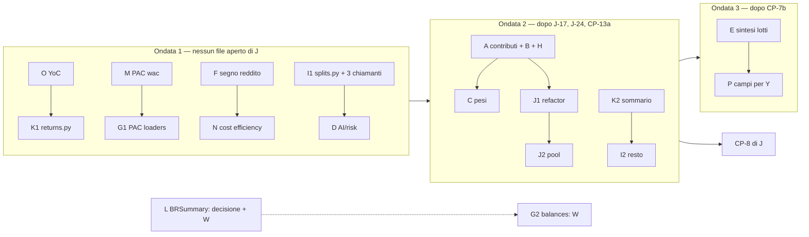

# Piano — fase 01, 11: MF · Matematica finanziaria (1.3.0)

> **Stato**: 🧊 analisi d'implementazione consegnata (16/10/2026), **nessun codice**. FROZEN fino alla revisione: la
> prima approvazione è del developer, relayata dal coordinatore alla lettera.
>
> - **Workstream MF** · worktree `LibreFolio-worktrees/e-alfy-turbo-waddle` · ramo `e-alfy-mf-matematica-finanziaria`
>   (rinominato dall'app all'avvio).
> - **Base**: `f77743d47c5082dac41fecb650d71960194b99e7` (`dev_release2`). Il worktree è nato a `dae4de4fa` (581 commit
>   indietro); il coordinatore l'ha portato in fast-forward. Tree pulito.
> - **Corsia**: `--test-port 6190 --data-dir /tmp/librefolio-r13-mf`, con
>   `PIPENV_CUSTOM_VENV_NAME=LibreFolio-SAUMUTtc pipenv run python dev.py test …`; un comando alla volta; prove leggere
>   solo con `vm.loadavg` a 1 minuto < 50; prove pesanti solo nello slot del coordinatore. Script e log nella cartella di
>   sessione, non in `/tmp`.
> - **Coordinatore**: «Release 1.3 planning», `928ffa97-f0c3-4975-a442-3de0c2c20fc7`.
> - **Fonti**: audit `11_financialMath/audit-matematica-finanziaria-20261016.md` (letto su `3d5ee174d`); decisioni
>   `decisioni-analisi-20261014.md` (P2, P19, P21, P22; punti 26–30); piano di J (`05_numbersAnalysis`, §3, §4, CP-3,
>   CP-4, CP-7, §5); piano 43 (inventario §2: R6–R11, L1–L2, O3–O4, S1–S3, W1–W5); backlog sezioni T, J, W (W-B19), Y,
>   MF; piano di Y, «Y12a — U8»; regole `financial-math.instructions.md`, `backend.instructions.md` («One Home»),
>   `ai-development.instructions.md` («Versions»), decisione 10.
> - **devWiki**: `graphify-out/graph.json` assente nel worktree (atteso). Lette direttamente:
>   `decisions/financial-math-one-home`, `decisions/financial-math-single-average-cost`,
>   `decisions/ai-export-version-bump-once-per-release`.
> - **Verifica**: tre agenti `explore` in sola lettura (servizi portafoglio/broker/lotti; AI Export, rischio, PAC,
>   transazioni; frontend) più letture mie (`daily_state.py`, `returns.py`, `fifo/engine.py`, `histories.py`,
>   `ledger_totals.py`, `portfolio_service.py` 815–900 e 1120–1140, `brokers/summary.py`). Nessun test, server o build.

## 0. Mandato

- Developer, P21 (16/10): «convertire al cambio del giorno della transazione, ogni calcolo nella valuta di
  destinazione»; poi «verifica che tutta la matematica sia fattorizzata in `financial_math` e rivedi gli algoritmi
  troppo contorti». Dopo l'audit: **«Tutti i 16 lotti nella 1.3, aprendo un workstream dedicato alla matematica accanto
  a J»**.
- Precisazioni del coordinatore: C prende da J i due difetti dei pesi (`portfolio_service.py` ~852/856); P solo backend
  (il frontend lo consuma Y; nessun `.svelte` senza OK); G tocca file di W e del PAC (prima chiedere).
- **Vietati finché i lotti aperti di J non entrano** (J-17, poi CP-13a, J-24, CP-7b, J-26): `portfolio_service.py`,
  `financial_math/portfolio/{daily_state,data_quality,models}.py`, `financial_math/price_marks.py`,
  `financial_math/lots/conversions.py`, `schemas/portfolio.py`, AI Export
  `{asset_core,asset_payloads,broker_financial,catalog,portfolio_financial}.py`, il drawdown (CP-13a). Lettura sì.

## 1. Stato reale (riverifica su `f77743d47`)

**Il codice del backend è identico a quello letto dall'audit** (`3d5ee174d`): fra le due HEAD solo giornale, skill e
il lotto ruoli del programma colori (`tokens.css`, `toneClasses.ts`, il gate dei token). CP-7a (`4f9e94420`) è già
dentro `3d5ee174d`. I numeri di riga dell'audit reggono, con gli scarti sotto.

### 1.1 Backend — righe dell'audit

| Riga dell'audit | Esito | Oggi | Nota |
|---|---|---|---|
| `portfolio_service.py:1586-1643` contributi | ✔ | `get_positions_contribution` 1467–1858, valutazione locale 1586–1645 | quantità da righe ×quota (1598), `_get_price_at_date` 489–495, cambio d'inizio a `date_from` (1623), di fine a `price_date_e` (1641), `_` scarta il mancante. Dal motore: realizzato, costo, redditi e costi, P&L di periodo |
| `:1812` «Other» a mano | ✔ | 1804–1812 | stessa formula di `period.period_other_result` (`period.py:112`), che `get_summary` usa (941) |
| `:1672/1683/1706` rapporti | ✔ | 1672, 1680–1683, 1706 | senza `gain_loss_ratio`, senza guardia di base negativa |
| `:720-747` variazione 1 giorno | ✔ | 720–747 | prezzo di ieri convertito alla sua data (729), rapporto a mano (733) |
| `:824-831` NAV per broker | ✔ | 820–846 | ricomposto: valore di mercato + `native_cash.value_at` + in transito e capitale dal motore. Il commento «re-values only when something happens» è superato (stati emessi ogni giorno, giorni sporchi da CP-6) |
| `:856/858` pesi | ✔ | 852–858 | `total_market = Σ or 1`; `nav_denominator = NAV if NAV > 0 else 1` → con NAV ≤ 0 il peso è `valore × 100` |
| `:360-396`, `:399-424` mini-FIFO | ✔ | 360–388, 399–424 | uno split è un'apertura/consumo semplice (T-B4); un trasferimento apre all'arrivo. Nessun test diretto |
| `:871-893` MWRR del sommario | ✔ **più largo** | 871–893 | guardie `engine_nav > 0` **e** `period_net_invested > 0`; la serie (`get_history` 1129–1135) non ha la seconda: **in un periodo con prelievi netti la card dice «—» e il grafico ha la linea** |
| 5 caricatori degli split | ✔ non identici | `portfolio_service.py:161`, `brokers/summary.py:225`, `lots_analysis_service.py:576-580`, `yield_on_cost.py:~806-852`, `portfolio/engine.py:213-226` | stessa join; colonne e validazione diverse (solo il motore valida il rapporto; YoC 10 colonne) |
| `brokers/summary.py:99-150, 242-253` | ✔ | idem | prezzo ultimo senza `as_of` e senza valuta. **Il frontend non legge `holdings` né `missing_fx_pairs`** (la pagina broker usa `cash_balances` e `total_value_base_currency`, che `summary.py` non valorizza mai). Lo leggono solo i test API |
| `lots_analysis_service.py:757-796` | ✔ | 712–~800 | tre convenzioni del rendimento di un lotto: sintesi `total_pnl/opening_value`, `_lot_returns` `(total + income)/cost − 1`, corto in `histories.py:~319` |
| costo residuo ×3 | ✔ | `lots_analysis_service.py:777`, `histories.py:472`, `payloads/portfolio_broker.py:173` | |
| `relative_return` | ✔ | `lots_analysis_service.py:773`, `histories.py:315` | |
| `histories.py:72` segno SHORT | **risolto: errato** | 63–72, `_open_value_on_date` 509 | un frammento corto entra nel NAV **positivo** (quantità positiva, nessun segno di direzione): nel ROI/TWRR della storia di performance un corto aperto pesa come un lungo. Va nel lotto E, con un rosso |
| `fifo/engine.py:877-878` `abs` reddito | ✔ | 877–878; anche 985–986 per FEE/TAX | |
| `fifo/engine.py:1125` peso nativo | ✔ | 1119–1125 | |
| `balances.py:136-150, 168-173` | ✔ (chiamanti più larghi) | `_get_balances_before_date` 126–144 (SUM 132–133), `get_asset_holdings` 166–171 (SUM 169) | `get_cash_balances` è già su `native_balances`. Chiamanti: convalida del batch (56), `get_balances_at_end_of` (148) → `brim_gap_fix.py:74`; `get_asset_holdings` → solo `brokers/summary.py:85` |
| PAC `loaders.py` | ✔ | 15–39, 42–76, 79–110 | SUM SQL di quantità (21) e cassa (94), nessuna quota né ruolo (da confrontare con i pesi del motore, che usano `effective_share`) |
| PAC `wac.py` | ✔ | 25–79, 168–200 | tolleranza `scale·1e-24`; `CostConversion` ha già `rate`, `rate_date`, `days_back` (`average_cost.py:109-117`) |
| `risk/service.py:544-549`, `:1154`; `comparison/plugin.py:58-66, :237` | ✔ | idem | annualizzazione osservata: a 0 giorni la casa solleva, il servizio dà None, il plugin ripiega sul fattore del contesto |
| AI Export: `portfolio_income.py`, `broker_cost_efficiency.py`, `technical_shared.py`, HHI ×2, `portfolio_broker.py` 369–399, `fx_core.py`, `drawdown_context.py:498`, `fx_timing_context.py` | ✔ | idem | `drawdown_context.py:498` **senza guardia sullo zero**; `fx_timing_context.py:332` un altro ciclo di rendimenti semplici |
| `yield_on_cost.py:452-460` | ✔ latente | 439–470 | l'unico chiamante (`portfolio_service.py:674-678`) passa la `wac_currency` della posizione |
| `DailyStateBuilder.build` | ✔ | 157–~780 | pre-frame 244–344, frame 346+; giorno pulito 389–429 (campi copiati a mano); riscalamento dei pool ~648–658; **`frame_start` mai passato in produzione** (`engine.py:401-414`), solo da 3 file di test |
| `engine.py:298-303` ramo vuoto | ✔ | 298–303 | solo un log, poi ricalcolo completo |
| MWRR | Δ (CP-4d) | `_solve_xirr` 410–448 (uno solo, verificato); `calculate_mwrr` 461–505; `calculate_mwrr_series` 508–597 | restano **due costruttori dei flussi** e **una seconda politica** nella serie (tetto adattivo, nuovo tentativo da 0,1, `|r|` più piccolo, 572–590). La riprova R2 è già uscita con CP-4d (il `noqa` di `get_report` la cita ancora: commento vecchio) |

### 1.2 Frontend — righe dell'audit

Tutte ✔, quattro file spostati in `features/`: `KpiSection.svelte:80-85, 93-102, 131-134, 243`;
`lotComparisonChartHelpers.ts:150-171`; `assetPriceDerived.ts:162, 184`; `assets/[id]/+page.svelte:557-562`;
`fxStoreRegistry.ts:64`; `risk/levels/levelHelpers.ts:359` (P19); `dashboard/ExposureTable.svelte:181` (W7 di Y).
Nel backend **nessun campo** di variazione del P&L a un giorno né di «timing effect».

### 1.3 Copie in più, non nell'audit

| Dove | Cosa | Lotto |
|---|---|---|
| `features/dashboard/ExposureTreemap.svelte:446-450` | G/L % di un gruppo (`gl / (value − gl)`) — W8 di Y | P |
| `features/dashboard/PerformanceChart.svelte:~200-210` | contributo % = valore/apertura — P4 di Y | P (dopo A) |
| `features/brokers/lots/unifiedLotsTableHelpers.ts:~140-170`, `lotWacPriceChartHelpers.ts:142`, `LotWacPriceChart.svelte:1413` | piè di tabella dei lotti, % sulla base, valore di un BUY — P5, V11 di Y | P |
| `portfolio_service.py:~700` | `current_price` convertito da sé con `_convert_to_base` accanto al `market_value` del motore | A |
| `portfolio_service.py:~1735`, `:1850-1851` | P&L delle sole posizioni a reddito (`income − fees`), guadagni/perdite lordi | A |
| `brokers/summary.py:145` | percentuale ×100 arrotondata a parte | L |
| `technical_shared.py` (lordo, `abs`) vs `risk/service.py` (netto, negativi rifiutati) | due definizioni di peso | C (varianti dichiarate) |
| piano 43, R7–R10 (`risk/metrics.py:461`, `:128`, `:208-222`, `riskfolio_worker.py:39-45`, `series_preparation.py:355-359`) | da cumulato a periodo, composizione, tasso → periodo, rendimento semplice | D (R11 resta a J, nei segnali) |
| piano 43, W4 (`broker_concentration_context.py:208-214, 409`, `technical_shared.py:1405-1441`, `technical_context.py:646-659`, `portfolio_broker_technical.py:157-191`) | quote % e rapporti di copertura, 3 copie | C (da verificare in apertura del lotto) |
| piano 43, O4 (`pac_allocator/source/portfolio_allocation_source.py`) | qty × `share_percentage`, `None` non gestito | G |

### 1.4 Già chiuso o contraddetto

- **Chiuso da CP-7a**: la divergenza SHORT storia/sintesi (−100 % a pareggio), T-B5, T-B6, la G/L % di
  `brokers/summary.py:141` (ora `gain_loss_ratio`), la conversione della chiusura alla data di chiusura (eccezione 6
  dell'audit).
- **Chiuso da CP-4d**: R2 (riprova MWRR a freddo) e il risolutore non verificato; resta la seconda politica (lotto K).
- **Chiuso da CP-4a–c**: `gain_loss_ratio` per le posizioni (`:717`, `:831`, `:913`), `rebase_to_period`, `period.py`.
- **Errato nell'audit**: nessuna riga; il punto «non verificato» (segno SHORT in `histories.py:72`) è un difetto vero.
- **Ancora del developer**: J-24 (consegna al costo d'un titolo estero) resta a J.

## 2. Sovrapposizioni e proposta di ripartizione

Quasi tutti i lotti dell'audit sono **voci già in coda a J** (piano J §4 e backlog T). Proposta, da confermare col
coordinatore (Q1):

| Voce di J / T | Contenuto | Lotto MF | Proposta |
|---|---|---|---|
| CP-3 (U5a: B8, V2/P2, R4, B19) — analisi di J del 16/10 06:20 | contributi e variazione a 1 giorno dal motore; TRANSFER per broker (P22 ✅) | A, B, parte di D | **a MF**, sull'analisi di J |
| CP-5 (U2, U6, T-B4) | `financial_math/splits.py`; finestre di detenzione; data del lotto più vecchio dopo uno split | I, H | **a MF** |
| CP-11, solo U3 e U7 (+ O4) | quote di proprietà; pesi | F, N, C, G (PAC) | **a MF**; U1 (piano dei cambi) e B15 restano a J |
| CP-12, solo le parti matematiche | U9 (rapporti, TWRR, HHI), T-B8 | C, D, E, F, N | **a MF**; T-B7, T-B9 (renderer) restano a J |
| CP-13 meno CP-13a | U8 lato backend per Y | P | **a MF**; CP-13a (P19, drawdown) resta a J |
| T-U4 residui R6–R10 | annualizzazione, composizione, rendimenti | D | **a MF**; R11 (gemelli pandas) a J con CP-10 |
| W-B19 (W) | cassa della convalida del batch | G | resta **a W**; MF prende la metà delle quantità solo col via di W |
| J-14, riga di W | G/L % di `brokers/summary.py` | L | già fatta da CP-7a |
| CP-8 (J) | `portfolio_service.py` → `services/portfolio/` | — | **dopo** l'ondata 2 di MF (piano 43 §P2.2: la matematica esce prima dello spostamento) |

Restano a J: J-17, CP-13a, J-24, CP-7b, J-26, J-10…J-12, CP-8, CP-9, CP-10 (resto), U1, U10, CP-14, T-B7, T-B9.

## 3. Lotti

Legenda: **Numeri** = cambia cifre che l'utente vede; **Prova** = come provo l'equivalenza o il cambio; **Peso** =
minimo / piccolo / medio / grande (nessuna stima di tempo).

### MF-A · Contributo per posizione dal motore (CP-3 di J)
- **Superfici**: `portfolio_service.py` (`get_positions_contribution` 1467–1858, `_get_price_at_date`,
  `_convert_to_base`, `get_report` 2010; `get_summary` ~700); `financial_math/portfolio/{engine,daily_state,models}.py`
  (istantanee delle posizioni a `period_start`, con `_build_position_state`); `financial_math/portfolio/` modulo nuovo
  per le regole di R4 (base, ripiego, finestra, chiusi); `ai_export/components/technical_shared.py:467-485` (eredita).
  Test: `test_financial/test_portfolio_service*.py`, `test_portfolio_cost_currency.py`, golden `native_cash_guard`;
  test nuovi della casa. Doc: dev `financial_math.md`, la pagina della Performance (teoria `performance-metrics`).
- **Numeri**: sì. Tabella Performance della Dashboard e del report (valore d'inizio/fine, delta non realizzato, %,
  annualizzato, riga «Other» che si riduce); pesi tecnici dell'AI Export. Cambiano: titoli senza quotazione a un
  confine (ora il segno di scambio, prima mancava), prezzo di fine vecchio in valuta estera (cambio del giorno di fine,
  non della quotazione), split dopo l'ultimo segno, cambio mancante (ora segnalato, mai scartato), ripartizione per
  broker d'un trasferimento nel periodo (P22: ogni broker il suo tratto; totale invariato), ordine degli unallocati
  (B19, solo ordine).
- **Dipendenze**: J-17 e J-24 dentro (stessi file); la decisione P22 c'è già. Prima di CP-8.
- **Prova**: rossi (test-author) — titolo con soli scambi ai confini; fine in USD con prezzo vecchio; split nel periodo;
  trasferimento a metà periodo per broker e totale; cambio mancante → valore None e coppia nella qualità dei dati; «Other»
  = `period_other_result`; R4 nella casa (base, ripiego, finestra, chiusi). Golden del motore identico (le istantanee in
  più non cambiano gli stati giornalieri).
- **CHANGELOG** (🐛 Fixed): «Dashboard Performance table: each position's start and end value now comes from the same
  valuation as the portfolio (trade prices, splits, the exchange rate of the period's end), so the "Other" line no
  longer absorbs valuation differences; a transfer during the period splits the result between the two brokers.»
- **Peso**: grande.

### MF-B · NAV e utile per broker dal motore
- **Superfici**: `portfolio_service.py:820-846` (legge `BrokerDailyContribution.nav_contribution` e `pnl_contribution`
  dell'ultimo stato; via il commento superato). Test: `test_broker_pnl_contributions.py`, `api portfolio`.
- **Numeri**: attesi **nessuno** oltre la polvere di conversione (stessa cassa nativa, stesse valutazioni del giorno).
- **Prova**: parità card ↔ contributo su corpus (golden, contributi per broker, broker con cassa estera, giorno senza
  eventi) a 0,01; se emerge uno scarto > polvere, lo dichiaro prima di cambiare.
- **Dipendenze**: con A. **Peso**: piccolo.

### MF-C · Una funzione «pesi» nella casa (+ HHI)
- **Superfici**: `financial_math/` modulo nuovo (pesi su un denominatore, varianti `net` e `gross` dichiarate, None
  se il denominatore ≤ 0; HHI e peso massimo); chiamanti `portfolio_service.py:852-858`, `derived_views.py:212-247`
  (`_alloc`, `build_allocation_history`), `risk/service.py:544-549` (resta il rifiuto dei negativi, D59),
  `technical_shared.py:467-485`, `broker_financial.py:205-212` e `broker_concentration_context.py:88-104` (una copia
  sola), W4 da verificare. Test: casa, `api portfolio`, AI Export broker, risk. Schema: descrizione di
  `nav_weight_percent`/`allocation_percent` (nullable) → `api sync`.
- **Numeri**: sì, solo nei casi limite. Con NAV ≤ 0 il peso sul NAV passa da `valore × 100` a «—»; con totale ≤ 0
  idem per l'allocazione. AI Export: HHI e peso massimo calcolati dai pesi non arrotondati (scarti alla 4ª cifra).
  Nota di J: da J-17 una posizione valutata al costo conta in entrambi i pesi (nessuna eccezione).
- **Dipendenze**: dopo J (vietati `portfolio_service.py`, `broker_financial.py`); dopo A per i pesi tecnici. Y W7
  toglie il ripiego del frontend (allineato: null → «—»).
- **Prova**: rosso per NAV ≤ 0 e totale 0; parità sui casi normali (stessi 0,01); HHI unico.
- **CHANGELOG** (🐛 Fixed): «Holdings: when the net worth is zero or negative, the weight on net worth shows "—"
  instead of a meaningless percentage.»
- **Peso**: piccolo-medio.

### MF-D · Rapporti, rendimenti di prezzo, annualizzazione, composizione
- **Superfici**: `returns.price_return`/`gain_loss_ratio`; una funzione Decimal della casa per il passo fra due
  cumulati (`(1+b)/(1+a) − 1`); AI Export `technical_shared.py:819`, `fx_timing_context.py:323-362` (e 332),
  `payloads/portfolio_broker.py:369-399`, `drawdown_context.py:498` (dopo CP-13a); rischio `risk/service.py:1154`,
  `comparison/plugin.py:58-66, 237` → `series_preparation.observed_annualization` e `risk/metrics.compounded_return`;
  R7–R10 del piano 43. La parte `portfolio_service.py` (733, 747, 1672, 1683, 1706) va in A; quella dei lotti in E.
- **Numeri**: nessuno, salvo i casi limite: base zero → None (oggi divisione per zero in `drawdown_context`), 0 giorni
  (una politica sola), ritorni non validi nel confronto (oggi composti in silenzio). Decimal vs float: identici al
  float stampato.
- **Prova**: parità prima/dopo sui test esistenti (`ai-export`, `risk-all -k comparison`, `series-preparation`), più
  test puri dei casi limite.
- **Versioni AI Export**: vedi Q2.
- **Peso**: piccolo (molti file, ognuno una riga).

### MF-E · Sintesi del lotto nella casa
- **Superfici**: `lots_analysis_service.py:712-~800` → `financial_math/lots/` (riusa `_value_snapshot_on_date`,
  `_lot_returns`); una formula del costo residuo (`:777`, `histories.py:472`, `portfolio_broker.py:173`); una
  convenzione del rendimento per direzione; `relative_return` → `price_return`; **segno dei corti nel NAV della storia
  di performance** (`histories.py:63-72`, `_open_value_on_date`); T-B8 (le due somme della sintesi FIFO dell'AI Export
  sullo stesso insieme di lotti, `payloads/portfolio_broker.py:532-622`).
- **Numeri**: sintesi dei lotti lunghi **nessuno** (identità; al più l'ultima cifra di 28). Storia di performance dei
  lotti con corti aperti: ROI/TWRR cambiano (oggi il corto pesa come un lungo). AI Export: le due somme di T-B8 sullo
  stesso insieme (cambiano solo con un costo ignoto).
- **Dipendenze**: dopo CP-7b (V1 tocca sintesi e `histories.py:267`) e J-24 (`lots/conversions.py` vietato).
- **Prova**: parità della sintesi su `lots-analysis-pure` e `roi-fifo-utils`; rossi per il corto nella storia e per
  T-B8.
- **CHANGELOG** (🐛 Fixed): «Lots performance history: an open short lot now counts against the value instead of as a
  holding.»
- **Peso**: medio.

### MF-F · Segno del reddito (FIFO e AI Export)
- **Superfici**: `fifo/engine.py:877-878` (pool di reddito col segno), da verificare `:985-986` (FEE/TAX: rimborsi);
  `ai_export/components/portfolio_income.py:340-385` su `native_cash.flows()`/`sums_by_date` con `effective_share` e
  segno; docstring corretto. Test: `roi-fifo-utils`, `lots-analysis-pure`, `ai-export` (portfolio_income). Doc: teoria
  `fifo-lot-analysis` (reddito), dev `lots_analysis_service.md`.
- **Numeri**: sì. Lotti: una correzione negativa di DIVIDEND/INTEREST riduce il reddito del lotto (oggi lo aumenta) →
  reddito e rendimento netto del lotto. AI Export: timeline dei redditi con le correzioni negative e, dalla pagina d'un
  broker, Editor/Viewer al 100 % (B9: «la regola della pagina da cui parte»).
- **Dipendenze**: nessun file vietato; d'accordo con J per `fifo/engine.py` (CP-7b/J-24 non toccano quelle righe).
  Decisione D-MF3.
- **CHANGELOG** (🐛 Fixed): «Lots: a negative dividend or interest correction now lowers the lot's income, as on the
  Dashboard.»
- **Peso**: piccolo.

### MF-G · Quantità e cassa senza `SUM` SQL
- **Superfici**: G1 PAC `pac_allocator/source/loaders.py:15-110` su `ledger_totals.position_quantities`,
  `native_cash.native_balances`, `price_marks` (ultimo prezzo ≤ `as_of`), con la quota (O4) da chiarire; G2 W
  `transactions/balances.py:126-144` (quantità della convalida su `position_quantities`; la cassa è W-B19 di W) e
  `get_asset_holdings` 166–171 (sparisce se L toglie `holdings`).
- **Numeri**: nessuno (Decimal esatto invece del float di SQLite; differenze solo oltre ~15 cifre). O4: se la quota
  manca nel PAC ed è un difetto, è un cambio da dichiarare (rosso prima).
- **Dipendenze**: G1 col via del proprietario del PAC (Q4); G2 col via di W (Q3).
- **Prova**: parità su `portfolio-allocation-source`, `pac-planner-*`, `transaction`, `brim-gap-fix`.
- **Peso**: piccolo-medio.

### MF-H · Finestra di detenzione nella casa (T-B4)
- **Superfici**: `portfolio_service.py:360-424` → `financial_math/` (FIFO delle quantità per broker, con gli split che
  riscalano invece di aprire/consumare); chiamanti `:663`, `:1584`, `:1703`. Test nuovi della casa.
- **Numeri**: sì. Data del lotto aperto più vecchio e annualizzato della Performance per le posizioni con uno split
  (oggi lo split apre un «lotto» datato allo split o consuma i più vecchi). Con D-MF2 = data d'origine, anche le
  posizioni trasferite.
- **Dipendenze**: dopo J (`portfolio_service.py`); con A (stessa funzione dei contributi). Decisione D-MF2.
- **CHANGELOG** (🐛 Fixed): «Performance: a stock split no longer resets the holding period used for annualized
  returns.»
- **Peso**: piccolo-medio.

### MF-I · Un caricatore degli split (`financial_math/splits.py`)
- **Superfici**: modulo nuovo (caricamento + validazione del motore + `_cumulative_split_ratio`, oggi in
  `daily_state.py:45`); punto di lettura del DB nominato nella regola 1 (`financial-math.instructions.md`, mappa);
  chiamanti `portfolio/engine.py:213-226`, `lots_analysis_service.py:576`, `yield_on_cost.py:~806`, poi
  `portfolio_service.py:161` e `brokers/summary.py:225` (o sparisce con L). Guardia `test_layer_boundaries.py`.
- **Numeri**: nessuno; con dati corrotti (rapporto ≤ 0) tutti i chiamanti rifiutano come il motore (oggi alcuni
  tacciono).
- **Dipendenze**: I1 (modulo + 3 chiamanti liberi) subito; I2 dopo J e con W/L.
- **Prova**: parità sui test di motore, lotti, YoC; test puro della validazione.
- **Peso**: piccolo.

### MF-J · `DailyStateBuilder` più lineare
- **J1, refactor puro**: togliere il pre-frame (244–344) e `frame_start` (mai passato in produzione) e il ramo vuoto
  `engine.py:298-303`; una sola `apply_pool_rule(tx, amount, sell_cost, pools)`; `collect_dirty_days(...)` pura;
  `dataclasses.replace` per i giorni puliti (con copie esplicite dei dict/set se qualcuno li muta: da verificare).
  I test che usano `frame_start` (`test_portfolio_engine_vnext.py`, `test_broker_pnl_contributions.py:390-407`,
  `test_broker_internal_flows.py` casi 09–10) si riscrivono sul comportamento equivalente con `date_from`
  (test-author). **Numeri**: nessuno.
- **J2, cambia numeri (decisione D-MF4)**: l'arrivo d'un trasferimento di cassa o d'un cambio valuta interno porta la
  ripartizione K/R della partenza (oggi tutto in K: «Approximate»); poi via il riscalamento dei pool se la deriva
  misurata sul corpus è 0. **Numeri**: la scomposizione della cassa fra capitale versato e rendimenti generati (Dashboard)
  dopo trasferimenti interni e conversioni di valuta: più rendimenti, meno capitale, totale invariato.
- **Dipendenze**: dopo J-17, J-24 (`daily_state.py`) e dopo A (che aggiunge le istantanee d'inizio periodo).
- **Prova**: J1 golden `eur_only_golden.json` identico, `portfolio-engine`, `roi-fifo-utils`, contributi per broker,
  candele, finanziamento degli acquisti: stati giornalieri uguali campo per campo su tutto il corpus (uno script di
  confronto prima/dopo nella cartella di sessione). J2 rossi prima.
- **CHANGELOG** (J2, 🐛 Fixed): «Dashboard cash breakdown: cash moved between brokers or converted between currencies
  keeps its share of generated returns instead of being counted as contributed capital.»
- **Peso**: J1 medio; J2 piccolo-medio.

### MF-K · Un MWRR solo
- **Superfici**: `returns.py` — un costruttore `_mwrr_flows(start, start_nav, flows, end, end_nav)` per
  `calculate_mwrr` e `calculate_mwrr_series`; una politica della radice (quella del punto singolo, verificata, più
  vicina a 0,1); la serie a freddo se il costo misurato regge (soglia proposta: +30 % al massimo sul tempo di
  `get_report` del DB popolato), altrimenti il sommario legge l'ultimo punto della serie. `portfolio_service.py:871-893`:
  il NAV iniziale di ripiego e le guardie nella casa, **le stesse della serie**. Commento `noqa` di `get_report`.
- **Numeri**: sì. In un periodo con prelievi netti (investito netto ≤ 0) la card MWRR mostra il valore che il grafico già
  mostra (oggi «—»), e il «timing effect» con lei; con più radici, card = ultimo punto del grafico (0 casi nei 20 000 di
  CP-4d). Decisione D-MF5.
- **Dipendenze**: K1 (`returns.py`) subito; K2 (`portfolio_service.py`) dopo J.
- **Prova**: rossi — periodo con prelievi netti (card = ultimo punto); parità card/serie sul corpus e sulle 20 000
  sequenze di CP-4d (`test_mwrr_verified_root.py`); misura di costo.
- **CHANGELOG** (🐛 Fixed): «Dashboard: the money-weighted return card now shows a value also for periods with net
  withdrawals, matching the chart.»
- **Peso**: piccolo-medio.

### MF-L · `BRSummary.holdings`
- **Superfici**: `brokers/summary.py` (W), `schemas/brokers.py` (`BRSummary`, `BRAssetHolding`), `api sync`, test API
  dei broker. Due strade (D-MF1): **togliere** `holdings`, `missing_fx_pairs` e `total_value_base_currency` (mai
  valorizzato), con `get_asset_holdings`, `_holding_average_costs`, `_get_latest_prices_batch` e la copia degli split;
  oppure valutarli col motore (`get_report` filtrato sul broker), con `as_of` e valuta del prezzo.
- **Numeri**: nell'interfaccia nessuno (non li legge). API: rottura (via) o cifre corrette (motore).
- **CHANGELOG**: (via) ⚠️ Breaking: «`GET /brokers/{id}/summary` no longer returns `holdings`, `missing_fx_pairs` and
  `total_value_base_currency`; holdings and their value come from the portfolio report.» (motore) 🐛 Fixed: «… holdings
  are valued like the Dashboard, in the price's own currency and as of the requested date.»
- **Peso**: piccolo (via) / medio (motore).

### MF-M · PAC: prova del cambio del WAC dal costo medio
- **Superfici**: `pac_allocator/source/wac.py:25-79, 168-200` → `CostStep.conversion` (`rate`, `rate_date`,
  `days_back`); via `_load_current_wac_fx_rows` e `_rates_match`. Test `portfolio-allocation-source`, `pac-planner-*`.
- **Numeri**: nessuno atteso; l'evidenza «missing» può cambiare dove il riempimento all'indietro di `wac.py` differisce da
  quello di `convert_bulk` (da misurare; se succede, lo dichiaro con un rosso).
- **Dipendenze**: via del proprietario del PAC (Q4). **Peso**: piccolo.

### MF-N · AI Export: costi del broker con la quota effettiva
- **Superfici**: `broker_cost_efficiency.py:152-168` su `effective_share` (B9/O3); `:550-568` (NAV medio e rapporti)
  resta, dichiarato come fatto dell'AI Export, o va nella casa se un secondo chiamante lo vuole. Test: `ai-export`
  (broker adequacy, runtime).
- **Numeri**: sì, solo AI Export: dalla pagina d'un broker un Editor/Viewer vede turnover e rapporti pieni (oggi × 0).
- **CHANGELOG** (🐛 Fixed): «AI Export from a broker page: editors and viewers get the broker's full turnover and cost
  ratios.»
- **Peso**: piccolo.

### MF-O · Yield on Cost: il WAC convertito al cambio storico
- **Superfici**: `yield_on_cost.py:439-470`: una `wac_currency` ≠ valuta del report si rifiuta (conversione mancante
  dichiarata), mai convertita a `as_of`. Test YoC (`roi-fifo-utils`).
- **Numeri**: nessuno (l'unico chiamante passa la valuta del report). **Peso**: minimo.

### MF-P · Campi del backend per il frontend (U8 lato backend, per Y)
- **Superfici**: `schemas/portfolio.py` + `portfolio_service.py`/`financial_math/portfolio/`: variazione del P&L totale
  a un giorno (importo, % sul NAV di ieri, % sul P&L di ieri), «timing effect» (MWRR cumulato − TWRR), G/L % per
  gruppo della treemap (W8), contributo % della Performance (P4, da A), aggregato dei lotti e piè di tabella (P5, da
  E), valore d'un BUY nel grafico WAC (V11). `api sync` (dichiarato). Il consumo è di Y (Y12b); nessun `.svelte` mio.
- **Numeri**: le cifre dei KPI diventano quelle del backend (Decimal, stati del motore): scarti piccoli rispetto al
  calcolo dalla `history` in float.
- **Dipendenze**: dopo A, E, K; CP-13a (P19) resta a J. Decisione D-MF6 (cosa è misura interattiva).
- **Prova**: test della casa e dello schema; Y scrive i rossi del frontend.
- **CHANGELOG**: con Y, una riga 🔄 Changed: «Dashboard KPI deltas and lot aggregates are computed by the server.»
- **Peso**: medio.

## 4. Ordine (ondate)

1. **Ondata 1** (subito dopo il via, nessun file vietato): O, K1, M, G1, F, N, I1, D (AI tranne `drawdown_context`;
   rischio se J/X lo consentono rispetto a CP-9).
2. **Ondata 2** (dopo J-17, J-24 e CP-13a): A (+B, +H, parte `portfolio_service` di D), C, K2, I2, poi J1 e J2. Poi
   CP-8 di J.
3. **Ondata 3** (dopo CP-7b): E (+T-B8), poi P.
4. **Fuori sequenza**: L e G2 quando arrivano D-MF1 e il via di W.

Un checkpoint per lotto (o per coppia piccola: O+K1, M+G1, F+N); i lotti che cambiano numeri sempre da soli.

## 5. Decisioni per il developer (domande chiuse, con raccomandazione)

| # | Lotto | Domanda | Raccomandazione |
|---|---|---|---|
| D-MF1 | L | `GET /brokers/{id}/summary` restituisce `holdings` che nessuna pagina legge, con prezzi senza data limite né valuta. **(a)** toglierli (rottura dell'API, CHANGELOG ⚠️) **(b)** valutarli col motore | **(a)**: il report del portafoglio li dà già giusti; meno codice e una copia in meno |
| D-MF2 | H | Per una posizione arrivata con un trasferimento, la «detenzione» che annualizza parte **(a)** dall'arrivo nel broker **(b)** dall'acquisto d'origine | **(a)**, coerente con P22 («ogni broker risponde del suo tratto»); in ogni caso lo split non azzera più la data |
| D-MF3 | F | Una correzione negativa di dividendo o interesse nei lotti: **(a)** riduce il reddito, come la Dashboard **(b)** resta in valore assoluto | **(a)**; lo stesso per un rimborso di commissione o tassa, se il controllo lo conferma |
| D-MF4 | J2 | La scomposizione della cassa fra capitale e rendimenti dopo trasferimenti interni e cambi valuta: **(a)** l'arrivo porta la ripartizione della partenza (cambia quel grafico) **(b)** com'è oggi | **(a)**, togliendo il riscalamento solo se la deriva misurata è 0 |
| D-MF5 | K | In un periodo con prelievi netti la card MWRR dice «—» e il grafico ha la linea: **(a)** la card mostra il valore, come il grafico **(b)** il grafico si spegne come la card | **(a)**: il MWRR è definito anche con prelievi netti |
| D-MF6 | P | **(a)** Variazione del P&L a un giorno, timing effect, G/L % dei gruppi: campi del backend. **(b)** L'aggregato dei lotti **selezionati** e le variazioni di prezzo/cambio su un intervallo scelto: misure interattive dichiarate nel codice (marcatore + guardia di Y), o anche loro dal backend | (a) sì; (b) dichiarate, tranne la tabella dei periodi fissi dell'asset (1G, 1S…), dal backend |
| D-MF7 | C | Con NAV ≤ 0 il peso sul NAV: **(a)** «—» **(b)** com'è oggi | **(a)** |

## 6. Domande per il coordinatore

- **Q1** — Ripartizione del §2 (MF prende CP-3, CP-5, U3/U7 di CP-11, la matematica di CP-12, CP-13 meno CP-13a;
  CP-8 dopo l'ondata 2). Serve l'OK di J sul suo piano e sul backlog.
- **Q2** — Versioni dell'AI Export: un builder rifatto con output identico byte per byte non sale (lettura della
  decisione `ai-export-version-bump-once-per-release`: conta il payload o un valore calcolato in altro modo); sale di
  +1 su `v1.2.0` (una volta per release, mappa compatta nello stesso cambio) chi cambia valori: C (concentrazione), F
  (`portfolio.income…`), N (efficienza dei costi), D dove un caso limite passa a None, E (T-B8). Confermi?
- **Q3** — W: `transactions/balances.py` (G2) e `brokers/summary.py` (I2, L). Proposta: G2 resta in W-B19 allargata
  alle quantità, MF dà la funzione (`position_quantities` c'è già) e rivede; L la scrive MF col via di W dopo D-MF1.
- **Q4** — Proprietario del PAC (`pac_allocator/source/`, toccato da J in CP-1): via per G1 e M.
- **Q5** — Rischio (D): `risk/service.py` e `comparison/plugin.py` prima di CP-9 (taglio del rischio, dopo PL2 di X)
  o dopo? Proposta: prima, tre righe, così CP-9 sposta il codice già pulito.
- **Q6** — Moduli nuovi in `financial_math/` (`splits.py`, pesi, finestre di detenzione, regole del rendimento di
  periodo d'una posizione): la mappa (`__init__.py`, `financial-math.instructions.md`, `backend.instructions.md`) la
  aggiorno io a ogni lotto; `splits.py` diventa un punto di lettura del DB nominato nella regola 1. OK?
- **Q7** — Slot pesanti: `all-backend` a fine ondata (1, 2, 3) e prima di ogni checkpoint che cambia numeri.

## 7. Rischi

- **A e J1 su `daily_state.py`** (1288 righe, il cuore dei numeri): rischio di regressione silenziosa. Contromisura:
  confronto campo per campo degli stati giornalieri prima/dopo su tutto il corpus del motore, golden identico, più
  `all-backend`.
- **Conflitti con J** (stessi file per tutta l'ondata 2) e con CP-8 (spostamento di `portfolio_service.py`): ordine del
  §4; mai due scrittori.
- **K a freddo**: costo della serie; misurato prima di scegliere.
- **AI Export**: versioni (Q2) e sonde: la sonda reale vuole i dati del developer (`real-data-copy`), da chiedere.
- **Test con `frame_start`** (J1): riscriverli senza perdere ciò che provano (capitale d'apertura, posizioni al primo
  giorno).
- **Macchina condivisa**: prove leggere sotto carico 50; nessuna prova pesante fuori slot.
- **Doc tradotte**: le pagine di teoria toccate (performance, lotti) lasciano debito di traduzione dichiarato.

## 8. Definizione di fatto (per lotto)

- Rosso prima (test-author), visto fallire per il motivo giusto, per ogni comportamento che cambia; valori che cambiano
  dichiarati nel piano prima del codice.
- Parità provata dove i numeri restano: test esistenti verdi con gli stessi conteggi, golden identico, confronto
  prima/dopo dove serve.
- Nessuna copia rimasta: grep della funzione sostituita a zero fuori dalla casa; mappa della casa aggiornata; guardia
  dei confini verde.
- ruff, black, dead code senza reperti nuovi; `api sync` dichiarato quando uno schema cambia.
- Doc EN (docs-writer), `mkdocs build` stretto e `check-links`; debito di traduzione dichiarato.
- Riga di CHANGELOG proposta (testo all'handoff; il file lo scrive il coordinatore).
- Righe del backlog MF chiuse con ✅, data e commit; righe del runner dichiarate.
- Porta 6190 libera (`lsof`), piano aggiornato a ogni passo, handoff FROZEN.

## 9. Test e specialisti

- **Selettori** (preambolo della corsia): `services financial-math`, `services roi-fifo-utils` (golden compreso),
  `services portfolio-engine`, `services lots-analysis-pure`, `utils roi-utils`, `api portfolio`, `api brokers`,
  `services broker`, `services transaction`, `services brim-gap-fix`, `services portfolio-allocation-source`,
  `services pac-planner-{core,evaluator,wire-numbers}`, `services ai-export` (con `-k` per componente),
  `services risk-all -k "comparison or annualiz"`, `services series-preparation`; a fine ondata `all-backend` nello slot.
- **test-author**: ogni rosso e ogni test riscritto (J1), file distinti per lotto, nessuna esecuzione senza corsia.
- **docs-writer**: dev `financial_math.md`, `transactions/lots_analysis_service.md`, `fifo_lot_engine.md`, pagine di
  teoria della performance e dei lotti; stamp solo per ritocchi puntuali.
- **Skill**: `ai-export-probe-tuning` (C, D, E, F, N), `test-triage` per i rossi non ovvi, `real-data-copy` solo su
  richiesta.

## 10. Avanzamento

### Analisi ✅ (2026-10-16)

- HEAD verificata `f77743d47`, tree pulito; riverifica dell'audit (§1), ripartizione (§2), schede (§3), ordine (§4),
  decisioni (§5), domande (§6).
- **⚠️ Fuori pista**: il worktree era nato a `dae4de4fa` (581 commit indietro): fermo e segnalato, fast-forward del
  coordinatore. Un errore del servizio ha interrotto il turno a metà analisi: ripresa dalla stessa HEAD, nessun file
  toccato.
- Riassunto mandato al coordinatore (16/10). Scritti solo il giornale: questo piano e le righe MF-A…MF-P nella sezione
  MF di `Phase_0/BACKLOG_POST_1.2.md`. Nessun codice, nessuna prova, nessun server. **FROZEN** in attesa
  dell'autorizzazione del developer, relayata alla lettera.
