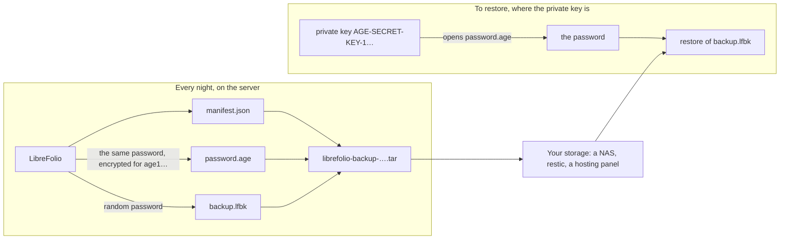

# 💾 Backup, Restore and Moving Your Instance

A backup is one archive with your whole LibreFolio in it: the database and the files of every user, in a plain zip or, for a [secure backup](#secure), encrypted with a password you choose. This page tells the whole story: what the archive holds, how to make and check one, how to protect it with a password, how to restore it, and how to move LibreFolio from an instance someone hosts for you to your own server, or the other way round. Every option and message of the commands is in «Back Up the Instance», in [CLI Admin Tools](cli_tools.md).

!!! tip "🗓️ Make one before every update"

    LibreFolio never takes a database back to an older version. A backup made before an update is your way back to the version you had: see [Updating LibreFolio](../user/installation.md#updating).

---

## 📦 What a Backup Holds {: #contents }

The archive is a zip with the layout of the [data directory](filesystem.md): unpacked into an empty data directory, it is your instance again. A [secure backup](#secure) is the same zip, encrypted with a password into an `.lfbk` file, and a [sealed backup](#sealed) is a secure backup whose password only a private key of yours opens, in a `.tar`.

| In the archive | What it is |
| --- | --- |
| `sqlite/app.db` | The database: users, brokers, transactions, assets, prices, exchange rates and settings. A consistent copy, made while LibreFolio keeps running |
| `custom-uploads/` | The files uploaded in the app |
| `broker_reports/` | The broker reports |
| `scenario_catalog/` | Your own stress scenarios, if you added any |
| `secrets/instance.key` | Only in a [secure backup](#secure), and only when LibreFolio generated the instance key: the key that encrypted the saved keys of the data providers, so that they travel with the data. A restore only reads it: the installation that receives the backup keeps its own key |
| `manifest.json` | The description of the archive: the LibreFolio version that made it and when, the migration revision of the database, its rows per table, the ledger's control totals (the cash of every broker in each currency and the quantity of every position), the size and SHA-256 checksum of every file, and whether the archive carries the instance key |

Never in the archive:

- 🔑 `secrets/`, which holds the instance key: a [secure backup](#secure) carries only the key LibreFolio generated, `secrets/instance.key`, never a key you set yourself with `LIBREFOLIO_INSTANCE_KEY` or `LIBREFOLIO_INSTANCE_KEY_FILE`. See «The Instance Key» in [Environment Variables](configuration.md);
- 📝 `logs/`, and `scheduler_state.json`, the last run of the scheduled syncs;
- 💾 `backups/`, where the command line writes its archives, and `.restore/`, the work folder of a restore;
- ⚙️ the configuration: `.env` and the environment variables, the [email](email.md) settings included, which LibreFolio keeps only in the environment.

### 🧭 What Follows {: #what-follows }

- 🔒 **Keep it private.** A clear archive holds every user's data and is not encrypted: keep it, and every copy, as private as the server itself. A [secure](#secure) one opens only with its password: keep the password apart from it.
- 🗝️ **Saved secrets and the instance key.** What LibreFolio encrypted with the instance key, such as the API key of a data source saved in the app, can be read only with that key.
    - A [secure backup](#secure) carries the key LibreFolio generated: its restore re-encrypts those secrets with the key of the installation that receives it, and there is nothing to do.
    - A clear backup leaves the key out, and so does a [sealed](#sealed) one, always, and a secure one whose key came from the environment (`LIBREFOLIO_INSTANCE_KEY`, `LIBREFOLIO_INSTANCE_KEY_FILE`) or could not be used. On an installation with another key, LibreFolio keeps those secrets, reports them as unreadable and never uses a wrong value: **Settings › Plugins** says under each one *Saved, but this instance's key cannot read it: enter it again.* If you still have the old key, put it back first, before anyone enters a secret again: stop LibreFolio, put your copy of `secrets/instance.key` in place of the generated one, or set the old value of the variable, and start it again («The Instance Key» in [Environment Variables](configuration.md)). An installation that keeps its own key, such as a hosted one, or one whose own secrets are already under its key, takes the old key at the restore instead: restore from the command line with `--instance-key-file` and your copy of the old key, and the check re-encrypts those secrets with this installation's key («The Instance Key of Another Installation» in [CLI Admin Tools](cli_tools.md)); on an instance someone hosts for you, ask whoever runs it. Enter the secrets again only if the old key is lost: a secret entered under the new key would become unreadable once the old one is back.
    - For the settings of the whole instance, every start also logs the error *Stored plugin secrets that the instance key cannot read: …* with their count, until they are entered again or the old key is back. No plugin shipped with LibreFolio keeps one today.
- ⚙️ **Bring your configuration.** Keep a copy of your `.env` with the archives: on another installation, set again the options you need, the email ones included ([Where the Configuration Lives](email.md#where-it-lives)).
- 🏠 **Any installation can take it**, if it runs the same version of LibreFolio or a newer one, whoever made the archive: Settings, the command line or a hosting panel.

---

## ⬇️ Make a Backup {: #create }

Three ways give the same archive:

- **Settings › Administration › Backup**, in the app: the archive downloads to your computer. For administrators.
- **The command line**, on the server: `backup create`.
- **A hosting panel**, if someone hosts LibreFolio for you and their panel takes backups: see [Backups for Your Hosting Panel](hosting_providers.md#panel-backups).

From Settings and from the command line, the backup can also be [secure](#secure): the same zip, encrypted with a password you choose. From the command line, it can also be [sealed](#sealed): encrypted with a random password that only a private key of yours opens, for backups made without anyone at the keyboard. A hosting panel's backups are clear, or sealed when `LIBREFOLIO_BACKUP_RECIPIENTS` is set.

In every case LibreFolio keeps working during the backup, and one backup runs at a time, whoever started it.

### 🖱️ From Settings › Administration › Backup {: #settings-backup }

1. Open **Settings › Administration › Backup**: only administrators have this tab.
2. In **Back up the instance**, choose the kind of backup:
    - **Clear**, the choice the card starts with: *A plain .zip: whoever has the file sees all the data, and on another instance the keys of the data providers must be entered again.*
    - **Secure**: *An .lfbk encrypted with a password you choose: only that password opens it, and a lost password cannot be recovered. It also carries the keys of the data providers.* See [Secure Backups](#secure).
3. For a secure backup, type its password in **Password of the backup**, then again in **The same password again**. The password follows the rules the server gives, those of an account's password with at least 12 characters: the meter under the first field lists them as you type (*At least 12 characters*, *One uppercase letter*, *One lowercase letter*, *One number*, *One special character*) and shows how strong the password is. While the two fields differ, *The two passwords differ.* shows under the second one, and **Create backup** stays disabled until both are right.
4. Click **Create backup**. The password fields empty at once. The card follows the backup on the server, phase by phase; a secure backup ends with *Encrypting with your password*.
5. When it reads **Backup ready**, click **Download**. Your browser saves the archive, named after the moment the backup started, in UTC, such as `librefolio-backup-20261015-121500.zip`, or `librefolio-backup-20261015-121500.lfbk` for a secure backup, which the card marks *Encrypted with your password: keep it safe, LibreFolio cannot recover it.*

Good to know:

- 🔑 **Keep the password of a secure backup.** LibreFolio keeps no copy of it, and without it nobody opens the archive, you included: keep it in a password manager, apart from the archive.
- ⏱️ The archive stays on the server for one hour, then it is deleted: download it within the hour. **Delete from the server** removes it sooner, and **Create a new backup** starts another one.
- ⚠️ **The backup is complete, with warnings** means that the database failed its integrity check or has broken references, and was archived as it is, or that some files were left out, or, for a secure backup, that the instance key could not be used and was left out ([Making a Secure Backup](#secure-problems)). The archive is written all the same: read the warnings before you rely on it.
- 🚦 While another backup runs, started from the app, the command line or a hosting panel, the card says so: try again when it ends. One started from this tab, or another tab of the app, whose answer never arrived (the connection dropped while it started) is not lost: the next **Create backup** finds it running, and the card follows it, then offers its download, as if it had just started it. This holds for a clear backup only: a secure one is never followed this way, because only its own password opens its archive, and a followed backup that turns out to be secure is not offered, unless the card had started it itself; in both cases the card says that another backup runs. A card that already offers an archive keeps offering it, and only says that another backup runs. One started from the command line or a hosting panel is not followed: its archive goes elsewhere. The card never says which backup runs; the browser's console does (its id and where it was started), should you need to find it.
- 🔒 On an instance its hosting provider has [blocked](hosting_providers.md#instance-block), the app shows the block page instead of Settings. Administrators find on it the same backup card, under **Keep a copy of the data**: make the backup and download it there ([What Users See](hosting_providers.md#what-users-see)). The hosting panel ([What Still Answers](hosting_providers.md#what-still-answers)) and the command line on the server can still make one too.

### ⌨️ From the Command Line {: #command-line }

```bash
# Docker: the archive appears in ./LibreFolio-data/backups/ on the host
docker compose exec librefolio python dev.py backup create

# Host installation: the archive goes into backups/ in the data directory
pipenv run ./dev.py backup create

# A secure backup (.lfbk): the password is asked twice
docker compose exec librefolio python dev.py backup create --encrypt
```

- 📁 `--output` (`-o`) writes the archive into another folder that already exists, or under a name of your own. With Docker, the path is inside the container: use a folder mounted from the host.
- 🔒 Only the owner of the archive can read it (`0600`): with Docker, that is the container's user.
- 🔐 `--encrypt` makes a [secure backup](#secure), `librefolio-backup-<date>-<time>.lfbk`, and asks its password twice at the terminal. Instead of typing it, give it with `--password-file FILE`, a file that holds only the password (the line breaks at its end do not count), such as a Docker secret, or with `--password-stdin`, one line of the standard input, from a pipe: at a terminal, the command asks it instead, without showing it, as without the option. Either one makes the backup secure by itself, `--encrypt` or not; the two cannot go together.
- 🙈 A password is never an argument of the command: every user of the server can read the commands that run (`ps`), and the shell keeps them in its history. There is no `--password` option.
- 📏 The password follows the rules of Settings › Administration › Backup: at least 12 characters, with an uppercase and a lowercase letter, a digit and a symbol. One that misses some stops the command before anything is written, with the rules it misses: `❌ The password of a backup needs at least 12 characters, with an uppercase and a lowercase letter, a digit and a symbol (password_too_weak: min_length, digit)`.
- 🤖 Without a terminal, from cron or a script, `--encrypt` alone stops with `❌ A password is needed: give it with --password-file or --password-stdin, or run the command at a terminal (password_required)`.
- 📖 Every option, warning and error: «Back Up the Instance» and «Back Up with Docker» in [CLI Admin Tools](cli_tools.md).

??? example "🐳 The password of the backups as a Docker secret"

    1. Write the password alone in a file next to `docker-compose.yml`, such as `backup_password.txt`, never in `LibreFolio-data/`: whoever had the data would have its password too. Keep the file private, `chmod 600 backup_password.txt`, and a copy of the password elsewhere: a lost password cannot be recovered.
    2. Add the marked lines to `docker-compose.yml`, and keep the rest of the service as it is:

        ```yaml
        services:
          librefolio:
            secrets:                              # added
              - backup_password                   # added
        secrets:                                  # added
          backup_password:                        # added
            file: ./backup_password.txt           # added
        ```

        If the file already has `secrets:` lists, such as for `JWT_SECRET_FILE` («Secrets in Files» in [Environment Variables](configuration.md)), add the lines to them. Then run `docker compose up -d`, which recreates the container with the secret.

    3. Make the backup with the path where Docker puts the secret in the container:

        ```bash
        docker compose exec librefolio python dev.py backup create --password-file /run/secrets/backup_password
        ```

### 🗄️ Keep Copies Off the Server {: #keep-copies }

`backups/` is in the data directory, on the same disk as the data: an archive kept there does not survive the loss of that disk. An archive downloaded from Settings is already off the server. From the command line, write the archives to another disk, a NAS or off-site with `--output`, on a schedule.

A `cron` line for a host installation, every night at 03:30 (`crontab -e`, as the user that runs LibreFolio):

```text
30 3 * * * cd /path/to/LibreFolio && pipenv run ./dev.py backup create --output /mnt/nas/librefolio/
```

With Docker, add `-T`, as cron gives the command no terminal. The archive lands in `LibreFolio-data/backups/`: copy it elsewhere with your usual tool.

```text
30 3 * * * cd /path/to/librefolio && docker compose exec -T librefolio python dev.py backup create
```

For [secure](#secure) archives, add `--password-file` with the path of a file that holds the password, as cron has no terminal to ask on; with Docker, the secret of the example above:

```text
30 3 * * * cd /path/to/librefolio && docker compose exec -T librefolio python dev.py backup create --password-file /run/secrets/backup_password
```

- 📁 The folder given to `--output` must exist when the command runs, so mount the NAS first: a path that is not an existing folder becomes the name of the archive itself.
- 🔢 The command prints what it did, and exits with `1` when the archive is not where you asked: keep that output, or have cron mail it to you.
- 🧭 cron runs commands with a short `PATH`: if it does not find `pipenv` or `docker`, write the full path, which `command -v pipenv` prints.
- 🗑️ LibreFolio deletes none of these archives: remove the old ones yourself. Keep several, and the last one made before each update.
- 🔑 Keep a copy of `.env` as well, as private as the archives: no archive holds it. Keep one of `secrets/` too, unless your archives are secure: a clear or [sealed](#sealed) archive leaves the instance key out, a secure one carries the key LibreFolio generated.
- 🔏 For nightly archives that the server itself cannot open, without a password file on its disk, see [Every Night with cron](#sealed-cron), in Sealed Backups.

### 🧰 Backups with restic or Backrest {: #restic }

LibreFolio writes the archive; a backup tool can then send it off-site and keep a history of it. [restic](https://restic.net/) sends a folder to an S3 bucket, Backblaze B2, a server over SFTP and other places, encrypted, and forgets the old copies by a rule you give it. [Backrest](https://github.com/garethgeorge/backrest) is a web interface for restic, with its own scheduler. LibreFolio needs neither: they only read the folder its archives are written to.

A nightly recipe for a host installation, with restic's variables in a private file (`chmod 600`):

```bash
# /etc/librefolio-restic.env: where the copies go, and the file with restic's password
RESTIC_REPOSITORY=sftp:backup@nas.example:/srv/restic/librefolio
RESTIC_PASSWORD_FILE=/root/.restic-librefolio-password
```

```text
30 3 * * * cd /path/to/LibreFolio && pipenv run ./dev.py backup create --output /var/backups/librefolio/ && . /etc/librefolio-restic.env && restic backup /var/backups/librefolio/ && restic forget --keep-daily 7 --keep-weekly 4 --prune && find /var/backups/librefolio/ -name 'librefolio-backup-*' -mtime +2 -delete
```

The line makes the archive, sends the folder, keeps seven daily and four weekly copies in the repository, and removes the local archives older than two days. With Docker, make the archive with the command of [Keep Copies Off the Server](#keep-copies) and give restic the host folder `LibreFolio-data/backups/`. With Backrest, add a plan on that same folder, with its schedule and its retention, and leave `backup create` in cron.

- 🔐 **restic's password is a key to all your data.** restic encrypts the repository with it, but anyone who has it reads every copy in it: keep it as private as the password of a [secure backup](#secure), and a copy of it elsewhere. Lost, the repository cannot be read.
- 🔑 **No public key.** restic needs its password to write as well as to read, so the server that sends the copies can also read them. If that matters to you, send [sealed backups](#sealed-cron) (`--sealed`): restic then stores files that only your private key opens, and neither the server nor restic's password reads them. [Secure backups](#secure) (`--password-file`) work too, but their password then sits in a file on the same server.
- 📦 **Little to deduplicate.** Each archive is compressed, and a secure one is encrypted: two nights look different to restic, which stores each archive almost whole. Plan the repository's space for the copies you keep.
- 🧪 **Try a restore before you need one.** `restic restore latest --target /tmp/librefolio-check`, then check the archive with [`backup restore --dry-run`](#check).

---

## 🔐 Secure Backups {: #secure }

A secure backup is the archive of a clear backup, encrypted with a password you choose, in a file of LibreFolio's own: `.lfbk`. Make one from [Settings › Administration › Backup](#settings-backup) or with `backup create --encrypt` on the [command line](#command-line); every check and restore of this page takes it, once given its password.

- 🛡️ **What it protects: the file at rest.** A lost disk, a stolen laptop, a copy on a cloud drive or a NAS: without the password, nothing in it can be read, neither the data nor the names of the files. A file changed or cut short is detected when it is opened, and refused.
- 👁️ **What it does not protect.** Whoever knows the password reads everything: the data of every user, and the keys of the data providers. Give it only to whoever may restore the backup, and never keep it with the file.
- 🗝️ **What it carries.** Besides the data, the instance key, when LibreFolio generated it (`secrets/instance.key`): the saved keys of the data providers travel with the backup, and its restore re-encrypts them with the key of the installation that receives it, which keeps its own. A key you set yourself, with `LIBREFOLIO_INSTANCE_KEY` or `LIBREFOLIO_INSTANCE_KEY_FILE`, or that a hosting panel gives the instance, never leaves: whoever set it keeps it.
- 🆘 **A lost password cannot be recovered.** LibreFolio keeps no copy of it, and nothing else opens the file.
- ⏳ **Slow to guess.** The key of the file comes from the password through scrypt, which takes 32 MiB of memory and about a tenth of a second for each try: nothing for one backup, light enough for a small server, but slow for whoever tries passwords one after another. Hence the rules: at least 12 characters, with an uppercase and a lowercase letter, a digit and a symbol.
- 💽 **On the server, while it is made,** the clear archive is written first, in the work folder of the backup inside `backups/`, which only the server's user can open; it is removed as soon as the `.lfbk` is written, and when the backup fails. A check decrypts the backup the same way, in a private folder of the data directory, and removes the decrypted archive once it has used it. A run killed outright, by a power cut or `kill -9`, cannot clean up: the next start of LibreFolio removes what it left in clear, and a backup cut short that way must be made again. The folder of a `backup inspect` killed that way goes once it is an hour old.

The design, for developers: [Secure Backups (`.lfbk`)](../developer/architecture/security.md#secure-backups).

---

## 🔏 Sealed Backups: a Key Instead of a Password {: #sealed }

A sealed backup is for a server that makes backups on its own, such as every night, without anyone typing a password and without keeping one on its disk. LibreFolio makes a [secure backup](#secure) with a random password of its own, encrypts that password with [age](https://age-encryption.org/) for a public key you give it, and forgets it: only the private key that goes with it opens the password, and the server that made the backup cannot open it again. A hosting panel's nightly backups work this way, and so can yours.

In three commands:

```bash
# Once, on a computer of yours (not the server): a key pair; the file holds the private key
pipenv run ./dev.py backup keygen --identity-file ~/librefolio-backup-key.txt

# On the server: a sealed backup for that public key (the age1… line keygen printed)
pipenv run ./dev.py backup create --recipient age1… --output /mnt/nas/librefolio/

# Wherever the private key is: check, unpack or restore it
pipenv run ./dev.py backup restore librefolio-backup-<date>-<time>.tar --identity-file ~/librefolio-backup-key.txt
```

The sections below explain each step: what the file holds, how to get a key and keep it, how to seal every night, and how to open a sealed backup, with LibreFolio or without it.



### 📦 What the `.tar` Holds {: #sealed-contents }

A sealed backup is one file, `librefolio-backup-<date>-<time>.tar`, named after the moment the backup started, in UTC, like the other archives. It is a plain, uncompressed tar with exactly three files, always in this order:

| # | File | What it is |
| --- | --- | --- |
| 1 | `manifest.json` | A short description, in clear: the format (`lfbk-tar`, version `1`), the public keys the password is encrypted for (`recipients`), the size and SHA-256 of `backup.lfbk` (`lfbk_size`, `lfbk_sha256`), when the backup was made (`created_at`, UTC), the LibreFolio version and the database revision that made it. It holds no personal data |
| 2 | `password.age` | The password of this backup, encrypted with age for every key in `recipients`, in age's binary form. Once opened, it is 43 characters of letters, digits, `-` and `_`, without a line break |
| 3 | `backup.lfbk` | A [secure backup](#secure), the same envelope Settings › Administration › Backup makes, encrypted with that password |

- 🎲 **A new password every time.** The server draws 32 random bytes for each backup: no rule to follow, nothing to remember, and two backups never share a password. The password lives only in the memory of the backup while it runs: never in a file, a log or the job's state.
- 🚪 **The server cannot open its own backup.** Once `password.age` is written, LibreFolio keeps only the public key, which encrypts but opens nothing. Whoever takes the server, its disk or its backups folder takes no way to read the backups it made.
- 🗝️ **The instance key never goes in**, even one LibreFolio generated, unlike a secure backup made from Settings. Whoever restores it on another installation gives that installation the old key (`LIBREFOLIO_INSTANCE_KEY`, see [What Follows](#what-follows)) or enters the keys of the data providers again. Keep a copy of `secrets/` as you would for a clear archive.
- 👀 **Whom is it sealed for?** Read the manifest without unpacking anything: `tar xOf librefolio-backup-<date>-<time>.tar manifest.json` prints it, and its `recipients` list holds the `age1…` keys. Compare them with the `# public key:` line of your key file.
- 🧱 **Keep the file as it is.** LibreFolio reads only a tar of these three files, in this order, with plain headers: a tar rebuilt by hand, such as with `tar cf`, is refused (`sealed_tar_invalid`). Copy, move and store the original.

### 🗝️ Get a Key {: #sealed-key }

The key is an age key pair, made **on a computer of yours, not on the server**: a private key, `AGE-SECRET-KEY-1…`, which opens the backups, and a public key, `age1…`, which only seals them. Two tools make one; use either.

With LibreFolio, where it is installed:

```bash
pipenv run ./dev.py backup keygen --identity-file ~/librefolio-backup-key.txt
```

It writes the private key into the file, readable by its owner only (`0600`), and never over a file that exists, then prints the public key:

```text
✅ Private key written: /home/you/librefolio-backup-key.txt (only its owner can read it). Keep it off this server, and a copy of it elsewhere: a lost key opens no backup.
🔑 Public key, for --recipient or LIBREFOLIO_BACKUP_RECIPIENTS:
age1…
```

With the `age` tool, on any computer: `age-keygen -o ~/librefolio-backup-key.txt` writes the same file and prints the public key; `age-keygen -y ~/librefolio-backup-key.txt` prints it again later. Both tools write the same format, three lines: `# created: …`, `# public key: age1…` and the private key. A file from either one works with `--identity-file` and with `age -d -i`.

You need the `age` tool only to open a backup without LibreFolio ([Open One by Hand](#sealed-by-hand)). To install it on your computer:

=== "Debian / Ubuntu"

    ```bash
    sudo apt install age
    ```

=== "Arch Linux"

    ```bash
    sudo pacman -S age
    ```

    An AUR helper such as `yay -S age` works too.

=== "Fedora"

    ```bash
    sudo dnf install age
    ```

=== "macOS"

    ```bash
    brew install age
    ```

=== "Windows"

    ```powershell
    winget install --id FiloSottile.age
    ```

    Or download it from [the releases of age](https://github.com/FiloSottile/age/releases).

Where to keep the private key:

- 🏠 **Off the server.** A private key on the server that makes the backups would undo the point: whoever takes the server would open them all. Keep it on your computer, in a password manager that holds files, or on a USB stick you keep at home.
- 📄 **A second copy elsewhere.** The key is one line of 74 characters: a copy in a password manager, or printed on paper, in another place, survives the loss of the first.
- 🆘 **A lost key opens nothing.** LibreFolio keeps no copy, and no one can recover it: every backup sealed only for that key is lost with it. Make a new key, change the variable, and keep the backups made from then on.
- 🔓 **A leaked key opens every backup** sealed for it, to whoever also has the `.tar` files. Make a new key at once, seal for it ([Change the Key](#sealed-rotation)), then delete the copies sealed only for the old one when you no longer need them.

### 🌙 Seal Every Backup: `LIBREFOLIO_BACKUP_RECIPIENTS` {: #sealed-recipients }

`--recipient age1…` seals one backup. To seal them all, put the public key in `LIBREFOLIO_BACKUP_RECIPIENTS`, in `.env`:

```bash
LIBREFOLIO_BACKUP_RECIPIENTS=age1…
```

With Docker Compose, `env_file: .env` passes it to the container: run `docker compose up -d` to recreate it, as `docker compose restart` keeps the old values. On a host installation, `pipenv run` reads `.env`; restart the server.

- 🔢 **One or two keys**, comma-separated; the spaces around each one do not count. Two only while you [change the key](#sealed-rotation): the password is then encrypted for both, and either private key opens it.
- 🧾 **Only age keys**, `age1…`, as `backup keygen` or `age-keygen` prints them: no SSH key, no private key, no other kind of age key, and never the same key twice.
- 🌐 **Not a secret.** A public key seals and opens nothing, so there is no `_FILE` form, and it may sit in `.env` with the other settings.
- 🔁 **Read each time it is used**: by `backup create --sealed`, and by every backup a [hosting panel](hosting_providers.md#panel-backups) starts, which it seals. The backups of Settings › Administration › Backup are not sealed: they keep the password you type.

**The check.** The **Security** tab of Settings › Administration, and the start log, report the variable as `backup.recipients`, in one of four states:

| State | What the tab says | What happens |
| --- | --- | --- |
| ✅ Set, usable | *The hosting panel's backups are sealed for 1 key: only the private key opens their password.* (or *2 keys*) | `backup create --sealed` and the hosting panel's backups are sealed |
| ✅ Not set, your own installation | *No recipients are set for the hosting panel's backups: the panel gets plain zip archives.* | `backup create --sealed` stops with `❌ LIBREFOLIO_BACKUP_RECIPIENTS is not set: …`; a hosting panel, if you have one, gets clear zips, as before |
| ❌ Set, not usable | *LIBREFOLIO_BACKUP_RECIPIENTS cannot be used (…): one or two age1… recipients, comma-separated. The hosting panel's backups answer 503 until it is fixed.* The parentheses hold `BACKUP_RECIPIENTS_INVALID` (not an `age1…` key, or an empty item between two commas), `BACKUP_RECIPIENTS_TOO_MANY` (more than two) or `BACKUP_RECIPIENTS_DUPLICATE` (the same key twice) | The server starts anyway. `backup create --sealed` stops with the same reason, and a hosting panel's backups answer `503` `backup_panel_unavailable`: never a clear zip instead |
| ❌ Not set, `managed` profile | *LIBREFOLIO_BACKUP_RECIPIENTS is not set: a managed instance never hands a plain backup to its hosting panel, whose backups answer 503 until it is set.* | An instance [hosted for others](hosting_providers.md#managed-profile) never hands its panel a backup in clear: its panel's backups answer `503` `backup_panel_unavailable` until the variable is set |

The messages never quote the value, so that a private key pasted by mistake does not land in a log.

#### 🔄 Change the Key {: #sealed-rotation }

Two keys at once let you change the key without a night left uncovered:

1. **Make the new key** on your computer: `backup keygen --identity-file ~/librefolio-backup-key-2.txt`, or `age-keygen`.
2. **Seal for both.** Write the old key and the new one, comma-separated: `LIBREFOLIO_BACKUP_RECIPIENTS=age1…old,age1…new`, then recreate the container or restart the server.
3. **Check the new key.** After the next backup, open it with the new private key alone: `backup inspect librefolio-backup-<date>-<time>.tar --identity-file ~/librefolio-backup-key-2.txt` ends with `✅ Every entry matches the manifest`.
4. **Drop the old key** from the variable, `LIBREFOLIO_BACKUP_RECIPIENTS=age1…new`, and restart again.
5. **Keep the old private key** as long as you keep backups made before the change: they are sealed only for it, as their `manifest.json` says. Once the last of them is gone, delete it.

### 🔓 Open a Sealed Backup {: #sealed-open }

A sealed backup opens wherever its private key is, in three ways.

**With LibreFolio**, the commands that take a secure backup take a sealed one too, with `--identity-file`, the file of the private key:

```bash
# Is it whole, and what does it hold?
pipenv run ./dev.py backup inspect librefolio-backup-<date>-<time>.tar --identity-file ~/librefolio-backup-key.txt

# Can this installation restore it? A restore tried on a copy
pipenv run ./dev.py backup restore librefolio-backup-<date>-<time>.tar --identity-file ~/librefolio-backup-key.txt --dry-run

# Restore it at the next start of the server
pipenv run ./dev.py backup restore librefolio-backup-<date>-<time>.tar --identity-file ~/librefolio-backup-key.txt

# The plain zip inside, to use by hand
pipenv run ./dev.py backup decrypt librefolio-backup-<date>-<time>.tar --identity-file ~/librefolio-backup-key.txt -o backup.zip
```

- 🔎 A sealed backup is recognised by its content, whatever its name. The command checks the `.tar` and its manifest, opens `password.age` with the key, checks that the password opens `backup.lfbk`, and only then goes on as for a [secure backup](#check) with its password, printing `🔏 Sealed backup <path>: its password opened with <key file>`.
- 💽 `backup.lfbk` is first copied into a private folder of the system's temporary folder, removed at the end: that folder needs room for it, about the size of the `.tar`.
- 🐳 With Docker, the key file is read before the command switches to the server's user, as a password file is: a Docker secret works. Still, a restore on the server puts the private key there for a moment: remove it once the restore is confirmed, or open the backup by hand on your computer and send only `backup.lfbk` and its password.
- ❌ Without `--identity-file`, a `.tar` stops with `sealed_backup_needs_key`; with `--identity-file`, any other archive stops too. The other refusals: [Opening a Sealed Backup](#sealed-problems).

**In Settings › Administration › Backup**, the restore card takes a `.lfbk` and its password, not the `.tar`, which it refuses with `sealed_backup_needs_key`. Unpack the `.tar` and open the password on your computer, as below (steps 1 and 2), then choose `backup.lfbk` in **Restore an archive** and paste the password when the card asks for it ([Restore from Settings › Administration › Backup](#restore-settings)).

#### 🧰 Open One by Hand {: #sealed-by-hand }

Without LibreFolio at hand, such as on a new computer after the old server is gone, `tar` and `age` open it. `tar` comes with Linux, macOS and Windows 10 and later; `age` installs as in [Get a Key](#sealed-key).

```bash
# 1. Unpack the three files
tar xf librefolio-backup-<date>-<time>.tar

# 2. Open the password with the private key, into a private file
age -d -i ~/librefolio-backup-key.txt -o password.txt password.age

# 3. Restore backup.lfbk with that password, on the installation that receives it
pipenv run ./dev.py backup restore backup.lfbk --password-file password.txt
```

- 🔐 `password.txt` holds the key to the whole backup: delete it as soon as the restore is confirmed. Without `-o`, `age` prints the password on the terminal instead, with no line break after it: paste it where LibreFolio asks for it.
- 🐳 With Docker, copy `backup.lfbk` into `LibreFolio-data/backups/` and run `docker compose exec librefolio python dev.py backup restore /app/backend/data/prod-docker/backups/backup.lfbk`: at a terminal, the command asks the password, without showing it.
- 🔗 From there, `backup.lfbk` is an ordinary secure backup: [Check a Backup](#check) and [Restore on This Installation](#restore) apply as they are.

### ⏰ Every Night with cron {: #sealed-cron }

With the variable set, `backup create --sealed` makes a sealed backup with no terminal and no password: a cron line is all it takes. Every night at 03:30, as the user that runs LibreFolio (`crontab -e`):

```text
# Host installation: into a folder of a NAS that is mounted
30 3 * * * cd /path/to/LibreFolio && pipenv run ./dev.py backup create --sealed --output /mnt/nas/librefolio/

# Docker: -T, as cron gives the command no terminal; the archive lands in LibreFolio-data/backups/
30 3 * * * cd /path/to/librefolio && docker compose exec -T librefolio python dev.py backup create --sealed
```

- ✅ The command ends with `🔏 Sealed for 1 key: only the matching private key opens its password, and this server cannot.`, and exits with `1` when the archive is not where you asked, as in [Keep Copies Off the Server](#keep-copies), whose notes on `--output`, `PATH` and old archives apply here too.
- ❌ `--sealed` goes without `--encrypt`, `--password-file` and `--password-stdin`, and without `--recipient`: the command stops before anything is written. A variable not set or not usable stops it too, with the reason.
- 🧪 Now and then, open a recent backup with the private key ([Open a Sealed Backup](#sealed-open)): a seal nobody has opened is a seal nobody has tested.

**With restic or Backrest.** Sealed backups fix the weak point noted in [Backups with restic or Backrest](#restic): restic needs its password on the server to write, so whoever has the server can read the repository, but a repository of sealed `.tar` files gives them nothing they can open. Use the recipe of that section with `backup create --sealed --output /var/backups/librefolio/` in place of `backup create --output …`; restic's own encryption stays, as a second layer. As for secure backups, two nights look different to restic, so plan the repository's space for the copies you keep. To restore, `restic restore latest --target /tmp/librefolio-check`, then [open the `.tar`](#sealed-open) where the private key is.

---

## 🔎 Check a Backup {: #check }

Two commands check an archive and change nothing. With Docker, give the path inside the container: an archive in `LibreFolio-data/backups/` is in `/app/backend/data/prod-docker/backups/` there.

```bash
# Is the archive whole, and what does it hold?
docker compose exec librefolio python dev.py backup inspect /app/backend/data/prod-docker/backups/librefolio-backup-20261015-121500.zip

# Can this installation restore it? A restore tried on a copy
docker compose exec librefolio python dev.py backup restore /app/backend/data/prod-docker/backups/librefolio-backup-20261015-121500.zip --dry-run

# A secure backup: the same commands ask its password first
docker compose exec librefolio python dev.py backup inspect /app/backend/data/prod-docker/backups/librefolio-backup-20261015-121500.lfbk
```

On a host installation, run `pipenv run ./dev.py backup …` with the path of the archive on the host.

| | `backup inspect` | `backup restore --dry-run` |
| --- | --- | --- |
| It answers | Whether the archive is whole: the size and SHA-256 checksum of every entry, compared with the manifest | Whether this installation can restore it: the archive unpacked into a copy, brought up to date and checked |
| It shows | Who made the archive and when, the revision of its database, its rows and tables, its files, and whether the instance key is included | The same, plus the migrations a restore would apply, the ledger's control totals of the copy compared with those the archive recorded, the saved keys of the data providers re-encrypted with this installation's key or to enter again, and the administrators you would sign in with |
| It needs | Any LibreFolio, its server running or stopped: no data directory, but for a secure backup, which it decrypts there | The installation that would receive the archive, whose server may keep running, and free space in its data directory: the archive unpacked, plus twice its database, plus 64 MB |
| It ends with | `✅ Every entry matches the manifest` | `✅ The archive can be restored. Dry run: the instance was left as it is, and the copy removed.` |

- 🔐 **A secure backup** (`.lfbk`): both commands ask its password first, typed at the terminal or given with `--password-file FILE` or `--password-stdin`, as for `backup create`. They decrypt it into a private folder of the data directory, which only the server's user can open, and remove it at the end: the disk there needs room for the decrypted archive too, about the size of the `.lfbk`. What a command killed outright, by a power cut or `kill -9`, leaves in clear goes at the next start of LibreFolio: the decrypted archive of `--dry-run` at once, the folder of `inspect` once it is an hour old, which the next `inspect` also removes. Their report adds `Secure backup: decrypted with its password`. A wrong password stops them with `❌ The password does not open this backup (wrong_password)`. A `.zip` ignores the two password options.
- 🗝️ `--dry-run` also says what becomes of the saved keys of the data providers, for any archive: `Saved provider keys: 2 re-encrypted with this instance's key` when the backup carries the key that encrypted them, `⚠️ 1 saved provider key cannot be read with this instance's key: enter it again after the restore` for those it cannot read ([What Follows](#what-follows)).
- 🔁 Run `inspect` now and then on the copies you keep, and `--dry-run` before a move, on the installation that will receive the archive.
- 🖱️ **Restore an archive**, in Settings › Administration › Backup, runs the same check as `--dry-run` on an archive from your computer: read its report, then **Drop this archive**, and nothing changes ([Restore from Settings › Administration › Backup](#restore-settings)).
- ❌ A refusal ends with a code in parentheses: see [When Something Goes Wrong](#troubleshooting). The full lists are in «Check an Archive» and «Try a Restore on a Copy», in [CLI Admin Tools](cli_tools.md).

---

## ♻️ Restore on This Installation {: #restore }

A restore replaces the data of the installation with the archive's: the database and the files, for every user. Two ways lead to it: **Settings › Administration › Backup**, in the app, for administrators, and `backup restore`, on the command line of the server. Both check the archive on a copy first and change nothing until you confirm: the next start of LibreFolio then applies it. From Settings › Administration › Backup, LibreFolio stops as soon as you confirm, for that start; on the command line, you restart it when it suits you. On an instance someone hosts for you, the command line is on their server: as one of its administrators, use Settings › Administration › Backup, or ask them.

### 🖱️ Restore from Settings › Administration › Backup {: #restore-settings }

1. **Choose the archive.** In **Settings › Administration › Backup**, under **Back up the instance**, the card **Restore an archive** reminds you that a restore replaces the data of every user: if you may want the current data back, [make a backup](#settings-backup) first. Click **Choose an archive…** and pick a backup archive made by LibreFolio here or on another installation: a `.zip`, or a secure `.lfbk`. A `.zip` is sent to the server at once, with a progress bar: **Stop sending** stops it, and nothing is kept.
2. **Type its password**, for a secure backup. The card asks for it before anything is sent: *A secure backup: type the password it was made with.* Type it in **Password of the backup** and click **Check the backup**: the archive is sent, with the same progress bar, and the password goes with the request that starts the check, which tries it at once. A wrong password brings the form back, with *Wrong password, or the file was changed: type the password again.* The archive stays on the server, and the next try does not send it again. **Cancel** forgets the file.
3. **Let it be checked.** The server checks the archive on a copy, as `backup restore --dry-run` does ([Check a Backup](#check)): *Decrypting the backup*, for a secure backup only, *Checking the archive*, *Unpacking it on a copy*, *Updating the copy's database*, *Verifying the copy*. Nothing changes until you confirm. **Stop the check** drops it: a check still running is dropped as soon as it ends.
4. **Read the report.** It opens in a window, **What this restore would do**; once closed, **Read the report** opens it again. It gives:
    - who made the archive, with which version of LibreFolio, and when;
    - its database: at the version of this LibreFolio, or brought to it on the copy, with the migrations listed, and the fixes applied to the copy;
    - the files and their size, the size of the database, and the tables whose rows the update changed;
    - whether the backup carries the key of the instance it comes from: either way, this LibreFolio keeps its own;
    - the saved keys of the data providers: how many are re-encrypted with this LibreFolio's key, such as *2 saved keys of data providers are re-encrypted with this instance's key.*, and how many it cannot read, to enter again after the restore, such as *1 saved key of a data provider cannot be read with this instance's key: enter it again after the restore.* ([What Follows](#what-follows));
    - the ledger totals: the same as when the backup was made, different on the lines listed ([how to read them](#check-refused)), not recorded, recorded by another version of the method, or unreadable;
    - the administrators of the backup, with *After the restore you sign in with one of them, with the password of then; every session open now ends.*
    - *Invitations and links sent before the restore will have expired: send them again if needed.*
    - the warnings, which let the restore go on, and the blocker, which forbids it: a backup without an active administrator;
    - until when the checked copy is kept: 24 hours after the check.

    **Drop this archive** drops the check and its copy: nothing is restored.

5. **Type the word.** The window shows a word picked at random, a real word of 6 to 10 letters in the language of the interface. Type it by hand in the field below it: the field refuses pasted and dropped text. The word guards against a hasty click, not against an administrator: the API and the command line do without it. For an archive that cannot be restored, the field and the button stay disabled.
6. **Restore and restart.** Once the word is typed, **Restore and restart** confirms the restore and stops LibreFolio at once, for everyone. A window covers the page, **LibreFolio is restarting**: *Its start applies the restore. This page waits for it to come back.* LibreFolio does not start itself again: whatever supervises it does ([Who Starts LibreFolio Again](#supervisors)), and that start applies the restore ([What the Next Start Does](#next-start)).

Once LibreFolio answers again, the page shows how it went:

- ✅ **It worked**: the page goes to the sign-in page, with no message, as every session has ended. Sign in with an administrator of the backup, with the password the account had when the backup was made: the usual first page shows the restored data. A restore that worked leaves no line on the card.
- ↩️ **It did not go through**: the window reads **The restore did not go through**, with the reason, and **Back to Backup** returns to the card, after the sign-in page if the restart ended your session, or to the block page on an instance blocked meanwhile. *The data is as it was before: …* means that the restore was rolled back: the card then says when, and why. *LibreFolio restarted, but the restore was not applied.* means that a start left it waiting, for the reason that follows. What to do: [What Settings › Administration › Backup Says](#restore-settings-problems).
- ⏳ **It takes long**: after a minute without the server, the window adds *LibreFolio has not come back yet. If nothing starts it again by itself, start it yourself: the restore is applied at that start.* If LibreFolio does not stop at all, after a minute the window says *LibreFolio has not stopped. If it does not restart by itself, restart it yourself: the restore is applied at that start.*, and offers **Back to Backup**: see [What Settings › Administration › Backup Says](#restore-settings-problems).

The page reads the outcome with a one-time ticket that its restart request received, valid one hour and kept only in the memory of the tab: it needs no session, so the window tells the outcome whatever your configuration. Without that ticket, after a reload of the page, more than an hour of waiting, or LibreFolio restarted from the command line rather than from this page, the page goes by its session: without `JWT_SECRET`, which signs everyone out at every start ([Keep Users Signed In After a Restart](index.md#session-persistence)), it then goes to the sign-in page whatever the outcome, and **Settings › Administration › Backup** says, once you are signed in, whether the restore went through.

A restore confirmed and not applied yet shows on the card instead of **Choose an archive…**: one confirmed from the command line, or here when LibreFolio did not stop or a start left it waiting. The card reads **A restore waits for the next start of LibreFolio**, with the backup, who confirmed it (`cli` from the command line) and when, why a start left it waiting if one did, and *Restarting stops LibreFolio for everyone; its next start applies the restore and ends every session.*

- **Restart now and restore** stops LibreFolio, as **Restore and restart** does, and the page waits for it in the same way.
- **Cancel the restore** drops it with its checked copy, as `backup pending --cancel` does: the data stays as it is.

While a start applies the restore, the card reads *A start of LibreFolio is applying the restore.*

Good to know:

- 👑 Only administrators have the tab, and one restore runs at a time: one archive is checked at a time, wherever the check started, here, in another tab or on the command line (*Another archive is being checked: try again when it ends.*), and a restore waiting takes the place of **Choose an archive…**.
- 📏 When the installation limits the size of the archives, the card says so, such as *Archives up to 500 MB.*, and refuses a larger file before sending anything. The limit is `LIBREFOLIO_BACKUP_MAX_UPLOAD_MB`, in megabytes of 1024 × 1024 bytes: none by default on your own installation, 500 MB by default in the managed profile of a hosting provider ([The Upload Limit of a Restore](hosting_providers.md#restore-upload-limit)).
- 💽 The disk of the data directory needs room for the archive and, while it is checked, for its copy, and for a secure backup for its decrypted archive too: [Check a Backup](#check) says how much.
- 🔑 The password of a secure backup goes to the server only with the request that starts the check, which tries it at once: it is never stored, written to the log or sent back. The field empties as soon as you submit it.
- 🔄 A reload of the page, in the same tab, keeps following the check and its report. The checked copy is kept 24 hours: after that, the confirmation answers *The check is too old: check the archive again.*
- 🚪 The restore ends every session, everyone signs in again with an account of the backup, and the links sent before it stop working: see [What the Next Start Does](#next-start).
- ❌ A refused upload, check or confirmation, or a server that does not answer, shows on the card with the reason. **Try again** reads the state of the restore again; to send an archive again, choose it again with **Choose an archive…**. The check refuses the same archives as the command line: see [The Check Refuses the Archive](#check-refused).
- 🖥️ With nothing that starts LibreFolio again, such as a host installation started by hand, [start the server](cli_tools.md#start-the-server) yourself once it has stopped: the page waits for it.
- 🔒 On an instance its hosting provider has [blocked](hosting_providers.md#instance-block), the app shows the block page instead of Settings: there is no restore from the app there. A restore confirmed before the block waits for the unblock: the first start after it applies it. If the start that follows **Restore and restart** finds the instance blocked, the window says why the restore was not applied, and **Back to Backup** leads to the block page.
- 👑 On an instance a hosting provider runs, the confirmation also asks which account of the backup becomes the owner's: see [The Owner's Account on a Hosted Instance](#owner-account).

### 👑 The Owner's Account on a Hosted Instance {: #owner-account }

On an instance a hosting provider runs for its users (the `managed` profile, see [The Managed Profile](hosting_providers.md#managed-profile)), the owner is the person whose address the provider set in `LIBREFOLIO_ADMIN_EMAIL`. A backup uploaded from the app may come from anywhere: in it, the owner's account may be missing, no longer an administrator, or have a password someone else knows. So, on such an instance, a restore confirmed from **Settings › Administration › Backup** names the account of the backup that becomes the owner's, and the owner then chooses its password.

- 🖱️ **When it is asked.** When you confirm the restore of an archive you uploaded, after the word is typed, LibreFolio asks you to choose that account. The choice is mandatory: without it the restore is not confirmed. It is asked only there: a restore the hosting provider makes from its panel ([Restoring an Instance from Your Panel](hosting_providers.md#panel-restore)) or with `backup restore` on the command line never asks, and changes no account's password. On your own installation (`selfhosted`, the default) it is never asked.
- 👥 **Which accounts are offered.**
    - If an account of the backup already has the owner's address (the capitals of the letters do not matter), it is the only choice, whatever its role: no other account could take that address.
    - Otherwise, any active administrator of the backup.
- 🔄 **What the restore does with it.** At the first start on the restored data, as the restore is kept ([What the Next Start Does](#next-start)):
    - the password of the chosen account stops working: nobody signs in with the password it had in the backup, and whoever prepared the backup cannot sign in as the owner. As for every account, its sessions end and every link of the backup is revoked;
    - the account takes the owner's address and becomes an active administrator;
    - then the owner receives by email a link to choose a new password, and signs in with it.
- 📮 **Without email.** When the instance cannot send email ([Email](email.md)), no message goes out: whoever runs the server reads the link with `backup pending`, on the command line, and gives it **only to the owner**: whoever has it sets the password of the owner's account.
- 🔑 The sentence of the report, *After the restore you sign in with one of them, with the password of then*, holds for the other administrators of the backup: the account chosen for the owner signs in only with the password set through its link.

After a restore that was kept, `backup pending` adds one line about the owner's account:

| Line | What it means |
| --- | --- |
| `✉️ The owner's account is set: a link to choose its password went to the owner's address` | Done: the owner chooses the password from the email |
| `✉️ The owner's account is set: a link to choose its password was already sent and is still valid` | Done before: that link still works |
| `✅ The owner's account is set, and its password chosen` | Nothing left to do |
| `⚠️ The owner's account is set, but no email could be sent: give this link only to the owner, it sets the account's password: <link>` | No email went out: hand the link to the owner, and to nobody else. When the link is no longer known, the line says so: the owner uses **Forgot Password?** on the sign-in page once email works |
| `⏳ The owner's account is set at the next start of the server` | The start has not given the owner the account yet: the next start does it |
| `❌ The owner's account could not be set (<CODE>): the server log has the cause` | The account could not be given to the owner: the log of the start names the cause |

`backup pending --json` does not carry this line.

When the confirmation is refused, nothing is confirmed and the data stays as it is:

| Code | Why | What to do |
| --- | --- | --- |
| `owner_choice_required` | No account was chosen for the owner | Choose one of the accounts offered, then confirm again |
| `owner_choice_invalid` | The account chosen is not one the restore offers: not an active administrator of the backup, or another one than the account that already has the owner's address | Choose one of the accounts offered |
| `owner_email_not_set` | The instance has no owner's address: `LIBREFOLIO_ADMIN_EMAIL` is not set | Ask the hosting provider to set it and restart LibreFolio, then choose the archive again to check it |
| `restore_stage_outdated` | LibreFolio was updated since the check, or the owner's address changed since then: the accounts offered were read for the old address | Choose the archive again: a new check offers the accounts for the current address |
| `owner_conflict` | The backup holds two accounts on one address or one name (the capitals of the letters aside), or an account named with the owner's address that does not have that address. The owner's account could not be set safely | Such a backup cannot be restored on a hosted instance. On the installation it comes from, give the accounts at fault their own name and address, then make a new backup |

### ⌨️ Restore from the Command Line {: #restore-command }

Run it where the server runs, in the container with Docker:

```bash
# 1. Check the archive on a copy, read the report, then type "restore" to confirm
docker compose exec librefolio python dev.py backup restore /app/backend/data/prod-docker/backups/librefolio-backup-20261015-121500.zip

# 2. Restart LibreFolio: its next start applies the restore
docker compose restart librefolio

# 3. See how it went
docker compose exec librefolio python dev.py backup pending
```

- 🧪 Step 1 runs the same check as `--dry-run` and shows the same report, then asks you to type `restore`. Nothing changes yet: LibreFolio keeps running on its data, and the restore waits for the next start.
- 🖥️ On a host installation, run `pipenv run ./dev.py backup restore <archive>`, then stop the whole server and [start it](cli_tools.md#start-the-server) again: never restart one worker alone.
- ⏳ Once LibreFolio is up again, `backup pending` says `✅ The last restore was applied on …`. Before the restart, `backup pending --cancel` drops the restore waiting, with its checked copy.
- 🤖 In a script, `--yes` confirms without asking.
- 🔐 For a secure backup (`.lfbk`), `backup restore` asks its password before the check, or reads it with `--password-file` or `--password-stdin`, as `inspect` does ([Check a Backup](#check)): in a script, give one of them as well as `--yes`.
- 📖 More: «Restore an Archive» and «Follow or Cancel a Restore» in [CLI Admin Tools](cli_tools.md).

### 🔄 What the Next Start Does {: #next-start }

- 🔀 **The swap.** The database and the three folders of files change places with the checked copy: one rename per folder, instant whatever its size. `secrets/`, `logs/`, `scheduler_state.json` and `backups/` stay as they are, so the installation keeps its own instance key. The key a secure backup carries is never put in its place: the check already re-encrypted the saved keys of the data providers on the copy, with this installation's key.
- 🚪 **Every session ends.** Everyone signs in again, on every device, with an account of the backup and the password it had then.
- 🔗 **One-time links are revoked.** No invitation, password-reset or email-verification link sent before works any more, not even those the backup held: send new ones. An account still waiting for its email verification stops waiting: when its owner asks the sign-in page for a new link, the page answers that the account is disabled. An administrator reactivates it with **Reactivate** ([What Each Action Does](users.md#actions)), or deletes it ([Delete an Account](users.md#delete)) so that its owner signs up again.
- ✅ **The first start must complete.** Only then is the restore kept and the former data removed. If that start fails, on a migration that fails or a damaged file, the next start puts the former data back by itself, and `backup pending`, like the card in Settings › Administration › Backup, says that the restore was rolled back, with the reason.

### 🔌 Who Starts LibreFolio Again {: #supervisors }

You start the restore yourself: with the restart of the command line, or with **Restore and restart** in Settings › Administration › Backup, which stops LibreFolio. Nothing in LibreFolio starts the server again: whatever supervises it does, after that stop, and after a first start that fails, so that the next start brings the data back.

| Supervisor | Starts LibreFolio again by itself |
| --- | --- |
| Docker Compose | With `restart: unless-stopped`, in both compose files LibreFolio ships |
| systemd | With `Restart=always` |
| A Fly.io Machine | With the `always` restart policy, or with `on-fail` where the Fly Proxy wakes the Machine on a request |
| None | No: start LibreFolio yourself, and the restore, or the way back, happens at that start |

**Restore and restart** stops LibreFolio cleanly: a policy that starts it again only after a failure, such as `on-failure`, does not start it after that stop.

---

## 🏠 Bring Your LibreFolio Home {: #bring-home }

An archive moves your LibreFolio from one installation to another: from an instance someone hosts for you to your own server, or the other way round. The installation that receives it must run the same version of LibreFolio or a newer one ([Never Backwards](#never-backwards)).

### 🏡 From a Hosted Instance to Your Server {: #to-your-server }

With Docker Compose on your server:

1. **Download a backup** of the hosted instance, as one of its administrators: **Settings › Administration › Backup**, **Create backup**, then **Download** ([From Settings › Administration › Backup](#settings-backup)). Its version is in **Settings › About** ([About](../user/settings/about.md)). Choose **Secure** to bring along the saved keys of the data providers: they travel when LibreFolio generated the key of the hosted instance, not when its provider set it, and the report of the check says whether the backup carries it. When it does not, as a clear backup never does, keep the instance key of the hosted instance if your hosting provider gives it to you, as privately as the archive: the restore then re-encrypts those saved keys with the key of your server (step 4).
2. **Prepare LibreFolio** on your server with steps 1 and 2 of [Installation with Docker](../user/installation.md): the folder, `docker-compose.yml` and `.env`. Do not start it yet.
3. **Copy the archive into its data folder**, next to `docker-compose.yml`, to restore it from the command line:

    ```bash
    mkdir -p LibreFolio-data/backups
    cp /path/to/librefolio-backup-20261015-121500.zip LibreFolio-data/backups/
    ```

    A secure backup goes the same way, `.lfbk` instead of `.zip`. The instance key, if you have it, never goes into `LibreFolio-data/`: step 4 hands it to the container. From the app, skip this step: you choose the archive on your computer.

4. **Start LibreFolio, restore the archive, restart**:

    ```bash
    docker compose up -d
    docker compose exec librefolio python dev.py backup restore /app/backend/data/prod-docker/backups/librefolio-backup-20261015-121500.zip
    docker compose restart librefolio
    ```

    `backup restore` checks the archive on a copy first: if this LibreFolio cannot take it, the command says why, and nothing changes. For a secure backup, it asks its password first. Read the report, then type `restore`.

    With the instance key of the hosted instance, in a file such as `old-instance.key` next to `docker-compose.yml`, kept private (`chmod 600 old-instance.key`), the restore line becomes three, before the restart:

    ```bash
    docker compose cp old-instance.key librefolio:/root/old-instance.key
    docker compose exec librefolio python dev.py backup restore /app/backend/data/prod-docker/backups/librefolio-backup-20261015-121500.zip --instance-key-file /root/old-instance.key
    docker compose exec librefolio rm /root/old-instance.key
    ```

    `/root` is root's own folder in the container, which LibreFolio's user can neither read nor change, while it could swap a file in `LibreFolio-data/`: the command reads the key as root, before it runs as that user. The report counts the saved keys it re-encrypted with the key of your server («The Instance Key of Another Installation» in [CLI Admin Tools](cli_tools.md)). Keep your own copy of the key apart.

    Or, from the app, which takes no instance key: start LibreFolio with `docker compose up -d`, open it, and create the administrator account it asks for, with **Register here**. Then restore the archive from **Settings › Administration › Backup** ([Restore from Settings › Administration › Backup](#restore-settings)): it is checked on a copy in the same way, and **Restore and restart** stops LibreFolio, which Docker starts again to apply the restore. The restore replaces the account you created with the accounts of the backup.

5. **Sign in** with your account of the hosted instance, and the password it had when you made the backup.
6. **Set what the archive does not carry**: the options of `.env` you need, the email ones included ([Email](email.md)), and the secret plugin settings the report counted as unreadable ([What Follows](#what-follows)).

Good to know:

- 🐳 At every start the container gives the whole `LibreFolio-data/` folder to its user: an archive copied in before the first start can be read by the server. One copied in later may need `sudo chown 1000:1000 <archive>` with the official image: see «Back Up with Docker» in [CLI Admin Tools](cli_tools.md).
- 🔒 If the hosted instance is blocked, its app shows the block page instead of Settings: as an administrator, download the archive from its card **Keep a copy of the data** ([What Users See](hosting_providers.md#what-users-see)). Otherwise ask your hosting provider: a hosting panel can still make one on a blocked instance ([Backups for Your Hosting Panel](hosting_providers.md#panel-backups)).
- 🖥️ On a host installation, the same steps with `pipenv run ./dev.py backup restore <archive>`, then a restart of the server by hand. From Settings › Administration › Backup, the server stops by itself: start it again yourself, unless something supervises it ([Who Starts LibreFolio Again](#supervisors)).

### ✋ By Hand: Unzip Before the First Start {: #by-hand }

Instead of a restore, unzip the archive into the data folder before the first start of LibreFolio, with the same image or a newer one. The start applies the pending migrations by itself.

```bash
# In the folder of docker-compose.yml, before the first start
unzip librefolio-backup-20261015-121500.zip -d LibreFolio-data
docker compose up -d
```

A secure backup (`.lfbk`) is not a zip: first turn it into its zip with `backup decrypt` («Decrypt a Secure Archive» in [CLI Admin Tools](cli_tools.md)), where LibreFolio's command line runs, then unzip that zip as above. With Docker, a restore is simpler: it takes the `.lfbk` as it is ([From a Hosted Instance to Your Server](#to-your-server)).

```bash
# Host installation
pipenv run ./dev.py backup decrypt librefolio-backup-20261015-121500.lfbk -o librefolio-backup-20261015-121500.zip

# Docker, in a running LibreFolio container: the paths inside it, and the zip where the container's user can write
docker compose exec librefolio python dev.py backup decrypt /app/backend/data/prod-docker/backups/librefolio-backup-20261015-121500.lfbk -o /app/backend/data/prod-docker/backups/librefolio-backup-20261015-121500.zip
```

- 📂 The data folder must be empty, or not exist yet: if LibreFolio has already started on it, stop LibreFolio and move `LibreFolio-data` aside first. Nothing of other data may mix with the archive's.
- 🔎 Nothing checks the archive first: a damaged archive, or one from a newer LibreFolio, shows when the start fails, and some damage only later, when a page reads the data it touches. A restore, from Settings › Administration › Backup or the command line, checks it on a copy before anything changes. To check an archive before you unzip it by hand, use an installation of LibreFolio that already runs: `backup inspect <archive>` compares each file with the manifest and, for a zip, writes nothing; `backup restore <archive> --dry-run` makes the whole check of a restore, on a copy («Check an Archive» and «Try a Restore on a Copy» in [CLI Admin Tools](cli_tools.md)). The dry run works in that installation's data directory: never point it at the empty folder you are about to fill.
- 🧹 The `manifest.json` left in `LibreFolio-data/` is harmless: you can delete it.
- 🔓 `backup decrypt` asks the password at the terminal, or reads it with `--password-file` or `--password-stdin`. It never replaces a file: an `-o` that already exists is refused, and nothing is written. Only the owner of the zip can read it (`0600`): the user who ran the command, or with Docker the container's user. It holds every user's data in clear, so delete it once unzipped. When the backup carries the instance key, the command adds `🔑 It also holds the instance key: with it, every saved provider key can be read.`: whoever has that zip can also read the saved keys of the data providers.
- 🗝️ From a clear backup, there is no `secrets/`: LibreFolio creates a new instance key the first time it needs one. When you move your own installation, put its `secrets/` back into `LibreFolio-data/` before the first start, and the saved secrets stay readable.
- 🔐 The zip of a secure backup holds `secrets/instance.key` when the backup carries the key: unzipped, the key is in place, and the saved keys of the data providers stay readable. Before the first start, make the folder and the file private, or the start log has a warning («Startup Checks» in [Environment Variables](configuration.md)): `chmod 700 LibreFolio-data/secrets` and `chmod 600 LibreFolio-data/secrets/instance.key`.
- ⛔ Use the key of a backup only this way, on an empty data folder, and on an installation that sets neither `LIBREFOLIO_INSTANCE_KEY` nor `LIBREFOLIO_INSTANCE_KEY_FILE`: a key set there wins over `secrets/instance.key`, and the saved keys of the data providers would stay unreadable. Never put it in place of a key already in use: what was saved under that key would become unreadable. To bring a secure backup to an installation that has its own key, restore it: the restore re-encrypts the saved keys with that installation's key.
- 📖 The steps for any installation, the host one included: «Use an Archive on Another Installation» in [CLI Admin Tools](cli_tools.md).

### ☁️ From Your Server to a Hosted Instance {: #to-a-hosted-instance }

1. **Make a backup** on your server: **Settings › Administration › Backup**, or `backup create` on the command line ([Make a Backup](#create)). Make it [secure](#secure) to bring along the saved keys of the data providers, if LibreFolio generated the key of your server.
2. **Restore it on the hosted instance.** As one of its administrators, restore it yourself from **Settings › Administration › Backup** ([Restore from Settings › Administration › Backup](#restore-settings)), within the upload limit the card shows, if the instance has one ([The Upload Limit of a Restore](hosting_providers.md#restore-upload-limit)). Otherwise, or for a larger archive, hand it to whoever runs the hosted instance, as privately as you keep it: they restore it on its server with the same command, `backup restore`, then restart it ([Restore on This Installation](#restore)). The hosted instance must run the same version as yours, or a newer one.
3. **Sign in** there with your account of your own server, and the password it had when you made the backup.
4. **Enter again the secret plugin settings the report counted as unreadable**: the hosted instance keeps its own instance key. A secure backup brings the others along, re-encrypted with that key. Email and the other options are the configuration of the hosted instance.

### ⛔ Never Backwards {: #never-backwards }

LibreFolio never takes a database back to an older version: use the version that made the archive, or a newer one. An older LibreFolio refuses an archive whose database carries a migration it does not know.

- 🏷️ `backup inspect` shows which version made the archive (`Made by LibreFolio <version>`), and **Settings › About** shows the version of an instance.
- ❌ `backup restore` refuses such an archive with `revision_unknown`, before anything changes.
- 🛑 By hand, an older LibreFolio does not start on such data: its log has `Failed to apply database migrations`, and Docker keeps restarting the container. Stop it with `docker compose down`.

Update the receiving LibreFolio first ([Updating LibreFolio](../user/installation.md#updating)), then restore. With Docker, the `latest` image is the newest release.

---

## 🧯 When Something Goes Wrong {: #troubleshooting }

### 🔐 Making a Secure Backup {: #secure-problems }

| What you see | Why | What to do |
| --- | --- | --- |
| `❌ A password is needed: give it with --password-file or --password-stdin, or run the command at a terminal (password_required)` | `backup create --encrypt` without a terminal to ask on, such as in cron | Give the password with `--password-file` or `--password-stdin` ([From the Command Line](#command-line)) |
| `❌ The password of a backup needs at least 12 characters, with an uppercase and a lowercase letter, a digit and a symbol (password_too_weak: …)`, or in Settings › Administration › Backup *The password does not meet the rules of a backup's password.* | The password misses the rules listed after `password_too_weak:`. In Settings the meter keeps **Create backup** disabled until every rule is met; when it could not read the rules of a backup from the server (`GET /api/v1/backup/instance/options`), it checks those of an account's password, with 8 characters, and the server refuses a shorter one than 12 | Choose a longer password that meets every rule. Nothing was written |
| `❌ The two passwords differ (password_mismatch)` | The second password typed at the terminal is not the first | Run the command again |
| `❌ password file: <path> does not exist (password_unreadable)`, or `cannot be read`, `is empty or blank`, `is not UTF-8 text` | `--password-file` cannot give the password | Fix the file: it holds the password alone, in UTF-8. With Docker, give the path inside the container, such as `/run/secrets/backup_password` |
| `⚠️ The instance key cannot be used: the secure backup was made without it, so saved provider keys must be entered again after a restore`, or in Settings › Administration › Backup *The instance key cannot be used: the backup was made without it, so the keys of the data providers must be entered again after a restore.* | `secrets/instance.key` is there, but damaged or out of reach, or longer than 4096 bytes, more than a restore reads back (the key LibreFolio generates has 43 characters). The backup is complete, without the key | If the start log says what is wrong with the key, fix it first («Startup Checks» in [Environment Variables](configuration.md)), then make a new secure backup. If it says nothing, the key is too long to travel: keep a copy of `secrets/` with the backup, as for a clear one |

### 🧾 The Check Refuses the Archive {: #check-refused }

`backup restore`, with or without `--dry-run`, ends a refusal with its code in parentheses, and changes nothing. Settings › Administration › Backup refuses the same archives and says why on its card, without the code: *The archive is damaged.* for `archive_damaged`, for instance.

| Code | Why | What to do |
| --- | --- | --- |
| `revision_unknown` | The archive comes from a newer LibreFolio | Update this one ([Never Backwards](#never-backwards)), then run the command again |
| `manifest_newer_format` | The archive format is newer than this LibreFolio reads | Update LibreFolio first |
| `checksum_mismatch`, `archive_damaged`, `missing_entry` | The archive is damaged, cut short, or was changed | `backup inspect` names the entries that differ. Copy the archive again from where you keep it, or use another one |
| `database_damaged` | The archive's database fails SQLite's integrity check, SQLite cannot read its schema, or it holds text that is not UTF-8: LibreFolio never writes such text, and after a restore every list holding it would fail to load. Settings › Administration › Backup: *The backup's database is damaged: it cannot be restored.* | Copy the archive again from where you keep it, or use another one. Text that is not UTF-8 means another program wrote to the database, or the archive was changed |
| `database_foreign_objects` | The archive's database holds a trigger, a view or a virtual table. LibreFolio never creates them, and their SQL would run during the check and in the server after a restore, so the check refuses them before it opens the copy for anything else. Settings › Administration › Backup: *The backup's database holds triggers, views or other objects LibreFolio never creates: it was not made by LibreFolio, or it was changed, and it cannot be restored.* | The archive was not made by LibreFolio, or was changed after: use another backup |
| `not_a_backup` | Not an archive LibreFolio wrote, such as a data directory zipped by hand | Put such a copy back [by hand](#by-hand), into an empty data directory |
| `sealed_backup_needs_key` | A sealed nightly backup of a hosting panel (`.tar`): its password is inside, encrypted for the provider's key, and the check cannot open it. Settings › Administration › Backup: *This is a sealed backup of a hosting panel: its password is encrypted for the provider's key. Extract backup.lfbk, open password.age with age, then restore backup.lfbk with that password.* | Restore it where its private key is: `backup restore <archive>.tar --identity-file <key file>` ([Sealed Backups](#sealed)), or the way your hosting provider tells you |
| `sealed_no_identity`, `sealed_identity_invalid`, `sealed_tar_invalid`, `sealed_manifest_invalid`, `sealed_password_invalid` | A [sealed backup](#sealed) given with `--identity-file` that does not open | See [Making or Opening a Sealed Backup](#sealed-problems) |
| `no_space` | The copy needs more free space than the disk of the data directory has | Free some space: the archive unpacked, plus twice its database, plus 64 MB, and for a secure backup the size of its `.lfbk` too |
| `archive_unreadable` | The archive cannot be opened, most often because the server's user may not read it | With Docker and the official image, `sudo chown 1000:1000 <archive>` on the host gives it to that user |
| `restore_already_pending` | Another restore waits for the next start | Restart LibreFolio to apply it, or drop it with `backup pending --cancel` or **Cancel the restore** in Settings › Administration › Backup |
| `wrong_password` | The password does not open the secure backup: not the one it was made with, or the start of the file was changed. Settings › Administration › Backup asks for it again: *Wrong password, or the file was changed: type the password again.* | Type it again as it was chosen, upper and lower case included. If it is right, copy the file again from where you keep it |
| `password_required` | A secure backup, and no password: the command had no terminal to ask on, and neither `--password-file` nor `--password-stdin` | Run the command at a terminal, or give the password with one of the two options |
| `envelope_damaged` | The secure backup is damaged, cut short, or was changed after it was made | Copy it again from where you keep it, or use another one: LibreFolio reads no part of a damaged `.lfbk` |
| `envelope_unsupported` | The secure backup comes from a newer LibreFolio, or asks for settings this one does not accept | Update this one first ([Never Backwards](#never-backwards)), then run the command again |

Two more messages:

- `❌ No file at <path>`: with Docker, give the path inside the container, `/app/backend/data/prod-docker/…`.
- `❌ The backup has no active administrator: after a restore nobody could manage the instance`, or the same in the report of Settings › Administration › Backup, whose confirmation then stays disabled: on the installation the backup comes from, make an active account administrator, then make a new backup.

Every code: «Refusals — what the codes mean» in [CLI Admin Tools](cli_tools.md).

Two notices let the restore go on, but read them before you confirm.

- 🔑 *Your account is not among the administrators of this backup: after the restart you cannot sign in with it.* This one is shown only in the report of Settings › Administration › Backup, in red. After a restore you sign in with an account of the backup, with the password it had then, and the account you are using now is not in it. Before you confirm, make sure you know the password of one of the administrators the report names. If you do not know it, use another backup.
- `⚠️ Ledger totals differ from the backup's (<n> lines):`, or *Ledger totals differ from the backup's on 2 lines:* in the report of Settings › Administration › Backup: the cash of a broker or the quantity of a position in the copy, once up to date, is not the one the backup recorded. Transactions were lost, added or changed between the backup and the copy, by a migration that corrects data for instance. Read the lines that follow: each gives a broker's number, then a currency or an asset's number, with the backup's amount before the arrow and the copy's after it. The numbers are those in the addresses of the broker's and the asset's pages in the app, `/brokers/<id>` and `/assets/<id>`. Compare these lines with the instance the backup comes from. The warning never blocks the restore: whether you confirm it is up to you.

### 🔏 Making or Opening a Sealed Backup {: #sealed-problems }

Making one, with `backup create --sealed` or `--recipient`: nothing is written, and the command exits with `1`.

| What you see | Why | What to do |
| --- | --- | --- |
| `❌ LIBREFOLIO_BACKUP_RECIPIENTS is not set: give the recipients there, or with --recipient age1…` | `--sealed` found no variable: not in `.env`, or the container was not recreated after it was added | Set it ([Seal Every Backup](#sealed-recipients)), then `docker compose up -d`, or run the command from the project folder with `pipenv run`, which reads `.env` |
| `❌ LIBREFOLIO_BACKUP_RECIPIENTS: item 2 is not an age recipient: expected age1… as age-keygen prints it (BACKUP_RECIPIENTS_INVALID)`, or `expected at most 2 recipients, comma-separated (BACKUP_RECIPIENTS_TOO_MANY)`, or `item 2 repeats an earlier recipient (BACKUP_RECIPIENTS_DUPLICATE)` | The variable holds something else than one or two different `age1…` keys: a private key, an SSH key, a comma too many | Write the public keys only, as `keygen` or `age-keygen -y` prints them. The **Security** tab says the same (`backup.recipients`) |
| `❌ A --recipient is not an age recipient: expected age1…, as keygen or age-keygen prints it`, `❌ The same recipient is given twice`, `❌ At most 2 recipients: --recipient twice, while a key is being changed` | The same rules, for `--recipient` | Give one or two different public keys |
| `❌ A sealed backup draws a password of its own: --sealed and --recipient go without --encrypt, --password-file or --password-stdin` | A sealed backup has no password to give | Drop the password options |
| `❌ --sealed reads the recipients from LIBREFOLIO_BACKUP_RECIPIENTS: give them there or with --recipient, not both` | `--sealed` and `--recipient` together | Keep one of the two |
| `❌ <path> already exists: a key file is never written over` | `backup keygen` never replaces a key: the old one may still open backups | Choose another file name, or move the old file away first if you are sure no backup needs it |

Opening one, with `--identity-file`: the command changes nothing and exits with `1`. The key file is read first, then the `.tar`.

| What you see | Why | What to do |
| --- | --- | --- |
| `(sealed_backup_needs_key)` | A `.tar` given without `--identity-file`, on the command line or in Settings › Administration › Backup | Give the key file, or [open it by hand](#sealed-by-hand) and restore `backup.lfbk` with its password |
| `❌ --identity-file opens a sealed backup (.tar) only: <path> is not one` | A `.zip` or an `.lfbk` given with `--identity-file` | Drop `--identity-file`: those archives open as usual |
| `❌ The key file cannot be read (sealed_identity_invalid)`, `Line 3 of the key file is not an age key`, `The key file holds no age key` | The file is not a private key: the public key alone, a key copied with a missing character, or a file the command may not read | Give the file `keygen` or `age-keygen` wrote, with its `AGE-SECRET-KEY-1…` line. Comments (`#`) and blank lines may stay |
| `❌ None of the keys given opens the password of this backup (sealed_no_identity)` | The backup was sealed for another key: an older one, before a [change of key](#sealed-rotation), or a hosting provider's | Compare its `recipients` (`tar xOf <archive>.tar manifest.json`) with the `# public key:` line of your key files, and give the matching one |
| `(sealed_tar_invalid)`, such as `The archive is cut short` or `The archive does not hold manifest.json, password.age and backup.lfbk, in this order` | Not the `.tar` LibreFolio wrote: cut short by a copy, rebuilt by hand with `tar cf`, or not a sealed backup | Copy the original again from where you keep it, or use another night's backup |
| `(sealed_manifest_invalid)`, such as `The manifest does not describe backup.lfbk: its size or SHA-256 differs` | `manifest.json` was changed, or `backup.lfbk` was | The copy is damaged: use another one |
| `(sealed_password_invalid)` | The key opened `password.age`, but what is inside is not a password LibreFolio writes | Not a LibreFolio backup, or changed: use another copy |
| `❌ The password does not open this backup (wrong_password)` | The key opened the password, but that password does not open `backup.lfbk`: the two files come from different backups, or one was changed | Use another copy, kept whole as LibreFolio wrote it |
| `(envelope_damaged)`, during the check or the restore | A byte of `backup.lfbk` was changed after the backup was made: the password was right | Use another copy: LibreFolio reads no part of a damaged `.lfbk` |

### 🔁 The Restore Does Not Go Through {: #restart-problems }

| What you see | Why | What to do |
| --- | --- | --- |
| `backup pending` says `The state of the restore cannot be read`, `(restore_state_unreadable: <reason>)` | `.restore/restore.json` cannot be used: its permissions (`io`), a link or a folder in its place (`not_a_file`), or content LibreFolio did not write (`invalid`). A restore may have stopped half way. No checked copy is removed meanwhile | For `io`, give `.restore/` back to the user that runs LibreFolio and look again. Otherwise stop LibreFolio and run `backup pending --recover previous`: the data of before comes back from `.restore/previous/`. Then start it, or restore a backup again: «An Unreadable Restore State» in [CLI Admin Tools](cli_tools.md) |
| `backup pending` ends with `(server_running)` | At the last start, another server process served the data directory: a worker started again on its own, or a second server | Restart the whole server, never one worker, and run one server per data directory |
| `backup pending` ends with `(instance_blocked)` | The hosting provider blocked the instance: a restore is never applied on a blocked instance | Nothing: the first start after the unblock applies it. `backup pending --cancel` drops it meanwhile |
| `backup pending` ends with `(other_data_directory)` | The server found its data directory under another path than the one the restore was confirmed for, such as a copy of the data directory | `backup pending --cancel`, or **Cancel the restore** in Settings › Administration › Backup, then restore the archive again: with `backup restore`, where the server runs |
| `backup pending` ends with `(backup_running)` | A backup was running at the last start | Nothing: the next start applies the restore |
| `backup pending` says the restore was rolled back, `(first_start_failed)` | The first start on the restored data did not complete | The data is as it was. The log of that start has the cause: fix it, then restore the archive again |
| … rolled back, `(swap_interrupted)` | The start that applied the restore was interrupted, and the next one undid it | Restore the archive again |
| … rolled back, `(swap_failed)` | The folders could not be moved into place | Make `sqlite/`, `custom-uploads/`, `broker_reports/` and `scenario_catalog/` real folders of the data directory, neither links nor separate mounts, then restore the archive again |
| … rolled back, `(stage_missing)` | The checked copy was gone or changed | Restore the archive again |
| A start stops, and its log says that another server applied the restore or serves the data directory | Two LibreFolio servers use the same data directory | Stop the other one, then start LibreFolio again: `backup pending` then tells whether the restore was kept |
| LibreFolio does not start, and its log has `The data directory is half restored` | Even putting the former data back failed, on a disk or permission error for instance | Fix the cause the log gives: every start tries again |
| `Failed to apply database migrations` after an unzip by hand | An archive from a newer LibreFolio, or a migration that fails: the log has the error | For a newer archive, `docker compose down`, then use the version that made it or a newer one ([Never Backwards](#never-backwards)) |

### 🖱️ What Settings › Administration › Backup Says {: #restore-settings-problems }

The window of the restart gives a reason in words where `backup pending` gives a code: the table says which one, and the row of that code in [The Restore Does Not Go Through](#restart-problems) says what to do. On the card, **Try again** reads the state of the restore again: to send an archive again, choose it again.

| What you see | Why | What to do |
| --- | --- | --- |
| After **Restore and restart**, the sign-in page, with no message | The restore worked: it ended every session. Only in the case of the next row does the sign-in page come although it did not | Sign in with an administrator of the backup, with the password the account had when the backup was made. If nobody remembers it: [After a Restore](#after-restore) |
| The sign-in page appeared, but once signed in the data is as before | The page could not read the outcome with its ticket (a reload of the page, more than an hour of waiting, or LibreFolio restarted from the command line rather than from the page), and LibreFolio runs without `JWT_SECRET` ([Keep Users Signed In After a Restart](index.md#session-persistence)): every start signs everyone out, so the page went to the sign-in page although the restore did not go through. The accounts and passwords of before still sign in | Open **Settings › Administration › Backup**: the card says *The last restore was rolled back on …*, or shows the restore waiting, with the reason; then see the row of that reason below. If the block page shows instead of the app, the hosting provider blocked the instance: the restore waits for the unblock |
| *LibreFolio has not come back yet. If nothing starts it again by itself, start it yourself: the restore is applied at that start.* | LibreFolio has not answered for a minute: nothing started it again, with no supervisor or one that starts it only after a failure ([Who Starts LibreFolio Again](#supervisors)), or its start is slow | If it is stopped, start it: `docker compose up -d` with Docker, or [start the server](cli_tools.md#start-the-server) on a host installation. The page goes on by itself once LibreFolio answers. On an instance someone hosts for you, ask them |
| *LibreFolio has not stopped. If it does not restart by itself, restart it yourself: the restore is applied at that start.*, a minute after **Restore and restart**, with **Back to Backup** | The request did not stop the server: the restore still waits for the next start, and `backup pending` shows it waiting | Restart LibreFolio yourself: `docker compose restart librefolio` with Docker, or stop the whole server and [start it](cli_tools.md#start-the-server) again. Its start applies the restore, and the page goes on by itself. Or **Back to Backup**: the card shows the restore waiting, to restart it again (**Restart now and restore**) or cancel it (**Cancel the restore**). On an instance someone hosts for you, ask them |
| **The restore did not go through**, with *The data is as it was before: …* | The restore was rolled back: *the first start after it did not complete* (`first_start_failed`), *the start that applied it was interrupted* (`swap_interrupted`), *its folders could not be moved into place* (`swap_failed`) or *its checked copy was gone* (`stage_missing`) | What the row of that code says. **Back to Backup** returns to the card, which says when the last restore was rolled back, and why |
| **The restore did not go through**, with *LibreFolio restarted, but the restore was not applied.* and the reason | A start left the restore waiting: *At the last start a backup was running…* (`backup_running`), *It was confirmed for another data directory…* (`other_data_directory`) or *At the last start another LibreFolio process was serving the data…* (`server_running`) | What the row of that code says. **Back to Backup** shows the restore waiting, with **Restart now and restore** and **Cancel the restore** |
| **The restore did not go through**, with *LibreFolio restarted, but the restore was not applied. The hosting provider blocked this instance: the restore waits until it is unblocked.* | The start found the instance blocked by its hosting provider (`instance_blocked`): a restore is never applied on a blocked instance | Settle it with the hosting provider: the first start after the unblock applies the restore. **Back to Backup** leads to the block page. Whoever runs the server can drop the restore meanwhile, with `backup pending --cancel` |
| *The archive is larger than this LibreFolio accepts (500 MB).* | The installation limits the archives uploaded for a restore with `LIBREFOLIO_BACKUP_MAX_UPLOAD_MB` (`backup_too_large`) | On your own installation there is no limit unless someone set one: raise it, or set it to `0`, then restart ([The Upload Limit of a Restore](hosting_providers.md#restore-upload-limit)). Or restore from the command line, which has no upload limit. On an instance someone hosts for you, ask them |
| *Unpacked, the archive is larger than this LibreFolio accepts for a restore.* | The sizes the archive's manifest declares add up to more than the installation accepts for a restore (`unpacked_too_large`): `LIBREFOLIO_BACKUP_MAX_RESTORE_MB`, or, while it is not set in a hosting provider's `managed` profile, 8 times the upload limit. The check refused the archive before unpacking anything | On your own installation there is no limit unless someone set one: raise it, set it to `0` or remove it, then restart ([The Upload Limit of a Restore](hosting_providers.md#restore-upload-limit)). Or restore from the command line with `LIBREFOLIO_BACKUP_MAX_RESTORE_MB=0` in front of `backup restore`. On an instance someone hosts for you, it is your hosting provider's limit: ask them |
| *LibreFolio cannot read its restore limit right now: try again later.* | `LIBREFOLIO_BACKUP_MAX_RESTORE_MB` is not a whole number of megabytes (`backup_restore_unavailable`): no check starts, and the archive stays on the server. The log has an error, from the start already | Write a whole number of megabytes, `0` for no limit, or remove the variable, then restart; the **Security** tab of Settings › Administration names it (`backup.restore_limit`). Then choose the archive again. On an instance someone hosts for you, ask them |
| Sending stops with *A proxy in front of LibreFolio refused an archive this large: ask whoever runs it to accept larger uploads, or restore from the command line.*, or with *The server does not answer: check the connection and try again.* or *The server answered with an error: the server's log has the cause.*, and the log of LibreFolio has nothing about it | A proxy in front of LibreFolio refused the archive: Nginx takes only 1 MB by default. The first message comes from a proxy that answers *too large* (HTTP 413), the others from one that drops the connection or answers otherwise | Let the proxy take archives as large as yours, with `client_max_body_size` in Nginx ([The Upload Limit of a Restore](hosting_providers.md#restore-upload-limit)), or restore from the command line |
| *Not enough free space on the server for this archive.* | The disk of the data directory, or a quota, is full (`backup_no_space`): while the archive was sent, and then nothing of it is kept (a network file system or a quota may report it only at the end of the file), or when **Restore and restart** confirmed the restore, and then nothing is confirmed and the checked copy stays. The log of a confirmation has `A restore could not be confirmed: not enough free space` | Free some space on the disk of the data directory, then choose the archive again. After a confirmation, **Try again**: the report comes back, and **Restore and restart** confirms again |
| *Not enough free space on the server to check the archive.* | The disk of the data directory, or a quota, is full when the check starts, and then the archive stays on the server, or while the check makes its copy (`no_space`) | Free some space, as much as the `no_space` row of [The Check Refuses the Archive](#check-refused) says, then choose the archive again |
| *The copy could not be written: the server's log has the cause.* | The check could not start, or could not write its copy, for another reason than space (`stage_failed`): the owner or the permissions of a folder of `.restore/`, a read-only disk, a disk error. At the start, the log has `A check of a backup archive could not start`, with the error and the system's reason | Fix what the log line names, such as giving `.restore/` back to the user that runs LibreFolio, then choose the archive again |
| *Not enough free space on the server for the backup.*, on the card **Back up the instance** | The disk of the data directory, or a quota, is full (`backup_no_space`), as the backup started or while it ran: the backup is built in `backups/`, on that disk | Free some space on that disk, then **Try again**. How much a backup needs: «Create an Archive» in [CLI Admin Tools](cli_tools.md) |
| *The restore could not be confirmed: the server's log has the cause. Nothing changed.*, after **Restore and restart** | The confirmation could not be written, for another reason than space (`restore_confirm_failed`): the owner or the permissions of `.restore/`, a read-only disk, a disk error. The log has `A restore could not be confirmed`, with the error and the system's reason. Nothing is confirmed, and the checked copy stays | Fix what the log line names, such as giving `.restore/` back to the user that runs LibreFolio, then **Try again**: the report comes back, and **Restore and restart** confirms again |
| *The restore could not be cancelled: the server's log has the cause. It still waits for the next start.*, after **Cancel the restore**: the card still shows the restore waiting, with **Restart now and restore** and **Cancel the restore** | The restore waiting could not be dropped (`restore_cancel_failed`): its state in `.restore/` could not be locked or removed, for its owner or permissions, a read-only disk or a disk error. The log has `A pending restore could not be cancelled`, with the error and the system's reason. A copy that cannot be removed once the restore is dropped is no such failure: the restore is cancelled, and the log has the warning `The copy of a cancelled restore could not be removed: it goes when its check expires` | Fix what the log line names, then **Cancel the restore** again, on the same card: until it is cancelled, the next start of LibreFolio applies the restore. A copy left goes at the first start of LibreFolio once its check is 24 hours old |
| *LibreFolio could not be restarted: the server's log has the cause. The restore still waits for the next start.*, after **Restore and restart** or **Restart now and restore** | LibreFolio was not stopped: the ticket with which the page reads the outcome could not be written (`restore_restart_failed`), on a full disk or for the owner or the permissions of `.restore/`. The log has `The ticket of the restore's outcome could not be written: no restart`. The restore is confirmed, and waits | Fix what the log line names, then **Restart now and restore**, which the card shows with the restore waiting. Or restart LibreFolio yourself, `docker compose restart librefolio` with Docker: its start applies the restore |
| *The state of the restore cannot be read: the server's log has the cause. A restore may still wait for the next start.* | LibreFolio cannot read the restore's state in `.restore/` (`restore_state_unreadable`): its owner or its permissions, such as files written by `root`, or a disk error. Whether a restore waits is not known: confirming another restore is refused too, and a start that cannot read the state leaves it as it is and applies nothing | Give `.restore/` and its files back to the user that runs LibreFolio, readable by it, then **Try again**. With Docker, each start of the container gives the data directory back to that user before LibreFolio reads the state, so a restore that waits is applied at that start; permissions changed with `chmod` stay as they are. `backup pending` says the same, with the system's reason |
| The card refuses the archive, such as *This file is not a LibreFolio backup.*, *The archive is damaged.* or *The secure backup is damaged or was changed: it cannot be opened.* | The check refused it, as `backup restore` does | See its code in [The Check Refuses the Archive](#check-refused) |
| The card asks for the password of a secure backup again: *Wrong password, or the file was changed: type the password again.* | The password does not open the backup (`wrong_password`) | Type it again: the archive stays on the server and is not sent again. If the password is right, the file was changed: **Cancel**, then choose a good copy of it with **Choose an archive…** |

### 🔑 After a Restore {: #after-restore }

| What happens | What to do |
| --- | --- |
| Nobody remembers the password an administrator had in the backup | Whoever runs the server sets a new one with `user reset`, or creates a reset link with `user reset-link` ([Reset a Password or Lock an Account](cli_tools.md#reset-a-password-or-lock-an-account)) |
| The sign-in page answers that an account is disabled: it was waiting for its email verification | An administrator clicks **Reactivate** on its row ([What Each Action Does](users.md#actions)), or deletes it so that its owner signs up again ([Delete an Account](users.md#delete)) |
| A link sent before the restore no longer works | Send a new invitation or password-reset link ([Users & Invitations](users.md)) |
| A secret plugin setting is reported as set but unreadable, as the report of the check announced (*… cannot be read with this instance's key: enter them again after the restore.*) | The backup carried no key that reads it: a clear backup, or a secure one whose instance had a key set in its environment, or could not use its own. If you still have the old key, put it back first, before anyone enters a secret again; only otherwise enter the setting again in **Settings › Plugins**, where each user enters their own ([What Follows](#what-follows)). If the start log says that this installation's own key cannot be used, fix that first («Startup Checks» in [Environment Variables](configuration.md)) |
| After a move, no email goes out | Set the email variables on this installation, then restart ([Email](email.md)) |

---

## 🔗 Related

- 🛠️ **[CLI Admin Tools](cli_tools.md)** — «Back Up the Instance»: every option and message of `backup create`, `inspect`, `restore`, `decrypt` and `pending`, and «Back Up with Docker»
- 📂 **[Filesystem Structure](filesystem.md)** — The data directory, `secrets/`, and a copy made by hand
- 🐳 **[Installation with Docker](../user/installation.md)** — Installing LibreFolio, and updating it
- 👥 **[Users & Invitations](users.md)** — Reactivate or delete accounts, and send new links
- 📧 **[Email](email.md)** — The email variables, which no archive holds
- 📝 **[Environment Variables](configuration.md)** — «The Instance Key», and every option of `.env`
- 🏢 **[Hosting for Others](hosting_providers.md)** — [Backups for Your Hosting Panel](hosting_providers.md#panel-backups) and [The Upload Limit of a Restore](hosting_providers.md#restore-upload-limit)
- 🧑‍💻 For developers: **[Restoring a Backup](../developer/architecture/security.md#backup-restore)** — The swap, the journal, the rollback and the restart
- 🧑‍💻 For developers: **[Secure Backups (`.lfbk`)](../developer/architecture/security.md#secure-backups)** — The envelope, the password and the instance key a secure backup carries
- 🧑‍💻 For developers: **[Sealed Backups (`.tar`)](../developer/architecture/security.md#sealed-backups)** — The three members, age through `pyrage`, and the strict reader
