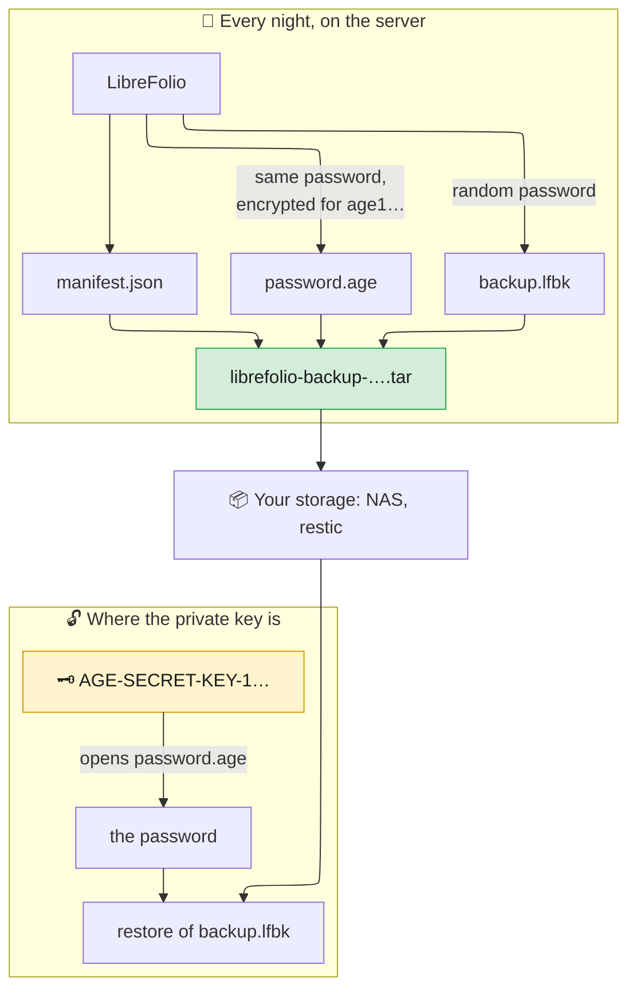

# 🔏 Backups: Sealed Backups

A **sealed backup** is closed with a key, not with a password.
It is for a server that makes its backups on its own, for example every night, with no password to type and none to keep on the disk.

The rest of the guide starts on [Backup, Restore and Moving Your Instance](backup_restore.md).

---

## 🔏 Sealed Backups: a Key Instead of a Password {: #sealed }

LibreFolio makes a [secure backup](backup_restore.md#secure) with a random password of its own, encrypts it with [age](https://age-encryption.org/) for the public key you give it, and forgets it: only the matching private key opens it, never the server that made the backup.

Three places, three steps:

1. **On your computer, not on the server**: make the key pair ([Get a Key](#sealed-key)).
2. **On the server**, in `.env` and in cron: seal every backup for the public key ([Seal Every Backup](#sealed-recipients), [Every Night with cron](#sealed-cron)).
3. **Where the private key is**: check, open or restore ([Open a Sealed Backup](#sealed-open)).



### 📦 What the `.tar` Holds {: #sealed-contents }

One file, `librefolio-backup-<date>-<time>.tar`, with the date and time the backup started in UTC, like the other archives. A plain, uncompressed tar with exactly three files, always in this order:

| # | File | What it is |
| --- | --- | --- |
| 1 | `manifest.json` | Description in clear: format (`lfbk-tar`, version `1`), public keys the password is encrypted for (`recipients`), size and SHA-256 of `backup.lfbk` (`lfbk_size`, `lfbk_sha256`), creation date (`created_at`, UTC), LibreFolio version and database revision. No personal data |
| 2 | `password.age` | The password of this backup, encrypted with age for every key in `recipients`, in age's binary form. Opened, it is one line of 43 characters among letters, digits, `-` and `_`, with no line breaks |
| 3 | `backup.lfbk` | A [secure backup](backup_restore.md#secure), the same envelope as Settings › Administration › Backup, encrypted with that password |

- 🎲 **A new password every time**: 32 random bytes per backup, never in a file, in a log or in the state of the backup job.
- 🚪 **The server cannot open its own backup**: once `password.age` is written it keeps only the public key, which encrypts and does not open. Whoever has the server, its disk or the backups folder reads nothing.
- 🗝️ **The instance key is never included**, not even one generated by LibreFolio. Whoever restores on another installation gives it the old key (`LIBREFOLIO_INSTANCE_KEY`, see [What Follows](backup_restore.md#what-follows)) or enters the keys of the data providers again. Keep a copy of `secrets/` as for a clear archive.
- 👀 **Whom is it sealed for?** `tar xOf librefolio-backup-<date>-<time>.tar manifest.json` prints the manifest; the `recipients` list holds the `age1…` keys. Compare them with the `# public key:` line of your key file.
- 🧱 **Keep the file as it is.** A tar rebuilt by hand, for example with `tar cf`, is refused (`sealed_tar_invalid`). Copy and move only the original.

### 🗝️ Get a Key {: #sealed-key }

An age key pair, private `AGE-SECRET-KEY-1…` and public `age1…`. Make it **on a computer of yours, not on the server**, with one of the two tools.

**On your computer, terminal, in LibreFolio's folder:**

```bash
pipenv run ./dev.py backup keygen --identity-file ~/librefolio-backup-key.txt
```

It writes the private key into the file (readable by its owner only, `0600`, never over an existing file) and prints the public key:

```text
✅ Private key written: /home/you/librefolio-backup-key.txt (only its owner can read it). Keep it off this server, and a copy of it elsewhere: a lost key opens no backup.
🔑 Public key, for --recipient or LIBREFOLIO_BACKUP_RECIPIENTS:
age1…
```

**Or, on any computer with `age`, terminal:**

```bash
age-keygen -o ~/librefolio-backup-key.txt
```

It writes the same file and prints the public key; `age-keygen -y ~/librefolio-backup-key.txt` prints it again later.
Same format for both, three lines: `# created: …`, `# public key: age1…` and the private key. The file works with `--identity-file` and with `age -d -i`.

The `age` tool is needed only to open a backup without LibreFolio ([Open One by Hand](#sealed-by-hand)). To install it **on your computer**:

=== "Debian / Ubuntu"

    ```bash
    sudo apt install age
    ```

=== "Arch Linux"

    ```bash
    sudo pacman -S age
    ```

    An AUR helper such as `yay -S age` works too.

=== "Fedora"

    ```bash
    sudo dnf install age
    ```

=== "macOS"

    ```bash
    brew install age
    ```

=== "Windows"

    ```powershell
    winget install --id FiloSottile.age
    ```

    Or download it from the [releases of age](https://github.com/FiloSottile/age/releases).

Where to keep the private key:

- 🏠 **Off the server**: on your computer, in a password manager that holds files, or on a USB stick kept at home. On the server, whoever takes it would open every backup.
- 📄 **A second copy elsewhere.** It is one line of 74 characters: in a password manager or printed on paper, in another place.
- 🆘 **A lost key opens nothing.** LibreFolio keeps no copy of it; every backup sealed only for that key is lost. Make a new key, change the variable and keep the backups made from then on.
- 🔓 **A leaked key opens every backup** sealed for it, to whoever also has the `.tar` files. Make a new key at once, seal for it ([Change the Key](#sealed-rotation)), then delete the copies sealed only for the old one when you no longer need them.

### 🌙 Seal Every Backup: `LIBREFOLIO_BACKUP_RECIPIENTS` {: #sealed-recipients }

**One backup — on the server, terminal, in LibreFolio's folder.** `--recipient` with the public key:

```bash
pipenv run ./dev.py backup create --recipient age1… --output /mnt/nas/librefolio/
```

It writes `librefolio-backup-<date>-<time>.tar` in the given folder.

**Every backup**, in two steps:

1. **In LibreFolio's `.env` file, on the server.** The public key:

    ```bash
    LIBREFOLIO_BACKUP_RECIPIENTS=age1…
    ```

2. **Restart LibreFolio. With Docker Compose, run `docker compose up -d`.** `env_file: .env` passes the variable to the container; `docker compose restart` is not enough, it keeps the old values. On a host installation, `pipenv run` reads `.env`: restart the server.

    From now on `backup create --sealed` makes backups sealed for that key.

The rules:

- 🔢 **One or two keys**, comma-separated; the spaces around them do not count. Two only while you [change the key](#sealed-rotation): the password is encrypted for both, and either private key opens it.
- 🧾 **Only age keys**, `age1…`, as `backup keygen` or `age-keygen` print them: no SSH key, no private key, no other kind of age key, never the same key twice.
- 🌐 **Not a secret**: no `_FILE` form, it sits in `.env` with the other settings.
- 🔁 **Read each time it is used**, by `backup create --sealed`. The backups of Settings › Administration › Backup are not sealed: they keep the password you type.

**The check.** The **Security** tab of Settings › Administration and the start log report the variable as `backup.recipients`, in one of four states:

| State | What the tab says | What happens |
| --- | --- | --- |
| ✅ Set, usable | *The hosting panel's backups are sealed for 1 key: only the private key opens their password.* (or *2 keys*) | `backup create --sealed` works |
| ✅ Not set, your own installation | *No recipients are set for the hosting panel's backups: the panel gets plain zip archives.* | `backup create --sealed` stops with `❌ LIBREFOLIO_BACKUP_RECIPIENTS is not set: …` |
| ❌ Set, not usable | *LIBREFOLIO_BACKUP_RECIPIENTS cannot be used (…): one or two age1… recipients, comma-separated. The hosting panel's backups answer 503 until it is fixed.* In the parentheses: `BACKUP_RECIPIENTS_INVALID` (not an `age1…` key, or an empty item between two commas), `BACKUP_RECIPIENTS_TOO_MANY` (more than two) or `BACKUP_RECIPIENTS_DUPLICATE` (the same key twice) | The server starts anyway. `backup create --sealed` stops with the same reason |

The messages never quote the value: a private key pasted by mistake does not land in a log.

#### 🔄 Change the Key {: #sealed-rotation }

Two keys together change the key without leaving a night uncovered:

1. **On your computer, terminal.** The new key:

    ```bash
    pipenv run ./dev.py backup keygen --identity-file ~/librefolio-backup-key-2.txt
    ```

    Or `age-keygen`. It prints the new public key.

2. **In LibreFolio's `.env` file, on the server.** Old and new key, comma-separated:

    ```bash
    LIBREFOLIO_BACKUP_RECIPIENTS=age1…old,age1…new
    ```

    Restart LibreFolio. With Docker Compose, run `docker compose up -d`. The next backups are sealed for both.

3. **Where the new private key is, terminal, in LibreFolio's folder.** After the next backup, open it with the new key alone:

    ```bash
    pipenv run ./dev.py backup inspect librefolio-backup-<date>-<time>.tar --identity-file ~/librefolio-backup-key-2.txt
    ```

    It ends with `✅ Every entry matches the manifest`.

4. **In LibreFolio's `.env` file, on the server.** The new key only:

    ```bash
    LIBREFOLIO_BACKUP_RECIPIENTS=age1…new
    ```

    Restart LibreFolio. With Docker Compose, run `docker compose up -d`.

5. **Keep the old private key** as long as you keep backups made before the change: they are sealed only for it, as their `manifest.json` says. Once the last of them is gone, delete it.

### 🔓 Open a Sealed Backup {: #sealed-open }

A sealed backup opens wherever its private key is, in three ways.

**With LibreFolio — where the private key is, terminal, in LibreFolio's folder.** The commands that take a secure backup take a sealed one too, with `--identity-file`, the file of the private key:

```bash
# Is it whole, and what does it hold?
pipenv run ./dev.py backup inspect librefolio-backup-<date>-<time>.tar --identity-file ~/librefolio-backup-key.txt

# Can this installation restore it? A restore tried on a copy
pipenv run ./dev.py backup restore librefolio-backup-<date>-<time>.tar --identity-file ~/librefolio-backup-key.txt --dry-run

# Restore it at the next start of the server
pipenv run ./dev.py backup restore librefolio-backup-<date>-<time>.tar --identity-file ~/librefolio-backup-key.txt

# The plain zip inside, to use by hand
pipenv run ./dev.py backup decrypt librefolio-backup-<date>-<time>.tar --identity-file ~/librefolio-backup-key.txt -o backup.zip
```

Each command prints `🔏 Sealed backup <path>: its password opened with <key file>`, then goes on as for a [secure backup](backup_restore.md#check).

- 🔎 A sealed backup is recognised by its content, whatever its name.
- 💽 `backup.lfbk` is first copied into a private folder of the system's temporary folder, removed at the end: it needs room for about the size of the `.tar`.
- 🐳 With Docker, the key file is read before the command switches to the server's user, like a password file: a Docker secret works. A restore on the server does put the private key there for a moment, though: remove it once the restore is confirmed, or open the backup by hand on your computer and send only `backup.lfbk` and its password.
- ❌ Without `--identity-file`, a `.tar` is refused with `sealed_backup_needs_key`; with `--identity-file`, any other archive is refused. The other refusals: [Opening a Sealed Backup](backup_moving.md#sealed-problems).

**In Settings › Administration › Backup.** The restore card takes a `.lfbk` and its password, not the `.tar` (refused with `sealed_backup_needs_key`). Unpack the `.tar` and open the password on your computer (steps 1 and 2 of [Open One by Hand](#sealed-by-hand)), then choose `backup.lfbk` in **Restore an archive** and paste the password when the card asks for it ([Restore from Settings › Administration › Backup](backup_restore.md#restore-settings)).

#### 🧰 Open One by Hand {: #sealed-by-hand }

Without LibreFolio, for example on a new computer after the old server is gone, `tar` and `age` are enough. `tar` comes with Linux, macOS and Windows 10 and later; `age` installs as in [Get a Key](#sealed-key).

1. **On your computer, terminal, in the folder of the `.tar`.** Unpack the three files:

    ```bash
    tar xf librefolio-backup-<date>-<time>.tar
    ```

    `manifest.json`, `password.age` and `backup.lfbk` appear.

2. **Same terminal.** Open the password with the private key, into a private file:

    ```bash
    age -d -i ~/librefolio-backup-key.txt -o password.txt password.age
    ```

    `password.txt` holds the key to the whole backup: delete it as soon as the restore is confirmed. Without `-o`, `age` prints the password on the terminal, with no line break after it: paste it where LibreFolio asks for it.

3. **On the installation that receives the restore, terminal, in LibreFolio's folder.** Restore `backup.lfbk` with that password:

    ```bash
    pipenv run ./dev.py backup restore backup.lfbk --password-file password.txt
    ```

    With Docker, copy `backup.lfbk` into `LibreFolio-data/backups/` and run `docker compose exec librefolio python dev.py backup restore /app/backend/data/prod-docker/backups/backup.lfbk`: the command asks for the password at the terminal, without showing it.

From here `backup.lfbk` is an ordinary secure backup: [Check a Backup](backup_restore.md#check) and [Restore on This Installation](backup_restore.md#restore) apply.

### ⏰ Every Night with cron {: #sealed-cron }

With the variable set, `backup create --sealed` makes a sealed backup with no terminal and no password.

**On the server, `crontab -e`, as the user that runs LibreFolio.** Every night at 03:30:

```text
# Host installation: into a folder of a NAS that is mounted
30 3 * * * cd /path/to/LibreFolio && pipenv run ./dev.py backup create --sealed --output /mnt/nas/librefolio/

# Docker: -T, as cron gives the command no terminal; the archive stays in its own folder of LibreFolio-data/backups/
30 3 * * * cd /path/to/librefolio && docker compose exec -T librefolio python dev.py backup create --sealed
```

The command ends with `🔏 Sealed for 1 key: only the matching private key opens its password, and this server cannot.`

- ✅ It exits with `1` when the archive is not where you asked, as in [Keep Copies Off the Server](backup_restore.md#keep-copies): its notes on `--output`, `PATH` and old archives apply here too.
- ❌ `--sealed` does not go with `--encrypt`, `--password-file`, `--password-stdin` or `--recipient`: the command stops before writing anything. A variable not set or not usable stops it too, with the reason.
- 🧪 Now and then, open a recent backup with the private key ([Open a Sealed Backup](#sealed-open)): a seal nobody has opened is a seal nobody has tested.

**With restic or Backrest.** It fixes the weak point of [Backups with restic or Backrest](backup_restore.md#restic): restic has its password on the server, but a repository of sealed `.tar` files gives it nothing to open. Use the recipe of that section with `backup create --sealed --output /var/backups/librefolio/` in place of `backup create --output …`; restic's encryption stays as a second layer. Two nights look different to restic: plan the repository's space for the copies you keep. To restore, `restic restore latest --target /tmp/librefolio-check`, then [open the `.tar`](#sealed-open) where the private key is.

---

## 🔗 Related

- 📄 **[Backup, Restore and Moving Your Instance](backup_restore.md)** — What a Backup Holds, Make a Backup, Secure Backups, …
- 📄 **[Backups: Moving and Troubleshooting](backup_moving.md)** — Bring Your LibreFolio Home, When Something Goes Wrong
