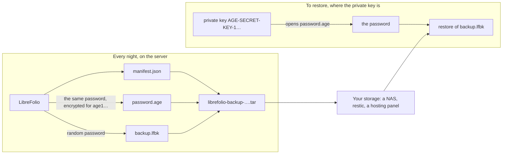

# 🔏 Backups: Sealed Backups

This page is part of the backup guide. It covers **sealed backups**: a backup closed with a key, which only its holder can open, instead of a password.

The rest of the guide starts on [Backup, Restore and Moving Your Instance](backup_restore.md).

---

## 🔏 Sealed Backups: a Key Instead of a Password {: #sealed }

A sealed backup is for a server that makes backups on its own, such as every night, without anyone typing a password and without keeping one on its disk. LibreFolio makes a [secure backup](backup_restore.md#secure) with a random password of its own, encrypts that password with [age](https://age-encryption.org/) for a public key you give it, and forgets it: only the private key that goes with it opens the password, and the server that made the backup cannot open it again. A hosting panel's nightly backups work this way, and so can yours.

In three commands:

```bash
# Once, on a computer of yours (not the server): a key pair; the file holds the private key
pipenv run ./dev.py backup keygen --identity-file ~/librefolio-backup-key.txt

# On the server: a sealed backup for that public key (the age1… line keygen printed)
pipenv run ./dev.py backup create --recipient age1… --output /mnt/nas/librefolio/

# Wherever the private key is: check, unpack or restore it
pipenv run ./dev.py backup restore librefolio-backup-<date>-<time>.tar --identity-file ~/librefolio-backup-key.txt
```

The sections below explain each step: what the file holds, how to get a key and keep it, how to seal every night, and how to open a sealed backup, with LibreFolio or without it.



### 📦 What the `.tar` Holds {: #sealed-contents }

A sealed backup is one file, `librefolio-backup-<date>-<time>.tar`, named after the moment the backup started, in UTC, like the other archives. It is a plain, uncompressed tar with exactly three files, always in this order:

| # | File | What it is |
| --- | --- | --- |
| 1 | `manifest.json` | A short description, in clear: the format (`lfbk-tar`, version `1`), the public keys the password is encrypted for (`recipients`), the size and SHA-256 of `backup.lfbk` (`lfbk_size`, `lfbk_sha256`), when the backup was made (`created_at`, UTC), the LibreFolio version and the database revision that made it. It holds no personal data |
| 2 | `password.age` | The password of this backup, encrypted with age for every key in `recipients`, in age's binary form. Once opened, it is 43 characters of letters, digits, `-` and `_`, without a line break |
| 3 | `backup.lfbk` | A [secure backup](backup_restore.md#secure), the same envelope Settings › Administration › Backup makes, encrypted with that password |

- 🎲 **A new password every time.** The server draws 32 random bytes for each backup: no rule to follow, nothing to remember, and two backups never share a password. The password lives only in the memory of the backup while it runs: never in a file, a log or the job's state.
- 🚪 **The server cannot open its own backup.** Once `password.age` is written, LibreFolio keeps only the public key, which encrypts but opens nothing. Whoever takes the server, its disk or its backups folder takes no way to read the backups it made.
- 🗝️ **The instance key never goes in**, even one LibreFolio generated, unlike a secure backup made from Settings. Whoever restores it on another installation gives that installation the old key (`LIBREFOLIO_INSTANCE_KEY`, see [What Follows](backup_restore.md#what-follows)) or enters the keys of the data providers again. Keep a copy of `secrets/` as you would for a clear archive.
- 👀 **Whom is it sealed for?** Read the manifest without unpacking anything: `tar xOf librefolio-backup-<date>-<time>.tar manifest.json` prints it, and its `recipients` list holds the `age1…` keys. Compare them with the `# public key:` line of your key file.
- 🧱 **Keep the file as it is.** LibreFolio reads only a tar of these three files, in this order, with plain headers: a tar rebuilt by hand, such as with `tar cf`, is refused (`sealed_tar_invalid`). Copy, move and store the original.

### 🗝️ Get a Key {: #sealed-key }

The key is an age key pair, made **on a computer of yours, not on the server**: a private key, `AGE-SECRET-KEY-1…`, which opens the backups, and a public key, `age1…`, which only seals them. Two tools make one; use either.

With LibreFolio, where it is installed:

```bash
pipenv run ./dev.py backup keygen --identity-file ~/librefolio-backup-key.txt
```

It writes the private key into the file, readable by its owner only (`0600`), and never over a file that exists, then prints the public key:

```text
✅ Private key written: /home/you/librefolio-backup-key.txt (only its owner can read it). Keep it off this server, and a copy of it elsewhere: a lost key opens no backup.
🔑 Public key, for --recipient or LIBREFOLIO_BACKUP_RECIPIENTS:
age1…
```

With the `age` tool, on any computer: `age-keygen -o ~/librefolio-backup-key.txt` writes the same file and prints the public key; `age-keygen -y ~/librefolio-backup-key.txt` prints it again later. Both tools write the same format, three lines: `# created: …`, `# public key: age1…` and the private key. A file from either one works with `--identity-file` and with `age -d -i`.

You need the `age` tool only to open a backup without LibreFolio ([Open One by Hand](#sealed-by-hand)). To install it on your computer:

=== "Debian / Ubuntu"

    ```bash
    sudo apt install age
    ```

=== "Arch Linux"

    ```bash
    sudo pacman -S age
    ```

    An AUR helper such as `yay -S age` works too.

=== "Fedora"

    ```bash
    sudo dnf install age
    ```

=== "macOS"

    ```bash
    brew install age
    ```

=== "Windows"

    ```powershell
    winget install --id FiloSottile.age
    ```

    Or download it from [the releases of age](https://github.com/FiloSottile/age/releases).

Where to keep the private key:

- 🏠 **Off the server.** A private key on the server that makes the backups would undo the point: whoever takes the server would open them all. Keep it on your computer, in a password manager that holds files, or on a USB stick you keep at home.
- 📄 **A second copy elsewhere.** The key is one line of 74 characters: a copy in a password manager, or printed on paper, in another place, survives the loss of the first.
- 🆘 **A lost key opens nothing.** LibreFolio keeps no copy, and no one can recover it: every backup sealed only for that key is lost with it. Make a new key, change the variable, and keep the backups made from then on.
- 🔓 **A leaked key opens every backup** sealed for it, to whoever also has the `.tar` files. Make a new key at once, seal for it ([Change the Key](#sealed-rotation)), then delete the copies sealed only for the old one when you no longer need them.

### 🌙 Seal Every Backup: `LIBREFOLIO_BACKUP_RECIPIENTS` {: #sealed-recipients }

`--recipient age1…` seals one backup. To seal them all, put the public key in `LIBREFOLIO_BACKUP_RECIPIENTS`, in `.env`:

```bash
LIBREFOLIO_BACKUP_RECIPIENTS=age1…
```

With Docker Compose, `env_file: .env` passes it to the container: run `docker compose up -d` to recreate it, as `docker compose restart` keeps the old values. On a host installation, `pipenv run` reads `.env`; restart the server.

- 🔢 **One or two keys**, comma-separated; the spaces around each one do not count. Two only while you [change the key](#sealed-rotation): the password is then encrypted for both, and either private key opens it.
- 🧾 **Only age keys**, `age1…`, as `backup keygen` or `age-keygen` prints them: no SSH key, no private key, no other kind of age key, and never the same key twice.
- 🌐 **Not a secret.** A public key seals and opens nothing, so there is no `_FILE` form, and it may sit in `.env` with the other settings.
- 🔁 **Read each time it is used**: by `backup create --sealed`, and by every backup a [hosting panel](hosting_panel_backups.md#panel-backups) starts, which it seals. The backups of Settings › Administration › Backup are not sealed: they keep the password you type.

**The check.** The **Security** tab of Settings › Administration, and the start log, report the variable as `backup.recipients`, in one of four states:

| State | What the tab says | What happens |
| --- | --- | --- |
| ✅ Set, usable | *The hosting panel's backups are sealed for 1 key: only the private key opens their password.* (or *2 keys*) | `backup create --sealed` and the hosting panel's backups are sealed |
| ✅ Not set, your own installation | *No recipients are set for the hosting panel's backups: the panel gets plain zip archives.* | `backup create --sealed` stops with `❌ LIBREFOLIO_BACKUP_RECIPIENTS is not set: …`; a hosting panel, if you have one, gets clear zips, as before |
| ❌ Set, not usable | *LIBREFOLIO_BACKUP_RECIPIENTS cannot be used (…): one or two age1… recipients, comma-separated. The hosting panel's backups answer 503 until it is fixed.* The parentheses hold `BACKUP_RECIPIENTS_INVALID` (not an `age1…` key, or an empty item between two commas), `BACKUP_RECIPIENTS_TOO_MANY` (more than two) or `BACKUP_RECIPIENTS_DUPLICATE` (the same key twice) | The server starts anyway. `backup create --sealed` stops with the same reason, and a hosting panel's backups answer `503` `backup_panel_unavailable`: never a clear zip instead |
| ❌ Not set, `managed` profile | *LIBREFOLIO_BACKUP_RECIPIENTS is not set: a managed instance never hands a plain backup to its hosting panel, whose backups answer 503 until it is set.* | An instance [hosted for others](hosting_providers.md#managed-profile) never hands its panel a backup in clear: its panel's backups answer `503` `backup_panel_unavailable` until the variable is set |

The messages never quote the value, so that a private key pasted by mistake does not land in a log.

#### 🔄 Change the Key {: #sealed-rotation }

Two keys at once let you change the key without a night left uncovered:

1. **Make the new key** on your computer: `backup keygen --identity-file ~/librefolio-backup-key-2.txt`, or `age-keygen`.
2. **Seal for both.** Write the old key and the new one, comma-separated: `LIBREFOLIO_BACKUP_RECIPIENTS=age1…old,age1…new`, then recreate the container or restart the server.
3. **Check the new key.** After the next backup, open it with the new private key alone: `backup inspect librefolio-backup-<date>-<time>.tar --identity-file ~/librefolio-backup-key-2.txt` ends with `✅ Every entry matches the manifest`.
4. **Drop the old key** from the variable, `LIBREFOLIO_BACKUP_RECIPIENTS=age1…new`, and restart again.
5. **Keep the old private key** as long as you keep backups made before the change: they are sealed only for it, as their `manifest.json` says. Once the last of them is gone, delete it.

### 🔓 Open a Sealed Backup {: #sealed-open }

A sealed backup opens wherever its private key is, in three ways.

**With LibreFolio**, the commands that take a secure backup take a sealed one too, with `--identity-file`, the file of the private key:

```bash
# Is it whole, and what does it hold?
pipenv run ./dev.py backup inspect librefolio-backup-<date>-<time>.tar --identity-file ~/librefolio-backup-key.txt

# Can this installation restore it? A restore tried on a copy
pipenv run ./dev.py backup restore librefolio-backup-<date>-<time>.tar --identity-file ~/librefolio-backup-key.txt --dry-run

# Restore it at the next start of the server
pipenv run ./dev.py backup restore librefolio-backup-<date>-<time>.tar --identity-file ~/librefolio-backup-key.txt

# The plain zip inside, to use by hand
pipenv run ./dev.py backup decrypt librefolio-backup-<date>-<time>.tar --identity-file ~/librefolio-backup-key.txt -o backup.zip
```

- 🔎 A sealed backup is recognised by its content, whatever its name. The command checks the `.tar` and its manifest, opens `password.age` with the key, checks that the password opens `backup.lfbk`, and only then goes on as for a [secure backup](backup_restore.md#check) with its password, printing `🔏 Sealed backup <path>: its password opened with <key file>`.
- 💽 `backup.lfbk` is first copied into a private folder of the system's temporary folder, removed at the end: that folder needs room for it, about the size of the `.tar`.
- 🐳 With Docker, the key file is read before the command switches to the server's user, as a password file is: a Docker secret works. Still, a restore on the server puts the private key there for a moment: remove it once the restore is confirmed, or open the backup by hand on your computer and send only `backup.lfbk` and its password.
- ❌ Without `--identity-file`, a `.tar` stops with `sealed_backup_needs_key`; with `--identity-file`, any other archive stops too. The other refusals: [Opening a Sealed Backup](backup_moving.md#sealed-problems).

**In Settings › Administration › Backup**, the restore card takes a `.lfbk` and its password, not the `.tar`, which it refuses with `sealed_backup_needs_key`. Unpack the `.tar` and open the password on your computer, as below (steps 1 and 2), then choose `backup.lfbk` in **Restore an archive** and paste the password when the card asks for it ([Restore from Settings › Administration › Backup](backup_restore.md#restore-settings)).

#### 🧰 Open One by Hand {: #sealed-by-hand }

Without LibreFolio at hand, such as on a new computer after the old server is gone, `tar` and `age` open it. `tar` comes with Linux, macOS and Windows 10 and later; `age` installs as in [Get a Key](#sealed-key).

```bash
# 1. Unpack the three files
tar xf librefolio-backup-<date>-<time>.tar

# 2. Open the password with the private key, into a private file
age -d -i ~/librefolio-backup-key.txt -o password.txt password.age

# 3. Restore backup.lfbk with that password, on the installation that receives it
pipenv run ./dev.py backup restore backup.lfbk --password-file password.txt
```

- 🔐 `password.txt` holds the key to the whole backup: delete it as soon as the restore is confirmed. Without `-o`, `age` prints the password on the terminal instead, with no line break after it: paste it where LibreFolio asks for it.
- 🐳 With Docker, copy `backup.lfbk` into `LibreFolio-data/backups/` and run `docker compose exec librefolio python dev.py backup restore /app/backend/data/prod-docker/backups/backup.lfbk`: at a terminal, the command asks the password, without showing it.
- 🔗 From there, `backup.lfbk` is an ordinary secure backup: [Check a Backup](backup_restore.md#check) and [Restore on This Installation](backup_restore.md#restore) apply as they are.

### ⏰ Every Night with cron {: #sealed-cron }

With the variable set, `backup create --sealed` makes a sealed backup with no terminal and no password: a cron line is all it takes. Every night at 03:30, as the user that runs LibreFolio (`crontab -e`):

```text
# Host installation: into a folder of a NAS that is mounted
30 3 * * * cd /path/to/LibreFolio && pipenv run ./dev.py backup create --sealed --output /mnt/nas/librefolio/

# Docker: -T, as cron gives the command no terminal; the archive lands in LibreFolio-data/backups/
30 3 * * * cd /path/to/librefolio && docker compose exec -T librefolio python dev.py backup create --sealed
```

- ✅ The command ends with `🔏 Sealed for 1 key: only the matching private key opens its password, and this server cannot.`, and exits with `1` when the archive is not where you asked, as in [Keep Copies Off the Server](backup_restore.md#keep-copies), whose notes on `--output`, `PATH` and old archives apply here too.
- ❌ `--sealed` goes without `--encrypt`, `--password-file` and `--password-stdin`, and without `--recipient`: the command stops before anything is written. A variable not set or not usable stops it too, with the reason.
- 🧪 Now and then, open a recent backup with the private key ([Open a Sealed Backup](#sealed-open)): a seal nobody has opened is a seal nobody has tested.

**With restic or Backrest.** Sealed backups fix the weak point noted in [Backups with restic or Backrest](backup_restore.md#restic): restic needs its password on the server to write, so whoever has the server can read the repository, but a repository of sealed `.tar` files gives them nothing they can open. Use the recipe of that section with `backup create --sealed --output /var/backups/librefolio/` in place of `backup create --output …`; restic's own encryption stays, as a second layer. As for secure backups, two nights look different to restic, so plan the repository's space for the copies you keep. To restore, `restic restore latest --target /tmp/librefolio-check`, then [open the `.tar`](#sealed-open) where the private key is.

---

## 🔗 Related

- 📄 **[Backup, Restore and Moving Your Instance](backup_restore.md)** — What a Backup Holds, Make a Backup, Secure Backups, …
- 📄 **[Backups: Moving and Troubleshooting](backup_moving.md)** — Bring Your LibreFolio Home, When Something Goes Wrong
