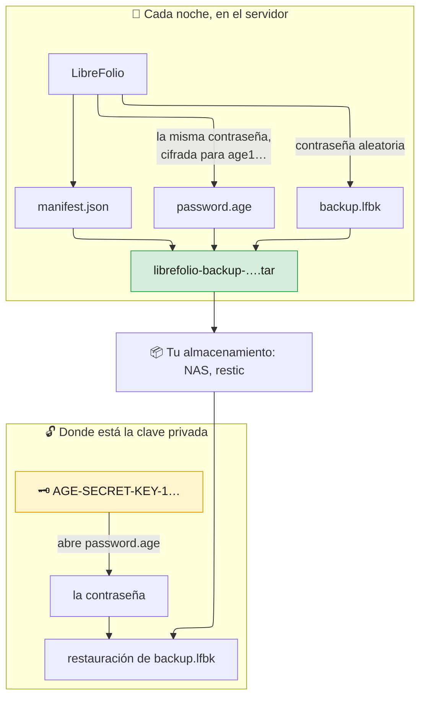

# 🔏 Copias de seguridad: copias selladas

Una **copia de seguridad sellada** se cierra con una clave, no con una contraseña.
Es para un servidor que hace sus copias por su cuenta, por ejemplo cada noche, sin contraseña que escribir y sin ninguna guardada en el disco.

El resto de la guía comienza en [Copia de seguridad, restauración y traslado de tu instancia](backup_restore.md).

---

## 🔏 Copias de seguridad selladas: una clave en lugar de una contraseña {: #sealed }

LibreFolio crea una [copia de seguridad segura](backup_restore.md#secure) con una contraseña aleatoria propia, la cifra con [age](https://age-encryption.org/) para la clave pública que le indiques y la olvida: solo la clave privada correspondiente la abre, nunca el servidor que hizo la copia.

Tres lugares, tres pasos:

1. **En tu ordenador, no en el servidor**: crea el par de claves ([Obtener una clave](#sealed-key)).
2. **En el servidor**, en `.env` y en cron: sella cada copia para la clave pública ([Sellar cada copia](#sealed-recipients), [Cada noche con cron](#sealed-cron)).
3. **Donde está la clave privada**: comprueba, abre o restaura ([Abrir una copia sellada](#sealed-open)).



### 📦 Qué contiene el `.tar` {: #sealed-contents }

Un archivo, `librefolio-backup-<date>-<time>.tar`, con la fecha y la hora en que empezó la copia en UTC, como los demás archivos. Un tar simple, sin comprimir, con exactamente tres archivos, siempre en este orden:

| # | Archivo | Qué es |
| --- | --- | --- |
| 1 | `manifest.json` | Descripción en claro: formato (`lfbk-tar`, versión `1`), claves públicas para las que se cifra la contraseña (`recipients`), tamaño y SHA-256 de `backup.lfbk` (`lfbk_size`, `lfbk_sha256`), fecha de creación (`created_at`, UTC), versión de LibreFolio y revisión de la base de datos. Sin datos personales |
| 2 | `password.age` | La contraseña de esta copia, cifrada con age para cada clave de `recipients`, en la forma binaria de age. Una vez abierta, es una línea de 43 caracteres entre letras, dígitos, `-` y `_`, sin saltos de línea |
| 3 | `backup.lfbk` | Una [copia de seguridad segura](backup_restore.md#secure), el mismo sobre que Configuración › Administración › Copia de seguridad, cifrada con esa contraseña |

- 🎲 **Una contraseña nueva cada vez**: 32 bytes aleatorios por copia, nunca en un archivo, en un registro ni en el estado de la tarea de copia.
- 🚪 **El servidor no puede abrir su propia copia**: una vez escrito `password.age`, solo conserva la clave pública, que cifra y no abre. Quien tenga el servidor, su disco o la carpeta de copias no lee nada.
- 🗝️ **La clave de instancia nunca se incluye**, ni siquiera una generada por LibreFolio. Quien restaure en otra instalación le da la clave antigua (`LIBREFOLIO_INSTANCE_KEY`, consulta [Lo que sigue](backup_restore.md#what-follows)) o vuelve a introducir las claves de los proveedores de datos. Conserva una copia de `secrets/` como con un archivo en claro.
- 👀 **¿Para quién está sellada?** `tar xOf librefolio-backup-<date>-<time>.tar manifest.json` imprime el manifiesto; la lista `recipients` contiene las claves `age1…`. Compáralas con la línea `# public key:` de tu archivo de claves.
- 🧱 **Conserva el archivo tal como está.** Un tar reconstruido a mano, por ejemplo con `tar cf`, se rechaza (`sealed_tar_invalid`). Copia y mueve solo el original.

### 🗝️ Obtener una clave {: #sealed-key }

Un par de claves de age, la privada `AGE-SECRET-KEY-1…` y la pública `age1…`. Créalo **en un ordenador tuyo, no en el servidor**, con una de las dos herramientas.

**En tu ordenador, terminal, en la carpeta de LibreFolio:**

```bash
pipenv run ./dev.py backup keygen --identity-file ~/librefolio-backup-key.txt
```

Escribe la clave privada en el archivo (legible solo por su propietario, `0600`, nunca sobre un archivo existente) e imprime la clave pública:

```text
✅ Private key written: /home/you/librefolio-backup-key.txt (only its owner can read it). Keep it off this server, and a copy of it elsewhere: a lost key opens no backup.
🔑 Public key, for --recipient or LIBREFOLIO_BACKUP_RECIPIENTS:
age1…
```

**O, en cualquier ordenador con `age`, terminal:**

```bash
age-keygen -o ~/librefolio-backup-key.txt
```

Escribe el mismo archivo e imprime la clave pública; `age-keygen -y ~/librefolio-backup-key.txt` la vuelve a imprimir más tarde.
Mismo formato en ambos casos, tres líneas: `# created: …`, `# public key: age1…` y la clave privada. El archivo funciona con `--identity-file` y con `age -d -i`.

La herramienta `age` solo hace falta para abrir una copia sin LibreFolio ([Abrir una a mano](#sealed-by-hand)). Para instalarla **en tu ordenador**:

=== "Debian / Ubuntu"

    ```bash
    sudo apt install age
    ```

=== "Arch Linux"

    ```bash
    sudo pacman -S age
    ```

    Un ayudante de AUR como `yay -S age` también funciona.

=== "Fedora"

    ```bash
    sudo dnf install age
    ```

=== "macOS"

    ```bash
    brew install age
    ```

=== "Windows"

    ```powershell
    winget install --id FiloSottile.age
    ```

    O descárgalo de las [versiones de age](https://github.com/FiloSottile/age/releases).

Dónde conservar la clave privada:

- 🏠 **Fuera del servidor**: en tu ordenador, en un gestor de contraseñas que guarde archivos, o en una memoria USB guardada en casa. En el servidor, quien se la lleve abriría todas las copias.
- 📄 **Una segunda copia en otro sitio.** Es una línea de 74 caracteres: en un gestor de contraseñas o impresa en papel, en otro lugar.
- 🆘 **Una clave perdida no abre nada.** LibreFolio no guarda copia de ella; toda copia sellada solo para esa clave se pierde. Crea una clave nueva, cambia la variable y conserva las copias hechas a partir de entonces.
- 🔓 **Una clave filtrada abre todas las copias** selladas para ella, a quien además tenga los archivos `.tar`. Crea una clave nueva de inmediato, sella para ella ([Cambiar la clave](#sealed-rotation)) y borra después las copias selladas solo para la antigua cuando ya no las necesites.

### 🌙 Sellar cada copia: `LIBREFOLIO_BACKUP_RECIPIENTS` {: #sealed-recipients }

**Una copia — en el servidor, terminal, en la carpeta de LibreFolio.** `--recipient` con la clave pública:

```bash
pipenv run ./dev.py backup create --recipient age1… --output /mnt/nas/librefolio/
```

Escribe `librefolio-backup-<date>-<time>.tar` en la carpeta indicada.

**Cada copia**, en dos pasos:

1. **En el archivo `.env` de LibreFolio, en el servidor.** La clave pública:

    ```bash
    LIBREFOLIO_BACKUP_RECIPIENTS=age1…
    ```

2. **Reinicia LibreFolio. Con Docker Compose, ejecuta `docker compose up -d`.** `env_file: .env` pasa la variable al contenedor; `docker compose restart` no basta, conserva los valores antiguos. En una instalación en el host, `pipenv run` lee `.env`: reinicia el servidor.

    A partir de ahora `backup create --sealed` crea copias selladas para esa clave.

Las reglas:

- 🔢 **Una o dos claves**, separadas por comas; los espacios alrededor no cuentan. Dos solo mientras [cambias la clave](#sealed-rotation): la contraseña se cifra para ambas y cualquiera de las claves privadas la abre.
- 🧾 **Solo claves de age**, `age1…`, tal como las imprimen `backup keygen` o `age-keygen`: ninguna clave SSH, ninguna clave privada, ningún otro tipo de clave de age, nunca la misma clave dos veces.
- 🌐 **No es un secreto**: no tiene forma `_FILE`, está en `.env` con los demás ajustes.
- 🔁 **Se lee cada vez que se usa**, por `backup create --sealed`. Las copias de Configuración › Administración › Copia de seguridad no se sellan: conservan la contraseña que escribes.

**La comprobación.** La pestaña **Seguridad** de Configuración › Administración y el registro de inicio informan de la variable como `backup.recipients`, en uno de cuatro estados:

| Estado | Qué dice la pestaña | Qué ocurre |
| --- | --- | --- |
| ✅ Establecida, utilizable | *Las copias de seguridad del panel del proveedor están selladas para 1 clave: solo la clave privada abre su contraseña.* (o *2 claves*) | `backup create --sealed` funciona |
| ✅ No establecida, tu propia instalación | *No hay destinatarios para las copias de seguridad del panel del proveedor: el panel recibe archivos zip sin cifrar.* | `backup create --sealed` se detiene con `❌ LIBREFOLIO_BACKUP_RECIPIENTS is not set: …` |
| ❌ Establecida, no utilizable | *LIBREFOLIO_BACKUP_RECIPIENTS no se puede usar (…): uno o dos destinatarios age1…, separados por comas. Las copias de seguridad del panel del proveedor responden 503 hasta que se corrija.* Entre paréntesis: `BACKUP_RECIPIENTS_INVALID` (no es una clave `age1…`, o un elemento vacío entre dos comas), `BACKUP_RECIPIENTS_TOO_MANY` (más de dos) o `BACKUP_RECIPIENTS_DUPLICATE` (la misma clave dos veces) | El servidor arranca igualmente. `backup create --sealed` se detiene con el mismo motivo |

Los mensajes nunca citan el valor: una clave privada pegada por error no acaba en un registro.

#### 🔄 Cambiar la clave {: #sealed-rotation }

Dos claves juntas cambian la clave sin dejar ninguna noche sin cubrir:

1. **En tu ordenador, terminal.** La clave nueva:

    ```bash
    pipenv run ./dev.py backup keygen --identity-file ~/librefolio-backup-key-2.txt
    ```

    O `age-keygen`. Imprime la nueva clave pública.

2. **En el archivo `.env` de LibreFolio, en el servidor.** Clave antigua y nueva, separadas por comas:

    ```bash
    LIBREFOLIO_BACKUP_RECIPIENTS=age1…old,age1…new
    ```

    Reinicia LibreFolio. Con Docker Compose, ejecuta `docker compose up -d`. Las próximas copias se sellan para ambas.

3. **Donde está la nueva clave privada, terminal, en la carpeta de LibreFolio.** Tras la siguiente copia, ábrela solo con la clave nueva:

    ```bash
    pipenv run ./dev.py backup inspect librefolio-backup-<date>-<time>.tar --identity-file ~/librefolio-backup-key-2.txt
    ```

    Termina con `✅ Every entry matches the manifest`.

4. **En el archivo `.env` de LibreFolio, en el servidor.** Solo la clave nueva:

    ```bash
    LIBREFOLIO_BACKUP_RECIPIENTS=age1…new
    ```

    Reinicia LibreFolio. Con Docker Compose, ejecuta `docker compose up -d`.

5. **Conserva la clave privada antigua** mientras conserves copias hechas antes del cambio: están selladas solo para ella, como dice su `manifest.json`. Cuando desaparezca la última, bórrala.

### 🔓 Abrir una copia sellada {: #sealed-open }

Una copia sellada se abre dondequiera que esté su clave privada, de tres maneras.

**Con LibreFolio — donde está la clave privada, terminal, en la carpeta de LibreFolio.** Los comandos que aceptan una copia segura aceptan también una sellada, con `--identity-file`, el archivo de la clave privada:

```bash
# Is it whole, and what does it hold?
pipenv run ./dev.py backup inspect librefolio-backup-<date>-<time>.tar --identity-file ~/librefolio-backup-key.txt

# Can this installation restore it? A restore tried on a copy
pipenv run ./dev.py backup restore librefolio-backup-<date>-<time>.tar --identity-file ~/librefolio-backup-key.txt --dry-run

# Restore it at the next start of the server
pipenv run ./dev.py backup restore librefolio-backup-<date>-<time>.tar --identity-file ~/librefolio-backup-key.txt

# The plain zip inside, to use by hand
pipenv run ./dev.py backup decrypt librefolio-backup-<date>-<time>.tar --identity-file ~/librefolio-backup-key.txt -o backup.zip
```

Cada comando imprime `🔏 Sealed backup <path>: its password opened with <key file>` y luego continúa como con una [copia de seguridad segura](backup_restore.md#check).

- 🔎 Una copia sellada se reconoce por su contenido, sea cual sea su nombre.
- 💽 `backup.lfbk` se copia primero en una carpeta privada de la carpeta temporal del sistema, que se elimina al final: necesita espacio para aproximadamente el tamaño del `.tar`.
- 🐳 Con Docker, el archivo de la clave se lee antes de que el comando cambie al usuario del servidor, como un archivo de contraseña: un secreto de Docker funciona. Sin embargo, una restauración en el servidor sí deja allí la clave privada por un momento: elimínala cuando la restauración esté confirmada, o abre la copia a mano en tu ordenador y envía solo `backup.lfbk` y su contraseña.
- ❌ Sin `--identity-file`, un `.tar` se rechaza con `sealed_backup_needs_key`; con `--identity-file`, se rechaza cualquier otro archivo. Los demás rechazos: [Abrir una copia de seguridad sellada](backup_moving.md#sealed-problems).

**En Configuración › Administración › Copia de seguridad.** La tarjeta de restauración acepta un `.lfbk` y su contraseña, no el `.tar` (rechazado con `sealed_backup_needs_key`). Desempaqueta el `.tar` y abre la contraseña en tu ordenador (pasos 1 y 2 de [Abrir una a mano](#sealed-by-hand)); luego elige `backup.lfbk` en **Restaurar un archivo** y pega la contraseña cuando la tarjeta la pida ([Restaurar desde Configuración › Administración › Copia de seguridad](backup_restore.md#restore-settings)).

#### 🧰 Abrir una a mano {: #sealed-by-hand }

Sin LibreFolio, por ejemplo en un ordenador nuevo cuando el servidor antiguo ya no existe, bastan `tar` y `age`. `tar` viene con Linux, macOS y Windows 10 y posteriores; `age` se instala como en [Obtener una clave](#sealed-key).

1. **En tu ordenador, terminal, en la carpeta del `.tar`.** Desempaqueta los tres archivos:

    ```bash
    tar xf librefolio-backup-<date>-<time>.tar
    ```

    Aparecen `manifest.json`, `password.age` y `backup.lfbk`.

2. **En el mismo terminal.** Abre la contraseña con la clave privada, en un archivo privado:

    ```bash
    age -d -i ~/librefolio-backup-key.txt -o password.txt password.age
    ```

    `password.txt` contiene la clave de toda la copia: bórralo en cuanto la restauración esté confirmada. Sin `-o`, `age` imprime la contraseña en el terminal, sin salto de línea después: pégala donde LibreFolio la pida.

3. **En la instalación que recibe la restauración, terminal, en la carpeta de LibreFolio.** Restaura `backup.lfbk` con esa contraseña:

    ```bash
    pipenv run ./dev.py backup restore backup.lfbk --password-file password.txt
    ```

    Con Docker, copia `backup.lfbk` en `LibreFolio-data/backups/` y ejecuta `docker compose exec librefolio python dev.py backup restore /app/backend/data/prod-docker/backups/backup.lfbk`: el comando pide la contraseña en el terminal, sin mostrarla.

A partir de aquí `backup.lfbk` es una copia de seguridad segura corriente: se aplican [Comprobar una copia de seguridad](backup_restore.md#check) y [Restaurar en esta instalación](backup_restore.md#restore).

### ⏰ Cada noche con cron {: #sealed-cron }

Con la variable establecida, `backup create --sealed` crea una copia sellada sin terminal y sin contraseña.

**En el servidor, `crontab -e`, como el usuario que ejecuta LibreFolio.** Cada noche a las 03:30:

```text
# Host installation: into a folder of a NAS that is mounted
30 3 * * * cd /path/to/LibreFolio && pipenv run ./dev.py backup create --sealed --output /mnt/nas/librefolio/

# Docker: -T, as cron gives the command no terminal; the archive stays in its own folder of LibreFolio-data/backups/
30 3 * * * cd /path/to/librefolio && docker compose exec -T librefolio python dev.py backup create --sealed
```

El comando termina con `🔏 Sealed for 1 key: only the matching private key opens its password, and this server cannot.`

- ✅ Sale con `1` cuando el archivo no está donde lo pediste, como en [Mantén copias fuera del servidor](backup_restore.md#keep-copies): sus notas sobre `--output`, `PATH` y los archivos antiguos se aplican también aquí.
- ❌ `--sealed` no va con `--encrypt`, `--password-file`, `--password-stdin` ni `--recipient`: el comando se detiene antes de escribir nada. Una variable no establecida o no utilizable también lo detiene, con el motivo.
- 🧪 De vez en cuando, abre una copia reciente con la clave privada ([Abrir una copia sellada](#sealed-open)): un sello que nadie ha abierto es un sello que nadie ha probado.

**Con restic o Backrest.** Corrige el punto débil de [Copias de seguridad con restic o Backrest](backup_restore.md#restic): restic tiene su contraseña en el servidor, pero un repositorio de archivos `.tar` sellados no le da nada que abrir. Usa la receta de esa sección con `backup create --sealed --output /var/backups/librefolio/` en lugar de `backup create --output …`; el cifrado de restic permanece como segunda capa. Dos noches le parecen distintas a restic: planifica el espacio del repositorio para las copias que conserves. Para restaurar, `restic restore latest --target /tmp/librefolio-check`, luego [abre el `.tar`](#sealed-open) donde está la clave privada.

---

## 🔗 Relacionado

- 📄 **[Copia de seguridad, restauración y traslado de tu instancia](backup_restore.md)** — Qué contiene una copia de seguridad, hacer una copia de seguridad, copias de seguridad seguras, …
- 📄 **[Copias de seguridad: traslado y solución de problemas](backup_moving.md)** — Lleva tu LibreFolio a casa, cuando algo va mal
