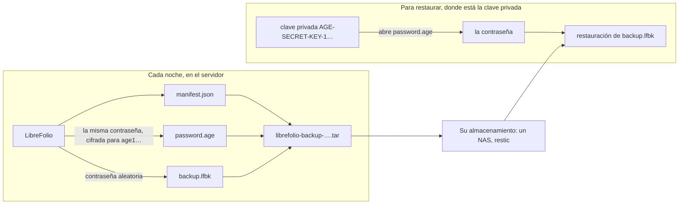

# 🔏 Copias de seguridad: copias selladas

Esta página forma parte de la guía de copias de seguridad. Trata de las **copias de seguridad selladas**: una copia cerrada con una clave, que solo puede abrir su titular, en lugar de una contraseña.

El resto de la guía comienza en [Copia de seguridad, restauración y traslado de la instancia](backup_restore.md).

---

## 🔏 Copias de seguridad selladas: una clave en lugar de una contraseña {: #sealed }

Una copia sellada está pensada para un servidor que hace copias por su cuenta, por ejemplo cada noche, sin que nadie escriba una contraseña y sin guardar ninguna en su disco. LibreFolio crea una [copia de seguridad segura](backup_restore.md#secure) con una contraseña aleatoria propia, cifra esa contraseña con [age](https://age-encryption.org/) para una clave pública que se le indique y la olvida: solo la clave privada correspondiente abre la contraseña, y el servidor que hizo la copia no puede volver a abrirla.

En tres comandos:

```bash
# Once, on a computer of yours (not the server): a key pair; the file holds the private key
pipenv run ./dev.py backup keygen --identity-file ~/librefolio-backup-key.txt

# On the server: a sealed backup for that public key (the age1… line keygen printed)
pipenv run ./dev.py backup create --recipient age1… --output /mnt/nas/librefolio/

# Wherever the private key is: check, unpack or restore it
pipenv run ./dev.py backup restore librefolio-backup-<date>-<time>.tar --identity-file ~/librefolio-backup-key.txt
```

Las secciones siguientes explican cada paso: qué contiene el archivo, cómo obtener una clave y conservarla, cómo sellar cada noche y cómo abrir una copia sellada, con LibreFolio o sin él.



### 📦 Qué contiene el archivo `.tar` {: #sealed-contents }

Una copia sellada es un único archivo, `librefolio-backup-<date>-<time>.tar`, nombrado según el momento en que comenzó la copia, en UTC, como los demás archivos. Es un tar simple, sin comprimir, con exactamente tres archivos, siempre en este orden:

| # | Archivo | Qué es |
| --- | --- | --- |
| 1 | `manifest.json` | Una descripción breve, en claro: el formato (`lfbk-tar`, versión `1`), las claves públicas para las que se cifra la contraseña (`recipients`), el tamaño y el SHA-256 de `backup.lfbk` (`lfbk_size`, `lfbk_sha256`), cuándo se hizo la copia (`created_at`, UTC), la versión de LibreFolio y la revisión de la base de datos con la que se creó. No contiene datos personales |
| 2 | `password.age` | La contraseña de esta copia, cifrada con age para cada clave de `recipients`, en el formato binario de age. Una vez abierta, son 43 caracteres de letras, dígitos, `-` y `_`, sin salto de línea |
| 3 | `backup.lfbk` | Una [copia de seguridad segura](backup_restore.md#secure), el mismo contenedor que crea Configuración › Administración › Copia de seguridad, cifrado con esa contraseña |

- 🎲 **Una contraseña nueva cada vez.** El servidor genera 32 bytes aleatorios para cada copia: ninguna regla que seguir, nada que recordar, y dos copias nunca comparten contraseña. La contraseña solo vive en la memoria de la copia mientras se ejecuta: nunca en un archivo, un registro o el estado del trabajo.
- 🚪 **El servidor no puede abrir su propia copia.** Una vez escrito `password.age`, LibreFolio solo conserva la clave pública, que cifra pero no abre nada. Quien se lleve el servidor, su disco o su carpeta de copias no tendrá forma alguna de leer las copias que hizo.
- 🗝️ **La clave de la instancia nunca se incluye**, ni siquiera una generada por LibreFolio, a diferencia de una copia segura creada desde Configuración. Quien la restaure en otra instalación le dará a esa instalación la clave antigua (`LIBREFOLIO_INSTANCE_KEY`, véase [Lo que sigue](backup_restore.md#what-follows)) o volverá a introducir las claves de los proveedores de datos. Guarde una copia de `secrets/` como lo haría para un archivo en claro.
- 👀 **¿Para quién está sellada?** Lea el manifiesto sin desempaquetar nada: `tar xOf librefolio-backup-<date>-<time>.tar manifest.json` lo imprime, y su lista `recipients` contiene las claves `age1…`. Compárelas con la línea `# public key:` de su archivo de clave.
- 🧱 **Conserve el archivo tal como está.** LibreFolio solo lee un tar con estos tres archivos, en este orden, con cabeceras simples: un tar reconstruido a mano, por ejemplo con `tar cf`, se rechaza (`sealed_tar_invalid`). Copie, mueva y guarde el original.

### 🗝️ Obtener una clave {: #sealed-key }

La clave es un par de claves de age, creado **en un ordenador suyo, no en el servidor**: una clave privada, `AGE-SECRET-KEY-1…`, que abre las copias, y una clave pública, `age1…`, que solo las sella. Dos herramientas permiten crear un par; use cualquiera de ellas.

Con LibreFolio, donde esté instalado:

```bash
pipenv run ./dev.py backup keygen --identity-file ~/librefolio-backup-key.txt
```

Escribe la clave privada en el archivo, legible solo por su propietario (`0600`), y nunca sobre un archivo que ya exista; después, imprime la clave pública:

```text
✅ Private key written: /home/you/librefolio-backup-key.txt (only its owner can read it). Keep it off this server, and a copy of it elsewhere: a lost key opens no backup.
🔑 Public key, for --recipient or LIBREFOLIO_BACKUP_RECIPIENTS:
age1…
```

Con la herramienta `age`, en cualquier ordenador: `age-keygen -o ~/librefolio-backup-key.txt` escribe el mismo archivo e imprime la clave pública; `age-keygen -y ~/librefolio-backup-key.txt` la vuelve a imprimir más adelante. Ambas herramientas escriben el mismo formato, tres líneas: `# created: …`, `# public key: age1…` y la clave privada. Un archivo de cualquiera de las dos funciona con `--identity-file` y con `age -d -i`.

Solo necesita la herramienta `age` para abrir una copia sin LibreFolio ([Abrir una a mano](#sealed-by-hand)). Para instalarla en su ordenador:

=== "Debian / Ubuntu"

    ```bash
    sudo apt install age
    ```

=== "Arch Linux"

    ```bash
    sudo pacman -S age
    ```

    También funciona una herramienta de AUR como `yay -S age`.

=== "Fedora"

    ```bash
    sudo dnf install age
    ```

=== "macOS"

    ```bash
    brew install age
    ```

=== "Windows"

    ```powershell
    winget install --id FiloSottile.age
    ```

    O descárguelo desde [las versiones de age](https://github.com/FiloSottile/age/releases).

Dónde conservar la clave privada:

- 🏠 **Fuera del servidor.** Una clave privada en el servidor que hace las copias echaría por tierra el propósito: quien se lleve el servidor las abriría todas. Guárdela en su ordenador, en un gestor de contraseñas que guarde archivos o en una memoria USB que conserve en casa.
- 📄 **Una segunda copia en otro lugar.** La clave es una sola línea de 74 caracteres: una copia en un gestor de contraseñas, o impresa en papel, en otro lugar, sobrevive a la pérdida de la primera.
- 🆘 **Una clave perdida no abre nada.** LibreFolio no guarda ninguna copia y nadie puede recuperarla: toda copia sellada solo para esa clave se pierde con ella. Cree una clave nueva, cambie la variable y conserve las copias hechas a partir de entonces.
- 🔓 **Una clave filtrada abre todas las copias** selladas para ella, a quien también tenga los archivos `.tar`. Cree una clave nueva de inmediato, selle para ella ([Cambiar la clave](#sealed-rotation)) y después elimine las copias selladas solo para la antigua cuando ya no las necesite.

### 🌙 Sellar cada copia: `LIBREFOLIO_BACKUP_RECIPIENTS` {: #sealed-recipients }

`--recipient age1…` sella una copia. Para sellarlas todas, ponga la clave pública en `LIBREFOLIO_BACKUP_RECIPIENTS`, en `.env`:

```bash
LIBREFOLIO_BACKUP_RECIPIENTS=age1…
```

Con Docker Compose, `env_file: .env` lo pasa al contenedor: ejecute `docker compose up -d` para recrearlo, ya que `docker compose restart` conserva los valores antiguos. En una instalación en el host, `pipenv run` lee `.env`; reinicie el servidor.

- 🔢 **Una o dos claves**, separadas por comas; los espacios alrededor de cada una no cuentan. Dos solo mientras [cambie la clave](#sealed-rotation): la contraseña se cifra entonces para ambas, y cualquiera de las dos claves privadas la abre.
- 🧾 **Solo claves de age**, `age1…`, tal como las imprimen `backup keygen` o `age-keygen`: ni claves SSH, ni claves privadas, ni ningún otro tipo de clave de age, y nunca la misma clave dos veces.
- 🌐 **No es un secreto.** Una clave pública sella y no abre nada, así que no existe una forma `_FILE`, y puede estar en `.env` con el resto de la configuración.
- 🔁 **Se lee cada vez que se usa**: mediante `backup create --sealed`. Las copias de Configuración › Administración › Copia de seguridad no se sellan: conservan la contraseña que escriba.

**La comprobación.** La pestaña **Seguridad** de Configuración › Administración, y el registro de inicio, informan de la variable como `backup.recipients`, en uno de cuatro estados:

| Estado | Qué dice la pestaña | Qué ocurre |
| --- | --- | --- |
| ✅ Definida, utilizable | *Las copias del panel de alojamiento están selladas para 1 clave: solo la clave privada abre su contraseña.* (o *2 claves*) | `backup create --sealed` funciona |
| ✅ Sin definir, su propia instalación | *No hay destinatarios definidos para las copias del panel de alojamiento: el panel recibe archivos zip simples.* | `backup create --sealed` se detiene con `❌ LIBREFOLIO_BACKUP_RECIPIENTS is not set: …` |
| ❌ Definida, no utilizable | *LIBREFOLIO_BACKUP_RECIPIENTS no se puede usar (…): uno o dos destinatarios age1…, separados por comas. Las copias del panel de alojamiento responden 503 hasta que se corrija.* Los paréntesis contienen `BACKUP_RECIPIENTS_INVALID` (no es una clave `age1…`, o hay un elemento vacío entre dos comas), `BACKUP_RECIPIENTS_TOO_MANY` (más de dos) o `BACKUP_RECIPIENTS_DUPLICATE` (la misma clave dos veces) | El servidor arranca de todos modos. `backup create --sealed` se detiene con el mismo motivo |

Los mensajes nunca citan el valor, para que una clave privada pegada por error no acabe en un registro.

#### 🔄 Cambiar la clave {: #sealed-rotation }

Dos claves a la vez permiten cambiar la clave sin dejar una noche sin cubrir:

1. **Cree la clave nueva** en su ordenador: `backup keygen --identity-file ~/librefolio-backup-key-2.txt`, o `age-keygen`.
2. **Selle para ambas.** Escriba la clave antigua y la nueva, separadas por comas: `LIBREFOLIO_BACKUP_RECIPIENTS=age1…old,age1…new`, y después recree el contenedor o reinicie el servidor.
3. **Compruebe la clave nueva.** Después de la siguiente copia, ábrala solo con la clave privada nueva: `backup inspect librefolio-backup-<date>-<time>.tar --identity-file ~/librefolio-backup-key-2.txt` termina con `✅ Every entry matches the manifest`.
4. **Elimine la clave antigua** de la variable, `LIBREFOLIO_BACKUP_RECIPIENTS=age1…new`, y reinicie de nuevo.
5. **Conserve la clave privada antigua** mientras conserve las copias hechas antes del cambio: están selladas solo para ella, como indica su `manifest.json`. Cuando desaparezca la última de esas copias, elimine la clave antigua.

### 🔓 Abrir una copia sellada {: #sealed-open }

Una copia sellada se abre allí donde esté su clave privada, de tres formas.

**Con LibreFolio**, los comandos que aceptan una copia segura también aceptan una sellada, con `--identity-file`, el archivo de la clave privada:

```bash
# Is it whole, and what does it hold?
pipenv run ./dev.py backup inspect librefolio-backup-<date>-<time>.tar --identity-file ~/librefolio-backup-key.txt

# Can this installation restore it? A restore tried on a copy
pipenv run ./dev.py backup restore librefolio-backup-<date>-<time>.tar --identity-file ~/librefolio-backup-key.txt --dry-run

# Restore it at the next start of the server
pipenv run ./dev.py backup restore librefolio-backup-<date>-<time>.tar --identity-file ~/librefolio-backup-key.txt

# The plain zip inside, to use by hand
pipenv run ./dev.py backup decrypt librefolio-backup-<date>-<time>.tar --identity-file ~/librefolio-backup-key.txt -o backup.zip
```

- 🔎 Una copia sellada se reconoce por su contenido, sea cual sea su nombre. El comando comprueba el `.tar` y su manifiesto, abre `password.age` con la clave, comprueba que la contraseña abre `backup.lfbk` y solo entonces continúa como con una [copia de seguridad segura](backup_restore.md#check) con su contraseña, imprimiendo `🔏 Sealed backup <path>: its password opened with <key file>`.
- 💽 `backup.lfbk` se copia primero en una carpeta privada dentro de la carpeta temporal del sistema, que se elimina al final: esa carpeta necesita espacio para él, aproximadamente el tamaño del `.tar`.
- 🐳 Con Docker, el archivo de clave se lee antes de que el comando cambie al usuario del servidor, igual que un archivo de contraseña: un secreto de Docker funciona. Aun así, una restauración en el servidor deja allí la clave privada por un momento: elimínela una vez confirmada la restauración, o abra la copia a mano en su ordenador y envíe solo `backup.lfbk` y su contraseña.
- ❌ Sin `--identity-file`, el comando se detiene ante un `.tar` con `sealed_backup_needs_key`; con `--identity-file`, también se detiene ante cualquier otro tipo de archivo. Los demás rechazos: [Abrir una copia sellada](backup_moving.md#sealed-problems).

**En Configuración › Administración › Copia de seguridad**, la tarjeta de restauración acepta un `.lfbk` y su contraseña, no el `.tar`, que rechaza con `sealed_backup_needs_key`. Desempaquete el `.tar` y abra la contraseña en su ordenador, como se indica a continuación (pasos 1 y 2); después, elija `backup.lfbk` en **Restaurar un archivo** y pegue la contraseña cuando la tarjeta la solicite ([Restaurar desde Configuración › Administración › Copia de seguridad](backup_restore.md#restore-settings)).

#### 🧰 Abrir una a mano {: #sealed-by-hand }

Sin LibreFolio a mano, por ejemplo en un ordenador nuevo después de que el servidor antiguo haya desaparecido, `tar` y `age` la abren. `tar` viene con Linux, macOS y Windows 10 y posteriores; `age` se instala como se indica en [Obtener una clave](#sealed-key).

```bash
# 1. Unpack the three files
tar xf librefolio-backup-<date>-<time>.tar

# 2. Open the password with the private key, into a private file
age -d -i ~/librefolio-backup-key.txt -o password.txt password.age

# 3. Restore backup.lfbk with that password, on the installation that receives it
pipenv run ./dev.py backup restore backup.lfbk --password-file password.txt
```

- 🔐 `password.txt` contiene la clave de toda la copia: elimínelo en cuanto se confirme la restauración. Sin `-o`, `age` imprime la contraseña en la terminal, sin salto de línea después: péguela donde LibreFolio la solicite.
- 🐳 Con Docker, copie `backup.lfbk` en `LibreFolio-data/backups/` y ejecute `docker compose exec librefolio python dev.py backup restore /app/backend/data/prod-docker/backups/backup.lfbk`: en una terminal, el comando pide la contraseña sin mostrarla.
- 🔗 A partir de ahí, `backup.lfbk` es una copia de seguridad segura normal: [Comprobar una copia](backup_restore.md#check) y [Restaurar en esta instalación](backup_restore.md#restore) se aplican tal cual.

### ⏰ Cada noche con cron {: #sealed-cron }

Con la variable definida, `backup create --sealed` crea una copia sellada sin terminal y sin contraseña: basta con una línea de cron. Cada noche a las 03:30, como el usuario que ejecuta LibreFolio (`crontab -e`):

```text
# Host installation: into a folder of a NAS that is mounted
30 3 * * * cd /path/to/LibreFolio && pipenv run ./dev.py backup create --sealed --output /mnt/nas/librefolio/

# Docker: -T, as cron gives the command no terminal; the archive stays in its own folder of LibreFolio-data/backups/
30 3 * * * cd /path/to/librefolio && docker compose exec -T librefolio python dev.py backup create --sealed
```

- ✅ El comando termina con `🔏 Sealed for 1 key: only the matching private key opens its password, and this server cannot.`, y sale con `1` cuando el archivo no está donde se pidió, como en [Mantener las copias fuera del servidor](backup_restore.md#keep-copies), cuyas notas sobre `--output`, `PATH` y archivos antiguos también se aplican aquí.
- ❌ `--sealed` no admite `--encrypt`, `--password-file` ni `--password-stdin`, ni `--recipient`: el comando se detiene antes de que se escriba nada. Una variable no definida o no utilizable también lo detiene, con el motivo.
- 🧪 De vez en cuando, abra una copia reciente con la clave privada ([Abrir una copia sellada](#sealed-open)): un sello que nadie ha abierto es un sello que nadie ha probado.

**Con restic o Backrest.** Las copias selladas resuelven el punto débil señalado en [Copias de seguridad con restic o Backrest](backup_restore.md#restic): restic necesita su contraseña en el servidor para escribir, así que quien tenga el servidor puede leer el repositorio, pero un repositorio de archivos `.tar` sellados no le da nada que pueda abrir. Use la receta de esa sección con `backup create --sealed --output /var/backups/librefolio/` en lugar de `backup create --output …`; el cifrado propio de restic se mantiene, como segunda capa. Como sucede con las copias seguras, para restic dos noches producen copias distintas, así que planifique el espacio del repositorio para las copias que conserve. Para restaurar, use `restic restore latest --target /tmp/librefolio-check` y después [abra el `.tar`](#sealed-open) donde esté la clave privada.

---

## 🔗 Relacionado

- 📄 **[Copia de seguridad, restauración y traslado de la instancia](backup_restore.md)** — Qué contiene una copia, Crear una copia, Copias seguras, …
- 📄 **[Copias de seguridad: traslado y solución de problemas](backup_moving.md)** — Lleve su LibreFolio a casa, Cuando algo va mal
