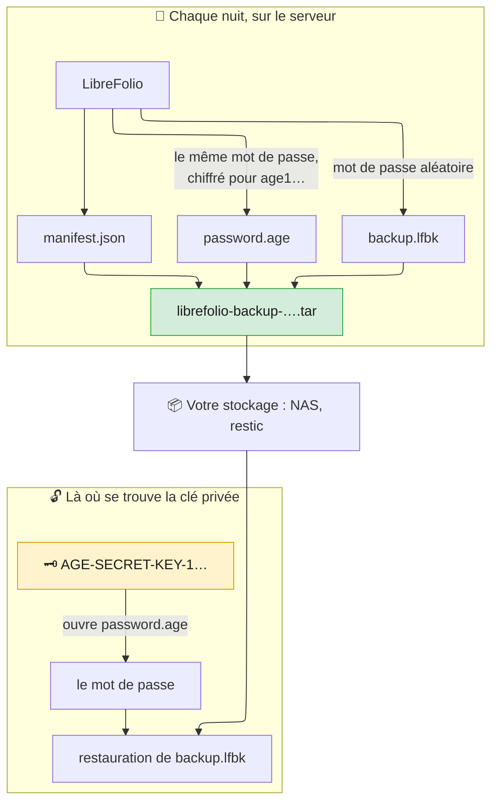

# 🔏 Sauvegardes : sauvegardes scellées

Une **sauvegarde scellée** est fermée avec une clé, pas avec un mot de passe.
Elle est destinée à un serveur qui effectue ses sauvegardes tout seul, par exemple chaque nuit, sans mot de passe à saisir et sans en conserver un sur le disque.

Le reste du guide commence à la page [Sauvegarde, restauration et déplacement de votre instance](backup_restore.md).

---

## 🔏 Sauvegardes scellées : une clé plutôt qu'un mot de passe {: #sealed }

LibreFolio effectue une [sauvegarde sécurisée](backup_restore.md#secure) avec un mot de passe aléatoire qui lui est propre, la chiffre avec [age](https://age-encryption.org/) pour la clé publique que vous lui fournissez, puis l'oublie : seule la clé privée correspondante l'ouvre, jamais le serveur qui a fait la sauvegarde.

Trois endroits, trois étapes :

1. **Sur votre ordinateur, pas sur le serveur** : créez la paire de clés ([Obtenir une clé](#sealed-key)).
2. **Sur le serveur**, dans `.env` et dans cron : scellez chaque sauvegarde pour la clé publique ([Sceller chaque sauvegarde](#sealed-recipients), [Chaque nuit avec cron](#sealed-cron)).
3. **Là où se trouve la clé privée** : vérifiez, ouvrez ou restaurez ([Ouvrir une sauvegarde scellée](#sealed-open)).



### 📦 Ce que contient le `.tar` {: #sealed-contents }

Un seul fichier, `librefolio-backup-<date>-<time>.tar`, avec la date et l'heure de début de la sauvegarde en UTC, comme les autres archives. Un tar simple, non compressé, contenant exactement trois fichiers, toujours dans cet ordre :

| # | Fichier | Ce que c'est |
| --- | --- | --- |
| 1 | `manifest.json` | Description en clair : format (`lfbk-tar`, version `1`), clés publiques pour lesquelles le mot de passe est chiffré (`recipients`), taille et SHA-256 de `backup.lfbk` (`lfbk_size`, `lfbk_sha256`), date de création (`created_at`, UTC), version de LibreFolio et révision de la base de données. Aucune donnée personnelle |
| 2 | `password.age` | Le mot de passe de cette sauvegarde, chiffré avec age pour chaque clé de `recipients`, sous la forme binaire d'age. Une fois ouvert, c'est une ligne de 43 caractères parmi des lettres, des chiffres, `-` et `_`, sans retour à la ligne |
| 3 | `backup.lfbk` | Une [sauvegarde sécurisée](backup_restore.md#secure), la même enveloppe que Paramètres › Administration › Sauvegarde, chiffrée avec ce mot de passe |

- 🎲 **Un nouveau mot de passe à chaque fois** : 32 octets aléatoires par sauvegarde, jamais dans un fichier, un journal ou l'état de la tâche de sauvegarde.
- 🚪 **Le serveur ne peut pas ouvrir sa propre sauvegarde** : une fois `password.age` écrit, il ne conserve que la clé publique, qui chiffre mais n'ouvre rien. Quiconque possède le serveur, son disque ou le dossier des sauvegardes ne lit rien.
- 🗝️ **La clé d'instance n'est jamais incluse**, même si LibreFolio l'a générée. Celui qui restaure sur une autre installation lui donne l'ancienne clé (`LIBREFOLIO_INSTANCE_KEY`, voir [Ce qui suit](backup_restore.md#what-follows)) ou saisit à nouveau les clés des fournisseurs de données. Conservez une copie de `secrets/` comme pour une archive en clair.
- 👀 **Pour qui est-elle scellée ?** `tar xOf librefolio-backup-<date>-<time>.tar manifest.json` affiche le manifeste ; la liste `recipients` contient les clés `age1…`. Comparez-les avec la ligne `# public key:` de votre fichier de clé.
- 🧱 **Conservez le fichier tel quel.** Un tar reconstruit à la main, par exemple avec `tar cf`, est refusé (`sealed_tar_invalid`). Copiez et déplacez uniquement l'original.

### 🗝️ Obtenir une clé {: #sealed-key }

Une paire de clés age, privée `AGE-SECRET-KEY-1…` et publique `age1…`. Créez-la **sur un de vos ordinateurs, pas sur le serveur**, avec l'un des deux outils.

**Sur votre ordinateur, terminal, dans le dossier de LibreFolio :**

```bash
pipenv run ./dev.py backup keygen --identity-file ~/librefolio-backup-key.txt
```

Il écrit la clé privée dans le fichier (lisible par son seul propriétaire, `0600`, jamais par-dessus un fichier existant) et affiche la clé publique :

```text
✅ Private key written: /home/you/librefolio-backup-key.txt (only its owner can read it). Keep it off this server, and a copy of it elsewhere: a lost key opens no backup.
🔑 Public key, for --recipient or LIBREFOLIO_BACKUP_RECIPIENTS:
age1…
```

**Ou, sur n'importe quel ordinateur avec `age`, terminal :**

```bash
age-keygen -o ~/librefolio-backup-key.txt
```

Il écrit le même fichier et affiche la clé publique ; `age-keygen -y ~/librefolio-backup-key.txt` l'affiche à nouveau plus tard.
Même format pour les deux, trois lignes : `# created: …`, `# public key: age1…` et la clé privée. Le fichier fonctionne avec `--identity-file` et avec `age -d -i`.

L'outil `age` n'est nécessaire que pour ouvrir une sauvegarde sans LibreFolio ([Ouvrir une sauvegarde à la main](#sealed-by-hand)). Pour l'installer **sur votre ordinateur** :

=== "Debian / Ubuntu"

    ```bash
    sudo apt install age
    ```

=== "Arch Linux"

    ```bash
    sudo pacman -S age
    ```

    Un assistant AUR tel que `yay -S age` fonctionne aussi.

=== "Fedora"

    ```bash
    sudo dnf install age
    ```

=== "macOS"

    ```bash
    brew install age
    ```

=== "Windows"

    ```powershell
    winget install --id FiloSottile.age
    ```

    Ou téléchargez-le depuis [les versions publiées d'age](https://github.com/FiloSottile/age/releases).

Où conserver la clé privée :

- 🏠 **Hors du serveur** : sur votre ordinateur, dans un gestionnaire de mots de passe qui accepte des fichiers, ou sur une clé USB gardée chez vous. Sur le serveur, quiconque la prendrait ouvrirait toutes les sauvegardes.
- 📄 **Une seconde copie ailleurs.** Elle tient sur une ligne de 74 caractères : dans un gestionnaire de mots de passe ou imprimée sur papier, à un autre endroit.
- 🆘 **Une clé perdue n'ouvre rien.** LibreFolio n'en conserve aucune copie ; toutes les sauvegardes scellées uniquement pour cette clé sont perdues. Créez une nouvelle clé, changez la variable et conservez les sauvegardes faites à partir de ce moment.
- 🔓 **Une clé divulguée ouvre toutes les sauvegardes** scellées pour elle, à quiconque possède aussi les fichiers `.tar`. Créez immédiatement une nouvelle clé, scellez pour elle ([Changer la clé](#sealed-rotation)), puis supprimez les copies scellées uniquement pour l'ancienne lorsque vous n'en avez plus besoin.

### 🌙 Sceller chaque sauvegarde : `LIBREFOLIO_BACKUP_RECIPIENTS` {: #sealed-recipients }

**Une sauvegarde — sur le serveur, terminal, dans le dossier de LibreFolio.** `--recipient` avec la clé publique :

```bash
pipenv run ./dev.py backup create --recipient age1… --output /mnt/nas/librefolio/
```

Il écrit `librefolio-backup-<date>-<time>.tar` dans le dossier indiqué.

**Chaque sauvegarde**, en deux étapes :

1. **Dans le fichier `.env` de LibreFolio, sur le serveur.** La clé publique :

    ```bash
    LIBREFOLIO_BACKUP_RECIPIENTS=age1…
    ```

2. **Redémarrez LibreFolio. Avec Docker Compose, exécutez `docker compose up -d`.** `env_file: .env` transmet la variable au conteneur ; `docker compose restart` ne suffit pas, il conserve les anciennes valeurs. Sur une installation hôte, `pipenv run` lit `.env` : redémarrez le serveur.

    Désormais, `backup create --sealed` produit des sauvegardes scellées pour cette clé.

Les règles :

- 🔢 **Une ou deux clés**, séparées par des virgules ; les espaces autour d'elles ne comptent pas. Deux seulement pendant que vous [changez la clé](#sealed-rotation) : le mot de passe est chiffré pour les deux, et l'une ou l'autre clé privée l'ouvre.
- 🧾 **Uniquement des clés age**, `age1…`, telles que les affichent `backup keygen` ou `age-keygen` : pas de clé SSH, pas de clé privée, pas d'autre type de clé age, et jamais deux fois la même clé.
- 🌐 **Ce n'est pas un secret** : pas de forme `_FILE`, elle figure dans `.env` avec les autres paramètres.
- 🔁 **Lue à chaque utilisation**, par `backup create --sealed`. Les sauvegardes de Paramètres › Administration › Sauvegarde ne sont pas scellées : elles conservent le mot de passe que vous saisissez.

**La vérification.** L'onglet **Sécurité** de Paramètres › Administration et le journal de démarrage rapportent la variable sous le nom `backup.recipients`, dans l'un de quatre états :

| État | Ce qu'affiche l'onglet | Ce qui se passe |
| --- | --- | --- |
| ✅ Définie, utilisable | *Les sauvegardes du panneau de l'hébergeur sont scellées pour 1 clé : seule la clé privée ouvre leur mot de passe.* (ou *2 clés*) | `backup create --sealed` fonctionne |
| ✅ Non définie, votre propre installation | *Aucun destinataire n'est défini pour les sauvegardes du panneau de l'hébergeur : le panneau reçoit des archives zip en clair.* | `backup create --sealed` s'arrête avec `❌ LIBREFOLIO_BACKUP_RECIPIENTS is not set: …` |
| ❌ Définie, inutilisable | *LIBREFOLIO_BACKUP_RECIPIENTS ne peut pas être utilisée (…) : un ou deux destinataires age1…, séparés par une virgule. Les sauvegardes du panneau de l'hébergeur répondent 503 tant qu'elle n'est pas corrigée.* Entre parenthèses : `BACKUP_RECIPIENTS_INVALID` (ce n'est pas une clé `age1…`, ou un élément vide entre deux virgules), `BACKUP_RECIPIENTS_TOO_MANY` (plus de deux) ou `BACKUP_RECIPIENTS_DUPLICATE` (la même clé deux fois) | Le serveur démarre malgré tout. `backup create --sealed` s'arrête avec le même motif |

Les messages ne citent jamais la valeur : une clé privée collée par erreur ne se retrouve pas dans un journal.

#### 🔄 Changer la clé {: #sealed-rotation }

Deux clés à la fois permettent de changer la clé sans laisser une nuit à découvert :

1. **Sur votre ordinateur, terminal.** La nouvelle clé :

    ```bash
    pipenv run ./dev.py backup keygen --identity-file ~/librefolio-backup-key-2.txt
    ```

    Ou `age-keygen`. Il affiche la nouvelle clé publique.

2. **Dans le fichier `.env` de LibreFolio, sur le serveur.** L'ancienne et la nouvelle clé, séparées par une virgule :

    ```bash
    LIBREFOLIO_BACKUP_RECIPIENTS=age1…old,age1…new
    ```

    Redémarrez LibreFolio. Avec Docker Compose, exécutez `docker compose up -d`. Les prochaines sauvegardes sont scellées pour les deux.

3. **Là où se trouve la nouvelle clé privée, terminal, dans le dossier de LibreFolio.** Après la sauvegarde suivante, ouvrez-la avec la nouvelle clé seule :

    ```bash
    pipenv run ./dev.py backup inspect librefolio-backup-<date>-<time>.tar --identity-file ~/librefolio-backup-key-2.txt
    ```

    Elle se termine par `✅ Every entry matches the manifest`.

4. **Dans le fichier `.env` de LibreFolio, sur le serveur.** La nouvelle clé seule :

    ```bash
    LIBREFOLIO_BACKUP_RECIPIENTS=age1…new
    ```

    Redémarrez LibreFolio. Avec Docker Compose, exécutez `docker compose up -d`.

5. **Conservez l'ancienne clé privée** tant que vous gardez des sauvegardes faites avant le changement : elles ne sont scellées que pour elle, comme l'indique leur `manifest.json`. Une fois la dernière disparue, supprimez-la.

### 🔓 Ouvrir une sauvegarde scellée {: #sealed-open }

Une sauvegarde scellée s'ouvre là où se trouve sa clé privée, de trois manières.

**Avec LibreFolio — là où se trouve la clé privée, terminal, dans le dossier de LibreFolio.** Les commandes qui acceptent une sauvegarde sécurisée acceptent aussi une sauvegarde scellée, avec `--identity-file`, le fichier de la clé privée :

```bash
# Est-elle intacte, et que contient-elle ?
pipenv run ./dev.py backup inspect librefolio-backup-<date>-<time>.tar --identity-file ~/librefolio-backup-key.txt

# Cette installation peut-elle la restaurer ? Une restauration testée sur une copie
pipenv run ./dev.py backup restore librefolio-backup-<date>-<time>.tar --identity-file ~/librefolio-backup-key.txt --dry-run

# La restaurer au prochain démarrage du serveur
pipenv run ./dev.py backup restore librefolio-backup-<date>-<time>.tar --identity-file ~/librefolio-backup-key.txt

# Le zip en clair qu'elle contient, à utiliser à la main
pipenv run ./dev.py backup decrypt librefolio-backup-<date>-<time>.tar --identity-file ~/librefolio-backup-key.txt -o backup.zip
```

Chaque commande affiche `🔏 Sealed backup <path>: its password opened with <key file>`, puis poursuit comme pour une [sauvegarde sécurisée](backup_restore.md#check).

- 🔎 Une sauvegarde scellée est reconnue par son contenu, quel que soit son nom.
- 💽 `backup.lfbk` est d'abord copié dans un dossier privé du dossier temporaire du système, supprimé à la fin : il faut y prévoir environ la taille du `.tar`.
- 🐳 Avec Docker, le fichier de clé est lu avant que la commande ne passe à l'utilisateur du serveur, comme un fichier de mot de passe : un secret Docker fonctionne. Toutefois, une restauration sur le serveur y place la clé privée pendant un moment : retirez-la une fois la restauration confirmée, ou ouvrez la sauvegarde à la main sur votre ordinateur et n'envoyez que `backup.lfbk` et son mot de passe.
- ❌ Sans `--identity-file`, un `.tar` est refusé avec `sealed_backup_needs_key` ; avec `--identity-file`, toute autre archive est refusée. Les autres refus : [Ouvrir une sauvegarde scellée](backup_moving.md#sealed-problems).

**Dans Paramètres › Administration › Sauvegarde.** La carte de restauration accepte un `.lfbk` et son mot de passe, pas le `.tar` (refusé avec `sealed_backup_needs_key`). Déballez le `.tar` et ouvrez le mot de passe sur votre ordinateur (étapes 1 et 2 de [Ouvrir une sauvegarde à la main](#sealed-by-hand)), puis choisissez `backup.lfbk` dans **Restaurer une archive** et collez le mot de passe lorsque la carte le demande ([Restaurer depuis Paramètres › Administration › Sauvegarde](backup_restore.md#restore-settings)).

#### 🧰 Ouvrir une sauvegarde à la main {: #sealed-by-hand }

Sans LibreFolio, par exemple sur un nouvel ordinateur après la disparition de l'ancien serveur, `tar` et `age` suffisent. `tar` est fourni avec Linux, macOS et Windows 10 et versions ultérieures ; `age` s'installe comme dans [Obtenir une clé](#sealed-key).

1. **Sur votre ordinateur, terminal, dans le dossier du `.tar`.** Extrayez les trois fichiers :

    ```bash
    tar xf librefolio-backup-<date>-<time>.tar
    ```

    `manifest.json`, `password.age` et `backup.lfbk` apparaissent.

2. **Même terminal.** Ouvrez le mot de passe avec la clé privée, dans un fichier privé :

    ```bash
    age -d -i ~/librefolio-backup-key.txt -o password.txt password.age
    ```

    `password.txt` contient la clé de toute la sauvegarde : supprimez-le dès que la restauration est confirmée. Sans `-o`, `age` affiche le mot de passe sur le terminal, sans retour à la ligne après : collez-le là où LibreFolio le demande.

3. **Sur l'installation qui reçoit la restauration, terminal, dans le dossier de LibreFolio.** Restaurez `backup.lfbk` avec ce mot de passe :

    ```bash
    pipenv run ./dev.py backup restore backup.lfbk --password-file password.txt
    ```

    Avec Docker, copiez `backup.lfbk` dans `LibreFolio-data/backups/` et lancez `docker compose exec librefolio python dev.py backup restore /app/backend/data/prod-docker/backups/backup.lfbk` : la commande demande le mot de passe dans le terminal, sans l'afficher.

À partir de là, `backup.lfbk` est une sauvegarde sécurisée ordinaire : [Vérifier une sauvegarde](backup_restore.md#check) et [Restaurer sur cette installation](backup_restore.md#restore) s'appliquent.

### ⏰ Chaque nuit avec cron {: #sealed-cron }

Une fois la variable définie, `backup create --sealed` produit une sauvegarde scellée sans terminal et sans mot de passe.

**Sur le serveur, `crontab -e`, en tant qu'utilisateur qui exécute LibreFolio.** Chaque nuit à 03:30 :

```text
# Installation hôte : dans un dossier d'un NAS monté
30 3 * * * cd /path/to/LibreFolio && pipenv run ./dev.py backup create --sealed --output /mnt/nas/librefolio/

# Docker : -T, car cron ne donne pas de terminal à la commande ; l'archive reste dans son propre dossier de LibreFolio-data/backups/
30 3 * * * cd /path/to/librefolio && docker compose exec -T librefolio python dev.py backup create --sealed
```

La commande se termine par `🔏 Sealed for 1 key: only the matching private key opens its password, and this server cannot.`

- ✅ Elle se termine avec le code `1` lorsque l'archive ne se trouve pas là où vous l'avez demandé, comme dans [Conserver des copies hors du serveur](backup_restore.md#keep-copies) : ses remarques sur `--output`, `PATH` et les anciennes archives s'appliquent ici aussi.
- ❌ `--sealed` ne s'utilise pas avec `--encrypt`, `--password-file`, `--password-stdin` ni `--recipient` : la commande s'arrête avant d'écrire quoi que ce soit. Une variable non définie ou inutilisable l'arrête aussi, avec le motif.
- 🧪 De temps en temps, ouvrez une sauvegarde récente avec la clé privée ([Ouvrir une sauvegarde scellée](#sealed-open)) : un sceau que personne n'a ouvert est un sceau que personne n'a testé.

**Avec restic ou Backrest.** Cela corrige le point faible de [Sauvegardes avec restic ou Backrest](backup_restore.md#restic) : restic a son mot de passe sur le serveur, mais un dépôt de fichiers `.tar` scellés ne lui donne rien à ouvrir. Utilisez la recette de cette section avec `backup create --sealed --output /var/backups/librefolio/` à la place de `backup create --output …` ; le chiffrement de restic reste comme seconde couche. Deux nuits se présentent différemment pour restic : prévoyez l'espace du dépôt pour les copies que vous conservez. Pour restaurer, `restic restore latest --target /tmp/librefolio-check`, puis [ouvrez le `.tar`](#sealed-open) là où se trouve la clé privée.

---

## 🔗 Voir aussi

- 📄 **[Sauvegarde, restauration et déplacement de votre instance](backup_restore.md)** — Ce que contient une sauvegarde, faire une sauvegarde, sauvegardes sécurisées, …
- 📄 **[Sauvegardes : déplacement et dépannage](backup_moving.md)** — Ramener votre LibreFolio chez vous, quand quelque chose ne va pas
