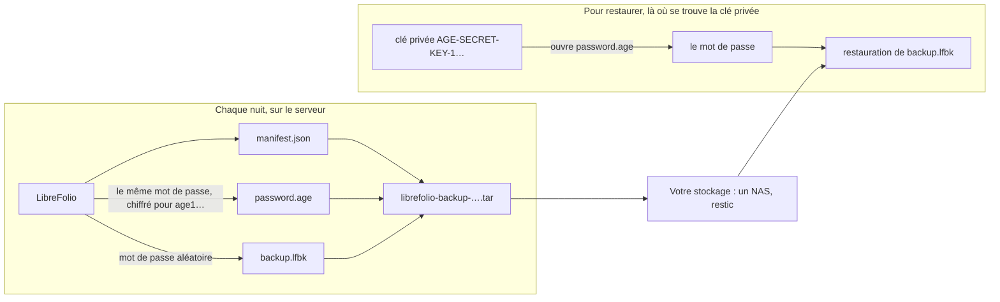

# 🔏 Sauvegardes : sauvegardes scellées

Cette page fait partie du guide des sauvegardes. Elle traite des **sauvegardes scellées** : une sauvegarde fermée avec une clé, que seul son détenteur peut ouvrir, au lieu d'un mot de passe.

Le reste du guide commence à la page [Sauvegarde, restauration et déplacement de votre instance](backup_restore.md).

---

## 🔏 Sauvegardes scellées : une clé plutôt qu'un mot de passe {: #sealed }

Une sauvegarde scellée est destinée à un serveur qui effectue ses sauvegardes tout seul, par exemple chaque nuit, sans que personne ne saisisse de mot de passe et sans en conserver un sur son disque. LibreFolio effectue une [sauvegarde sécurisée](backup_restore.md#secure) avec un mot de passe aléatoire qui lui est propre, chiffre ce mot de passe avec [age](https://age-encryption.org/) pour une clé publique que vous lui fournissez, puis l'oublie : seule la clé privée correspondante ouvre le mot de passe, et le serveur qui a fait la sauvegarde ne peut plus l'ouvrir.

En trois commandes :

```bash
# Une fois, sur un de vos ordinateurs (pas le serveur) : une paire de clés ; le fichier contient la clé privée
pipenv run ./dev.py backup keygen --identity-file ~/librefolio-backup-key.txt

# Sur le serveur : une sauvegarde scellée pour cette clé publique (la ligne age1… affichée par keygen)
pipenv run ./dev.py backup create --recipient age1… --output /mnt/nas/librefolio/

# Là où se trouve la clé privée : vérifiez, extrayez ou restaurez-la
pipenv run ./dev.py backup restore librefolio-backup-<date>-<time>.tar --identity-file ~/librefolio-backup-key.txt
```

Les sections ci-dessous expliquent chaque étape : ce que contient le fichier, comment obtenir une clé et la conserver, comment sceller chaque nuit, et comment ouvrir une sauvegarde scellée, avec ou sans LibreFolio.



### 📦 Ce que contient le `.tar` {: #sealed-contents }

Une sauvegarde scellée est un seul fichier, `librefolio-backup-<date>-<time>.tar`, nommé d'après le moment où la sauvegarde a commencé, en UTC, comme les autres archives. C'est un tar simple, non compressé, contenant exactement trois fichiers, toujours dans cet ordre :

| # | Fichier | Ce que c'est |
| --- | --- | --- |
| 1 | `manifest.json` | Une courte description, en clair : le format (`lfbk-tar`, version `1`), les clés publiques pour lesquelles le mot de passe est chiffré (`recipients`), la taille et le SHA-256 de `backup.lfbk` (`lfbk_size`, `lfbk_sha256`), le moment où la sauvegarde a été faite (`created_at`, UTC), la version de LibreFolio et la révision de la base de données qui l'a produite. Il ne contient aucune donnée personnelle |
| 2 | `password.age` | Le mot de passe de cette sauvegarde, chiffré avec age pour chaque clé de `recipients`, sous la forme binaire d'age. Une fois ouvert, il fait 43 caractères composés de lettres, de chiffres, de `-` et de `_`, sans retour à la ligne |
| 3 | `backup.lfbk` | Une [sauvegarde sécurisée](backup_restore.md#secure), la même enveloppe que produit Paramètres › Administration › Sauvegarde, chiffrée avec ce mot de passe |

- 🎲 **Un nouveau mot de passe à chaque fois.** Le serveur tire 32 octets aléatoires pour chaque sauvegarde : aucune règle à suivre, rien à mémoriser, et deux sauvegardes ne partagent jamais un mot de passe. Le mot de passe ne vit que dans la mémoire de la sauvegarde pendant son exécution : jamais dans un fichier, un journal ou l'état de la tâche.
- 🚪 **Le serveur ne peut pas ouvrir sa propre sauvegarde.** Une fois `password.age` écrit, LibreFolio ne conserve que la clé publique, qui chiffre mais n'ouvre rien. Quiconque s'empare du serveur, de son disque ou de son dossier de sauvegardes ne dispose d'aucun moyen de lire les sauvegardes qu'il a faites.
- 🗝️ **La clé d'instance n'est jamais incluse**, même si LibreFolio l'a générée, contrairement à une sauvegarde sécurisée faite depuis les Paramètres. Celui qui la restaure sur une autre installation donne à cette installation l'ancienne clé (`LIBREFOLIO_INSTANCE_KEY`, voir [Ce qui suit](backup_restore.md#what-follows)) ou saisit à nouveau les clés des fournisseurs de données. Conservez une copie de `secrets/` comme vous le feriez pour une archive en clair.
- 👀 **Pour qui est-elle scellée ?** Lisez le manifeste sans rien extraire : `tar xOf librefolio-backup-<date>-<time>.tar manifest.json` l'affiche, et sa liste `recipients` contient les clés `age1…`. Comparez-les avec la ligne `# public key:` de votre fichier de clé.
- 🧱 **Conservez le fichier tel quel.** LibreFolio ne lit qu'un tar de ces trois fichiers, dans cet ordre, avec des en-têtes simples : un tar reconstruit à la main, par exemple avec `tar cf`, est refusé (`sealed_tar_invalid`). Copiez, déplacez et stockez l'original.

### 🗝️ Obtenir une clé {: #sealed-key }

La clé est une paire de clés age, créée **sur un ordinateur qui vous appartient, pas sur le serveur** : une clé privée, `AGE-SECRET-KEY-1…`, qui ouvre les sauvegardes, et une clé publique, `age1…`, qui ne fait que les sceller. Deux outils permettent d'en créer une ; utilisez l'un ou l'autre.

Avec LibreFolio, là où il est installé :

```bash
pipenv run ./dev.py backup keygen --identity-file ~/librefolio-backup-key.txt
```

Il écrit la clé privée dans le fichier, lisible par son seul propriétaire (`0600`), et jamais par-dessus un fichier existant, puis affiche la clé publique :

```text
✅ Private key written: /home/you/librefolio-backup-key.txt (only its owner can read it). Keep it off this server, and a copy of it elsewhere: a lost key opens no backup.
🔑 Public key, for --recipient or LIBREFOLIO_BACKUP_RECIPIENTS:
age1…
```

Avec l'outil `age`, sur n'importe quel ordinateur : `age-keygen -o ~/librefolio-backup-key.txt` écrit le même fichier et affiche la clé publique ; `age-keygen -y ~/librefolio-backup-key.txt` l'affiche à nouveau plus tard. Les deux outils écrivent le même format, trois lignes : `# created: …`, `# public key: age1…` et la clé privée. Un fichier produit par l'un ou l'autre fonctionne avec `--identity-file` et avec `age -d -i`.

Vous n'avez besoin de l'outil `age` que pour ouvrir une sauvegarde sans LibreFolio ([Ouvrir une sauvegarde à la main](#sealed-by-hand)). Pour l'installer sur votre ordinateur :

=== "Debian / Ubuntu"

    ```bash
    sudo apt install age
    ```

=== "Arch Linux"

    ```bash
    sudo pacman -S age
    ```

    Un assistant AUR tel que `yay -S age` fonctionne aussi.

=== "Fedora"

    ```bash
    sudo dnf install age
    ```

=== "macOS"

    ```bash
    brew install age
    ```

=== "Windows"

    ```powershell
    winget install --id FiloSottile.age
    ```

    Ou téléchargez-le depuis [les versions publiées d'age](https://github.com/FiloSottile/age/releases).

Où conserver la clé privée :

- 🏠 **Hors du serveur.** Une clé privée sur le serveur qui fait les sauvegardes annulerait l'intérêt : quiconque s'emparerait du serveur les ouvrirait toutes. Conservez-la sur votre ordinateur, dans un gestionnaire de mots de passe qui accepte des fichiers, ou sur une clé USB que vous gardez chez vous.
- 📄 **Une seconde copie ailleurs.** La clé tient sur une ligne de 74 caractères : une copie dans un gestionnaire de mots de passe, ou imprimée sur papier, à un autre endroit, survit à la perte de la première.
- 🆘 **Une clé perdue n'ouvre rien.** LibreFolio n'en conserve aucune copie, et personne ne peut la récupérer : toutes les sauvegardes scellées uniquement pour cette clé sont perdues avec elle. Créez une nouvelle clé, changez la variable, et conservez les sauvegardes faites à partir de ce moment.
- 🔓 **Une clé divulguée ouvre toutes les sauvegardes** scellées pour elle, à quiconque possède aussi les fichiers `.tar`. Créez immédiatement une nouvelle clé, scellez pour elle ([Changer la clé](#sealed-rotation)), puis supprimez les copies scellées uniquement pour l'ancienne lorsque vous n'en avez plus besoin.

### 🌙 Sceller chaque sauvegarde : `LIBREFOLIO_BACKUP_RECIPIENTS` {: #sealed-recipients }

`--recipient age1…` scelle une sauvegarde. Pour les sceller toutes, placez la clé publique dans `LIBREFOLIO_BACKUP_RECIPIENTS`, dans `.env` :

```bash
LIBREFOLIO_BACKUP_RECIPIENTS=age1…
```

Avec Docker Compose, `env_file: .env` transmet cette variable au conteneur : lancez `docker compose up -d` pour recréer le conteneur, car `docker compose restart` conserve les anciennes valeurs. Sur une installation hôte, `pipenv run` lit `.env` ; redémarrez le serveur.

- 🔢 **Une ou deux clés**, séparées par des virgules ; les espaces autour de chacune ne comptent pas. Deux seulement pendant que vous [changez la clé](#sealed-rotation) : le mot de passe est alors chiffré pour les deux, et l'une ou l'autre clé privée l'ouvre.
- 🧾 **Uniquement des clés age**, `age1…`, telles que les affichent `backup keygen` ou `age-keygen` : pas de clé SSH, pas de clé privée, pas d'autre type de clé age, et jamais deux fois la même clé.
- 🌐 **Ce n'est pas un secret.** Une clé publique scelle et n'ouvre rien, il n'existe donc pas de forme `_FILE`, et elle peut figurer dans `.env` avec les autres paramètres.
- 🔁 **Lue à chaque utilisation** : par `backup create --sealed`. Les sauvegardes de Paramètres › Administration › Sauvegarde ne sont pas scellées : elles conservent le mot de passe que vous saisissez.

**La vérification.** L'onglet **Sécurité** de Paramètres › Administration, ainsi que le journal de démarrage, rapportent la variable sous le nom `backup.recipients`, dans l'un de quatre états :

| État | Ce qu'affiche l'onglet | Ce qui se passe |
| --- | --- | --- |
| ✅ Définie, utilisable | *Les sauvegardes du panneau d'hébergement sont scellées pour 1 clé : seule la clé privée ouvre leur mot de passe.* (ou *2 clés*) | `backup create --sealed` fonctionne |
| ✅ Non définie, votre propre installation | *Aucun destinataire n'est défini pour les sauvegardes du panneau d'hébergement : le panneau reçoit de simples archives zip.* | `backup create --sealed` s'arrête avec `❌ LIBREFOLIO_BACKUP_RECIPIENTS is not set: …` |
| ❌ Définie, inutilisable | *LIBREFOLIO_BACKUP_RECIPIENTS ne peut pas être utilisée (…) : un ou deux destinataires age1…, séparés par des virgules. Les sauvegardes du panneau d'hébergement répondent 503 tant que ce n'est pas corrigé.* Les parenthèses contiennent `BACKUP_RECIPIENTS_INVALID` (ce n'est pas une clé `age1…`, ou un élément vide entre deux virgules), `BACKUP_RECIPIENTS_TOO_MANY` (plus de deux) ou `BACKUP_RECIPIENTS_DUPLICATE` (la même clé deux fois) | Le serveur démarre malgré tout. `backup create --sealed` s'arrête avec le même motif |

Les messages ne citent jamais la valeur, afin qu'une clé privée collée par erreur ne se retrouve pas dans un journal.

#### 🔄 Changer la clé {: #sealed-rotation }

Deux clés à la fois permettent de changer la clé sans laisser une nuit à découvert :

1. **Créez la nouvelle clé** sur votre ordinateur : `backup keygen --identity-file ~/librefolio-backup-key-2.txt`, ou `age-keygen`.
2. **Scellez pour les deux.** Écrivez l'ancienne clé et la nouvelle, séparées par une virgule : `LIBREFOLIO_BACKUP_RECIPIENTS=age1…old,age1…new`, puis recréez le conteneur ou redémarrez le serveur.
3. **Vérifiez la nouvelle clé.** Après la sauvegarde suivante, ouvrez-la avec la nouvelle clé privée seule : `backup inspect librefolio-backup-<date>-<time>.tar --identity-file ~/librefolio-backup-key-2.txt` se termine par `✅ Every entry matches the manifest`.
4. **Retirez l'ancienne clé** de la variable, `LIBREFOLIO_BACKUP_RECIPIENTS=age1…new`, et redémarrez à nouveau.
5. **Conservez l'ancienne clé privée** tant que vous gardez des sauvegardes faites avant le changement : elles ne sont scellées que pour elle, comme l'indique leur `manifest.json`. Une fois la dernière disparue, supprimez-la.

### 🔓 Ouvrir une sauvegarde scellée {: #sealed-open }

Une sauvegarde scellée s'ouvre là où se trouve sa clé privée, de trois manières.

**Avec LibreFolio**, les commandes qui acceptent une sauvegarde sécurisée acceptent aussi une sauvegarde scellée, avec `--identity-file`, le fichier de la clé privée :

```bash
# Est-elle intacte, et que contient-elle ?
pipenv run ./dev.py backup inspect librefolio-backup-<date>-<time>.tar --identity-file ~/librefolio-backup-key.txt

# Cette installation peut-elle la restaurer ? Une restauration testée sur une copie
pipenv run ./dev.py backup restore librefolio-backup-<date>-<time>.tar --identity-file ~/librefolio-backup-key.txt --dry-run

# La restaurer au prochain démarrage du serveur
pipenv run ./dev.py backup restore librefolio-backup-<date>-<time>.tar --identity-file ~/librefolio-backup-key.txt

# Le zip en clair qu'elle contient, à utiliser à la main
pipenv run ./dev.py backup decrypt librefolio-backup-<date>-<time>.tar --identity-file ~/librefolio-backup-key.txt -o backup.zip
```

- 🔎 Une sauvegarde scellée est reconnue par son contenu, quel que soit son nom. La commande vérifie le `.tar` et son manifeste, ouvre `password.age` avec la clé, vérifie que le mot de passe ouvre `backup.lfbk`, et ne poursuit qu'ensuite comme pour une [sauvegarde sécurisée](backup_restore.md#check) avec son mot de passe, en affichant `🔏 Sealed backup <path>: its password opened with <key file>`.
- 💽 `backup.lfbk` est d'abord copié dans un dossier privé du répertoire temporaire du système, supprimé à la fin : ce dossier doit disposer de la place nécessaire, soit environ la taille du `.tar`.
- 🐳 Avec Docker, le fichier de clé est lu avant que la commande ne passe à l'utilisateur du serveur, comme pour un fichier de mot de passe : un secret Docker fonctionne. Toutefois, une restauration sur le serveur y place la clé privée pendant un moment : retirez-la une fois la restauration confirmée, ou ouvrez la sauvegarde à la main sur votre ordinateur et n'envoyez que `backup.lfbk` et son mot de passe.
- ❌ Sans `--identity-file`, un `.tar` s'arrête avec `sealed_backup_needs_key` ; avec `--identity-file`, toute autre archive s'arrête aussi. Les autres refus : [Ouvrir une sauvegarde scellée](backup_moving.md#sealed-problems).

**Dans Paramètres › Administration › Sauvegarde**, la carte de restauration accepte un `.lfbk` et son mot de passe, pas le `.tar`, qu'elle refuse avec `sealed_backup_needs_key`. Déballez le `.tar` et ouvrez le mot de passe sur votre ordinateur, comme ci-dessous (étapes 1 et 2), puis choisissez `backup.lfbk` dans **Restaurer une archive** et collez le mot de passe lorsque la carte le demande ([Restaurer depuis Paramètres › Administration › Sauvegarde](backup_restore.md#restore-settings)).

#### 🧰 Ouvrir une sauvegarde à la main {: #sealed-by-hand }

Sans LibreFolio à portée de main, par exemple sur un nouvel ordinateur après la disparition de l'ancien serveur, `tar` et `age` l'ouvrent. `tar` est fourni avec Linux, macOS et Windows 10 et versions ultérieures ; `age` s'installe comme indiqué dans [Obtenir une clé](#sealed-key).

```bash
# 1. Extrayez les trois fichiers
tar xf librefolio-backup-<date>-<time>.tar

# 2. Ouvrez le mot de passe avec la clé privée, dans un fichier privé
age -d -i ~/librefolio-backup-key.txt -o password.txt password.age

# 3. Restaurez backup.lfbk avec ce mot de passe, sur l'installation qui reçoit la sauvegarde
pipenv run ./dev.py backup restore backup.lfbk --password-file password.txt
```

- 🔐 `password.txt` contient la clé de toute la sauvegarde : supprimez-le dès que la restauration est confirmée. Sans `-o`, `age` affiche le mot de passe sur le terminal à la place, sans retour à la ligne après : collez-le là où LibreFolio le demande.
- 🐳 Avec Docker, copiez `backup.lfbk` dans `LibreFolio-data/backups/` et lancez `docker compose exec librefolio python dev.py backup restore /app/backend/data/prod-docker/backups/backup.lfbk` : dans un terminal, la commande demande le mot de passe, sans l'afficher.
- 🔗 À partir de là, `backup.lfbk` est une sauvegarde sécurisée ordinaire : [Vérifier une sauvegarde](backup_restore.md#check) et [Restaurer sur cette installation](backup_restore.md#restore) s'appliquent telles quelles.

### ⏰ Chaque nuit avec cron {: #sealed-cron }

Une fois la variable définie, `backup create --sealed` produit une sauvegarde scellée sans terminal et sans mot de passe : une ligne cron suffit. Chaque nuit à 03:30, en tant qu'utilisateur qui exécute LibreFolio (`crontab -e`) :

```text
# Installation hôte : dans un dossier d'un NAS monté
30 3 * * * cd /path/to/LibreFolio && pipenv run ./dev.py backup create --sealed --output /mnt/nas/librefolio/

# Docker : -T, car cron ne donne pas de terminal à la commande ; l'archive reste dans son propre dossier de LibreFolio-data/backups/
30 3 * * * cd /path/to/librefolio && docker compose exec -T librefolio python dev.py backup create --sealed
```

- ✅ La commande affiche `🔏 Sealed for 1 key: only the matching private key opens its password, and this server cannot.` et renvoie le code de sortie `1` lorsque l'archive ne se trouve pas là où vous l'avez demandé, comme dans [Conserver des copies hors du serveur](backup_restore.md#keep-copies), dont les remarques sur `--output`, `PATH` et les anciennes archives s'appliquent ici aussi.
- ❌ `--sealed` s'utilise sans `--encrypt`, `--password-file` ni `--password-stdin`, et sans `--recipient` : la commande s'arrête avant que quoi que ce soit ne soit écrit. Une variable non définie ou inutilisable l'arrête aussi, avec le motif.
- 🧪 De temps en temps, ouvrez une sauvegarde récente avec la clé privée ([Ouvrir une sauvegarde scellée](#sealed-open)) : un sceau que personne n'a ouvert est un sceau que personne n'a testé.

**Avec restic ou Backrest.** Les sauvegardes scellées corrigent le point faible signalé dans [Sauvegardes avec restic ou Backrest](backup_restore.md#restic) : restic a besoin de son mot de passe sur le serveur pour écrire, si bien que quiconque possède le serveur peut lire le dépôt, mais un dépôt de fichiers `.tar` scellés ne lui donne rien qu'il puisse ouvrir. Utilisez la recette de cette section avec `backup create --sealed --output /var/backups/librefolio/` à la place de `backup create --output …` ; le chiffrement propre à restic reste, comme seconde couche. Comme pour les sauvegardes sécurisées, deux nuits produisent des sauvegardes différentes pour restic ; prévoyez donc l'espace du dépôt pour les copies que vous conservez. Pour restaurer, `restic restore latest --target /tmp/librefolio-check`, puis [ouvrez le `.tar`](#sealed-open) là où se trouve la clé privée.

---

## 🔗 Voir aussi

- 📄 **[Sauvegarde, restauration et déplacement de votre instance](backup_restore.md)** — Ce que contient une sauvegarde, Faire une sauvegarde, Sauvegardes sécurisées, …
- 📄 **[Sauvegardes : déplacement et dépannage](backup_moving.md)** — Ramener votre LibreFolio chez vous, Quand quelque chose ne va pas
