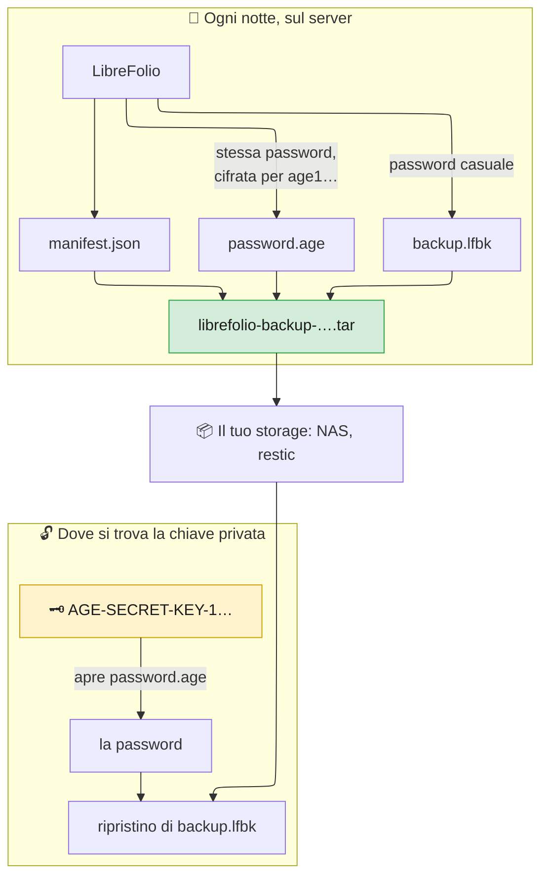

# 🔏 Backup: Backup Sigillati

Un **backup sigillato** è chiuso con una chiave, non con una password.
Serve a un server che fa i backup da solo, ad esempio ogni notte, senza password da digitare né da tenere sul disco.

Il resto della guida inizia con [Backup, Ripristino e Spostamento della Tua Istanza](backup_restore.md).

---

## 🔏 Backup Sigillati: una Chiave Invece di una Password {: #sealed }

LibreFolio crea un [backup sicuro](backup_restore.md#secure) con una password casuale propria, la cifra con [age](https://age-encryption.org/) per la chiave pubblica che gli dai, e la dimentica: la apre solo la chiave privata corrispondente, mai il server che ha creato il backup.

Tre luoghi, tre passi:

1. **Sul tuo computer, non sul server**: crea la coppia di chiavi ([Ottenere una Chiave](#sealed-key)).
2. **Sul server**, nel `.env` e in cron: sigilla ogni backup per la chiave pubblica ([Sigillare Ogni Backup](#sealed-recipients), [Ogni Notte con cron](#sealed-cron)).
3. **Dove si trova la chiave privata**: controlla, apri o ripristina ([Aprire un Backup Sigillato](#sealed-open)).



### 📦 Cosa Contiene il `.tar` {: #sealed-contents }

Un unico file, `librefolio-backup-<date>-<time>.tar`, con la data e l'ora di avvio del backup in UTC come gli altri archivi. Un tar semplice, non compresso, con esattamente tre file, sempre in questo ordine:

| # | File | Che cos'è |
| --- | --- | --- |
| 1 | `manifest.json` | Descrizione in chiaro: formato (`lfbk-tar`, versione `1`), chiavi pubbliche per cui è cifrata la password (`recipients`), dimensione e SHA-256 di `backup.lfbk` (`lfbk_size`, `lfbk_sha256`), data di creazione (`created_at`, UTC), versione di LibreFolio e revisione del database. Nessun dato personale |
| 2 | `password.age` | La password di questo backup, cifrata con age per ogni chiave in `recipients`, nella forma binaria di age. Aperta, è una riga di 43 caratteri tra lettere, cifre, `-` e `_`, senza interruzioni di riga |
| 3 | `backup.lfbk` | Un [backup sicuro](backup_restore.md#secure), la stessa busta di Impostazioni › Amministrazione › Backup, cifrata con quella password |

- 🎲 **Una nuova password ogni volta**: 32 byte casuali per backup, mai in un file, in un log o nello stato dell'attività di backup.
- 🚪 **Il server non può aprire il proprio backup**: dopo aver scritto `password.age` conserva solo la chiave pubblica, che cifra e non apre. Chi ha il server, il suo disco o la cartella dei backup non legge nulla.
- 🗝️ **La chiave dell'istanza non è mai inclusa**, nemmeno una generata da LibreFolio. Chi ripristina su un'altra installazione le fornisce la vecchia chiave (`LIBREFOLIO_INSTANCE_KEY`, vedi [Cosa Segue](backup_restore.md#what-follows)) oppure reinserisce le chiavi dei provider di dati. Conserva una copia di `secrets/` come per un archivio in chiaro.
- 👀 **Per chi è sigillato?** `tar xOf librefolio-backup-<date>-<time>.tar manifest.json` stampa il manifest; la lista `recipients` contiene le chiavi `age1…`. Confrontale con la riga `# public key:` del tuo file di chiave.
- 🧱 **Mantieni il file così com'è.** Un tar ricostruito a mano, ad esempio con `tar cf`, viene rifiutato (`sealed_tar_invalid`). Copia e sposta solo l'originale.

### 🗝️ Ottenere una Chiave {: #sealed-key }

Una coppia di chiavi age, privata `AGE-SECRET-KEY-1…` e pubblica `age1…`. Creala **su un tuo computer, non sul server**, con uno dei due strumenti.

**Sul tuo computer, terminale, nella cartella di LibreFolio:**

```bash
pipenv run ./dev.py backup keygen --identity-file ~/librefolio-backup-key.txt
```

Scrive la chiave privata nel file (leggibile solo dal proprietario, `0600`, mai sopra un file esistente) e stampa la chiave pubblica:

```text
✅ Private key written: /home/you/librefolio-backup-key.txt (only its owner can read it). Keep it off this server, and a copy of it elsewhere: a lost key opens no backup.
🔑 Public key, for --recipient or LIBREFOLIO_BACKUP_RECIPIENTS:
age1…
```

**Oppure, su qualsiasi computer con `age`, terminale:**

```bash
age-keygen -o ~/librefolio-backup-key.txt
```

Scrive lo stesso file e stampa la chiave pubblica; `age-keygen -y ~/librefolio-backup-key.txt` la stampa di nuovo in seguito.
Stesso formato per entrambi, tre righe: `# created: …`, `# public key: age1…` e la chiave privata. Il file funziona con `--identity-file` e con `age -d -i`.

Lo strumento `age` serve solo per aprire un backup senza LibreFolio ([Aprire uno a Mano](#sealed-by-hand)). Per installarlo **sul tuo computer**:

=== "Debian / Ubuntu"

    ```bash
    sudo apt install age
    ```

=== "Arch Linux"

    ```bash
    sudo pacman -S age
    ```

    Anche un helper AUR come `yay -S age` funziona.

=== "Fedora"

    ```bash
    sudo dnf install age
    ```

=== "macOS"

    ```bash
    brew install age
    ```

=== "Windows"

    ```powershell
    winget install --id FiloSottile.age
    ```

    Oppure scaricalo dalle [release di age](https://github.com/FiloSottile/age/releases).

Dove conservare la chiave privata:

- 🏠 **Fuori dal server**: sul tuo computer, in un gestore di password che conserva file, o su una chiavetta USB tenuta a casa. Sul server, chi se ne impossessa aprirebbe tutti i backup.
- 📄 **Una seconda copia altrove.** È una riga di 74 caratteri: in un gestore di password o stampata su carta, in un altro luogo.
- 🆘 **Una chiave persa non apre nulla.** LibreFolio non ne conserva copia; ogni backup sigillato solo per quella chiave è perso. Crea una nuova chiave, cambia la variabile e conserva i backup creati da quel momento.
- 🔓 **Una chiave trapelata apre ogni backup** sigillato per essa, a chiunque abbia anche i `.tar`. Crea subito una nuova chiave, sigilla per essa ([Cambiare la Chiave](#sealed-rotation)), poi elimina le copie sigillate solo per la vecchia quando non servono più.

### 🌙 Sigillare Ogni Backup: `LIBREFOLIO_BACKUP_RECIPIENTS` {: #sealed-recipients }

**Un solo backup — sul server, terminale, nella cartella di LibreFolio.** `--recipient` con la chiave pubblica:

```bash
pipenv run ./dev.py backup create --recipient age1… --output /mnt/nas/librefolio/
```

Scrive `librefolio-backup-<date>-<time>.tar` nella cartella indicata.

**Tutti i backup**, in due passi:

1. **Nel file `.env` di LibreFolio, sul server.** La chiave pubblica:

    ```bash
    LIBREFOLIO_BACKUP_RECIPIENTS=age1…
    ```

2. **Riavvia LibreFolio. Con Docker Compose, esegui `docker compose up -d`.** `env_file: .env` passa la variabile al container; `docker compose restart` non basta, mantiene i vecchi valori. Su un'installazione host, `pipenv run` legge `.env`: riavvia il server.

    Da ora `backup create --sealed` crea backup sigillati per quella chiave.

Le regole:

- 🔢 **Una o due chiavi**, separate da virgola; gli spazi attorno non contano. Due solo mentre [cambi la chiave](#sealed-rotation): la password viene cifrata per entrambe, e una qualsiasi delle due chiavi private la apre.
- 🧾 **Solo chiavi age**, `age1…`, come le stampano `backup keygen` o `age-keygen`: nessuna chiave SSH, nessuna chiave privata, nessun altro tipo di chiave age, mai la stessa chiave due volte.
- 🌐 **Non è un segreto**: nessuna forma `_FILE`, sta in `.env` con le altre impostazioni.
- 🔁 **Letta ogni volta che viene usata**, da `backup create --sealed`. I backup di Impostazioni › Amministrazione › Backup non sono sigillati: mantengono la password che digiti.

**Il controllo.** La scheda **Sicurezza** di Impostazioni › Amministrazione e il log di avvio riportano la variabile come `backup.recipients`, in uno dei quattro stati:

| Stato | Cosa dice la scheda | Cosa succede |
| --- | --- | --- |
| ✅ Impostata, utilizzabile | *I backup del pannello di hosting sono sigillati per 1 chiave: solo la chiave privata ne apre la password.* (o *2 chiavi*) | `backup create --sealed` funziona |
| ✅ Non impostata, installazione propria | *Non è impostato alcun destinatario per i backup del pannello di hosting: il pannello riceve archivi zip non sigillati.* | `backup create --sealed` si ferma con `❌ LIBREFOLIO_BACKUP_RECIPIENTS is not set: …` |
| ❌ Impostata, non utilizzabile | *LIBREFOLIO_BACKUP_RECIPIENTS non può essere utilizzata (…): uno o due destinatari age1…, separati da virgola. I backup del pannello di hosting rispondono con 503 finché non viene corretto.* Tra parentesi: `BACKUP_RECIPIENTS_INVALID` (non è una chiave `age1…`, o un elemento vuoto tra due virgole), `BACKUP_RECIPIENTS_TOO_MANY` (più di due) o `BACKUP_RECIPIENTS_DUPLICATE` (la stessa chiave due volte) | Il server si avvia comunque. `backup create --sealed` si ferma con lo stesso motivo |

I messaggi non citano mai il valore: una chiave privata incollata per errore non finisce in un log.

#### 🔄 Cambiare la Chiave {: #sealed-rotation }

Due chiavi insieme cambiano la chiave senza lasciare una notte scoperta:

1. **Sul tuo computer, terminale.** La nuova chiave:

    ```bash
    pipenv run ./dev.py backup keygen --identity-file ~/librefolio-backup-key-2.txt
    ```

    Oppure `age-keygen`. Stampa la nuova chiave pubblica.

2. **Nel file `.env` di LibreFolio, sul server.** Vecchia e nuova chiave, separate da virgola:

    ```bash
    LIBREFOLIO_BACKUP_RECIPIENTS=age1…old,age1…new
    ```

    Riavvia LibreFolio. Con Docker Compose, esegui `docker compose up -d`. I backup successivi sono sigillati per entrambe.

3. **Dove si trova la nuova chiave privata, terminale, nella cartella di LibreFolio.** Dopo il backup successivo, aprilo con la sola nuova chiave:

    ```bash
    pipenv run ./dev.py backup inspect librefolio-backup-<date>-<time>.tar --identity-file ~/librefolio-backup-key-2.txt
    ```

    Termina con `✅ Every entry matches the manifest`.

4. **Nel file `.env` di LibreFolio, sul server.** Solo la nuova chiave:

    ```bash
    LIBREFOLIO_BACKUP_RECIPIENTS=age1…new
    ```

    Riavvia LibreFolio. Con Docker Compose, esegui `docker compose up -d`.

5. **Conserva la vecchia chiave privata** finché conservi i backup creati prima del cambio: sono sigillati solo per essa, come dice il loro `manifest.json`. Sparito l'ultimo, eliminala.

### 🔓 Aprire un Backup Sigillato {: #sealed-open }

Un backup sigillato si apre ovunque si trovi la sua chiave privata, in tre modi.

**Con LibreFolio — dove si trova la chiave privata, terminale, nella cartella di LibreFolio.** I comandi che accettano un backup sicuro accettano anche uno sigillato, con `--identity-file`, il file della chiave privata:

```bash
# Is it whole, and what does it hold?
pipenv run ./dev.py backup inspect librefolio-backup-<date>-<time>.tar --identity-file ~/librefolio-backup-key.txt

# Can this installation restore it? A restore tried on a copy
pipenv run ./dev.py backup restore librefolio-backup-<date>-<time>.tar --identity-file ~/librefolio-backup-key.txt --dry-run

# Restore it at the next start of the server
pipenv run ./dev.py backup restore librefolio-backup-<date>-<time>.tar --identity-file ~/librefolio-backup-key.txt

# The plain zip inside, to use by hand
pipenv run ./dev.py backup decrypt librefolio-backup-<date>-<time>.tar --identity-file ~/librefolio-backup-key.txt -o backup.zip
```

Ogni comando stampa `🔏 Sealed backup <path>: its password opened with <key file>`, poi prosegue come per un [backup sicuro](backup_restore.md#check).

- 🔎 Un backup sigillato è riconosciuto dal contenuto, qualunque sia il nome.
- 💽 `backup.lfbk` viene prima copiato in una cartella privata della cartella temporanea del sistema, rimossa alla fine: serve spazio per circa la dimensione del `.tar`.
- 🐳 Con Docker, il file della chiave viene letto prima che il comando passi all'utente del server, come un file di password: un Docker secret funziona. Un ripristino sul server vi colloca però la chiave privata per un momento: rimuovila una volta confermato il ripristino, oppure apri il backup a mano sul tuo computer e invia solo `backup.lfbk` e la sua password.
- ❌ Senza `--identity-file`, un `.tar` viene rifiutato con `sealed_backup_needs_key`; con `--identity-file`, viene rifiutato qualsiasi altro archivio. Gli altri rifiuti: [Aprire un Backup Sigillato](backup_moving.md#sealed-problems).

**In Impostazioni › Amministrazione › Backup.** La scheda di ripristino accetta un `.lfbk` e la sua password, non il `.tar` (rifiutato con `sealed_backup_needs_key`). Estrai il `.tar` e apri la password sul tuo computer (passi 1 e 2 di [Aprire uno a Mano](#sealed-by-hand)), poi scegli `backup.lfbk` in **Ripristina un archivio** e incolla la password quando la scheda la chiede ([Ripristino da Impostazioni › Amministrazione › Backup](backup_restore.md#restore-settings)).

#### 🧰 Aprire uno a Mano {: #sealed-by-hand }

Senza LibreFolio, ad esempio su un nuovo computer dopo che il vecchio server è sparito, bastano `tar` e `age`. `tar` è incluso in Linux, macOS e Windows 10 e successivi; `age` si installa come in [Ottenere una Chiave](#sealed-key).

1. **Sul tuo computer, terminale, nella cartella del `.tar`.** Estrai i tre file:

    ```bash
    tar xf librefolio-backup-<date>-<time>.tar
    ```

    Compaiono `manifest.json`, `password.age` e `backup.lfbk`.

2. **Stesso terminale.** Apri la password con la chiave privata, in un file privato:

    ```bash
    age -d -i ~/librefolio-backup-key.txt -o password.txt password.age
    ```

    `password.txt` contiene la chiave dell'intero backup: eliminalo appena il ripristino è confermato. Senza `-o`, `age` stampa la password sul terminale, senza interruzione di riga dopo: incollala dove LibreFolio la chiede.

3. **Sull'installazione che riceve il ripristino, terminale, nella cartella di LibreFolio.** Ripristina `backup.lfbk` con quella password:

    ```bash
    pipenv run ./dev.py backup restore backup.lfbk --password-file password.txt
    ```

    Con Docker, copia `backup.lfbk` in `LibreFolio-data/backups/` ed esegui `docker compose exec librefolio python dev.py backup restore /app/backend/data/prod-docker/backups/backup.lfbk`: il comando chiede la password al terminale, senza mostrarla.

Da qui `backup.lfbk` è un normale backup sicuro: valgono [Controllare un Backup](backup_restore.md#check) e [Ripristinare su Questa Installazione](backup_restore.md#restore).

### ⏰ Ogni Notte con cron {: #sealed-cron }

Con la variabile impostata, `backup create --sealed` crea un backup sigillato senza terminale e senza password.

**Sul server, `crontab -e`, come l'utente che esegue LibreFolio.** Ogni notte alle 03:30:

```text
# Host installation: into a folder of a NAS that is mounted
30 3 * * * cd /path/to/LibreFolio && pipenv run ./dev.py backup create --sealed --output /mnt/nas/librefolio/

# Docker: -T, as cron gives the command no terminal; the archive stays in its own folder of LibreFolio-data/backups/
30 3 * * * cd /path/to/librefolio && docker compose exec -T librefolio python dev.py backup create --sealed
```

Il comando termina con `🔏 Sealed for 1 key: only the matching private key opens its password, and this server cannot.`

- ✅ Esce con `1` quando l'archivio non è dove l'hai chiesto, come in [Conservare Copie Fuori dal Server](backup_restore.md#keep-copies): le sue note su `--output`, `PATH` e archivi vecchi valgono anche qui.
- ❌ `--sealed` non va insieme a `--encrypt`, `--password-file`, `--password-stdin` né `--recipient`: il comando si ferma prima di scrivere. Anche una variabile non impostata o non utilizzabile lo ferma, con il motivo.
- 🧪 Di tanto in tanto apri un backup recente con la chiave privata ([Aprire un Backup Sigillato](#sealed-open)): un sigillo che nessuno ha aperto è un sigillo che nessuno ha testato.

**Con restic o Backrest.** Risolve il punto debole di [Backup con restic o Backrest](backup_restore.md#restic): restic ha la sua password sul server, ma un repository di `.tar` sigillati non gli dà nulla da aprire. Usa la ricetta di quella sezione con `backup create --sealed --output /var/backups/librefolio/` al posto di `backup create --output …`; la cifratura di restic resta come secondo livello. Due notti appaiono diverse a restic: pianifica lo spazio del repository per le copie che conservi. Per ripristinare, `restic restore latest --target /tmp/librefolio-check`, poi [apri il `.tar`](#sealed-open) dove si trova la chiave privata.

---

## 🔗 Correlati

- 📄 **[Backup, Ripristino e Spostamento della Tua Istanza](backup_restore.md)** — Cosa Contiene un Backup, Creare un Backup, Backup Sicuri, …
- 📄 **[Backup: Spostamento e Risoluzione dei Problemi](backup_moving.md)** — Porta il Tuo LibreFolio a Casa, Quando Qualcosa Va Storto
