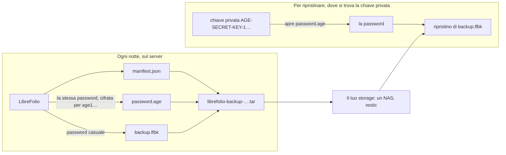

# 🔏 Backup: Backup Sigillati

Questa pagina fa parte della guida ai backup. Tratta i **backup sigillati**: un backup chiuso con una chiave, che solo chi possiede la chiave può aprire, invece che con una password.

Il resto della guida inizia con [Backup, Ripristino e Spostamento della Tua Istanza](backup_restore.md).

---

## 🔏 Backup Sigillati: una Chiave Invece di una Password {: #sealed }

Un backup sigillato è pensato per un server che esegue i backup da solo, ad esempio ogni notte, senza che nessuno digiti una password e senza tenerne una sul proprio disco. LibreFolio crea un [backup sicuro](backup_restore.md#secure) con una password casuale propria, cifra quella password con [age](https://age-encryption.org/) per una chiave pubblica che gli fornisci, e la dimentica: solo la chiave privata corrispondente apre la password, e il server che ha creato il backup non può più aprirlo.

In tre comandi:

```bash
# Once, on a computer of yours (not the server): a key pair; the file holds the private key
pipenv run ./dev.py backup keygen --identity-file ~/librefolio-backup-key.txt

# On the server: a sealed backup for that public key (the age1… line keygen printed)
pipenv run ./dev.py backup create --recipient age1… --output /mnt/nas/librefolio/

# Wherever the private key is: check, unpack or restore it
pipenv run ./dev.py backup restore librefolio-backup-<date>-<time>.tar --identity-file ~/librefolio-backup-key.txt
```

Le sezioni seguenti spiegano ogni passaggio: cosa contiene il file, come ottenere una chiave e conservarla, come sigillare ogni notte e come aprire un backup sigillato, con o senza LibreFolio.



### 📦 Cosa Contiene il `.tar` {: #sealed-contents }

Un backup sigillato è un unico file, `librefolio-backup-<date>-<time>.tar`, denominato in base al momento in cui il backup è stato avviato, in UTC, come gli altri archivi. È un tar semplice e non compresso con esattamente tre file, sempre in questo ordine:

| # | File | Che cos'è |
| --- | --- | --- |
| 1 | `manifest.json` | Una breve descrizione, in chiaro: il formato (`lfbk-tar`, versione `1`), le chiavi pubbliche per cui è cifrata la password (`recipients`), le dimensioni e lo SHA-256 di `backup.lfbk` (`lfbk_size`, `lfbk_sha256`), quando è stato creato il backup (`created_at`, UTC), la versione di LibreFolio e la revisione del database che l'ha creato. Non contiene dati personali |
| 2 | `password.age` | La password di questo backup, cifrata con age per ogni chiave in `recipients`, nella forma binaria di age. Una volta aperta, è composta da 43 caratteri tra lettere, cifre, `-` e `_`, senza interruzioni di riga |
| 3 | `backup.lfbk` | Un [backup sicuro](backup_restore.md#secure), la stessa busta che crea Impostazioni › Amministrazione › Backup, cifrata con quella password |

- 🎲 **Una nuova password ogni volta.** Il server estrae 32 byte casuali per ogni backup: nessuna regola da seguire, nulla da ricordare, e due backup non condividono mai una password. La password vive solo nella memoria del backup mentre è in esecuzione: mai in un file, in un log o nello stato dell'attività di backup.
- 🚪 **Il server non può aprire il proprio backup.** Una volta scritto `password.age`, LibreFolio conserva solo la chiave pubblica, che cifra ma non apre nulla. Chi si impossessa del server, del suo disco o della sua cartella dei backup non ottiene alcun modo per leggere i backup che ha creato.
- 🗝️ **La chiave dell'istanza non è mai inclusa**, nemmeno una generata da LibreFolio, a differenza di un backup sicuro creato da Impostazioni. Chi lo ripristina su un'altra installazione fornisce a quell'installazione la vecchia chiave (`LIBREFOLIO_INSTANCE_KEY`, vedi [Cosa Segue](backup_restore.md#what-follows)) oppure reinserisce le chiavi dei provider di dati. Conserva una copia di `secrets/` come faresti per un archivio in chiaro.
- 👀 **Per chi è sigillato?** Leggi il manifest senza estrarre nulla: `tar xOf librefolio-backup-<date>-<time>.tar manifest.json` lo stampa, e la sua lista `recipients` contiene le chiavi `age1…`. Confrontale con la riga `# public key:` del tuo file di chiave.
- 🧱 **Mantieni il file così com'è.** LibreFolio legge solo un tar di questi tre file, in questo ordine, con intestazioni semplici: un tar ricostruito a mano, ad esempio con `tar cf`, viene rifiutato (`sealed_tar_invalid`). Copia, sposta e conserva l'originale.

### 🗝️ Ottenere una Chiave {: #sealed-key }

La chiave è una coppia di chiavi age, creata **su un tuo computer, non sul server**: una chiave privata, `AGE-SECRET-KEY-1…`, che apre i backup, e una chiave pubblica, `age1…`, che si limita a sigillarli. Due strumenti ne creano una; usa l'uno o l'altro.

Con LibreFolio, dove è installato:

```bash
pipenv run ./dev.py backup keygen --identity-file ~/librefolio-backup-key.txt
```

Scrive la chiave privata nel file, leggibile solo dal suo proprietario (`0600`), senza mai sovrascrivere un file esistente, poi stampa la chiave pubblica:

```text
✅ Private key written: /home/you/librefolio-backup-key.txt (only its owner can read it). Keep it off this server, and a copy of it elsewhere: a lost key opens no backup.
🔑 Public key, for --recipient or LIBREFOLIO_BACKUP_RECIPIENTS:
age1…
```

Con lo strumento `age`, su qualsiasi computer: `age-keygen -o ~/librefolio-backup-key.txt` scrive lo stesso file e stampa la chiave pubblica; `age-keygen -y ~/librefolio-backup-key.txt` la stampa di nuovo in seguito. Entrambi gli strumenti scrivono lo stesso formato, tre righe: `# created: …`, `# public key: age1…` e la chiave privata. Un file creato da uno dei due funziona con `--identity-file` e con `age -d -i`.

Ti serve lo strumento `age` solo per aprire un backup senza LibreFolio ([Aprire uno a Mano](#sealed-by-hand)). Per installarlo sul tuo computer:

=== "Debian / Ubuntu"

    ```bash
    sudo apt install age
    ```

=== "Arch Linux"

    ```bash
    sudo pacman -S age
    ```

    Anche un helper AUR come `yay -S age` funziona.

=== "Fedora"

    ```bash
    sudo dnf install age
    ```

=== "macOS"

    ```bash
    brew install age
    ```

=== "Windows"

    ```powershell
    winget install --id FiloSottile.age
    ```

    Oppure scaricalo dalle [release di age](https://github.com/FiloSottile/age/releases).

Dove conservare la chiave privata:

- 🏠 **Fuori dal server.** Una chiave privata sul server che crea i backup annullerebbe lo scopo: chi si impossessa del server li aprirebbe tutti. Conservala sul tuo computer, in un gestore di password che consente di conservare file, o su una chiavetta USB che tieni a casa.
- 📄 **Una seconda copia altrove.** La chiave è una riga di 74 caratteri: una copia in un gestore di password, o stampata su carta, in un altro luogo, sopravvive alla perdita della prima.
- 🆘 **Una chiave persa non apre nulla.** LibreFolio non ne conserva copia, e nessuno può recuperarla: ogni backup sigillato solo per quella chiave è perso con essa. Crea una nuova chiave, cambia la variabile e conserva i backup creati da quel momento in poi.
- 🔓 **Una chiave trapelata apre ogni backup** sigillato per essa, a chiunque possieda anche i file `.tar`. Crea subito una nuova chiave, sigilla per essa ([Cambiare la Chiave](#sealed-rotation)), poi elimina le copie sigillate solo per quella vecchia quando non ti servono più.

### 🌙 Sigillare Ogni Backup: `LIBREFOLIO_BACKUP_RECIPIENTS` {: #sealed-recipients }

`--recipient age1…` sigilla un backup. Per sigillarli tutti, inserisci la chiave pubblica in `LIBREFOLIO_BACKUP_RECIPIENTS`, in `.env`:

```bash
LIBREFOLIO_BACKUP_RECIPIENTS=age1…
```

Con Docker Compose, `env_file: .env` passa la variabile al container: esegui `docker compose up -d` per ricrearlo, poiché `docker compose restart` mantiene i vecchi valori. Su un'installazione host, `pipenv run` legge `.env`; riavvia il server.

- 🔢 **Una o due chiavi**, separate da virgola; gli spazi attorno a ciascuna non contano. Due solo mentre [cambi la chiave](#sealed-rotation): la password viene allora cifrata per entrambe, e una qualsiasi delle due chiavi private la apre.
- 🧾 **Solo chiavi age**, `age1…`, come le stampano `backup keygen` o `age-keygen`: nessuna chiave SSH, nessuna chiave privata, nessun altro tipo di chiave age, e mai la stessa chiave due volte.
- 🌐 **Non è un segreto.** Una chiave pubblica sigilla e non apre nulla, quindi non esiste una forma `_FILE`, e può stare in `.env` con le altre impostazioni.
- 🔁 **Letta ogni volta che viene usata**: da `backup create --sealed`. I backup di Impostazioni › Amministrazione › Backup non sono sigillati: mantengono la password che digiti.

**Il controllo.** La scheda **Sicurezza** di Impostazioni › Amministrazione, e il log di avvio, riportano la variabile come `backup.recipients`, in uno dei quattro stati:

| Stato | Cosa dice la scheda | Cosa succede |
| --- | --- | --- |
| ✅ Impostata, utilizzabile | *I backup del pannello di hosting sono sigillati per 1 chiave: solo la chiave privata ne apre la password.* (o *2 chiavi*) | `backup create --sealed` funziona |
| ✅ Non impostata, installazione propria | *Non è impostato alcun destinatario per i backup del pannello di hosting: il pannello riceve archivi zip non sigillati.* | `backup create --sealed` si ferma con `❌ LIBREFOLIO_BACKUP_RECIPIENTS is not set: …` |
| ❌ Impostata, non utilizzabile | *LIBREFOLIO_BACKUP_RECIPIENTS non può essere utilizzata (…): uno o due destinatari age1…, separati da virgola. I backup del pannello di hosting rispondono con 503 finché non viene corretto.* Le parentesi contengono `BACKUP_RECIPIENTS_INVALID` (non è una chiave `age1…`, o c'è un elemento vuoto tra due virgole), `BACKUP_RECIPIENTS_TOO_MANY` (più di due) o `BACKUP_RECIPIENTS_DUPLICATE` (la stessa chiave due volte) | Il server si avvia comunque. `backup create --sealed` si ferma con lo stesso motivo |

I messaggi non citano mai il valore, così che una chiave privata incollata per errore non finisca in un log.

#### 🔄 Cambiare la Chiave {: #sealed-rotation }

Due chiavi contemporaneamente ti permettono di cambiare la chiave senza lasciare una notte scoperta:

1. **Crea la nuova chiave** sul tuo computer: `backup keygen --identity-file ~/librefolio-backup-key-2.txt`, oppure `age-keygen`.
2. **Sigilla per entrambe.** Scrivi la vecchia chiave e la nuova, separate da virgola: `LIBREFOLIO_BACKUP_RECIPIENTS=age1…old,age1…new`, poi ricrea il container o riavvia il server.
3. **Verifica la nuova chiave.** Dopo il backup successivo, aprilo con la sola nuova chiave privata: `backup inspect librefolio-backup-<date>-<time>.tar --identity-file ~/librefolio-backup-key-2.txt` termina con `✅ Every entry matches the manifest`.
4. **Rimuovi la vecchia chiave** dalla variabile, `LIBREFOLIO_BACKUP_RECIPIENTS=age1…new`, e riavvia di nuovo.
5. **Conserva la vecchia chiave privata** finché conservi i backup creati prima del cambio: sono sigillati solo per essa, come dice il loro `manifest.json`. Una volta che l'ultimo di essi è sparito, eliminala.

### 🔓 Aprire un Backup Sigillato {: #sealed-open }

Un backup sigillato si apre ovunque si trovi la sua chiave privata, in tre modi.

**Con LibreFolio**, i comandi che accettano un backup sicuro accettano anche uno sigillato, con `--identity-file`, il file della chiave privata:

```bash
# Is it whole, and what does it hold?
pipenv run ./dev.py backup inspect librefolio-backup-<date>-<time>.tar --identity-file ~/librefolio-backup-key.txt

# Can this installation restore it? A restore tried on a copy
pipenv run ./dev.py backup restore librefolio-backup-<date>-<time>.tar --identity-file ~/librefolio-backup-key.txt --dry-run

# Restore it at the next start of the server
pipenv run ./dev.py backup restore librefolio-backup-<date>-<time>.tar --identity-file ~/librefolio-backup-key.txt

# The plain zip inside, to use by hand
pipenv run ./dev.py backup decrypt librefolio-backup-<date>-<time>.tar --identity-file ~/librefolio-backup-key.txt -o backup.zip
```

- 🔎 Un backup sigillato è riconosciuto dal suo contenuto, qualunque sia il suo nome. Il comando controlla il `.tar` e il suo manifest, apre `password.age` con la chiave, verifica che la password apra `backup.lfbk`, e solo allora prosegue come per un [backup sicuro](backup_restore.md#check) con la sua password, stampando `🔏 Sealed backup <path>: its password opened with <key file>`.
- 💽 `backup.lfbk` viene prima copiato in una cartella privata della cartella temporanea del sistema, rimossa alla fine: quella cartella deve avere spazio per esso, circa la dimensione del `.tar`.
- 🐳 Con Docker, il file della chiave viene letto prima che il comando passi all'utente del server, come un file di password: un Docker secret funziona. Tuttavia, un ripristino sul server vi colloca la chiave privata per un momento: rimuovila una volta confermato il ripristino, oppure apri il backup a mano sul tuo computer e invia solo `backup.lfbk` e la sua password.
- ❌ Senza `--identity-file`, un `.tar` viene rifiutato con `sealed_backup_needs_key`; con `--identity-file`, anche qualsiasi altro archivio viene rifiutato. Gli altri rifiuti: [Aprire un Backup Sigillato](backup_moving.md#sealed-problems).

**In Impostazioni › Amministrazione › Backup**, la scheda di ripristino accetta un `.lfbk` e la sua password, non il `.tar`, che rifiuta con `sealed_backup_needs_key`. Estrai il `.tar` e apri la password sul tuo computer, come sotto (passaggi 1 e 2), poi scegli `backup.lfbk` in **Ripristina un archivio** e incolla la password quando la scheda la richiede ([Ripristino da Impostazioni › Amministrazione › Backup](backup_restore.md#restore-settings)).

#### 🧰 Aprire uno a Mano {: #sealed-by-hand }

Senza LibreFolio a portata di mano, ad esempio su un nuovo computer dopo che il vecchio server è sparito, `tar` e `age` lo aprono. `tar` è incluso in Linux, macOS e Windows 10 e successivi; `age` si installa come in [Ottenere una Chiave](#sealed-key).

```bash
# 1. Unpack the three files
tar xf librefolio-backup-<date>-<time>.tar

# 2. Open the password with the private key, into a private file
age -d -i ~/librefolio-backup-key.txt -o password.txt password.age

# 3. Restore backup.lfbk with that password, on the installation that receives it
pipenv run ./dev.py backup restore backup.lfbk --password-file password.txt
```

- 🔐 `password.txt` contiene la chiave dell'intero backup: eliminalo non appena il ripristino è confermato. Senza `-o`, `age` stampa invece la password sul terminale, senza interruzione di riga dopo: incollala dove LibreFolio la richiede.
- 🐳 Con Docker, copia `backup.lfbk` in `LibreFolio-data/backups/` ed esegui `docker compose exec librefolio python dev.py backup restore /app/backend/data/prod-docker/backups/backup.lfbk`: al terminale, il comando chiede la password, senza mostrarla.
- 🔗 Da lì, `backup.lfbk` è un normale backup sicuro: [Controllare un Backup](backup_restore.md#check) e [Ripristinare su Questa Installazione](backup_restore.md#restore) si applicano così come sono.

### ⏰ Ogni Notte con cron {: #sealed-cron }

Con la variabile impostata, `backup create --sealed` crea un backup sigillato senza terminale e senza password: basta una riga di cron. Ogni notte alle 03:30, come l'utente che esegue LibreFolio (`crontab -e`):

```text
# Host installation: into a folder of a NAS that is mounted
30 3 * * * cd /path/to/LibreFolio && pipenv run ./dev.py backup create --sealed --output /mnt/nas/librefolio/

# Docker: -T, as cron gives the command no terminal; the archive stays in its own folder of LibreFolio-data/backups/
30 3 * * * cd /path/to/librefolio && docker compose exec -T librefolio python dev.py backup create --sealed
```

- ✅ Il comando termina con `🔏 Sealed for 1 key: only the matching private key opens its password, and this server cannot.`, ed esce con `1` quando l'archivio non è dove l'hai chiesto, come in [Conservare Copie Fuori dal Server](backup_restore.md#keep-copies), le cui note su `--output`, `PATH` e archivi vecchi valgono anche qui.
- ❌ `--sealed` non può essere usato insieme a `--encrypt`, `--password-file` o `--password-stdin`, né con `--recipient`: il comando si ferma prima che venga scritto qualcosa. Anche una variabile non impostata o non utilizzabile lo ferma, con il motivo.
- 🧪 Di tanto in tanto, apri un backup recente con la chiave privata ([Aprire un Backup Sigillato](#sealed-open)): un sigillo che nessuno ha aperto è un sigillo che nessuno ha testato.

**Con restic o Backrest.** I backup sigillati risolvono il punto debole segnalato in [Backup con restic o Backrest](backup_restore.md#restic): restic ha bisogno della sua password sul server per scrivere, quindi chi ha il server può leggere il repository, ma un repository di file `.tar` sigillati non gli offre nulla che possa aprire. Usa la ricetta di quella sezione con `backup create --sealed --output /var/backups/librefolio/` al posto di `backup create --output …`; la cifratura propria di restic resta, come secondo livello. Come per i backup sicuri, due notti appaiono diverse a restic, quindi pianifica lo spazio del repository per le copie che conservi. Per ripristinare, `restic restore latest --target /tmp/librefolio-check`, poi [apri il `.tar`](#sealed-open) dove si trova la chiave privata.

---

## 🔗 Correlati

- 📄 **[Backup, Ripristino e Spostamento della Tua Istanza](backup_restore.md)** — Cosa Contiene un Backup, Creare un Backup, Backup Sicuri, …
- 📄 **[Backup: Spostamento e Risoluzione dei Problemi](backup_moving.md)** — Porta il Tuo LibreFolio a Casa, Quando Qualcosa Va Storto
