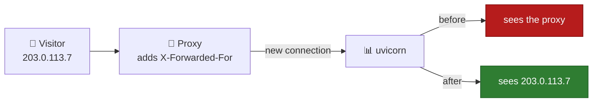
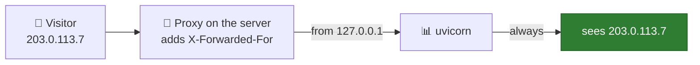
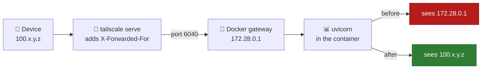
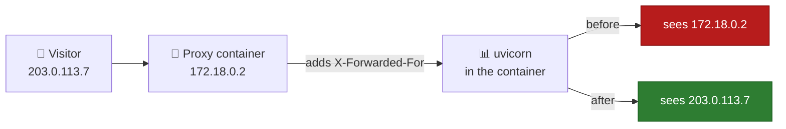
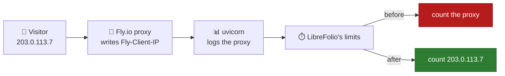

# 🧰 Checking Connection Security: Behind a Reverse Proxy

LibreFolio **behind a reverse proxy** such as Nginx, Caddy, Traefik or Tailscale Serve: which headers the
proxy must send, what you set in LibreFolio's `.env` and, proxy by proxy, where each thing is written.

To see what your users get (indicator, server's view, session cookie), start from
[Checking Connection Security](connection_checks.md).

---

## 🧰 Behind a Reverse Proxy {: #reverse-proxy }

The proxy receives the HTTPS connection and passes it to LibreFolio over plain HTTP.
LibreFolio learns about the HTTPS, and about the visitor, only from two headers of the proxy:

| Header | What it tells LibreFolio |
| --- | --- |
| `X-Forwarded-Proto: https` | The browser uses HTTPS. With `SESSION_COOKIE_SECURE=auto` (default) the session cookie is marked `Secure`. |
| `X-Forwarded-For` | The visitor's address. The indicator sees where users connect from ([below](#client-address)). |

Tailscale Serve and Funnel, Caddy and Traefik send both on their own.
Nginx does not: the two lines to add are in its tab, [below](#per-proxy).

**Browser on HTTPS, but session cookie without `Secure`?**
The proxy does not send `X-Forwarded-Proto`, or `SESSION_COOKIE_SECURE` is `never`.
Administrators see one more line in the indicator's details; the level stays **Connection: secure**
(the connection is encrypted, only the cookie lacks `Secure`):

> Your browser uses HTTPS, but the session cookie is not marked Secure. Make the reverse proxy send
> X-Forwarded-Proto (Nginx: `proxy_set_header X-Forwarded-Proto $scheme;`), or set
> SESSION_COOKIE_SECURE back to auto if it is never.

1. **In the proxy's configuration**: make it send `X-Forwarded-Proto` (Nginx: the first line of its tab).
2. Reload LibreFolio: the line disappears. Sign out and sign in again: the browser gets a `Secure` cookie.

??? tip "⚙️ Set `SESSION_COOKIE_SECURE` instead"

    Sending the header is the better fix.
    If you only ever reach LibreFolio over HTTPS, you can instead write **in LibreFolio's `.env`**:

    ```bash
    SESSION_COOKIE_SECURE=always
    ```

    Restart LibreFolio. With Docker Compose, run `docker compose up -d`.
    On the host, restart `./dev.py server` (it reads `.env` too). Then sign out and sign in again.

    Use `never` only for the rare proxy that claims HTTPS while the browser is on plain HTTP.
    Every option: [Configuration](configuration.md#session-cookie-secure).

### 🛤️ What Happens to the Visitor's Address {: #address-path }



The visitor connects to the proxy. The proxy opens its own connection to LibreFolio and writes the visitor's
address in `X-Forwarded-For`. uvicorn, LibreFolio's web server, sees the connection come from the proxy.

**Before:** uvicorn ignores `X-Forwarded-For`, because by default it believes it only from `127.0.0.1`.
For LibreFolio, every visitor has the proxy's address.

**After:** the proxy's address is in `FORWARDED_ALLOW_IPS`. When a connection comes from there, uvicorn reads
`X-Forwarded-For` and uses that address as the visitor's.

**A proxy with a header of its own**, such as Fly.io with `Fly-Client-IP`: uvicorn does not read it.
LibreFolio reads it, when `LIBREFOLIO_CLIENT_IP_HEADER` names it.

**Why it matters:** the limits on failed sign-ins and on emails count per address ([next section](#client-address)).

**Reading the log.** uvicorn writes one line per request, starting with the address it sees:

| Log line | What it means |
| --- | --- |
| `172.18.0.2:51234 - "GET … HTTP/1.1" 200 OK` | Before: the proxy's address, with the port of its connection. |
| `203.0.113.7:0 - "GET … HTTP/1.1" 200 OK` | After: the visitor's address. The port is `0` because the header carries only the address. |
| `127.0.0.1:<port> - "GET /api/v1/system/health HTTP/1.1" 200 OK` | Docker's health check, made inside the container: leave it aside. |

With `LIBREFOLIO_CLIENT_IP_HEADER` the log does not change: uvicorn keeps writing the proxy's address.
Only LibreFolio's limits use the header.

### 🧭 The Visitor's Address {: #client-address }

LibreFolio limits some requests per visitor's address:

- the failed sign-ins ([Failed Sign-ins](configuration_accounts.md#login-limit));
- the sign-up emails, **Send the link again** and the forgotten passwords ([Email](email.md)).

Behind a reverse proxy the connections come from the proxy: if LibreFolio does not learn each
visitor's address, all of them share the proxy's, and a single count:

- **Proxy on a public address**: 50 failed sign-ins through the proxy, from anyone, would refuse every
  sign-in attempt through it, even with the right password, for up to 15 minutes.
- **Proxy on a local address**, such as a proxy container in front of the Docker image: LibreFolio instead
  leaves those sign-ins out of the count per address and counts them only per username or email address
  ([below](#untrusted-proxy)).

Let LibreFolio learn each visitor's address **in LibreFolio's `.env`** (or in the container's
environment), with one of these two variables:

| Variable | When | Value |
| --- | --- | --- |
| `FORWARDED_ALLOW_IPS` | The proxy forwards the visitor's address in `X-Forwarded-For`: uvicorn, LibreFolio's web server, reads it only from connections that come from an address listed here (`127.0.0.1` when not set). | The proxy's address **as LibreFolio sees it**, or its network. With Docker: the address of the proxy container or its Docker network, such as `172.18.0.0/16` (`docker network inspect`, with the network's name, shows both). Guide: [Forgotten Passwords](email_flows.md#forgot-password). |
| `LIBREFOLIO_CLIENT_IP_HEADER` | The proxy writes the visitor's address in a header of its own. | The name of that header: `Fly-Client-IP` (Fly.io), `X-Real-IP` (Nginx). |

After every change to `.env`, restart LibreFolio. With Docker Compose, run `docker compose up -d`.
On the host, restart `./dev.py server`. LibreFolio reads the variable once per server process.

!!! warning "⚠️ Trust only addresses used by your proxy alone"

    In `FORWARDED_ALLOW_IPS`, a whole network includes its gateway, which is also the address of the connections
    made on the server itself ([Tailscale with Docker](#tailscale)).

!!! warning "🚧 Only when every request crosses the proxy"

    LibreFolio believes the header of `LIBREFOLIO_CLIENT_IP_HEADER`, whoever sends it.
    Set the variable only if your visitors reach LibreFolio through that proxy alone.
    Whoever reaches it directly, on its port (`PORT`, 6040 by default) or by any other
    path, can send the header and choose any address: to get around the limits or to use up
    someone else's.

??? note "📏 Rules of `LIBREFOLIO_CLIENT_IP_HEADER`"

    - **One address, written by the proxy itself.** Never a value the proxy passes on from the visitor.
    - **`X-Forwarded-For` and `Forwarded` are refused**: they hold a list whose first address is chosen by the
      visitor. For `X-Forwarded-For`, list your proxy in `FORWARDED_ALLOW_IPS` instead.
    - **A wrong value stops the server from starting**, with an error that names the variable.
      Wrong: one of those two headers, or a value that is not the name of a header (a space, a `:`).
      Case and spaces around the name do not matter. An empty value is the same as not setting it.
    - **Request without the header** → counted with the connection's address.
    - **Header LibreFolio cannot use** → counted with the connection's address.
      Unusable: the request carries it twice, or it holds a list, an address with a port or
      anything other than a single IP address. The log has one warning per server process:

        ```text
        Client address header unusable: using the connection's address
        ```

        With the header's name in `header`, how many times the request carried it in `lines` and the total
        length of those lines in `length`; never the value itself. Check how your proxy sets the header.

    - **No profile sets it**: the header depends on the proxy in front of each instance.
    - **The indicator does not use it**: it keeps reading `X-Forwarded-For`, as
      [The Server's View](connection_checks.md#server-view) explains.

### 🗺️ The Path, Setup by Setup {: #paths }

Find your setup: where the request passes, and which address LibreFolio sees before and after the setting.
The steps for each proxy are in [Your Proxy, Step by Step](#per-proxy).

#### 🖥️ Proxy and LibreFolio on the Same Server, Without Docker {: #path-host }



The proxy (Nginx, Caddy, `tailscale serve`) connects to LibreFolio on `127.0.0.1`.
uvicorn trusts that address by default, so it reads `X-Forwarded-For` from the start.
Nothing to set in `.env`. Nginx still needs its two lines ([its tab](#per-proxy)).

#### 🐳 Proxy on the Server, LibreFolio in Docker {: #path-docker-host }



The proxy runs on the server and passes the request to the port that Docker publishes.
Inside the container, the connection comes from the gateway of the Docker network, such as `172.28.0.1`.

**Before:** uvicorn does not trust the gateway. Every visitor has the address `172.28.0.1`.

**After:** the gateway is in `FORWARDED_ALLOW_IPS`. uvicorn reads `X-Forwarded-For`: the device's Tailscale
address, `100.x.y.z`; through Funnel, the visitor's public address.

Same path for Nginx or Caddy installed on the server, and for the sidecars of Level 4.
Steps: [Tailscale Serve and Funnel with Docker](#tailscale).

#### 📦 Proxy Container on the Docker Network {: #path-docker-network }



Caddy, Nginx or Traefik run in a container on LibreFolio's Docker network.
They reach LibreFolio directly, without the published port.
The connection comes from the proxy container's address, such as `172.18.0.2`.

**Before:** uvicorn does not trust that address. Every visitor has the proxy's address.

**After:** the network `172.18.0.0/16` is in `FORWARDED_ALLOW_IPS`. uvicorn reads `X-Forwarded-For` and sees
each visitor. Listing the whole network keeps working when the proxy container gets a new address.

#### 🏷️ Proxy With a Header of Its Own {: #path-own-header }



Fly.io writes the visitor's address in `Fly-Client-IP`. Nginx can write it in `X-Real-IP`.
uvicorn does not read these headers: its log keeps showing the proxy's address.

**After:** `LIBREFOLIO_CLIENT_IP_HEADER` names the header, and LibreFolio's limits count with the visitor's address.
Set it only when every request crosses that proxy ([warning above](#client-address)).

### 🧩 Your Proxy, Step by Step {: #per-proxy }

=== "Nginx"

    1. **In Nginx's configuration file, in the `location` block that passes requests to LibreFolio**, add:

        ```nginx
        proxy_set_header X-Forwarded-Proto $scheme;
        proxy_set_header X-Forwarded-For $proxy_add_x_forwarded_for;
        ```

        LibreFolio knows that the browser uses HTTPS and gets the visitor's address.

    2. **In LibreFolio's `.env`**, list Nginx as LibreFolio sees it (with Docker: its container or its
       Docker network):

        ```bash
        FORWARDED_ALLOW_IPS=172.18.0.0/16
        ```

        Alternative with an Nginx header, only if every request crosses Nginx ([warning above](#client-address)):
        in the `location` block add `proxy_set_header X-Real-IP $remote_addr;`, in `.env`
        `LIBREFOLIO_CLIENT_IP_HEADER=X-Real-IP`.

    3. Restart LibreFolio. With Docker Compose, run `docker compose up -d`.
       Then sign out and sign in again: the session cookie is `Secure`.

=== "Caddy"

    Nothing to add to Caddy's configuration: it sends both headers on its own.

    1. **In LibreFolio's `.env`**, list Caddy as LibreFolio sees it ([value](#client-address); with
       Docker, its Docker network):

        ```bash
        FORWARDED_ALLOW_IPS=172.18.0.0/16
        ```

    2. Restart LibreFolio. With Docker Compose, run `docker compose up -d`.

=== "Traefik"

    Nothing to add to Traefik's configuration: it sends both headers on its own.

    1. **In LibreFolio's `.env`**, list Traefik as LibreFolio sees it ([value](#client-address); with
       Docker, its Docker network):

        ```bash
        FORWARDED_ALLOW_IPS=172.18.0.0/16
        ```

    2. Restart LibreFolio. With Docker Compose, run `docker compose up -d`.

=== "Tailscale Serve/Funnel"

    Nothing to add to Tailscale's configuration: Serve and Funnel write `X-Forwarded-For` on their own, in
    place of any header sent by the visitor (the Tailscale address of the device, `100.x.y.z`; through
    Funnel, the address of the visitor on the internet). Over HTTPS (the default of Serve, the only mode of Funnel) also
    `X-Forwarded-Proto: https`. With `tailscale serve --http=…` neither, rightly: the browser is on plain
    HTTP too.

    | LibreFolio installed | What to do |
    | --- | --- |
    | On the host, without Docker, with `tailscale serve` or `tailscale funnel` on the same server | Nothing: the requests come from `127.0.0.1`, which uvicorn trusts by default. |
    | With the Docker image | Follow [Tailscale Serve and Funnel with Docker](#tailscale), below. |

=== "Fly.io"

    Fly's proxy writes the visitor's address in `Fly-Client-IP`: nothing to set up on Fly's side.

    1. **In LibreFolio's `.env`, or in the container's environment**, only if every request crosses Fly's proxy
       ([warning above](#client-address)):

        ```bash
        LIBREFOLIO_CLIENT_IP_HEADER=Fly-Client-IP
        ```

    2. Restart LibreFolio.

    Another proxy in front of Fly.io, such as Cloudflare: `Fly-Client-IP` holds that proxy's address, not the
    visitor's.

#### 🕵️ When LibreFolio Does Not Trust Your Proxy {: #untrusted-proxy }

It happens when the proxy is on a **local address** (`loopback`, `lan` or `vpn` in
[The Server's View](connection_checks.md#server-view), such as `172.18.0.2` on a Docker network) and LibreFolio does not
learn the visitor's address either through `FORWARDED_ALLOW_IPS` or through `LIBREFOLIO_CLIENT_IP_HEADER`.
It cannot tell the visitors behind the proxy apart: the limits per visitor's address leave those
requests out, so that one visitor cannot lock everyone out; the limits per account or per email address keep
counting them.

**How you notice**

- **In the log**, one warning per server process, the first time such a request meets a limit
  per visitor's address:

    ```text
    Requests come through a reverse proxy that LibreFolio does not trust: the limits per client address skip them. List the proxy in FORWARDED_ALLOW_IPS, or name the header it sets in LIBREFOLIO_CLIENT_IP_HEADER
    ```

    With the names of the headers in `headers`, such as `X-Forwarded-For, X-Real-IP`; never an address.

- **In the security checks**, as a warning of `platform.client_address`.
  The check tells what the server has met since its last start: after a restart it reads `ok` until such a
  request comes again. So it never appears among the
  [startup checks](configuration_security.md#startup-checks).

**How to fix it.** In LibreFolio's `.env`, `FORWARDED_ALLOW_IPS` if the proxy forwards `X-Forwarded-For`,
`LIBREFOLIO_CLIENT_IP_HEADER` if it sets a header of its own and every request crosses it: values and restart in
[The Visitor's Address](#client-address), steps in [your proxy's tab](#per-proxy).
Tailscale Serve or Funnel with the Docker image: [below](#tailscale).

**No proxy of yours in front of LibreFolio?** Then the forwarding header (`X-Forwarded-For`, `Forwarded` or `X-Real-IP`)
that set off the warning was sent by:

- a visitor on your network or VPN;
- with Docker Desktop exposed directly, any visitor;
- any IPv6 visitor that Docker's proxy passes on ([Limits](connection_checks.md#limits)).

List nothing.

**Forwarding headers from a public address.** They only get an `info`:

- in the log, once per server process, with `headers` too:

    ```text
    Forwarding headers from a public address were ignored: if a proxy on a public address forwards the requests, list it in FORWARDED_ALLOW_IPS
    ```

- in the security checks, where `platform.client_address` stays a warning if a proxy
  as above was met too.

Those requests keep being counted with the connection's address.
They are harmless when no proxy of yours has a public address: a visitor, or a proxy of their own, may add such
headers.

#### 🐳 Tailscale Serve and Funnel with Docker {: #tailscale }

Both Tailscale setups of [Exposing Securely](service_exposure.md) reach LibreFolio's container
through Docker, so their requests come from the gateway of the container's Docker network, such as
`172.28.0.1`, which uvicorn does not trust ([above](#untrusted-proxy)):

- **On the server**: `tailscale serve --bg 6040` (the HTTPS address of Level 1) or `tailscale funnel --bg 6040`
  (Level 3) passes the requests to `http://127.0.0.1:6040`, and Docker's proxy hands them to the container.
- **In the [sidecar containers](service_exposure_funnel.md#level-4-multi-funnel-with-docker-sidecars)** (Level 4): socat
  passes them to the server's LAN address and LibreFolio's published port.

**Procedure**, **on the server, from a terminal, in the folder that holds `docker-compose.yml` and `.env`**:

1. **Find the gateway** of LibreFolio's Docker network:

    ```bash
    docker inspect --format '{{range .NetworkSettings.Networks}}{{.Gateway}}{{end}}' librefolio
    ```

    It prints an address such as `172.28.0.1`. `librefolio` is the name `docker-compose.yml` gives the container
    (`container_name`).

    ??? tip "🔎 Alternatively, with `docker network inspect`"

        `docker network ls` lists the networks; a Compose project's own is `<project>_default`.
        `docker network inspect <network>` shows the same gateway under `IPAM` → `Config` → `Gateway`, next to the
        network's `Subnet`.

2. **Make sure that Tailscale's requests come from the gateway.** Open LibreFolio at its Tailscale address, then
   read the last lines of its log:

    ```bash
    docker compose logs --tail 20 librefolio
    ```

    uvicorn logs each request on a line ([how to read it](#address-path)). Through Tailscale,
    the address is the gateway's:

    ```text
    172.28.0.1:<port> - "GET … HTTP/1.1" 200 OK
    ```

3. **In LibreFolio's `.env`**, list the gateway in `FORWARDED_ALLOW_IPS`, with your own value:

    ```bash
    FORWARDED_ALLOW_IPS=172.28.0.1
    ```

    If `.env` already sets the variable, for another proxy, add the gateway at the end of its list, after a
    comma.

    For example, with another proxy on the network `172.18.0.0/16` and the Tailscale gateway:

    ```bash
    FORWARDED_ALLOW_IPS=172.18.0.0/16,172.28.0.1
    ```

4. **Restart LibreFolio**, so that its container gets the new environment:

    ```bash
    docker compose up -d
    ```

5. **Check.** Open LibreFolio at its Tailscale address again, then read the log as in step 2:

    ```bash
    docker compose logs --tail 20 librefolio
    ```

    The lines of your requests now show the address of the device (through Funnel, the visitor's public
    address), followed by port `0`:

    ```text
    100.x.y.z:0 - "GET … HTTP/1.1" 200 OK
    ```

    The warning of `platform.client_address` stops coming back; but after the restart it reads `ok` either way, so
    the log line is the real proof.

**Which value to put in `FORWARDED_ALLOW_IPS`.**

| Value | Pros | Cons |
| --- | --- | --- |
| The exact gateway, such as `172.28.0.1` | The narrowest choice. | Compose may give the network another subnet when it creates it again (`docker compose down`, then `docker compose up -d`): check the gateway again after such a change. |
| `172.16.0.0/12` | Survives that change: it covers every Docker network from `172.16` to `172.31`. | Trusts every Docker network on the server. Does not cover the `192.168.x.x` networks that Docker hands out once those run out. |

!!! warning "⚠️ The gateway is not Tailscale alone"

    It is also the address of every connection made on the server itself through the published port, and of the
    IPv6 visitors that Docker's proxy passes on ([Limits](connection_checks.md#limits)).
    Trusting it lets them choose the address the limits count.

    Do you reach LibreFolio **only** through `tailscale serve` or `tailscale funnel` on the server?
    Publish the port on the loopback only, so that nothing outside the server can reach it.
    **In `docker-compose.yml`, under `ports:`**, change:

    ```yaml
    - "${PORT:-6040}:6040"
    ```

    to:

    ```yaml
    - "127.0.0.1:${PORT:-6040}:6040"
    ```

    Then run `docker compose up -d`.

    Not with Level 4, nor with the plain-HTTP addresses of Levels 1 and 2: they reach the port through
    the server's LAN or Tailscale address.

---

## 🔗 Related

- 📄 **[Checking Connection Security](connection_checks.md)** — Checklist, What the Indicator Shows, The Server's View, …
