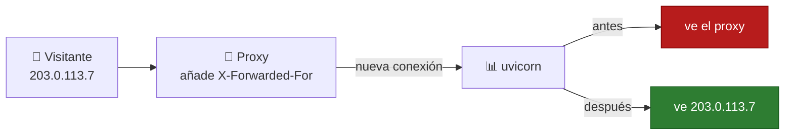
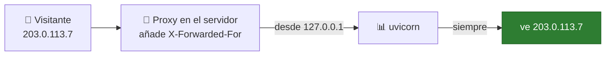
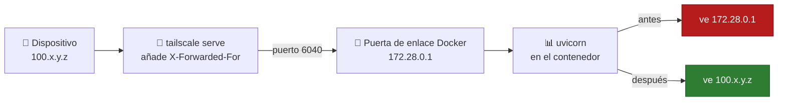
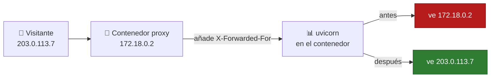
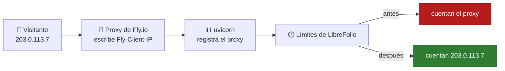

# 🧰 Comprobación de la seguridad de la conexión: detrás de un proxy inverso

LibreFolio **detrás de un proxy inverso** como Nginx, Caddy, Traefik o Tailscale Serve: qué cabeceras debe enviar el
proxy, qué estableces en el `.env` de LibreFolio y, proxy por proxy, dónde se escribe cada cosa.

Para ver lo que obtienen tus usuarios (indicador, vista del servidor, cookie de sesión), empieza por
[Comprobar la seguridad de la conexión](connection_checks.md).

---

## 🧰 Detrás de un proxy inverso {: #reverse-proxy }

El proxy recibe la conexión HTTPS y la pasa a LibreFolio por HTTP sin cifrar.
LibreFolio se entera del HTTPS, y del visitante, solo por dos cabeceras del proxy:

| Cabecera | Qué le indica a LibreFolio |
| --- | --- |
| `X-Forwarded-Proto: https` | El navegador usa HTTPS. Con `SESSION_COOKIE_SECURE=auto` (predeterminado) la cookie de sesión se marca como `Secure`. |
| `X-Forwarded-For` | La dirección del visitante. El indicador ve desde dónde se conectan los usuarios ([más abajo](#client-address)). |

Tailscale Serve y Funnel, Caddy y Traefik envían ambas por su cuenta.
Nginx no: las dos líneas que hay que añadir están en su pestaña, [más abajo](#per-proxy).

**¿Navegador en HTTPS, pero cookie de sesión sin `Secure`?**
El proxy no envía `X-Forwarded-Proto`, o `SESSION_COOKIE_SECURE` está en `never`.
Los administradores ven una línea más en los detalles del indicador; el nivel sigue siendo **Conexión: segura**
(la conexión está cifrada, solo a la cookie le falta `Secure`):

> Tu navegador usa HTTPS, pero la cookie de sesión no está marcada como Secure. Haz que el proxy inverso envíe
> X-Forwarded-Proto (Nginx: `proxy_set_header X-Forwarded-Proto $scheme;`), o vuelve a poner
> SESSION_COOKIE_SECURE en auto si está en never.

1. **En la configuración del proxy**: haz que envíe `X-Forwarded-Proto` (Nginx: la primera línea de su pestaña).
2. Recarga LibreFolio: la línea desaparece. Cierra sesión y vuelve a iniciarla: el navegador recibe una cookie `Secure`.

??? tip "⚙️ Establece `SESSION_COOKIE_SECURE` en su lugar"

    Enviar la cabecera es la mejor solución.
    Si solo accedes a LibreFolio por HTTPS, puedes escribir en su lugar **en el `.env` de LibreFolio**:

    ```bash
    SESSION_COOKIE_SECURE=always
    ```

    Reinicia LibreFolio. Con Docker Compose, ejecuta `docker compose up -d`.
    En el host, reinicia `./dev.py server` (también lee `.env`). Luego cierra sesión y vuelve a iniciarla.

    Usa `never` solo para el raro proxy que afirma usar HTTPS mientras el navegador está en HTTP sin cifrar.
    Todas las opciones: [Configuración](configuration.md#session-cookie-secure).

### 🛤️ Qué le pasa a la dirección del visitante {: #address-path }



El visitante se conecta al proxy. El proxy abre su propia conexión hacia LibreFolio y escribe la dirección del
visitante en `X-Forwarded-For`. uvicorn, el servidor web de LibreFolio, ve llegar la conexión desde el proxy.

**Antes:** uvicorn ignora `X-Forwarded-For`, porque por defecto solo lo cree si llega desde `127.0.0.1`.
Para LibreFolio, todos los visitantes tienen la dirección del proxy.

**Después:** la dirección del proxy está en `FORWARDED_ALLOW_IPS`. Cuando una conexión llega desde ahí, uvicorn lee
`X-Forwarded-For` y usa esa dirección como la del visitante.

**Un proxy con una cabecera propia**, como Fly.io con `Fly-Client-IP`: uvicorn no la lee.
La lee LibreFolio, cuando `LIBREFOLIO_CLIENT_IP_HEADER` la nombra.

**Por qué importa:** los límites de inicios de sesión fallidos y de correos cuentan por dirección ([sección siguiente](#client-address)).

**Leer el registro.** uvicorn escribe una línea por solicitud, que empieza con la dirección que ve:

| Línea del registro | Qué significa |
| --- | --- |
| `172.18.0.2:51234 - "GET … HTTP/1.1" 200 OK` | Antes: la dirección del proxy, con el puerto de su conexión. |
| `203.0.113.7:0 - "GET … HTTP/1.1" 200 OK` | Después: la dirección del visitante. El puerto es `0` porque la cabecera solo lleva la dirección. |
| `127.0.0.1:<port> - "GET /api/v1/system/health HTTP/1.1" 200 OK` | La comprobación de estado de Docker, hecha dentro del contenedor: déjala de lado. |

Con `LIBREFOLIO_CLIENT_IP_HEADER` el registro no cambia: uvicorn sigue escribiendo la dirección del proxy.
Solo los límites de LibreFolio usan la cabecera.

### 🧭 La dirección del visitante {: #client-address }

LibreFolio limita algunas solicitudes por dirección del visitante:

- los inicios de sesión fallidos ([Inicios de sesión fallidos](configuration_accounts.md#login-limit));
- los correos de registro, **Enviar el enlace de nuevo** y las contraseñas olvidadas ([Correo electrónico](email.md)).

Detrás de un proxy inverso las conexiones proceden del proxy: si LibreFolio no averigua la dirección de cada
visitante, todos comparten la del proxy y un único recuento:

- **Proxy en una dirección pública**: 50 inicios de sesión fallidos a través del proxy, de cualquiera, harían rechazar
  todo intento de inicio de sesión por ese camino, incluso con la contraseña correcta, durante hasta 15 minutos.
- **Proxy en una dirección local**, como un contenedor de proxy delante de la imagen de Docker: LibreFolio, en cambio,
  deja esos inicios de sesión fuera del recuento por dirección y los cuenta solo por nombre de usuario o dirección de correo
  ([más abajo](#untrusted-proxy)).

Haz que LibreFolio averigüe la dirección de cada visitante **en el `.env` de LibreFolio** (o en el
entorno del contenedor), con una de estas dos variables:

| Variable | Cuándo | Valor |
| --- | --- | --- |
| `FORWARDED_ALLOW_IPS` | El proxy reenvía la dirección del visitante en `X-Forwarded-For`: uvicorn, el servidor web de LibreFolio, solo la lee de las conexiones que proceden de una dirección que figure aquí (`127.0.0.1` si no se establece). | La dirección del proxy **tal como la ve LibreFolio**, o su red. Con Docker: la dirección del contenedor del proxy o de su red de Docker, como `172.18.0.0/16` (`docker network inspect`, con el nombre de la red, muestra ambas). Guía: [Contraseñas olvidadas](email_flows.md#forgot-password). |
| `LIBREFOLIO_CLIENT_IP_HEADER` | El proxy escribe la dirección del visitante en una cabecera propia. | El nombre de esa cabecera: `Fly-Client-IP` (Fly.io), `X-Real-IP` (Nginx). |

Tras cada cambio en `.env`, reinicia LibreFolio. Con Docker Compose, ejecuta `docker compose up -d`.
En el host, reinicia `./dev.py server`. LibreFolio lee la variable una vez por proceso del servidor.

!!! warning "⚠️ Confía solo en direcciones que use únicamente tu proxy"

    En `FORWARDED_ALLOW_IPS`, una red entera incluye su puerta de enlace, que es también la dirección de las conexiones
    hechas en el propio servidor ([Tailscale con Docker](#tailscale)).

!!! warning "🚧 Solo cuando todas las solicitudes pasan por el proxy"

    LibreFolio cree la cabecera de `LIBREFOLIO_CLIENT_IP_HEADER`, la envíe quien la envíe.
    Establece la variable solo si tus visitantes llegan a LibreFolio únicamente a través de ese proxy.
    Quien llegue a él directamente, por su puerto (`PORT`, 6040 por defecto) o por cualquier otro
    camino, puede enviar la cabecera y elegir cualquier dirección: para eludir los límites o para agotar el de
    otra persona.

??? note "📏 Reglas de `LIBREFOLIO_CLIENT_IP_HEADER`"

    - **Una dirección, escrita por el propio proxy.** Nunca un valor que el proxy reenvíe del visitante.
    - **`X-Forwarded-For` y `Forwarded` se rechazan**: contienen una lista cuya primera dirección elige el
      visitante. Para `X-Forwarded-For`, incluye tu proxy en `FORWARDED_ALLOW_IPS`.
    - **Un valor incorrecto impide que el servidor arranque**, con un error que nombra la variable.
      Incorrecto: una de esas dos cabeceras, o un valor que no es el nombre de una cabecera (un espacio, un `:`).
      Las mayúsculas y los espacios alrededor del nombre no importan. Un valor vacío equivale a no establecerlo.
    - **Solicitud sin la cabecera** → se cuenta con la dirección de la conexión.
    - **Cabecera que LibreFolio no puede usar** → se cuenta con la dirección de la conexión.
      Inutilizable: la solicitud la lleva dos veces, o contiene una lista, una dirección con puerto o
      cualquier cosa que no sea una única dirección IP. El registro tiene una advertencia por proceso del servidor:

        ```text
        Client address header unusable: using the connection's address
        ```

        Con el nombre de la cabecera en `header`, cuántas veces la llevó la solicitud en `lines` y la longitud total
        de esas líneas en `length`; nunca el valor en sí. Comprueba cómo establece la cabecera tu proxy.

    - **Ningún perfil la establece**: la cabecera depende del proxy que haya delante de cada instancia.
    - **El indicador no la usa**: sigue leyendo `X-Forwarded-For`, como explica
      [La vista del servidor](connection_checks.md#server-view).

### 🗺️ El camino, instalación por instalación {: #paths }

Busca tu instalación: por dónde pasa la solicitud, y qué dirección ve LibreFolio antes y después del ajuste.
Los pasos de cada proxy están en [Tu proxy, paso a paso](#per-proxy).

#### 🖥️ Proxy y LibreFolio en el mismo servidor, sin Docker {: #path-host }



El proxy (Nginx, Caddy, `tailscale serve`) se conecta a LibreFolio en `127.0.0.1`.
uvicorn confía en esa dirección por defecto, así que lee `X-Forwarded-For` desde el principio.
Nada que ajustar en `.env`. Nginx sigue necesitando sus dos líneas ([su pestaña](#per-proxy)).

#### 🐳 Proxy en el servidor, LibreFolio en Docker {: #path-docker-host }



El proxy se ejecuta en el servidor y pasa la solicitud al puerto que Docker publica.
Dentro del contenedor, la conexión llega desde la puerta de enlace de la red Docker, como `172.28.0.1`.

**Antes:** uvicorn no confía en la puerta de enlace. Todos los visitantes tienen la dirección `172.28.0.1`.

**Después:** la puerta de enlace está en `FORWARDED_ALLOW_IPS`. uvicorn lee `X-Forwarded-For`: la dirección de
Tailscale del dispositivo, `100.x.y.z`; a través de Funnel, la dirección pública del visitante.

Mismo camino para Nginx o Caddy instalados en el servidor, y para los sidecars del Nivel 4.
Pasos: [Tailscale Serve y Funnel con Docker](#tailscale).

#### 📦 Contenedor proxy en la red Docker {: #path-docker-network }



Caddy, Nginx o Traefik se ejecutan en un contenedor en la red Docker de LibreFolio.
Llegan a LibreFolio directamente, sin el puerto publicado.
La conexión llega desde la dirección del contenedor proxy, como `172.18.0.2`.

**Antes:** uvicorn no confía en esa dirección. Todos los visitantes tienen la dirección del proxy.

**Después:** la red `172.18.0.0/16` está en `FORWARDED_ALLOW_IPS`. uvicorn lee `X-Forwarded-For` y ve
a cada visitante. Indicar toda la red sigue funcionando cuando el contenedor proxy cambia de dirección.

#### 🏷️ Proxy con una cabecera propia {: #path-own-header }



Fly.io escribe la dirección del visitante en `Fly-Client-IP`. Nginx puede escribirla en `X-Real-IP`.
uvicorn no lee estas cabeceras: su registro sigue mostrando la dirección del proxy.

**Después:** `LIBREFOLIO_CLIENT_IP_HEADER` nombra la cabecera, y los límites de LibreFolio cuentan con la dirección del visitante.
Establécela solo cuando cada solicitud atraviese ese proxy ([advertencia de arriba](#client-address)).

### 🧩 Tu proxy, paso a paso {: #per-proxy }

=== "Nginx"

    1. **En el archivo de configuración de Nginx, en el bloque `location` que pasa las solicitudes a LibreFolio**, añade:

        ```nginx
        proxy_set_header X-Forwarded-Proto $scheme;
        proxy_set_header X-Forwarded-For $proxy_add_x_forwarded_for;
        ```

        LibreFolio sabe que el navegador usa HTTPS y obtiene la dirección del visitante.

    2. **En el `.env` de LibreFolio**, incluye Nginx tal como lo ve LibreFolio (con Docker: su contenedor o su
       red de Docker):

        ```bash
        FORWARDED_ALLOW_IPS=172.18.0.0/16
        ```

        Alternativa con una cabecera de Nginx, solo si todas las solicitudes pasan por Nginx ([advertencia más arriba](#client-address)):
        en el bloque `location` añade `proxy_set_header X-Real-IP $remote_addr;`, en `.env`
        `LIBREFOLIO_CLIENT_IP_HEADER=X-Real-IP`.

    3. Reinicia LibreFolio. Con Docker Compose, ejecuta `docker compose up -d`.
       Luego cierra sesión y vuelve a iniciarla: la cookie de sesión es `Secure`.

=== "Caddy"

    No hay nada que añadir a la configuración de Caddy: envía ambas cabeceras por su cuenta.

    1. **En el `.env` de LibreFolio**, incluye Caddy tal como lo ve LibreFolio ([valor](#client-address); con
       Docker, su red de Docker):

        ```bash
        FORWARDED_ALLOW_IPS=172.18.0.0/16
        ```

    2. Reinicia LibreFolio. Con Docker Compose, ejecuta `docker compose up -d`.

=== "Traefik"

    No hay nada que añadir a la configuración de Traefik: envía ambas cabeceras por su cuenta.

    1. **En el `.env` de LibreFolio**, incluye Traefik tal como lo ve LibreFolio ([valor](#client-address); con
       Docker, su red de Docker):

        ```bash
        FORWARDED_ALLOW_IPS=172.18.0.0/16
        ```

    2. Reinicia LibreFolio. Con Docker Compose, ejecuta `docker compose up -d`.

=== "Tailscale Serve/Funnel"

    No hay nada que añadir a la configuración de Tailscale: Serve y Funnel escriben `X-Forwarded-For` por su cuenta, en
    lugar de cualquier cabecera enviada por el visitante (la dirección de Tailscale del dispositivo, `100.x.y.z`; a través de
    Funnel, la dirección del visitante en internet). Por HTTPS (el modo predeterminado de Serve, el único de Funnel) también
    `X-Forwarded-Proto: https`. Con `tailscale serve --http=…` ninguna de las dos, con razón: el navegador también está en
    HTTP sin cifrar.

    | LibreFolio instalado | Qué hacer |
    | --- | --- |
    | En el host, sin Docker, con `tailscale serve` o `tailscale funnel` en el mismo servidor | Nada: las solicitudes proceden de `127.0.0.1`, en el que uvicorn confía por defecto. |
    | Con la imagen de Docker | Sigue [Tailscale Serve y Funnel con Docker](#tailscale), más abajo. |

=== "Fly.io"

    El proxy de Fly escribe la dirección del visitante en `Fly-Client-IP`: no hay nada que configurar en el lado de Fly.

    1. **En el `.env` de LibreFolio, o en el entorno del contenedor**, solo si todas las solicitudes pasan por el proxy de Fly
       ([advertencia más arriba](#client-address)):

        ```bash
        LIBREFOLIO_CLIENT_IP_HEADER=Fly-Client-IP
        ```

    2. Reinicia LibreFolio.

    Si hay otro proxy delante de Fly.io, como Cloudflare: `Fly-Client-IP` contiene la dirección de ese proxy, no la del
    visitante.

#### 🕵️ Cuando LibreFolio no confía en tu proxy {: #untrusted-proxy }

Ocurre cuando el proxy está en una **dirección local** (`loopback`, `lan` o `vpn` en
[La vista del servidor](connection_checks.md#server-view), como `172.18.0.2` en una red de Docker) y LibreFolio no
averigua la dirección del visitante ni mediante `FORWARDED_ALLOW_IPS` ni mediante `LIBREFOLIO_CLIENT_IP_HEADER`.
No puede distinguir a los visitantes que hay detrás del proxy: los límites por dirección del visitante dejan fuera esas
solicitudes, para que un solo visitante no pueda bloquear a todos; los límites por cuenta o por dirección de correo siguen
contándolas.

**Cómo te das cuenta**

- **En el registro**, una advertencia por proceso del servidor, la primera vez que una solicitud así alcanza un límite
  por dirección del visitante:

    ```text
    Requests come through a reverse proxy that LibreFolio does not trust: the limits per client address skip them. List the proxy in FORWARDED_ALLOW_IPS, or name the header it sets in LIBREFOLIO_CLIENT_IP_HEADER
    ```

    Con los nombres de las cabeceras en `headers`, como `X-Forwarded-For, X-Real-IP`; nunca una dirección.

- **En las comprobaciones de seguridad**, como una advertencia de `platform.client_address`.
  La comprobación indica lo que el servidor ha encontrado desde su último inicio: tras un reinicio dice `ok` hasta que vuelve
  a llegar una solicitud así. Por eso nunca aparece entre las
  [comprobaciones de inicio](configuration_security.md#startup-checks).

**Cómo corregirlo.** En el `.env` de LibreFolio, `FORWARDED_ALLOW_IPS` si el proxy reenvía `X-Forwarded-For`,
`LIBREFOLIO_CLIENT_IP_HEADER` si establece una cabecera propia y todas las solicitudes pasan por él: valores y reinicio en
[La dirección del visitante](#client-address), pasos en [la pestaña de tu proxy](#per-proxy).
Tailscale Serve o Funnel con la imagen de Docker: [más abajo](#tailscale).

**¿Ningún proxy tuyo delante de LibreFolio?** Entonces la cabecera de reenvío (`X-Forwarded-For`, `Forwarded` o `X-Real-IP`)
que disparó la advertencia la envió:

- un visitante de tu red o de tu VPN;
- con Docker Desktop expuesto directamente, cualquier visitante;
- cualquier visitante IPv6 que el proxy de Docker reenvíe ([Límites](connection_checks.md#limits)).

No incluyas nada.

**Cabeceras de reenvío desde una dirección pública.** Solo reciben un `info`:

- en el registro, una vez por proceso del servidor, con `headers` también:

    ```text
    Forwarding headers from a public address were ignored: if a proxy on a public address forwards the requests, list it in FORWARDED_ALLOW_IPS
    ```

- en las comprobaciones de seguridad, donde `platform.client_address` sigue siendo una advertencia si también se encontró un
  proxy como el anterior.

Esas solicitudes siguen contándose con la dirección de la conexión.
Son inofensivas cuando ningún proxy tuyo tiene una dirección pública: un visitante, o un proxy propio suyo, puede añadir
esas cabeceras.

#### 🐳 Tailscale Serve y Funnel con Docker {: #tailscale }

Las dos configuraciones de Tailscale de [Exponer de forma segura](service_exposure.md) llegan al contenedor de LibreFolio
a través de Docker, así que sus solicitudes proceden de la puerta de enlace de la red de Docker del contenedor, como
`172.28.0.1`, en la que uvicorn no confía ([más arriba](#untrusted-proxy)):

- **En el servidor**: `tailscale serve --bg 6040` (la dirección HTTPS del Nivel 1) o `tailscale funnel --bg 6040`
  (Nivel 3) pasa las solicitudes a `http://127.0.0.1:6040`, y el proxy de Docker se las entrega al contenedor.
- **En los [contenedores sidecar](service_exposure_funnel.md#level-4-multi-funnel-with-docker-sidecars)** (Nivel 4): socat
  las pasa a la dirección LAN del servidor y al puerto publicado de LibreFolio.

**Procedimiento**, **en el servidor, desde un terminal, en la carpeta que contiene `docker-compose.yml` y `.env`**:

1. **Busca la puerta de enlace** de la red de Docker de LibreFolio:

    ```bash
    docker inspect --format '{{range .NetworkSettings.Networks}}{{.Gateway}}{{end}}' librefolio
    ```

    Imprime una dirección como `172.28.0.1`. `librefolio` es el nombre que `docker-compose.yml` da al contenedor
    (`container_name`).

    ??? tip "🔎 Alternativamente, con `docker network inspect`"

        `docker network ls` lista las redes; la propia de un proyecto de Compose es `<project>_default`.
        `docker network inspect <network>` muestra la misma puerta de enlace en `IPAM` → `Config` → `Gateway`, junto a la
        `Subnet` de la red.

2. **Comprueba que las solicitudes de Tailscale proceden de la puerta de enlace.** Abre LibreFolio en su dirección de Tailscale y
   luego lee las últimas líneas de su registro:

    ```bash
    docker compose logs --tail 20 librefolio
    ```

    uvicorn registra cada solicitud en una línea ([cómo leerla](#address-path)). A través de Tailscale,
    la dirección es la de la puerta de enlace:

    ```text
    172.28.0.1:<port> - "GET … HTTP/1.1" 200 OK
    ```

3. **En el `.env` de LibreFolio**, incluye la puerta de enlace en `FORWARDED_ALLOW_IPS`, con tu propio valor:

    ```bash
    FORWARDED_ALLOW_IPS=172.28.0.1
    ```

    Si `.env` ya establece la variable, para otro proxy, añade la puerta de enlace al final de su lista, tras una
    coma.

    Por ejemplo, con otro proxy en la red `172.18.0.0/16` y la puerta de enlace de Tailscale:

    ```bash
    FORWARDED_ALLOW_IPS=172.18.0.0/16,172.28.0.1
    ```

4. **Reinicia LibreFolio**, para que su contenedor reciba el nuevo entorno:

    ```bash
    docker compose up -d
    ```

5. **Comprueba.** Abre de nuevo LibreFolio en su dirección de Tailscale y lee el registro como en el paso 2:

    ```bash
    docker compose logs --tail 20 librefolio
    ```

    Las líneas de tus solicitudes muestran ahora la dirección del dispositivo (a través de Funnel, la dirección pública
    del visitante), seguida del puerto `0`:

    ```text
    100.x.y.z:0 - "GET … HTTP/1.1" 200 OK
    ```

    La advertencia de `platform.client_address` deja de repetirse; pero tras el reinicio dice `ok` en cualquier caso, así que
    la línea del registro es la prueba real.

**Qué valor poner en `FORWARDED_ALLOW_IPS`.**

| Valor | Ventajas | Inconvenientes |
| --- | --- | --- |
| La puerta de enlace exacta, como `172.28.0.1` | La opción más estrecha. | Compose puede dar a la red otra subred cuando la crea de nuevo (`docker compose down`, luego `docker compose up -d`): vuelve a comprobar la puerta de enlace tras un cambio así. |
| `172.16.0.0/12` | Sobrevive a ese cambio: cubre todas las redes de Docker de `172.16` a `172.31`. | Confía en todas las redes de Docker del servidor. No cubre las redes `192.168.x.x` que Docker reparte cuando aquellas se agotan. |

!!! warning "⚠️ La puerta de enlace no es solo Tailscale"

    Es también la dirección de toda conexión hecha en el propio servidor a través del puerto publicado, y de los
    visitantes IPv6 que el proxy de Docker reenvía ([Límites](connection_checks.md#limits)).
    Confiar en ella les permite elegir la dirección que cuentan los límites.

    ¿Accedes a LibreFolio **solo** a través de `tailscale serve` o `tailscale funnel` en el servidor?
    Publica el puerto solo en el loopback, para que nada fuera del servidor pueda alcanzarlo.
    **En `docker-compose.yml`, bajo `ports:`**, cambia:

    ```yaml
    - "${PORT:-6040}:6040"
    ```

    por:

    ```yaml
    - "127.0.0.1:${PORT:-6040}:6040"
    ```

    Luego ejecuta `docker compose up -d`.

    No con el Nivel 4, ni con las direcciones HTTP sin cifrar de los Niveles 1 y 2: llegan al puerto a través de
    la dirección LAN o de Tailscale del servidor.

---

## 🔗 Relacionado

- 📄 **[Comprobar la seguridad de la conexión](connection_checks.md)** — Lista de comprobación, qué muestra el indicador, la vista del servidor, …
