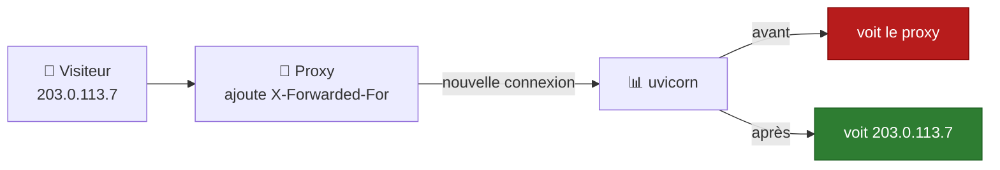
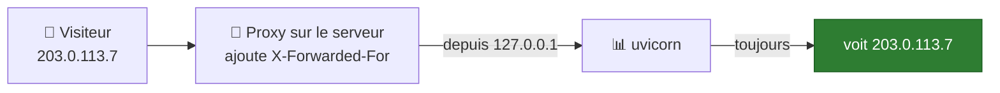
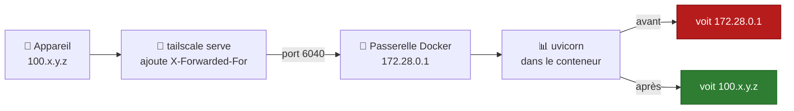
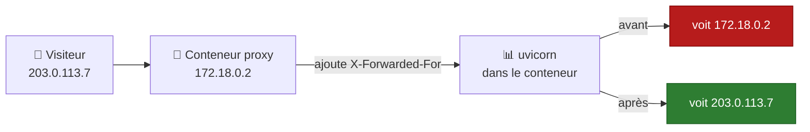
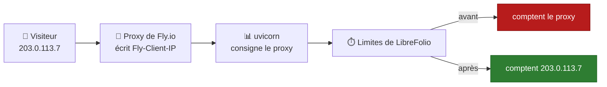

# 🧰 Vérification de la sécurité de la connexion : derrière un proxy inverse

LibreFolio **derrière un proxy inverse** tel que Nginx, Caddy, Traefik ou Tailscale Serve : les en-têtes que le
proxy doit envoyer, ce que vous définissez dans le `.env` de LibreFolio et, proxy par proxy, où chaque chose s’écrit.

Pour voir ce que vos utilisateurs obtiennent (indicateur, vue du serveur, cookie de session), commencez par
[Vérification de la sécurité de la connexion](connection_checks.md).

---

## 🧰 Derrière un proxy inverse {: #reverse-proxy }

Le proxy reçoit la connexion HTTPS et la transmet à LibreFolio en HTTP simple.
LibreFolio n’apprend le HTTPS, ainsi que l’identité du visiteur, qu’à partir de deux en-têtes du proxy :

| En-tête | Ce qu’il apprend à LibreFolio |
| --- | --- |
| `X-Forwarded-Proto: https` | Le navigateur utilise HTTPS. Avec `SESSION_COOKIE_SECURE=auto` (par défaut), le cookie de session est marqué `Secure`. |
| `X-Forwarded-For` | L’adresse du visiteur. L’indicateur voit depuis où les utilisateurs se connectent ([ci-dessous](#client-address)). |

Tailscale Serve et Funnel, Caddy et Traefik envoient les deux d’eux-mêmes.
Nginx non : les deux lignes à ajouter se trouvent dans son onglet, [ci-dessous](#per-proxy).

**Navigateur en HTTPS, mais cookie de session sans `Secure` ?**
Le proxy n’envoie pas `X-Forwarded-Proto`, ou `SESSION_COOKIE_SECURE` vaut `never`.
Les administrateurs voient une ligne de plus dans les détails de l’indicateur ; le niveau reste **Connexion : sécurisée**
(la connexion est chiffrée, seul le cookie n’a pas `Secure`) :

> Votre navigateur utilise HTTPS, mais le cookie de session n'est pas marqué Secure. Faites envoyer
> X-Forwarded-Proto par le reverse proxy (Nginx : `proxy_set_header X-Forwarded-Proto $scheme;`), ou
> remettez SESSION_COOKIE_SECURE sur auto s'il vaut never.

1. **Dans la configuration du proxy** : faites-lui envoyer `X-Forwarded-Proto` (Nginx : la première ligne de son onglet).
2. Rechargez LibreFolio : la ligne disparaît. Déconnectez-vous puis reconnectez-vous : le navigateur reçoit un cookie `Secure`.

??? tip "⚙️ Définir plutôt `SESSION_COOKIE_SECURE`"

    Envoyer l’en-tête est la meilleure solution.
    Si vous n’atteignez LibreFolio qu’en HTTPS, vous pouvez plutôt écrire **dans le `.env` de LibreFolio** :

    ```bash
    SESSION_COOKIE_SECURE=always
    ```

    Redémarrez LibreFolio. Avec Docker Compose, exécutez `docker compose up -d`.
    Sur l’hôte, redémarrez `./dev.py server` (il lit aussi `.env`). Déconnectez-vous ensuite puis reconnectez-vous.

    N’utilisez `never` que pour le rare proxy qui prétend utiliser HTTPS alors que le navigateur est en HTTP simple.
    Toutes les options : [Configuration](configuration.md#session-cookie-secure).

### 🛤️ Ce qui arrive à l’adresse du visiteur {: #address-path }



Le visiteur se connecte au proxy. Le proxy ouvre sa propre connexion vers LibreFolio et écrit l’adresse du
visiteur dans `X-Forwarded-For`. uvicorn, le serveur web de LibreFolio, voit la connexion arriver du proxy.

**Avant :** uvicorn ignore `X-Forwarded-For`, car par défaut il ne le croit que s’il vient de `127.0.0.1`.
Pour LibreFolio, tous les visiteurs ont l’adresse du proxy.

**Après :** l’adresse du proxy est dans `FORWARDED_ALLOW_IPS`. Quand une connexion vient de là, uvicorn lit
`X-Forwarded-For` et utilise cette adresse comme celle du visiteur.

**Un proxy avec son propre en-tête**, comme Fly.io avec `Fly-Client-IP` : uvicorn ne le lit pas.
C’est LibreFolio qui le lit, quand `LIBREFOLIO_CLIENT_IP_HEADER` le nomme.

**Pourquoi c’est important :** les limites sur les connexions échouées et sur les e-mails comptent par adresse ([section suivante](#client-address)).

**Lire le journal.** uvicorn écrit une ligne par requête, qui commence par l’adresse qu’il voit :

| Ligne du journal | Ce qu’elle signifie |
| --- | --- |
| `172.18.0.2:51234 - "GET … HTTP/1.1" 200 OK` | Avant : l’adresse du proxy, avec le port de sa connexion. |
| `203.0.113.7:0 - "GET … HTTP/1.1" 200 OK` | Après : l’adresse du visiteur. Le port est `0` car l’en-tête ne porte que l’adresse. |
| `127.0.0.1:<port> - "GET /api/v1/system/health HTTP/1.1" 200 OK` | Le contrôle de santé de Docker, effectué à l’intérieur du conteneur : laissez-le de côté. |

Avec `LIBREFOLIO_CLIENT_IP_HEADER`, le journal ne change pas : uvicorn continue d’écrire l’adresse du proxy.
Seules les limites de LibreFolio utilisent l’en-tête.

### 🧭 L’adresse du visiteur {: #client-address }

LibreFolio limite certaines requêtes par adresse de visiteur :

- les connexions échouées ([Connexions échouées](configuration_accounts.md#login-limit)) ;
- les e-mails d’inscription, **Renvoyer le lien** et les mots de passe oubliés ([E-mail](email.md)).

Derrière un proxy inverse, les connexions proviennent du proxy : si LibreFolio n’apprend pas l’adresse de chaque
visiteur, tous partagent celle du proxy, et un seul décompte :

- **Proxy sur une adresse publique** : 50 connexions échouées via le proxy, de n’importe qui, refuseraient toute
  tentative de connexion passant par lui, y compris avec le bon mot de passe, pendant jusqu’à 15 minutes.
- **Proxy sur une adresse locale**, comme un conteneur proxy devant l’image Docker : LibreFolio exclut alors ces
  connexions du décompte par adresse et ne les compte que par nom d’utilisateur ou par adresse e-mail
  ([ci-dessous](#untrusted-proxy)).

Permettez à LibreFolio d’apprendre l’adresse de chaque visiteur **dans le `.env` de LibreFolio** (ou dans
l’environnement du conteneur), avec l’une de ces deux variables :

| Variable | Quand | Valeur |
| --- | --- | --- |
| `FORWARDED_ALLOW_IPS` | Le proxy transmet l’adresse du visiteur dans `X-Forwarded-For` : uvicorn, le serveur web de LibreFolio, ne la lit que sur les connexions qui proviennent d’une adresse listée ici (`127.0.0.1` lorsque la variable n’est pas définie). | L’adresse du proxy **telle que LibreFolio la voit**, ou son réseau. Avec Docker : l’adresse du conteneur proxy ou de son réseau Docker, comme `172.18.0.0/16` (`docker network inspect`, avec le nom du réseau, montre les deux). Guide : [Mots de passe oubliés](email_flows.md#forgot-password). |
| `LIBREFOLIO_CLIENT_IP_HEADER` | Le proxy écrit l’adresse du visiteur dans un en-tête qui lui est propre. | Le nom de cet en-tête : `Fly-Client-IP` (Fly.io), `X-Real-IP` (Nginx). |

Après chaque modification de `.env`, redémarrez LibreFolio. Avec Docker Compose, exécutez `docker compose up -d`.
Sur l’hôte, redémarrez `./dev.py server`. LibreFolio lit la variable une fois par processus serveur.

!!! warning "⚠️ Ne faites confiance qu’aux adresses utilisées par votre seul proxy"

    Dans `FORWARDED_ALLOW_IPS`, un réseau entier inclut sa passerelle, qui est aussi l’adresse des connexions
    établies sur le serveur lui-même ([Tailscale avec Docker](#tailscale)).

!!! warning "🚧 Uniquement lorsque chaque requête passe par le proxy"

    LibreFolio fait confiance à l’en-tête de `LIBREFOLIO_CLIENT_IP_HEADER`, quel que soit son émetteur.
    Ne définissez la variable que si vos visiteurs n’atteignent LibreFolio qu’à travers ce proxy.
    Quiconque l’atteint directement, sur son port (`PORT`, 6040 par défaut) ou par tout autre
    chemin, peut envoyer l’en-tête et choisir n’importe quelle adresse : pour contourner les limites ou pour consommer
    celles de quelqu’un d’autre.

??? note "📏 Règles de `LIBREFOLIO_CLIENT_IP_HEADER`"

    - **Une seule adresse, écrite par le proxy lui-même.** Jamais une valeur que le proxy transmet depuis le visiteur.
    - **`X-Forwarded-For` et `Forwarded` sont refusés** : ils contiennent une liste dont la première adresse est choisie par le
      visiteur. Pour `X-Forwarded-For`, listez plutôt votre proxy dans `FORWARDED_ALLOW_IPS`.
    - **Une valeur incorrecte empêche le serveur de démarrer**, avec une erreur qui nomme la variable.
      Incorrect : l’un de ces deux en-têtes, ou une valeur qui n’est pas le nom d’un en-tête (un espace, un `:`).
      La casse et les espaces autour du nom n’ont pas d’importance. Une valeur vide équivaut à ne pas la définir.
    - **Requête sans l’en-tête** → comptée avec l’adresse de la connexion.
    - **En-tête que LibreFolio ne peut pas utiliser** → compté avec l’adresse de la connexion.
      Inutilisable : la requête le contient deux fois, ou il contient une liste, une adresse avec un port ou
      autre chose qu’une seule adresse IP. Le journal contient un avertissement par processus serveur :

        ```text
        Client address header unusable: using the connection's address
        ```

        Avec le nom de l’en-tête dans `header`, le nombre de fois où la requête l’a contenu dans `lines` et la longueur
        totale de ces lignes dans `length` ; jamais la valeur elle-même. Vérifiez comment votre proxy définit l’en-tête.

    - **Aucun profil ne la définit** : l’en-tête dépend du proxy devant chaque instance.
    - **L’indicateur ne l’utilise pas** : il continue de lire `X-Forwarded-For`, comme
      l’explique [La vue du serveur](connection_checks.md#server-view).

### 🗺️ Le chemin, installation par installation {: #paths }

Trouvez votre installation : par où passe la requête, et quelle adresse LibreFolio voit avant et après le réglage.
Les étapes pour chaque proxy sont dans [Votre proxy, pas à pas](#per-proxy).

#### 🖥️ Proxy et LibreFolio sur le même serveur, sans Docker {: #path-host }



Le proxy (Nginx, Caddy, `tailscale serve`) se connecte à LibreFolio sur `127.0.0.1`.
uvicorn fait confiance à cette adresse par défaut, il lit donc `X-Forwarded-For` dès le départ.
Rien à régler dans `.env`. Nginx a quand même besoin de ses deux lignes ([son onglet](#per-proxy)).

#### 🐳 Proxy sur le serveur, LibreFolio dans Docker {: #path-docker-host }



Le proxy tourne sur le serveur et passe la requête au port que Docker publie.
Dans le conteneur, la connexion arrive de la passerelle du réseau Docker, comme `172.28.0.1`.

**Avant :** uvicorn ne fait pas confiance à la passerelle. Tous les visiteurs ont l’adresse `172.28.0.1`.

**Après :** la passerelle est dans `FORWARDED_ALLOW_IPS`. uvicorn lit `X-Forwarded-For` : l’adresse Tailscale de
l’appareil, `100.x.y.z` ; via Funnel, l’adresse publique du visiteur.

Même chemin pour Nginx ou Caddy installés sur le serveur, et pour les sidecars du niveau 4.
Étapes : [Tailscale Serve et Funnel avec Docker](#tailscale).

#### 📦 Conteneur proxy sur le réseau Docker {: #path-docker-network }



Caddy, Nginx ou Traefik tournent dans un conteneur sur le réseau Docker de LibreFolio.
Ils joignent LibreFolio directement, sans le port publié.
La connexion arrive de l’adresse du conteneur proxy, comme `172.18.0.2`.

**Avant :** uvicorn ne fait pas confiance à cette adresse. Tous les visiteurs ont l’adresse du proxy.

**Après :** le réseau `172.18.0.0/16` est dans `FORWARDED_ALLOW_IPS`. uvicorn lit `X-Forwarded-For` et voit
chaque visiteur. Indiquer tout le réseau continue de fonctionner quand le conteneur proxy change d’adresse.

#### 🏷️ Proxy avec son propre en-tête {: #path-own-header }



Fly.io écrit l’adresse du visiteur dans `Fly-Client-IP`. Nginx peut l’écrire dans `X-Real-IP`.
uvicorn ne lit pas ces en-têtes : son journal continue d’afficher l’adresse du proxy.

**Après :** `LIBREFOLIO_CLIENT_IP_HEADER` nomme l’en-tête, et les limites de LibreFolio comptent avec l’adresse du visiteur.
Ne la définissez que si chaque requête traverse ce proxy ([avertissement ci-dessus](#client-address)).

### 🧩 Votre proxy, pas à pas {: #per-proxy }

=== "Nginx"

    1. **Dans le fichier de configuration de Nginx, dans le bloc `location` qui transmet les requêtes à LibreFolio**, ajoutez :

        ```nginx
        proxy_set_header X-Forwarded-Proto $scheme;
        proxy_set_header X-Forwarded-For $proxy_add_x_forwarded_for;
        ```

        LibreFolio sait que le navigateur utilise HTTPS et obtient l’adresse du visiteur.

    2. **Dans le `.env` de LibreFolio**, listez Nginx tel que LibreFolio le voit (avec Docker : son conteneur ou son
       réseau Docker) :

        ```bash
        FORWARDED_ALLOW_IPS=172.18.0.0/16
        ```

        Variante avec un en-tête de Nginx, uniquement si chaque requête passe par Nginx ([avertissement ci-dessus](#client-address)) :
        dans le bloc `location`, ajoutez `proxy_set_header X-Real-IP $remote_addr;`, dans `.env`
        `LIBREFOLIO_CLIENT_IP_HEADER=X-Real-IP`.

    3. Redémarrez LibreFolio. Avec Docker Compose, exécutez `docker compose up -d`.
       Déconnectez-vous ensuite puis reconnectez-vous : le cookie de session est `Secure`.

=== "Caddy"

    Rien à ajouter à la configuration de Caddy : il envoie les deux en-têtes de lui-même.

    1. **Dans le `.env` de LibreFolio**, listez Caddy tel que LibreFolio le voit ([valeur](#client-address) ; avec
       Docker, son réseau Docker) :

        ```bash
        FORWARDED_ALLOW_IPS=172.18.0.0/16
        ```

    2. Redémarrez LibreFolio. Avec Docker Compose, exécutez `docker compose up -d`.

=== "Traefik"

    Rien à ajouter à la configuration de Traefik : il envoie les deux en-têtes de lui-même.

    1. **Dans le `.env` de LibreFolio**, listez Traefik tel que LibreFolio le voit ([valeur](#client-address) ; avec
       Docker, son réseau Docker) :

        ```bash
        FORWARDED_ALLOW_IPS=172.18.0.0/16
        ```

    2. Redémarrez LibreFolio. Avec Docker Compose, exécutez `docker compose up -d`.

=== "Tailscale Serve/Funnel"

    Rien à ajouter à la configuration de Tailscale : Serve et Funnel écrivent `X-Forwarded-For` d’eux-mêmes, à la
    place de tout en-tête envoyé par le visiteur (l’adresse Tailscale de l’appareil, `100.x.y.z` ; via
    Funnel, l’adresse du visiteur sur internet). En HTTPS (le choix par défaut de Serve, le seul mode de Funnel), aussi
    `X-Forwarded-Proto: https`. Avec `tailscale serve --http=…`, ni l’un ni l’autre, à juste titre : le navigateur est lui aussi en
    HTTP simple.

    | LibreFolio installé | Que faire |
    | --- | --- |
    | Sur l’hôte, sans Docker, avec `tailscale serve` ou `tailscale funnel` sur le même serveur | Rien : les requêtes proviennent de `127.0.0.1`, auquel uvicorn fait confiance par défaut. |
    | Avec l’image Docker | Suivez [Tailscale Serve et Funnel avec Docker](#tailscale), ci-dessous. |

=== "Fly.io"

    Le proxy de Fly écrit l’adresse du visiteur dans `Fly-Client-IP` : rien à configurer du côté de Fly.

    1. **Dans le `.env` de LibreFolio, ou dans l’environnement du conteneur**, uniquement si chaque requête passe par le proxy de Fly
       ([avertissement ci-dessus](#client-address)) :

        ```bash
        LIBREFOLIO_CLIENT_IP_HEADER=Fly-Client-IP
        ```

    2. Redémarrez LibreFolio.

    Un autre proxy devant Fly.io, comme Cloudflare : `Fly-Client-IP` contient l’adresse de ce proxy, et non celle du
    visiteur.

#### 🕵️ Quand LibreFolio ne fait pas confiance à votre proxy {: #untrusted-proxy }

Cela arrive lorsque le proxy est sur une **adresse locale** (`loopback`, `lan` ou `vpn` dans
[La vue du serveur](connection_checks.md#server-view), comme `172.18.0.2` sur un réseau Docker) et que LibreFolio
n’apprend l’adresse du visiteur ni par `FORWARDED_ALLOW_IPS` ni par `LIBREFOLIO_CLIENT_IP_HEADER`.
Il ne peut pas distinguer les visiteurs derrière le proxy : les limites par adresse de visiteur excluent ces
requêtes, afin qu’un seul visiteur ne puisse pas bloquer tout le monde ; les limites par compte ou par adresse e-mail
continuent de les compter.

**Comment le remarquer**

- **Dans le journal**, un avertissement par processus serveur, la première fois qu’une telle requête rencontre une limite
  par adresse de visiteur :

    ```text
    Requests come through a reverse proxy that LibreFolio does not trust: the limits per client address skip them. List the proxy in FORWARDED_ALLOW_IPS, or name the header it sets in LIBREFOLIO_CLIENT_IP_HEADER
    ```

    Avec les noms des en-têtes dans `headers`, par exemple `X-Forwarded-For, X-Real-IP` ; jamais une adresse.

- **Dans les contrôles de sécurité**, sous forme d’avertissement de `platform.client_address`.
  Le contrôle indique ce que le serveur a rencontré depuis son dernier démarrage : après un redémarrage, il affiche `ok` jusqu’à ce qu’une telle
  requête se reproduise. Il n’apparaît donc jamais parmi les
  [vérifications au démarrage](configuration_security.md#startup-checks).

**Comment corriger.** Dans le `.env` de LibreFolio, `FORWARDED_ALLOW_IPS` si le proxy transmet `X-Forwarded-For`,
`LIBREFOLIO_CLIENT_IP_HEADER` s’il définit un en-tête qui lui est propre et que chaque requête le traverse : valeurs et redémarrage dans
[L’adresse du visiteur](#client-address), étapes dans [l’onglet de votre proxy](#per-proxy).
Tailscale Serve ou Funnel avec l’image Docker : [ci-dessous](#tailscale).

**Pas de proxy à vous devant LibreFolio ?** Alors l’en-tête de transfert (`X-Forwarded-For`, `Forwarded` ou `X-Real-IP`)
qui a déclenché l’avertissement a été envoyé par :

- un visiteur de votre réseau ou de votre VPN ;
- avec Docker Desktop exposé directement, n’importe quel visiteur ;
- tout visiteur IPv6 que le proxy de Docker transmet ([Limites](connection_checks.md#limits)).

Ne listez rien.

**En-têtes de transfert provenant d’une adresse publique.** Ils ne reçoivent qu’un `info` :

- dans le journal, une fois par processus serveur, avec `headers` aussi :

    ```text
    Forwarding headers from a public address were ignored: if a proxy on a public address forwards the requests, list it in FORWARDED_ALLOW_IPS
    ```

- dans les contrôles de sécurité, où `platform.client_address` reste un avertissement si un proxy
  comme ci-dessus a aussi été rencontré.

Ces requêtes continuent d’être comptées avec l’adresse de la connexion.
Elles sont sans danger lorsqu’aucun proxy à vous n’a d’adresse publique : un visiteur, ou un proxy à lui, peut ajouter de tels
en-têtes.

#### 🐳 Tailscale Serve et Funnel avec Docker {: #tailscale }

Les deux configurations Tailscale de [Exposer en toute sécurité](service_exposure.md) atteignent le conteneur de LibreFolio
via Docker ; leurs requêtes proviennent donc de la passerelle du réseau Docker du conteneur, comme
`172.28.0.1`, à laquelle uvicorn ne fait pas confiance ([ci-dessus](#untrusted-proxy)) :

- **Sur le serveur** : `tailscale serve --bg 6040` (l’adresse HTTPS du niveau 1) ou `tailscale funnel --bg 6040`
  (niveau 3) transmet les requêtes à `http://127.0.0.1:6040`, et le proxy de Docker les remet au conteneur.
- **Dans les [conteneurs sidecar](service_exposure_funnel.md#level-4-multi-funnel-with-docker-sidecars)** (niveau 4) : socat
  les transmet à l’adresse LAN du serveur et au port publié de LibreFolio.

**Procédure**, **sur le serveur, depuis un terminal, dans le dossier qui contient `docker-compose.yml` et `.env`** :

1. **Trouvez la passerelle** du réseau Docker de LibreFolio :

    ```bash
    docker inspect --format '{{range .NetworkSettings.Networks}}{{.Gateway}}{{end}}' librefolio
    ```

    Elle affiche une adresse comme `172.28.0.1`. `librefolio` est le nom que `docker-compose.yml` donne au conteneur
    (`container_name`).

    ??? tip "🔎 Autrement, avec `docker network inspect`"

        `docker network ls` liste les réseaux ; celui d’un projet Compose est `<project>_default`.
        `docker network inspect <network>` montre la même passerelle sous `IPAM` → `Config` → `Gateway`, à côté du
        `Subnet` du réseau.

2. **Vérifiez que les requêtes de Tailscale proviennent de la passerelle.** Ouvrez LibreFolio à son adresse Tailscale, puis
   lisez les dernières lignes de son journal :

    ```bash
    docker compose logs --tail 20 librefolio
    ```

    uvicorn consigne chaque requête sur une ligne ([comment la lire](#address-path)). Via Tailscale,
    l’adresse est celle de la passerelle :

    ```text
    172.28.0.1:<port> - "GET … HTTP/1.1" 200 OK
    ```

3. **Dans le `.env` de LibreFolio**, listez la passerelle dans `FORWARDED_ALLOW_IPS`, avec votre propre valeur :

    ```bash
    FORWARDED_ALLOW_IPS=172.28.0.1
    ```

    Si `.env` définit déjà la variable, pour un autre proxy, ajoutez la passerelle à la fin de sa liste, après une
    virgule.

    Par exemple, avec un autre proxy sur le réseau `172.18.0.0/16` et la passerelle de Tailscale :

    ```bash
    FORWARDED_ALLOW_IPS=172.18.0.0/16,172.28.0.1
    ```

4. **Redémarrez LibreFolio**, pour que son conteneur reçoive le nouvel environnement :

    ```bash
    docker compose up -d
    ```

5. **Vérifiez.** Ouvrez de nouveau LibreFolio à son adresse Tailscale, puis lisez le journal comme à l’étape 2 :

    ```bash
    docker compose logs --tail 20 librefolio
    ```

    Les lignes de vos requêtes affichent maintenant l’adresse de l’appareil (via Funnel, l’adresse publique du
    visiteur), suivie du port `0` :

    ```text
    100.x.y.z:0 - "GET … HTTP/1.1" 200 OK
    ```

    L’avertissement de `platform.client_address` cesse de revenir ; mais après le redémarrage, il affiche `ok` dans les deux cas, donc
    la ligne du journal est la vraie preuve.

**Quelle valeur mettre dans `FORWARDED_ALLOW_IPS`.**

| Valeur | Avantages | Inconvénients |
| --- | --- | --- |
| La passerelle exacte, comme `172.28.0.1` | Le choix le plus étroit. | Compose peut donner un autre sous-réseau au réseau lorsqu’il le recrée (`docker compose down`, puis `docker compose up -d`) : revérifiez la passerelle après un tel changement. |
| `172.16.0.0/12` | Survit à ce changement : couvre tous les réseaux Docker de `172.16` à `172.31`. | Fait confiance à tous les réseaux Docker du serveur. Ne couvre pas les réseaux `192.168.x.x` que Docker attribue une fois ceux-là épuisés. |

!!! warning "⚠️ La passerelle n’est pas propre à Tailscale"

    C’est aussi l’adresse de chaque connexion établie sur le serveur lui-même via le port publié, et des
    visiteurs IPv6 que le proxy de Docker transmet ([Limites](connection_checks.md#limits)).
    Lui faire confiance leur permet de choisir l’adresse que comptent les limites.

    Atteignez-vous LibreFolio **uniquement** via `tailscale serve` ou `tailscale funnel` sur le serveur ?
    Publiez le port sur la boucle locale seulement, afin que rien d’extérieur au serveur ne puisse l’atteindre.
    **Dans `docker-compose.yml`, sous `ports:`**, remplacez :

    ```yaml
    - "${PORT:-6040}:6040"
    ```

    par :

    ```yaml
    - "127.0.0.1:${PORT:-6040}:6040"
    ```

    Exécutez ensuite `docker compose up -d`.

    Pas avec le niveau 4, ni avec les adresses en HTTP simple des niveaux 1 et 2 : elles atteignent le port via
    l’adresse LAN ou Tailscale du serveur.

---

## 🔗 Voir aussi

- 📄 **[Vérification de la sécurité de la connexion](connection_checks.md)** — Liste de vérification, ce qu’affiche l’indicateur, la vue du serveur, …
