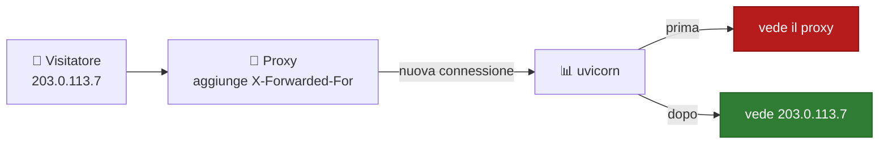
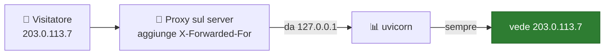
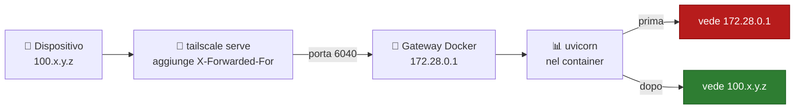
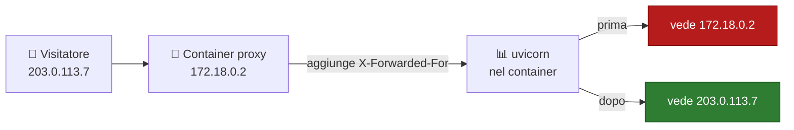
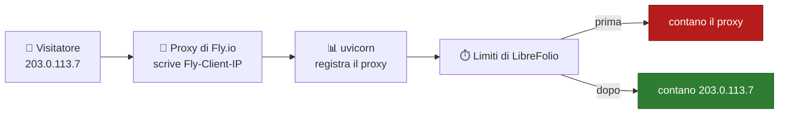

# 🧰 Verifica della sicurezza della connessione: dietro un proxy inverso

LibreFolio **dietro un proxy inverso** come Nginx, Caddy, Traefik o Tailscale Serve: quali header deve inviare il
proxy, che cosa imposti nel `.env` di LibreFolio e, proxy per proxy, dove si scrive ogni cosa.

Per vedere ciò che ottengono i tuoi utenti (indicatore, vista del server, cookie di sessione), parti da
[Verifica della sicurezza della connessione](connection_checks.md).

---

## 🧰 Dietro un proxy inverso {: #reverse-proxy }

Il proxy riceve la connessione HTTPS e la passa a LibreFolio su HTTP in chiaro.
LibreFolio viene a sapere dell'HTTPS, e del visitatore, solo da due header del proxy:

| Header | Cosa dice a LibreFolio |
| --- | --- |
| `X-Forwarded-Proto: https` | Il browser usa HTTPS. Con `SESSION_COOKIE_SECURE=auto` (predefinito) il cookie di sessione è contrassegnato `Secure`. |
| `X-Forwarded-For` | L'indirizzo del visitatore. L'indicatore vede da dove si connettono gli utenti ([sotto](#client-address)). |

Tailscale Serve e Funnel, Caddy e Traefik li inviano entrambi da soli.
Nginx no: le due righe da aggiungere sono nella sua scheda, [sotto](#per-proxy).

**Browser su HTTPS, ma cookie di sessione senza `Secure`?**
Il proxy non invia `X-Forwarded-Proto`, oppure `SESSION_COOKIE_SECURE` è `never`.
Gli amministratori vedono una riga in più nei dettagli dell'indicatore; il livello resta **Connessione: sicura**
(la connessione è cifrata, solo il cookie è privo di `Secure`):

> Il tuo browser usa HTTPS, ma il cookie di sessione non è contrassegnato come Secure. Fai in modo che il proxy inverso invii
> X-Forwarded-Proto (Nginx: `proxy_set_header X-Forwarded-Proto $scheme;`), oppure riporta
> SESSION_COOKIE_SECURE su auto se è impostato su never.

1. **Nella configurazione del proxy**: fai inviare `X-Forwarded-Proto` (Nginx: la prima riga della sua scheda).
2. Ricarica LibreFolio: la riga scompare. Esci e accedi di nuovo: il browser riceve un cookie `Secure`.

??? tip "⚙️ Imposta invece `SESSION_COOKIE_SECURE`"

    Inviare l'header è la soluzione migliore.
    Se raggiungi LibreFolio sempre e solo tramite HTTPS, puoi invece scrivere **nel `.env` di LibreFolio**:

    ```bash
    SESSION_COOKIE_SECURE=always
    ```

    Riavvia LibreFolio. Con Docker Compose, esegui `docker compose up -d`.
    Sull'host, riavvia `./dev.py server` (legge anch'esso `.env`). Poi esci e accedi di nuovo.

    Usa `never` solo per il raro proxy che dichiara HTTPS mentre il browser è su HTTP in chiaro.
    Tutte le opzioni: [Configurazione](configuration.md#session-cookie-secure).

### 🛤️ Cosa succede all'indirizzo del visitatore {: #address-path }



Il visitatore si connette al proxy. Il proxy apre una sua connessione verso LibreFolio e scrive l'indirizzo del
visitatore in `X-Forwarded-For`. uvicorn, il server web di LibreFolio, vede la connessione arrivare dal proxy.

**Prima:** uvicorn ignora `X-Forwarded-For`, perché di default gli crede solo se arriva da `127.0.0.1`.
Per LibreFolio, tutti i visitatori hanno l'indirizzo del proxy.

**Dopo:** l'indirizzo del proxy è in `FORWARDED_ALLOW_IPS`. Quando una connessione arriva da lì, uvicorn legge
`X-Forwarded-For` e usa quell'indirizzo come quello del visitatore.

**Un proxy con un header suo**, come Fly.io con `Fly-Client-IP`: uvicorn non lo legge.
Lo legge LibreFolio, quando `LIBREFOLIO_CLIENT_IP_HEADER` lo nomina.

**Perché conta:** i limiti sugli accessi falliti e sulle email contano per indirizzo ([sezione seguente](#client-address)).

**Leggere il log.** uvicorn scrive una riga per richiesta, che inizia con l'indirizzo che vede:

| Riga del log | Cosa significa |
| --- | --- |
| `172.18.0.2:51234 - "GET … HTTP/1.1" 200 OK` | Prima: l'indirizzo del proxy, con la porta della sua connessione. |
| `203.0.113.7:0 - "GET … HTTP/1.1" 200 OK` | Dopo: l'indirizzo del visitatore. La porta è `0` perché l'header porta solo l'indirizzo. |
| `127.0.0.1:<port> - "GET /api/v1/system/health HTTP/1.1" 200 OK` | L'health check di Docker, eseguito dentro il container: lascialo da parte. |

Con `LIBREFOLIO_CLIENT_IP_HEADER` il log non cambia: uvicorn continua a scrivere l'indirizzo del proxy.
Solo i limiti di LibreFolio usano l'header.

### 🧭 L'indirizzo del visitatore {: #client-address }

LibreFolio limita alcune richieste per indirizzo del visitatore:

- gli accessi falliti ([Accessi falliti](configuration_accounts.md#login-limit));
- le email di registrazione, **Invia di nuovo il link** e le password dimenticate ([Email](email.md)).

Dietro un proxy inverso le connessioni provengono dal proxy: se LibreFolio non apprende l'indirizzo di ogni
visitatore, tutte condividono quello del proxy e un unico conteggio:

- **Proxy su un indirizzo pubblico**: 50 accessi falliti attraverso il proxy, da chiunque, rifiuterebbero ogni
  tentativo di accesso attraverso di esso, anche con la password corretta, fino a 15 minuti.
- **Proxy su un indirizzo locale**, come un container proxy davanti all'immagine Docker: LibreFolio esclude invece
  quegli accessi dal conteggio per indirizzo e li conta solo per nome utente o indirizzo email
  ([sotto](#untrusted-proxy)).

Fai apprendere a LibreFolio l'indirizzo di ogni visitatore **nel `.env` di LibreFolio** (o nell'ambiente del
container), con una di queste due variabili:

| Variabile | Quando | Valore |
| --- | --- | --- |
| `FORWARDED_ALLOW_IPS` | Il proxy inoltra l'indirizzo del visitatore in `X-Forwarded-For`: uvicorn, il server web di LibreFolio, lo legge solo dalle connessioni che provengono da un indirizzo elencato qui (`127.0.0.1` se non impostata). | L'indirizzo del proxy **così come lo vede LibreFolio**, o la sua rete. Con Docker: l'indirizzo del container del proxy o la sua rete Docker, come `172.18.0.0/16` (`docker network inspect`, con il nome della rete, mostra entrambi). Guida: [Password dimenticate](email_flows.md#forgot-password). |
| `LIBREFOLIO_CLIENT_IP_HEADER` | Il proxy scrive l'indirizzo del visitatore in un header tutto suo. | Il nome di quell'header: `Fly-Client-IP` (Fly.io), `X-Real-IP` (Nginx). |

Dopo ogni modifica al `.env`, riavvia LibreFolio. Con Docker Compose, esegui `docker compose up -d`.
Sull'host, riavvia `./dev.py server`. LibreFolio legge la variabile una volta per processo del server.

!!! warning "⚠️ Fidati solo di indirizzi usati esclusivamente dal tuo proxy"

    In `FORWARDED_ALLOW_IPS`, un'intera rete include il suo gateway, che è anche l'indirizzo delle connessioni
    effettuate sul server stesso ([Tailscale con Docker](#tailscale)).

!!! warning "🚧 Solo quando ogni richiesta passa attraverso il proxy"

    LibreFolio crede all'header di `LIBREFOLIO_CLIENT_IP_HEADER`, chiunque lo invii.
    Imposta la variabile solo se i tuoi visitatori raggiungono LibreFolio esclusivamente attraverso quel proxy.
    Chi lo raggiunge direttamente, sulla sua porta (`PORT`, 6040 per impostazione predefinita) o per qualsiasi altro
    percorso, può inviare l'header e scegliere qualsiasi indirizzo: per aggirare i limiti o per esaurire quelli di
    qualcun altro.

??? note "📏 Regole di `LIBREFOLIO_CLIENT_IP_HEADER`"

    - **Un solo indirizzo, scritto dal proxy stesso.** Mai un valore che il proxy inoltra dal visitatore.
    - **`X-Forwarded-For` e `Forwarded` sono rifiutati**: contengono un elenco il cui primo indirizzo è scelto dal
      visitatore. Per `X-Forwarded-For`, elenca invece il tuo proxy in `FORWARDED_ALLOW_IPS`.
    - **Un valore errato impedisce l'avvio del server**, con un errore che nomina la variabile.
      Errato: uno di quei due header, oppure un valore che non è il nome di un header (uno spazio, un `:`).
      Maiuscole/minuscole e spazi attorno al nome non hanno importanza. Un valore vuoto equivale a non impostarla.
    - **Richiesta senza l'header** → conteggiata con l'indirizzo della connessione.
    - **Header che LibreFolio non può usare** → conteggiata con l'indirizzo della connessione.
      Inutilizzabile: la richiesta lo trasporta due volte, oppure contiene un elenco, un indirizzo con una porta o
      qualsiasi cosa diversa da un singolo indirizzo IP. Il log presenta un avviso per ogni processo del server:

        ```text
        Client address header unusable: using the connection's address
        ```

        Con il nome dell'header in `header`, quante volte la richiesta lo trasportava in `lines` e la lunghezza
        totale di tali righe in `length`; mai il valore stesso. Controlla come il tuo proxy imposta l'header.

    - **Nessun profilo lo imposta**: l'header dipende dal proxy davanti a ciascuna istanza.
    - **L'indicatore non lo usa**: continua a leggere `X-Forwarded-For`, come spiega
      [La vista del server](connection_checks.md#server-view).

### 🗺️ Il percorso, configurazione per configurazione {: #paths }

Trova la tua configurazione: dove passa la richiesta, e quale indirizzo vede LibreFolio prima e dopo l'impostazione.
I passi per ogni proxy sono in [Il tuo proxy, passo per passo](#per-proxy).

#### 🖥️ Proxy e LibreFolio sullo stesso server, senza Docker {: #path-host }



Il proxy (Nginx, Caddy, `tailscale serve`) si connette a LibreFolio su `127.0.0.1`.
uvicorn si fida di quell'indirizzo di default, quindi legge `X-Forwarded-For` fin dall'inizio.
Niente da impostare in `.env`. Nginx ha comunque bisogno delle sue due righe ([la sua scheda](#per-proxy)).

#### 🐳 Proxy sul server, LibreFolio in Docker {: #path-docker-host }



Il proxy gira sul server e passa la richiesta alla porta che Docker pubblica.
Dentro il container, la connessione arriva dal gateway della rete Docker, come `172.28.0.1`.

**Prima:** uvicorn non si fida del gateway. Tutti i visitatori hanno l'indirizzo `172.28.0.1`.

**Dopo:** il gateway è in `FORWARDED_ALLOW_IPS`. uvicorn legge `X-Forwarded-For`: l'indirizzo Tailscale del
dispositivo, `100.x.y.z`; attraverso Funnel, l'indirizzo pubblico del visitatore.

Stesso percorso per Nginx o Caddy installati sul server, e per i sidecar del Livello 4.
Passi: [Tailscale Serve e Funnel con Docker](#tailscale).

#### 📦 Container proxy sulla rete Docker {: #path-docker-network }



Caddy, Nginx o Traefik girano in un container sulla rete Docker di LibreFolio.
Raggiungono LibreFolio direttamente, senza la porta pubblicata.
La connessione arriva dall'indirizzo del container proxy, come `172.18.0.2`.

**Prima:** uvicorn non si fida di quell'indirizzo. Tutti i visitatori hanno l'indirizzo del proxy.

**Dopo:** la rete `172.18.0.0/16` è in `FORWARDED_ALLOW_IPS`. uvicorn legge `X-Forwarded-For` e vede
ogni visitatore. Indicare l'intera rete continua a funzionare quando il container proxy cambia indirizzo.

#### 🏷️ Proxy con un header suo {: #path-own-header }



Fly.io scrive l'indirizzo del visitatore in `Fly-Client-IP`. Nginx può scriverlo in `X-Real-IP`.
uvicorn non legge questi header: il suo log continua a mostrare l'indirizzo del proxy.

**Dopo:** `LIBREFOLIO_CLIENT_IP_HEADER` nomina l'header, e i limiti di LibreFolio contano con l'indirizzo del visitatore.
Impostalo solo quando ogni richiesta attraversa quel proxy ([avviso sopra](#client-address)).

### 🧩 Il tuo proxy, passo per passo {: #per-proxy }

=== "Nginx"

    1. **Nel file di configurazione di Nginx, nel blocco `location` che passa le richieste a LibreFolio**, aggiungi:

        ```nginx
        proxy_set_header X-Forwarded-Proto $scheme;
        proxy_set_header X-Forwarded-For $proxy_add_x_forwarded_for;
        ```

        LibreFolio sa che il browser usa HTTPS e riceve l'indirizzo del visitatore.

    2. **Nel `.env` di LibreFolio**, elenca Nginx così come LibreFolio lo vede (con Docker: il suo container o la
       sua rete Docker):

        ```bash
        FORWARDED_ALLOW_IPS=172.18.0.0/16
        ```

        Alternativa con un header di Nginx, solo se ogni richiesta passa da Nginx ([avviso sopra](#client-address)):
        nel blocco `location` aggiungi `proxy_set_header X-Real-IP $remote_addr;`, nel `.env`
        `LIBREFOLIO_CLIENT_IP_HEADER=X-Real-IP`.

    3. Riavvia LibreFolio. Con Docker Compose, esegui `docker compose up -d`.
       Poi esci e accedi di nuovo: il cookie di sessione è `Secure`.

=== "Caddy"

    Nulla da aggiungere alla configurazione di Caddy: invia da solo entrambi gli header.

    1. **Nel `.env` di LibreFolio**, elenca Caddy così come LibreFolio lo vede ([valore](#client-address); con
       Docker, la sua rete Docker):

        ```bash
        FORWARDED_ALLOW_IPS=172.18.0.0/16
        ```

    2. Riavvia LibreFolio. Con Docker Compose, esegui `docker compose up -d`.

=== "Traefik"

    Nulla da aggiungere alla configurazione di Traefik: invia da solo entrambi gli header.

    1. **Nel `.env` di LibreFolio**, elenca Traefik così come LibreFolio lo vede ([valore](#client-address); con
       Docker, la sua rete Docker):

        ```bash
        FORWARDED_ALLOW_IPS=172.18.0.0/16
        ```

    2. Riavvia LibreFolio. Con Docker Compose, esegui `docker compose up -d`.

=== "Tailscale Serve/Funnel"

    Nulla da aggiungere alla configurazione di Tailscale: Serve e Funnel scrivono da soli `X-Forwarded-For`, al
    posto di qualsiasi header inviato dal visitatore (l'indirizzo Tailscale del dispositivo, `100.x.y.z`; tramite
    Funnel, l'indirizzo del visitatore su Internet). Su HTTPS (predefinito di Serve, unica modalità di Funnel) anche
    `X-Forwarded-Proto: https`. Con `tailscale serve --http=…` nessuno dei due, giustamente: anche il browser usa
    HTTP in chiaro.

    | LibreFolio installato | Cosa fare |
    | --- | --- |
    | Sull'host, senza Docker, con `tailscale serve` o `tailscale funnel` sullo stesso server | Niente: le richieste provengono da `127.0.0.1`, di cui uvicorn si fida per impostazione predefinita. |
    | Con l'immagine Docker | Segui [Tailscale Serve e Funnel con Docker](#tailscale), sotto. |

=== "Fly.io"

    Il proxy di Fly scrive l'indirizzo del visitatore in `Fly-Client-IP`: niente da configurare dal lato di Fly.

    1. **Nel `.env` di LibreFolio, o nell'ambiente del container**, solo se ogni richiesta passa dal proxy di Fly
       ([avviso sopra](#client-address)):

        ```bash
        LIBREFOLIO_CLIENT_IP_HEADER=Fly-Client-IP
        ```

    2. Riavvia LibreFolio.

    Un altro proxy davanti a Fly.io, come Cloudflare: `Fly-Client-IP` contiene l'indirizzo di quel proxy, non quello
    del visitatore.

#### 🕵️ Quando LibreFolio non si fida del tuo proxy {: #untrusted-proxy }

Succede quando il proxy è su un **indirizzo locale** (`loopback`, `lan` o `vpn` in
[La vista del server](connection_checks.md#server-view), come `172.18.0.2` su una rete Docker) e LibreFolio non
apprende l'indirizzo del visitatore né tramite `FORWARDED_ALLOW_IPS` né tramite `LIBREFOLIO_CLIENT_IP_HEADER`.
Non riesce a distinguere i visitatori dietro il proxy: i limiti per indirizzo del visitatore escludono quelle
richieste, così un solo visitatore non può bloccare tutti; i limiti per account o per indirizzo email continuano a
conteggiarle.

**Come te ne accorgi**

- **Nel log**, un avviso per ogni processo del server, la prima volta che una richiesta del genere incontra un limite
  per indirizzo del visitatore:

    ```text
    Requests come through a reverse proxy that LibreFolio does not trust: the limits per client address skip them. List the proxy in FORWARDED_ALLOW_IPS, or name the header it sets in LIBREFOLIO_CLIENT_IP_HEADER
    ```

    Con i nomi degli header in `headers`, come `X-Forwarded-For, X-Real-IP`; mai un indirizzo.

- **Nei controlli di sicurezza**, come avviso di `platform.client_address`.
  Il controllo indica ciò che il server ha incontrato dal suo ultimo avvio: dopo un riavvio legge `ok` finché non si
  ripresenta una richiesta del genere. Perciò non compare mai tra i
  [controlli all'avvio](configuration_security.md#startup-checks).

**Come risolvere.** Nel `.env` di LibreFolio, `FORWARDED_ALLOW_IPS` se il proxy inoltra `X-Forwarded-For`,
`LIBREFOLIO_CLIENT_IP_HEADER` se imposta un header tutto suo e ogni richiesta lo attraversa: valori e riavvio in
[L'indirizzo del visitatore](#client-address), passi nella [scheda del tuo proxy](#per-proxy).
Tailscale Serve o Funnel con l'immagine Docker: [sotto](#tailscale).

**Nessun tuo proxy davanti a LibreFolio?** Allora l'header di inoltro (`X-Forwarded-For`, `Forwarded` o `X-Real-IP`)
che ha fatto scattare l'avviso è stato inviato da:

- un visitatore sulla tua rete o VPN;
- con Docker Desktop esposto direttamente, qualsiasi visitatore;
- qualsiasi visitatore IPv6 che il proxy di Docker trasmette ([Limiti](connection_checks.md#limits)).

Non elencare nulla.

**Header di inoltro da un indirizzo pubblico.** Ottengono solo un `info`:

- nel log, una volta per processo del server, anche con `headers`:

    ```text
    Forwarding headers from a public address were ignored: if a proxy on a public address forwards the requests, list it in FORWARDED_ALLOW_IPS
    ```

- nei controlli di sicurezza, dove `platform.client_address` resta un avviso se è stato incontrato anche un proxy
  come sopra.

Quelle richieste continuano a essere conteggiate con l'indirizzo della connessione.
Sono innocue quando nessun tuo proxy ha un indirizzo pubblico: un visitatore, o un proxy proprio, può aggiungere tali
header.

#### 🐳 Tailscale Serve e Funnel con Docker {: #tailscale }

Entrambe le configurazioni Tailscale di [Esporre in modo sicuro](service_exposure.md) raggiungono il container di
LibreFolio attraverso Docker, quindi le loro richieste provengono dal gateway della rete Docker del container, come
`172.28.0.1`, di cui uvicorn non si fida ([sopra](#untrusted-proxy)):

- **Sul server**: `tailscale serve --bg 6040` (l'indirizzo HTTPS del Livello 1) o `tailscale funnel --bg 6040`
  (Livello 3) passa le richieste a `http://127.0.0.1:6040`, e il proxy di Docker le consegna al container.
- **Nei [container sidecar](service_exposure_funnel.md#level-4-multi-funnel-with-docker-sidecars)** (Livello 4): socat
  le passa all'indirizzo LAN del server e alla porta pubblicata di LibreFolio.

**Procedura**, **sul server, da terminale, nella cartella che contiene `docker-compose.yml` e `.env`**:

1. **Trova il gateway** della rete Docker di LibreFolio:

    ```bash
    docker inspect --format '{{range .NetworkSettings.Networks}}{{.Gateway}}{{end}}' librefolio
    ```

    Stampa un indirizzo come `172.28.0.1`. `librefolio` è il nome che `docker-compose.yml` assegna al container
    (`container_name`).

    ??? tip "🔎 In alternativa, con `docker network inspect`"

        `docker network ls` elenca le reti; quella propria di un progetto Compose è `<project>_default`.
        `docker network inspect <network>` mostra lo stesso gateway sotto `IPAM` → `Config` → `Gateway`, accanto alla
        `Subnet` della rete.

2. **Verifica che le richieste di Tailscale provengano dal gateway.** Apri LibreFolio al suo indirizzo Tailscale, poi
   leggi le ultime righe del suo log:

    ```bash
    docker compose logs --tail 20 librefolio
    ```

    uvicorn registra ogni richiesta su una riga ([come leggerla](#address-path)). Attraverso Tailscale,
    l'indirizzo è quello del gateway:

    ```text
    172.28.0.1:<port> - "GET … HTTP/1.1" 200 OK
    ```

3. **Nel `.env` di LibreFolio**, elenca il gateway in `FORWARDED_ALLOW_IPS`, con il tuo valore:

    ```bash
    FORWARDED_ALLOW_IPS=172.28.0.1
    ```

    Se `.env` imposta già la variabile, per un altro proxy, aggiungi il gateway alla fine del suo elenco, dopo una
    virgola.

    Per esempio, con un altro proxy sulla rete `172.18.0.0/16` e il gateway di Tailscale:

    ```bash
    FORWARDED_ALLOW_IPS=172.18.0.0/16,172.28.0.1
    ```

4. **Riavvia LibreFolio**, così che il suo container riceva il nuovo ambiente:

    ```bash
    docker compose up -d
    ```

5. **Controlla.** Apri di nuovo LibreFolio al suo indirizzo Tailscale, poi leggi il log come al passo 2:

    ```bash
    docker compose logs --tail 20 librefolio
    ```

    Le righe delle tue richieste mostrano ora l'indirizzo del dispositivo (tramite Funnel, l'indirizzo pubblico del
    visitatore), seguito dalla porta `0`:

    ```text
    100.x.y.z:0 - "GET … HTTP/1.1" 200 OK
    ```

    L'avviso di `platform.client_address` smette di ripresentarsi; ma dopo il riavvio legge `ok` in ogni caso, quindi
    la riga del log è la prova reale.

**Quale valore mettere in `FORWARDED_ALLOW_IPS`.**

| Valore | Pro | Contro |
| --- | --- | --- |
| Il gateway esatto, come `172.28.0.1` | La scelta più restrittiva. | Compose può assegnare alla rete un'altra subnet quando la ricrea (`docker compose down`, poi `docker compose up -d`): controlla di nuovo il gateway dopo un cambiamento del genere. |
| `172.16.0.0/12` | Sopravvive a quel cambiamento: copre ogni rete Docker da `172.16` a `172.31`. | Si fida di ogni rete Docker sul server. Non copre le reti `192.168.x.x` che Docker assegna una volta esaurite quelle. |

!!! warning "⚠️ Il gateway non è solo Tailscale"

    È anche l'indirizzo di ogni connessione effettuata sul server stesso attraverso la porta pubblicata, e dei
    visitatori IPv6 che il proxy di Docker trasmette ([Limiti](connection_checks.md#limits)).
    Fidarsi di esso consente loro di scegliere l'indirizzo conteggiato ai fini dei limiti.

    Raggiungi LibreFolio **solo** tramite `tailscale serve` o `tailscale funnel` sul server?
    Pubblica la porta solo sul loopback, così che nulla al di fuori del server possa raggiungerla.
    **Nel `docker-compose.yml`, sotto `ports:`**, cambia:

    ```yaml
    - "${PORT:-6040}:6040"
    ```

    in:

    ```yaml
    - "127.0.0.1:${PORT:-6040}:6040"
    ```

    Poi esegui `docker compose up -d`.

    Non con il Livello 4, né con gli indirizzi HTTP in chiaro dei Livelli 1 e 2: raggiungono la porta tramite
    l'indirizzo LAN o Tailscale del server.

---

## 🔗 Correlati

- 📄 **[Verifica della sicurezza della connessione](connection_checks.md)** — Checklist, Cosa mostra l'indicatore, La vista del server, …
