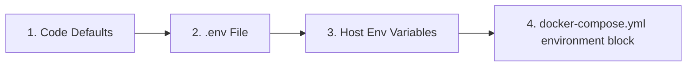

# 🐳 Advanced Docker Guide

For those who customize the Docker deployment, build their own image or run maintenance on the container.
For a first installation, start from the [Installation guide](../user/installation.md).

Two Compose files:

| File | Image it runs |
| --- | --- |
| `docker-compose.prod.yml` | The official image from GHCR. The installation guide saves it as `docker-compose.yml`. |
| `docker-compose.yml`, in the repository | An image you build yourself with `./dev.py docker build`. |

Where the commands of this page are run:

| Command | Where |
| --- | --- |
| `docker compose …` | On the host, in the folder that holds `docker-compose.yml` and `.env`. No checkout needed. |
| `./dev.py docker …` | On the host, in the root of a checkout of the repository. |
| `./dev.py docker exec <cmd>` | From the checkout; the command runs **inside the running container** ([details](#docker-exec)). |
| `docker compose run --rm librefolio …` | In the folder of `docker-compose.yml`, with the server stopped: a one-off container ([fixes](#post-migration-fixes)). |

## ⚠️ Prerequisites

1. **Docker group (Linux)**, to use Docker without `sudo`. On the host:

    ```bash
    sudo usermod -aG docker $USER
    ```

    Then log out and back in, or run `newgrp docker`. Without it, every `docker` and `docker compose` fails with a permission error.

2. **`.env` file**, next to the Compose file. `./dev.py docker build` refuses to proceed without it. In a checkout:

    ```bash
    cp .env.example .env
    $EDITOR .env          # review and customize parameters
    ```

## 🏗️ Architecture

The image is **runtime-only**: the web app (SvelteKit) and the documentation (MkDocs) are built on the host and copied into it; `./dev.py docker build` does it for you.
Build stages, contents and startup: [Architecture overview → Docker image](../developer/architecture/overview.md#docker-image).

## 📄 `docker-compose.yml`

It defines the `librefolio` service and its persistent data directory.

### 🔝 Resolution Priority {: #resolution-priority }

From lowest to highest:



`.env` reaches the container through `env_file`; the `environment:` block overrides it.
For the `${…}` placeholders of the Compose file, such as `${PORT:-6040}`, a variable of your shell wins over `.env`.

### 🔧 Service: `librefolio`

| Key | Value | Good to know |
| --- | --- | --- |
| 🏷️ `image` | `ghcr.io/librefolio/librefolio:latest` (production file) or your local `librefolio:latest` (repository file) | `LIBREFOLIO_IMAGE` in `.env` picks another tag |
| 🏗️ `build` | Repository file only: builds the `Dockerfile` in the root | Arguments `UID`, `GID` and `DOCS_VARIANT` |
| 🔌 `ports` | host `${PORT:-6040}` → container `6040` | `PORT` chooses the host side; inside the container the server always listens on `6040`, the only port of the image |
| 📂 `volumes` | bind mount `./LibreFolio-data` → `/app/backend/data/prod-docker` | |
| 📝 `env_file: .env` | Your configuration (copied from `.env.example`) | |
| 🌍 `environment` | `LIBREFOLIO_DATA_DIR` (path in the container), `HOST=0.0.0.0`, `PORT=6040` | Leave them as they are. `PORT=6040` replaces the host port of your `.env`: the `dev.py` commands in the container ([`docker exec`](#docker-exec)) look for the server on the right port, and `db upgrade` sees it running and refuses to start |
| 🩺 `healthcheck` | `GET /api/v1/system/health` every 30 seconds | It only tells Docker that the server answers |

!!! tip "📈 Monitoring LibreFolio: `/api/v1/system/ready`"

    Point a monitor such as **Uptime Kuma** or an orchestrator at `GET /api/v1/system/ready`, for example `http://your-server:6040/api/v1/system/ready` (with your `PORT`). No sign-in needed; the status code is enough:

    - **`200`**: ready. `{"status": "ready", "checks": {"database": "ok", "migrations": "ok"}, "database_revision": "…", "mode": "normal", "app_version": "…"}`. `database_revision`: the migration of the database; `app_version`: the running version, the same as the public `GET /api/v1/system/info`, so a monitor checks the version after an update.
    - **`503`**: not ready. `status` is `not_ready`; `checks` shows what is not `ok`:

        | Check | Value | Meaning |
        | --- | --- | --- |
        | `database` | `unreachable` | The database does not answer |
        | `migrations` | `behind` | The database is at an older migration: one was not applied, or failed |
        | `migrations` | `ahead` | The database is at a migration this version does not know: the data comes from a newer LibreFolio. Use that version or a newer one: [Never Backwards](backup_moving.md#never-backwards) |
        | `migrations` | `unknown` | It cannot tell, for example while the database is `unreachable` |

    The answer never includes details or paths: LibreFolio writes them to its own log (`docker compose logs librefolio`) as `Instance not ready`, once for each change of state. `db current` shows the migration of the database ([Apply Migrations](cli_tools.md#apply-migrations)).

### 💾 Data Directory: `LibreFolio-data/`

**Bind mount** next to the Compose file: SQLite database, custom uploads, broker reports, logs.
It survives container stop, restart and removal; you back it up straight from the host.

### 👤 User and Permissions

The container starts as root only to hand all of `LibreFolio-data/` over to the LibreFolio user, at every start; then it runs the server as that **non-root** user: on the host the files belong to its UID/GID.
`./dev.py docker exec` uses the same UID/GID ([details](#docker-exec)).

The UID/GID comes from the **build arguments** `UID` and `GID`, kept in the image as `LIBREFOLIO_UID` and `LIBREFOLIO_GID` and read by the entrypoint at every start.

| Image | UID/GID |
| --- | --- |
| Official on GHCR | `1000:1000`. The two `.env` lines below have no effect. |
| `./dev.py docker build` | The ids of the user who runs it, whatever `.env` says. |
| `docker compose build` | `UID` and `GID` read from `.env` (default `1000`). |

To match the ids to the host user, or the dedicated user, that must own the data, **in `.env`**:

```bash
UID=1000
GID=1000
```

They take effect only when `docker compose build` rebuilds the image: `.env` also reaches the container through `env_file`, but a restart does not change the ids.

- On the **host**, `ls -l LibreFolio-data/` shows the user and group of that UID/GID according to the host's `/etc/passwd` and `/etc/group`.
- **Inside the container**, the same files usually show as `librefolio:librefolio`: the same numeric UID/GID, resolved with the container's `/etc/passwd` and `/etc/group`.

??? tip "Linux reminder: users, groups and IDs"

    All commands: on the host.

    **Your UID and GID:**

    ```bash
    id -u              # your user ID (e.g. 1000)
    id -g              # your primary group ID (e.g. 1000)
    id                 # full info: uid, gid, groups
    ```

    **UID/GID of another user:**

    ```bash
    id -u username     # UID of 'username'
    id -g username     # primary GID of 'username'
    ```

    **A new group:**

    ```bash
    sudo groupadd librefolio          # create group (auto-assigns GID)
    sudo groupadd -g 1500 librefolio  # create group with specific GID
    ```

    **A new user:**

    ```bash
    # System user (no home, no login — ideal for services)
    sudo useradd --system --no-create-home --gid librefolio --shell /usr/sbin/nologin librefolio

    # Regular user with home directory
    sudo useradd -m -g librefolio librefolio
    ```

    **The assigned ids:**

    ```bash
    id librefolio
    # → uid=998(librefolio) gid=998(librefolio) groups=998(librefolio)
    ```

    **Your user in a group:**

    ```bash
    sudo usermod -aG librefolio $USER
    newgrp librefolio    # activate in current session (or log out/in)
    ```

    **Checking membership:**

    ```bash
    groups $USER         # list all groups for your user
    ```

    **Ownership of the data directory:**

    ```bash
    sudo chown -R librefolio:librefolio ./LibreFolio-data
    ```

    Then put the matching UID/GID in `.env` and rebuild with `docker compose build`: at every start the container hands the directory back to the image's UID/GID.

## 🛠️ CLI Commands

**Where: root of a checkout of the repository.** `dev.py` wraps the Docker operations:

```bash
./dev.py docker build          # Build image (auto-builds frontend + docs)
./dev.py docker build --light  # Light variant: no documentation screenshots (tagged *-light)
./dev.py docker build --no-cache  # Full rebuild without Docker cache
./dev.py docker rebuild        # Build → stop → restart (one-step deploy)
./dev.py docker up             # Start containers
./dev.py docker down           # Stop containers
./dev.py docker logs -f        # Follow container logs
./dev.py docker status         # Show container status
./dev.py docker exec <cmd>     # Run a dev.py command inside the container
```

**Without a checkout**, in the folder of `docker-compose.yml`, the day-to-day work:

| Action | Command |
| --- | --- |
| Start | `docker compose up -d` |
| Stop | `docker compose down` |
| Follow the log | `docker compose logs -f` |
| Container status | `docker compose ps` |

Image variants:

- `--light` builds the image without the documentation screenshots, which then load from the online site ([Image Variants](../user/installation.md#image-variants-full-and-light)).
- Local tags: `librefolio:<version>` and `librefolio:latest` for the full image, `librefolio:<version>-light` and `librefolio:latest-light` for the light one; `<version>` is the git version of the checkout. On the registry, instead, `latest` is the light variant and `latest-light` does not exist.
- To run your light build with the repository's Compose file, **in `.env`**: `LIBREFOLIO_IMAGE=librefolio:latest-light`.

??? warning "🧱 When `./dev.py docker build` stops"

    **A resource cannot be downloaded.** The build caches external resources (the Noto Color Emoji font for flags on Windows, MathJax for formulas, Mermaid for diagrams) so that the image works offline. If one is missing and there is no cached copy, the build stops:

    ```text
    ❌ Resource cache incomplete — the build would ship without these:
       - noto-color-emoji: ...
    ```

    The **first build requires internet** (or a pre-warmed cache). With the network back, run the build again; `./dev.py cache js` refreshes the cache by hand (`--force` re-downloads everything).

    **The frontend is a debug build.** The image must contain the production build of the web app. `./dev.py docker build` rebuilds `frontend/build/` in production when the last build was a debug one (`./dev.py server --test`, `./dev.py server --debug`, test runner), when the sources have changed or when it was not built for this version ([details](../developer/dev_workflow.md#docker-build-steps)). `docker build` or `docker compose build` skip that step: with `frontend/build/` in debug or instrumented for coverage, the build stops:

    ```text
    ERROR: /build is not a production frontend build: it is a debug build (.build-debug = 1)
    Rebuild it with './dev.py front build', then build the image again.
    ```

    Run `./dev.py front build`, then build the image again; or build with `./dev.py docker build`.

??? tip "🖼️ Building a full image with the documentation screenshots"

    A full image contains the screenshots only if they were generated, and the documentation rebuilt with them, **before** the build: otherwise a local full image and a light one are the same apart from the tag. In the checkout:

    ```bash
    ./dev.py mkdocs gallery   # generate the screenshots
    ./dev.py mkdocs build     # rebuild the documentation with the screenshots
    ./dev.py docker build     # build the full image; it rebuilds for production the debug frontend the gallery leaves
    ```

    `./dev.py mkdocs gallery` requires a complete environment (`pipenv`) and the Playwright browsers. It starts its own test server and populates the test database (`--no-populate` skips reseeding). It takes a few minutes.

### 📡 `docker exec` — Running Commands Inside the Container {: #docker-exec }

**Where: from the checkout; the command runs in the running container**, as the server's user: the numeric `LIBREFOLIO_UID:LIBREFOLIO_GID` of the image (User and Permissions, above), not root. Files created in `LibreFolio-data/` belong to that user straight away. For example:

```bash
./dev.py docker exec user create admin admin@example.com Pass123!
./dev.py docker exec user list
```

**Without a checkout**, in the folder of `docker-compose.yml`, `./dev.py docker exec user list` is the same as this line (`gosu`, also used by the entrypoint, switches to the image's ids before `dev.py` starts):

```bash
docker compose exec librefolio sh -c 'exec gosu "${LIBREFOLIO_UID:-1000}:${LIBREFOLIO_GID:-1000}" python dev.py "$@"' sh user list
```

A plain `docker compose exec librefolio python dev.py <cmd>` runs as root: what it creates in `LibreFolio-data/` belongs to root until the next start, when the entrypoint hands the directory back to the image's user.

| Command | In the image |
| --- | --- |
| `user`, `db`, `info`, `backup` | They work ([Back Up with Docker](cli_backup.md#backup-docker)) |
| `test`, `i18n`, `mkdocs translate`, `mkdocs translate-validate` | Listed, but they only answer that they are *not available in this installation*: the image contains the application, not the development tree |
| `./dev.py docker exec test db populate` | The same *not available* answer as every `test` command |
| `./dev.py docker exec server --test` | Stops with `Frontend build failed. Server not started.`: test mode rebuilds the web app in debug, which needs Node.js and the sources; the image has only the production build, without Node.js. Like `./dev.py mkdocs gallery`, it belongs to a development checkout |

**Database migrations need no command.** The server applies the pending ones at every start: after `docker compose pull` and `docker compose up -d` there is nothing else to do; `docker compose restart librefolio` retries them after a failure.
The restart does not help when the upgrade to 1.3 stops because two accounts have the same email address apart from capitals: separate the two accounts first, as «Two Accounts with the Same Email Address» in [Command-Line Tools](cli_tools.md) explains.
Do not use `./dev.py docker exec db upgrade`: `db upgrade` needs the server stopped, and in the container the server is the main process, always running.

## 🩹 Post-Migration Fixes {: #post-migration-fixes }

At every start, right after the pending migrations, the server runs the **post-migration fixes**: repairs that a migration cannot make. What they repair and what the log says: [Command-Line Tools → Post-Migration Fixes](cli_tools.md#post-migration-fixes). In Docker:

- the log is the container output (`./dev.py docker logs` or `docker compose logs`), also saved in `LibreFolio-data/logs/`;
- the copy kept by a failed fix sits next to the database, in `LibreFolio-data/sqlite/`, for example `app.db.pre-autoincrement-20261008T101500Z.bak`.

### ⏹️ Running the Fixes with the Server Stopped

To preview the fixes, or to retry one that failed at startup and read its error.
`docker exec` needs the running container: `docker compose run` replaces the server with your command instead, in a one-off container.

**Where: folder of `docker-compose.yml`.** Always preview with `--dry-run` first:

```bash
docker compose stop librefolio
docker compose run --rm librefolio python -m backend.app.db.post_migration --dry-run   # preview: changes nothing
docker compose run --rm librefolio python -m backend.app.db.post_migration             # apply the fixes
docker compose start librefolio
```

Result: the script works on the same database and data directory as the server and reports what it finds:

```text
Database: /app/backend/data/prod-docker/sqlite/app.db
Integrity check: ok
Fix autoincrement: would_apply
Orphan broker folder: broker_reports/uploaded/broker_7
```

Each fix is `clean` (nothing to do), `would_apply` (dry run), `applied` or `failed`; it also lists a kept backup, the errors and each transfer of securities sent to a deleted broker, with the cost it takes or the reason it stays as it is ([details](cli_tools.md#post-migration-fixes)).
Exit code `0` when nothing failed, dry run included; `1` if a fix, the integrity check or the conversion of those transfers failed.

## 🧪 Test Mode

The image has no test mode: it listens only on `6040`, the production server, and both Compose files publish only that port.
The test server (`./dev.py server --test`, port `6041` by default) is a developer tool: **on the host, from a source checkout**. Its database, `backend/data/test/sqlite/app.db` by default, is separate from `LibreFolio-data/`; `./dev.py test db populate --force` deletes and recreates it with mock data.

How to start it, and why it does not start in the container: [Developer Workflow](../developer/dev_workflow.md#docker-test-mode).

## 🏭 Production Considerations

### 🎮 1. Customizing `docker-compose.yml`

The most common changes. After (2)–(5), restart LibreFolio. With Docker Compose, run `docker compose up -d`.

| # | What | Where and how |
| --- | --- | --- |
| (1) | Match the host UID/GID | Rebuild the image with them: `./dev.py docker build` as the user who must own the files, or `UID=1001` and `GID=1001` in `.env` and then `docker compose build` |
| (2) | Change the production port | In `.env`: `PORT=3000` |
| (3) | Custom data path | In `docker-compose.yml`, the bind mount: `./my-data:/app/backend/data/prod-docker` |
| (4) | All configuration | In `.env` (copied from `.env.example`) |
| (5) | Run another image tag | In `.env`: `LIBREFOLIO_IMAGE`, for example `LIBREFOLIO_IMAGE=ghcr.io/librefolio/librefolio:1.1.0` |

The first account created in the browser becomes the administrator: no command. To have LibreFolio create it at the first start, from `LIBREFOLIO_ADMIN_EMAIL`: [The Initial Administrator](configuration_accounts.md#initial-admin).

??? example "📄 The repository's `docker-compose.yml`, annotated"

    ```yaml
    services:
      librefolio:
        image: ${LIBREFOLIO_IMAGE:-librefolio:latest}  # (5) Built by ./dev.py docker build
        build:
          context: .
          args:
            UID: ${UID:-1000}              # (1) UID owning the data files (build time only)
            GID: ${GID:-1000}              # (1) GID owning the data files (build time only)
            DOCS_VARIANT: ${DOCS_VARIANT:-full}  # light = no documentation screenshots
        container_name: librefolio
        # No 'user:' directive — entrypoint starts as root, fixes permissions,
        # then drops to the numeric LIBREFOLIO_UID:LIBREFOLIO_GID via gosu, like ./dev.py docker exec.
        restart: unless-stopped
        ports:
          - "${PORT:-6040}:6040"           # (2) Production port — change via PORT in .env
        volumes:
          - ./LibreFolio-data:/app/backend/data/prod-docker  # (3) Persistent data (bind mount)
        env_file: .env                     # (4) All config from .env file
        environment:
          - LIBREFOLIO_DATA_DIR=/app/backend/data/prod-docker  # Docker-specific override
          - HOST=0.0.0.0
          - PORT=6040                      # The container's port; (2) sets the host side
        healthcheck:
          test: ["CMD", "python", "-c", "import urllib.request; urllib.request.urlopen('http://localhost:6040/api/v1/system/health')"]
          interval: 30s
          timeout: 10s
          start_period: 15s
          retries: 3
    ```

    `docker-compose.prod.yml` has the same service without `build:`; its default image is `ghcr.io/librefolio/librefolio:latest`.

### 🔒 2. Security and Exposure (Tailscale and Reverse Proxy)

| Way | When | Guide |
| --- | --- | --- |
| **Tailscale** (recommended, the simplest) | Automatic HTTPS, without router ports or public DNS | [Tailscale Exposure Guide](service_exposure.md) |
| **Classic reverse proxy** (Nginx, Traefik) | You already have a web infrastructure, SSL/TLS certificates of your own, several applications on one server, custom security headers or rate limiting | Below |

Once exposed, [Checking Connection Security](connection_checks.md) shows how to check that users connect securely and, [behind a reverse proxy](connection_proxy.md#reverse-proxy), that the session cookie is `Secure`.

Behind a classic reverse proxy, **in `.env`** also say which proxy to trust (`FORWARDED_ALLOW_IPS`) or which header holds the visitor's address (`LIBREFOLIO_CLIENT_IP_HEADER`): otherwise LibreFolio sees every visitor with the proxy's address, and reports it in the log and in the security checks. See [The Visitor's Address](connection_proxy.md#client-address).

In the proxy configuration, do not compress again: LibreFolio already compresses with gzip (API JSON, JavaScript and CSS, documentation pages) and sends images and the live stream of the asset search as they are.

### 💾 3. Database Backup

The database is in `LibreFolio-data/` next to `docker-compose.yml`: a bind mount readable from the host, no `docker cp`.

!!! warning "Do not copy `app.db` from a running container"

    SQLite runs in **WAL mode** (`PRAGMA journal_mode=WAL`): recent transactions are in `app.db-wal`, so a `cp` of `app.db` alone with the server up can give an inconsistent or stale backup. Use one of the procedures below.

**Where: on the host, folder of `docker-compose.yml`.**

**Option A — Stop the container, then copy** (the simplest):

```bash
#!/bin/bash
docker compose stop librefolio
cp ./LibreFolio-data/sqlite/app.db /path/to/backups/app.db-$(date +%F)
docker compose start librefolio
```

**Option B — Online backup with the SQLite CLI** (no downtime; requires `sqlite3` on the host):

```bash
#!/bin/bash
sqlite3 ./LibreFolio-data/sqlite/app.db ".backup '/path/to/backups/app.db-$(date +%F)'"
```

`.backup` uses SQLite's online backup API, safe with a live WAL database.

**Option C — `backup create`**, without a stop or `sqlite3` on the host. Inside the container, from the folder of `docker-compose.yml`:

```bash
docker compose exec librefolio python dev.py backup create
```

Result: a consistent copy of the database, uploaded files, broker reports and stress scenarios in one archive, in its own folder of `LibreFolio-data/backups/`, with the server running ([Back Up with Docker](cli_backup.md#backup-docker)).
A clear archive leaves out `secrets/`, which holds the instance key: back that folder up as [What to Back Up](filesystem.md#what-to-back-up) explains. A [secure archive](backup_restore.md#secure), with `--encrypt`, contains the key, encrypted with your password.

Full list of what is worth backing up (uploaded files, original broker reports): [Filesystem Layout](filesystem.md).

Files you may find next to the database:

| File | What to do |
| --- | --- |
| `app.db.pre-<fix>-<UTC time>.bak` | Copy kept by a failed [post-migration fix](#post-migration-fixes): delete it when you no longer need it |
| `app.db.post-migration.lock` | Empty lock file of the [post-migration fixes](#post-migration-fixes), reused at every start. Leave it: deleting it while the server starts could let two runs overlap |

### 🔑 4. Environment Variables

All configuration is **in `.env`** (copied from `.env.example`); leave the Docker variables of the `environment:` block as they are. Every variable and its effect: [Configuration Guide](configuration.md).

🔐 **Users signed in across restarts.** In `.env`, `JWT_SECRET` to a long random string, for example the output of `openssl rand -hex 32`:

```bash
JWT_SECRET=<output of openssl rand -hex 32>
```

Restart LibreFolio. With Docker Compose, run `docker compose up -d`.
Without it, LibreFolio generates a new key at every start: every restart or update of the container signs everyone out.

### ✅ 5. Verify the Image You Pull {: #verify-image }

Every image on GHCR (`ghcr.io/librefolio/librefolio`, full and light) has a **build attestation**, signed by the release pipeline of the project's repository: this exact image was built there from this code. No key of ours to keep or lose (GitHub proves the identity of the run, Sigstore records it): anyone can verify it.

**Where: where you have Docker and the [GitHub CLI](https://cli.github.com/).**

1. Take the digest of the image you pulled:

    ```bash
    # The digest of a tag (the line "Digest: sha256:…")
    docker buildx imagetools inspect ghcr.io/librefolio/librefolio:1.3.0
    ```

2. Ask GitHub to verify it:

    ```bash
    # Verify the attestation of that digest
    gh attestation verify oci://ghcr.io/librefolio/librefolio@sha256:<digest> --owner Librefolio
    ```

    Result: `✓ Verification succeeded!` with the repository and the workflow that built it. Only an error → this digest does not come from LibreFolio's pipeline: do not run it.

The attestation covers every tag that points to the same digest (`1.3.0`, `latest`...). Releases before this check have none.

---

## 🔗 Related

- 📄 **[Installation guide](../user/installation.md)** — First installation, Image Variants
- 📄 **[Command-Line Tools](cli_tools.md)** — Apply Migrations, Post-Migration Fixes
- 📄 **[Backups](cli_backup.md#backup-docker)** — Back Up with Docker
- 📄 **[Filesystem Layout](filesystem.md)** — What to Back Up
- 📄 **[Checking Connection Security](connection_checks.md)** — Behind a Reverse Proxy, The Visitor's Address
