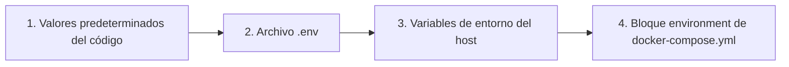

# 🐳 Guía avanzada de Docker

Para quien personaliza el despliegue de Docker, compila su propia imagen o hace tareas de mantenimiento en el contenedor.
Para una primera instalación, empieza por la [Guía de instalación](../user/installation.md).

Dos archivos Compose:

| Archivo | Imagen que ejecuta |
| --- | --- |
| `docker-compose.prod.yml` | La imagen oficial de GHCR. La guía de instalación lo guarda como `docker-compose.yml`. |
| `docker-compose.yml`, en el repositorio | Una imagen que compilas tú mismo con `./dev.py docker build`. |

Dónde se ejecutan los comandos de esta página:

| Comando | Dónde |
| --- | --- |
| `docker compose …` | En el host, en la carpeta que contiene `docker-compose.yml` y `.env`. No hace falta una copia del repositorio. |
| `./dev.py docker …` | En el host, en la raíz de una copia del repositorio. |
| `./dev.py docker exec <cmd>` | Desde la copia del repositorio; el comando se ejecuta **dentro del contenedor en marcha** ([detalles](#docker-exec)). |
| `docker compose run --rm librefolio …` | En la carpeta de `docker-compose.yml`, con el servidor detenido: un contenedor de un solo uso ([correcciones](#post-migration-fixes)). |

## ⚠️ Requisitos previos

1. **Grupo de Docker (Linux)**, para usar Docker sin `sudo`. En el host:

    ```bash
    sudo usermod -aG docker $USER
    ```

    Después cierra sesión y vuelve a iniciarla, o ejecuta `newgrp docker`. Sin esto, todos los comandos `docker` y `docker compose` fallan con un error de permisos.

2. **Archivo `.env`**, junto al archivo Compose. `./dev.py docker build` se niega a continuar sin él. En una copia del repositorio:

    ```bash
    cp .env.example .env
    $EDITOR .env          # review and customize parameters
    ```

## 🏗️ Arquitectura

La imagen es **solo de ejecución**: la aplicación web (SvelteKit) y la documentación (MkDocs) se compilan en el host y se copian en ella; `./dev.py docker build` lo hace por ti.
Etapas de compilación, contenido y arranque: [Resumen de la arquitectura → Imagen de Docker](../developer/architecture/overview.md#docker-image).

## 📄 `docker-compose.yml`

Define el servicio `librefolio` y su directorio de datos persistentes.

### 🔝 Prioridad de resolución {: #resolution-priority }

De menor a mayor:



`.env` llega al contenedor mediante `env_file`; el bloque `environment:` lo sobrescribe.
Para los marcadores de posición `${…}` del archivo Compose, como `${PORT:-6040}`, una variable de tu shell prevalece sobre `.env`.

### 🔧 Servicio: `librefolio`

| Clave | Valor | Conviene saber |
| --- | --- | --- |
| 🏷️ `image` | `ghcr.io/librefolio/librefolio:latest` (archivo de producción) o tu `librefolio:latest` local (archivo del repositorio) | `LIBREFOLIO_IMAGE` en `.env` elige otra etiqueta |
| 🏗️ `build` | Solo el archivo del repositorio: compila el `Dockerfile` de la raíz | Argumentos `UID`, `GID` y `DOCS_VARIANT` |
| 🔌 `ports` | host `${PORT:-6040}` → contenedor `6040` | `PORT` elige el lado del host; dentro del contenedor el servidor siempre escucha en `6040`, el único puerto de la imagen |
| 📂 `volumes` | montaje bind `./LibreFolio-data` → `/app/backend/data/prod-docker` | |
| 📝 `env_file: .env` | Tu configuración (copiada de `.env.example`) | |
| 🌍 `environment` | `LIBREFOLIO_DATA_DIR` (ruta dentro del contenedor), `HOST=0.0.0.0`, `PORT=6040` | Déjalas como están. `PORT=6040` reemplaza el puerto del host de tu `.env`: los comandos de `dev.py` dentro del contenedor ([`docker exec`](#docker-exec)) buscan el servidor en el puerto correcto, y `db upgrade` lo ve en ejecución y se niega a iniciarse |
| 🩺 `healthcheck` | `GET /api/v1/system/health` cada 30 segundos | Solo le dice a Docker que el servidor responde |

!!! tip "📈 Monitorizar LibreFolio: `/api/v1/system/ready`"

    Apunta un monitor como **Uptime Kuma**, o un orquestador, a `GET /api/v1/system/ready`, por ejemplo `http://your-server:6040/api/v1/system/ready` (con tu `PORT`). No hace falta iniciar sesión; basta el código de estado:

    - **`200`**: listo. `{"status": "ready", "checks": {"database": "ok", "migrations": "ok"}, "database_revision": "…", "mode": "normal", "app_version": "…"}`. `database_revision`: la migración de la base de datos; `app_version`: la versión en ejecución, la misma que da el `GET /api/v1/system/info` público, de modo que un monitor comprueba la versión tras una actualización.
    - **`503`**: no está listo. `status` es `not_ready`; `checks` muestra lo que no está `ok`:

        | Comprobación | Valor | Significado |
        | --- | --- | --- |
        | `database` | `unreachable` | La base de datos no responde |
        | `migrations` | `behind` | La base de datos está en una migración anterior: una no se aplicó, o falló |
        | `migrations` | `ahead` | La base de datos está en una migración que esta versión no conoce: los datos vienen de un LibreFolio más reciente. Usa esa versión o una más nueva: [Nunca hacia atrás](backup_moving.md#never-backwards) |
        | `migrations` | `unknown` | No puede saberlo, por ejemplo mientras la base de datos está `unreachable` |

    La respuesta nunca incluye detalles ni rutas: LibreFolio los escribe en su propio registro (`docker compose logs librefolio`) como `Instance not ready`, una vez por cada cambio de estado. `db current` muestra la migración de la base de datos ([Aplicar migraciones](cli_tools.md#apply-migrations)).

### 💾 Directorio de datos: `LibreFolio-data/`

**Montaje bind** junto al archivo Compose: base de datos SQLite, subidas personalizadas, informes de brókers, registros.
Sobrevive a detener, reiniciar y eliminar el contenedor; haces la copia de seguridad directamente desde el host.

### 👤 Usuario y permisos

El contenedor arranca como root solo para entregar todo `LibreFolio-data/` al usuario de LibreFolio, en cada arranque; luego ejecuta el servidor como ese usuario **sin privilegios de root**: en el host, los archivos pertenecen a su UID/GID.
`./dev.py docker exec` usa los mismos UID/GID ([detalles](#docker-exec)).

El UID/GID procede de los **argumentos de compilación** `UID` y `GID`, que se guardan en la imagen como `LIBREFOLIO_UID` y `LIBREFOLIO_GID` y que el entrypoint lee en cada arranque.

| Imagen | UID/GID |
| --- | --- |
| Oficial de GHCR | `1000:1000`. Las dos líneas de `.env` de más abajo no tienen efecto. |
| `./dev.py docker build` | Los ids del usuario que lo ejecuta, diga lo que diga `.env`. |
| `docker compose build` | `UID` y `GID` leídos de `.env` (por defecto `1000`). |

Para hacer coincidir los ids con el usuario del host, o con el usuario dedicado, que debe ser el propietario de los datos, **en `.env`**:

```bash
UID=1000
GID=1000
```

Solo surten efecto cuando `docker compose build` vuelve a compilar la imagen: `.env` también llega al contenedor mediante `env_file`, pero un reinicio no cambia los ids.

- En el **host**, `ls -l LibreFolio-data/` muestra el usuario y el grupo de ese UID/GID según el `/etc/passwd` y el `/etc/group` del host.
- **Dentro del contenedor**, los mismos archivos suelen aparecer como `librefolio:librefolio`: el mismo UID/GID numérico, resuelto con el `/etc/passwd` y el `/etc/group` del contenedor.

??? tip "Recordatorio de Linux: usuarios, grupos e ids"

    Todos los comandos: en el host.

    **Tu UID y GID:**

    ```bash
    id -u              # your user ID (e.g. 1000)
    id -g              # your primary group ID (e.g. 1000)
    id                 # full info: uid, gid, groups
    ```

    **UID/GID de otro usuario:**

    ```bash
    id -u username     # UID of 'username'
    id -g username     # primary GID of 'username'
    ```

    **Un grupo nuevo:**

    ```bash
    sudo groupadd librefolio          # create group (auto-assigns GID)
    sudo groupadd -g 1500 librefolio  # create group with specific GID
    ```

    **Un usuario nuevo:**

    ```bash
    # System user (no home, no login — ideal for services)
    sudo useradd --system --no-create-home --gid librefolio --shell /usr/sbin/nologin librefolio

    # Regular user with home directory
    sudo useradd -m -g librefolio librefolio
    ```

    **Los ids asignados:**

    ```bash
    id librefolio
    # → uid=998(librefolio) gid=998(librefolio) groups=998(librefolio)
    ```

    **Tu usuario en un grupo:**

    ```bash
    sudo usermod -aG librefolio $USER
    newgrp librefolio    # activate in current session (or log out/in)
    ```

    **Comprobar la pertenencia:**

    ```bash
    groups $USER         # list all groups for your user
    ```

    **Propiedad del directorio de datos:**

    ```bash
    sudo chown -R librefolio:librefolio ./LibreFolio-data
    ```

    Luego pon el UID/GID correspondiente en `.env` y vuelve a compilar con `docker compose build`: en cada arranque el contenedor devuelve el directorio al UID/GID de la imagen.

## 🛠️ Comandos CLI

**Dónde: raíz de una copia del repositorio.** `dev.py` envuelve las operaciones de Docker:

```bash
./dev.py docker build          # Build image (auto-builds frontend + docs)
./dev.py docker build --light  # Light variant: no documentation screenshots (tagged *-light)
./dev.py docker build --no-cache  # Full rebuild without Docker cache
./dev.py docker rebuild        # Build → stop → restart (one-step deploy)
./dev.py docker up             # Start containers
./dev.py docker down           # Stop containers
./dev.py docker logs -f        # Follow container logs
./dev.py docker status         # Show container status
./dev.py docker exec <cmd>     # Run a dev.py command inside the container
```

**Sin una copia del repositorio**, en la carpeta de `docker-compose.yml`, el trabajo del día a día:

| Acción | Comando |
| --- | --- |
| Iniciar | `docker compose up -d` |
| Detener | `docker compose down` |
| Seguir el registro | `docker compose logs -f` |
| Estado del contenedor | `docker compose ps` |

Variantes de la imagen:

- `--light` compila la imagen sin las capturas de pantalla de la documentación, que entonces se cargan desde el sitio en línea ([Variantes de la imagen](../user/installation.md#image-variants-full-and-light)).
- Etiquetas locales: `librefolio:<version>` y `librefolio:latest` para la imagen completa, `librefolio:<version>-light` y `librefolio:latest-light` para la ligera; `<version>` es la versión git de la copia del repositorio. En el registro, en cambio, `latest` es la variante ligera y `latest-light` no existe.
- Para ejecutar tu compilación ligera con el archivo Compose del repositorio, **en `.env`**: `LIBREFOLIO_IMAGE=librefolio:latest-light`.

??? warning "🧱 Cuando `./dev.py docker build` se detiene"

    **No se puede descargar un recurso.** La compilación guarda en caché recursos externos (la fuente Noto Color Emoji para las banderas en Windows, MathJax para las fórmulas, Mermaid para los diagramas) para que la imagen funcione sin conexión. Si falta uno y no hay copia en caché, la compilación se detiene:

    ```text
    ❌ Resource cache incomplete — the build would ship without these:
       - noto-color-emoji: ...
    ```

    La **primera compilación requiere internet** (o una caché precalentada). Cuando vuelva la red, ejecuta de nuevo la compilación; `./dev.py cache js` actualiza la caché a mano (`--force` vuelve a descargar todo).

    **El frontend es una compilación de depuración.** La imagen debe contener la compilación de producción de la aplicación web. `./dev.py docker build` vuelve a compilar `frontend/build/` en producción cuando la última compilación fue de depuración (`./dev.py server --test`, `./dev.py server --debug`, el ejecutor de pruebas), cuando las fuentes han cambiado o cuando no se compiló para esta versión ([detalles](../developer/dev_workflow.md#docker-build-steps)). `docker build` o `docker compose build` se saltan ese paso: con `frontend/build/` en depuración o instrumentado para cobertura, la compilación se detiene:

    ```text
    ERROR: /build is not a production frontend build: it is a debug build (.build-debug = 1)
    Rebuild it with './dev.py front build', then build the image again.
    ```

    Ejecuta `./dev.py front build` y vuelve a compilar la imagen; o compila con `./dev.py docker build`.

??? tip "🖼️ Compilar una imagen completa con las capturas de pantalla de la documentación"

    Una imagen completa contiene las capturas solo si se generaron, y la documentación se recompiló con ellas, **antes** de la compilación: de lo contrario, una imagen completa local y una ligera son iguales salvo por la etiqueta. En la copia del repositorio:

    ```bash
    ./dev.py mkdocs gallery   # generate the screenshots
    ./dev.py mkdocs build     # rebuild the documentation with the screenshots
    ./dev.py docker build     # build the full image; it rebuilds for production the debug frontend the gallery leaves
    ```

    `./dev.py mkdocs gallery` requiere un entorno completo (`pipenv`) y los navegadores de Playwright. Inicia su propio servidor de pruebas y puebla la base de datos de pruebas (`--no-populate` omite volver a sembrarla). Tarda unos minutos.

### 📡 `docker exec` — Ejecutar comandos dentro del contenedor {: #docker-exec }

**Dónde: desde la copia del repositorio; el comando se ejecuta en el contenedor en marcha**, como el usuario del servidor: el `LIBREFOLIO_UID:LIBREFOLIO_GID` numérico de la imagen (Usuario y permisos, arriba), no root. Los archivos creados en `LibreFolio-data/` pertenecen a ese usuario desde el primer momento. Por ejemplo:

```bash
./dev.py docker exec user create admin admin@example.com Pass123!
./dev.py docker exec user list
```

**Sin una copia del repositorio**, en la carpeta de `docker-compose.yml`, `./dev.py docker exec user list` equivale a esta línea (`gosu`, que también usa el entrypoint, cambia a los ids de la imagen antes de que arranque `dev.py`):

```bash
docker compose exec librefolio sh -c 'exec gosu "${LIBREFOLIO_UID:-1000}:${LIBREFOLIO_GID:-1000}" python dev.py "$@"' sh user list
```

Un simple `docker compose exec librefolio python dev.py <cmd>` se ejecuta como root: lo que crea en `LibreFolio-data/` pertenece a root hasta el siguiente arranque, cuando el entrypoint devuelve el directorio al usuario de la imagen.

| Comando | En la imagen |
| --- | --- |
| `user`, `db`, `info`, `backup` | Funcionan ([Copia de seguridad con Docker](cli_backup.md#backup-docker)) |
| `test`, `i18n`, `mkdocs translate`, `mkdocs translate-validate` | Aparecen listados, pero solo responden que *no están disponibles en esta instalación*: la imagen contiene la aplicación, no el árbol de desarrollo |
| `./dev.py docker exec test db populate` | La misma respuesta *no disponible* que todos los comandos `test` |
| `./dev.py docker exec server --test` | Se detiene con `Frontend build failed. Server not started.`: el modo de pruebas recompila la aplicación web en depuración, lo que necesita Node.js y las fuentes; la imagen solo tiene la compilación de producción, sin Node.js. Como `./dev.py mkdocs gallery`, pertenece a una copia de desarrollo |

**Las migraciones de la base de datos no necesitan ningún comando.** El servidor aplica las pendientes en cada arranque: después de `docker compose pull` y `docker compose up -d` no hay nada más que hacer; `docker compose restart librefolio` las reintenta tras un fallo.
El reinicio no ayuda cuando la actualización a 1.3 se detiene porque dos cuentas tienen la misma dirección de correo electrónico salvo por las mayúsculas: separa primero las dos cuentas, como explica «Dos cuentas con la misma dirección de correo electrónico» en [Herramientas de línea de comandos](cli_tools.md).
No uses `./dev.py docker exec db upgrade`: `db upgrade` necesita el servidor detenido, y en el contenedor el servidor es el proceso principal, siempre en marcha.

## 🩹 Correcciones posteriores a la migración {: #post-migration-fixes }

En cada arranque, justo después de las migraciones pendientes, el servidor ejecuta las **correcciones posteriores a la migración**: reparaciones que una migración no puede hacer. Qué reparan y qué dice el registro: [Herramientas de línea de comandos → Correcciones posteriores a la migración](cli_tools.md#post-migration-fixes). En Docker:

- el registro es la salida del contenedor (`./dev.py docker logs` o `docker compose logs`), que también se guarda en `LibreFolio-data/logs/`;
- la copia que conserva una corrección fallida está junto a la base de datos, en `LibreFolio-data/sqlite/`, por ejemplo `app.db.pre-autoincrement-20261008T101500Z.bak`.

### ⏹️ Ejecutar las correcciones con el servidor detenido

Para previsualizar las correcciones, o para reintentar una que falló al arrancar y leer su error.
`docker exec` necesita el contenedor en marcha: `docker compose run` sustituye en cambio el servidor por tu comando, en un contenedor de un solo uso.

**Dónde: carpeta de `docker-compose.yml`.** Previsualiza siempre primero con `--dry-run`:

```bash
docker compose stop librefolio
docker compose run --rm librefolio python -m backend.app.db.post_migration --dry-run   # preview: changes nothing
docker compose run --rm librefolio python -m backend.app.db.post_migration             # apply the fixes
docker compose start librefolio
```

Resultado: el script trabaja sobre la misma base de datos y el mismo directorio de datos que el servidor, e informa de lo que encuentra:

```text
Database: /app/backend/data/prod-docker/sqlite/app.db
Integrity check: ok
Fix autoincrement: would_apply
Orphan broker folder: broker_reports/uploaded/broker_7
```

Cada corrección es `clean` (nada que hacer), `would_apply` (simulacro), `applied` o `failed`; también lista una copia de seguridad conservada, los errores y cada traspaso de valores enviado a un bróker eliminado, con el coste que asume o el motivo por el que se queda como está ([detalles](cli_tools.md#post-migration-fixes)).
Código de salida `0` cuando nada falló, simulacro incluido; `1` si falló una corrección, la comprobación de integridad o la conversión de esos traspasos.

## 🧪 Modo de pruebas

La imagen no tiene modo de pruebas: escucha solo en `6040`, el servidor de producción, y ambos archivos Compose publican solo ese puerto.
El servidor de pruebas (`./dev.py server --test`, puerto `6041` por defecto) es una herramienta de desarrollo: **en el host, desde una copia del código fuente**. Su base de datos, `backend/data/test/sqlite/app.db` por defecto, está separada de `LibreFolio-data/`; `./dev.py test db populate --force` la elimina y la vuelve a crear con datos de ejemplo.

Cómo iniciarlo y por qué no arranca en el contenedor: [Flujo de trabajo de desarrollo](../developer/dev_workflow.md#docker-test-mode).

## 🏭 Consideraciones de producción

### 🎮 1. Personalizar `docker-compose.yml`

Los cambios más habituales. Después de (2)–(5), reinicia LibreFolio. Con Docker Compose, ejecuta `docker compose up -d`.

| # | Qué | Dónde y cómo |
| --- | --- | --- |
| (1) | Hacer coincidir el UID/GID del host | Vuelve a compilar la imagen con ellos: `./dev.py docker build` como el usuario que debe ser el propietario de los archivos, o `UID=1001` y `GID=1001` en `.env` y luego `docker compose build` |
| (2) | Cambiar el puerto de producción | En `.env`: `PORT=3000` |
| (3) | Ruta de datos personalizada | En `docker-compose.yml`, el montaje bind: `./my-data:/app/backend/data/prod-docker` |
| (4) | Toda la configuración | En `.env` (copiado de `.env.example`) |
| (5) | Ejecutar otra etiqueta de imagen | En `.env`: `LIBREFOLIO_IMAGE`, por ejemplo `LIBREFOLIO_IMAGE=ghcr.io/librefolio/librefolio:1.1.0` |

La primera cuenta creada en el navegador se convierte en la administradora: ningún comando. Para que LibreFolio la cree en el primer arranque, a partir de `LIBREFOLIO_ADMIN_EMAIL`: [El administrador inicial](configuration_accounts.md#initial-admin).

??? example "📄 El `docker-compose.yml` del repositorio, anotado"

    ```yaml
    services:
      librefolio:
        image: ${LIBREFOLIO_IMAGE:-librefolio:latest}  # (5) Built by ./dev.py docker build
        build:
          context: .
          args:
            UID: ${UID:-1000}              # (1) UID owning the data files (build time only)
            GID: ${GID:-1000}              # (1) GID owning the data files (build time only)
            DOCS_VARIANT: ${DOCS_VARIANT:-full}  # light = no documentation screenshots
        container_name: librefolio
        # No 'user:' directive — entrypoint starts as root, fixes permissions,
        # then drops to the numeric LIBREFOLIO_UID:LIBREFOLIO_GID via gosu, like ./dev.py docker exec.
        restart: unless-stopped
        ports:
          - "${PORT:-6040}:6040"           # (2) Production port — change via PORT in .env
        volumes:
          - ./LibreFolio-data:/app/backend/data/prod-docker  # (3) Persistent data (bind mount)
        env_file: .env                     # (4) All config from .env file
        environment:
          - LIBREFOLIO_DATA_DIR=/app/backend/data/prod-docker  # Docker-specific override
          - HOST=0.0.0.0
          - PORT=6040                      # The container's port; (2) sets the host side
        healthcheck:
          test: ["CMD", "python", "-c", "import urllib.request; urllib.request.urlopen('http://localhost:6040/api/v1/system/health')"]
          interval: 30s
          timeout: 10s
          start_period: 15s
          retries: 3
    ```

    `docker-compose.prod.yml` tiene el mismo servicio sin `build:`; su imagen predeterminada es `ghcr.io/librefolio/librefolio:latest`.

### 🔒 2. Seguridad y exposición (Tailscale y proxy inverso)

| Vía | Cuándo | Guía |
| --- | --- | --- |
| **Tailscale** (recomendada, la más sencilla) | HTTPS automático, sin puertos del router ni DNS público | [Guía de exposición con Tailscale](service_exposure.md) |
| **Proxy inverso clásico** (Nginx, Traefik) | Ya tienes una infraestructura web, certificados SSL/TLS propios, varias aplicaciones en un servidor, cabeceras de seguridad personalizadas o limitación de peticiones | Más abajo |

Una vez expuesto, [Comprobar la seguridad de la conexión](connection_checks.md) muestra cómo verificar que los usuarios se conectan de forma segura y, [detrás de un proxy inverso](connection_proxy.md#reverse-proxy), que la cookie de sesión es `Secure`.

Detrás de un proxy inverso clásico, **en `.env`** indica también en qué proxy confiar (`FORWARDED_ALLOW_IPS`) o qué cabecera contiene la dirección del visitante (`LIBREFOLIO_CLIENT_IP_HEADER`): de lo contrario LibreFolio ve a todos los visitantes con la dirección del proxy, y la registra así en el registro y en las comprobaciones de seguridad. Consulta [La dirección del visitante](connection_proxy.md#client-address).

En la configuración del proxy, no vuelvas a comprimir: LibreFolio ya comprime con gzip (JSON de la API, JavaScript y CSS, páginas de la documentación) y envía tal cual las imágenes y el flujo en directo de la búsqueda de activos.

### 💾 3. Copia de seguridad de la base de datos

La base de datos está en `LibreFolio-data/`, junto a `docker-compose.yml`: un montaje bind legible desde el host, sin `docker cp`.

!!! warning "No copies `app.db` de un contenedor en marcha"

    SQLite funciona en **modo WAL** (`PRAGMA journal_mode=WAL`): las transacciones recientes están en `app.db-wal`, así que un `cp` de `app.db` solo, con el servidor en marcha, puede dar una copia de seguridad inconsistente u obsoleta. Usa uno de los procedimientos siguientes.

**Dónde: en el host, carpeta de `docker-compose.yml`.**

**Opción A — Detener el contenedor y luego copiar** (la más sencilla):

```bash
#!/bin/bash
docker compose stop librefolio
cp ./LibreFolio-data/sqlite/app.db /path/to/backups/app.db-$(date +%F)
docker compose start librefolio
```

**Opción B — Copia en línea con la CLI de SQLite** (sin tiempo de inactividad; requiere `sqlite3` en el host):

```bash
#!/bin/bash
sqlite3 ./LibreFolio-data/sqlite/app.db ".backup '/path/to/backups/app.db-$(date +%F)'"
```

`.backup` usa la API de copia en línea de SQLite, segura con una base de datos WAL en uso.

**Opción C — `backup create`**, sin detener nada ni `sqlite3` en el host. Dentro del contenedor, desde la carpeta de `docker-compose.yml`:

```bash
docker compose exec librefolio python dev.py backup create
```

Resultado: una copia consistente de la base de datos, los archivos subidos, los informes de brókers y los escenarios de estrés en un solo archivo, en su propia carpeta de `LibreFolio-data/backups/`, con el servidor en marcha ([Copia de seguridad con Docker](cli_backup.md#backup-docker)).
Un archivo claro deja fuera `secrets/`, que contiene la clave de instancia: respalda esa carpeta como explica [Qué respaldar](filesystem.md#what-to-back-up). Un [archivo seguro](backup_restore.md#secure), con `--encrypt`, contiene la clave, cifrada con tu contraseña.

Lista completa de lo que conviene respaldar (archivos subidos, informes originales de brókers): [Estructura del sistema de archivos](filesystem.md).

Archivos que puedes encontrar junto a la base de datos:

| Archivo | Qué hacer |
| --- | --- |
| `app.db.pre-<fix>-<UTC time>.bak` | Copia conservada por una [corrección posterior a la migración](#post-migration-fixes) fallida: elimínala cuando ya no la necesites |
| `app.db.post-migration.lock` | Archivo de bloqueo vacío de las [correcciones posteriores a la migración](#post-migration-fixes), reutilizado en cada arranque. Déjalo: eliminarlo mientras el servidor arranca podría hacer que se solapen dos ejecuciones |

### 🔑 4. Variables de entorno

Toda la configuración está **en `.env`** (copiado de `.env.example`); deja las variables de Docker del bloque `environment:` como están. Cada variable y su efecto: [Guía de configuración](configuration.md).

🔐 **Usuarios con la sesión iniciada tras los reinicios.** En `.env`, `JWT_SECRET` con una cadena aleatoria larga, por ejemplo la salida de `openssl rand -hex 32`:

```bash
JWT_SECRET=<output of openssl rand -hex 32>
```

Reinicia LibreFolio. Con Docker Compose, ejecuta `docker compose up -d`.
Sin ella, LibreFolio genera una clave nueva en cada arranque: cada reinicio o actualización del contenedor desconecta a todos.

### ✅ 5. Verificar la imagen que descargas {: #verify-image }

Cada imagen de GHCR (`ghcr.io/librefolio/librefolio`, completa y ligera) tiene una **atestación de compilación**, firmada por el pipeline de publicación del repositorio del proyecto: esta imagen exacta se compiló allí a partir de este código. No hay ninguna clave nuestra que guardar ni perder (GitHub prueba la identidad de la ejecución, Sigstore la registra): cualquiera puede verificarla.

**Dónde: donde tengas Docker y la [CLI de GitHub](https://cli.github.com/).**

1. Obtén el digest de la imagen que descargaste:

    ```bash
    # The digest of a tag (the line "Digest: sha256:…")
    docker buildx imagetools inspect ghcr.io/librefolio/librefolio:1.3.0
    ```

2. Pide a GitHub que la verifique:

    ```bash
    # Verify the attestation of that digest
    gh attestation verify oci://ghcr.io/librefolio/librefolio@sha256:<digest> --owner Librefolio
    ```

    Resultado: `✓ Verification succeeded!` con el repositorio y el workflow que la compiló. Solo un error → este digest no procede del pipeline de LibreFolio: no la ejecutes.

La atestación cubre cada etiqueta que apunta al mismo digest (`1.3.0`, `latest`...). Las versiones anteriores a esta comprobación no la tienen.

---

## 🔗 Relacionado

- 📄 **[Guía de instalación](../user/installation.md)** — Primera instalación, variantes de la imagen
- 📄 **[Herramientas de línea de comandos](cli_tools.md)** — Aplicar migraciones, correcciones posteriores a la migración
- 📄 **[Copias de seguridad](cli_backup.md#backup-docker)** — Copia de seguridad con Docker
- 📄 **[Estructura del sistema de archivos](filesystem.md)** — Qué respaldar
- 📄 **[Comprobar la seguridad de la conexión](connection_checks.md)** — Detrás de un proxy inverso, la dirección del visitante
