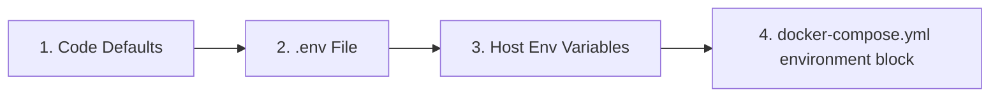

# 🐳 Guía avanzada de Docker

Esta guía está dirigida a administradores que personalizan su despliegue de Docker, compilan su propia imagen o realizan tareas de mantenimiento en el contenedor. Para una primera instalación, comience por la [Guía de instalación](../user/installation.md).

LibreFolio incluye dos archivos Compose:

- **`docker-compose.prod.yml`** ejecuta la imagen oficial de GHCR: la guía de instalación lo guarda como `docker-compose.yml`.
- **`docker-compose.yml`**, en el repositorio, ejecuta una imagen que usted mismo compila con `./dev.py docker build`.

## ⚠️ Requisitos previos

**Grupo de Docker (Linux).** Su usuario debe pertenecer al grupo `docker` para ejecutar comandos de Docker sin `sudo`:

```bash
sudo usermod -aG docker $USER
```

Después, **cierre sesión y vuelva a iniciarla**, o ejecute `newgrp docker` para activar el grupo en la sesión actual. Sin esto, todos los comandos `docker` y `docker compose` fallan con un error de permisos.

**Archivo `.env`.** LibreFolio requiere un archivo `.env` junto al archivo Compose, y `./dev.py docker build` se niega a continuar sin él. En una copia local del repositorio:

```bash
cp .env.example .env
$EDITOR .env          # review and customize parameters
```

## 🏗️ Arquitectura

La imagen es **solo de ejecución**: la aplicación web (SvelteKit) y la documentación (MkDocs) se compilan en el host y se copian en ella, y `./dev.py docker build` ejecuta esas compilaciones por usted. Etapas de compilación, contenido de la imagen y secuencia de inicio: [Resumen de la arquitectura → Imagen de Docker](../developer/architecture/overview.md#docker-image).

## 📄 `docker-compose.yml`

El archivo Compose define el servicio `librefolio` y su directorio de datos persistentes.

### 🔝 Prioridad de resolución {: #resolution-priority }

Al resolver las variables de configuración, LibreFolio respeta el siguiente orden de precedencia (de menor a mayor prioridad):



En Docker, `.env` llega al contenedor mediante `env_file`, y el bloque `environment:` lo sobrescribe. Para los marcadores de posición `${…}` del archivo Compose, como `${PORT:-6040}`, una variable definida en su shell tiene prioridad sobre `.env`.

### 🔧 Servicio: `librefolio`

- 🏷️ **`image`**: la imagen oficial `ghcr.io/librefolio/librefolio:latest` (archivo de producción) o su `librefolio:latest` local (archivo del repositorio); `LIBREFOLIO_IMAGE` en `.env` selecciona otra etiqueta.
- 🏗️ **`build`** (solo archivo del repositorio): compila el `Dockerfile` raíz con los argumentos `UID`, `GID` y `DOCS_VARIANT`.
- 🔌 **`ports`**: host `${PORT:-6040}` → contenedor `6040`, el único puerto en el que escucha la imagen. `PORT` elige el lado del host; dentro del contenedor, el servidor siempre escucha en `6040`.
- 📂 **`volumes`**: el montaje bind `./LibreFolio-data` → `/app/backend/data/prod-docker`.
- 📝 **`env_file: .env`**: carga su configuración (copiada de `.env.example`).
- 🌍 **`environment`**: las variables específicas de Docker `LIBREFOLIO_DATA_DIR` (ruta del contenedor), `HOST=0.0.0.0` y `PORT=6040`; déjelas como están. Dentro del contenedor, `PORT=6040` reemplaza el puerto del host que su `.env` pueda definir, de modo que los comandos de `dev.py` que ejecute allí ([`docker exec`](#docker-exec)) buscan el servidor en el puerto en el que escucha: `db upgrade`, por ejemplo, lo ve en ejecución y se niega a iniciarse.
- 🩺 **`healthcheck`**: consulta `GET /api/v1/system/health` cada 30 segundos.

!!! tip "📈 Supervisar LibreFolio: `/api/v1/system/ready`"

    El chequeo de estado solo indica a Docker que el servidor responde. Para saber si LibreFolio puede atender solicitudes realmente, apunte un monitor como **Uptime Kuma** o un orquestador a `GET /api/v1/system/ready`, por ejemplo `http://your-server:6040/api/v1/system/ready` (con su `PORT` si lo cambió). No necesita inicio de sesión, y el código de estado es todo lo que un monitor necesita:

    - **`200`**: listo. La base de datos responde y su estructura coincide con esta versión de LibreFolio: `{"status": "ready", "checks": {"database": "ok", "migrations": "ok"}, "database_revision": "…", "mode": "normal", "app_version": "…"}`. `database_revision` es la migración en la que se encuentra la base de datos, y `app_version` es la versión de LibreFolio en ejecución: el mismo texto que proporciona el `GET /api/v1/system/info` público sin inicio de sesión, por lo que un monitor puede comprobar la versión después de una actualización solo con esta sonda.
    - **`503`**: no listo. `status` es `not_ready`, y `checks` muestra qué no está `ok`: `database` es `unreachable` cuando la base de datos no responde; `migrations` es `behind` cuando la base de datos está en una migración anterior que esta versión conoce (una migración no se aplicó o falló), `ahead` cuando está en una migración que esta versión no conoce (los datos provienen de un LibreFolio más reciente: use esa versión o una más reciente; consulte [Nunca hacia atrás](backup_moving.md#never-backwards)), y `unknown` cuando no puede determinarlo, por ejemplo mientras la base de datos está `unreachable`.

    La respuesta nunca incluye detalles del error ni una ruta: LibreFolio los escribe en su registro (`docker compose logs librefolio`) como `Instance not ready`, una vez por cada cambio de estado. `db current` muestra la migración en la que se encuentra la base de datos ([Aplicar migraciones](cli_tools.md#apply-migrations)).

### 💾 Directorio de datos: `LibreFolio-data/`

Un directorio de **montaje bind** junto al archivo Compose que contiene la base de datos SQLite, los archivos subidos personalizados, los informes del bróker y los archivos de registro. Sobrevive a la detención, el reinicio y la eliminación del contenedor, y puede hacer copias de seguridad directamente desde el host.

### 👤 Usuario y permisos

El contenedor se inicia como root solo para transferir el directorio de datos al usuario de LibreFolio y, después, ejecuta el servidor como ese usuario **no root**: los archivos que crea en `LibreFolio-data/` pertenecen a ese UID/GID en el host. La transferencia se ejecuta en cada inicio y abarca todo el contenido del directorio. Los comandos ejecutados con `./dev.py docker exec` usan el mismo UID/GID ([detalles](#docker-exec)).

Ese UID/GID proviene de los **argumentos de compilación** `UID` y `GID`: la imagen los conserva como `LIBREFOLIO_UID` y `LIBREFOLIO_GID`, que el entrypoint lee en cada inicio. La imagen oficial de GHCR se compila con `1000:1000`. `./dev.py docker build` usa los ids del usuario que lo ejecuta, diga lo que diga `.env`, mientras que `docker compose build` lee `UID` y `GID` de `.env` (valor predeterminado `1000`): configúrelos para que coincidan con el usuario del host, o el usuario dedicado, que debe ser propietario de los archivos de datos:

```bash
UID=1000
GID=1000
```

Cambiarlos en `.env` solo surte efecto cuando `docker compose build` recompila la imagen: `.env` también llega al contenedor mediante `env_file`, pero un reinicio no cambia los ids. Con la imagen oficial, que usted no compila, estas dos líneas no tienen efecto.

- En el **host**, `ls -l LibreFolio-data/` muestra el usuario y el grupo propietarios de ese UID/GID en el host (resueltos mediante `/etc/passwd` y `/etc/group`).
- **Dentro del contenedor**, los mismos archivos suelen mostrarse como `librefolio:librefolio`: el mismo UID/GID numérico, resuelto con el `/etc/passwd` y `/etc/group` propios del contenedor.

??? tip "Chuleta de Linux: usuarios, grupos e IDs"

    **Averigüe su UID y GID actuales:**

    ```bash
    id -u              # your user ID (e.g. 1000)
    id -g              # your primary group ID (e.g. 1000)
    id                 # full info: uid, gid, groups
    ```

    **Encuentre el UID/GID de cualquier usuario:**

    ```bash
    id -u username     # UID of 'username'
    id -g username     # primary GID of 'username'
    ```

    **Cree un nuevo grupo:**

    ```bash
    sudo groupadd librefolio          # create group (auto-assigns GID)
    sudo groupadd -g 1500 librefolio  # create group with specific GID
    ```

    **Cree un nuevo usuario:**

    ```bash
    # System user (no home, no login — ideal for services)
    sudo useradd --system --no-create-home --gid librefolio --shell /usr/sbin/nologin librefolio

    # Regular user with home directory
    sudo useradd -m -g librefolio librefolio
    ```

    **Compruebe los IDs asignados:**

    ```bash
    id librefolio
    # → uid=998(librefolio) gid=998(librefolio) groups=998(librefolio)
    ```

    **Añada su usuario existente a un grupo:**

    ```bash
    sudo usermod -aG librefolio $USER
    newgrp librefolio    # activate in current session (or log out/in)
    ```

    **Verifique la pertenencia a grupos:**

    ```bash
    groups $USER         # list all groups for your user
    ```

    **Establezca la propiedad del directorio de datos:**

    ```bash
    sudo chown -R librefolio:librefolio ./LibreFolio-data
    ```

    Después, establezca el UID/GID correspondiente en `.env` y recompile la imagen con `docker compose build`: en cada inicio, el contenedor devuelve el directorio al UID/GID de la imagen.

## 🛠️ Comandos CLI

En una copia local del repositorio, `dev.py` encapsula las operaciones de Docker:

```bash
./dev.py docker build          # Build image (auto-builds frontend + docs)
./dev.py docker build --light  # Light variant: no documentation screenshots (tagged *-light)
./dev.py docker build --no-cache  # Full rebuild without Docker cache
./dev.py docker rebuild        # Build → stop → restart (one-step deploy)
./dev.py docker up             # Start containers
./dev.py docker down           # Stop containers
./dev.py docker logs -f        # Follow container logs
./dev.py docker status         # Show container status
./dev.py docker exec <cmd>     # Run a dev.py command inside the container
```

Sin una copia local, los comandos simples hacen el trabajo diario: `docker compose up -d`, `docker compose down`, `docker compose logs -f` y `docker compose ps`.

- `--light` compila la imagen sin las capturas de pantalla de la documentación, que entonces se cargan desde el sitio de documentación en línea (consulte [Variantes de imagen](../user/installation.md#image-variants-full-and-light)).
- Etiquetas locales: `librefolio:<version>` y `librefolio:latest` para la imagen completa, `librefolio:<version>-light` y `librefolio:latest-light` para la ligera, siendo `<version>` la versión git de su copia local. En el registro, en cambio, `latest` es la variante ligera y no existe `latest-light`.
- Para ejecutar su compilación ligera con el archivo Compose del repositorio, establezca `LIBREFOLIO_IMAGE=librefolio:latest-light` en `.env`.

??? warning "🧱 Cuando `./dev.py docker build` se detiene"

    **No se puede descargar un recurso.** La compilación almacena en caché algunos recursos externos, como la fuente Noto Color Emoji (banderas en Windows), MathJax (fórmulas en la documentación) y Mermaid (diagramas en la documentación), para que la imagen funcione completamente sin conexión. Si uno no se puede descargar y aún no existe una copia en caché, la compilación se detiene en lugar de distribuir una imagen defectuosa:

    ```text
    ❌ Resource cache incomplete — the build would ship without these:
       - noto-color-emoji: ...
    ```

    La **primera compilación requiere acceso a internet** (o una caché precargada). Cuando vuelva la red, ejecute la compilación de nuevo; `./dev.py cache js` actualiza la caché manualmente (`--force` vuelve a descargarlo todo).

    **El frontend es una compilación de depuración.** La imagen debe incluir la compilación de producción de la aplicación web. `./dev.py docker build` se encarga de ello: recompila `frontend/build/` en modo producción cuando la última compilación fue de depuración (por ejemplo, mediante `./dev.py server --test`, `./dev.py server --debug` o el ejecutor de pruebas), cuando sus fuentes han cambiado o cuando no se compiló para esta versión ([detalles](../developer/dev_workflow.md#docker-build-steps)). Una imagen compilada directamente con `docker build` o `docker compose build` omite ese paso: si `frontend/build/` se compiló por última vez en modo depuración o instrumentado para cobertura, la compilación de la imagen se detiene con un error como:

    ```text
    ERROR: /build is not a production frontend build: it is a debug build (.build-debug = 1)
    Rebuild it with './dev.py front build', then build the image again.
    ```

    Ejecute `./dev.py front build` y luego vuelva a compilar la imagen, o compílela con `./dev.py docker build`.

??? tip "🖼️ Compilar una imagen completa con las capturas de pantalla de la documentación"

    Una imagen completa contiene las capturas de pantalla de la documentación solo si se generaron, y la documentación se recompiló con ellas, **antes** de compilar la imagen; de lo contrario, una imagen completa local y una ligera son iguales salvo por su etiqueta. La secuencia completa es:

    ```bash
    ./dev.py mkdocs gallery   # generate the screenshots
    ./dev.py mkdocs build     # rebuild the documentation with the screenshots
    ./dev.py docker build     # build the full image; it rebuilds for production the debug frontend the gallery leaves
    ```

    `./dev.py mkdocs gallery` requiere un entorno completamente instalado (con `pipenv`) y los navegadores de Playwright. Inicia su propio servidor de pruebas y llena la base de datos de pruebas automáticamente (`--no-populate` omite la repoblación). La generación de la galería tarda unos minutos.

### 📡 `docker exec` — Ejecutar comandos dentro del contenedor {: #docker-exec }

`./dev.py docker exec <cmd>` ejecuta un comando de `dev.py` dentro del contenedor **en ejecución**, como el mismo usuario que el servidor: el `LIBREFOLIO_UID:LIBREFOLIO_GID` numérico de la imagen (consulte Usuario y permisos más arriba), no root. Por lo tanto, los archivos que crea un comando en `LibreFolio-data/` pertenecen a ese usuario de inmediato, igual que los del propio servidor. Por ejemplo, para gestionar usuarios:

```bash
./dev.py docker exec user create admin admin@example.com Pass123!
./dev.py docker exec user list
```

Entre bastidores, `./dev.py docker exec user list` ejecuta la línea siguiente, que también funciona sin una copia local. `gosu`, que el entrypoint también usa, cambia a los ids de la imagen antes de que se inicie `dev.py`:

```bash
docker compose exec librefolio sh -c 'exec gosu "${LIBREFOLIO_UID:-1000}:${LIBREFOLIO_GID:-1000}" python dev.py "$@"' sh user list
```

Un `docker compose exec librefolio python dev.py <cmd>` simple ejecuta el comando como root: lo que crea en `LibreFolio-data/` pertenece a root hasta el siguiente inicio del contenedor, cuando el entrypoint devuelve el directorio al usuario de la imagen.

En la imagen, `user`, `db`, `info` y `backup` funcionan ([Copias de seguridad con Docker](cli_backup.md#backup-docker)). Los comandos de desarrollo (`test`, `i18n`, `mkdocs translate` y `mkdocs translate-validate`) también aparecen listados, pero solo responden que *no están disponibles en esta instalación*: la imagen incluye la aplicación, no el árbol de desarrollo.

Los comandos del modo de pruebas tampoco se ejecutan en el contenedor; al igual que `./dev.py mkdocs gallery`, pertenecen a una copia local de desarrollo:

- `./dev.py docker exec test db populate` obtiene la misma respuesta de *no disponible* que todos los comandos `test`;
- `./dev.py docker exec server --test` se detiene con `Frontend build failed. Server not started.`: el modo de pruebas primero intenta recompilar la aplicación web en modo depuración, lo que requiere Node.js y las fuentes de la aplicación web, mientras que la imagen solo incluye la compilación de producción, sin Node.js.

**Las migraciones de la base de datos no necesitan ningún comando.** El servidor aplica las migraciones pendientes cada vez que se inicia: después de `docker compose pull` y `docker compose up -d` no hay nada más que ejecutar, y `docker compose restart librefolio` las reintenta después de un fallo. Un reinicio no ayuda cuando la actualización a la 1.3 se detiene porque dos cuentas comparten una dirección de correo electrónico salvo por las mayúsculas: separe primero las cuentas, como explica «Dos cuentas con la misma dirección de correo electrónico» en [Herramientas de línea de comandos](cli_tools.md). No use `./dev.py docker exec db upgrade`: `db upgrade` necesita el servidor detenido y, en el contenedor, el servidor es el proceso principal, siempre en ejecución.

## 🩹 Correcciones posteriores a la migración {: #post-migration-fixes }

Cada vez que el servidor se inicia, justo después de aplicar cualquier migración pendiente de la base de datos, ejecuta las **correcciones posteriores a la migración**: reparaciones que una migración no puede realizar. Qué reparan y qué dice el registro sobre ellas se explica en [Herramientas de línea de comandos → Correcciones posteriores a la migración](cli_tools.md#post-migration-fixes). En Docker:

- el registro es la salida del contenedor (`./dev.py docker logs` o `docker compose logs`), también guardada en `LibreFolio-data/logs/`;
- una copia conservada por una corrección fallida se encuentra junto a la base de datos, en `LibreFolio-data/sqlite/`, por ejemplo `app.db.pre-autoincrement-20261008T101500Z.bak`.

### ⏹️ Ejecutar las correcciones con el servidor detenido

Para previsualizar las correcciones, o para reintentar una que falló al inicio y leer su error, ejecútelas manualmente con el servidor detenido. `docker exec` necesita el contenedor en ejecución, así que use `docker compose run` en su lugar: el comando que pase reemplaza al servidor en un contenedor de un solo uso. Previsualice siempre primero con `--dry-run`:

```bash
docker compose stop librefolio
docker compose run --rm librefolio python -m backend.app.db.post_migration --dry-run   # preview: changes nothing
docker compose run --rm librefolio python -m backend.app.db.post_migration             # apply the fixes
docker compose start librefolio
```

El script trabaja sobre la misma base de datos y el mismo directorio de datos que el servidor e informa lo que encontró, por ejemplo:

```text
Database: /app/backend/data/prod-docker/sqlite/app.db
Integrity check: ok
Fix autoincrement: would_apply
Orphan broker folder: broker_reports/uploaded/broker_7
```

Cada corrección es `clean` (nada que hacer), `would_apply` (simulación), `applied` o `failed`; también se listan una copia de seguridad conservada y cualquier error, así como cada transferencia de valores enviada a un bróker eliminado, con el coste que supone o el motivo por el que se deja como está ([detalles](cli_tools.md#post-migration-fixes)). El código de salida es `0` cuando no falló nada, incluida una simulación, y `1` cuando falló una corrección, la comprobación de integridad o la conversión de esas transferencias.

## 🧪 Modo de pruebas

La imagen no tiene modo de pruebas: solo escucha en `6040`, el servidor de producción iniciado con el contenedor, y ambos archivos Compose publican únicamente ese puerto. El servidor de pruebas (`./dev.py server --test`, en el puerto `6041` de forma predeterminada) es una herramienta para desarrolladores que se ejecuta desde una copia local del código fuente, en el host. Su base de datos, `backend/data/test/sqlite/app.db` de forma predeterminada, es independiente de `LibreFolio-data/`: `./dev.py test db populate --force` la elimina y la vuelve a crear con datos de prueba.

Cómo iniciarlo y por qué no se inicia en el contenedor se explica en el [Flujo de trabajo para desarrolladores](../developer/dev_workflow.md#docker-test-mode).

## 🏭 Consideraciones de producción

### 🎮 1. Personalizar `docker-compose.yml`

Los cambios más habituales:

| # | Qué | Cómo |
|---|------|-----|
| (1) | Ajustar al UID/GID del host | Recompile la imagen con ellos: ejecute `./dev.py docker build` como el usuario que debe ser propietario de los archivos, o establezca `UID=1001` y `GID=1001` en `.env` y ejecute `docker compose build` |
| (2) | Cambiar el puerto de producción | Establezca `PORT=3000` en `.env` |
| (3) | Ruta de datos personalizada | Cambie el montaje bind: `./my-data:/app/backend/data/prod-docker` |
| (4) | Toda la configuración | Edite el archivo `.env` (copiado de `.env.example`) |
| (5) | Ejecutar otra etiqueta de imagen | Establezca `LIBREFOLIO_IMAGE` en `.env`, por ejemplo `LIBREFOLIO_IMAGE=ghcr.io/librefolio/librefolio:1.1.0` |

La primera cuenta creada en el navegador se convierte automáticamente en administrador: no se necesita ningún comando. Para que, en su lugar, LibreFolio cree el administrador en su primer inicio a partir de `LIBREFOLIO_ADMIN_EMAIL`, consulte [El administrador inicial](configuration_accounts.md#initial-admin).

??? example "📄 El `docker-compose.yml` del repositorio, anotado"

    ```yaml
    services:
      librefolio:
        image: ${LIBREFOLIO_IMAGE:-librefolio:latest}  # (5) Built by ./dev.py docker build
        build:
          context: .
          args:
            UID: ${UID:-1000}              # (1) UID owning the data files (build time only)
            GID: ${GID:-1000}              # (1) GID owning the data files (build time only)
            DOCS_VARIANT: ${DOCS_VARIANT:-full}  # light = no documentation screenshots
        container_name: librefolio
        # No 'user:' directive — entrypoint starts as root, fixes permissions,
        # then drops to the numeric LIBREFOLIO_UID:LIBREFOLIO_GID via gosu, like ./dev.py docker exec.
        restart: unless-stopped
        ports:
          - "${PORT:-6040}:6040"           # (2) Production port — change via PORT in .env
        volumes:
          - ./LibreFolio-data:/app/backend/data/prod-docker  # (3) Persistent data (bind mount)
        env_file: .env                     # (4) All config from .env file
        environment:
          - LIBREFOLIO_DATA_DIR=/app/backend/data/prod-docker  # Docker-specific override
          - HOST=0.0.0.0
          - PORT=6040                      # The container's port; (2) sets the host side
        healthcheck:
          test: ["CMD", "python", "-c", "import urllib.request; urllib.request.urlopen('http://localhost:6040/api/v1/system/health')"]
          interval: 30s
          timeout: 10s
          start_period: 15s
          retries: 3
    ```

    `docker-compose.prod.yml` tiene el mismo servicio sin `build:`, y su imagen usa `ghcr.io/librefolio/librefolio:latest` de forma predeterminada.

### 🔒 2. Seguridad y exposición (Tailscale y proxy inverso)

Exponga LibreFolio de forma segura mediante **Tailscale** (recomendado y la opción más sencilla) o detrás de un proxy inverso clásico como **Nginx** o **Traefik**:

- **Tailscale (recomendado)**: acceso seguro con HTTPS automático, sin abrir puertos del router ni configurar registros DNS públicos. Consulte la **[Guía detallada de exposición con Tailscale](service_exposure.md)**.
- **Proxy inverso clásico (Nginx/Traefik)**: útil si ya tiene una infraestructura web, o si desea gestionar certificados SSL/TLS personalizados, servir varias aplicaciones en un mismo servidor o añadir cabeceras de seguridad personalizadas y limitación de velocidad.

Una vez expuesto LibreFolio, [Comprobar la seguridad de la conexión](connection_checks.md) muestra cómo verificar que sus usuarios se conectan de forma segura y, [detrás de un proxy inverso](connection_proxy.md#reverse-proxy), que la cookie de sesión está marcada como `Secure`.

Detrás de un proxy inverso clásico, indique también a LibreFolio en qué proxy confiar (`FORWARDED_ALLOW_IPS`) o qué cabecera contiene la dirección del visitante (`LIBREFOLIO_CLIENT_IP_HEADER`); de lo contrario, LibreFolio ve a todos los visitantes con la dirección del proxy y advierte de ello en su registro y en sus comprobaciones de seguridad. Consulte [La dirección del visitante](connection_proxy.md#client-address).

LibreFolio ya comprime con gzip sus respuestas (el JSON de la API, el JavaScript y el CSS de la aplicación web, las páginas de documentación) y envía las imágenes y el flujo de búsqueda de activos en vivo tal cual: el proxy no necesita volver a comprimirlos.

### 💾 3. Copia de seguridad de la base de datos

La base de datos se almacena en el directorio `LibreFolio-data/`, junto a `docker-compose.yml`. No se necesita `docker cp`: el directorio de datos es un montaje bind accesible desde el host.

!!! warning "No copie `app.db` desde un contenedor en ejecución"

    LibreFolio ejecuta SQLite en **modo WAL** (`PRAGMA journal_mode=WAL`): las transacciones recientes residen en el archivo auxiliar `app.db-wal`, por lo que un `cp` simple de solo `app.db` mientras el servidor está activo puede producir una copia de seguridad incoherente u obsoleta. Use uno de los dos procedimientos seguros siguientes.

**Opción A — Detener el contenedor y después copiar** (la más sencilla):

```bash
#!/bin/bash
docker compose stop librefolio
cp ./LibreFolio-data/sqlite/app.db /path/to/backups/app.db-$(date +%F)
docker compose start librefolio
```

**Opción B — Copia de seguridad en línea con la CLI de SQLite** (sin tiempo de inactividad, requiere la herramienta `sqlite3` en el host):

```bash
#!/bin/bash
sqlite3 ./LibreFolio-data/sqlite/app.db ".backup '/path/to/backups/app.db-$(date +%F)'"
```

El comando `.backup` de SQLite usa la API de copia de seguridad en línea, que es segura con una base de datos WAL activa.

`backup create` no necesita ni detener el servidor ni `sqlite3` en el host: `docker compose exec librefolio python dev.py backup create` coloca una copia coherente de la base de datos, los archivos subidos, los informes del bróker y sus propios escenarios de estrés en un único archivo, en su propia carpeta de `LibreFolio-data/backups/`, mientras el servidor sigue en ejecución ([Copias de seguridad con Docker](cli_backup.md#backup-docker)). Un archivo no cifrado deja fuera `secrets/`, que contiene la clave de la instancia: haga una copia de seguridad de esa carpeta como se explica en [Qué incluir en la copia de seguridad](filesystem.md#what-to-back-up). Un [archivo seguro](backup_restore.md#secure), con `--encrypt`, incluye la clave que generó LibreFolio, cifrada con su contraseña.

Para ver la lista completa de lo que merece la pena incluir en la copia de seguridad (archivos subidos, informes originales del bróker), consulte la página [Estructura del sistema de archivos](filesystem.md).

Archivos que puede encontrar junto a la base de datos:

- `app.db.pre-<fix>-<UTC time>.bak`: una copia conservada por una [corrección posterior a la migración](#post-migration-fixes) que falló; elimínela cuando ya no la necesite.
- `app.db.post-migration.lock`: el archivo de bloqueo vacío de las [correcciones posteriores a la migración](#post-migration-fixes), reutilizado en cada inicio. Es inofensivo: déjelo en su sitio, ya que eliminarlo mientras el servidor se está iniciando podría permitir que dos ejecuciones se solapen.

### 🔑 4. Variables de entorno

Toda la configuración se gestiona en el archivo `.env` (copiado de `.env.example`); deje como están las sobrescrituras específicas de Docker del bloque `environment:`. Para ver cada variable y su efecto, consulte la **[Guía de configuración](configuration.md)**.

🔐 **Mantener la sesión de los usuarios entre reinicios**: establezca `JWT_SECRET` en `.env` con una cadena aleatoria larga, por ejemplo la salida de `openssl rand -hex 32`. Sin ella, LibreFolio genera una nueva clave en cada inicio, por lo que cada reinicio o actualización del contenedor cierra la sesión de todos los usuarios.

### ✅ 5. Verificar la imagen que descarga {: #verify-image }

Cada imagen que LibreFolio publica en GHCR (`ghcr.io/librefolio/librefolio`, tanto la variante completa como la ligera) incluye una **atestación de compilación**: una declaración, firmada por el pipeline de publicación del repositorio del proyecto, de que esta imagen exacta se compiló allí a partir de este código. Se firma sin ninguna clave nuestra que conservar o perder (GitHub demuestra la identidad de la ejecución y Sigstore la registra), de modo que cualquiera puede comprobarla.

Tome el digest de la imagen que descargó y luego pida a GitHub que lo verifique con la [GitHub CLI](https://cli.github.com/):

```bash
# The digest of a tag (the line "Digest: sha256:…")
docker buildx imagetools inspect ghcr.io/librefolio/librefolio:1.3.0

# Verify the attestation of that digest
gh attestation verify oci://ghcr.io/librefolio/librefolio@sha256:<digest> --owner Librefolio
```

Una imagen verificada imprime `✓ Verification succeeded!` junto con el repositorio y el flujo de trabajo que la compiló. Si no se imprime nada salvo un error, significa que este digest no lo compiló el pipeline de LibreFolio: no lo ejecute. La atestación cubre todas las etiquetas que apuntan al mismo digest (`1.3.0`, `latest`...). Las versiones publicadas antes de que se añadiera esta comprobación no incluyen ninguna.
