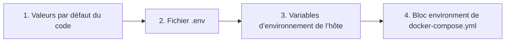

# 🐳 Guide Docker avancé

Ce guide s’adresse aux administrateurs qui personnalisent leur déploiement Docker, construisent leur propre image ou effectuent la maintenance du conteneur. Pour une première installation, commencez par le [Guide d’installation](../user/installation.md).

LibreFolio est fourni avec deux fichiers Compose :

- **`docker-compose.prod.yml`** exécute l’image officielle depuis GHCR : le guide d’installation l’enregistre sous `docker-compose.yml`.
- **`docker-compose.yml`**, dans le dépôt, exécute une image que vous construisez vous-même avec `./dev.py docker build`.

## ⚠️ Prérequis

**Groupe Docker (Linux).** Votre utilisateur doit appartenir au groupe `docker` pour exécuter les commandes Docker sans `sudo` :

```bash
sudo usermod -aG docker $USER
```

Ensuite, **déconnectez-vous puis reconnectez-vous**, ou exécutez `newgrp docker` pour activer le groupe dans la session en cours. Sans cela, toutes les commandes `docker` et `docker compose` échouent avec une erreur de permission.

**Fichier `.env`.** LibreFolio nécessite un fichier `.env` à côté du fichier Compose, et `./dev.py docker build` refuse de continuer sans lui. Dans une copie locale du dépôt :

```bash
cp .env.example .env
$EDITOR .env          # review and customize parameters
```

## 🏗️ Architecture

L’image est **destinée uniquement à l’exécution** : l’application web (SvelteKit) et la documentation (MkDocs) sont construites sur l’hôte puis copiées dedans, et `./dev.py docker build` lance ces constructions pour vous. Étapes de construction, contenu de l’image et séquence de démarrage : [Vue d’ensemble de l’architecture → Image Docker](../developer/architecture/overview.md#docker-image).

## 📄 `docker-compose.yml`

Le fichier Compose définit le service `librefolio` et son répertoire de données persistantes.

### 🔝 Priorité de résolution {: #resolution-priority }

Lors de la résolution des variables de configuration, LibreFolio respecte l’ordre de priorité suivant (de la priorité la plus faible à la plus élevée) :



Dans Docker, `.env` parvient au conteneur via `env_file`, et le bloc `environment:` a priorité sur lui. Pour les espaces réservés `${…}` du fichier Compose, comme `${PORT:-6040}`, une variable définie dans votre shell l’emporte sur `.env`.

### 🔧 Service : `librefolio`

- 🏷️ **`image`** : l’image officielle `ghcr.io/librefolio/librefolio:latest` (fichier de production) ou votre image locale `librefolio:latest` (fichier du dépôt) ; `LIBREFOLIO_IMAGE` dans `.env` choisit un autre tag.
- 🏗️ **`build`** (fichier du dépôt uniquement) : construit le `Dockerfile` racine avec les arguments `UID`, `GID` et `DOCS_VARIANT`.
- 🔌 **`ports`** : hôte `${PORT:-6040}` → conteneur `6040`, le seul port sur lequel l’image écoute. `PORT` choisit le côté hôte ; dans le conteneur, le serveur écoute toujours sur `6040`.
- 📂 **`volumes`** : le montage bind `./LibreFolio-data` → `/app/backend/data/prod-docker`.
- 📝 **`env_file: .env`** : charge votre configuration (copiée depuis `.env.example`).
- 🌍 **`environment`** : les valeurs spécifiques à Docker `LIBREFOLIO_DATA_DIR` (chemin dans le conteneur), `HOST=0.0.0.0` et `PORT=6040` ; laissez-les telles quelles. Dans le conteneur, `PORT=6040` remplace le port hôte que votre `.env` peut définir, de sorte que les commandes `dev.py` que vous y exécutez ([`docker exec`](#docker-exec)) cherchent le serveur sur le port sur lequel il écoute : `db upgrade`, par exemple, le voit en cours d’exécution et refuse de démarrer.
- 🩺 **`healthcheck`** : interroge `GET /api/v1/system/health` toutes les 30 secondes.

!!! tip "📈 Surveiller LibreFolio : `/api/v1/system/ready`"

    Le contrôle d’état indique seulement à Docker que le serveur répond. Pour savoir si LibreFolio peut réellement répondre aux requêtes, pointez un moniteur tel que **Uptime Kuma** ou un orchestrateur vers `GET /api/v1/system/ready`, par exemple `http://your-server:6040/api/v1/system/ready` (avec votre `PORT` si vous l’avez modifié). Aucune authentification n’est requise, et le code d’état suffit à un moniteur :

    - **`200`** : prêt. La base de données répond et sa structure correspond à cette version de LibreFolio : `{"status": "ready", "checks": {"database": "ok", "migrations": "ok"}, "database_revision": "…", "mode": "normal", "app_version": "…"}`. `database_revision` est la migration sur laquelle se trouve la base de données, et `app_version` est la version de LibreFolio en cours d’exécution : le même texte que fournit l’appel public `GET /api/v1/system/info` sans authentification, de sorte qu’un moniteur peut vérifier la version après une mise à jour avec cette seule sonde.
    - **`503`** : pas prêt. `status` vaut `not_ready`, et `checks` montre ce qui n’est pas `ok` : `database` vaut `unreachable` lorsque la base de données ne répond pas ; `migrations` vaut `behind` lorsque la base de données se trouve sur une migration plus ancienne que cette version connaît (une migration n’a pas été appliquée ou a échoué), `ahead` lorsqu’elle se trouve sur une migration que cette version ne connaît pas (les données proviennent d’une version plus récente de LibreFolio : utilisez cette version ou une version plus récente, voir [Jamais de retour en arrière](backup_moving.md#never-backwards)), et `unknown` lorsqu’elle ne peut pas le déterminer, par exemple tant que la base de données est `unreachable`.

    La réponse n’inclut jamais de détails d’erreur ni de chemin : LibreFolio les écrit dans son journal (`docker compose logs librefolio`) sous la forme `Instance not ready`, une fois à chaque changement d’état. `db current` affiche la migration sur laquelle se trouve la base de données ([Appliquer les migrations](cli_tools.md#apply-migrations)).

### 💾 Répertoire de données : `LibreFolio-data/`

Un répertoire en **montage bind** à côté du fichier Compose, qui contient la base de données SQLite, les fichiers téléversés personnalisés, les rapports de courtier et les fichiers journaux. Il survit à l’arrêt, au redémarrage et à la suppression du conteneur, et vous pouvez le sauvegarder directement depuis l’hôte.

### 👤 Utilisateur et permissions

Le conteneur démarre en tant que root uniquement pour remettre le répertoire de données à l’utilisateur LibreFolio, puis exécute le serveur sous cet utilisateur **non root** : les fichiers qu’il crée dans `LibreFolio-data/` appartiennent à ce UID/GID sur l’hôte. Ce transfert s’exécute à chaque démarrage et couvre tout le contenu du répertoire. Les commandes exécutées avec `./dev.py docker exec` utilisent les mêmes UID/GID ([détails](#docker-exec)).

Ces UID/GID proviennent des **arguments de construction** `UID` et `GID` : l’image les conserve sous les noms `LIBREFOLIO_UID` et `LIBREFOLIO_GID`, que le point d’entrée lit à chaque démarrage. L’image officielle GHCR est construite avec `1000:1000`. `./dev.py docker build` utilise les ID de l’utilisateur qui l’exécute, quoi que dise `.env`, tandis que `docker compose build` lit `UID` et `GID` depuis `.env` (valeur par défaut `1000`) : définissez-les pour qu’ils correspondent à l’utilisateur de l’hôte, ou à l’utilisateur dédié, qui doit posséder les fichiers de données :

```bash
UID=1000
GID=1000
```

Leur modification dans `.env` ne prend effet que lorsque `docker compose build` reconstruit l’image : `.env` parvient aussi au conteneur via `env_file`, mais un redémarrage ne change pas les ID. Avec l’image officielle, que vous ne construisez pas, ces deux lignes n’ont aucun effet.

- Sur l’**hôte**, `ls -l LibreFolio-data/` affiche l’utilisateur et le groupe qui possèdent cet UID/GID sur l’hôte (résolus via `/etc/passwd` et `/etc/group`).
- **Dans le conteneur**, les mêmes fichiers apparaissent généralement comme `librefolio:librefolio` : les mêmes UID/GID numériques, résolus par rapport aux fichiers `/etc/passwd` et `/etc/group` propres au conteneur.

??? tip "Aide-mémoire Linux : utilisateurs, groupes et ID"

    **Découvrez votre UID et votre GID actuels :**

    ```bash
    id -u              # your user ID (e.g. 1000)
    id -g              # your primary group ID (e.g. 1000)
    id                 # full info: uid, gid, groups
    ```

    **Trouver l’UID/GID de n’importe quel utilisateur :**

    ```bash
    id -u username     # UID of 'username'
    id -g username     # primary GID of 'username'
    ```

    **Créer un nouveau groupe :**

    ```bash
    sudo groupadd librefolio          # create group (auto-assigns GID)
    sudo groupadd -g 1500 librefolio  # create group with specific GID
    ```

    **Créer un nouvel utilisateur :**

    ```bash
    # System user (no home, no login — ideal for services)
    sudo useradd --system --no-create-home --gid librefolio --shell /usr/sbin/nologin librefolio

    # Regular user with home directory
    sudo useradd -m -g librefolio librefolio
    ```

    **Vérifier les ID attribués :**

    ```bash
    id librefolio
    # → uid=998(librefolio) gid=998(librefolio) groups=998(librefolio)
    ```

    **Ajouter votre utilisateur existant à un groupe :**

    ```bash
    sudo usermod -aG librefolio $USER
    newgrp librefolio    # activate in current session (or log out/in)
    ```

    **Vérifier l’appartenance au groupe :**

    ```bash
    groups $USER         # list all groups for your user
    ```

    **Définir le propriétaire du répertoire de données :**

    ```bash
    sudo chown -R librefolio:librefolio ./LibreFolio-data
    ```

    Définissez ensuite les UID/GID correspondants dans `.env` et reconstruisez l’image avec `docker compose build` : à chaque démarrage, le conteneur remet le répertoire au propriétaire correspondant aux UID/GID de l’image.

## 🛠️ Commandes CLI

Dans une copie locale du dépôt, `dev.py` encapsule les opérations Docker :

```bash
./dev.py docker build          # Build image (auto-builds frontend + docs)
./dev.py docker build --light  # Light variant: no documentation screenshots (tagged *-light)
./dev.py docker build --no-cache  # Full rebuild without Docker cache
./dev.py docker rebuild        # Build → stop → restart (one-step deploy)
./dev.py docker up             # Start containers
./dev.py docker down           # Stop containers
./dev.py docker logs -f        # Follow container logs
./dev.py docker status         # Show container status
./dev.py docker exec <cmd>     # Run a dev.py command inside the container
```

Sans copie locale du dépôt, les commandes simples suffisent au quotidien : `docker compose up -d`, `docker compose down`, `docker compose logs -f` et `docker compose ps`.

- `--light` construit l’image sans les captures d’écran de la documentation, qui sont alors chargées depuis le site de documentation en ligne (voir [Variantes d’image](../user/installation.md#image-variants-full-and-light)).
- Tags locaux : `librefolio:<version>` et `librefolio:latest` pour l’image complète, `librefolio:<version>-light` et `librefolio:latest-light` pour l’image légère, `<version>` étant la version git de votre copie locale. Sur le registre en revanche, `latest` correspond à la variante légère et il n’existe pas de `latest-light`.
- Pour exécuter votre construction légère avec le fichier Compose du dépôt, définissez `LIBREFOLIO_IMAGE=librefolio:latest-light` dans `.env`.

??? warning "🧱 Quand `./dev.py docker build` s’arrête"

    **Une ressource ne peut pas être téléchargée.** La construction met en cache quelques ressources externes, telles que la police Noto Color Emoji (drapeaux sous Windows), MathJax (formules dans la documentation) et Mermaid (diagrammes dans la documentation), afin que l’image fonctionne entièrement hors ligne. Si l’une d’elles ne peut pas être téléchargée et qu’aucune copie en cache n’existe encore, la construction s’arrête au lieu de livrer une image défectueuse :

    ```text
    ❌ Resource cache incomplete — the build would ship without these:
       - noto-color-emoji: ...
    ```

    La **première construction nécessite un accès à Internet** (ou un cache prérempli). Une fois le réseau rétabli, relancez la construction ; `./dev.py cache js` actualise le cache manuellement (`--force` retélécharge tout).

    **Le frontend est une construction de débogage.** L’image doit contenir la construction de production de l’application web. `./dev.py docker build` s’en charge : il reconstruit `frontend/build/` en mode production lorsque la dernière construction était une construction de débogage (par exemple avec `./dev.py server --test`, `./dev.py server --debug` ou le lanceur de tests), lorsque ses sources ont changé, ou lorsqu’elle n’a pas été construite pour cette version ([détails](../developer/dev_workflow.md#docker-build-steps)). Une image construite directement avec `docker build` ou `docker compose build` saute cette étape : si `frontend/build/` a été construit pour la dernière fois en mode débogage ou instrumenté pour la couverture, la construction de l’image s’arrête avec une erreur du type :

    ```text
    ERROR: /build is not a production frontend build: it is a debug build (.build-debug = 1)
    Rebuild it with './dev.py front build', then build the image again.
    ```

    Exécutez `./dev.py front build`, puis reconstruisez l’image, ou construisez-la avec `./dev.py docker build`.

??? tip "🖼️ Construire une image complète avec les captures d’écran de la documentation"

    Une image complète ne contient les captures d’écran de la documentation que si elles ont été générées, et la documentation reconstruite avec elles, **avant** la construction de l’image : sinon, une image complète locale et une image légère sont identiques, à leur tag près. La séquence complète est la suivante :

    ```bash
    ./dev.py mkdocs gallery   # generate the screenshots
    ./dev.py mkdocs build     # rebuild the documentation with the screenshots
    ./dev.py docker build     # build the full image; it rebuilds for production the debug frontend the gallery leaves
    ```

    `./dev.py mkdocs gallery` nécessite un environnement entièrement installé (avec `pipenv`) et les navigateurs Playwright. Il démarre son propre serveur de test et remplit automatiquement la base de données de test (`--no-populate` évite le réensemencement). La génération de la galerie prend quelques minutes.

### 📡 `docker exec` — Exécuter des commandes dans le conteneur {: #docker-exec }

`./dev.py docker exec <cmd>` exécute une commande `dev.py` dans le conteneur **en cours d’exécution**, avec le même utilisateur que le serveur : les UID/GID numériques `LIBREFOLIO_UID:LIBREFOLIO_GID` de l’image (voir Utilisateur et permissions ci-dessus), et non root. Les fichiers qu’une commande crée dans `LibreFolio-data/` appartiennent donc immédiatement à cet utilisateur, comme ceux du serveur. Par exemple, pour gérer les utilisateurs :

```bash
./dev.py docker exec user create admin admin@example.com Pass123!
./dev.py docker exec user list
```

En coulisses, `./dev.py docker exec user list` exécute la ligne ci-dessous, qui fonctionne aussi sans copie locale du dépôt. `gosu`, que le point d’entrée utilise également, bascule vers les ID de l’image avant le démarrage de `dev.py` :

```bash
docker compose exec librefolio sh -c 'exec gosu "${LIBREFOLIO_UID:-1000}:${LIBREFOLIO_GID:-1000}" python dev.py "$@"' sh user list
```

Une simple commande `docker compose exec librefolio python dev.py <cmd>` exécute au contraire la commande en tant que root : ce qu’elle crée dans `LibreFolio-data/` appartient à root jusqu’au prochain démarrage du conteneur, moment où le point d’entrée remet le répertoire à l’utilisateur de l’image.

Dans l’image, `user`, `db`, `info` et `backup` fonctionnent ([Sauvegarder avec Docker](cli_backup.md#backup-docker)). Les commandes de développement (`test`, `i18n`, `mkdocs translate` et `mkdocs translate-validate`) sont aussi répertoriées, mais elles répondent seulement qu’elles ne sont *pas disponibles dans cette installation* : l’image contient l’application, pas l’arborescence de développement.

Les commandes en mode test ne s’exécutent pas non plus dans le conteneur ; comme `./dev.py mkdocs gallery`, elles font partie d’une copie locale de développement :

- `./dev.py docker exec test db populate` reçoit la même réponse *pas disponible* que toutes les commandes `test` ;
- `./dev.py docker exec server --test` s’arrête avec `Frontend build failed. Server not started.` : le mode test tente d’abord de reconstruire l’application web en mode débogage, ce qui nécessite Node.js et les sources de l’application web, tandis que l’image ne contient que la construction de production, sans Node.js.

**Les migrations de base de données ne nécessitent aucune commande.** Le serveur applique les migrations en attente à chaque démarrage : après `docker compose pull` et `docker compose up -d`, il n’y a rien d’autre à exécuter, et `docker compose restart librefolio` les retente après un échec. Un redémarrage ne suffit pas lorsque la mise à niveau 1.3 s’arrête parce que deux comptes utilisent la même adresse e-mail, à la casse près : séparez d’abord les comptes, comme l’explique « Deux comptes avec la même adresse e-mail » dans [Outils en ligne de commande](cli_tools.md). N’utilisez pas `./dev.py docker exec db upgrade` : `db upgrade` nécessite que le serveur soit arrêté, or dans le conteneur, le serveur est le processus principal, toujours en cours d’exécution.

## 🩹 Correctifs post-migration {: #post-migration-fixes }

À chaque démarrage du serveur, juste après l’application des éventuelles migrations de base de données en attente, il exécute les **correctifs post-migration** : des réparations qu’une migration ne peut pas effectuer. Ce qu’ils réparent, et ce que le journal indique à leur sujet, est expliqué dans [Outils en ligne de commande → Correctifs post-migration](cli_tools.md#post-migration-fixes). Dans Docker :

- le journal correspond à la sortie du conteneur (`./dev.py docker logs` ou `docker compose logs`), également enregistrée dans `LibreFolio-data/logs/` ;
- une copie conservée par un correctif qui a échoué se trouve à côté de la base de données, dans `LibreFolio-data/sqlite/`, par exemple `app.db.pre-autoincrement-20261008T101500Z.bak`.

### ⏹️ Exécuter les correctifs avec le serveur arrêté

Pour prévisualiser les correctifs, ou pour retenter un correctif qui a échoué au démarrage et lire son erreur, exécutez-les manuellement avec le serveur arrêté. `docker exec` nécessite un conteneur en cours d’exécution ; utilisez donc `docker compose run` à la place : la commande que vous transmettez remplace le serveur dans un conteneur ponctuel. Prévisualisez toujours avec `--dry-run` d’abord :

```bash
docker compose stop librefolio
docker compose run --rm librefolio python -m backend.app.db.post_migration --dry-run   # preview: changes nothing
docker compose run --rm librefolio python -m backend.app.db.post_migration             # apply the fixes
docker compose start librefolio
```

Le script travaille sur la même base de données et le même répertoire de données que le serveur et signale ce qu’il a trouvé, par exemple :

```text
Database: /app/backend/data/prod-docker/sqlite/app.db
Integrity check: ok
Fix autoincrement: would_apply
Orphan broker folder: broker_reports/uploaded/broker_7
```

Chaque correctif est `clean` (rien à faire), `would_apply` (exécution à blanc), `applied` ou `failed` ; une sauvegarde conservée et toute erreur sont également listées, ainsi que chaque transfert de titres vers un courtier supprimé, avec le coût qu’il représente ou la raison pour laquelle il reste en l’état ([détails](cli_tools.md#post-migration-fixes)). Le code de sortie est `0` lorsque rien n’a échoué, y compris lors d’une exécution à blanc, et `1` lorsqu’un correctif, le contrôle d’intégrité ou la conversion de ces transferts a échoué.

## 🧪 Mode test

L’image n’a pas de mode test : le serveur de production démarré avec le conteneur n’écoute que sur `6040`, et les deux fichiers Compose ne publient que ce port. Le serveur de test (`./dev.py server --test`, sur le port `6041` par défaut) est un outil de développeur qui s’exécute depuis une copie locale des sources, sur l’hôte. Sa base de données, `backend/data/test/sqlite/app.db` par défaut, est séparée de `LibreFolio-data/` : `./dev.py test db populate --force` la supprime et la recrée avec des données fictives.

La manière de le démarrer, et la raison pour laquelle il ne démarre pas dans le conteneur, sont expliquées dans le [Flux de travail du développeur](../developer/dev_workflow.md#docker-test-mode).

## 🏭 Considérations de production

### 🎮 1. Personnaliser `docker-compose.yml`

Les modifications les plus courantes :

| # | Élément | Comment |
|---|------|-----|
| (1) | Faire correspondre les UID/GID à ceux de l’hôte | Reconstruisez l’image avec ces valeurs : exécutez `./dev.py docker build` en tant qu’utilisateur qui doit posséder les fichiers, ou définissez `UID=1001` et `GID=1001` dans `.env` puis exécutez `docker compose build` |
| (2) | Changer le port de production | Définissez `PORT=3000` dans `.env` |
| (3) | Chemin de données personnalisé | Modifiez le montage bind : `./my-data:/app/backend/data/prod-docker` |
| (4) | Toute la configuration | Modifiez le fichier `.env` (copié depuis `.env.example`) |
| (5) | Exécuter un autre tag d’image | Définissez `LIBREFOLIO_IMAGE` dans `.env`, par exemple `LIBREFOLIO_IMAGE=ghcr.io/librefolio/librefolio:1.1.0` |

Le premier compte créé dans le navigateur devient automatiquement administrateur : aucune commande n’est nécessaire. Pour que LibreFolio crée plutôt l’administrateur à son premier démarrage, à partir de `LIBREFOLIO_ADMIN_EMAIL`, voir [L’administrateur initial](configuration_accounts.md#initial-admin).

??? example "📄 Le `docker-compose.yml` du dépôt, annoté"

    ```yaml
    services:
      librefolio:
        image: ${LIBREFOLIO_IMAGE:-librefolio:latest}  # (5) Built by ./dev.py docker build
        build:
          context: .
          args:
            UID: ${UID:-1000}              # (1) UID owning the data files (build time only)
            GID: ${GID:-1000}              # (1) GID owning the data files (build time only)
            DOCS_VARIANT: ${DOCS_VARIANT:-full}  # light = no documentation screenshots
        container_name: librefolio
        # No 'user:' directive — entrypoint starts as root, fixes permissions,
        # then drops to the numeric LIBREFOLIO_UID:LIBREFOLIO_GID via gosu, like ./dev.py docker exec.
        restart: unless-stopped
        ports:
          - "${PORT:-6040}:6040"           # (2) Production port — change via PORT in .env
        volumes:
          - ./LibreFolio-data:/app/backend/data/prod-docker  # (3) Persistent data (bind mount)
        env_file: .env                     # (4) All config from .env file
        environment:
          - LIBREFOLIO_DATA_DIR=/app/backend/data/prod-docker  # Docker-specific override
          - HOST=0.0.0.0
          - PORT=6040                      # The container's port; (2) sets the host side
        healthcheck:
          test: ["CMD", "python", "-c", "import urllib.request; urllib.request.urlopen('http://localhost:6040/api/v1/system/health')"]
          interval: 30s
          timeout: 10s
          start_period: 15s
          retries: 3
    ```

    `docker-compose.prod.yml` contient le même service sans `build:`, et son image utilise par défaut `ghcr.io/librefolio/librefolio:latest`.

### 🔒 2. Sécurité et exposition (Tailscale et proxy inverse)

Exposez LibreFolio de manière sécurisée via **Tailscale** (recommandé, et le choix le plus simple) ou derrière un proxy inverse classique tel que **Nginx** ou **Traefik** :

- **Tailscale (recommandé)** : un accès sécurisé avec HTTPS automatique, sans ouvrir de ports sur le routeur ni configurer d’enregistrements DNS publics. Voir le **[Guide d’exposition Tailscale](service_exposure.md)** détaillé.
- **Proxy inverse classique (Nginx/Traefik)** : utile si vous disposez déjà d’une infrastructure web, ou si vous souhaitez gérer des certificats SSL/TLS personnalisés, servir plusieurs applications sur un même serveur, ou ajouter des en-têtes de sécurité personnalisés et une limitation de débit.

Une fois LibreFolio exposé, [Vérifier la sécurité de la connexion](connection_checks.md) montre comment vérifier que vos utilisateurs se connectent de manière sécurisée et, [derrière un proxy inverse](connection_proxy.md#reverse-proxy), que le cookie de session est marqué `Secure`.

Derrière un proxy inverse classique, indiquez également à LibreFolio à quel proxy faire confiance (`FORWARDED_ALLOW_IPS`) ou quel en-tête contient l’adresse du visiteur (`LIBREFOLIO_CLIENT_IP_HEADER`) : sinon, LibreFolio voit chaque visiteur avec l’adresse du proxy et le signale dans son journal et dans ses contrôles de sécurité. Voir [L’adresse du visiteur](connection_proxy.md#client-address).

LibreFolio compresse déjà ses réponses avec gzip (le JSON de l’API, le JavaScript et le CSS de l’application web, les pages de documentation) et envoie les images et le flux de recherche d’actifs en direct tels quels : le proxy n’a pas besoin de les compresser à nouveau.

### 💾 3. Sauvegarde de la base de données

La base de données est stockée dans le répertoire `LibreFolio-data/`, à côté de `docker-compose.yml`. Aucun `docker cp` n’est nécessaire — le répertoire de données est un montage bind accessible depuis l’hôte.

!!! warning "Ne copiez pas `app.db` depuis un conteneur en cours d’exécution"

    LibreFolio exécute SQLite en **mode WAL** (`PRAGMA journal_mode=WAL`) : les transactions récentes résident dans le fichier annexe `app.db-wal`, de sorte qu’une simple copie `cp` de `app.db` seul pendant que le serveur est actif peut produire une sauvegarde incohérente ou obsolète. Utilisez l’une des deux procédures sûres ci-dessous.

**Option A — Arrêter le conteneur, puis copier** (la plus simple) :

```bash
#!/bin/bash
docker compose stop librefolio
cp ./LibreFolio-data/sqlite/app.db /path/to/backups/app.db-$(date +%F)
docker compose start librefolio
```

**Option B — Sauvegarde en ligne avec la CLI SQLite** (sans interruption de service, nécessite l’outil `sqlite3` sur l’hôte) :

```bash
#!/bin/bash
sqlite3 ./LibreFolio-data/sqlite/app.db ".backup '/path/to/backups/app.db-$(date +%F)'"
```

La commande `.backup` de SQLite utilise l’API de sauvegarde en ligne, qui est sûre face à une base de données WAL active.

`backup create` ne nécessite ni arrêt ni `sqlite3` sur l’hôte : `docker compose exec librefolio python dev.py backup create` place une copie cohérente de la base de données, des fichiers téléversés, des rapports de courtier et de vos propres scénarios de stress dans une seule archive, dans son propre dossier sous `LibreFolio-data/backups/`, pendant que le serveur continue de fonctionner ([Sauvegarder avec Docker](cli_backup.md#backup-docker)). Une archive non chiffrée exclut `secrets/`, qui contient la clé de l’instance : sauvegardez ce dossier comme l’explique [Ce qu’il faut sauvegarder](filesystem.md#what-to-back-up). Une [archive sécurisée](backup_restore.md#secure), avec `--encrypt`, contient la clé générée par LibreFolio, chiffrée avec votre mot de passe.

Pour la liste complète de ce qu’il vaut la peine de sauvegarder (fichiers téléversés, rapports de courtier originaux), consultez la page [Organisation du système de fichiers](filesystem.md).

Fichiers que vous pouvez trouver à côté de la base de données :

- `app.db.pre-<fix>-<UTC time>.bak` : une copie conservée par un [correctif post-migration](#post-migration-fixes) qui a échoué ; supprimez-la lorsque vous n’en avez plus besoin.
- `app.db.post-migration.lock` : le fichier de verrouillage vide des [correctifs post-migration](#post-migration-fixes), réutilisé à chaque démarrage. Il est inoffensif : laissez-le en place, car le supprimer pendant le démarrage du serveur pourrait permettre à deux exécutions de se chevaucher.

### 🔑 4. Variables d’environnement

Toute la configuration est gérée dans le fichier `.env` (copié depuis `.env.example`) ; laissez les surcharges spécifiques à Docker du bloc `environment:` telles quelles. Pour chaque variable et son effet, voir le **[Guide de configuration](configuration.md)**.

🔐 **Garder les utilisateurs connectés entre les redémarrages** : définissez `JWT_SECRET` dans `.env` avec une longue chaîne aléatoire, par exemple la sortie de `openssl rand -hex 32`. Sans cela, LibreFolio génère une nouvelle clé à chaque démarrage, de sorte que chaque redémarrage ou mise à jour du conteneur déconnecte tous les utilisateurs.

### ✅ 5. Vérifier l’image que vous téléchargez {: #verify-image }

Chaque image publiée par LibreFolio sur GHCR (`ghcr.io/librefolio/librefolio`, la variante complète et la variante légère) est accompagnée d’une **attestation de construction** : une déclaration, signée par le pipeline de publication du dépôt du projet, selon laquelle cette image exacte y a été construite à partir de ce code. Elle est signée sans aucune clé de notre part à conserver ou à perdre (GitHub prouve l’identité de l’exécution et Sigstore l’enregistre), de sorte que n’importe qui peut la vérifier.

Récupérez le digest de l’image que vous avez téléchargée, puis demandez à GitHub de le vérifier avec la [GitHub CLI](https://cli.github.com/) :

```bash
# The digest of a tag (the line "Digest: sha256:…")
docker buildx imagetools inspect ghcr.io/librefolio/librefolio:1.3.0

# Verify the attestation of that digest
gh attestation verify oci://ghcr.io/librefolio/librefolio@sha256:<digest> --owner Librefolio
```

Une image vérifiée affiche `✓ Verification succeeded!` avec le dépôt et le workflow qui l’a construite. Si rien n’est affiché à part une erreur, cela signifie que ce digest n’a pas été construit par le pipeline de LibreFolio : ne l’exécutez pas. L’attestation couvre tous les tags qui pointent vers le même digest (`1.3.0`, `latest`...). Les versions publiées avant l’ajout de cette vérification n’en comportent aucune.
