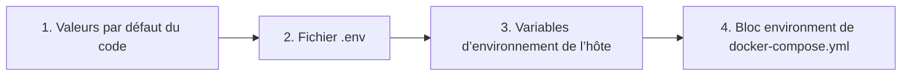

# 🐳 Guide Docker avancé

Pour ceux qui personnalisent le déploiement Docker, construisent leur propre image ou font la maintenance du conteneur.
Pour une première installation, commencez par le [Guide d’installation](../user/installation.md).

Deux fichiers Compose :

| Fichier | Image qu’il exécute |
| --- | --- |
| `docker-compose.prod.yml` | L’image officielle de GHCR. Le guide d’installation l’enregistre sous `docker-compose.yml`. |
| `docker-compose.yml`, dans le dépôt | Une image que vous construisez vous-même avec `./dev.py docker build`. |

Où se lancent les commandes de cette page :

| Commande | Où |
| --- | --- |
| `docker compose …` | Sur l’hôte, dans le dossier qui contient `docker-compose.yml` et `.env`. Aucune copie du dépôt nécessaire. |
| `./dev.py docker …` | Sur l’hôte, à la racine d’une copie du dépôt. |
| `./dev.py docker exec <cmd>` | Depuis la copie du dépôt ; la commande s’exécute **dans le conteneur en cours d’exécution** ([détails](#docker-exec)). |
| `docker compose run --rm librefolio …` | Dans le dossier de `docker-compose.yml`, serveur arrêté : un conteneur ponctuel ([correctifs](#post-migration-fixes)). |

## ⚠️ Prérequis

1. **Groupe Docker (Linux)**, pour utiliser Docker sans `sudo`. Sur l’hôte :

    ```bash
    sudo usermod -aG docker $USER
    ```

    Déconnectez-vous puis reconnectez-vous, ou exécutez `newgrp docker`. Sans cela, toutes les commandes `docker` et `docker compose` échouent avec une erreur de permission.

2. **Fichier `.env`**, à côté du fichier Compose. `./dev.py docker build` refuse de continuer sans lui. Dans une copie du dépôt :

    ```bash
    cp .env.example .env
    $EDITOR .env          # review and customize parameters
    ```

## 🏗️ Architecture

L’image est **destinée uniquement à l’exécution** : l’application web (SvelteKit) et la documentation (MkDocs) sont construites sur l’hôte puis copiées dedans ; `./dev.py docker build` le fait pour vous.
Étapes de construction, contenu et démarrage : [Vue d’ensemble de l’architecture → Image Docker](../developer/architecture/overview.md#docker-image).

## 📄 `docker-compose.yml`

Il définit le service `librefolio` et son répertoire de données persistantes.

### 🔝 Priorité de résolution {: #resolution-priority }

De la plus faible à la plus élevée :



`.env` arrive dans le conteneur par `env_file` ; le bloc `environment:` l’emporte sur lui.
Pour les espaces réservés `${…}` du fichier Compose, comme `${PORT:-6040}`, une variable de votre shell l’emporte sur `.env`.

### 🔧 Service : `librefolio`

| Clé | Valeur | Bon à savoir |
| --- | --- | --- |
| 🏷️ `image` | `ghcr.io/librefolio/librefolio:latest` (fichier de production) ou votre `librefolio:latest` local (fichier du dépôt) | `LIBREFOLIO_IMAGE` dans `.env` choisit un autre tag |
| 🏗️ `build` | Fichier du dépôt uniquement : construit le `Dockerfile` à la racine | Arguments `UID`, `GID` et `DOCS_VARIANT` |
| 🔌 `ports` | hôte `${PORT:-6040}` → conteneur `6040` | `PORT` choisit le côté hôte ; dans le conteneur, le serveur écoute toujours sur `6040`, le seul port de l’image |
| 📂 `volumes` | bind mount `./LibreFolio-data` → `/app/backend/data/prod-docker` | |
| 📝 `env_file: .env` | Votre configuration (copiée depuis `.env.example`) | |
| 🌍 `environment` | `LIBREFOLIO_DATA_DIR` (chemin dans le conteneur), `HOST=0.0.0.0`, `PORT=6040` | Laissez-les tels quels. `PORT=6040` remplace le port hôte de votre `.env` : les commandes `dev.py` dans le conteneur ([`docker exec`](#docker-exec)) cherchent le serveur sur le bon port, et `db upgrade` le voit en cours d’exécution et refuse de démarrer |
| 🩺 `healthcheck` | `GET /api/v1/system/health` toutes les 30 secondes | Il indique seulement à Docker que le serveur répond |

!!! tip "📈 Surveiller LibreFolio : `/api/v1/system/ready`"

    Pointez un outil de supervision comme **Uptime Kuma**, ou un orchestrateur, vers `GET /api/v1/system/ready`, par exemple `http://your-server:6040/api/v1/system/ready` (avec votre `PORT`). Aucune connexion nécessaire ; le code de statut suffit :

    - **`200`** : prêt. `{"status": "ready", "checks": {"database": "ok", "migrations": "ok"}, "database_revision": "…", "mode": "normal", "app_version": "…"}`. `database_revision` : la migration de la base de données ; `app_version` : la version en cours d’exécution, la même que celle du `GET /api/v1/system/info` public, si bien qu’un outil de supervision vérifie la version après une mise à jour.
    - **`503`** : pas prêt. `status` vaut `not_ready` ; `checks` montre ce qui n’est pas `ok` :

        | Vérification | Valeur | Signification |
        | --- | --- | --- |
        | `database` | `unreachable` | La base de données ne répond pas |
        | `migrations` | `behind` | La base de données est à une migration plus ancienne : une n’a pas été appliquée, ou a échoué |
        | `migrations` | `ahead` | La base de données est à une migration que cette version ne connaît pas : les données viennent d’un LibreFolio plus récent. Utilisez cette version ou une plus récente : [Jamais de retour en arrière](backup_moving.md#never-backwards) |
        | `migrations` | `unknown` | Impossible de le dire, par exemple pendant que la base de données est `unreachable` |

    La réponse ne contient jamais de détails ni de chemins : LibreFolio les écrit dans son propre journal (`docker compose logs librefolio`) sous la forme `Instance not ready`, une fois à chaque changement d’état. `db current` montre la migration de la base de données ([Appliquer les migrations](cli_tools.md#apply-migrations)).

### 💾 Répertoire de données : `LibreFolio-data/`

**Bind mount** à côté du fichier Compose : base de données SQLite, fichiers téléversés personnalisés, rapports de courtiers, journaux.
Il survit à l’arrêt, au redémarrage et à la suppression du conteneur ; vous le sauvegardez directement depuis l’hôte.

### 👤 Utilisateur et permissions

Le conteneur démarre en root uniquement pour confier tout `LibreFolio-data/` à l’utilisateur LibreFolio, à chaque démarrage ; il exécute ensuite le serveur sous cet utilisateur **non root** : sur l’hôte, les fichiers appartiennent à son UID/GID.
`./dev.py docker exec` utilise les mêmes UID/GID ([détails](#docker-exec)).

L’UID/GID vient des **arguments de construction** `UID` et `GID`, conservés dans l’image sous les noms `LIBREFOLIO_UID` et `LIBREFOLIO_GID` et lus par l’entrypoint à chaque démarrage.

| Image | UID/GID |
| --- | --- |
| Officielle sur GHCR | `1000:1000`. Les deux lignes `.env` ci-dessous n’ont aucun effet. |
| `./dev.py docker build` | Les identifiants de l’utilisateur qui l’exécute, quoi que dise `.env`. |
| `docker compose build` | `UID` et `GID` lus dans `.env` (par défaut `1000`). |

Pour faire correspondre les identifiants à l’utilisateur de l’hôte, ou à l’utilisateur dédié, qui doit posséder les données, **dans `.env`** :

```bash
UID=1000
GID=1000
```

Ils ne prennent effet que lorsque `docker compose build` reconstruit l’image : `.env` arrive aussi dans le conteneur par `env_file`, mais un redémarrage ne change pas les identifiants.

- Sur l’**hôte**, `ls -l LibreFolio-data/` montre l’utilisateur et le groupe de cet UID/GID d’après le `/etc/passwd` et le `/etc/group` de l’hôte.
- **Dans le conteneur**, les mêmes fichiers apparaissent généralement comme `librefolio:librefolio` : le même UID/GID numérique, résolu avec le `/etc/passwd` et le `/etc/group` du conteneur.

??? tip "Rappel Linux : utilisateurs, groupes et identifiants"

    Toutes les commandes : sur l’hôte.

    **Votre UID et votre GID :**

    ```bash
    id -u              # your user ID (e.g. 1000)
    id -g              # your primary group ID (e.g. 1000)
    id                 # full info: uid, gid, groups
    ```

    **UID/GID d’un autre utilisateur :**

    ```bash
    id -u username     # UID of 'username'
    id -g username     # primary GID of 'username'
    ```

    **Un nouveau groupe :**

    ```bash
    sudo groupadd librefolio          # create group (auto-assigns GID)
    sudo groupadd -g 1500 librefolio  # create group with specific GID
    ```

    **Un nouvel utilisateur :**

    ```bash
    # System user (no home, no login — ideal for services)
    sudo useradd --system --no-create-home --gid librefolio --shell /usr/sbin/nologin librefolio

    # Regular user with home directory
    sudo useradd -m -g librefolio librefolio
    ```

    **Les identifiants attribués :**

    ```bash
    id librefolio
    # → uid=998(librefolio) gid=998(librefolio) groups=998(librefolio)
    ```

    **Votre utilisateur dans un groupe :**

    ```bash
    sudo usermod -aG librefolio $USER
    newgrp librefolio    # activate in current session (or log out/in)
    ```

    **Vérifier l’appartenance :**

    ```bash
    groups $USER         # list all groups for your user
    ```

    **Propriété du répertoire de données :**

    ```bash
    sudo chown -R librefolio:librefolio ./LibreFolio-data
    ```

    Mettez ensuite l’UID/GID correspondant dans `.env` et reconstruisez avec `docker compose build` : à chaque démarrage, le conteneur confie le répertoire à l’UID/GID de l’image.

## 🛠️ Commandes CLI

**Où : racine d’une copie du dépôt.** `dev.py` encapsule les opérations Docker :

```bash
./dev.py docker build          # Build image (auto-builds frontend + docs)
./dev.py docker build --light  # Light variant: no documentation screenshots (tagged *-light)
./dev.py docker build --no-cache  # Full rebuild without Docker cache
./dev.py docker rebuild        # Build → stop → restart (one-step deploy)
./dev.py docker up             # Start containers
./dev.py docker down           # Stop containers
./dev.py docker logs -f        # Follow container logs
./dev.py docker status         # Show container status
./dev.py docker exec <cmd>     # Run a dev.py command inside the container
```

**Sans copie du dépôt**, dans le dossier de `docker-compose.yml`, le travail au quotidien :

| Action | Commande |
| --- | --- |
| Démarrer | `docker compose up -d` |
| Arrêter | `docker compose down` |
| Suivre le journal | `docker compose logs -f` |
| État du conteneur | `docker compose ps` |

Variantes de l’image :

- `--light` construit l’image sans les captures d’écran de la documentation, qui se chargent alors depuis le site en ligne ([Variantes d’image](../user/installation.md#image-variants-full-and-light)).
- Tags locaux : `librefolio:<version>` et `librefolio:latest` pour l’image complète, `librefolio:<version>-light` et `librefolio:latest-light` pour la légère ; `<version>` est la version git de la copie du dépôt. Sur le registre, en revanche, `latest` est la variante légère et `latest-light` n’existe pas.
- Pour exécuter votre construction légère avec le fichier Compose du dépôt, **dans `.env`** : `LIBREFOLIO_IMAGE=librefolio:latest-light`.

??? warning "🧱 Quand `./dev.py docker build` s’arrête"

    **Une ressource ne peut pas être téléchargée.** La construction met en cache des ressources externes (la police Noto Color Emoji pour les drapeaux sous Windows, MathJax pour les formules, Mermaid pour les diagrammes) afin que l’image fonctionne hors ligne. Si l’une manque et qu’il n’y a pas de copie en cache, la construction s’arrête :

    ```text
    ❌ Resource cache incomplete — the build would ship without these:
       - noto-color-emoji: ...
    ```

    La **première construction exige Internet** (ou un cache préchauffé). Une fois le réseau rétabli, relancez la construction ; `./dev.py cache js` actualise le cache à la main (`--force` retélécharge tout).

    **Le frontend est une construction de débogage.** L’image doit contenir la construction de production de l’application web. `./dev.py docker build` reconstruit `frontend/build/` en production quand la dernière construction était une construction de débogage (`./dev.py server --test`, `./dev.py server --debug`, lanceur de tests), quand les sources ont changé ou quand elle n’a pas été construite pour cette version ([détails](../developer/dev_workflow.md#docker-build-steps)). `docker build` ou `docker compose build` sautent cette étape : avec `frontend/build/` en débogage ou instrumenté pour la couverture, la construction s’arrête :

    ```text
    ERROR: /build is not a production frontend build: it is a debug build (.build-debug = 1)
    Rebuild it with './dev.py front build', then build the image again.
    ```

    Exécutez `./dev.py front build`, puis reconstruisez l’image ; ou construisez avec `./dev.py docker build`.

??? tip "🖼️ Construire une image complète avec les captures d’écran de la documentation"

    Une image complète ne contient les captures d’écran que si elles ont été générées, et la documentation reconstruite avec elles, **avant** la construction : sinon, une image complète locale et une légère sont identiques, au tag près. Dans la copie du dépôt :

    ```bash
    ./dev.py mkdocs gallery   # generate the screenshots
    ./dev.py mkdocs build     # rebuild the documentation with the screenshots
    ./dev.py docker build     # build the full image; it rebuilds for production the debug frontend the gallery leaves
    ```

    `./dev.py mkdocs gallery` exige un environnement complet (`pipenv`) et les navigateurs Playwright. Il démarre son propre serveur de test et remplit la base de données de test (`--no-populate` saute le remplissage). Il prend quelques minutes.

### 📡 `docker exec` — Exécuter des commandes dans le conteneur {: #docker-exec }

**Où : depuis la copie du dépôt ; la commande s’exécute dans le conteneur en cours d’exécution**, sous l’utilisateur du serveur : le `LIBREFOLIO_UID:LIBREFOLIO_GID` numérique de l’image (Utilisateur et permissions, ci-dessus), pas root. Les fichiers créés dans `LibreFolio-data/` appartiennent tout de suite à cet utilisateur. Par exemple :

```bash
./dev.py docker exec user create admin admin@example.com Pass123!
./dev.py docker exec user list
```

**Sans copie du dépôt**, dans le dossier de `docker-compose.yml`, `./dev.py docker exec user list` revient à cette ligne (`gosu`, aussi utilisé par l’entrypoint, passe aux identifiants de l’image avant le démarrage de `dev.py`) :

```bash
docker compose exec librefolio sh -c 'exec gosu "${LIBREFOLIO_UID:-1000}:${LIBREFOLIO_GID:-1000}" python dev.py "$@"' sh user list
```

Un simple `docker compose exec librefolio python dev.py <cmd>` s’exécute en root : ce qu’il crée dans `LibreFolio-data/` appartient à root jusqu’au prochain démarrage, quand l’entrypoint rend le répertoire à l’utilisateur de l’image.

| Commande | Dans l’image |
| --- | --- |
| `user`, `db`, `info`, `backup` | Elles fonctionnent ([Sauvegarder avec Docker](cli_backup.md#backup-docker)) |
| `test`, `i18n`, `mkdocs translate`, `mkdocs translate-validate` | Listées, mais elles répondent seulement qu’elles ne sont *pas disponibles dans cette installation* : l’image contient l’application, pas l’arborescence de développement |
| `./dev.py docker exec test db populate` | La même réponse *non disponible* que toute commande `test` |
| `./dev.py docker exec server --test` | S’arrête avec `Frontend build failed. Server not started.` : le mode test reconstruit l’application web en débogage, ce qui exige Node.js et les sources ; l’image n’a que la construction de production, sans Node.js. Comme `./dev.py mkdocs gallery`, il relève d’une copie de développement du dépôt |

**Les migrations de base de données ne demandent aucune commande.** Le serveur applique celles en attente à chaque démarrage : après `docker compose pull` et `docker compose up -d`, il n’y a rien d’autre à faire ; `docker compose restart librefolio` les relance après un échec.
Le redémarrage ne sert à rien quand la mise à niveau vers la 1.3 s’arrête parce que deux comptes ont la même adresse e-mail à la casse près : séparez d’abord les deux comptes, comme l’explique « Deux comptes avec la même adresse e-mail » dans [Outils en ligne de commande](cli_tools.md).
N’utilisez pas `./dev.py docker exec db upgrade` : `db upgrade` exige le serveur arrêté, et dans le conteneur le serveur est le processus principal, toujours en cours d’exécution.

## 🩹 Correctifs post-migration {: #post-migration-fixes }

À chaque démarrage, juste après les migrations en attente, le serveur exécute les **correctifs post-migration** : des réparations qu’une migration ne peut pas faire. Ce qu’ils réparent et ce que dit le journal : [Outils en ligne de commande → Correctifs post-migration](cli_tools.md#post-migration-fixes). Avec Docker :

- le journal est la sortie du conteneur (`./dev.py docker logs` ou `docker compose logs`), aussi enregistrée dans `LibreFolio-data/logs/` ;
- la copie conservée par un correctif en échec se trouve à côté de la base de données, dans `LibreFolio-data/sqlite/`, par exemple `app.db.pre-autoincrement-20261008T101500Z.bak`.

### ⏹️ Exécuter les correctifs serveur arrêté

Pour prévisualiser les correctifs, ou en relancer un qui a échoué au démarrage et lire son erreur.
`docker exec` exige le conteneur en cours d’exécution : `docker compose run` remplace plutôt le serveur par votre commande, dans un conteneur ponctuel.

**Où : dossier de `docker-compose.yml`.** Prévisualisez toujours d’abord avec `--dry-run` :

```bash
docker compose stop librefolio
docker compose run --rm librefolio python -m backend.app.db.post_migration --dry-run   # preview: changes nothing
docker compose run --rm librefolio python -m backend.app.db.post_migration             # apply the fixes
docker compose start librefolio
```

Résultat : le script travaille sur la même base de données et le même répertoire de données que le serveur, et indique ce qu’il trouve :

```text
Database: /app/backend/data/prod-docker/sqlite/app.db
Integrity check: ok
Fix autoincrement: would_apply
Orphan broker folder: broker_reports/uploaded/broker_7
```

Chaque correctif est `clean` (rien à faire), `would_apply` (simulation), `applied` ou `failed` ; il liste aussi une sauvegarde conservée, les erreurs et chaque transfert de titres envoyé à un courtier supprimé, avec le coût qu’il prend ou la raison pour laquelle il reste tel quel ([détails](cli_tools.md#post-migration-fixes)).
Code de sortie `0` quand rien n’a échoué, simulation comprise ; `1` si un correctif, le contrôle d’intégrité ou la conversion de ces transferts a échoué.

## 🧪 Mode test

L’image n’a pas de mode test : elle écoute uniquement sur `6040`, le serveur de production, et les deux fichiers Compose ne publient que ce port.
Le serveur de test (`./dev.py server --test`, port `6041` par défaut) est un outil de développeur : **sur l’hôte, depuis une copie des sources**. Sa base de données, `backend/data/test/sqlite/app.db` par défaut, est distincte de `LibreFolio-data/` ; `./dev.py test db populate --force` la supprime et la recrée avec des données fictives.

Comment le démarrer, et pourquoi il ne démarre pas dans le conteneur : [Flux de travail du développeur](../developer/dev_workflow.md#docker-test-mode).

## 🏭 Considérations pour la production

### 🎮 1. Personnaliser `docker-compose.yml`

Les changements les plus courants. Après (2)–(5), redémarrez LibreFolio. Avec Docker Compose, exécutez `docker compose up -d`.

| N° | Quoi | Où et comment |
| --- | --- | --- |
| (1) | Faire correspondre l’UID/GID de l’hôte | Reconstruisez l’image avec eux : `./dev.py docker build` sous l’utilisateur qui doit posséder les fichiers, ou `UID=1001` et `GID=1001` dans `.env` puis `docker compose build` |
| (2) | Changer le port de production | Dans `.env` : `PORT=3000` |
| (3) | Chemin de données personnalisé | Dans `docker-compose.yml`, le bind mount : `./my-data:/app/backend/data/prod-docker` |
| (4) | Toute la configuration | Dans `.env` (copié depuis `.env.example`) |
| (5) | Exécuter un autre tag d’image | Dans `.env` : `LIBREFOLIO_IMAGE`, par exemple `LIBREFOLIO_IMAGE=ghcr.io/librefolio/librefolio:1.1.0` |

Le premier compte créé dans le navigateur devient l’administrateur : aucune commande. Pour que LibreFolio le crée au premier démarrage, à partir de `LIBREFOLIO_ADMIN_EMAIL` : [L’administrateur initial](configuration_accounts.md#initial-admin).

??? example "📄 Le `docker-compose.yml` du dépôt, annoté"

    ```yaml
    services:
      librefolio:
        image: ${LIBREFOLIO_IMAGE:-librefolio:latest}  # (5) Built by ./dev.py docker build
        build:
          context: .
          args:
            UID: ${UID:-1000}              # (1) UID owning the data files (build time only)
            GID: ${GID:-1000}              # (1) GID owning the data files (build time only)
            DOCS_VARIANT: ${DOCS_VARIANT:-full}  # light = no documentation screenshots
        container_name: librefolio
        # No 'user:' directive — entrypoint starts as root, fixes permissions,
        # then drops to the numeric LIBREFOLIO_UID:LIBREFOLIO_GID via gosu, like ./dev.py docker exec.
        restart: unless-stopped
        ports:
          - "${PORT:-6040}:6040"           # (2) Production port — change via PORT in .env
        volumes:
          - ./LibreFolio-data:/app/backend/data/prod-docker  # (3) Persistent data (bind mount)
        env_file: .env                     # (4) All config from .env file
        environment:
          - LIBREFOLIO_DATA_DIR=/app/backend/data/prod-docker  # Docker-specific override
          - HOST=0.0.0.0
          - PORT=6040                      # The container's port; (2) sets the host side
        healthcheck:
          test: ["CMD", "python", "-c", "import urllib.request; urllib.request.urlopen('http://localhost:6040/api/v1/system/health')"]
          interval: 30s
          timeout: 10s
          start_period: 15s
          retries: 3
    ```

    `docker-compose.prod.yml` contient le même service sans `build:` ; son image par défaut est `ghcr.io/librefolio/librefolio:latest`.

### 🔒 2. Sécurité et exposition (Tailscale et proxy inverse)

| Voie | Quand | Guide |
| --- | --- | --- |
| **Tailscale** (recommandé, le plus simple) | HTTPS automatique, sans ports de routeur ni DNS public | [Guide d’exposition avec Tailscale](service_exposure.md) |
| **Proxy inverse classique** (Nginx, Traefik) | Vous avez déjà une infrastructure web, vos propres certificats SSL/TLS, plusieurs applications sur un serveur, des en-têtes de sécurité personnalisés ou une limitation de débit | Ci-dessous |

Une fois exposé, [Vérifier la sécurité de la connexion](connection_checks.md) montre comment contrôler que les utilisateurs se connectent de façon sécurisée et, [derrière un proxy inverse](connection_proxy.md#reverse-proxy), que le cookie de session est `Secure`.

Derrière un proxy inverse classique, **dans `.env`**, indiquez aussi quel proxy croire (`FORWARDED_ALLOW_IPS`) ou quel en-tête contient l’adresse du visiteur (`LIBREFOLIO_CLIENT_IP_HEADER`) : sinon, LibreFolio voit chaque visiteur avec l’adresse du proxy, et la consigne ainsi dans le journal et dans les vérifications de sécurité. Voir [L’adresse du visiteur](connection_proxy.md#client-address).

Dans la configuration du proxy, ne compressez pas une seconde fois : LibreFolio compresse déjà en gzip (JSON de l’API, JavaScript et CSS, pages de la documentation) et envoie tel quel les images et le flux en direct de la recherche d’actifs.

### 💾 3. Sauvegarde de la base de données

La base de données se trouve dans `LibreFolio-data/`, à côté de `docker-compose.yml` : un bind mount lisible depuis l’hôte, sans `docker cp`.

!!! warning "Ne copiez pas `app.db` depuis un conteneur en cours d’exécution"

    SQLite fonctionne en **mode WAL** (`PRAGMA journal_mode=WAL`) : les transactions récentes sont dans `app.db-wal`, si bien qu’un `cp` de `app.db` seul, serveur en marche, peut donner une sauvegarde incohérente ou périmée. Utilisez l’une des procédures ci-dessous.

**Où : sur l’hôte, dossier de `docker-compose.yml`.**

**Option A — Arrêter le conteneur, puis copier** (la plus simple) :

```bash
#!/bin/bash
docker compose stop librefolio
cp ./LibreFolio-data/sqlite/app.db /path/to/backups/app.db-$(date +%F)
docker compose start librefolio
```

**Option B — Sauvegarde en ligne avec la CLI SQLite** (sans interruption ; exige `sqlite3` sur l’hôte) :

```bash
#!/bin/bash
sqlite3 ./LibreFolio-data/sqlite/app.db ".backup '/path/to/backups/app.db-$(date +%F)'"
```

`.backup` utilise l’API de sauvegarde en ligne de SQLite, sûre avec une base WAL active.

**Option C — `backup create`**, sans arrêt ni `sqlite3` sur l’hôte. Dans le conteneur, depuis le dossier de `docker-compose.yml` :

```bash
docker compose exec librefolio python dev.py backup create
```

Résultat : une copie cohérente de la base de données, des fichiers téléversés, des rapports de courtiers et des scénarios de stress dans une seule archive, dans son propre dossier de `LibreFolio-data/backups/`, serveur en marche ([Sauvegarder avec Docker](cli_backup.md#backup-docker)).
Une archive en clair omet `secrets/`, qui contient la clé d’instance : sauvegardez ce dossier comme l’explique [Ce qu’il faut sauvegarder](filesystem.md#what-to-back-up). Une [archive sécurisée](backup_restore.md#secure), avec `--encrypt`, contient la clé, chiffrée avec votre mot de passe.

Liste complète de ce qui vaut la peine d’être sauvegardé (fichiers téléversés, rapports d’origine des courtiers) : [Organisation du système de fichiers](filesystem.md).

Fichiers que vous pouvez trouver à côté de la base de données :

| Fichier | Que faire |
| --- | --- |
| `app.db.pre-<fix>-<UTC time>.bak` | Copie conservée par un [correctif post-migration](#post-migration-fixes) en échec : supprimez-la quand vous n’en avez plus besoin |
| `app.db.post-migration.lock` | Fichier de verrou vide des [correctifs post-migration](#post-migration-fixes), réutilisé à chaque démarrage. Laissez-le : le supprimer pendant le démarrage du serveur pourrait faire se chevaucher deux exécutions |

### 🔑 4. Variables d’environnement

Toute la configuration est **dans `.env`** (copié depuis `.env.example`) ; laissez les variables Docker du bloc `environment:` telles quelles. Chaque variable et son effet : [Guide de configuration](configuration.md).

🔐 **Utilisateurs connectés d’un redémarrage à l’autre.** Dans `.env`, mettez `JWT_SECRET` à une longue chaîne aléatoire, par exemple la sortie de `openssl rand -hex 32` :

```bash
JWT_SECRET=<output of openssl rand -hex 32>
```

Redémarrez LibreFolio. Avec Docker Compose, exécutez `docker compose up -d`.
Sans cela, LibreFolio génère une nouvelle clé à chaque démarrage : chaque redémarrage ou mise à jour du conteneur déconnecte tout le monde.

### ✅ 5. Vérifier l’image que vous téléchargez {: #verify-image }

Chaque image sur GHCR (`ghcr.io/librefolio/librefolio`, complète et légère) a une **attestation de construction**, signée par le pipeline de publication du dépôt du projet : cette image exacte y a été construite à partir de ce code. Aucune clé à nous à garder ou à perdre (GitHub prouve l’identité de l’exécution, Sigstore l’enregistre) : n’importe qui peut la vérifier.

**Où : là où vous avez Docker et le [GitHub CLI](https://cli.github.com/).**

1. Prenez le digest de l’image que vous avez téléchargée :

    ```bash
    # The digest of a tag (the line "Digest: sha256:…")
    docker buildx imagetools inspect ghcr.io/librefolio/librefolio:1.3.0
    ```

2. Demandez à GitHub de la vérifier :

    ```bash
    # Verify the attestation of that digest
    gh attestation verify oci://ghcr.io/librefolio/librefolio@sha256:<digest> --owner Librefolio
    ```

    Résultat : `✓ Verification succeeded!` avec le dépôt et le workflow qui l’a construite. Seulement une erreur → ce digest ne vient pas du pipeline de LibreFolio : ne l’exécutez pas.

L’attestation couvre tous les tags qui pointent vers le même digest (`1.3.0`, `latest`...). Les versions antérieures à cette vérification n’en ont aucune.

---

## 🔗 Voir aussi

- 📄 **[Guide d’installation](../user/installation.md)** — Première installation, Variantes d’image
- 📄 **[Outils en ligne de commande](cli_tools.md)** — Appliquer les migrations, Correctifs post-migration
- 📄 **[Sauvegardes](cli_backup.md#backup-docker)** — Sauvegarder avec Docker
- 📄 **[Organisation du système de fichiers](filesystem.md)** — Ce qu’il faut sauvegarder
- 📄 **[Vérifier la sécurité de la connexion](connection_checks.md)** — Derrière un proxy inverse, L’adresse du visiteur
