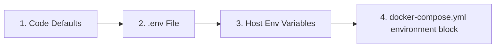

# 🐳 Guida avanzata a Docker

Questa guida è destinata agli amministratori che personalizzano il proprio deployment Docker, compilano la propria immagine o eseguono operazioni di manutenzione sul container. Per una prima installazione, partite dalla [Guida all'installazione](../user/installation.md).

LibreFolio viene fornito con due file Compose:

- **`docker-compose.prod.yml`** esegue l'immagine ufficiale da GHCR: la guida all'installazione lo salva come `docker-compose.yml`.
- **`docker-compose.yml`**, nel repository, esegue un'immagine compilata da voi con `./dev.py docker build`.

## ⚠️ Prerequisiti

**Gruppo Docker (Linux).** Il vostro utente deve appartenere al gruppo `docker` per eseguire i comandi Docker senza `sudo`:

```bash
sudo usermod -aG docker $USER
```

Poi **uscite e rientrate**, oppure eseguite `newgrp docker` per attivare il gruppo nella sessione corrente. In mancanza di ciò, tutti i comandi `docker` e `docker compose` falliscono con un errore di permessi.

**File `.env`.** LibreFolio richiede un file `.env` accanto al file Compose, e `./dev.py docker build` rifiuta di procedere senza di esso. In un checkout del repository:

```bash
cp .env.example .env
$EDITOR .env          # review and customize parameters
```

## 🏗️ Architettura

L'immagine è **solo runtime**: l'applicazione web (SvelteKit) e la documentazione (MkDocs) vengono compilate sull'host e copiate al suo interno, e `./dev.py docker build` esegue quelle compilazioni per voi. Fasi di build, contenuto dell'immagine e sequenza di avvio: [Panoramica dell'architettura → Immagine Docker](../developer/architecture/overview.md#docker-image).

## 📄 `docker-compose.yml`

Il file Compose definisce il servizio `librefolio` e la sua directory di dati persistenti.

### 🔝 Priorità di risoluzione {: #resolution-priority }

Quando risolve le variabili di configurazione, LibreFolio rispetta il seguente ordine di precedenza (dal più basso al più alto):



In Docker, `.env` raggiunge il container tramite `env_file`, e il blocco `environment:` lo sovrascrive. Per i segnaposto `${…}` del file Compose, come `${PORT:-6040}`, una variabile impostata nella vostra shell prevale su `.env`.

### 🔧 Servizio: `librefolio`

- 🏷️ **`image`**: l'immagine ufficiale `ghcr.io/librefolio/librefolio:latest` (file di produzione) o la vostra `librefolio:latest` locale (file del repository); `LIBREFOLIO_IMAGE` in `.env` ne sceglie un altro tag.
- 🏗️ **`build`** (solo file del repository): compila il `Dockerfile` nella radice con gli argomenti `UID`, `GID` e `DOCS_VARIANT`.
- 🔌 **`ports`**: host `${PORT:-6040}` → container `6040`, l'unica porta su cui l'immagine è in ascolto. `PORT` sceglie il lato host; all'interno del container il server è sempre in ascolto su `6040`.
- 📂 **`volumes`**: il bind mount `./LibreFolio-data` → `/app/backend/data/prod-docker`.
- 📝 **`env_file: .env`**: carica la vostra configurazione (copiata da `.env.example`).
- 🌍 **`environment`**: le variabili specifiche di Docker `LIBREFOLIO_DATA_DIR` (percorso nel container), `HOST=0.0.0.0` e `PORT=6040`; lasciatele così come sono. All'interno del container, `PORT=6040` sostituisce la porta host che il vostro `.env` potrebbe impostare, così i comandi `dev.py` che eseguite lì ([`docker exec`](#docker-exec)) cercano il server sulla porta su cui è in ascolto: `db upgrade`, per esempio, lo vede in esecuzione e rifiuta di partire.
- 🩺 **`healthcheck`**: interroga `GET /api/v1/system/health` ogni 30 secondi.

!!! tip "📈 Monitorare LibreFolio: `/api/v1/system/ready`"

    L'health check dice solo a Docker che il server risponde. Per sapere se LibreFolio può effettivamente servire richieste, puntate un monitor come **Uptime Kuma** o un orchestratore su `GET /api/v1/system/ready`, per esempio `http://your-server:6040/api/v1/system/ready` (con la vostra `PORT` se l'avete cambiata). Non richiede alcun accesso, e il codice di stato è tutto ciò che serve a un monitor:

    - **`200`**: pronto. Il database risponde, e la sua struttura corrisponde a questa versione di LibreFolio: `{"status": "ready", "checks": {"database": "ok", "migrations": "ok"}, "database_revision": "…", "mode": "normal", "app_version": "…"}`. `database_revision` è la migrazione a cui si trova il database, e `app_version` è la versione di LibreFolio in esecuzione: lo stesso testo che il `GET /api/v1/system/info` pubblico restituisce senza alcun accesso, così un monitor può verificare la versione dopo un aggiornamento con questa sola sonda.
    - **`503`**: non pronto. `status` è `not_ready`, e `checks` mostra ciò che non è `ok`: `database` è `unreachable` quando il database non risponde; `migrations` è `behind` quando il database si trova a una migrazione più vecchia che questa versione conosce (una migrazione non è stata applicata, o è fallita), `ahead` quando si trova a una migrazione che questa versione non conosce (i dati provengono da un LibreFolio più recente: usate quella versione o una più recente, vedi [Mai all'indietro](backup_moving.md#never-backwards)), e `unknown` quando non è in grado di dirlo, per esempio mentre il database è `unreachable`.

    La risposta non include mai dettagli sugli errori né un percorso: LibreFolio li scrive nel proprio log (`docker compose logs librefolio`) come `Instance not ready`, una volta per ogni cambio di stato. `db current` mostra la migrazione a cui si trova il database ([Applicare le migrazioni](cli_tools.md#apply-migrations)).

### 💾 Directory dei dati: `LibreFolio-data/`

Una directory **bind mount** accanto al file Compose, che contiene il database SQLite, i caricamenti personalizzati, i report dei broker e i file di log. Sopravvive all'arresto, al riavvio e alla rimozione del container, e la potete sottoporre a backup direttamente dall'host.

### 👤 Utente e permessi

Il container si avvia come root solo per cedere la directory dei dati all'utente LibreFolio, poi esegue il server come quell'utente **non-root**: i file che crea in `LibreFolio-data/` appartengono a quel UID/GID sull'host. La cessione avviene a ogni avvio e copre tutto ciò che si trova nella directory. I comandi eseguiti con `./dev.py docker exec` usano lo stesso UID/GID ([dettagli](#docker-exec)).

Quel UID/GID proviene dagli **argomenti di build** `UID` e `GID`: l'immagine li conserva come `LIBREFOLIO_UID` e `LIBREFOLIO_GID`, che l'entrypoint legge a ogni avvio. L'immagine ufficiale su GHCR è compilata con `1000:1000`. `./dev.py docker build` usa gli id dell'utente che lo esegue, qualunque cosa dica `.env`, mentre `docker compose build` legge `UID` e `GID` da `.env` (predefiniti `1000`): impostateli in modo che corrispondano all'utente host, o all'utente dedicato, che deve possedere i file dei dati:

```bash
UID=1000
GID=1000
```

Modificarli in `.env` ha effetto solo quando `docker compose build` ricompila l'immagine: `.env` raggiunge il container anche tramite `env_file`, ma un riavvio non cambia gli id. Con l'immagine ufficiale, che non compilate voi, queste due righe non hanno effetto.

- Sull'**host**, `ls -l LibreFolio-data/` mostra l'utente e il gruppo che possiedono quel UID/GID sull'host (risolti tramite `/etc/passwd` e `/etc/group`).
- **All'interno del container**, gli stessi file di solito appaiono come `librefolio:librefolio`: lo stesso UID/GID numerico, risolto rispetto ai `/etc/passwd` e `/etc/group` propri del container.

??? tip "Promemoria Linux: utenti, gruppi e ID"

    **Scoprite il vostro UID e GID attuali:**

    ```bash
    id -u              # your user ID (e.g. 1000)
    id -g              # your primary group ID (e.g. 1000)
    id                 # full info: uid, gid, groups
    ```

    **Trovate l'UID/GID di qualsiasi utente:**

    ```bash
    id -u username     # UID of 'username'
    id -g username     # primary GID of 'username'
    ```

    **Create un nuovo gruppo:**

    ```bash
    sudo groupadd librefolio          # create group (auto-assigns GID)
    sudo groupadd -g 1500 librefolio  # create group with specific GID
    ```

    **Create un nuovo utente:**

    ```bash
    # System user (no home, no login — ideal for services)
    sudo useradd --system --no-create-home --gid librefolio --shell /usr/sbin/nologin librefolio

    # Regular user with home directory
    sudo useradd -m -g librefolio librefolio
    ```

    **Controllate gli ID assegnati:**

    ```bash
    id librefolio
    # → uid=998(librefolio) gid=998(librefolio) groups=998(librefolio)
    ```

    **Aggiungete il vostro utente esistente a un gruppo:**

    ```bash
    sudo usermod -aG librefolio $USER
    newgrp librefolio    # activate in current session (or log out/in)
    ```

    **Verificate l'appartenenza ai gruppi:**

    ```bash
    groups $USER         # list all groups for your user
    ```

    **Impostate la proprietà della directory dei dati:**

    ```bash
    sudo chown -R librefolio:librefolio ./LibreFolio-data
    ```

    Poi impostate in `.env` l'UID/GID corrispondente e ricompilate l'immagine con `docker compose build`: a ogni avvio il container restituisce la directory all'UID/GID dell'immagine.

## 🛠️ Comandi CLI

In un checkout del repository, `dev.py` incapsula le operazioni Docker:

```bash
./dev.py docker build          # Build image (auto-builds frontend + docs)
./dev.py docker build --light  # Light variant: no documentation screenshots (tagged *-light)
./dev.py docker build --no-cache  # Full rebuild without Docker cache
./dev.py docker rebuild        # Build → stop → restart (one-step deploy)
./dev.py docker up             # Start containers
./dev.py docker down           # Stop containers
./dev.py docker logs -f        # Follow container logs
./dev.py docker status         # Show container status
./dev.py docker exec <cmd>     # Run a dev.py command inside the container
```

Senza un checkout, i comandi semplici svolgono il lavoro quotidiano: `docker compose up -d`, `docker compose down`, `docker compose logs -f` e `docker compose ps`.

- `--light` compila l'immagine senza gli screenshot della documentazione, che poi vengono caricati dal sito della documentazione online (vedi [Varianti dell'immagine](../user/installation.md#image-variants-full-and-light)).
- Tag locali: `librefolio:<version>` e `librefolio:latest` per l'immagine completa, `librefolio:<version>-light` e `librefolio:latest-light` per quella light, dove `<version>` è la versione git del vostro checkout. Sul registry invece `latest` è la variante light e non esiste `latest-light`.
- Per eseguire la vostra build light con il file Compose del repository, impostate `LIBREFOLIO_IMAGE=librefolio:latest-light` in `.env`.

??? warning "🧱 Quando `./dev.py docker build` si ferma"

    **Una risorsa non può essere scaricata.** La build mette in cache alcune risorse esterne, come il font Noto Color Emoji (le bandiere su Windows), MathJax (le formule nella documentazione) e Mermaid (i diagrammi nella documentazione), così che l'immagine funzioni completamente offline. Se una non può essere scaricata e non esiste ancora una copia in cache, la build si ferma invece di distribuire un'immagine rotta:

    ```text
    ❌ Resource cache incomplete — the build would ship without these:
       - noto-color-emoji: ...
    ```

    La **prima build richiede l'accesso a internet** (o una cache già precaricata). Quando la rete torna disponibile, eseguite di nuovo la build; `./dev.py cache js` aggiorna la cache a mano (`--force` riscarica tutto).

    **Il frontend è una build di debug.** L'immagine deve contenere la build di produzione dell'applicazione web. `./dev.py docker build` se ne occupa: ricompila `frontend/build/` in modalità produzione quando l'ultima build era di debug (per esempio a causa di `./dev.py server --test`, `./dev.py server --debug` o del test runner), quando le sue sorgenti sono cambiate, o quando non è stata compilata per questa versione ([dettagli](../developer/dev_workflow.md#docker-build-steps)). Un'immagine compilata direttamente con `docker build` o `docker compose build` salta quel passaggio: se `frontend/build/` è stata compilata l'ultima volta in modalità debug o strumentata per la copertura, la build dell'immagine si ferma con un errore come:

    ```text
    ERROR: /build is not a production frontend build: it is a debug build (.build-debug = 1)
    Rebuild it with './dev.py front build', then build the image again.
    ```

    Eseguite `./dev.py front build`, poi compilate di nuovo l'immagine, oppure compilatela con `./dev.py docker build`.

??? tip "🖼️ Compilare un'immagine completa con gli screenshot della documentazione"

    Un'immagine completa contiene gli screenshot della documentazione solo se sono stati generati, e la documentazione ricompilata con essi, **prima** della build dell'immagine: altrimenti un'immagine completa locale e una light sono identiche a parte il tag. La sequenza completa è:

    ```bash
    ./dev.py mkdocs gallery   # generate the screenshots
    ./dev.py mkdocs build     # rebuild the documentation with the screenshots
    ./dev.py docker build     # build the full image; it rebuilds for production the debug frontend the gallery leaves
    ```

    `./dev.py mkdocs gallery` richiede un ambiente completamente installato (con `pipenv`) e i browser Playwright. Avvia un proprio server di test e popola automaticamente il database di test (`--no-populate` salta il ripopolamento). La generazione della galleria richiede alcuni minuti.

### 📡 `docker exec` — Eseguire comandi dentro il container {: #docker-exec }

`./dev.py docker exec <cmd>` esegue un comando `dev.py` dentro il container **in esecuzione**, con lo stesso utente del server: il `LIBREFOLIO_UID:LIBREFOLIO_GID` numerico dell'immagine (vedi Utente e permessi sopra), non root. I file che un comando crea in `LibreFolio-data/` appartengono quindi subito a quell'utente, come quelli del server stesso. Per esempio, per gestire gli utenti:

```bash
./dev.py docker exec user create admin admin@example.com Pass123!
./dev.py docker exec user list
```

Dietro le quinte, `./dev.py docker exec user list` esegue la riga seguente, che funziona anche senza un checkout. `gosu`, che usa anche l'entrypoint, passa agli id dell'immagine prima che `dev.py` si avvii:

```bash
docker compose exec librefolio sh -c 'exec gosu "${LIBREFOLIO_UID:-1000}:${LIBREFOLIO_GID:-1000}" python dev.py "$@"' sh user list
```

Un semplice `docker compose exec librefolio python dev.py <cmd>` esegue invece il comando come root: ciò che crea in `LibreFolio-data/` appartiene a root fino al successivo avvio del container, quando l'entrypoint restituisce la directory all'utente dell'immagine.

Nell'immagine funzionano `user`, `db`, `info` e `backup` ([Backup con Docker](cli_backup.md#backup-docker)). Sono elencati anche i comandi di sviluppo (`test`, `i18n`, `mkdocs translate` e `mkdocs translate-validate`), ma rispondono solo che *non sono disponibili in questa installazione*: l'immagine contiene l'applicazione, non l'albero di sviluppo.

Neanche i comandi in modalità test vengono eseguiti nel container; come `./dev.py mkdocs gallery`, appartengono a un checkout di sviluppo:

- `./dev.py docker exec test db populate` ottiene la stessa risposta *non disponibile* di ogni comando `test`;
- `./dev.py docker exec server --test` si ferma con `Frontend build failed. Server not started.`: la modalità test prova prima a ricompilare l'applicazione web in modalità debug, che richiede Node.js e le sorgenti dell'applicazione web, mentre l'immagine contiene solo la build di produzione, senza Node.js.

**Le migrazioni del database non richiedono alcun comando.** Il server applica le migrazioni in sospeso a ogni avvio: dopo `docker compose pull` e `docker compose up -d` non c'è altro da eseguire, e `docker compose restart librefolio` le riprova dopo un errore. Un riavvio non aiuta quando l'aggiornamento alla 1.3 si ferma perché due account hanno lo stesso indirizzo email a meno delle maiuscole: separate prima i due account, come spiega «Due account con lo stesso indirizzo email» in [Strumenti da riga di comando](cli_tools.md). Non usate `./dev.py docker exec db upgrade`: `db upgrade` richiede che il server sia fermo, e nel container il server è il processo principale, sempre in esecuzione.

## 🩹 Correzioni post-migrazione {: #post-migration-fixes }

Ogni volta che il server si avvia, subito dopo aver applicato qualsiasi migrazione del database in sospeso, esegue le **correzioni post-migrazione**: riparazioni che una migrazione non può effettuare. Cosa riparano, e cosa dice il log al riguardo, è spiegato in [Strumenti da riga di comando → Correzioni post-migrazione](cli_tools.md#post-migration-fixes). In Docker:

- il log è l'output del container (`./dev.py docker logs` o `docker compose logs`), salvato anche in `LibreFolio-data/logs/`;
- una copia conservata da una correzione fallita si trova accanto al database, in `LibreFolio-data/sqlite/`, per esempio `app.db.pre-autoincrement-20261008T101500Z.bak`.

### ⏹️ Eseguire le correzioni con il server fermo

Per visualizzare in anteprima le correzioni, o per riprovare una che è fallita all'avvio e leggere il suo errore, eseguitele a mano con il server fermo. `docker exec` richiede il container in esecuzione, quindi usate invece `docker compose run`: il comando che passate sostituisce il server in un container usa e getta. Visualizzate sempre prima l'anteprima con `--dry-run`:

```bash
docker compose stop librefolio
docker compose run --rm librefolio python -m backend.app.db.post_migration --dry-run   # preview: changes nothing
docker compose run --rm librefolio python -m backend.app.db.post_migration             # apply the fixes
docker compose start librefolio
```

Lo script opera sullo stesso database e sulla stessa directory dei dati del server e riporta ciò che ha trovato, per esempio:

```text
Database: /app/backend/data/prod-docker/sqlite/app.db
Integrity check: ok
Fix autoincrement: would_apply
Orphan broker folder: broker_reports/uploaded/broker_7
```

Ogni correzione è `clean` (niente da fare), `would_apply` (dry run), `applied` o `failed`; vengono elencati anche un backup conservato e qualsiasi errore, così come ogni trasferimento di titoli inviato a un broker eliminato, con il costo che comporta o il motivo per cui resta com'è ([dettagli](cli_tools.md#post-migration-fixes)). Il codice di uscita è `0` quando nulla è fallito, dry run incluso, e `1` quando è fallita una correzione, il controllo di integrità o la conversione di quei trasferimenti.

## 🧪 Modalità test

L'immagine non ha una modalità test: è in ascolto solo su `6040`, il server di produzione avviato con il container, ed entrambi i file Compose pubblicano solo quella porta. Il server di test (`./dev.py server --test`, sulla porta `6041` per impostazione predefinita) è uno strumento per sviluppatori che viene eseguito da un checkout dei sorgenti, sull'host. Il suo database, `backend/data/test/sqlite/app.db` per impostazione predefinita, è separato da `LibreFolio-data/`: `./dev.py test db populate --force` lo cancella e lo ricrea con dati fittizi.

Come avviarlo, e perché non si avvia nel container, è spiegato nel [Flusso di lavoro dello sviluppatore](../developer/dev_workflow.md#docker-test-mode).

## 🏭 Considerazioni sulla produzione

### 🎮 1. Personalizzare `docker-compose.yml`

Le modifiche più comuni:

| # | Cosa | Come |
|---|------|-----|
| (1) | Allineare UID/GID dell'host | Ricompilate l'immagine con essi: eseguite `./dev.py docker build` come l'utente che deve possedere i file, oppure impostate `UID=1001` e `GID=1001` in `.env` ed eseguite `docker compose build` |
| (2) | Cambiare la porta di produzione | Impostate `PORT=3000` in `.env` |
| (3) | Percorso dati personalizzato | Cambiate il bind mount: `./my-data:/app/backend/data/prod-docker` |
| (4) | Tutta la configurazione | Modificate il file `.env` (copiato da `.env.example`) |
| (5) | Eseguire un altro tag dell'immagine | Impostate `LIBREFOLIO_IMAGE` in `.env`, per esempio `LIBREFOLIO_IMAGE=ghcr.io/librefolio/librefolio:1.1.0` |

Il primo account creato nel browser diventa automaticamente l'amministratore: nessun comando necessario. Per far invece creare a LibreFolio l'amministratore al suo primo avvio, a partire da `LIBREFOLIO_ADMIN_EMAIL`, vedi [L'amministratore iniziale](configuration_accounts.md#initial-admin).

??? example "📄 Il `docker-compose.yml` del repository, annotato"

    ```yaml
    services:
      librefolio:
        image: ${LIBREFOLIO_IMAGE:-librefolio:latest}  # (5) Built by ./dev.py docker build
        build:
          context: .
          args:
            UID: ${UID:-1000}              # (1) UID owning the data files (build time only)
            GID: ${GID:-1000}              # (1) GID owning the data files (build time only)
            DOCS_VARIANT: ${DOCS_VARIANT:-full}  # light = no documentation screenshots
        container_name: librefolio
        # No 'user:' directive — entrypoint starts as root, fixes permissions,
        # then drops to the numeric LIBREFOLIO_UID:LIBREFOLIO_GID via gosu, like ./dev.py docker exec.
        restart: unless-stopped
        ports:
          - "${PORT:-6040}:6040"           # (2) Production port — change via PORT in .env
        volumes:
          - ./LibreFolio-data:/app/backend/data/prod-docker  # (3) Persistent data (bind mount)
        env_file: .env                     # (4) All config from .env file
        environment:
          - LIBREFOLIO_DATA_DIR=/app/backend/data/prod-docker  # Docker-specific override
          - HOST=0.0.0.0
          - PORT=6040                      # The container's port; (2) sets the host side
        healthcheck:
          test: ["CMD", "python", "-c", "import urllib.request; urllib.request.urlopen('http://localhost:6040/api/v1/system/health')"]
          interval: 30s
          timeout: 10s
          start_period: 15s
          retries: 3
    ```

    `docker-compose.prod.yml` ha lo stesso servizio senza `build:`, e la sua immagine predefinita è `ghcr.io/librefolio/librefolio:latest`.

### 🔒 2. Sicurezza ed esposizione (Tailscale e reverse proxy)

Esponete LibreFolio in modo sicuro tramite **Tailscale** (consigliato, e la scelta più semplice) o dietro un classico reverse proxy come **Nginx** o **Traefik**:

- **Tailscale (consigliato)**: accesso sicuro con HTTPS automatico, senza aprire porte del router né configurare record DNS pubblici. Vedi la dettagliata **[Guida all'esposizione con Tailscale](service_exposure.md)**.
- **Reverse proxy classico (Nginx/Traefik)**: utile se disponete già di un'infrastruttura web, o volete gestire certificati SSL/TLS personalizzati, servire più applicazioni su un solo server, o aggiungere header di sicurezza personalizzati e limitazione della frequenza.

Una volta che LibreFolio è esposto, [Verifica della sicurezza della connessione](connection_checks.md) mostra come verificare che i vostri utenti si connettano in modo sicuro e, [dietro un reverse proxy](connection_proxy.md#reverse-proxy), che il cookie di sessione sia contrassegnato come `Secure`.

Dietro un reverse proxy classico, indicate anche a LibreFolio di quale proxy fidarsi (`FORWARDED_ALLOW_IPS`) o quale header contiene l'indirizzo del visitatore (`LIBREFOLIO_CLIENT_IP_HEADER`): altrimenti LibreFolio vede ogni visitatore con l'indirizzo del proxy, e lo segnala nel proprio log e nei propri controlli di sicurezza. Vedi [L'indirizzo del visitatore](connection_proxy.md#client-address).

LibreFolio comprime già le proprie risposte con gzip (JSON delle API, JavaScript e CSS dell'applicazione web, pagine della documentazione) e invia le immagini e il flusso in tempo reale della ricerca degli asset così come sono: il proxy non deve comprimerli di nuovo.

### 💾 3. Backup del database

Il database è memorizzato nella directory `LibreFolio-data/` accanto a `docker-compose.yml`. Nessun `docker cp` necessario — la directory dei dati è un bind mount accessibile dall'host.

!!! warning "Non copiate `app.db` da un container in esecuzione"

    LibreFolio esegue SQLite in **modalità WAL** (`PRAGMA journal_mode=WAL`): le transazioni recenti risiedono nel file collaterale `app.db-wal`, quindi un semplice `cp` del solo `app.db` mentre il server è attivo può produrre un backup incoerente o obsoleto. Usate una delle due procedure sicure seguenti.

**Opzione A — Fermare il container, poi copiare** (la più semplice):

```bash
#!/bin/bash
docker compose stop librefolio
cp ./LibreFolio-data/sqlite/app.db /path/to/backups/app.db-$(date +%F)
docker compose start librefolio
```

**Opzione B — Backup online con la CLI SQLite** (nessun downtime, richiede lo strumento `sqlite3` sull'host):

```bash
#!/bin/bash
sqlite3 ./LibreFolio-data/sqlite/app.db ".backup '/path/to/backups/app.db-$(date +%F)'"
```

Il comando `.backup` di SQLite usa l'API di backup online, che è sicura con un database WAL attivo.

`backup create` non richiede né un arresto né `sqlite3` sull'host: `docker compose exec librefolio python dev.py backup create` inserisce una copia coerente del database, dei file caricati, dei report dei broker e dei vostri scenari di stress in un unico archivio, in una propria cartella di `LibreFolio-data/backups/`, mentre il server continua a funzionare ([Backup con Docker](cli_backup.md#backup-docker)). Un archivio in chiaro esclude `secrets/`, che contiene la chiave dell'istanza: sottoponete a backup quella cartella come spiega [Cosa sottoporre a backup](filesystem.md#what-to-back-up). Un [archivio sicuro](backup_restore.md#secure), con `--encrypt`, contiene la chiave generata da LibreFolio, cifrata con la vostra password.

Per l'elenco completo di ciò che vale la pena sottoporre a backup (file caricati, report originali dei broker), vedi la pagina [Struttura del filesystem](filesystem.md).

File che potreste trovare accanto al database:

- `app.db.pre-<fix>-<UTC time>.bak`: una copia conservata da una [correzione post-migrazione](#post-migration-fixes) fallita; cancellatela quando non vi serve più.
- `app.db.post-migration.lock`: il file di lock vuoto delle [correzioni post-migrazione](#post-migration-fixes), riutilizzato a ogni avvio. È innocuo: lasciatelo al suo posto, poiché cancellarlo mentre il server si avvia potrebbe consentire a due esecuzioni di sovrapporsi.

### 🔑 4. Variabili d'ambiente

Tutta la configurazione è gestita nel file `.env` (copiato da `.env.example`); lasciate le variabili specifiche di Docker del blocco `environment:` così come sono. Per ogni variabile e il suo effetto, vedi la **[Guida alla configurazione](configuration.md)**.

🔐 **Mantenere gli utenti connessi tra i riavvii**: impostate `JWT_SECRET` in `.env` a una lunga stringa casuale, per esempio l'output di `openssl rand -hex 32`. In mancanza di ciò, LibreFolio genera una nuova chiave a ogni avvio, quindi ogni riavvio o aggiornamento del container disconnette tutti gli utenti.

### ✅ 5. Verificare l'immagine che scaricate {: #verify-image }

Ogni immagine che LibreFolio pubblica su GHCR (`ghcr.io/librefolio/librefolio`, la variante completa e quella light) è accompagnata da una **attestazione di build**: una dichiarazione, firmata dalla pipeline di rilascio del repository del progetto, che questa esatta immagine è stata compilata lì da questo codice. È firmata senza alcuna nostra chiave da conservare o perdere (GitHub dimostra l'identità dell'esecuzione, e Sigstore la registra), quindi chiunque può verificarla.

Prendete il digest dell'immagine che avete scaricato, poi chiedete a GitHub di verificarlo con la [GitHub CLI](https://cli.github.com/):

```bash
# The digest of a tag (the line "Digest: sha256:…")
docker buildx imagetools inspect ghcr.io/librefolio/librefolio:1.3.0

# Verify the attestation of that digest
gh attestation verify oci://ghcr.io/librefolio/librefolio@sha256:<digest> --owner Librefolio
```

Un'immagine verificata stampa `✓ Verification succeeded!` con il repository e il workflow che l'hanno compilata. Se viene stampato solo un errore, significa che questo digest non è stato compilato dalla pipeline di LibreFolio: non eseguitelo. L'attestazione copre ogni tag che punta allo stesso digest (`1.3.0`, `latest`...). Le release pubblicate prima dell'aggiunta di questo controllo non ne hanno alcuna.
