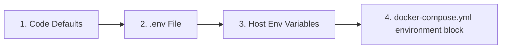

# 🐳 Guida avanzata a Docker

Per chi personalizza il deployment Docker, compila la propria immagine o fa manutenzione sul container.
Per una prima installazione, parti dalla [Guida all'installazione](../user/installation.md).

Due file Compose:

| File | Immagine che esegue |
| --- | --- |
| `docker-compose.prod.yml` | L'immagine ufficiale da GHCR. La guida all'installazione lo salva come `docker-compose.yml`. |
| `docker-compose.yml`, nel repository | Un'immagine compilata da te con `./dev.py docker build`. |

Dove si lanciano i comandi di questa pagina:

| Comando | Dove |
| --- | --- |
| `docker compose …` | Sull'host, nella cartella che contiene `docker-compose.yml` e `.env`. Non serve un checkout. |
| `./dev.py docker …` | Sull'host, nella radice di un checkout del repository. |
| `./dev.py docker exec <cmd>` | Dal checkout; il comando gira **dentro il container** in esecuzione ([dettagli](#docker-exec)). |
| `docker compose run --rm librefolio …` | Nella cartella di `docker-compose.yml`, con il server fermo: un container usa e getta ([correzioni](#post-migration-fixes)). |

## ⚠️ Prerequisiti

1. **Gruppo Docker (Linux)**, per usare Docker senza `sudo`. Sull'host:

    ```bash
    sudo usermod -aG docker $USER
    ```

    Poi esci e rientra, oppure esegui `newgrp docker`. Senza, ogni `docker` e `docker compose` fallisce con un errore di permessi.

2. **File `.env`**, accanto al file Compose. `./dev.py docker build` rifiuta di procedere senza. In un checkout:

    ```bash
    cp .env.example .env
    $EDITOR .env          # review and customize parameters
    ```

## 🏗️ Architettura

L'immagine è **solo runtime**: applicazione web (SvelteKit) e documentazione (MkDocs) sono compilate sull'host e copiate dentro; `./dev.py docker build` lo fa per te.
Fasi di build, contenuto e avvio: [Panoramica dell'architettura → Immagine Docker](../developer/architecture/overview.md#docker-image).

## 📄 `docker-compose.yml`

Definisce il servizio `librefolio` e la sua directory di dati persistenti.

### 🔝 Priorità di risoluzione {: #resolution-priority }

Dal più basso al più alto:



`.env` raggiunge il container tramite `env_file`; il blocco `environment:` lo sovrascrive.
Per i segnaposto `${…}` del file Compose, come `${PORT:-6040}`, una variabile della tua shell prevale su `.env`.

### 🔧 Servizio: `librefolio`

| Chiave | Valore | Da sapere |
| --- | --- | --- |
| 🏷️ `image` | `ghcr.io/librefolio/librefolio:latest` (file di produzione) o la tua `librefolio:latest` locale (file del repository) | `LIBREFOLIO_IMAGE` in `.env` sceglie un altro tag |
| 🏗️ `build` | Solo file del repository: compila il `Dockerfile` nella radice | Argomenti `UID`, `GID` e `DOCS_VARIANT` |
| 🔌 `ports` | host `${PORT:-6040}` → container `6040` | `PORT` sceglie il lato host; dentro il container il server ascolta sempre su `6040`, l'unica porta dell'immagine |
| 📂 `volumes` | bind mount `./LibreFolio-data` → `/app/backend/data/prod-docker` | |
| 📝 `env_file: .env` | La tua configurazione (copiata da `.env.example`) | |
| 🌍 `environment` | `LIBREFOLIO_DATA_DIR` (percorso nel container), `HOST=0.0.0.0`, `PORT=6040` | Lasciale così. `PORT=6040` sostituisce la porta host del tuo `.env`: i comandi `dev.py` nel container ([`docker exec`](#docker-exec)) cercano il server sulla porta giusta, e `db upgrade` lo vede in esecuzione e rifiuta di partire |
| 🩺 `healthcheck` | `GET /api/v1/system/health` ogni 30 secondi | Dice solo a Docker che il server risponde |

!!! tip "📈 Monitorare LibreFolio: `/api/v1/system/ready`"

    Punta un monitor come **Uptime Kuma** o un orchestratore su `GET /api/v1/system/ready`, per esempio `http://your-server:6040/api/v1/system/ready` (con la tua `PORT`). Nessun accesso richiesto; basta il codice di stato:

    - **`200`**: pronto. `{"status": "ready", "checks": {"database": "ok", "migrations": "ok"}, "database_revision": "…", "mode": "normal", "app_version": "…"}`. `database_revision`: la migrazione del database; `app_version`: la versione in esecuzione, la stessa del `GET /api/v1/system/info` pubblico, così un monitor verifica la versione dopo un aggiornamento.
    - **`503`**: non pronto. `status` è `not_ready`; `checks` mostra ciò che non è `ok`:

        | Controllo | Valore | Significato |
        | --- | --- | --- |
        | `database` | `unreachable` | Il database non risponde |
        | `migrations` | `behind` | Il database è a una migrazione più vecchia: una non è stata applicata, o è fallita |
        | `migrations` | `ahead` | Il database è a una migrazione che questa versione non conosce: i dati vengono da un LibreFolio più recente. Usa quella versione o una più recente: [Mai all'indietro](backup_moving.md#never-backwards) |
        | `migrations` | `unknown` | Non può dirlo, per esempio mentre il database è `unreachable` |

    La risposta non include mai dettagli né percorsi: LibreFolio li scrive nel proprio log (`docker compose logs librefolio`) come `Instance not ready`, una volta per ogni cambio di stato. `db current` mostra la migrazione del database ([Applicare le migrazioni](cli_tools.md#apply-migrations)).

### 💾 Directory dei dati: `LibreFolio-data/`

**Bind mount** accanto al file Compose: database SQLite, caricamenti personalizzati, report dei broker, log.
Sopravvive ad arresto, riavvio e rimozione del container; la salvi direttamente dall'host.

### 👤 Utente e permessi

Il container parte come root solo per cedere tutta `LibreFolio-data/` all'utente LibreFolio, a ogni avvio; poi esegue il server come quell'utente **non-root**: sull'host i file appartengono al suo UID/GID.
`./dev.py docker exec` usa lo stesso UID/GID ([dettagli](#docker-exec)).

L'UID/GID viene dagli **argomenti di build** `UID` e `GID`, conservati nell'immagine come `LIBREFOLIO_UID` e `LIBREFOLIO_GID` e letti dall'entrypoint a ogni avvio.

| Immagine | UID/GID |
| --- | --- |
| Ufficiale su GHCR | `1000:1000`. Le due righe di `.env` qui sotto non hanno effetto. |
| `./dev.py docker build` | Gli id dell'utente che lo esegue, qualunque cosa dica `.env`. |
| `docker compose build` | `UID` e `GID` letti da `.env` (predefiniti `1000`). |

Per far corrispondere gli id all'utente host, o all'utente dedicato, che deve possedere i dati, **in `.env`**:

```bash
UID=1000
GID=1000
```

Hanno effetto solo quando `docker compose build` ricompila l'immagine: `.env` arriva al container anche tramite `env_file`, ma un riavvio non cambia gli id.

- Sull'**host**, `ls -l LibreFolio-data/` mostra utente e gruppo di quel UID/GID secondo `/etc/passwd` e `/etc/group` dell'host.
- **Dentro il container**, gli stessi file appaiono di solito come `librefolio:librefolio`: stesso UID/GID numerico, risolto con i `/etc/passwd` e `/etc/group` del container.

??? tip "Promemoria Linux: utenti, gruppi e ID"

    Tutti i comandi: sull'host.

    **Il tuo UID e GID:**

    ```bash
    id -u              # your user ID (e.g. 1000)
    id -g              # your primary group ID (e.g. 1000)
    id                 # full info: uid, gid, groups
    ```

    **UID/GID di un altro utente:**

    ```bash
    id -u username     # UID of 'username'
    id -g username     # primary GID of 'username'
    ```

    **Un nuovo gruppo:**

    ```bash
    sudo groupadd librefolio          # create group (auto-assigns GID)
    sudo groupadd -g 1500 librefolio  # create group with specific GID
    ```

    **Un nuovo utente:**

    ```bash
    # System user (no home, no login — ideal for services)
    sudo useradd --system --no-create-home --gid librefolio --shell /usr/sbin/nologin librefolio

    # Regular user with home directory
    sudo useradd -m -g librefolio librefolio
    ```

    **Gli id assegnati:**

    ```bash
    id librefolio
    # → uid=998(librefolio) gid=998(librefolio) groups=998(librefolio)
    ```

    **Il tuo utente in un gruppo:**

    ```bash
    sudo usermod -aG librefolio $USER
    newgrp librefolio    # activate in current session (or log out/in)
    ```

    **Verifica dell'appartenenza:**

    ```bash
    groups $USER         # list all groups for your user
    ```

    **Proprietà della directory dei dati:**

    ```bash
    sudo chown -R librefolio:librefolio ./LibreFolio-data
    ```

    Poi metti in `.env` l'UID/GID corrispondente e ricompila con `docker compose build`: a ogni avvio il container restituisce la directory all'UID/GID dell'immagine.

## 🛠️ Comandi CLI

**Dove: radice di un checkout del repository.** `dev.py` incapsula le operazioni Docker:

```bash
./dev.py docker build          # Build image (auto-builds frontend + docs)
./dev.py docker build --light  # Light variant: no documentation screenshots (tagged *-light)
./dev.py docker build --no-cache  # Full rebuild without Docker cache
./dev.py docker rebuild        # Build → stop → restart (one-step deploy)
./dev.py docker up             # Start containers
./dev.py docker down           # Stop containers
./dev.py docker logs -f        # Follow container logs
./dev.py docker status         # Show container status
./dev.py docker exec <cmd>     # Run a dev.py command inside the container
```

**Senza checkout**, nella cartella di `docker-compose.yml`, il lavoro quotidiano:

| Azione | Comando |
| --- | --- |
| Avviare | `docker compose up -d` |
| Fermare | `docker compose down` |
| Seguire il log | `docker compose logs -f` |
| Stato del container | `docker compose ps` |

Varianti dell'immagine:

- `--light` compila l'immagine senza gli screenshot della documentazione, caricati poi dal sito online ([Varianti dell'immagine](../user/installation.md#image-variants-full-and-light)).
- Tag locali: `librefolio:<version>` e `librefolio:latest` per l'immagine completa, `librefolio:<version>-light` e `librefolio:latest-light` per la light; `<version>` è la versione git del checkout. Sul registry, invece, `latest` è la variante light e `latest-light` non esiste.
- Per eseguire la tua build light con il file Compose del repository, **in `.env`**: `LIBREFOLIO_IMAGE=librefolio:latest-light`.

??? warning "🧱 Quando `./dev.py docker build` si ferma"

    **Una risorsa non può essere scaricata.** La build mette in cache risorse esterne (font Noto Color Emoji per le bandiere su Windows, MathJax per le formule, Mermaid per i diagrammi) così che l'immagine funzioni offline. Se una manca e non c'è copia in cache, la build si ferma:

    ```text
    ❌ Resource cache incomplete — the build would ship without these:
       - noto-color-emoji: ...
    ```

    La **prima build richiede internet** (o una cache precaricata). Con la rete, rilancia la build; `./dev.py cache js` aggiorna la cache a mano (`--force` riscarica tutto).

    **Il frontend è una build di debug.** L'immagine deve contenere la build di produzione dell'applicazione web. `./dev.py docker build` ricompila `frontend/build/` in produzione quando l'ultima build era di debug (`./dev.py server --test`, `./dev.py server --debug`, test runner), quando le sorgenti sono cambiate o quando non è stata compilata per questa versione ([dettagli](../developer/dev_workflow.md#docker-build-steps)). `docker build` o `docker compose build` saltano quel passo: con `frontend/build/` in debug o strumentata per la copertura, la build si ferma:

    ```text
    ERROR: /build is not a production frontend build: it is a debug build (.build-debug = 1)
    Rebuild it with './dev.py front build', then build the image again.
    ```

    Esegui `./dev.py front build`, poi ricompila l'immagine; oppure compila con `./dev.py docker build`.

??? tip "🖼️ Compilare un'immagine completa con gli screenshot della documentazione"

    Un'immagine completa contiene gli screenshot solo se generati, e documentazione ricompilata con essi, **prima** della build: altrimenti completa e light locali sono identiche a parte il tag. Nel checkout:

    ```bash
    ./dev.py mkdocs gallery   # generate the screenshots
    ./dev.py mkdocs build     # rebuild the documentation with the screenshots
    ./dev.py docker build     # build the full image; it rebuilds for production the debug frontend the gallery leaves
    ```

    `./dev.py mkdocs gallery` richiede un ambiente completo (`pipenv`) e i browser Playwright. Avvia un proprio server di test e popola il database di test (`--no-populate` salta il ripopolamento). Richiede alcuni minuti.

### 📡 `docker exec` — Eseguire comandi dentro il container {: #docker-exec }

**Dove: dal checkout; il comando gira nel container in esecuzione**, con l'utente del server: il `LIBREFOLIO_UID:LIBREFOLIO_GID` numerico dell'immagine (Utente e permessi, sopra), non root. I file creati in `LibreFolio-data/` appartengono subito a quell'utente. Per esempio:

```bash
./dev.py docker exec user create admin admin@example.com Pass123!
./dev.py docker exec user list
```

**Senza checkout**, nella cartella di `docker-compose.yml`, `./dev.py docker exec user list` equivale a questa riga (`gosu`, usato anche dall'entrypoint, passa agli id dell'immagine prima che `dev.py` parta):

```bash
docker compose exec librefolio sh -c 'exec gosu "${LIBREFOLIO_UID:-1000}:${LIBREFOLIO_GID:-1000}" python dev.py "$@"' sh user list
```

Un semplice `docker compose exec librefolio python dev.py <cmd>` gira come root: ciò che crea in `LibreFolio-data/` appartiene a root fino al successivo avvio, quando l'entrypoint restituisce la directory all'utente dell'immagine.

| Comando | Nell'immagine |
| --- | --- |
| `user`, `db`, `info`, `backup` | Funzionano ([Backup con Docker](cli_backup.md#backup-docker)) |
| `test`, `i18n`, `mkdocs translate`, `mkdocs translate-validate` | Elencati, ma rispondono solo che *non sono disponibili in questa installazione*: l'immagine contiene l'applicazione, non l'albero di sviluppo |
| `./dev.py docker exec test db populate` | Stessa risposta *non disponibile* di ogni comando `test` |
| `./dev.py docker exec server --test` | Si ferma con `Frontend build failed. Server not started.`: la modalità test ricompila l'applicazione web in debug, che richiede Node.js e le sorgenti; l'immagine ha solo la build di produzione, senza Node.js. Come `./dev.py mkdocs gallery`, appartiene a un checkout di sviluppo |

**Le migrazioni del database non richiedono alcun comando.** Il server applica quelle in sospeso a ogni avvio: dopo `docker compose pull` e `docker compose up -d` non c'è altro da fare; `docker compose restart librefolio` le riprova dopo un errore.
Il riavvio non aiuta quando l'aggiornamento alla 1.3 si ferma perché due account hanno lo stesso indirizzo email a meno delle maiuscole: separa prima i due account, come spiega «Due account con lo stesso indirizzo email» in [Strumenti da riga di comando](cli_tools.md).
Non usare `./dev.py docker exec db upgrade`: `db upgrade` richiede il server fermo, e nel container il server è il processo principale, sempre in esecuzione.

## 🩹 Correzioni post-migrazione {: #post-migration-fixes }

A ogni avvio, subito dopo le migrazioni in sospeso, il server esegue le **correzioni post-migrazione**: riparazioni che una migrazione non può fare. Cosa riparano e cosa dice il log: [Strumenti da riga di comando → Correzioni post-migrazione](cli_tools.md#post-migration-fixes). In Docker:

- il log è l'output del container (`./dev.py docker logs` o `docker compose logs`), salvato anche in `LibreFolio-data/logs/`;
- la copia conservata da una correzione fallita sta accanto al database, in `LibreFolio-data/sqlite/`, per esempio `app.db.pre-autoincrement-20261008T101500Z.bak`.

### ⏹️ Eseguire le correzioni con il server fermo

Per vedere in anteprima le correzioni, o riprovarne una fallita all'avvio e leggerne l'errore.
`docker exec` richiede il container in esecuzione: `docker compose run` sostituisce invece il server con il tuo comando, in un container usa e getta.

**Dove: cartella di `docker-compose.yml`.** Prima sempre l'anteprima con `--dry-run`:

```bash
docker compose stop librefolio
docker compose run --rm librefolio python -m backend.app.db.post_migration --dry-run   # preview: changes nothing
docker compose run --rm librefolio python -m backend.app.db.post_migration             # apply the fixes
docker compose start librefolio
```

Risultato: lo script lavora sullo stesso database e directory dei dati del server e riporta ciò che trova:

```text
Database: /app/backend/data/prod-docker/sqlite/app.db
Integrity check: ok
Fix autoincrement: would_apply
Orphan broker folder: broker_reports/uploaded/broker_7
```

Ogni correzione è `clean` (niente da fare), `would_apply` (dry run), `applied` o `failed`; elenca anche un backup conservato, gli errori e ogni trasferimento di titoli inviato a un broker eliminato, con il costo che comporta o il motivo per cui resta com'è ([dettagli](cli_tools.md#post-migration-fixes)).
Codice di uscita `0` quando nulla è fallito, dry run incluso; `1` se è fallita una correzione, il controllo di integrità o la conversione di quei trasferimenti.

## 🧪 Modalità test

L'immagine non ha una modalità test: ascolta solo su `6040`, il server di produzione, ed entrambi i file Compose pubblicano solo quella porta.
Il server di test (`./dev.py server --test`, porta `6041` per impostazione predefinita) è uno strumento per sviluppatori: **sull'host, da un checkout dei sorgenti**. Il suo database, `backend/data/test/sqlite/app.db` per impostazione predefinita, è separato da `LibreFolio-data/`; `./dev.py test db populate --force` lo cancella e lo ricrea con dati fittizi.

Come avviarlo, e perché non parte nel container: [Flusso di lavoro dello sviluppatore](../developer/dev_workflow.md#docker-test-mode).

## 🏭 Considerazioni sulla produzione

### 🎮 1. Personalizzare `docker-compose.yml`

Le modifiche più comuni. Dopo (2)–(5), riavvia LibreFolio. Con Docker Compose, esegui `docker compose up -d`.

| # | Cosa | Dove e come |
| --- | --- | --- |
| (1) | Allineare UID/GID dell'host | Ricompila l'immagine con essi: `./dev.py docker build` come l'utente che deve possedere i file, oppure `UID=1001` e `GID=1001` in `.env` e poi `docker compose build` |
| (2) | Cambiare la porta di produzione | In `.env`: `PORT=3000` |
| (3) | Percorso dati personalizzato | In `docker-compose.yml`, il bind mount: `./my-data:/app/backend/data/prod-docker` |
| (4) | Tutta la configurazione | In `.env` (copiato da `.env.example`) |
| (5) | Eseguire un altro tag dell'immagine | In `.env`: `LIBREFOLIO_IMAGE`, per esempio `LIBREFOLIO_IMAGE=ghcr.io/librefolio/librefolio:1.1.0` |

Il primo account creato nel browser diventa l'amministratore: nessun comando. Per farlo creare a LibreFolio al primo avvio, da `LIBREFOLIO_ADMIN_EMAIL`: [L'amministratore iniziale](configuration_accounts.md#initial-admin).

??? example "📄 Il `docker-compose.yml` del repository, annotato"

    ```yaml
    services:
      librefolio:
        image: ${LIBREFOLIO_IMAGE:-librefolio:latest}  # (5) Built by ./dev.py docker build
        build:
          context: .
          args:
            UID: ${UID:-1000}              # (1) UID owning the data files (build time only)
            GID: ${GID:-1000}              # (1) GID owning the data files (build time only)
            DOCS_VARIANT: ${DOCS_VARIANT:-full}  # light = no documentation screenshots
        container_name: librefolio
        # No 'user:' directive — entrypoint starts as root, fixes permissions,
        # then drops to the numeric LIBREFOLIO_UID:LIBREFOLIO_GID via gosu, like ./dev.py docker exec.
        restart: unless-stopped
        ports:
          - "${PORT:-6040}:6040"           # (2) Production port — change via PORT in .env
        volumes:
          - ./LibreFolio-data:/app/backend/data/prod-docker  # (3) Persistent data (bind mount)
        env_file: .env                     # (4) All config from .env file
        environment:
          - LIBREFOLIO_DATA_DIR=/app/backend/data/prod-docker  # Docker-specific override
          - HOST=0.0.0.0
          - PORT=6040                      # The container's port; (2) sets the host side
        healthcheck:
          test: ["CMD", "python", "-c", "import urllib.request; urllib.request.urlopen('http://localhost:6040/api/v1/system/health')"]
          interval: 30s
          timeout: 10s
          start_period: 15s
          retries: 3
    ```

    `docker-compose.prod.yml` ha lo stesso servizio senza `build:`; la sua immagine predefinita è `ghcr.io/librefolio/librefolio:latest`.

### 🔒 2. Sicurezza ed esposizione (Tailscale e reverse proxy)

| Via | Quando | Guida |
| --- | --- | --- |
| **Tailscale** (consigliato, il più semplice) | HTTPS automatico, senza porte del router né DNS pubblico | [Guida all'esposizione con Tailscale](service_exposure.md) |
| **Reverse proxy classico** (Nginx, Traefik) | Hai già un'infrastruttura web, certificati SSL/TLS tuoi, più applicazioni su un server, header di sicurezza o limitazione della frequenza personalizzati | Sotto |

Una volta esposto, [Verifica della sicurezza della connessione](connection_checks.md) mostra come controllare che gli utenti si connettano in modo sicuro e, [dietro un reverse proxy](connection_proxy.md#reverse-proxy), che il cookie di sessione sia `Secure`.

Dietro un reverse proxy classico, **in `.env`** indica anche di quale proxy fidarsi (`FORWARDED_ALLOW_IPS`) o quale header contiene l'indirizzo del visitatore (`LIBREFOLIO_CLIENT_IP_HEADER`): altrimenti LibreFolio vede ogni visitatore con l'indirizzo del proxy, e lo segnala nel log e nei controlli di sicurezza. Vedi [L'indirizzo del visitatore](connection_proxy.md#client-address).

Nella configurazione del proxy, non comprimere di nuovo: LibreFolio comprime già con gzip (JSON delle API, JavaScript e CSS, pagine della documentazione) e invia immagini e flusso in tempo reale della ricerca degli asset così come sono.

### 💾 3. Backup del database

Il database sta in `LibreFolio-data/` accanto a `docker-compose.yml`: un bind mount leggibile dall'host, nessun `docker cp`.

!!! warning "Non copiare `app.db` da un container in esecuzione"

    SQLite gira in **modalità WAL** (`PRAGMA journal_mode=WAL`): le transazioni recenti stanno in `app.db-wal`, quindi un `cp` del solo `app.db` con il server attivo può dare un backup incoerente o obsoleto. Usa una delle procedure sotto.

**Dove: sull'host, cartella di `docker-compose.yml`.**

**Opzione A — Ferma il container, poi copia** (la più semplice):

```bash
#!/bin/bash
docker compose stop librefolio
cp ./LibreFolio-data/sqlite/app.db /path/to/backups/app.db-$(date +%F)
docker compose start librefolio
```

**Opzione B — Backup online con la CLI SQLite** (nessun downtime; richiede `sqlite3` sull'host):

```bash
#!/bin/bash
sqlite3 ./LibreFolio-data/sqlite/app.db ".backup '/path/to/backups/app.db-$(date +%F)'"
```

`.backup` usa l'API di backup online di SQLite, sicura con un database WAL attivo.

**Opzione C — `backup create`**, senza arresto né `sqlite3` sull'host. Dentro il container, dalla cartella di `docker-compose.yml`:

```bash
docker compose exec librefolio python dev.py backup create
```

Risultato: una copia coerente di database, file caricati, report dei broker e scenari di stress in un unico archivio, in una propria cartella di `LibreFolio-data/backups/`, con il server in funzione ([Backup con Docker](cli_backup.md#backup-docker)).
Un archivio in chiaro esclude `secrets/`, che contiene la chiave dell'istanza: salva quella cartella come spiega [Cosa sottoporre a backup](filesystem.md#what-to-back-up). Un [archivio sicuro](backup_restore.md#secure), con `--encrypt`, contiene la chiave, cifrata con la tua password.

Elenco completo di ciò che vale la pena salvare (file caricati, report originali dei broker): [Struttura del filesystem](filesystem.md).

File che puoi trovare accanto al database:

| File | Cosa fare |
| --- | --- |
| `app.db.pre-<fix>-<UTC time>.bak` | Copia conservata da una [correzione post-migrazione](#post-migration-fixes) fallita: cancellala quando non serve più |
| `app.db.post-migration.lock` | File di lock vuoto delle [correzioni post-migrazione](#post-migration-fixes), riutilizzato a ogni avvio. Lascialo: cancellarlo mentre il server parte potrebbe far sovrapporre due esecuzioni |

### 🔑 4. Variabili d'ambiente

Tutta la configurazione sta **in `.env`** (copiato da `.env.example`); lascia così le variabili Docker del blocco `environment:`. Ogni variabile e il suo effetto: [Guida alla configurazione](configuration.md).

🔐 **Utenti connessi tra i riavvii.** In `.env`, `JWT_SECRET` a una lunga stringa casuale, per esempio l'output di `openssl rand -hex 32`:

```bash
JWT_SECRET=<output of openssl rand -hex 32>
```

Riavvia LibreFolio. Con Docker Compose, esegui `docker compose up -d`.
Senza, LibreFolio genera una nuova chiave a ogni avvio: ogni riavvio o aggiornamento del container disconnette tutti.

### ✅ 5. Verificare l'immagine che scaricate {: #verify-image }

Ogni immagine su GHCR (`ghcr.io/librefolio/librefolio`, completa e light) ha una **attestazione di build**, firmata dalla pipeline di rilascio del repository del progetto: questa esatta immagine è stata compilata lì da questo codice. Nessuna nostra chiave da conservare o perdere (GitHub dimostra l'identità dell'esecuzione, Sigstore la registra): chiunque può verificarla.

**Dove: dove hai Docker e la [GitHub CLI](https://cli.github.com/).**

1. Prendi il digest dell'immagine scaricata:

    ```bash
    # The digest of a tag (the line "Digest: sha256:…")
    docker buildx imagetools inspect ghcr.io/librefolio/librefolio:1.3.0
    ```

2. Chiedi a GitHub di verificarlo:

    ```bash
    # Verify the attestation of that digest
    gh attestation verify oci://ghcr.io/librefolio/librefolio@sha256:<digest> --owner Librefolio
    ```

    Risultato: `✓ Verification succeeded!` con repository e workflow che l'hanno compilata. Solo un errore → questo digest non viene dalla pipeline di LibreFolio: non eseguirlo.

L'attestazione copre ogni tag che punta allo stesso digest (`1.3.0`, `latest`...). Le release precedenti a questo controllo non ne hanno.

---

## 🔗 Correlati

- 📄 **[Guida all'installazione](../user/installation.md)** — Prima installazione, Varianti dell'immagine
- 📄 **[Strumenti da riga di comando](cli_tools.md)** — Applicare le migrazioni, Correzioni post-migrazione
- 📄 **[Backup](cli_backup.md#backup-docker)** — Backup con Docker
- 📄 **[Struttura del filesystem](filesystem.md)** — Cosa sottoporre a backup
- 📄 **[Verifica della sicurezza della connessione](connection_checks.md)** — Dietro un reverse proxy, L'indirizzo del visitatore
