# 📬 Email: Links and Messages

The messages LibreFolio sends once email works, flow by flow:

- the **links** for invitations and password resets;
- **forgotten passwords**;
- the **limits** on those emails;
- the **verification** of new addresses;
- the notice of an **address change**.

Email has to work first: the SMTP variables, the **Email** tab and the test email are in [Email](email.md).
When a message does not go out: [Email: When It Does Not Work](email_troubleshooting.md).

---

## 🌐 Emails with a Link {: #public-url }

An invitation or password-reset link sent by email is built **only** from `LIBREFOLIO_PUBLIC_URL`.
Never from the address the browser used, nor from anything else in a request.

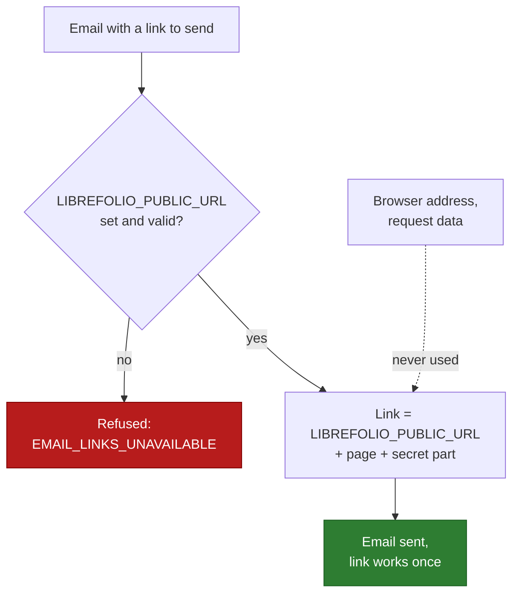

The email names the instance, by the host of `LIBREFOLIO_PUBLIC_URL`, and says how long the link is valid.

```text
https://librefolio.example.com/reset-password#token=…
```

!!! info "🛡️ Why"

    Anyone can send LibreFolio a request that names another address.
    If the link were built from the request, a stranger could have LibreFolio email one of your users a real link
    to a site of theirs, and catch its secret part when the user opens it.

**Where to set it: LibreFolio's `.env` file.** The address your users open LibreFolio at:

```bash
LIBREFOLIO_PUBLIC_URL=https://librefolio.example.com
```

| Rule | Value |
| --- | --- |
| Scheme | `http://` or `https://`, then a host name |
| Forbidden | user name or password, `?` or `#`, spaces |

It is the same variable the command line puts in front of the links it prints: [Accounts and Sign-ups](configuration_accounts.md#accounts).

**The «no» branch** of the diagram (variable missing, or an address that breaks these rules), besides the `EMAIL_LINKS_UNAVAILABLE` refusal:

- the test email still works;
- **Require Email Verification** cannot be turned on ([Email Verification](#verification));
- the links you copy, from the [command line](cli_tools.md) for one, stay as they are.

**How long the links are valid**, written in the email:

| Link | Valid for |
| --- | --- |
| New invitation | 7 days |
| Password reset | 30 minutes |
| Verification | 24 hours |
| Setup of the initial administrator | 72 hours |

**The secret part** of the link comes after `#`: browsers never send it to the server, so it stays out of server and proxy logs.

**To check it:**

- With email **Ready**, Settings › Administration › Email shows a notice when `LIBREFOLIO_PUBLIC_URL` is not set or cannot be used, and the start log has a line ([What the Log Says](email_troubleshooting.md#logs)).
- Once it can be used, the tab shows the address and checks, from your browser, that this instance answers there: [The Address in Emailed Links](email.md#links-check).
- From anywhere, `/api/v1/system/instance` shows `"links": true` when both email and the address are fine.

---

## 📨 Links Sent by an Administrator {: #admin-links }

An invitation or password-reset link created by an administrator can be sent by email, instead of being copied by hand.

Condition: email **Ready** and a usable `LIBREFOLIO_PUBLIC_URL` ([Emails with a Link](#public-url)).
Then the invitation and password-reset dialogs of [Users & Invitations](users.md#send-by-email) show **Send by email** under the link.

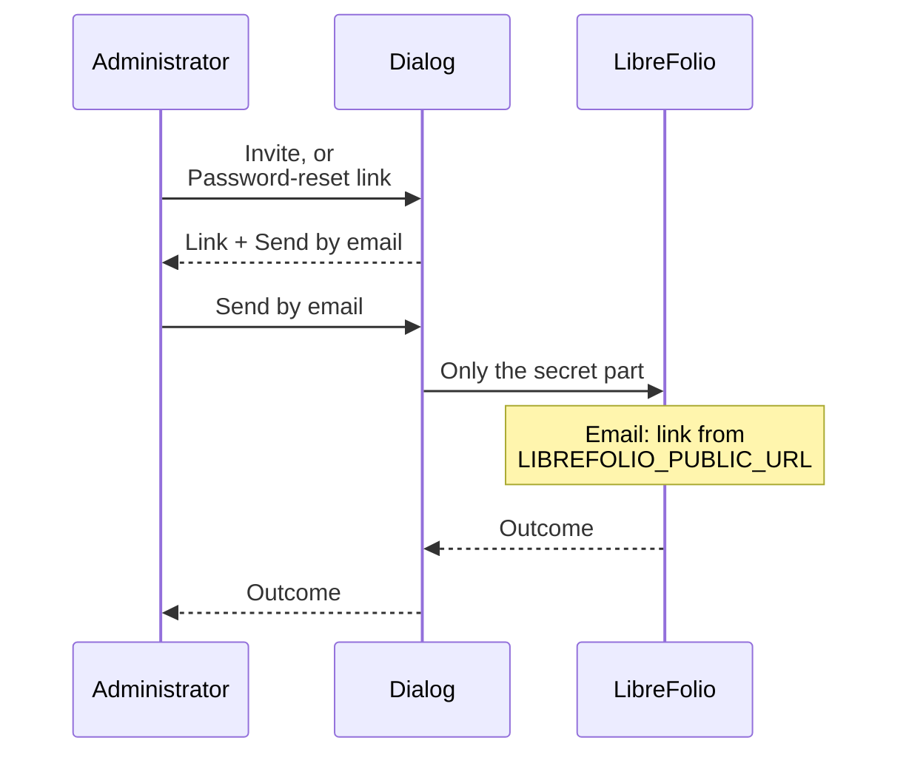

**The outcome**, shown in the dialog:

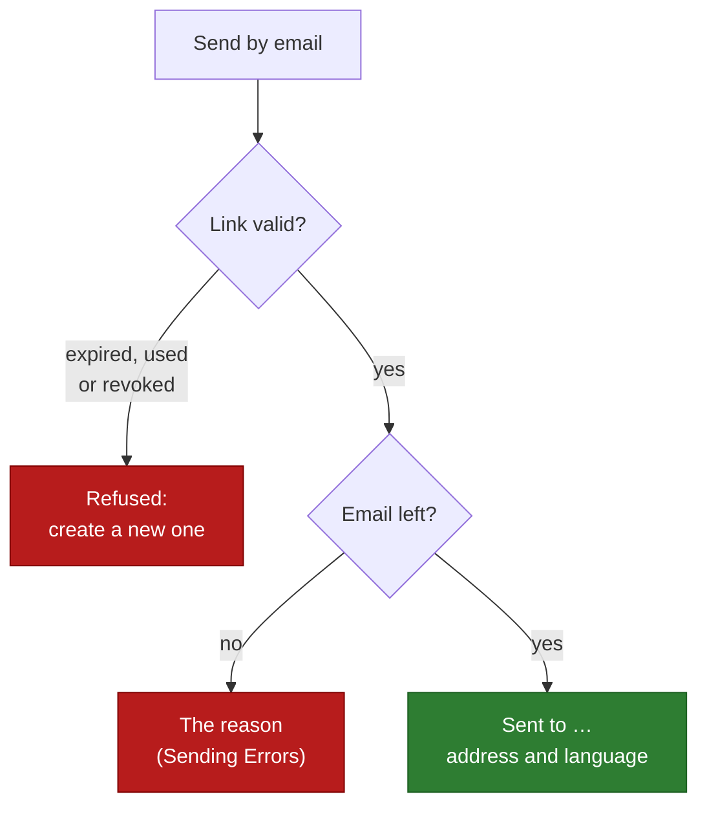

| | Invitation | Password-reset link |
| --- | --- | --- |
| **Send to** | Starts with the address written in the invitation; you can change it. | No field: it goes to the address of its account. |
| **Language of the email** | Chosen in the dialog (table below); without a choice, the instance's **Default Language**. | The language of its account. |
| Content | Names you as the person who invites and says, when it is the case, that the new account will be an administrator. | — |
| Condition | — | Only while the account is active. |

| Language choice | Effect |
| --- | --- |
| **The instance's language** | The email is in the instance's **Default Language** ([Global Settings](settings.md)). |
| English, Italiano, Français, Español | For someone who reads another one. |

The language of the email is the email's only: it does not become the language of the account the invitation creates.

To set the **Default Language** before an administrator has saved it, **in the `.env` file** (`en`, `it`, `fr` or `es`):

```bash
LIBREFOLIO_DEFAULT_LANGUAGE=it
```

See [Environment Variables](configuration_accounts.md#accounts).

- **The link in the email starts with `LIBREFOLIO_PUBLIC_URL`**, whatever **Server address** the dialog shows: only the secret part of the link travels from the dialog. The dialog says so above the button.
- Why an email did not go out: [Sending Errors](email_troubleshooting.md#sending-errors).
- Each email counts against the hourly limit.

---

## 🗝️ Forgotten Passwords {: #forgot-password }

Someone who forgot their password can ask for a reset link by email, with their username or email address, without signing in.

**Before the answer:**

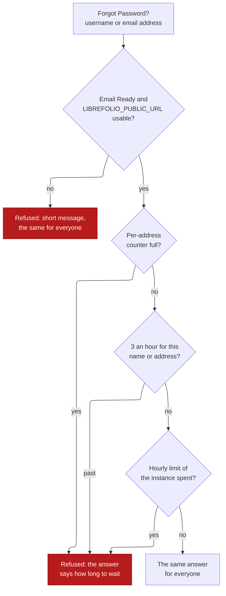

**After the answer, silently:**

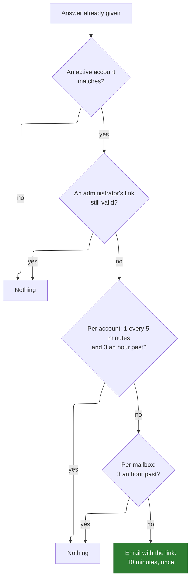

The email with the link is in the account's language.

**The same answer for everyone**, whether an account matches or not:

> If an active account matches, its owner gets an email with a link to choose a new password

The search for the account and the sending come after the answer: nobody can use it to find out which accounts exist.

- **The account** is found as the login finds it: username or email address. The email goes to its address.
- **The link** replaces the reset links that earlier requests sent the account. A link created by an administrator, instead, is never cancelled by a request.

It is safe because changing an account's email address asks for the current password ([Profile](../user/settings/profile.md)): see [Security Notes](email_troubleshooting.md#security).

**The login page:**

| State of the instance | What the page shows |
| --- | --- |
| Email **Ready** and a usable `LIBREFOLIO_PUBLIC_URL` | **Forgot Password?** opens the form for it, without the server commands (they stay in [Command-Line Tools](cli_tools.md#reset-a-password-or-lock-an-account)). After a request the form says *Email sent: check your spam folder too.*, the same for everyone, and its button counts down 5 minutes, the interval for one account, before the next request; a reload of the page keeps the countdown. |
| Otherwise | That command, open, under the warning: *Email recovery is not available on this instance. Reset your password from the server terminal, or ask your administrator for a password-reset link.* |
| The page cannot read the instance's configuration from the server | Only the advice: *Ask your administrator for a password-reset link: they can create one for your account.* |

An administrator creates that link in **Settings › Administration › Users**, even without email ([Password-Reset Links](users.md#reset-links)).

**The limits:**

| Limit | Past it |
| --- | --- |
| `LIBREFOLIO_SIGNUP_EMAILS_PER_ADDRESS` requests an hour (20 by default) from the same address. A count shared with the registrations and with **Send the link again** ([Limits on Activation and Password-Reset Emails](#activation-limits)). An IPv6 address counts by its /64, the block one subscriber usually holds. | Refused until a place frees in that count, or in the hourly limit of the instance if that one waits longer. The answer says how long. |
| 3 requests an hour for the same username or email address, whether an account matches or not | Refused until the oldest of them is an hour old. |
| The hourly limit of the instance, `LIBREFOLIO_SMTP_MAX_PER_HOUR` | Refused until an email fits again. |
| 3 emails an hour to the same mailbox, whatever account they are for and however its address is written | Nothing is sent; the answer stays the same. |
| 1 email every 5 minutes, and 3 an hour, for the same account, the links created by an administrator included | Nothing is sent; the answer stays the same. Two requests at the same moment cannot both be sent. |

Where the counts live:

- the limit per account counts the account's reset links in the database;
- the others are kept in the memory of each server process: with several processes, each has its own count, and a restart forgets them;
- a reset email that did not go out still counts, for the account and for the mailbox.

**One mailbox, however its address is written.** The limit per mailbox counts the aliases of an address as one mailbox:

| Spelling | Mailbox counted |
| --- | --- |
| Capitals | Do not count. |
| `name+news@example.com` | `name@example.com`: a `+tag` does not count, on any domain. |
| `first.last@googlemail.com` | `firstlast@gmail.com`: the dots of a Gmail address do not count, and `googlemail.com` is `gmail.com`. |

- The limits of the [verification emails](#verification-limits) and of the [notices of an email change](#email-change-notice) count the same way.
- Each email still goes to the address exactly as the account has it.
- A mailbox that takes mail under any name, such as a catch-all domain or Fastmail's `anything@user.fastmail.com`, counts each name apart: only the hourly limit of the instance holds those back.

**Behind a reverse proxy**, the address that counts is the visitor's, as LibreFolio reads it ([The Visitor's Address](connection_proxy.md#client-address)):

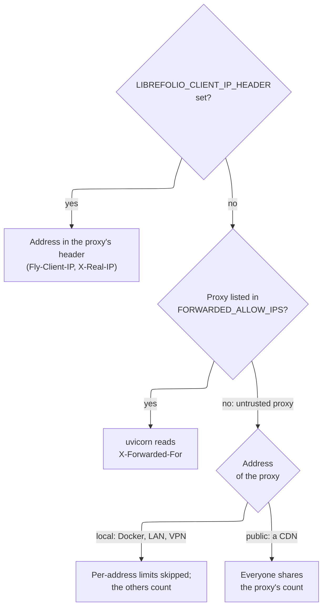

- **With `LIBREFOLIO_CLIENT_IP_HEADER`**, **in the `.env` file**, LibreFolio reads the address in the header your proxy sets with the visitor's address (`Fly-Client-IP` on Fly.io, `X-Real-IP` from Nginx):

    ```bash
    LIBREFOLIO_CLIENT_IP_HEADER=X-Real-IP
    ```

    Set it only if every request crosses that proxy: a visitor who reaches LibreFolio directly could write the header.

- **Otherwise** it is the address the server (uvicorn) sees. uvicorn takes the visitor's address from the proxy's `X-Forwarded-For` header only when the proxy's address is listed in `FORWARDED_ALLOW_IPS` (`127.0.0.1` when not set). List your proxy's addresses or networks there, **in the `.env` file**:

    ```bash
    FORWARDED_ALLOW_IPS=172.18.0.0/16
    ```

    Never `*`: uvicorn would take the first address of the header, which the visitor can write.

- **An untrusted proxy on a local address**, such as a proxy container in front of the Docker image, the usual setup: a visitor cannot use up the count of **Forgot Password?**, **Send the link again** and the registrations for everyone. The limits per username or email address, per account and per mailbox, and the hourly limit of the instance, still count. The log warns once per server process, and the security checks report it as a warning of `platform.client_address` ([The Visitor's Address](connection_proxy.md#client-address)).
- **An untrusted proxy on a public address**, such as a CDN: the first `LIBREFOLIO_SIGNUP_EMAILS_PER_ADDRESS` requests of anyone use up the count through the proxy for everyone, for up to an hour. Tell LibreFolio about the proxy.

---

## 🚦 Limits on Activation and Password-Reset Emails {: #activation-limits }

The emails that activate an account and the ones that reset a password are held back by **two counters**, the same for every way to ask for them.
Each counts over the last 60 minutes, in the memory of each server process.

| Counter | Variable | Default | What it counts |
| --- | --- | --- | --- |
| **Per address** | `LIBREFOLIO_SIGNUP_EMAILS_PER_ADDRESS` | 20 an hour | The emails that leave for one client address (an IPv6 address by its /64), in one count: the registrations, every **Send the link again** with the right password and every **Forgot Password?** for an account that exists. Tries are not counted (diagram below). |
| **Per instance** | `LIBREFOLIO_SMTP_MAX_PER_HOUR` | 50 an hour | Every email the instance sends: activations, resets, invitations, notices. |

**The per-address counter counts the emails that leave, not the tries:**

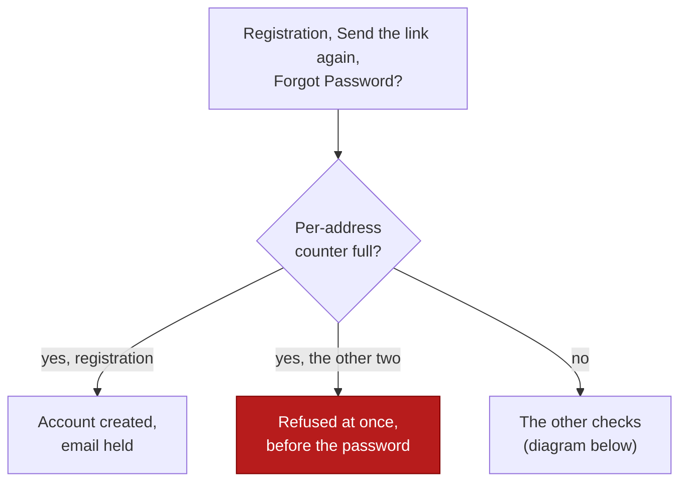

**When the counter is not full**, the place is spent only if the other checks pass:

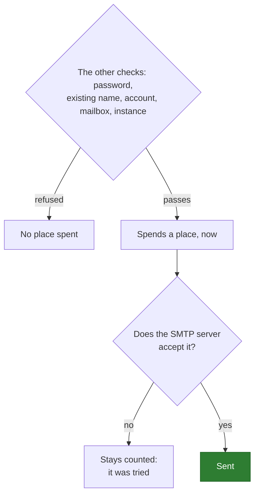

These cost it nothing:

- a wrong password: it has its own limit;
- a request for a name no account has (for **Forgot Password?**, the answer is the same whether an account matches or not);
- a request refused by another limit, such as a **Send the link again** refused by the limit per account or per mailbox.

Three more limits stay as they are. They are not counters of activation emails, and they rarely matter for an account whose email was held: nothing has reached its mailbox yet.

| Limit | Applies to |
| --- | --- |
| The sign-in's limit on **wrong passwords** ([Failed Sign-ins](configuration_accounts.md#login-limit)) | **Send the link again**, which shares it with the login page. |
| **3 emails an hour to the same mailbox** | LibreFolio cannot be used to flood someone else's address. |
| **1 email every 5 minutes, and 3 an hour, for the same account** | **Send the link again**. |

**How long to wait.** The answer says how many seconds to wait, and that time is exact: the **longest** of the waits of the counters that held the request back.
The same request made at that moment goes through, unless others from the same network used the place meanwhile: the answer then says the new time.

**An example.** An office with one internet address and a limit of 20.

| Time | What happens |
| --- | --- |
| 9:00 – 9:40 | Twenty colleagues register: their twenty emails leave. |
| 9:45 | The twenty-first, Mario, registers. His account is created, but his email is held: the page tells him to try again in about 15 minutes, the time until the 9:00 email leaves the count at 10:00. |
| 9:46 | Mario signs in and asks for the link again: the same counter refuses him, for 14 minutes. |
| 10:00 | He asks again with username and password: the link leaves. |

The per-address counter is shared on purpose, with a consequence to know: when a network has used up its count with registrations, **Forgot Password?** from that network waits too, until a place frees.

For a network where many people sign up together, such as a school or an office, raise `LIBREFOLIO_SIGNUP_EMAILS_PER_ADDRESS` **in the `.env` file**.
Restart LibreFolio. With Docker Compose, run `docker compose up -d`.

---

## ✅ Email Verification {: #verification }

With **Require Email Verification** on, a new account cannot sign in until its owner confirms the address with a link that LibreFolio emails to the account.

**Where:** the switch is in **Settings › Administration › Global Settings**, **Security** category ([Global Settings](settings.md)). It is off by default.

**The registration:**

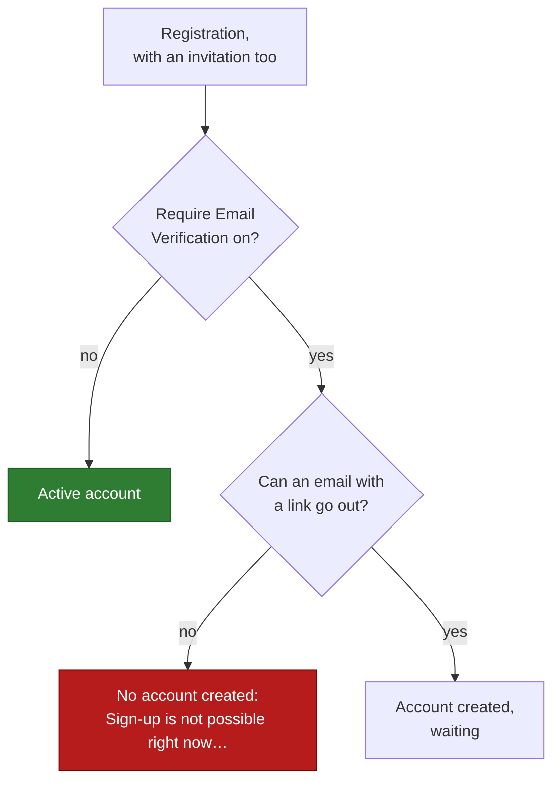

**Then the verification email:**

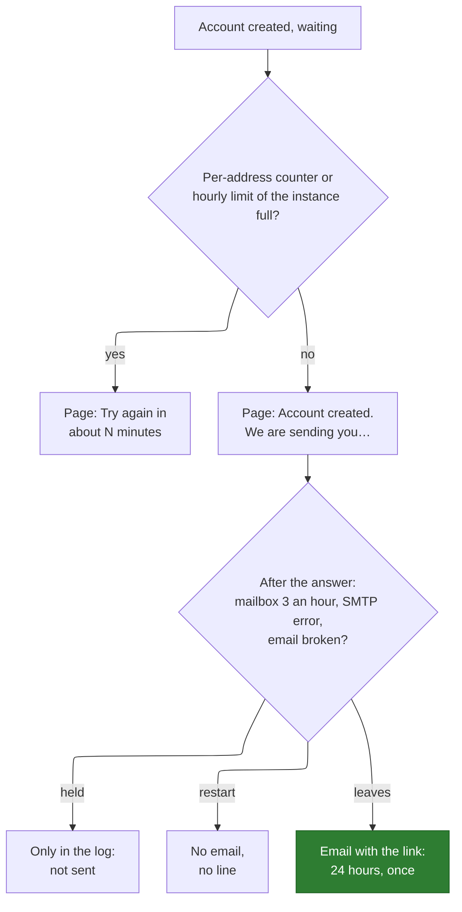

**Finally the click on the link:**

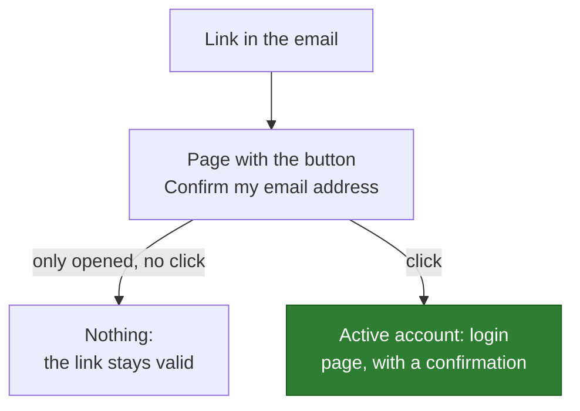

**Who waits:** every account created from the registration page while the switch is on, the ones opened with an invitation included.

They never wait:

- the first account of a new instance, its administrator;
- the administrator LibreFolio creates from `LIBREFOLIO_ADMIN_EMAIL`, activated by its setup link;
- the accounts created with `user create` on the [command line](cli_tools.md);
- the accounts that already exist.

**The texts of the login page** right after the registration:

| Case | Text |
| --- | --- |
| The email can leave | *Account created. We are sending you an email with a link to activate it: open it within 24 hours, then sign in. No email after a few minutes? Check the spam folder, then sign in with your username and password: you will be offered a new link.* |
| The client address already had the emails of `LIBREFOLIO_SIGNUP_EMAILS_PER_ADDRESS` registrations (20 by default) in the last hour, or the hourly limit of the instance is spent | *Account created, but the activation email could not leave now. Try again in about N minutes: sign in with your username and password, and you will be offered a new link.* |

- N is exact: the time until both counters admit a new email ([Limits on Activation and Password-Reset Emails](#activation-limits)).
- Behind a reverse proxy LibreFolio does not trust, on a local address (the usual Docker setup), nothing is counted per address, so the second text never shows ([Forgotten Passwords](#forgot-password)).
- *We are sending you an email* means that the email is queued, not that it was delivered: it leaves after the answer, and it can still not go ([Limits of the Verification Emails](#verification-limits)).

**The email**, *Confirm your email address*, is in the instance's **Default Language**: a new account has no language of its own yet.
Its link starts with `LIBREFOLIO_PUBLIC_URL` ([Emails with a Link](#public-url)).

!!! info "🔍 Why a click is needed"

    The mail filters that scan links, such as Microsoft Defender Safe Links, open the links of a message in a
    browser that runs scripts: if opening were enough, the filter would activate the account in place of its owner.
    Such an opening spends nothing; the link stays valid for its owner.
    Someone who opens a link without having signed up has only to close the page.

**Until the address is confirmed**, the account cannot sign in, but it can ask for a new link:

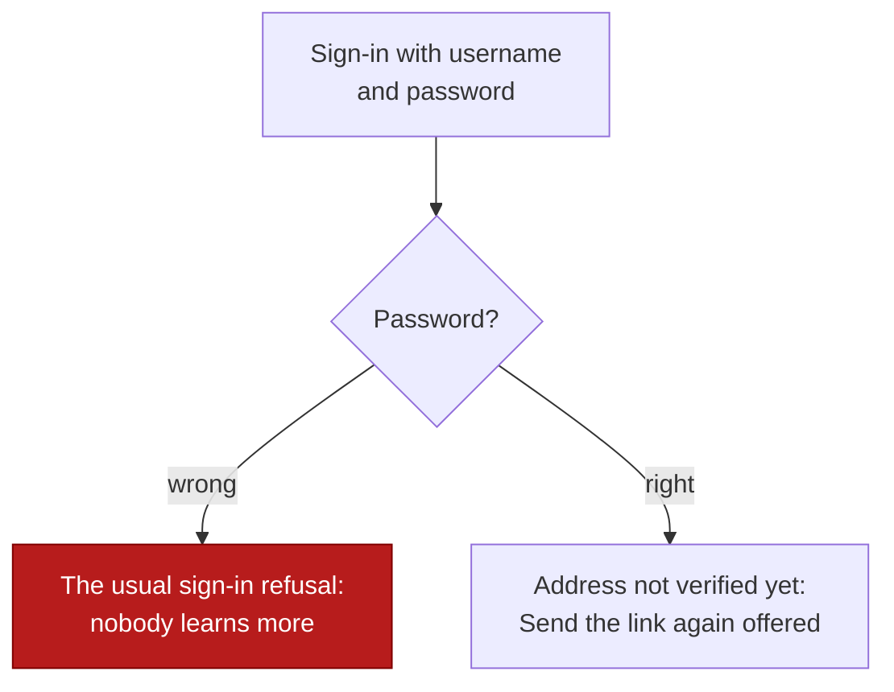

**Send the link again**, the first checks:

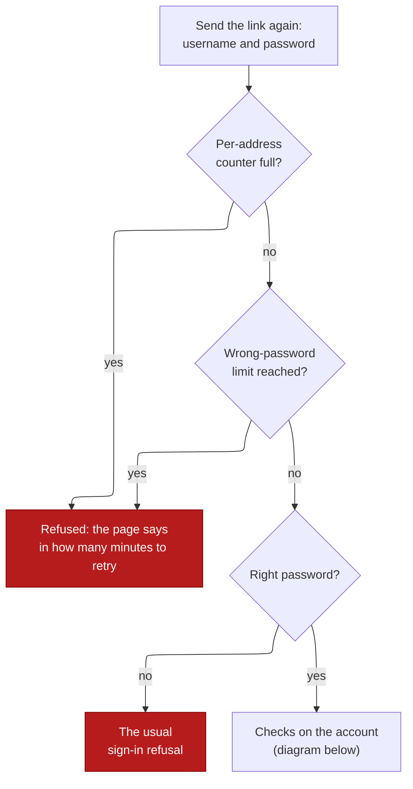

**With the right password**, the checks on the account:

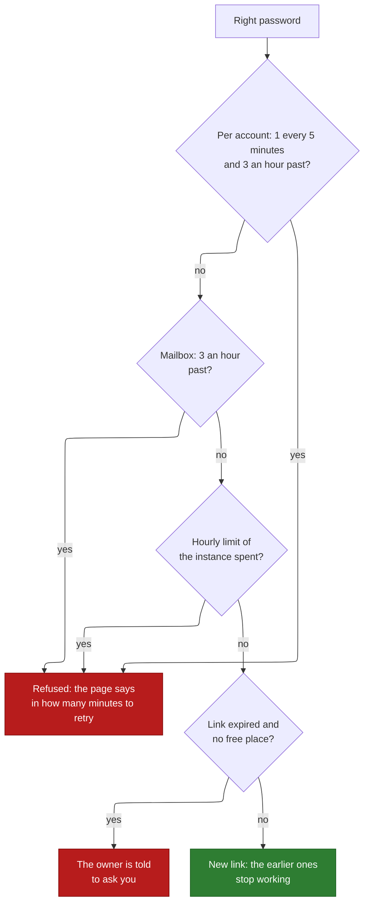

What the person sees, step by step: *If LibreFolio Asks You to Confirm Your Email* in [Getting Started](../user/getting-started.md).

### 🔀 Turning It On and Off {: #verification-switch }

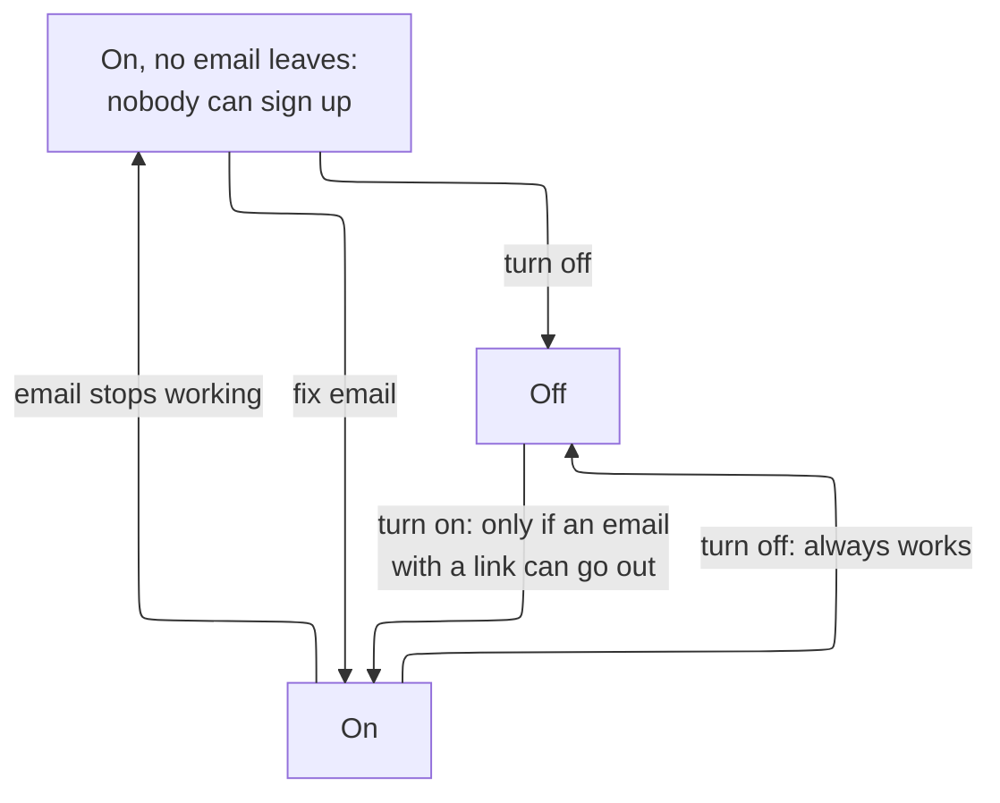

«An email with a link can go out» = email **Ready** ([Settings › Administration › Email](email.md#email-tab)) and a usable `LIBREFOLIO_PUBLIC_URL` ([Emails with a Link](#public-url)).

| Step | What LibreFolio says |
| --- | --- |
| Turn on, but no email with a link can go out | The switch is greyed out, with the hint: *Needs an email with a link to go out: set up SMTP and LIBREFOLIO_PUBLIC_URL first (Settings › Administration › Email).* |
| That changes between opening the tab and saving | The save is refused and nothing of it is stored: *Email verification needs an email with a link to go out, and none can go now: check Settings › Administration › Email.* |
| On: saving the other settings | Always works, even when email has stopped working since. |
| Turn off | The accounts already waiting keep waiting: their links still work, and so does **Send the link again**. To let one in at once, activate it ([Waiting Accounts](#verification-waiting)). |
| Email stops working while it is on (the server or a variable breaks) | Nobody can sign up any more, not even with an invitation, which stays valid; no account is created. The registration page says: *Sign-up is not possible right now: this instance cannot send the verification email. Try again later, or ask its administrator.* Only the first account of a new instance is let through. **Send the link again** fails the same way. Fix email ([When It Does Not Work](email_troubleshooting.md#troubleshooting)) or turn the switch off. |

### ⏳ Waiting Accounts {: #verification-waiting }

**Towards Active:**

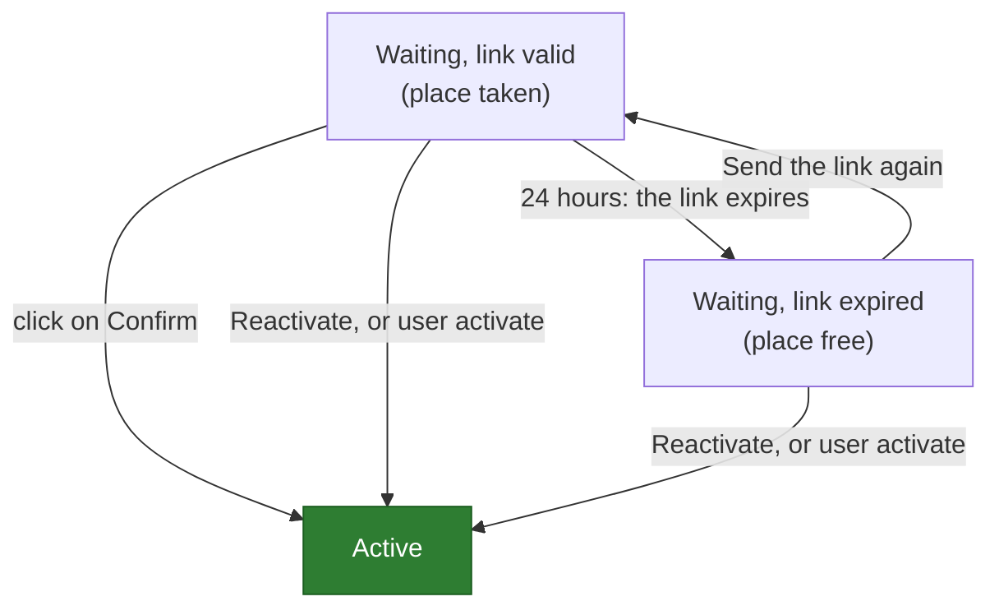

**To turn it away:**

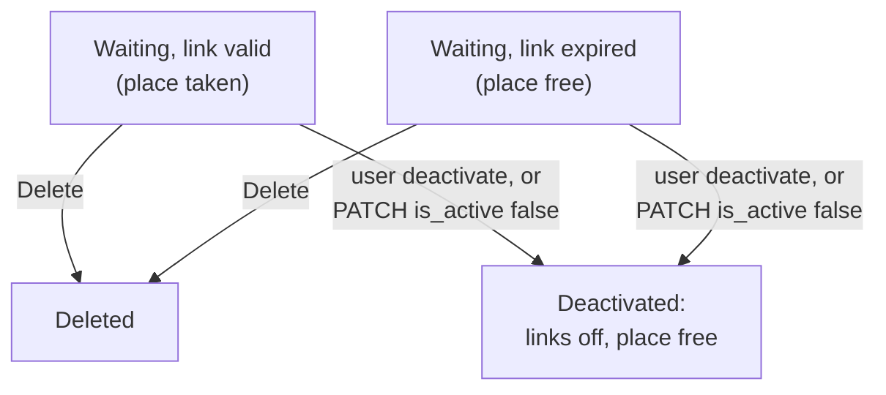

**Where:** in **Settings › Administration › Users**, a waiting account shows the badge **Waiting for verification**, not **Deactivated**, even once its link has expired.
Hover over the badge, or open the row, for the hint: the owner has not opened the link yet, signing in offers a new one, and **Reactivate** lets the account in at once.

| Step | Facts the diagram does not say |
| --- | --- |
| The place of the user limit (`LIBREFOLIO_MAX_USERS`) | Taken as by an open invitation. The place is free again when the last link sent expires, 24 hours later; on a full instance, **Send the link again** tells the owner to ask you. |
| **Reactivate** ([Accounts Waiting for Their Email](users.md#waiting)), or `user activate` on the [command line](cli_tools.md) | Lets the account in without the email: it can sign in at once, and the links already sent stop working. While the link is valid the place is already counted, so **Reactivate** works even on a full instance and `user activate` prints no limit warning. Once the link has expired, a free place is needed, as for any deactivated account. |
| **Delete** ([Delete an Account](users.md#delete)) | To turn it away. The Users tab itself offers no **Deactivate** for an account that is not active: there, **Delete** is the way. |
| `user deactivate` on the command line, or the administrator API with `is_active: false` | To turn it away. Deactivated, it stops waiting: its links stop working, its place is free, its row reads **Deactivated** from then on, and signing in tells the owner that the account is disabled. |

The administrator API endpoint:

```text
PATCH /api/v1/users/{id}
```

### 📏 Limits of the Verification Emails {: #verification-limits }

The checks of **Send the link again** are in the diagram of [Email Verification](#verification); here the numbers, and what whoever passes them sees.

| Limit | Past it |
| --- | --- |
| `LIBREFOLIO_SIGNUP_EMAILS_PER_ADDRESS` emails an hour (20 by default) from the same address, counting the emails that leave: the registrations, **Send the link again** with the right password and **Forgot Password?** for an account that exists. An IPv6 address counts by its /64. | The next new accounts are still created and wait, but their emails do not leave: the login page says so right after the registration, with how long to wait; the owners ask for the link again from the login page once that time has passed. **Send the link again** is refused for the same time. |
| The sign-in's own limit on wrong passwords, shared with the login page: 10 every 15 minutes for the same username or email address, 50 from the same address ([Failed Sign-ins](configuration_accounts.md#login-limit)) | Refused before the password is checked: the page says in how many minutes to try again. The right password clears the failures of what was typed. |
| 1 email every 5 minutes, and 3 an hour, for the same account, the email of the registration included | Refused: the page says in how many minutes to try again. |
| 3 emails an hour to the same mailbox, whatever account they are for and however its address is written ([Forgotten Passwords](#forgot-password)): the email of a registration and the links sent again alike, and only the emails that left | **Send the link again** is refused: the page says in how many minutes to try again. After a registration, the account is created and waits, but no email leaves, and nothing tells the owner: the page shows its usual text, which already says what to do (check the spam folder, then sign in to get a new link). |
| The hourly limit of the instance, `LIBREFOLIO_SMTP_MAX_PER_HOUR` | Refused until an email fits again. A registration made while it is spent is held like one past the limit of its address. |
| A free place, once the account's link has expired | Refused: the owner is told to ask you. |

**What stays invisible** after a registration. None of these reaches the page:

- the mailbox limit of 3 verification emails an hour;
- the hourly limit of the instance;
- an SMTP error;
- email or `LIBREFOLIO_PUBLIC_URL` that stopped working meanwhile;
- a restart.

Only the log says it ([What the Log Says](email_troubleshooting.md#logs)):

```text
Verification email: not sent
Verification email: the request failed
```

A restart before the email goes out leaves no line at all.
The account stays waiting with its email held, and **Send the link again** recovers it: that is why the text of the page tells the person what to do when nothing arrives.

!!! info "🔍 Why the mailbox limit is not checked before the answer"

    It is deliberate. A registration that answered differently when the mailbox had just received emails
    would tell anyone who signs up with someone else's address whether that mailbox is receiving them.

Besides:

- a link whose email did not go out counts neither for the account nor for the mailbox;
- if the account stops waiting in the meantime (address confirmed, or an administrator activated or deactivated it), no new link is sent;
- the limits per address and per mailbox are kept in the memory of each server process (each has its own count; a restart forgets them), and behind a reverse proxy the address that counts follows the rules of [Forgotten Passwords](#forgot-password).

---

## 🔔 Email Address Changes {: #email-change-notice }

When someone changes the email address of their account, in [Profile](../user/settings/profile.md), LibreFolio writes to the address the account had **before**.

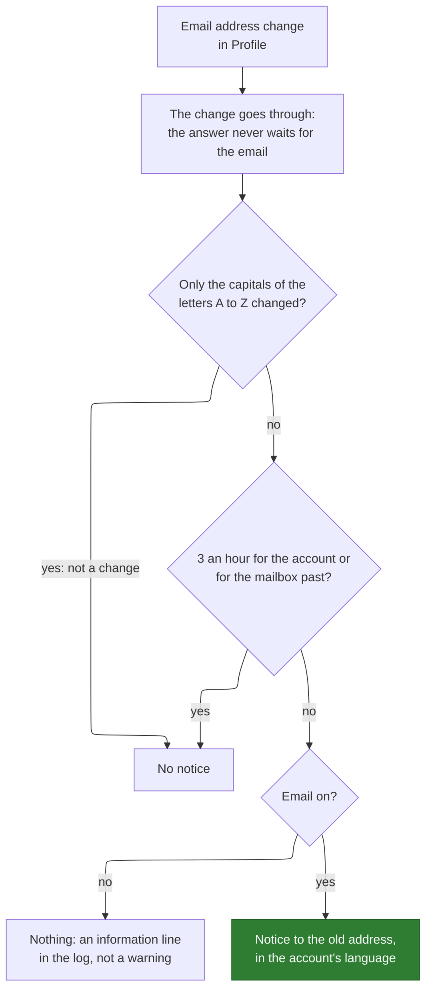

| | The notice |
| --- | --- |
| **Recipient** | Only the old address: the new one gets nothing. |
| **What it does not say** | Nothing of the new address, not even the domain, and no username: it opens with a plain «Hello,» ([Security Notes](email_troubleshooting.md#security)). |
| **What it says** | That the address changed. If the owner did not make the change, someone may be using their account: they must change the password at once if they still can, and tell you. No link. |
| **Instance name** | The host of `LIBREFOLIO_PUBLIC_URL`, with its port if it has one, or «LibreFolio» when the variable is not set or cannot be used: with no link, the notice does not need it. |
| **Hourly limit** | Counts like any email. |
| **3 an hour per account and per mailbox** | The mailbox is counted however its address is written ([Forgotten Passwords](#forgot-password)). Without these limits, an account could point its email at any address and change it again, to make your instance write there. |
| **Capitals** | `Anna@example.com` for `anna@example.com` is no change of address: no notice goes. Accented letters count as different: `Émile@example.com` for `émile@example.com` is a change, with its notice. |

---

## 🔗 Related

- 📄 **[Email](email.md)** — Where the Configuration Lives, The Variables, Examples, …
- 📄 **[Email: When It Does Not Work](email_troubleshooting.md)** — When It Does Not Work, Security Notes
