# 📬 Correo electrónico: enlaces y mensajes

Los mensajes que LibreFolio envía una vez que el correo electrónico funciona, flujo por flujo:

- los **enlaces** de invitaciones y de restablecimiento de contraseña;
- las **contraseñas olvidadas**;
- los **límites** de esos correos;
- la **verificación** de las direcciones nuevas;
- el aviso de un **cambio de dirección**.

El correo electrónico debe funcionar primero: las variables SMTP, la pestaña **Correo** y el correo de prueba están en [Correo electrónico](email.md).
Cuando un mensaje no sale: [Correo electrónico: cuando no funciona](email_troubleshooting.md).

---

## 🌐 Correos con un enlace {: #public-url }

Un enlace de invitación o de restablecimiento de contraseña enviado por correo electrónico se construye **solo** a partir de `LIBREFOLIO_PUBLIC_URL`.
Nunca a partir de la dirección que usó el navegador, ni de ninguna otra cosa de una solicitud.

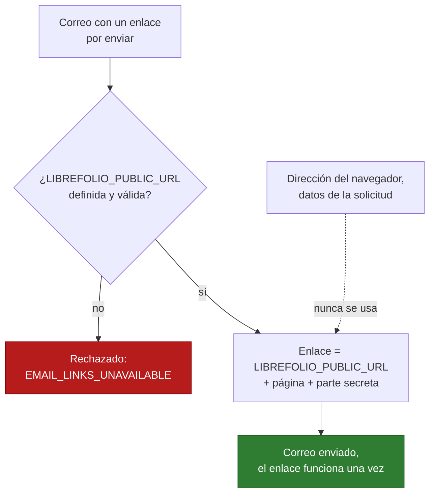

El correo nombra la instancia, por el host de `LIBREFOLIO_PUBLIC_URL`, e indica cuánto tiempo es válido el enlace.

```text
https://librefolio.example.com/reset-password#token=…
```

!!! info "🛡️ Por qué"

    Cualquiera puede enviar a LibreFolio una solicitud que indique otra dirección.
    Si el enlace se construyera a partir de la solicitud, un desconocido podría hacer que LibreFolio envíe por correo a uno de tus usuarios un enlace real
    a un sitio suyo, y capturar su parte secreta cuando el usuario lo abra.

**Dónde definirla: el archivo `.env` de LibreFolio.** La dirección en la que tus usuarios abren LibreFolio:

```bash
LIBREFOLIO_PUBLIC_URL=https://librefolio.example.com
```

| Regla | Valor |
| --- | --- |
| Esquema | `http://` o `https://`, y luego un nombre de host |
| Prohibido | nombre de usuario o contraseña, `?` o `#`, espacios |

Es la misma variable que la línea de comandos antepone a los enlaces que imprime: [Cuentas y altas](configuration_accounts.md#accounts).

**La rama «no»** del diagrama (variable ausente, o una dirección que incumple estas reglas), además del rechazo `EMAIL_LINKS_UNAVAILABLE`:

- el correo de prueba sigue funcionando;
- **Verificación Email Requerida** no se puede activar ([Verificación por correo electrónico](#verification));
- los enlaces que copias, por ejemplo desde la [línea de comandos](cli_tools.md), permanecen como están.

**Cuánto tiempo son válidos los enlaces**, indicado en el correo:

| Enlace | Válido durante |
| --- | --- |
| Nueva invitación | 7 días |
| Restablecimiento de contraseña | 30 minutos |
| Verificación | 24 horas |
| Configuración del administrador inicial | 72 horas |

**La parte secreta** del enlace va después de `#`: los navegadores nunca la envían al servidor, así que queda fuera de los registros del servidor y del proxy.

**Para comprobarlo:**

- Con el correo electrónico **Listo**, Configuración › Administración › Correo muestra un aviso cuando `LIBREFOLIO_PUBLIC_URL` no está definida o no se puede usar, y el registro de inicio tiene una línea ([Qué dice el registro](email_troubleshooting.md#logs)).
- Una vez que se puede usar, la pestaña muestra la dirección y comprueba, desde tu navegador, que esta instancia responde allí: [La dirección en los enlaces enviados por correo](email.md#links-check).
- Desde cualquier lugar, `/api/v1/system/instance` muestra `"links": true` cuando tanto el correo electrónico como la dirección están bien.

---

## 📨 Enlaces enviados por un administrador {: #admin-links }

Un enlace de invitación o de restablecimiento de contraseña que crea un administrador puede enviarse por correo electrónico, en lugar de copiarse a mano.

Condición: correo electrónico **Listo** y un `LIBREFOLIO_PUBLIC_URL` utilizable ([Correos con un enlace](#public-url)).
Entonces los diálogos de invitación y de restablecimiento de contraseña de [Usuarios e invitaciones](users.md#send-by-email) muestran **Enviar por correo** bajo el enlace.

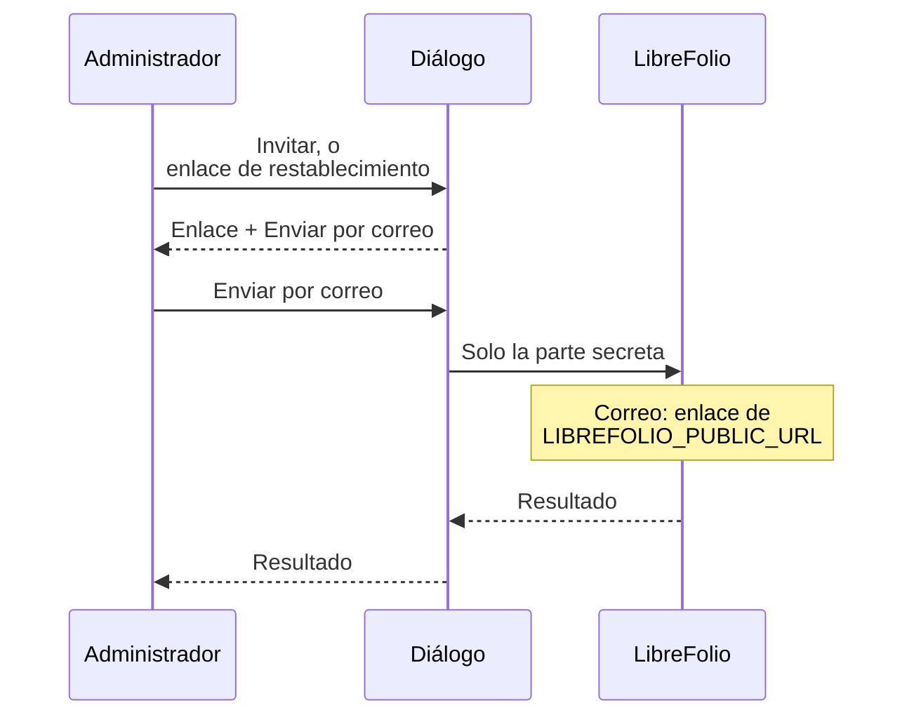

**El resultado**, que se muestra en el diálogo:

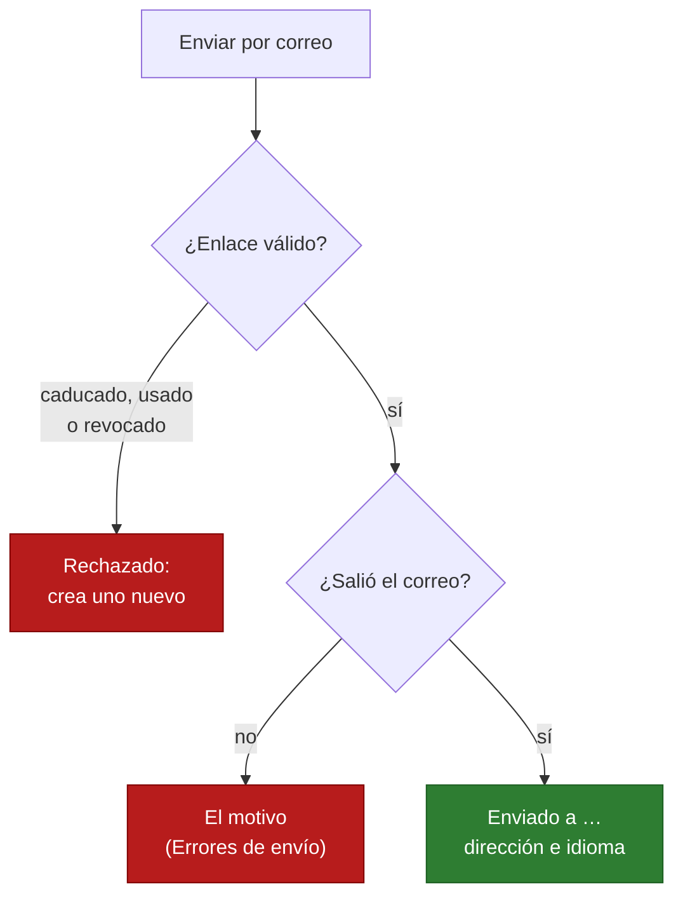

| | Invitación | Enlace de restablecimiento |
| --- | --- | --- |
| **Enviar a** | Empieza por la dirección escrita en la invitación; puedes cambiarla. | Sin campo: va a la dirección de su cuenta. |
| **Idioma del correo** | Se elige en el diálogo (tabla siguiente); sin elección, el **Idioma Predeterminado** de la instancia. | El idioma de su cuenta. |
| Contenido | Te nombra como la persona que invita e indica, cuando es el caso, que la nueva cuenta será administradora. | — |
| Condición | — | Solo mientras la cuenta está activa. |

| Idioma elegido | Efecto |
| --- | --- |
| **El idioma de la instancia** | El correo va en el **Idioma Predeterminado** de la instancia ([Configuración global](settings.md)). |
| English, Italiano, Français, Español | Para alguien que lea otro. |

El idioma del correo es solo el del correo: no se convierte en el idioma de la cuenta que crea la invitación.

Para definir el **Idioma Predeterminado** antes de que un administrador lo haya guardado, **en el archivo `.env`** (`en`, `it`, `fr` o `es`):

```bash
LIBREFOLIO_DEFAULT_LANGUAGE=it
```

Consulta [Variables de entorno](configuration_accounts.md#accounts).

- **El enlace del correo empieza por `LIBREFOLIO_PUBLIC_URL`**, sea cual sea la **Dirección del servidor** que muestre el diálogo: del diálogo solo viaja la parte secreta del enlace. El diálogo lo indica encima del botón.
- Por qué un correo no salió: [Errores de envío](email_troubleshooting.md#sending-errors).
- Cada correo cuenta para el límite por hora.

---

## 🗝️ Contraseñas olvidadas {: #forgot-password }

Quien olvidó su contraseña puede pedir por correo electrónico un enlace de restablecimiento, con su nombre de usuario o su dirección de correo, sin iniciar sesión.

**Antes de la respuesta:**

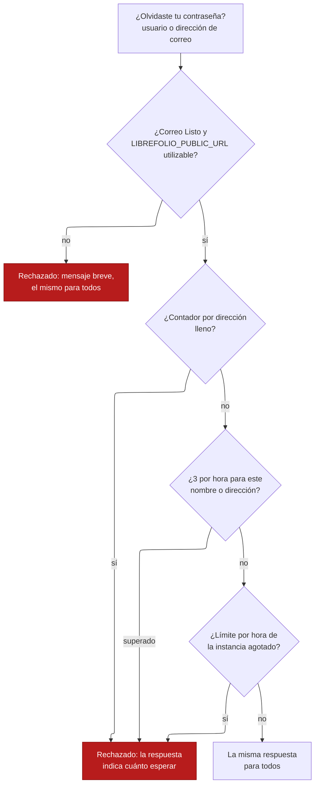

**Después de la respuesta, en silencio:**

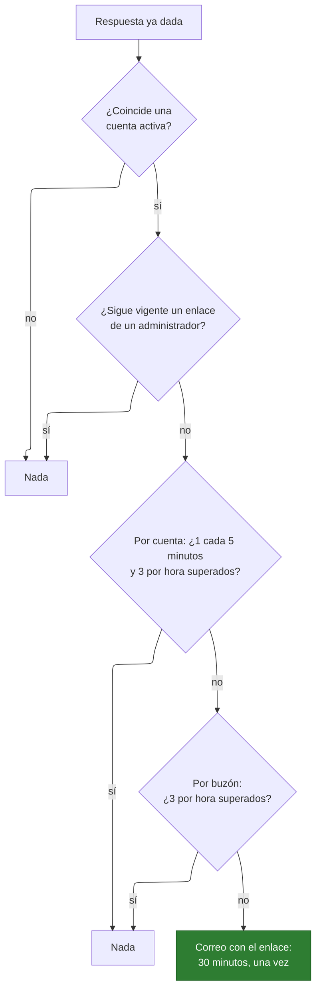

El correo con el enlace va en el idioma de la cuenta.

**La misma respuesta para todos**, coincida o no una cuenta:

> Si coincide una cuenta activa, su propietario recibe un correo con un enlace para elegir una contraseña nueva

La búsqueda de la cuenta y el envío ocurren después de la respuesta: nadie puede usarla para averiguar qué cuentas existen.

- **La cuenta** se encuentra como la encuentra el inicio de sesión: nombre de usuario o dirección de correo. El correo va a su dirección.
- **El enlace** sustituye los enlaces de restablecimiento que solicitudes anteriores enviaron a la cuenta. Un enlace creado por un administrador, en cambio, nunca lo cancela una solicitud.

Es seguro porque cambiar la dirección de correo de una cuenta pide su contraseña actual ([Perfil](../user/settings/profile.md)): consulta [Notas de seguridad](email_troubleshooting.md#security).

**La página de inicio de sesión:**

| Estado de la instancia | Qué muestra la página |
| --- | --- |
| Correo **Listo** y un `LIBREFOLIO_PUBLIC_URL` utilizable | **¿Olvidaste tu contraseña?** abre el formulario para ello, sin los comandos del servidor (siguen en las [Herramientas de línea de comandos](cli_tools.md#reset-a-password-or-lock-an-account)). Tras una solicitud, el formulario dice *Correo enviado: revisa también la carpeta de spam.*, igual para todos, y su botón muestra una cuenta atrás de 5 minutos, el intervalo para una cuenta, antes de la siguiente solicitud; recargar la página mantiene la cuenta atrás. |
| En otro caso | Ese comando, abierto, bajo la advertencia: *La recuperación por correo electrónico no está disponible en esta instancia. Restablece tu contraseña desde la terminal del servidor o pide a tu administrador un enlace para restablecerla.* |
| La página no puede leer la configuración de la instancia desde el servidor | Solo el consejo: *Pide a tu administrador un enlace para restablecer la contraseña: puede crear uno para tu cuenta.* |

Un administrador crea ese enlace en **Configuración › Administración › Usuarios**, incluso sin correo electrónico ([Enlaces de restablecimiento de contraseña](users.md#reset-links)).

**Los límites:**

| Límite | Al superarlo |
| --- | --- |
| `LIBREFOLIO_SIGNUP_EMAILS_PER_ADDRESS` solicitudes por hora (20 de forma predeterminada) desde la misma dirección. Un recuento compartido con las altas y con **Enviar el enlace de nuevo** ([Límites de los correos de activación y de restablecimiento de contraseña](#activation-limits)). Una dirección IPv6 cuenta por su /64, el bloque que suele tener un abonado. | Rechazado hasta que se libere una plaza en ese recuento, o en el límite por hora de la instancia si este tarda más. La respuesta indica cuánto tiempo. |
| 3 solicitudes por hora para el mismo nombre de usuario o dirección de correo, coincida o no una cuenta | Rechazado hasta que la más antigua de ellas tenga una hora. |
| El límite por hora de la instancia, `LIBREFOLIO_SMTP_MAX_PER_HOUR` | Rechazado hasta que vuelva a caber un correo. |
| 3 correos por hora al mismo buzón, sea cual sea la cuenta a la que correspondan y cómo se escriba su dirección | No se envía nada; la respuesta sigue siendo la misma. |
| 1 correo cada 5 minutos, y 3 por hora, para la misma cuenta, incluidos los enlaces creados por un administrador | No se envía nada; la respuesta sigue siendo la misma. Dos solicitudes en el mismo instante no pueden enviarse las dos. |

Dónde viven los recuentos:

- el límite por cuenta cuenta los enlaces de restablecimiento de la cuenta en la base de datos;
- los demás se guardan en la memoria de cada proceso del servidor: con varios procesos, cada uno tiene su propio recuento, y un reinicio los olvida;
- un correo de restablecimiento que no salió cuenta igualmente, para la cuenta y para el buzón.

**Un buzón, se escriba como se escriba su dirección.** El límite por buzón cuenta los alias de una dirección como un solo buzón:

| Escritura | Buzón contado |
| --- | --- |
| Mayúsculas | No cuentan. |
| `name+news@example.com` | `name@example.com`: una `+tag` no cuenta, en ningún dominio. |
| `first.last@googlemail.com` | `firstlast@gmail.com`: los puntos de una dirección de Gmail no cuentan, y `googlemail.com` es `gmail.com`. |

- Los límites de los [correos de verificación](#verification-limits) y de los [avisos de cambio de correo](#email-change-notice) cuentan de la misma manera.
- Cada correo sigue yendo a la dirección tal como la tiene la cuenta.
- Un buzón que recibe correo con cualquier nombre, como un dominio catch-all o el `anything@user.fastmail.com` de Fastmail, cuenta cada nombre por separado: solo el límite por hora de la instancia los frena.

**Detrás de un proxy inverso**, la dirección que cuenta es la del visitante, tal como la lee LibreFolio ([La dirección del visitante](connection_proxy.md#client-address)):

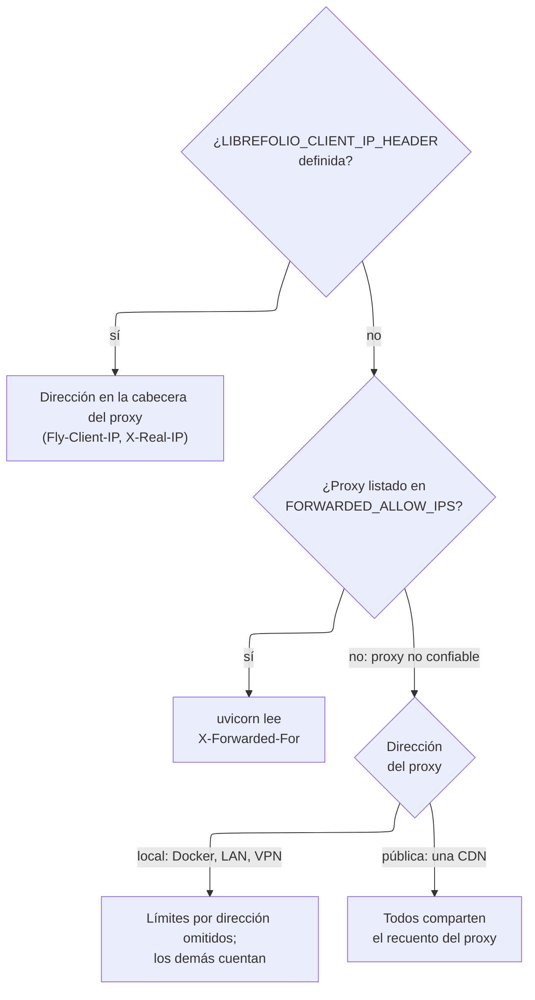

- **Con `LIBREFOLIO_CLIENT_IP_HEADER`**, **en el archivo `.env`**, LibreFolio lee la dirección en la cabecera que tu proxy rellena con la del visitante (`Fly-Client-IP` en Fly.io, `X-Real-IP` desde Nginx):

    ```bash
    LIBREFOLIO_CLIENT_IP_HEADER=X-Real-IP
    ```

    Defínela solo si todas las solicitudes pasan por ese proxy: un visitante que llegue directamente a LibreFolio podría escribir la cabecera.

- **En caso contrario** es la dirección que ve el servidor (uvicorn). uvicorn toma la dirección del visitante de la cabecera `X-Forwarded-For` del proxy solo cuando la dirección del proxy figura en `FORWARDED_ALLOW_IPS` (`127.0.0.1` si no está definida). Lista ahí las direcciones o redes de tu proxy, **en el archivo `.env`**:

    ```bash
    FORWARDED_ALLOW_IPS=172.18.0.0/16
    ```

    Nunca `*`: uvicorn tomaría la primera dirección de la cabecera, que el visitante puede escribir.

- **Un proxy no confiable en una dirección local**, como un contenedor proxy delante de la imagen de Docker, la configuración habitual: un visitante no puede agotar el recuento de **¿Olvidaste tu contraseña?**, **Enviar el enlace de nuevo** y las altas para todos. Los límites por nombre de usuario o dirección de correo, por cuenta y por buzón, y el límite por hora de la instancia, siguen contando. El registro avisa una vez por proceso del servidor, y las comprobaciones de seguridad lo señalan como una advertencia de `platform.client_address` ([La dirección del visitante](connection_proxy.md#client-address)).
- **Un proxy no confiable en una dirección pública**, como una CDN: las primeras `LIBREFOLIO_SIGNUP_EMAILS_PER_ADDRESS` solicitudes de cualquiera agotan el recuento a través del proxy para todos, durante hasta una hora. Informa a LibreFolio sobre el proxy.

---

## 🚦 Límites de los correos de activación y de restablecimiento de contraseña {: #activation-limits }

Los correos que activan una cuenta y los que restablecen una contraseña los frenan **dos contadores**, los mismos para cualquier forma de pedirlos.
Cada uno cuenta durante los últimos 60 minutos, en la memoria de cada proceso del servidor.

| Contador | Variable | Valor predeterminado | Qué cuenta |
| --- | --- | --- | --- |
| **Por dirección** | `LIBREFOLIO_SIGNUP_EMAILS_PER_ADDRESS` | 20 por hora | Los correos que salen hacia una dirección de cliente (una dirección IPv6 por su /64), en un solo recuento: las altas, cada **Enviar el enlace de nuevo** con la contraseña correcta y cada **¿Olvidaste tu contraseña?** de una cuenta que existe. Los intentos no se cuentan (diagrama siguiente). |
| **Por instancia** | `LIBREFOLIO_SMTP_MAX_PER_HOUR` | 50 por hora | Todos los correos que envía la instancia: activaciones, restablecimientos, invitaciones, avisos. |

**El contador por dirección cuenta los correos que salen, no los intentos:**

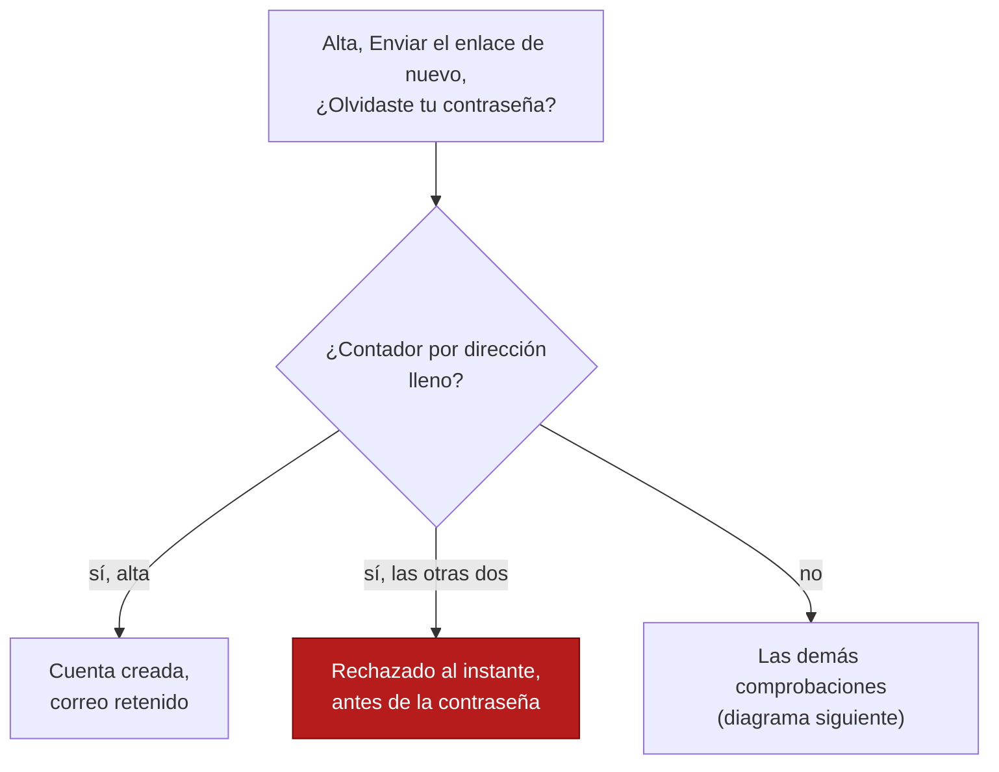

**Cuando el contador no está lleno**, la plaza se gasta solo si pasan las demás comprobaciones:

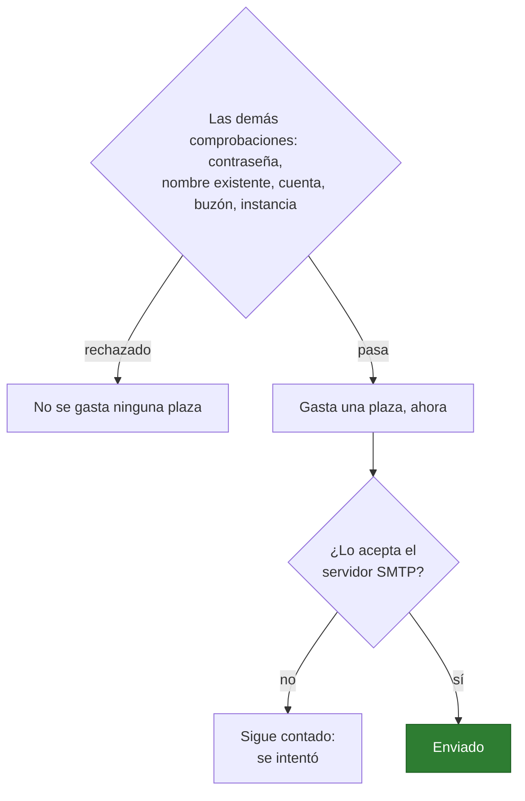

Esto no le cuesta nada:

- una contraseña incorrecta: tiene su propio límite;
- una solicitud de un nombre que ninguna cuenta tiene (en **¿Olvidaste tu contraseña?**, la respuesta es la misma coincida o no una cuenta);
- una solicitud rechazada por otro límite, como un **Enviar el enlace de nuevo** rechazado por el límite por cuenta o por buzón.

Otros tres límites se mantienen tal cual. No son contadores de correos de activación, y rara vez importan para una cuenta cuyo correo quedó retenido: todavía no ha llegado nada a su buzón.

| Límite | Se aplica a |
| --- | --- |
| El límite del inicio de sesión sobre **contraseñas incorrectas** ([Inicios de sesión fallidos](configuration_accounts.md#login-limit)) | **Enviar el enlace de nuevo**, que lo comparte con la página de inicio de sesión. |
| **3 correos por hora al mismo buzón** | LibreFolio no puede usarse para inundar la dirección de otra persona. |
| **1 correo cada 5 minutos, y 3 por hora, para la misma cuenta** | **Enviar el enlace de nuevo**. |

**Cuánto esperar.** La respuesta indica cuántos segundos esperar, y ese tiempo es exacto: el **más largo** de las esperas de los contadores que frenaron la solicitud.
La misma solicitud hecha en ese momento pasa, salvo que otros de la misma red hayan usado la plaza mientras tanto: entonces la respuesta indica el nuevo tiempo.

**Un ejemplo.** Una oficina con una sola dirección de internet y un límite de 20.

| Hora | Qué ocurre |
| --- | --- |
| 9:00 – 9:40 | Veinte compañeros se registran: sus veinte correos salen. |
| 9:45 | El vigésimo primero, Mario, se registra. Su cuenta se crea, pero su correo queda retenido: la página le dice que vuelva a intentarlo en unos 15 minutos, el tiempo que falta para que el correo de las 9:00 salga del recuento a las 10:00. |
| 9:46 | Mario inicia sesión y pide el enlace de nuevo: el mismo contador lo rechaza, durante 14 minutos. |
| 10:00 | Vuelve a pedirlo con nombre de usuario y contraseña: el enlace sale. |

El contador por dirección se comparte a propósito, con una consecuencia que conviene conocer: cuando una red ha agotado su recuento con altas, **¿Olvidaste tu contraseña?** desde esa red también espera, hasta que se libere una plaza.

Para una red donde se registran muchas personas a la vez, como una escuela o una oficina, sube `LIBREFOLIO_SIGNUP_EMAILS_PER_ADDRESS` **en el archivo `.env`**.
Reinicia LibreFolio. Con Docker Compose, ejecuta `docker compose up -d`.

---

## ✅ Verificación por correo electrónico {: #verification }

Con **Verificación Email Requerida** activada, una cuenta nueva no puede iniciar sesión hasta que su titular confirme la dirección con un enlace que LibreFolio envía por correo a la cuenta.

**Dónde:** el interruptor está en **Configuración › Administración › Configuración Global**, categoría **Seguridad** ([Configuración global](settings.md)). Está desactivado de forma predeterminada.

**El alta:**

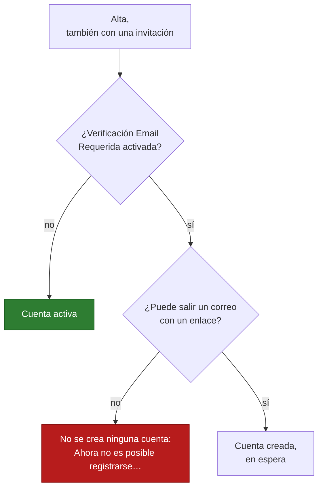

**Luego el correo de verificación:**

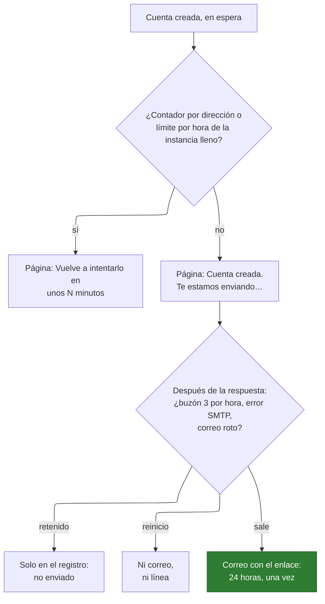

**Por último, el clic en el enlace:**

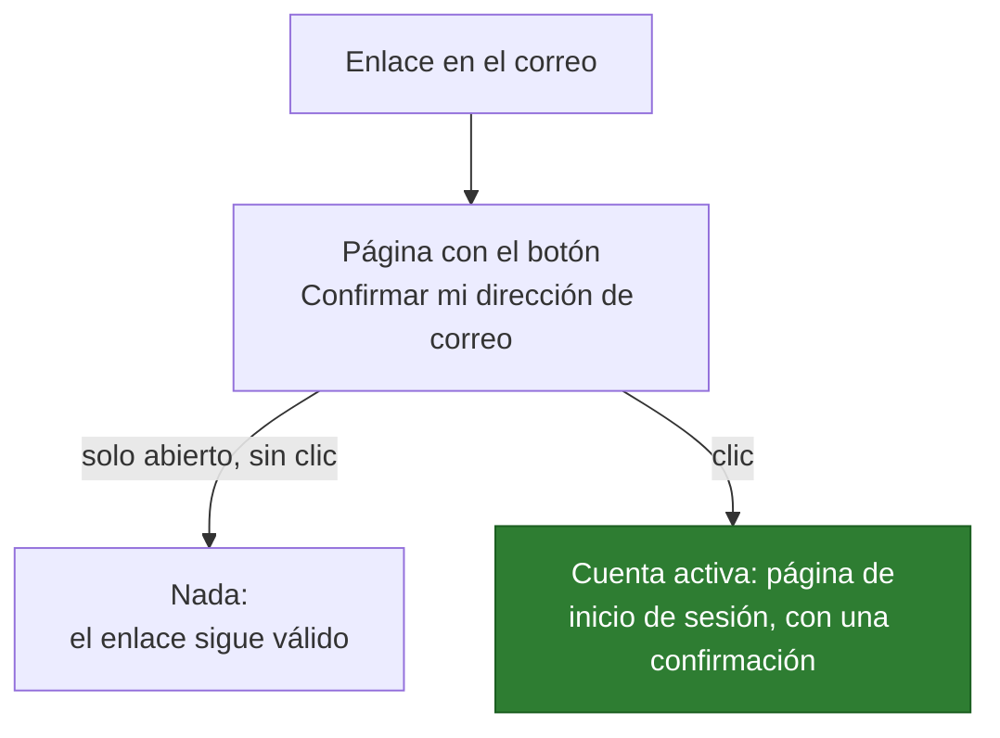

**Quién espera:** toda cuenta creada desde la página de registro mientras el interruptor está activado, incluidas las abiertas con una invitación.

Nunca esperan:

- la primera cuenta de una instancia nueva, su administrador;
- el administrador que LibreFolio crea a partir de `LIBREFOLIO_ADMIN_EMAIL`, activado con su enlace de configuración;
- las cuentas creadas con `user create` en la [línea de comandos](cli_tools.md);
- las cuentas que ya existen.

**Los textos de la página de inicio de sesión** justo después del alta:

| Caso | Texto |
| --- | --- |
| El correo puede salir | *Cuenta creada. Te estamos enviando un correo con un enlace para activarla: ábrelo en las próximas 24 horas y luego inicia sesión. ¿No llega ningún correo en unos minutos? Revisa el spam y luego inicia sesión con tu nombre de usuario y tu contraseña: se te ofrecerá un enlace nuevo.* |
| La dirección del cliente ya tenía los correos de `LIBREFOLIO_SIGNUP_EMAILS_PER_ADDRESS` altas (20 de forma predeterminada) en la última hora, o el límite por hora de la instancia está agotado | *Cuenta creada, pero el correo de activación no ha podido salir ahora. Vuelve a intentarlo en unos N minutos: inicia sesión con tu nombre de usuario y tu contraseña, y se te ofrecerá un enlace nuevo.* |

- N es exacto: el tiempo hasta que ambos contadores admiten un correo nuevo ([Límites de los correos de activación y de restablecimiento de contraseña](#activation-limits)).
- Detrás de un proxy inverso en el que LibreFolio no confía, en una dirección local (la configuración habitual de Docker), no se cuenta nada por dirección, así que el segundo texto nunca aparece ([Contraseñas olvidadas](#forgot-password)).
- *Te estamos enviando un correo* significa que el correo está en cola, no que se haya entregado: sale después de la respuesta, y aún puede no salir ([Límites de los correos de verificación](#verification-limits)).

**El correo**, *Confirma tu dirección de correo*, va en el **Idioma Predeterminado** de la instancia: una cuenta nueva todavía no tiene idioma propio.
Su enlace empieza por `LIBREFOLIO_PUBLIC_URL` ([Correos con un enlace](#public-url)).

!!! info "🔍 Por qué hace falta un clic"

    Los filtros de correo que analizan enlaces, como Microsoft Defender Safe Links, abren los enlaces de un mensaje en un
    navegador que ejecuta scripts: si bastara con abrirlo, el filtro activaría la cuenta en lugar de su titular.
    Una apertura así no gasta nada; el enlace sigue válido para su titular.
    Quien abre un enlace sin haberse registrado solo tiene que cerrar la página.

**Hasta que se confirma la dirección**, la cuenta no puede iniciar sesión, pero puede pedir un enlace nuevo:

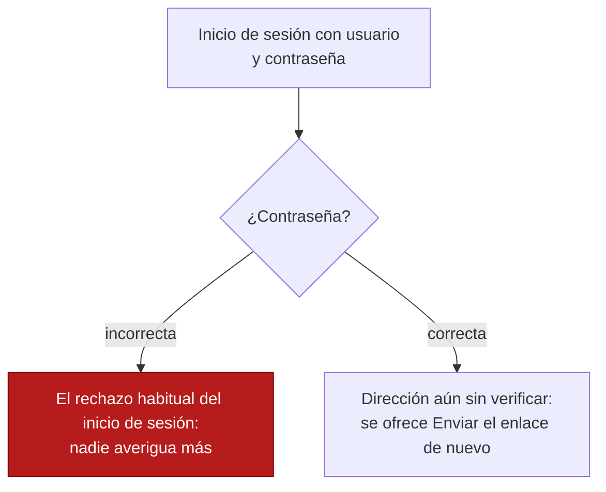

**Enviar el enlace de nuevo**, las primeras comprobaciones:

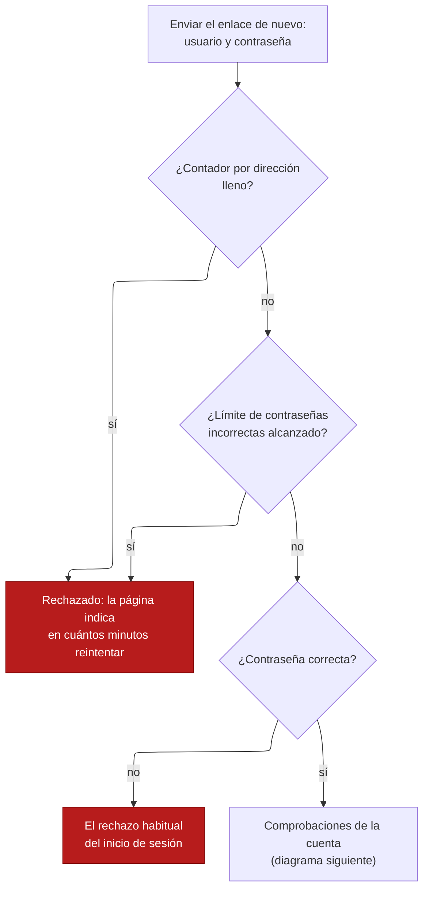

**Con la contraseña correcta**, las comprobaciones de la cuenta:

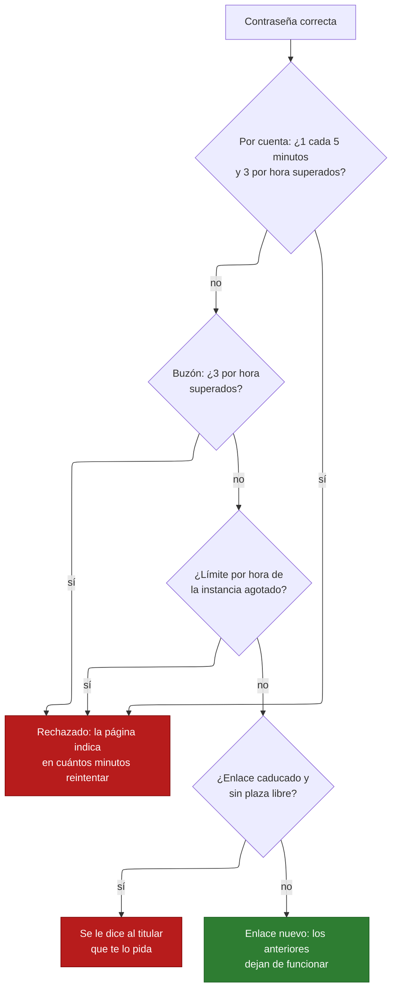

Lo que ve la persona, paso a paso: *Si LibreFolio te pide que confirmes tu correo electrónico* en [Primeros pasos](../user/getting-started.md).

### 🔀 Activarla y desactivarla {: #verification-switch }

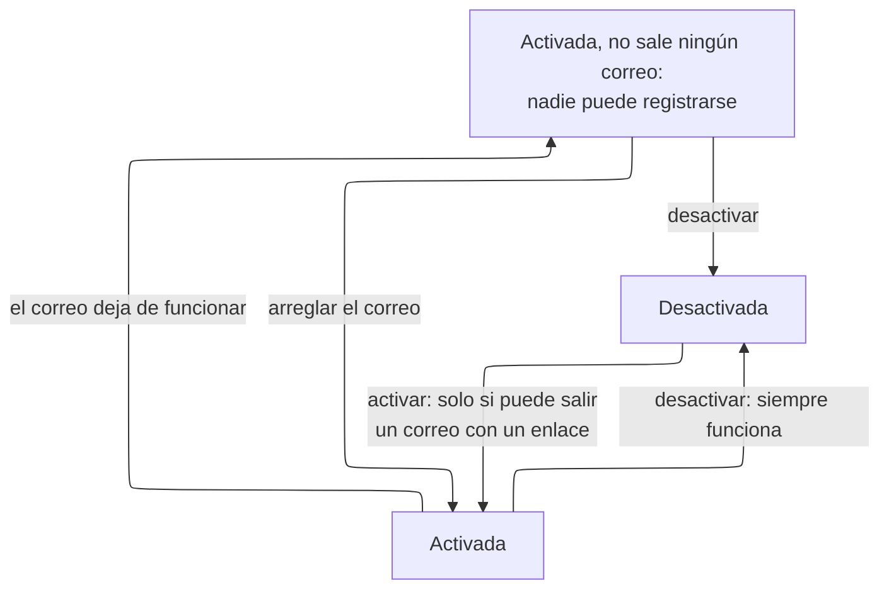

«Puede salir un correo con un enlace» = correo electrónico **Listo** ([Configuración › Administración › Correo](email.md#email-tab)) y un `LIBREFOLIO_PUBLIC_URL` utilizable ([Correos con un enlace](#public-url)).

| Paso | Qué dice LibreFolio |
| --- | --- |
| Activarla, pero no puede salir ningún correo con enlace | El interruptor aparece atenuado, con la indicación: *Hace falta que pueda salir un correo con enlace: configura primero SMTP y LIBREFOLIO_PUBLIC_URL (Configuración › Administración › Correo).* |
| Eso cambia entre abrir la pestaña y guardar | El guardado se rechaza y no se almacena nada: *La verificación del correo necesita que pueda salir un correo con enlace, y ahora no puede: revisa Configuración › Administración › Correo.* |
| Activada: guardar los demás ajustes | Siempre funciona, incluso si el correo ha dejado de funcionar desde entonces. |
| Desactivarla | Las cuentas que ya esperan siguen esperando: sus enlaces siguen funcionando, y también **Enviar el enlace de nuevo**. Para dejar entrar a una de inmediato, actívala ([Cuentas en espera](#verification-waiting)). |
| El correo deja de funcionar mientras está activada (el servidor o una variable se rompe) | Nadie puede registrarse ya, ni siquiera con una invitación, que sigue válida; no se crea ninguna cuenta. La página de registro dice: *Ahora no es posible registrarse: esta instancia no puede enviar el correo de verificación. Inténtalo más tarde o pregunta a su administrador.* Solo se deja pasar la primera cuenta de una instancia nueva. **Enviar el enlace de nuevo** falla igual. Arregla el correo ([Cuando no funciona](email_troubleshooting.md#troubleshooting)) o desactiva el interruptor. |

### ⏳ Cuentas en espera {: #verification-waiting }

**Hacia Activa:**

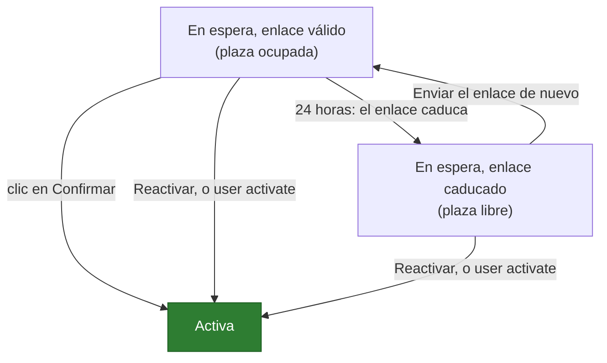

**Para rechazarla:**

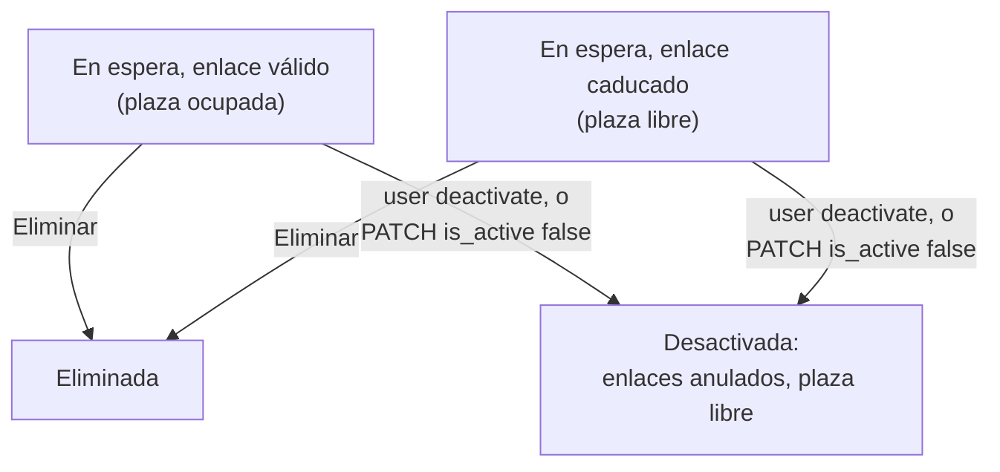

**Dónde:** en **Configuración › Administración › Usuarios**, una cuenta en espera muestra la insignia **Pendiente de verificación**, no **Desactivada**, incluso cuando su enlace ha caducado.
Pasa el cursor sobre la insignia, o abre la fila, para ver la indicación: su titular aún no ha abierto el enlace, al iniciar sesión se le ofrece uno nuevo, y **Reactivar** deja entrar a la cuenta de inmediato.

| Paso | Datos que el diagrama no dice |
| --- | --- |
| La plaza del límite de usuarios (`LIBREFOLIO_MAX_USERS`) | Se ocupa como con una invitación abierta. La plaza vuelve a quedar libre cuando caduca el último enlace enviado, 24 horas después; en una instancia llena, **Enviar el enlace de nuevo** le dice al titular que te lo pida. |
| **Reactivar** ([Cuentas pendientes de su correo electrónico](users.md#waiting)), o `user activate` en la [línea de comandos](cli_tools.md) | Deja entrar a la cuenta sin el correo: puede iniciar sesión de inmediato, y los enlaces ya enviados dejan de funcionar. Mientras el enlace es válido la plaza ya está contada, así que **Reactivar** funciona incluso en una instancia llena y `user activate` no imprime ninguna advertencia de límite. Una vez que el enlace ha caducado, hace falta una plaza libre, como para cualquier cuenta desactivada. |
| **Eliminar** ([Eliminar una cuenta](users.md#delete)) | Para rechazarla. La propia pestaña Usuarios no ofrece **Desactivar** para una cuenta que no está activa: ahí, **Eliminar** es el camino. |
| `user deactivate` en la línea de comandos, o la API de administrador con `is_active: false` | Para rechazarla. Desactivada, deja de esperar: sus enlaces dejan de funcionar, su plaza queda libre, su fila pasa a decir **Desactivada** a partir de entonces, y al iniciar sesión se le dice al titular que la cuenta está deshabilitada. |

El endpoint de la API de administrador:

```text
PATCH /api/v1/users/{id}
```

### 📏 Límites de los correos de verificación {: #verification-limits }

Las comprobaciones de **Enviar el enlace de nuevo** están en el diagrama de [Verificación por correo electrónico](#verification); aquí los números, y lo que ve quien los supera.

| Límite | Al superarlo |
| --- | --- |
| `LIBREFOLIO_SIGNUP_EMAILS_PER_ADDRESS` correos por hora (20 de forma predeterminada) desde la misma dirección, contando los correos que salen: las altas, **Enviar el enlace de nuevo** con la contraseña correcta y **¿Olvidaste tu contraseña?** de una cuenta que existe. Una dirección IPv6 cuenta por su /64. | Las cuentas nuevas siguientes se siguen creando y esperan, pero sus correos no salen: la página de inicio de sesión lo dice justo después del alta, con cuánto esperar; los titulares piden el enlace de nuevo desde la página de inicio de sesión cuando haya pasado ese tiempo. **Enviar el enlace de nuevo** se rechaza durante el mismo tiempo. |
| El límite propio del inicio de sesión sobre contraseñas incorrectas, compartido con la página de inicio de sesión: 10 cada 15 minutos para el mismo nombre de usuario o dirección de correo, 50 desde la misma dirección ([Inicios de sesión fallidos](configuration_accounts.md#login-limit)) | Rechazado antes de comprobar la contraseña: la página indica en cuántos minutos volver a intentarlo. La contraseña correcta borra los fallos de lo que se escribió. |
| 1 correo cada 5 minutos, y 3 por hora, para la misma cuenta, incluido el correo del alta | Rechazado: la página indica en cuántos minutos volver a intentarlo. |
| 3 correos por hora al mismo buzón, sea cual sea la cuenta a la que correspondan y cómo se escriba su dirección ([Contraseñas olvidadas](#forgot-password)): el correo de un alta y los enlaces enviados de nuevo por igual, y solo los correos que salieron | **Enviar el enlace de nuevo** se rechaza: la página indica en cuántos minutos volver a intentarlo. Tras un alta, la cuenta se crea y espera, pero no sale ningún correo, y nada se lo dice al titular: la página muestra su texto habitual, que ya dice qué hacer (revisar el spam y luego iniciar sesión para obtener un enlace nuevo). |
| El límite por hora de la instancia, `LIBREFOLIO_SMTP_MAX_PER_HOUR` | Rechazado hasta que vuelva a caber un correo. Un alta hecha mientras está agotado queda retenida como una que supera el límite de su dirección. |
| Una plaza libre, una vez que el enlace de la cuenta ha caducado | Rechazado: se le dice al titular que te lo pida. |

**Lo que sigue invisible** tras un alta. Nada de esto llega a la página:

- el límite de buzón de 3 correos de verificación por hora;
- el límite por hora de la instancia;
- un error de SMTP;
- el correo o `LIBREFOLIO_PUBLIC_URL` que dejó de funcionar entretanto;
- un reinicio.

Solo lo dice el registro ([Qué dice el registro](email_troubleshooting.md#logs)):

```text
Verification email: not sent
Verification email: the request failed
```

Un reinicio antes de que salga el correo no deja ninguna línea.
La cuenta sigue en espera con su correo retenido, y **Enviar el enlace de nuevo** lo recupera: por eso el texto de la página le dice a la persona qué hacer cuando no llega nada.

!!! info "🔍 Por qué el límite de buzón no se comprueba antes de la respuesta"

    Es deliberado. Un alta que respondiera de otra manera cuando el buzón acaba de recibir correos
    le diría a cualquiera que se registre con la dirección de otra persona si ese buzón los está recibiendo.

Además:

- un enlace cuyo correo no salió no cuenta ni para la cuenta ni para el buzón;
- si la cuenta deja de esperar entretanto (dirección confirmada, o un administrador la activó o la desactivó), no se envía ningún enlace nuevo;
- los límites por dirección y por buzón se guardan en la memoria de cada proceso del servidor (cada uno tiene su propio recuento; un reinicio los olvida), y detrás de un proxy inverso la dirección que cuenta sigue las reglas de [Contraseñas olvidadas](#forgot-password).

---

## 🔔 Cambios de dirección de correo {: #email-change-notice }

Cuando la dirección de correo de una cuenta ha cambiado, en [Perfil](../user/settings/profile.md), LibreFolio escribe dos correos breves, en el idioma de la cuenta: un **aviso** a la dirección que la cuenta tenía **antes**, y una **confirmación** a la dirección **nueva**, que ahora es la de la cuenta.

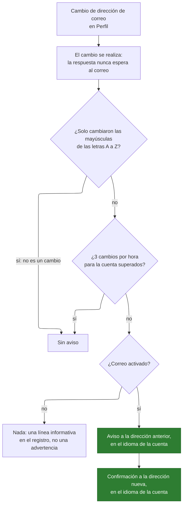

| | El aviso y la confirmación |
| --- | --- |
| **Destinatarios** | El aviso a la dirección anterior, luego la confirmación a la nueva. Cada correo sale por su cuenta: si uno no puede salir, el otro sale igualmente, y ninguno deshace el cambio. |
| **Lo que no dicen** | El aviso no muestra nada de la dirección nueva, ni siquiera el dominio; la confirmación nada de la anterior. Ninguno lleva el nombre de usuario: ambos empiezan con un simple «Hola:» ([Notas de seguridad](email_troubleshooting.md#security)). |
| **Lo que dice el aviso** | Que la dirección cambió. Si el titular no hizo el cambio, alguien puede estar usando su cuenta: debe cambiar la contraseña de inmediato si aún puede, y avisarte. Sin enlace. |
| **Lo que dice la confirmación** | Que esta dirección es ahora la de la cuenta: inicia sesión con ella y recibe ahí sus correos. A quien no tiene cuenta en la instancia le dice que alguien escribió la dirección por error, y que te avise. Sin enlace. |
| **Nombre de la instancia** | El host de `LIBREFOLIO_PUBLIC_URL`, con su puerto si lo tiene, o «LibreFolio» cuando la variable no está definida o no se puede usar: sin enlace, el aviso no la necesita. |
| **Límite por hora** | Cuenta como cualquier correo. |
| **3 por hora por cuenta y por buzón** | 3 cambios con correos por hora por cuenta, y 3 correos por hora por buzón, se escriba como se escriba su dirección ([Contraseñas olvidadas](#forgot-password)). Un buzón que supera su límite no recibe nada; la otra dirección recibe igualmente su correo. Sin estos límites, una cuenta podría apuntar su correo a cualquier dirección y volver a cambiarlo, para que tu instancia escriba ahí. |
| **Mayúsculas** | `Anna@example.com` por `anna@example.com` no es un cambio de dirección: no sale ningún correo. Las letras con acento cuentan como distintas: `Émile@example.com` por `émile@example.com` es un cambio, con su aviso. |

---

## 🔗 Relacionado

- 📄 **[Correo electrónico](email.md)** — Dónde se encuentra la configuración, Las variables, Ejemplos, …
- 📄 **[Correo electrónico: cuando no funciona](email_troubleshooting.md)** — Cuando no funciona, Notas de seguridad
